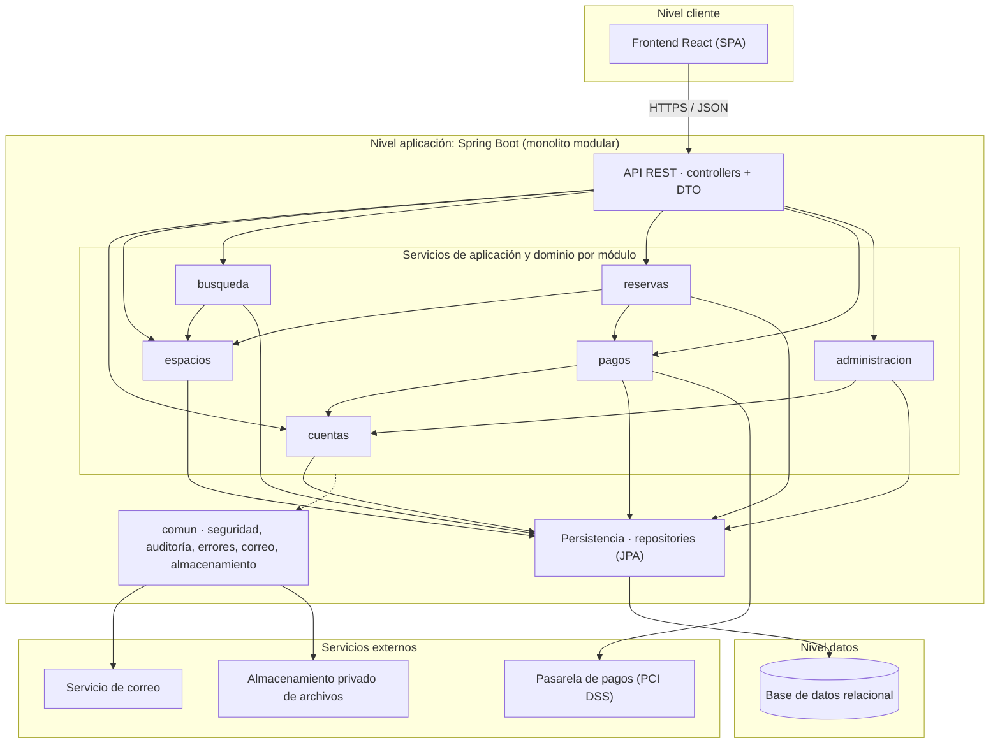
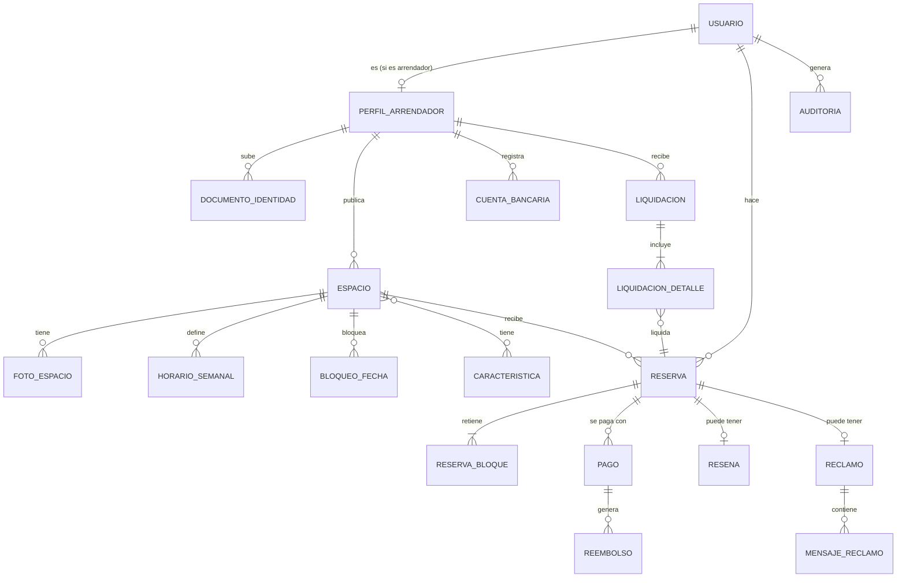

# Arquitectura propuesta — Marketplace de alquiler de espacios

> **Estado: propuesta para discutir en equipo.** Sirve de base para las secciones 6.4, 6.5, 6.7 y 9.2 del informe.
> Decidido: backend **Spring Boot (Java)** y frontend **React**.
> Pendiente: **base de datos** (se recomienda PostgreSQL, ver sección 1) y el nombre del proyecto.
> Cada decisión lleva su justificación, porque en arquitectura el porqué importa más que el cómo.

---

## 1. Análisis de la base de datos (pendiente de decidir)

### Drivers que condicionan la elección

| Driver | Origen en el backlog | Qué exige a la base de datos |
| --- | --- | --- |
| Evitar dobles reservas | HU-12: "restricción única por espacio y bloque en BD contra doble reserva" | Restricciones únicas y transacciones con concurrencia |
| Integridad del dinero | HU-13, HU-15, HU-16 y HU-19: montos calculados en servidor, reembolsos idempotentes y liquidaciones con comisión del 10 % | Transacciones ACID: todo o nada, sin pagos ni liquidaciones duplicadas |
| Datos muy relacionados | Usuario → espacio → horario → reserva → pago → reembolso → liquidación → reseña o reclamo | Llaves foráneas y joins |
| Búsqueda con disponibilidad | HU-10, HU-11 y HU-23: disponibilidad = horario − bloqueos − reservas, calculada al consultar, con filtros | Consultas con joins, índices y filtros combinados |
| Auditoría y datos sensibles | La R de STRIDE en casi todas las historias; cifrado de facturación, documentos y datos bancarios | Tabla de auditoría y columnas cifradas |
| Derechos sobre los datos | HU-22: exportar los datos en JSON y anonimizar | Consultas que reúnan los datos de un usuario; JSON útil pero no imprescindible |

### Comparación

| Opción | ¿Encaja? | Ventajas | Desventajas |
| --- | --- | --- | --- |
| **PostgreSQL** | **Sí, recomendada** | ACID completo, restricciones únicas, llaves foráneas y CHECK; **índices únicos parciales** (por ejemplo, un bloque único solo para reservas activas); JSONB para la exportación de HU-22; buen soporte en Spring Data JPA; hosting gratuito (Supabase, Neon, Render) | Esquema rígido; hay que mantener migraciones |
| MySQL | Sí | ACID, muy conocida, buen soporte en Spring | No tiene índices únicos parciales: la regla del bloque único hay que modelarla distinto (por ejemplo, borrando los bloques al expirar o cancelar) |
| MongoDB | No | Esquema flexible | No resuelve nada de este dominio; la unicidad entre documentos y la integridad del dinero son más difíciles; elegirla sería por moda, no por los drivers |

### Recomendación y trade-off (para la sección 6.10)
**PostgreSQL**, con migraciones versionadas (por ejemplo, Flyway) y Spring Data JPA.
- **Se gana:** integridad y consistencia garantizadas por la base, que es justo lo que piden la doble reserva y el manejo de dinero.
- **Se cede:** flexibilidad del esquema y el costo de mantener migraciones. Para el alcance del proyecto (28 historias bien definidas), ese costo es bajo.

Una vez decidida, la base de datos pasa a la sección **6.4 (Restricciones)** y la justificación va en la **6.10 (Razonamiento arquitectónico)**.

---

## 2. Sección 6.4 — Restricciones

Restricciones que condicionaron la arquitectura y redujeron las alternativas:

| Restricción | Origen | Impacto en la arquitectura |
| --- | --- | --- |
| Backend en **Spring Boot (Java)** | Decisión del equipo; el curso exige POO, principios y patrones | Arquitectura en capas con el ecosistema Spring: Spring MVC (API REST), Spring Data JPA (persistencia) y Spring Security (autenticación y roles) |
| Frontend en **React** | Conocimiento previo del equipo | Aplicación de una sola página (SPA) que consume la API REST. El frontend no contiene reglas de negocio: montos, estados y permisos se deciden en el backend |
| Comunicación por **API REST con JSON sobre HTTPS** | Arquitectura cliente-servidor web | Contratos de API (DTO) definidos y estables entre frontend y backend; TLS en toda la comunicación (HU-03) |
| Base de datos **relacional** ([POR CONFIRMAR: PostgreSQL]) | Decisión de arquitectura (sección 1) | Persistencia con JPA; integridad con restricciones en la base |
| Pagos solo vía **pasarela certificada PCI DSS**, en modo de prueba | Normativa de pagos con tarjeta | La plataforma nunca recibe ni guarda datos de tarjeta; usa el checkout de la pasarela; el estado del pago cambia solo por un webhook con firma verificada e idempotente (HU-13) |
| **Protección de datos personales** (en Perú, Ley 29733) | Normativa | Consentimiento registrado con versión de la política (HU-01); cifrado de datos sensibles; derecho de acceso y supresión (HU-22) |
| **Almacenamiento privado de archivos** | Seguridad (STRIDE de HU-05 y HU-07) | Documentos de identidad y fotos fuera de la base, en almacenamiento privado, servidos con URLs firmadas de corta duración |
| Notificaciones **solo por correo** | Simplificación del backlog (sin push) | Un componente de correo reutilizable para verificación, recuperación, confirmaciones y recordatorios |
| **Tiempo: 5 semanas, 6 personas** | Proyecto académico | Se descartan funcionalidades (mapa, favoritos, billetera, push…) y se simplifican otras (cancelación fija de 48 h, liquidación manual) |

---

## 3. Sección 6.5 — Componentes y estilos arquitectónicos

### 3.1 Componentes de la arquitectura

| Componente | Responsabilidad | Tecnología |
| --- | --- | --- |
| **Frontend web** | Interfaz de usuario: pantallas, formularios, navegación y presentación de resultados según el rol (usuario, arrendador, administrador) | React (SPA) |
| **API REST** (capa de servicios distribuidos) | Recibir solicitudes HTTP, autenticar, validar la entrada, convertir DTO y delegar al caso de uso | Spring MVC (`@RestController`) |
| **Servicios de aplicación** (uno por módulo) | Coordinar cada caso de uso: transacciones, orquestación entre el dominio, la persistencia y los servicios externos | Spring (`@Service`) |
| **Dominio** | Entidades y reglas de negocio: estados de cuenta, reserva y pago; política de reembolso; cálculo de comisión | Clases Java (POO) |
| **Persistencia** | Acceso a datos, separado de la lógica de negocio | Spring Data JPA (Repository / DAO) |
| **Base de datos** | Datos persistentes con integridad (restricciones, llaves y transacciones) | [POR CONFIRMAR: PostgreSQL] |
| **Integraciones externas** | Pasarela de pagos, servicio de correo y almacenamiento de archivos, detrás de interfaces propias | Adaptadores (patrón Adapter) |
| **Infraestructura transversal** | Seguridad (autenticación, roles, MFA), auditoría (quién, qué, cuándo e IP), manejo global de errores, configuración por variables de entorno | Spring Security y componentes comunes |

### 3.2 Estilos, patrón y enfoque

| Tipo | Elección | Justificación |
| --- | --- | --- |
| **Estilo** | **Arquitectura en capas, N-capas orientada al dominio**: presentación → servicios distribuidos (API) → aplicación → dominio → persistencia, con una capa de infraestructura transversal | Separa responsabilidades: se puede cambiar la interfaz sin tocar las reglas de negocio, probar cada capa por separado y repartir el trabajo entre 6 personas |
| **Estilo de despliegue** | **Cliente-servidor de 3 niveles (multi-tier)**: navegador (React) → servidor de aplicación (Spring Boot) → servidor de base de datos | Cada nivel se despliega y escala por separado; la base de datos no queda expuesta al cliente |
| **Granularidad** | **Monolito modular**, no microservicios | Las decisiones están en un espectro (tercera ley): con 6 personas, 5 semanas y un solo dominio, los microservicios añadirían distribución, red y observabilidad sin beneficio. Los módulos quedan bien separados por si en el futuro hiciera falta extraer alguno |
| **Patrón arquitectónico** | **MVC** en el backend (Spring MVC): el controlador recibe la solicitud y coordina con el modelo (servicios y dominio); la vista es la respuesta JSON que el frontend React presenta | Separa la presentación, el control y la información; el frontend queda sin reglas de negocio |
| **Enfoque** | **DDD ligero + OOA**: cada épica es un contexto (cuentas, espacios, búsqueda, reservas, pagos, administración) con un lenguaje común; el dominio se modela con objetos que encapsulan estado y reglas | Los módulos siguen al negocio y no a la tecnología; la POO es requisito del curso. Spring aporta además el desarrollo basado en componentes (CBD) con inyección de dependencias |

### 3.3 Patrones de diseño previstos (detalle en la sección 7.7)

| Historia | Patrón | Dónde |
| --- | --- | --- |
| HU-13 Pago con tarjeta | Adapter, Factory Method, Facade | Módulo de pagos: la interfaz `PasarelaPago` y su adaptador |
| HU-14 Mis reservas | Iterator, DAO | Módulo de reservas |
| HU-15 Cancelación | Strategy | Módulo de reservas: la interfaz `PoliticaReembolso` |
| HU-16 Reembolso automático | Command, Adapter | Módulo de pagos: `SolicitudReembolso` |
| HU-23 Filtros de búsqueda | Decorator | Módulo de búsqueda: filtros combinables |
| HU-25 Recordatorio por correo | Factory Method, Adapter | Componente común de correo |
| Toda la persistencia | DAO / Repository | Un repositorio por agregado |

---

## 4. Sección 6.7 — Vista lógica

### 4.1 Organización en paquetes (backend)

```
pe.edu.ulima.<proyecto>
├── cuentas/          HU-01 a HU-05, HU-17, HU-20, HU-22
│   ├── controller/   @RestController + validación de entrada
│   ├── dto/          objetos de entrada y salida de la API
│   ├── service/      casos de uso (transacciones)
│   ├── domain/       entidades y reglas (Usuario, PerfilArrendador, estados)
│   └── repository/   acceso a datos (Spring Data JPA)
├── espacios/         HU-07, HU-08, HU-21
├── busqueda/         HU-10, HU-11, HU-23, HU-24
├── reservas/         HU-12, HU-14, HU-15, HU-25
├── pagos/            HU-13, HU-16, HU-18, HU-19, HU-28
├── administracion/   HU-06, HU-09, HU-26, HU-27
└── comun/            transversal: seguridad, auditoria, errores, correo, almacenamiento, configuracion
```

### 4.2 Reglas de dependencia

1. **Dentro de un módulo:** `controller` → `service` → `domain` y `repository`. Un controlador **nunca** llama directamente a un repositorio.
2. **Entre módulos:** solo a través de la interfaz de su `service` (por ejemplo, `reservas` usa `PagoService`, no `PagoRepository`). Sin dependencias circulares.
3. **Las entidades no salen del backend:** la API recibe y devuelve DTO.
4. **El dominio no depende de Spring Web ni de la pasarela:** las integraciones externas se usan a través de interfaces propias (adaptadores en `comun` o en el módulo).
5. **Todos los módulos pueden usar `comun`**, pero `comun` no depende de ningún módulo.

### 4.3 Diagrama (para pasarlo a la herramienta CASE como diagrama de paquetes o componentes)



### 4.4 Responsabilidades (tabla para el informe)

| Elemento lógico | Responsabilidad | Depende de |
| --- | --- | --- |
| Frontend React | Presentar información y capturar las acciones del usuario | API REST |
| API REST | Exponer los casos de uso, autenticar y validar, traducir DTO | Servicios de aplicación |
| Módulo cuentas | Registro, sesión, recuperación, identidad del arrendador, MFA, perfil y datos personales | comun |
| Módulo espacios | Publicación, disponibilidad y estado de los espacios | cuentas (identidad verificada) |
| Módulo busqueda | Búsqueda, detalle, filtros y reseñas | espacios |
| Módulo reservas | Reserva con bloqueo temporal, mis reservas, cancelación, recordatorios | espacios, pagos |
| Módulo pagos | Pago, reembolso, cuenta bancaria, liquidación y comprobantes | cuentas, pasarela |
| Módulo administracion | Revisión de identidad, suspensión, reclamos y moderación | cuentas, pagos |
| Persistencia | Guardar y consultar entidades | Base de datos |
| comun | Seguridad, auditoría, errores, correo y almacenamiento de archivos | Servicios externos |

**Atributos de calidad que favorece:** mantenibilidad y modificabilidad (alta cohesión dentro de cada módulo y bajo acoplamiento entre módulos); testeabilidad (cada capa se prueba por separado); seguridad (un único punto transversal de autenticación, roles y auditoría).

---

## 5. Sección 9.2 — Modelo de base de datos

### 5.1 Entidades principales

| Grupo | Entidad | Atributos clave | Historias |
| --- | --- | --- | --- |
| Cuentas | `usuario` | id, nombre, correo (único), hash_contrasena, telefono, foto_url, rol (USUARIO, ARRENDADOR, ADMIN), correo_verificado, estado (ACTIVA, SUSPENDIDA, ELIMINADA), version_politica, fecha_consentimiento, recordatorios_activos | HU-01, HU-02, HU-09, HU-20, HU-25 |
| | `perfil_arrendador` | usuario_id, tipo_documento (DNI, RUC), numero_documento (cifrado), datos_facturacion (cifrados), estado_identidad (NO_INICIADA, EN_REVISION, VERIFICADA, RECHAZADA), motivo_rechazo | HU-02, HU-05, HU-06 |
| | `documento_identidad` | id, arrendador_id, tipo, ruta_archivo, tipo_mime, tamano, subido_en | HU-05 |
| | `revision_identidad` | id, arrendador_id, admin_id, decision, motivo, fecha | HU-06 |
| | `token` | id, usuario_id, tipo (VERIFICACION, RECUPERACION), hash_token, expira_en, usado_en | HU-01, HU-04 |
| | `sesion` | id, usuario_id, creada_en, expira_en, revocada | HU-03, HU-04, HU-09 |
| | `mfa` / `codigo_respaldo` | usuario_id, secreto (cifrado), activo / hash_codigo, usado | HU-17 |
| Espacios | `espacio` | id, arrendador_id, nombre, tipo (CANCHA, ESTADIO, AUDITORIO), direccion, zona, capacidad, precio_hora, descripcion, estado (BORRADOR, PUBLICADO, PAUSADO, BAJA, OCULTO) | HU-07, HU-21, HU-27 |
| | `foto_espacio` | id, espacio_id, ruta_archivo, orden (máximo 5) | HU-07 |
| | `horario_semanal` | id, espacio_id, dia_semana, hora_inicio, hora_fin | HU-08 |
| | `bloqueo_fecha` | id, espacio_id, fecha | HU-08 |
| | `caracteristica` / `espacio_caracteristica` | id, nombre / espacio_id + caracteristica_id | HU-23 |
| Reservas | `reserva` | id, usuario_id, espacio_id, estado (PENDIENTE_PAGO, CONFIRMADA, EXPIRADA, CANCELADA), monto_total, precio_hora_aplicado, creada_en, expira_en, cancelada_por, cancelada_en | HU-12, HU-14, HU-15 |
| | `reserva_bloque` | id, reserva_id, espacio_id, fecha, hora_inicio, activo | HU-12 |
| Pagos | `pago` | id, reserva_id, id_transaccion_pasarela (único), monto, estado (PAGADO, RECHAZADO, REEMBOLSADO, REEMBOLSO_FALLIDO), ultimos4, creado_en | HU-13, HU-28 |
| | `reembolso` | id, pago_id, monto, origen (CANCELACION, RECLAMO), estado, intentos, creado_en | HU-16, HU-26 |
| | `cuenta_bancaria` | id, arrendador_id, banco, numero (cifrado), titular, retener_hasta | HU-18 |
| | `liquidacion` / `liquidacion_detalle` | id, arrendador_id, periodo, monto_bruto, comision, monto_neto, estado (PENDIENTE_CUENTA, GENERADA, PAGADA), numero_operacion / liquidacion_id + reserva_id | HU-19 |
| Confianza | `resena` | id, reserva_id (único), usuario_id, espacio_id, calificacion (1–5), comentario, estado (VISIBLE, OCULTA) | HU-24, HU-27 |
| | `reclamo` / `mensaje_reclamo` | id, reserva_id (único), motivo, descripcion, estado, resolucion / reclamo_id, autor_id, texto, fecha | HU-26 |
| | `reporte` | id, reportante_id, tipo_objetivo (ESPACIO, RESENA), objetivo_id, motivo, estado, admin_id, decision | HU-27 |
| Transversal | `auditoria` | id, usuario_id, accion, entidad, entidad_id, ip, fecha, detalle | Todas (R de STRIDE) |

### 5.2 Restricciones clave (justifican la base relacional)

| Restricción | Regla de negocio | Historia |
| --- | --- | --- |
| Bloque único: (espacio_id, fecha, hora_inicio) solo para bloques activos | Dos usuarios no pueden reservar el mismo bloque | HU-12 |
| `pago.id_transaccion_pasarela` único | El webhook es idempotente: un pago no se registra dos veces | HU-13 |
| Un reembolso por pago y origen | Una cancelación no genera dos reembolsos | HU-16 |
| `liquidacion_detalle.reserva_id` único | Una reserva no se liquida dos veces | HU-19 |
| `resena.reserva_id` único y calificación entre 1 y 5 | Una reseña por reserva | HU-24 |
| `reclamo.reserva_id` único | Un reclamo por reserva | HU-26 |
| `usuario.correo` único | No hay dos cuentas con el mismo correo | HU-01 |
| Llaves foráneas en todas las relaciones | No hay reservas, pagos ni reseñas huérfanas | Todas |

### 5.3 Diagrama entidad-relación (núcleo)



### 5.4 Cómo explicarlo en el informe
1. **Entidades principales:** agrupar por módulo, como en la tabla 5.1, y decir qué representa cada una.
2. **Relaciones y cardinalidades:** por ejemplo, un espacio tiene muchos horarios; una reserva retiene uno o más bloques; una reserva tiene como máximo una reseña.
3. **Restricciones de integridad:** la tabla 5.2, conectada con las historias y con el STRIDE.
4. **Evolución entre releases:** las tablas de R2 (`mfa`, `cuenta_bancaria`, `liquidacion`, `resena`, `reclamo`, `reporte`, `caracteristica`) se agregaron con migraciones nuevas sin cambiar las de R1. Es buen material para las secciones 5.5 y 6.10.

---

## 6. Fuentes de esta propuesta
- **Backlog del proyecto:** las 28 historias, con sus criterios, dependencias y STRIDE.
- **Ingeniería de Software II, semana 7** (*Diseño de la arquitectura del software*): drivers, restricciones, estilos (capas y multi-tier), patrón MVC, enfoques DDD y OOA, y las tres leyes de la arquitectura.
- **Pizarra del profesor Henry Wong:** separar el núcleo del backend de la API, y Entity frente a DTO.
- La elección de PostgreSQL, el modelo de datos y las reglas de dependencia son **una propuesta**: el equipo debe validarlos.
