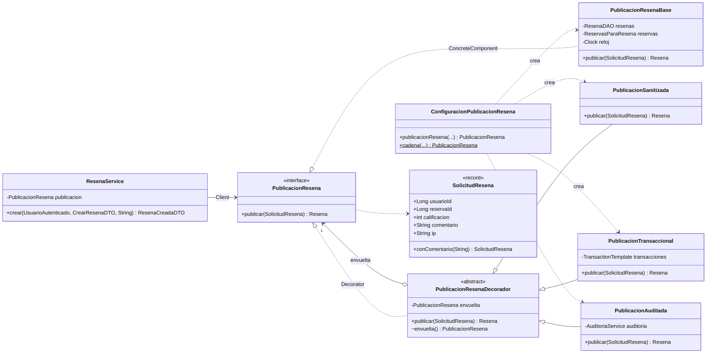
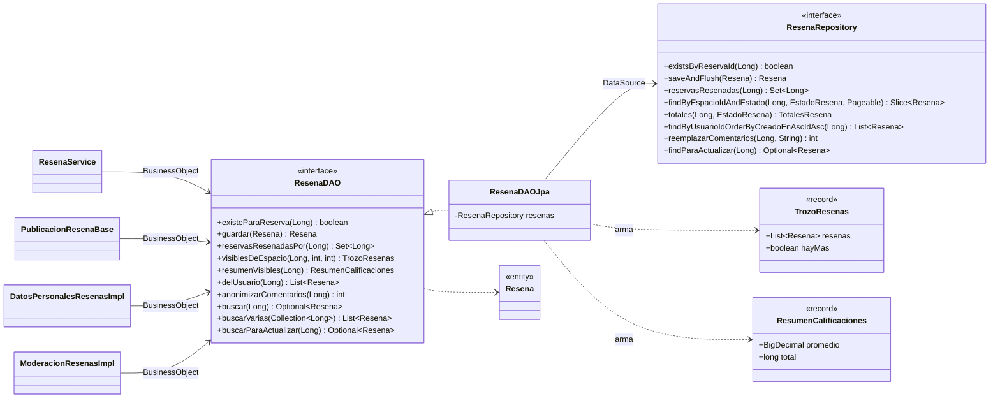
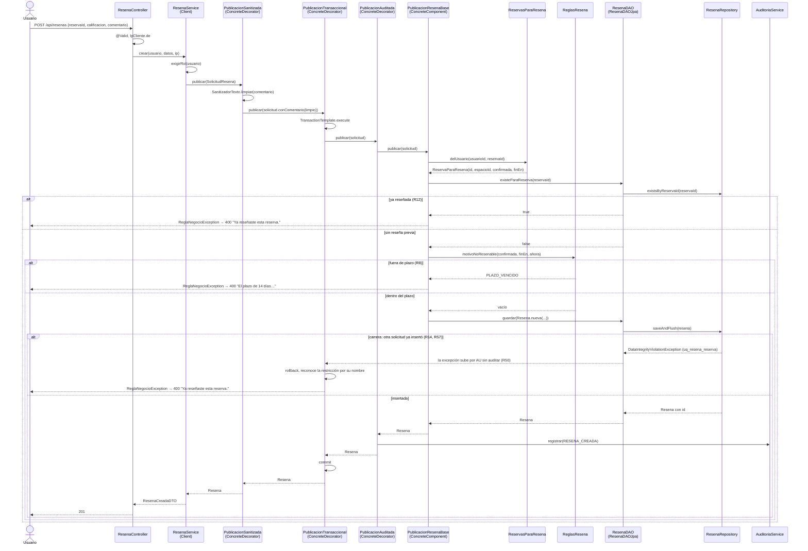

# Informe · HU-24 Reseñas y calificaciones (★ Decorator, DAO)

> Material del informe para HU-24 (capítulos 7 y 8). Fuente: `specs/HU-24/design.md` § 12 y el código de
> `2_Backend/src/main/java/pe/edu/ulima/espacioya/busqueda/`. Los diagramas están en Mermaid para que se puedan editar; los
> fragmentos de código están copiados de los archivos tal como quedaron después de la refactorización (2026-11-13).

## § 7.7 Patrones de diseño aplicados en HU-24

### 7.7.1 Decorator (GoF, estructural)

**Problema.** Publicar una reseña exige cuatro cosas de naturaleza distinta: limpiar el texto (STRIDE T), abrir y cerrar
la transacción traduciendo la carrera del índice único (persistencia), dejar el registro de auditoría (STRIDE R) y aplicar
la regla del negocio (reserva propia, una reseña por reserva, plazo de 14 días). Decorator agrega responsabilidades a un
objeto envolviéndolo con otros objetos de la misma interfaz, sin modificarlo: la regla queda sola en el
ConcreteComponent y cada comportamiento transversal es un ConcreteDecorator que se suma o se quita con una línea del
ensamblador.



| Rol GoF | Clase (`busqueda.service`) | Responsabilidad |
|---------|----------------------------|-----------------|
| Component | `PublicacionResena` | `Resena publicar(SolicitudResena)`. |
| ConcreteComponent | `PublicacionResenaBase` | Reserva propia (404), *ya reseñada*, plazo (`ReglasResena`) y `ResenaDAO.guardar`. No sanitiza, no abre transacción ni audita. |
| Decorator | `PublicacionResenaDecorador` (abstracta) | Guarda la `envuelta` y le reenvía `publicar`. |
| ConcreteDecorator | `PublicacionSanitizada` | **Antes** de reenviar: `SanitizadorTexto.limpiar`; si queda vacío, 400 sin reenviar. |
| ConcreteDecorator | `PublicacionTransaccional` | **Alrededor**: `TransactionTemplate.execute` y traducción de `uq_resena_reserva` a *ya reseñada*. |
| ConcreteDecorator | `PublicacionAuditada` | **Después** de que la envuelta vuelve: registra `RESENA_CREADA`; si la envuelta lanza, nada. |
| Ensamblador | `ConfiguracionPublicacionResena` | Único lugar que conoce el orden (`cadena`); publica el único `@Bean PublicacionResena`. |
| Client | `ResenaService` | `crear`: comprueba el rol y solo conoce `PublicacionResena`. |

**Por qué este orden.** De afuera hacia adentro: Sanitizada → Transaccional → Auditada → Base. La sanitización va fuera de
la transacción (un comentario que queda vacío no abre transacción ni lee la reserva) y la auditoría dentro (si el registro
falla, la reseña se revierte). A diferencia de HU-23, aquí los decoradores no conmutan: por eso hay un solo ensamblador y
una prueba (`ConfiguracionPublicacionResenaTest`) que fija la cadena.

### 7.7.2 DAO (Core J2EE Patterns, acceso a datos)

**Problema.** Tres clases de `busqueda` usaban el repositorio de Spring Data directamente y cada una repetía detalles de la
tecnología: el `PageRequest` con su orden, el tope de offset, `EstadoResena.VISIBLE` como argumento, la proyección
`TotalesResena` y el texto de anonimización. DAO separa la lógica de negocio del acceso a datos con una interfaz en el
idioma del dominio y deja la tecnología (JPA, Spring Data, JPQL) en una sola implementación. Mismo estilo que
`ReservaDAO` de HU-14.



| Rol (DAO) | Clase | Responsabilidad |
|-----------|-------|-----------------|
| DataAccessObject (interfaz) | `busqueda.repository.ResenaDAO` | Operaciones sobre `resena` en idioma del negocio; nada de `Pageable`, `Slice` ni proyecciones. |
| DataAccessObject (implementación) | `busqueda.repository.ResenaDAOJpa` (`@Repository`, de paquete) | Traduce cada operación a `ResenaRepository`: orden, filtro `VISIBLE`, tope de offset, `saveAndFlush`, bloqueo. |
| DataSource | `ResenaRepository` (Spring Data JPA) sobre PostgreSQL | Consultas derivadas y JPQL. Solo lo usa `ResenaDAOJpa`. |
| TransferObject | `Resena`, `TrozoResenas`, `ResumenCalificaciones` | Lo que cruza la frontera del DAO. |
| BusinessObject | `ResenaService`, `PublicacionResenaBase`, `DatosPersonalesResenasImpl` (HU-22), `ModeracionResenasImpl` (HU-27) | Solo conocen `ResenaDAO` (lo comprueba `AccesoResenasTest`). |

**Cómo se combinan.** `PublicacionResenaBase` es a la vez ConcreteComponent del Decorator y BusinessObject del DAO: la
regla del negocio no conoce la transacción (la pone un decorador) ni la tecnología de persistencia (la esconde el DAO).

## § 8.1 Escenario seleccionado

| ID | Historia | Escenario | Actor | Release / Sprint | Justificación |
|----|----------|-----------|-------|------------------|---------------|
| ESC-24 | HU-24 | Reseñar una reserva pasada | Usuario | Release 2 / Sprint 7 | En un solo flujo se ven los dos patrones de la historia: la cadena completa de decoradores (sanitizar → transacción → auditar → regla) y el DAO tanto para leer (`existeParaReserva`) como para escribir (`guardar`). Además cubre un control de cada amenaza STRIDE de la historia: S/T (reserva propia, una por reserva, índice único), T (sanitización) y R (auditoría en la misma transacción). |

## § 8.1.1 Diagrama de secuencia: "Reseñar una reserva pasada"



**Explicación.**

- **Flujo principal.** El controlador valida el cuerpo y saca la IP; `ResenaService` (Client) comprueba que la sesión sea
  `USUARIO` y entrega una `SolicitudResena` a la cadena. `PublicacionSanitizada` limpia el comentario y pasa una copia;
  `PublicacionTransaccional` abre la transacción; `PublicacionAuditada` deja pasar la llamada y espera; `PublicacionResenaBase`
  lee la reserva propia, pregunta al DAO si ya tiene reseña, aplica la regla del plazo y guarda con el DAO. Al volver,
  `PublicacionAuditada` registra `RESENA_CREADA` dentro de la misma transacción y `PublicacionTransaccional` confirma. El
  servicio convierte la entidad en `ResenaCreadaDTO` y el controlador responde 201.
- **Alterno "ya reseñada" (R12).** `ResenaDAO.existeParaReserva` responde `true`; la base lanza `ReglaNegocioException`
  antes de mirar el plazo (es la causa real). La excepción atraviesa `PublicacionAuditada` sin auditar y
  `PublicacionTransaccional` revierte y la deja pasar: 400.
- **Alterno "fuera de plazo" (R8).** `ReglasResena.motivoNoResenable` devuelve `PLAZO_VENCIDO` porque `ahora ≥ fin + 14 días`:
  400 con el mensaje del plazo, sin guardar ni auditar.
- **Alterno "carrera" (R14, R57).** Dos envíos simultáneos pasan ambos `existeParaReserva`; el segundo `INSERT` choca con
  `uq_resena_reserva`. Como `guardar` usa `saveAndFlush`, la violación sale de esa misma llamada, todavía dentro de la
  transacción; sube por `PublicacionAuditada` sin auditar y `PublicacionTransaccional` revierte, reconoce la restricción por
  su nombre y la traduce a *ya reseñada*: 400.

## § 8.1.2 Del diagrama al código

### Identificación del escenario

| Campo | Valor |
|-------|-------|
| ID | ESC-24 |
| Historia | HU-24 · Reseñas y calificaciones |
| Escenario | Reseñar una reserva pasada |
| Actor | Usuario (rol `USUARIO` con sesión) |
| Entrada | `POST /api/resenas` con `{ reservaId, calificacion, comentario }` |
| Salida | 201 `ResenaCreadaDTO`; 400 *ya reseñada*, *fuera de plazo*, *no reseñable* o por campo; 403; 404 |
| Patrones | Decorator (cadena `PublicacionResena`), DAO (`ResenaDAO` + `ResenaDAOJpa`) |
| Requisitos | R1, R8, R12, R14, R21–R23, R44–R52, R57 (`specs/HU-24/requirements.md`) |
| Release / Sprint | Release 2 / Sprint 7 |

### Fragmentos de código

**`ResenaController.crear`** — punto de entrada HTTP.

```java
@PostMapping("/api/resenas")
@ResponseStatus(HttpStatus.CREATED)
public ResenaCreadaDTO crear(@AuthenticationPrincipal UsuarioAutenticado usuario,
                             @Valid @RequestBody CrearResenaDTO datos, HttpServletRequest peticion) {
    return resenas.crear(usuario, datos, IpCliente.de(peticion));
}
```

**`ResenaService.crear`** — Client del Decorator.

```java
// Sin @Transactional: la transacción la abre PublicacionTransaccional, dentro de la cadena (DT-6, DT-21).
public ResenaCreadaDTO crear(UsuarioAutenticado usuario, CrearResenaDTO datos, String ip) {
    exigirRol(usuario);
    var resena = publicacion.publicar(new SolicitudResena(usuario.usuarioId(), datos.reservaId(),
            datos.calificacion(), datos.comentario(), ip));
    return new ResenaCreadaDTO(resena.getId(), resena.getReservaId(), resena.getCalificacion(),
            resena.getComentario(), fechaDe(resena));
}
```

**`ConfiguracionPublicacionResena.cadena`** — ensamblador: el único lugar con el orden.

```java
public static PublicacionResena cadena(ResenaDAO resenas, ReservasParaResena reservas, AuditoriaService auditoria,
                                       TransactionTemplate transacciones, Clock reloj) {
    return new PublicacionSanitizada(                       // 1. fuera de la transacción: R22 no abre ni lee nada
            new PublicacionTransaccional(                   // 2. abre la transacción y traduce la carrera (DT-6)
                    new PublicacionAuditada(                // 3. dentro de la transacción: R23 y R51
                            new PublicacionResenaBase(resenas, reservas, reloj), auditoria),
                    transacciones));
}
```

**`PublicacionResenaDecorador.publicar`** — Decorator: reenvía a la envuelta.

```java
@Override
public Resena publicar(SolicitudResena solicitud) {
    return envuelta.publicar(solicitud);
}
```

**`PublicacionSanitizada.publicar`** — ConcreteDecorator, antes de reenviar.

```java
@Override
public Resena publicar(SolicitudResena solicitud) {
    var limpio = SanitizadorTexto.limpiar(solicitud.comentario());
    if (limpio.isEmpty()) {
        throw new ReglaNegocioException(CAMPO_COMENTARIO, CrearResenaDTO.M_COMENTARIO);
    }
    return super.publicar(solicitud.conComentario(limpio));
}
```

**`PublicacionTransaccional.publicar`** — ConcreteDecorator, alrededor.

```java
@Override
public Resena publicar(SolicitudResena solicitud) {
    try {
        return transacciones.execute(estado -> super.publicar(solicitud));
    } catch (DataIntegrityViolationException conflicto) {
        if (esReservaYaResenada(conflicto)) {
            throw new ReglaNegocioException(ResenaService.MENSAJE_YA_RESENADA);
        }
        throw conflicto;
    }
}

// Por el nombre de la restricción: otro fallo de integridad no debe disfrazarse de reseña repetida (R14).
private static boolean esReservaYaResenada(DataIntegrityViolationException conflicto) {
    var mensaje = conflicto.getMostSpecificCause().getMessage();
    return mensaje != null && mensaje.contains(RESTRICCION_UNA_POR_RESERVA);
}
```

**`PublicacionAuditada.publicar`** — ConcreteDecorator, después.

```java
@Override
public Resena publicar(SolicitudResena solicitud) {
    var resena = super.publicar(solicitud);
    // Sin el comentario: el detalle de R23 solo lleva ids y la calificación.
    var detalle = "reservaId=" + resena.getReservaId() + ";espacioId=" + resena.getEspacioId() + ";calificacion="
            + resena.getCalificacion();
    auditoria.registrar(new EventoAuditoria(solicitud.usuarioId(), ResenaService.ACCION_RESENA_CREADA,
            ENTIDAD_RESENA, resena.getId(), solicitud.ip(), detalle));
    return resena;
}
```

**`PublicacionResenaBase.publicar`** — ConcreteComponent y BusinessObject del DAO.

```java
@Override
public Resena publicar(SolicitudResena solicitud) {
    var reserva = reservas.delUsuario(solicitud.usuarioId(), solicitud.reservaId());
    // Antes que el plazo: si ya la reseñó, esa es la causa real (R12, DT-16).
    if (resenas.existeParaReserva(reserva.id())) {
        throw new ReglaNegocioException(ResenaService.MENSAJE_YA_RESENADA);
    }
    var ahora = Instant.now(reloj);
    ReglasResena.motivoNoResenable(reserva.confirmada(), reserva.finEn(), ahora).ifPresent(motivo -> {
        throw new ReglaNegocioException(mensajeDe(motivo));
    });
    return resenas.guardar(Resena.nueva(reserva.id(), solicitud.usuarioId(), reserva.espacioId(),
            solicitud.calificacion(), solicitud.comentario(), ahora));
}
```

**`ResenaDAOJpa.existeParaReserva` y `guardar`** — DataAccessObject sobre el DataSource.

```java
@Override
public boolean existeParaReserva(Long reservaId) {
    return resenas.existsByReservaId(reservaId);
}

@Override
public Resena guardar(Resena nueva) {
    return resenas.saveAndFlush(nueva);
}
```

### Correspondencia mensaje del diagrama → clase.método

| Mensaje del diagrama | Clase.método |
|----------------------|--------------|
| `POST /api/resenas` | `ResenaController.crear` |
| `@Valid, IpCliente.de` | `CrearResenaDTO` (Bean Validation) · `IpCliente.de` |
| `crear(usuario, datos, ip)` | `ResenaService.crear` |
| `exigirRol(usuario)` | `ResenaService.exigirRol` |
| `publicar(SolicitudResena)` (S → SZ) | `PublicacionSanitizada.publicar` |
| `SanitizadorTexto.limpiar(comentario)` | `SanitizadorTexto.limpiar` |
| `publicar(solicitud.conComentario(limpio))` (SZ → TX) | `SolicitudResena.conComentario` · `PublicacionResenaDecorador.publicar` → `PublicacionTransaccional.publicar` |
| `TransactionTemplate.execute` | `PublicacionTransaccional.publicar` (`transacciones.execute`) |
| `publicar(solicitud)` (TX → AU) | `PublicacionAuditada.publicar` |
| `publicar(solicitud)` (AU → B) | `PublicacionResenaBase.publicar` |
| `delUsuario(usuarioId, reservaId)` | `ReservasParaResena.delUsuario` (`ReservasParaResenaImpl`) |
| `existeParaReserva(reservaId)` | `ResenaDAO.existeParaReserva` (`ResenaDAOJpa`) |
| `existsByReservaId(reservaId)` | `ResenaRepository.existsByReservaId` |
| `motivoNoResenable(confirmada, finEn, ahora)` | `ReglasResena.motivoNoResenable` |
| `guardar(Resena.nueva(...))` | `Resena.nueva` · `ResenaDAO.guardar` (`ResenaDAOJpa`) |
| `saveAndFlush(resena)` | `ResenaRepository.saveAndFlush` |
| `ReglaNegocioException → 400` | `ReglaNegocioException` · `ManejadorGlobalErrores` |
| `rollback, reconoce la restricción por su nombre` | `PublicacionTransaccional.esReservaYaResenada` |
| `registrar(RESENA_CREADA)` | `AuditoriaService.registrar` (desde `PublicacionAuditada.publicar`) |
| `commit` | `TransactionTemplate.execute` (al volver el callback) |
| `ResenaCreadaDTO` · `201` | `ResenaService.crear` · `@ResponseStatus(HttpStatus.CREATED)` |

### Explicación

El diagrama y el código coinciden mensaje por mensaje. `ResenaService` no sabe que existe una cadena: recibe por
inyección el único bean `PublicacionResena`, que es la `PublicacionSanitizada` más externa. Cada decorador hereda de
`PublicacionResenaDecorador` y llama a `super.publicar`, que reenvía a su envuelta: así el orden de la secuencia (sanitizar,
abrir transacción, auditar al volver, regla) es exactamente el anidamiento de `ConfiguracionPublicacionResena.cadena`.
`PublicacionTransaccional` usa `TransactionTemplate` y no `@Transactional` porque las piezas no son beans (no hay proxy) y
porque así la violación del índice se puede atrapar y traducir. El DAO aparece en los dos accesos a datos del escenario:
`existeParaReserva` y `guardar`; `ResenaDAOJpa` los traduce a `existsByReservaId` y `saveAndFlush`. Usar `saveAndFlush`
es lo que hace que la carrera falle dentro de `guardar` y no al confirmar (R57), y por eso el alterno "carrera" del
diagrama sube por `PublicacionAuditada` sin registrar y lo traduce `PublicacionTransaccional`.

### Archivos

| Archivo (desde la raíz del repo) | Rol |
|----------------------------------|-----|
| `2_Backend/src/main/java/pe/edu/ulima/espacioya/busqueda/controller/ResenaController.java` | Entrada HTTP |
| `2_Backend/src/main/java/pe/edu/ulima/espacioya/busqueda/service/ResenaService.java` | Client (Decorator) · BusinessObject (DAO) |
| `2_Backend/src/main/java/pe/edu/ulima/espacioya/busqueda/service/PublicacionResena.java` | Component |
| `2_Backend/src/main/java/pe/edu/ulima/espacioya/busqueda/service/SolicitudResena.java` | Entrada de la cadena |
| `2_Backend/src/main/java/pe/edu/ulima/espacioya/busqueda/service/PublicacionResenaDecorador.java` | Decorator |
| `2_Backend/src/main/java/pe/edu/ulima/espacioya/busqueda/service/PublicacionSanitizada.java` | ConcreteDecorator |
| `2_Backend/src/main/java/pe/edu/ulima/espacioya/busqueda/service/PublicacionTransaccional.java` | ConcreteDecorator |
| `2_Backend/src/main/java/pe/edu/ulima/espacioya/busqueda/service/PublicacionAuditada.java` | ConcreteDecorator |
| `2_Backend/src/main/java/pe/edu/ulima/espacioya/busqueda/service/PublicacionResenaBase.java` | ConcreteComponent · BusinessObject |
| `2_Backend/src/main/java/pe/edu/ulima/espacioya/busqueda/service/ConfiguracionPublicacionResena.java` | Ensamblador |
| `2_Backend/src/main/java/pe/edu/ulima/espacioya/busqueda/repository/ResenaDAO.java` | DataAccessObject (interfaz) |
| `2_Backend/src/main/java/pe/edu/ulima/espacioya/busqueda/repository/ResenaDAOJpa.java` | DataAccessObject (JPA) |
| `2_Backend/src/main/java/pe/edu/ulima/espacioya/busqueda/repository/TrozoResenas.java` | TransferObject |
| `2_Backend/src/main/java/pe/edu/ulima/espacioya/busqueda/repository/ResenaRepository.java` | DataSource |
| `2_Backend/src/main/java/pe/edu/ulima/espacioya/busqueda/domain/ReglasResena.java` | Regla del plazo |
| `2_Backend/src/main/java/pe/edu/ulima/espacioya/busqueda/service/impl/DatosPersonalesResenasImpl.java` | BusinessObject (HU-22) |
| `2_Backend/src/main/java/pe/edu/ulima/espacioya/busqueda/service/impl/ModeracionResenasImpl.java` | BusinessObject (HU-27) |
| `2_Backend/src/test/java/pe/edu/ulima/espacioya/busqueda/service/ConfiguracionPublicacionResenaTest.java` | Fija la cadena (R44) |
| `2_Backend/src/test/java/pe/edu/ulima/espacioya/busqueda/service/PublicacionResenaIT.java` | Auditoría dentro de la transacción (R51) |
| `2_Backend/src/test/java/pe/edu/ulima/espacioya/busqueda/repository/ResenaDAOJpaIT.java` | DAO contra PostgreSQL (R54, R56, R57) |
| `2_Backend/src/test/java/pe/edu/ulima/espacioya/busqueda/AccesoResenasTest.java` | Solo el DAO toca `resena` (R53) |
