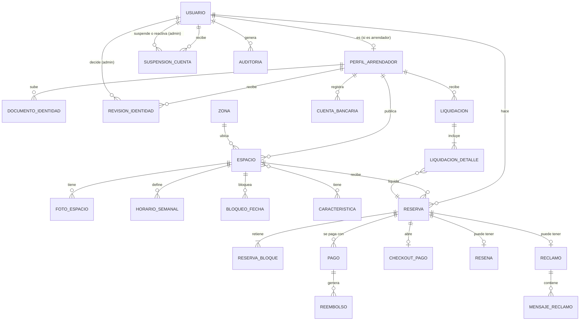

# Modelo de datos

> Modelo de referencia para PostgreSQL 17. Cada historia crea **solo** las
> tablas que necesita, con su propia migración Flyway (ver
> `docs/conventions.md`). Si el `design.md` de una historia necesita cambiar un
> nombre, un atributo o un estado de este modelo, lo justifica ahí y actualiza
> este archivo en el mismo PR.

## Entidades principales

| Grupo | Entidad | Atributos clave | Historias |
| --- | --- | --- | --- |
| Cuentas | `usuario` | id, nombre, correo (único), hash_contrasena, telefono, foto_url, rol (USUARIO, ARRENDADOR, ADMIN), correo_verificado, estado (ACTIVA, SUSPENDIDA, ELIMINADA), version_politica, fecha_consentimiento, recordatorios_activos | HU-01, HU-02, HU-09, HU-20, HU-25 |
| | `perfil_arrendador` | usuario_id, tipo_documento (DNI, RUC), numero_documento (cifrado), hash_documento (único, HMAC), razon_social (cifrada), direccion_fiscal (cifrada), estado_identidad (NO_INICIADA, EN_REVISION, VERIFICADA, RECHAZADA), motivo_rechazo | HU-02, HU-05, HU-06 |
| | `documento_identidad` | id, arrendador_id, tipo (IDENTIDAD, PROPIEDAD), ruta_archivo (clave aleatoria `identidad/<UUID>` del almacenamiento privado; el archivo va cifrado fuera de la BD y el nombre original no se guarda), tipo_mime (application/pdf, image/jpeg, image/png, según el contenido real), tamano (bytes recibidos, 1 a 5 242 880), subido_en. Solo los documentos vigentes: un reenvío reemplaza los anteriores | HU-05, HU-06 |
| | `token` | id, usuario_id, tipo (VERIFICACION, RECUPERACION; hoy solo se usa RECUPERACION), hash_token (único, SHA-256 hex del token; el token nunca se guarda en claro), creado_en, expira_en (creado_en + 30 min en RECUPERACION), usado_en (al usarlo o anularlo; las filas no se borran) | HU-01, HU-04 |
| | `sesion` | id, usuario_id, hash_token (único, SHA-256 hex del token; el token nunca se guarda en claro), creada_en, expira_en (se mueve a ahora + 30 min en cada solicitud autenticada), revocada | HU-03, HU-04, HU-09 |
| | `mfa` / `codigo_respaldo` | usuario_id, secreto (cifrado), activo / hash_codigo, usado | HU-17 |
| Espacios | `zona` | codigo (PK, p. ej. `MIRAFLORES`), nombre (único, con tildes). Catálogo cerrado sembrado por la migración: 43 distritos de Lima Metropolitana y 7 del Callao | HU-07, HU-10 |
| | `espacio` | id, arrendador_id, nombre (3–100), tipo (CANCHA, ESTADIO, AUDITORIO), direccion (5–200), zona (FK a `zona.codigo`), capacidad (1–100 000), precio_hora (`NUMERIC(8,2)`, S/ 1.00–100 000.00, un único precio por hora), descripcion (obligatoria, 10–2000), estado (BORRADOR, PUBLICADO, PAUSADO, BAJA, OCULTO), creado_en, actualizado_en. Índice `ix_espacio_busqueda` (estado, tipo, zona, precio_hora, id) para la búsqueda pública (HU-10, solo rendimiento) | HU-07, HU-10, HU-21, HU-27 |
| | `foto_espacio` | id, espacio_id, ruta_archivo (clave aleatoria `espacios/<UUID>` del almacenamiento; el archivo va **sin cifrar** fuera de la BD, re-codificado y sin metadatos, y su UUID forma la URL estable `/api/fotos/<UUID>`; el nombre original no se guarda), tipo_mime (image/jpeg, image/png, según el contenido real), orden (1–5; la principal es la 1) | HU-07 |
| | `horario_semanal` | id, espacio_id (FK en cascada), dia_semana (`SMALLINT`, ISO 1 = lunes … 7 = domingo), hora_inicio (`SMALLINT` 0–23), hora_fin (`SMALLINT` 1–24, exclusivo; 24 = medianoche). Varias franjas por día sin superponerse; el horario se reemplaza completo. Los bloques libres no se guardan: se calculan al consultar | HU-08 |
| | `bloqueo_fecha` | id, espacio_id (FK en cascada), fecha (`DATE`, día completo; se bloquea solo dentro de las próximas 8 semanas y se puede desbloquear) | HU-08 |
| | `caracteristica` / `espacio_caracteristica` | id, nombre / espacio_id + caracteristica_id | HU-23 |
| Reservas | `reserva` | id, usuario_id (FK a `usuario`, sin cascada), espacio_id (FK a `espacio`, sin cascada), estado (`VARCHAR(20)`: PENDIENTE_PAGO, CONFIRMADA, EXPIRADA, CANCELADA), precio_hora_aplicado (`NUMERIC(8,2)`, copia del precio al crear), monto_total (`NUMERIC(10,2)`: 24 × S/ 100 000.00 no cabe en `(8,2)`), creada_en, expira_en (`TIMESTAMPTZ`; creada_en + 15 min). `cancelada_por` y `cancelada_en` los agrega HU-15 con su migración | HU-12, HU-14, HU-15 |
| | `reserva_bloque` | id, reserva_id (FK a `reserva`, en cascada), espacio_id (FK a `espacio`, sin cascada), fecha (`DATE`), hora_inicio (`SMALLINT` 0–23, la misma granularidad que `horario_semanal`, HU-08), activo (`BOOLEAN`, por defecto `TRUE`). Liberar un bloque pone `activo = false`: las filas se conservan porque HU-14 muestra el horario de las reservas pasadas | HU-12 |
| Pagos | `pago` | id, reserva_id (FK a `reserva`, sin cascada), id_transaccion_pasarela (`VARCHAR(100)`, único, id del pago en la pasarela: cada intento tiene el suyo), monto (`NUMERIC(10,2)`), estado (PAGADO, RECHAZADO, PAGADO_TARDIO, MONTO_DISTINTO, REEMBOLSADO, REEMBOLSO_FALLIDO), ultimos4 (`VARCHAR(4)`, nulo si la pasarela no lo informa), creado_en (`TIMESTAMPTZ`) | HU-13, HU-28 |
| | `checkout_pago` | id, reserva_id (FK a `reserva`, en cascada, único), id_checkout, url_pago, creado_en. Un enlace por reserva, para reutilizarlo y no dejar dos cobros abiertos; no tiene estado porque su vencimiento depende solo de `reserva.expira_en` | HU-13 |
| | `reembolso` | id, pago_id, monto, origen (CANCELACION, RECLAMO), estado, intentos, creado_en | HU-16, HU-26 |
| | `cuenta_bancaria` | id, arrendador_id, banco, numero (cifrado), titular, retener_hasta | HU-18 |
| | `liquidacion` / `liquidacion_detalle` | id, arrendador_id, periodo, monto_bruto, comision, monto_neto, estado (PENDIENTE_CUENTA, GENERADA, PAGADA), numero_operacion / liquidacion_id + reserva_id | HU-19 |
| Confianza | `resena` | id, reserva_id (único), usuario_id, espacio_id, calificacion (1–5), comentario, estado (VISIBLE, OCULTA) | HU-24, HU-27 |
| | `reclamo` / `mensaje_reclamo` | id, reserva_id (único), motivo, descripcion, estado, resolucion / reclamo_id, autor_id, texto, fecha | HU-26 |
| | `reporte` | id, reportante_id, tipo_objetivo (ESPACIO, RESENA), objetivo_id, motivo, estado, admin_id, decision | HU-27 |
| Administración | `revision_identidad` | id, arrendador_id (FK a `perfil_arrendador`, en cascada), admin_id (FK a `usuario`, sin cascada), decision (APROBADA, RECHAZADA), motivo (hasta 500; obligatorio y no en blanco solo si RECHAZADA, nulo si APROBADA), fecha. Historial de decisiones del admin: el estado vigente sigue en `perfil_arrendador` | HU-06 |
| | `suspension_cuenta` | id, usuario_id (FK a `usuario`, en cascada), admin_id (FK a `usuario`, sin cascada), accion (SUSPENSION, REACTIVACION), motivo (hasta 500; obligatorio y no en blanco solo si SUSPENSION, nulo si REACTIVACION), fecha. Historial de suspensiones y reactivaciones del admin: el estado vigente sigue en `usuario.estado` | HU-09 |
| Transversal | `auditoria` | id, usuario_id, accion, entidad, entidad_id, ip, fecha, detalle | Todas (R de STRIDE) |

## Restricciones clave

| Restricción | Regla de negocio | Historia |
| --- | --- | --- |
| Bloque único: `uq_reserva_bloque_activo` en (espacio_id, fecha, hora_inicio) solo para bloques activos (índice único parcial `WHERE activo`) | Dos usuarios no pueden reservar el mismo bloque | HU-12 |
| `reserva`: `CHECK` de estado (`ck_reserva_estado`), de montos positivos (`ck_reserva_montos`) y de `expira_en > creada_en` (`ck_reserva_expira`); `reserva_bloque`: `CHECK` de `hora_inicio` entre 0 y 23 (`ck_reserva_bloque_hora`). Índices `ix_reserva_usuario_estado` (usuario_id, estado), `ix_reserva_vencimiento` (expira_en, `WHERE estado = 'PENDIENTE_PAGO'`) e `ix_reserva_bloque_reserva` (reserva_id) | Una reserva nace con valores válidos y el cupo y la expiración se consultan sin recorrer la tabla | HU-12 |
| `pago.id_transaccion_pasarela` único y `NOT NULL` (`uq_pago_id_transaccion`) | El webhook es idempotente: un pago no se registra dos veces | HU-13 |
| Índice único parcial `uq_pago_reserva_pagado` en (reserva_id) `WHERE estado = 'PAGADO'` | Una reserva no se cobra dos veces; admite varios rechazos | HU-13 |
| `pago`: `CHECK` de estado (`ck_pago_estado`), de monto positivo (`ck_pago_monto`) y de `ultimos4` con 4 dígitos (`ck_pago_ultimos4`). Índice `ix_pago_reserva_estado` (reserva_id, estado, creado_en) | Un pago nace con valores válidos y los rechazos recientes se cuentan sin recorrer la tabla | HU-13 |
| `checkout_pago.reserva_id` único (`uq_checkout_pago_reserva`) | Una reserva tiene un solo enlace de pago | HU-13 |
| Un reembolso por pago y origen | Una cancelación no genera dos reembolsos | HU-16 |
| `liquidacion_detalle.reserva_id` único | Una reserva no se liquida dos veces | HU-19 |
| `resena.reserva_id` único y calificación entre 1 y 5 (`CHECK`) | Una reseña por reserva | HU-24 |
| `reclamo.reserva_id` único | Un reclamo por reserva | HU-26 |
| `usuario.correo` único | No hay dos cuentas con el mismo correo | HU-01 |
| `perfil_arrendador.hash_documento` único (HMAC-SHA256 del número, que va cifrado) | No hay dos arrendadores con el mismo RUC o DNI | HU-02 |
| `documento_identidad` (arrendador_id, tipo) único | Como mucho un documento vigente de cada tipo por arrendador | HU-05 |
| `foto_espacio.orden` entre 1 y 5 (`CHECK`) y (espacio_id, orden) único, diferido para renumerar en una transacción | Como mucho 5 fotos por espacio, sin dos en el mismo lugar | HU-07 |
| `espacio.zona` FK a `zona.codigo`; `CHECK` de tipo, estado, capacidad y precio_hora | Un espacio solo está en una zona del catálogo, con valores válidos | HU-07 |
| `horario_semanal`: `CHECK` de dia_semana (1–7) y de horas (`hora_inicio >= 0`, `hora_fin <= 24`, `hora_inicio < hora_fin`); (espacio_id, dia_semana, hora_inicio) único. La superposición entre franjas la impide el servicio con el espacio bloqueado | Bloques de 1 hora en punto, sin franjas repetidas | HU-08 |
| `bloqueo_fecha` (espacio_id, fecha) único | Una fecha no se bloquea dos veces | HU-08 |
| `revision_identidad`: `CHECK` de decision (APROBADA, RECHAZADA) y de motivo (RECHAZADA con motivo no en blanco, APROBADA sin motivo) | Toda decisión de identidad queda registrada y un rechazo siempre dice por qué | HU-06 |
| `suspension_cuenta`: `CHECK` de accion (SUSPENSION, REACTIVACION) y de motivo (SUSPENSION con motivo no en blanco, REACTIVACION sin motivo) | Toda suspensión o reactivación queda registrada y una suspensión siempre dice por qué | HU-09 |
| `token.hash_token` único (SHA-256 hex del token) | Un enlace de un solo uso no se confunde con otro; el token en claro no se guarda | HU-04 |
| Llaves foráneas en todas las relaciones | No hay reservas, pagos ni reseñas huérfanas | Todas |

## Diagrama entidad-relación (núcleo)

## Evolución entre releases

Las tablas de Release 2 (`mfa`, `cuenta_bancaria`, `liquidacion`, `resena`,
`reclamo`, `reporte`, `caracteristica`) se agregan con migraciones nuevas, sin
editar las de Release 1.
