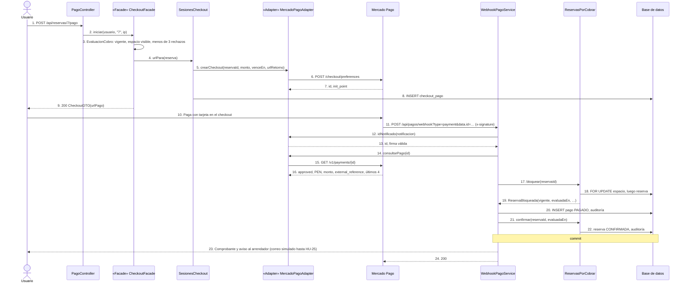
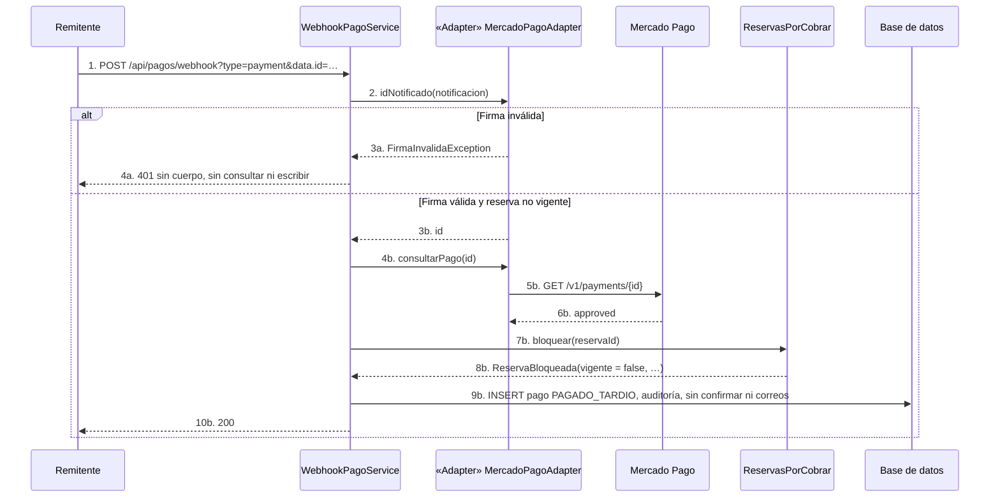
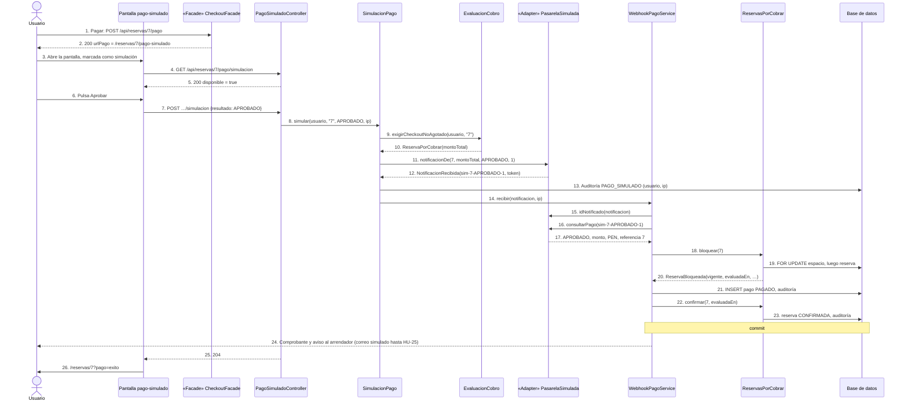
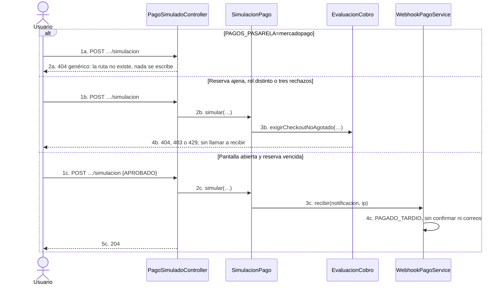

# Material del informe — HU-13 · Pago con tarjeta

> Este archivo reúne, sección por sección, lo que el informe final necesita de HU-13
> (Release 1, Sprint 4). **No se vacía al cerrar la historia.**
>
> **Reglas para quien lo llene:**
> - Solo datos reales. Lo que aún no exista se deja `_pendiente_`; nunca se inventan métricas,
>   resultados, capturas ni referencias.
> - Cada dato cita su origen (`specs/HU-13/...`, `progress/review_HU-13.md`, archivo y método).
> - Si el código o el diseño cambian, se actualiza aquí lo que cambió.
> - El código se copia del repositorio **después** de `APPROVED`, no del spec.
> - Marca `[x]` cuando la sección esté completa y verificada.
>
> **Quién llena qué:** `spec-author` → §1, §4, §5. `implementer` → §3, §8, §9, §11.
> `reviewer` → comprueba que coincide con el código y agrega sus defectos a §10.
> Orquestador, tras `APPROVED` → §2, §6, §7. Dueño → §7.4 (commit) y capturas de §8.4.
> Ariel Enriquez → caja negra de §9.3 y defectos de §10.

> **Estado de la demostración (adenda del 2026-10-30, D7 revisada, D8 y D9).** El pago de la aplicación se demuestra con la
> **pasarela simulada**, también en UAT y en el video. **La firma real de Mercado Pago no se ha comprobado** (S1) y la task T23
> **no se ha ejecutado**. Mercado Pago **no se probó de punta a punta dentro de la aplicación**: lo único real es un pago de
> prueba aislado, hecho por `curl` fuera de la aplicación, con notificación recibida y consulta del pago
> (`progress/HU-13.md`). `MercadoPagoAdapter` solo ha corrido contra `StubMercadoPago`. La adenda ya tiene código y pruebas
> automáticas; **ningún agente abrió sus pantallas en un navegador**.

---

## 1. Decisiones y riesgos (informe 7.4 y 5.4) — al aprobar el spec

- [ ] Completa

Contenido definitivo del spec: Eduardo Saldaña lo aprobó el 2026-10-30 con S1–S14, y el mismo día aprobó la adenda, que agrega
filas, con D7 revisada, D8, D9, S15–S20 y las contradicciones C1 a C5. La casilla sigue abierta porque la columna Resultado de
los riesgos de §1.2 aún está pendiente.

### 1.1 Decisiones de diseño (informe 7.4)

| Decisión | Problema / necesidad | Alternativas consideradas | Criterio de decisión | Elección | Consecuencia | Origen |
| :---- | :---- | :---- | :---- | :---- | :---- | :---- |
| Proveedor de la pasarela | Cobrar en soles con una pasarela certificada, en modo de prueba, sin trámites de empresa | Stripe / Mercado Pago Checkout Pro / Culqi / Izipay | Poder abrir la cuenta desde Perú, checkout alojado, firma de webhook y prueba real de notificaciones | Mercado Pago Checkout Pro | Perú no aparece en el registro de Stripe; un pago de prueba real sí envió notificaciones. No hay URL pública para `localhost`. Por D8 sigue siendo el proveedor elegido, pero no se conecta por ahora | `specs/HU-13/requirements.md` D1, D8, H1 |
| Integración con el proveedor | Crear el checkout, consultar el pago y verificar la firma desde Java 25 y Spring Boot 4.1.2 | SDK oficial `sdk-java:3.7.0` / `RestClient` + HMAC propio | Dependencias agregadas, estado global y facilidad de probar contra un doble | `RestClient` + HMAC propio | Sin dependencias nuevas. El SDK funcionó en la prueba de compatibilidad, pero trae al menos 16 librerías, usa configuración estática y fija la URL base. La firma se protege con un vector de prueba aceptado por el validador oficial | `specs/HU-13/design.md` DT-1 |
| Cómo se garantiza la idempotencia del webhook | Un solo pago genera varias notificaciones, y pueden repetirse o llegar a la vez | Solo leer antes de insertar / solo `UNIQUE` / las dos defensas | Ninguna repetición debe confirmar, contar ni enviar correos dos veces | `id_transaccion_pasarela` = id del pago; bloqueo de la reserva, lectura y `UNIQUE` como última defensa; solo se procesa `type=payment` | Los reintentos no chocan, porque cada intento es un pago con id propio. Otros formatos se responden 200 sin procesar | `specs/HU-13/design.md` DT-2, DT-5; R23, R42–R46 |
| Quién confirma la reserva | El estado solo debe cambiar por una notificación con firma verificada (RNF-CUM-02), que no trae estado ni monto | Confirmar al volver el navegador / leer el cuerpo de la notificación / verificar la firma y consultar el pago | Fuente de verdad y control de suplantación | `WebhookPagoService` verifica la firma, consulta `GET /v1/payments/{id}`, valida monto y moneda y confirma por el puerto `ReservasPorCobrar` | `CheckoutFacade` no confirma nada. La pantalla espera con un sondeo acotado. Con Mercado Pago real, sin comprobar (S1) | `specs/HU-13/design.md` § 5, DT-5, DT-14; R25, R26, R31 |
| Cómo se cuentan los 3 intentos fallidos | Máximo 3 fallos por reserva cada 30 min, con intentos que ocurren en la página de la pasarela | `LimitadorIntentos` en memoria / contar filas `RECHAZADO` | Sobrevivir a un reinicio y no contar doble un aviso repetido | Contar filas `RECHAZADO` de los últimos 30 min | 429 al iniciar y cierre del checkout de mejor esfuerzo. Un cuarto intento en curso puede pasar: riesgo aceptado | `specs/HU-13/design.md` DT-4; R13, R40, R41; S6 |
| Selección de la pasarela (sandbox o simulada) por configuración, sin Factory Method | Elegir la implementación según el entorno sin que el dominio la conozca | Fábrica escrita a mano (Factory Method) / selección por configuración con inyección de dependencias | Reducir el impacto del cambio sin agregar clases sin necesidad | `@ConditionalOnProperty` sobre `espacioya.pagos.pasarela`, sin valor por defecto | Factory Method queda solo en HU-25. Sin valor el backend no arranca, así que todo entorno debe elegir pasarela; cada integrante define `PAGOS_PASARELA=simulada` en local y, por D7 revisada, UAT también | `progress/history.md`, 2026-10-30; `specs/HU-13/design.md` DT-9; R55–R57 |
| Pago aprobado con la reserva no vigente | La notificación es asíncrona: RN-08 decía que el caso no ocurría, pero puede ocurrir | Registrar sin confirmar / reembolso automático / confirmar si los bloques siguen activos | Nunca confirmar una reserva cuyos bloques pueden ser de otro | Estado `PAGADO_TARDIO`, auditoría y devolución manual; margen de 1 minuto para reducir el caso | Se corrige RN-08. HU-19 y HU-28 deben ignorar ese estado | `specs/HU-13/requirements.md` D2, D3; R34 |
| Conectar o no Mercado Pago en esta entrega | La firma real está sin comprobar y hace falta demostrar el pago | Conectarlo ahora (T23) / dejar el adaptador listo y usar la simulada | Decisión del dueño (D8) | No se conecta. `MercadoPagoAdapter` y sus pruebas quedan listos; T23 se difiere sin ejecutar | UAT no tiene pasarela certificada hasta T23 (D7 revisada). S1, S5 y S6 siguen sin comprobar | `specs/HU-13/requirements.md` Adenda, D7 revisada, D8 |
| Cómo se demuestra el pago sin terminal | Ariel Enriquez y el video necesitan aprobar y rechazar sin `curl` | `curl` al webhook / botones en el resumen / pantalla aparte solo con la simulada | Pedido del dueño (D9) y no mezclar la aplicación con lo que hace la pasarela | Pantalla `/reservas/:id/pago-simulado`, marcada como simulación y habilitada por el backend | Con `mercadopago`, la ruta de la API no existe y la pantalla no muestra botones | `specs/HU-13/design.md` § 14; R59–R62, R81, R82 |
| Cómo pasa un pago simulado por las mismas reglas | No debe nacer un segundo camino de confirmación | Confirmar desde la simulación / método sin firma en `WebhookPagoService` / entregar una notificación a `recibir` | Un solo camino, sin una entrada sin firma | `SimulacionPago` entrega una `NotificacionRecibida` a `WebhookPagoService.recibir`, que no cambia | Vigencia, tardío, 3 rechazos, idempotencia y correos salen del mismo código. La "firma" es un token del proceso: **no prueba S1** | `specs/HU-13/design.md` DT-16, DT-22; R62–R72 |
| Montos de la simulada en memoria | En UAT, un reinicio no puede romper un pago pendiente | Columna en `checkout_pago` / leer con un puerto / monto en el id / reescribir el monto en cada solicitud | Sin migración ni dependencia nueva, para algo que el servidor ya leyó | Cada `POST` escribe `monto_total` en la simulada justo antes de `recibir`; los ids salen de la base | Sobrevive a un reinicio. El `curl` local conserva su límite | `specs/HU-13/design.md` DT-20, DT-21; R70, R72 |

### 1.2 Riesgos (informe 5.4)

| Release / Sprint | Riesgo | Probabilidad | Impacto | Respuesta / mitigación | Resultado | Origen |
| :---- | :---- | :---- | :---- | :---- | :---- | :---- |
| R1 / S4 | La firma no se comprobó aún contra una notificación real | Media | Alto: toda notificación real sería rechazada | Algoritmo tomado del validador oficial. T23 queda diferida (D8): se prueba al conectar Mercado Pago y, si falla, la historia se reabre | **Sin comprobar** | `specs/HU-13/requirements.md` S1, D8 |
| R1 / S4 | No hay pasarela certificada en UAT hasta ejecutar T23 | Alta: ya es así | Alto para las conclusiones: la demo prueba el flujo y las reglas, no la integración real | El informe lo declara. Aparte hay un pago de prueba aislado por `curl`, con notificación y consulta, fuera de la aplicación | _pendiente_ | `specs/HU-13/design.md` § 14.13, RS-2 |
| R1 / S4 | No hay URL pública para `localhost` en la demo | Alta | Bajo tras D8 | La demo usa la simulada; hará falta túnel o UAT cuando se ejecute T23 | _pendiente_ | `progress/HU-13.md`, H1 |
| R1 / S4 | Pago aprobado que llega con la reserva ya no vigente | Media | Alto: pago sin reserva | `PAGADO_TARDIO`, auditoría, devolución manual y cierre 1 minuto antes | _pendiente_ | `specs/HU-13/requirements.md` D2, D3 |
| R1 / S4 | Un cuarto intento pasa en la página de la pasarela antes de conocer el tercer rechazo | Media | Bajo | 429 al iniciar y cierre del checkout de mejor esfuerzo; riesgo aceptado | _pendiente_ | `specs/HU-13/requirements.md` S6 |
| R1 / S4 | La pasarela simulada llega a UAT | Ocurre por decisión del dueño | Alto: se confirma sin pasarela real | Ya no es un fallo: D7 revisada la usa en UAT, de forma explícita. Se pasa a los dos riesgos siguientes | Aceptado por el dueño | `specs/HU-13/requirements.md` D7 revisada, S11 |
| R1 / S4 | Quien tenga una cuenta en UAT puede aprobar su propio pago mientras esté la simulada | Alta | Bajo en UAT; alto si llegara a un entorno con dinero real | Sesión, rol `USUARIO`, reserva propia, auditoría `PAGO_SIMULADO`, prefijo `sim-` y aviso en pantalla. Riesgo aceptado para UAT | _pendiente_ | `specs/HU-13/design.md` § 14.13, RS-1 |
| R1 / S4 | Alguien define `PAGOS_SECRETO_WEBHOOK` en UAT con la simulada, y quien lo conozca aprueba pagos de cualquier reserva con `curl` | Baja | Medio | Vacío en UAT: la ruta pública responde 401 a todo pago (R83) y la pantalla funciona igual | _pendiente_ | `specs/HU-13/requirements.md` S16 |
| R1 / S4 | Las filas `sim-` de UAT se cuentan como pagos en HU-15, HU-16, HU-19 y HU-28 | Media | Medio | Aviso al equipo; el prefijo permite filtrarlas o limpiarlas al conectar | _pendiente_ | `specs/HU-13/design.md` § 14.13, RS-5 |
| R1 / S4 | Declarar cerrada la historia con T23 sin ejecutar puede leerse como que Mercado Pago funciona | Media | Alto para la honestidad del informe | T23 va como texto "no se ha ejecutado", con pendiente en `docs/requerimientos.md` § 9 y este aviso. El dueño decide las contradicciones C1 a C5 | _pendiente_ | `specs/HU-13/design.md` § 14.13 |
| R1 / S4 | Una credencial real termina en el repositorio | Baja | Alto | Secretos solo por variable de entorno y `.env.example` sin valores; ampliar la revisión de secretos del arnés | _pendiente_ | `docs/conventions.md`; `specs/HU-13/tasks.md` T21 |

### 1.3 Decisiones y trade-offs (informe 5.4)

| Release | Decisión / trade-off | Alternativas evaluadas | Criterio | Elección final | Consecuencia |
| :---- | :---- | :---- | :---- | :---- | :---- |
| R1 | Cerrar el enlace antes que la reserva: menos pagos tardíos a cambio de un minuto menos para pagar | Cerrar al vencer / cerrar 1 minuto antes | Reducir pagos sin reserva | 1 minuto antes, configurable (D3) | En el último minuto no se inicia un pago |
| R1 | Reserva retenida tras 3 rechazos: no se crea una transición nueva a cambio de bloques ocupados unos minutos | Mantenerla hasta expirar / expirarla al tercer rechazo | No cambiar RN-03 ni permitir soltar bloques a voluntad | Mantenerla hasta expirar (D4) | La pantalla indica reservar de nuevo cuando expire |
| R1 | Límite por reserva, no por persona: se cumple el requisito sin agregar reglas | Solo por reserva / agregar límite por usuario | Alcance de la historia | Solo por reserva (S7) | Riesgo aceptado: hasta 9 rechazos cada 15 minutos por usuario |
| R1 | HMAC propio a cambio de no agregar dependencias | SDK oficial / `RestClient` + HMAC | Dependencias y facilidad de prueba | `RestClient` + HMAC (DT-1) | Más código propio de firma, cubierto con un vector de prueba |
| R1 | Demostrar el flujo completo sin terminal a cambio de no tener pasarela certificada en UAT | Conectar Mercado Pago ahora / usar la simulada en UAT | Decisión del dueño (D7 revisada, D8, D9) | Simulada en UAT | El informe lo declara; S1, S5 y S6 quedan abiertos |
| R1 | Poder mostrar el pago tardío en pantalla a cambio de no repetir la vigencia al decidir | Repetir todas las reglas de iniciar / dejar que decida el webhook | Las mismas reglas que un pago real (S15, aceptado por el dueño) | Decide `WebhookPagoService`; no se ofrecen botones sin pago disponible | Una pantalla abierta hasta vencer produce `PAGADO_TARDIO` |

---

## 2. Patrones y principios aplicados (informe 7.7) — al terminar

- [ ] Completa

> **Borrador del diseño: verificar contra el código tras APPROVED.**

| Elemento | Tipo | Problema que aborda | Justificación de uso | Aplicación en el sistema | Evidencia |
| :---- | :---- | :---- | :---- | :---- | :---- |
| Adapter | Patrón de diseño | La API de Mercado Pago no encaja con la interfaz que necesita `pagos`, y el proveedor debe poder cambiar sin tocar el dominio (RNF-ARQ-08) | Encapsula en un solo lugar la traducción de formato, firma y estados, y permite una implementación simulada | `PasarelaPago` (Target), `MercadoPagoAdapter` y `PasarelaSimulada` (Adapter), API REST de Mercado Pago (Adaptee). Solo traduce; las reglas viven en `ReglasPago`. **En la aplicación corre `PasarelaSimulada`; `MercadoPagoAdapter` queda listo, sin conectar (D8).** La adenda deja `notificacionDe` fuera del Target para no tocar la interfaz | `specs/HU-13/design.md` § 5, § 14.5; _clase real pendiente_ |
| Facade | Patrón de diseño | Iniciar un pago exige evaluar la reserva, abrir o reutilizar el checkout y auditar, en orden | Da al controlador una sola operación de alto nivel y evita que conozca el subsistema | `CheckoutFacade.iniciar` coordina `EvaluacionCobro`, `SesionesCheckout` y la auditoría, sin reglas propias. El webhook entra por `WebhookPagoService`, no por la Facade. La simulación tampoco pasa por ella: sigue sin confirmar nada | `specs/HU-13/design.md` § 5, § 14.5; _clase real pendiente_ |
| DIP | Principio de diseño | `pagos` necesita datos de la reserva y confirmarla sin depender de `reservas` | El módulo de abajo define la interfaz y el de arriba la implementa, sin ciclos | `ReservasPorCobrar` definido en `pagos` e implementado en `reservas`; `PasarelaPago` para el proveedor | `docs/architecture.md`, "Puertos entre módulos"; _clase real pendiente_ |

Lo de la adenda en esta tabla coincide con el código: `notificacionDe` está fuera de `PasarelaPago`, y `SimulacionPago` no pasa por `CheckoutFacade` ni usa `ReservasPorCobrar`. El cierre de esta sección y sus evidencias siguen siendo del orquestador.

---

## 3. Clases (informe 7.5 y 7.6) — al terminar

- [x] Diagrama de clases (fuente editable para la herramienta CASE)
- [x] Tabla de clases
- [x] Tabla de relaciones

Verificado contra el código en `2_Backend/src/main/java/pe/edu/ulima/espacioya/pagos/` y `reservas/service/ReservasPorCobrarImpl.java`, incluida la adenda.

### 3.1 Diagrama de clases

```mermaid
classDiagram
  class CheckoutFacade {
    <<Facade>>
    +iniciar(usuario, reservaId, ip) CheckoutDTO
    +estado(usuario, reservaId) EstadoPagoDTO
  }
  class PasarelaPago {
    <<Target>>
    +crearCheckout(solicitud) CheckoutCreado
    +cerrarCheckout(idCheckout)
    +idNotificado(notificacion) Optional
    +consultarPago(id) PagoConsultado
  }
  <<Adapter>> MercadoPagoAdapter
  class PasarelaSimulada {
    <<Adapter>>
    +notificacionDe(reservaId, monto, resultado, intento) NotificacionRecibida
  }
  <<Adaptee>> ApiMercadoPago
  <<Puerto>> ReservasPorCobrar
  PagoController --> CheckoutFacade
  WebhookPagoController --> WebhookPagoService
  CheckoutFacade --> EvaluacionCobro
  CheckoutFacade --> SesionesCheckout
  EvaluacionCobro --> ReservasPorCobrar
  EvaluacionCobro --> ReglasPago
  SesionesCheckout --> PasarelaPago
  SesionesCheckout --> CheckoutPago
  WebhookPagoService --> PasarelaPago
  WebhookPagoService --> ReservasPorCobrar
  WebhookPagoService --> ReglasPago
  WebhookPagoService --> Pago
  WebhookPagoService --> AvisosPago
  WebhookPagoService --> SesionesCheckout
  WebhookPagoService --> PagoRepository
  CheckoutFacade --> PagoRepository
  EvaluacionCobro --> PagoRepository
  SesionesCheckout --> CheckoutPagoRepository
  AvisosPago --> CuentaService
  AvisosPago --> NotificadorCorreo
  ReservasPorCobrarImpl --> DisponibilidadService
  PasarelaPago <|.. MercadoPagoAdapter
  PasarelaPago <|.. PasarelaSimulada
  MercadoPagoAdapter --> ApiMercadoPago
  ReservasPorCobrar <|.. ReservasPorCobrarImpl
  PagoSimuladoController --> SimulacionPago
  SimulacionPago --> EvaluacionCobro
  SimulacionPago --> SesionesCheckout
  SimulacionPago --> PasarelaSimulada
  SimulacionPago --> WebhookPagoService
  SimulacionPago --> PagoRepository
  SimulacionPago --> AuditoriaService
```

Las siete últimas relaciones son de la adenda y solo existen con `PAGOS_PASARELA=simulada`.

### 3.2 Descripción de clases

| Clase | Propósito / responsabilidad | Atributos principales | Métodos principales | Relaciones relevantes |
| :---- | :---- | :---- | :---- | :---- |
| `PasarelaPago` | Interfaz propia de la pasarela, sin tipos del proveedor | — | `crearCheckout`, `cerrarCheckout`, `idNotificado`, `consultarPago` | La implementan `MercadoPagoAdapter` y `PasarelaSimulada` |
| `MercadoPagoAdapter` | Traduce a la API REST de Mercado Pago y verifica la firma; sin reglas de negocio | Llave secreta, secreto del webhook, URL de notificación, `RestClient` | Los de `PasarelaPago` | Implementa `PasarelaPago`; usa la API de Mercado Pago |
| `PasarelaSimulada` | Implementación usada en pruebas, desarrollo y, por D7 revisada, en UAT | Montos en memoria, secreto, token interno aleatorio por instancia | Los de `PasarelaPago` y `notificacionDe`, fuera de la interfaz | Implementa `PasarelaPago` |
| `CheckoutFacade` | Entrada única para iniciar el pago y consultar su estado; coordina sin reglas | Colaboradores inyectados | `iniciar`, `estado` | Usa `EvaluacionCobro`, `SesionesCheckout`, `PagoRepository` y `AuditoriaService` |
| `EvaluacionCobro` | Decide si el pago está disponible y traduce el motivo a la respuesta | Margen de cierre | `exigirDisponible`, `resumen` (devuelve `ResumenCobro`, para `estado`), `exigirRol`, `exigirCheckoutNoAgotado` | Usa `ReservasPorCobrar`, `PagoRepository`, `ReglasPago` |
| `SesionesCheckout` | Reutiliza o crea el enlace de la reserva, y lo cierra | Colaboradores inyectados | `urlPara`, `existe`, `cerrar` | Usa `PasarelaPago`, `CheckoutPagoRepository` |
| `WebhookPagoService` | Procesa la notificación: firma, consulta, registro, confirmación. Único camino que confirma una reserva | Colaboradores inyectados, `TransactionTemplate` | `recibir` | Usa `PasarelaPago`, `ReservasPorCobrar`, `PagoRepository`, `SesionesCheckout`, `AvisosPago` y `AuditoriaService` |
| `AvisosPago` | Lee los correos dentro de la transacción y envía comprobante y aviso después del commit | Colaboradores inyectados | `programar` | Usa `CuentaService` y `NotificadorCorreo` |
| `PagoController` | `POST` y `GET /api/reservas/{id}/pago`; sin `@RequestBody` | `CheckoutFacade` | `iniciar`, `estado` | Solo habla con la Facade |
| `WebhookPagoController` | `POST /api/pagos/webhook`; no lee el cuerpo; firma inválida → 401 vacío | `WebhookPagoService` | `recibir` | Traduce `FirmaInvalidaException` |
| `ReglasPago` | Reglas puras de disponibilidad y clasificación | `MAXIMO_RECHAZOS`, `VENTANA_RECHAZOS`, `MONEDA` | `motivoNoDisponible`, `estadoDeAprobado`, `intentosAgotados`, `inicioVentanaRechazos`, `idDeReserva` | La usan `EvaluacionCobro`, `WebhookPagoService` y las pasarelas (`MONEDA`) |
| `Pago` | Registro de cada transacción | `reservaId`, `idTransaccionPasarela`, `monto`, `estado`, `ultimos4`, `creadoEn` | `de` | Referencia una reserva por id |
| `CheckoutPago` | Enlace de pago de una reserva | `reservaId`, `idCheckout`, `urlPago`, `creadoEn` | Constructor | Referencia una reserva por id |
| `ReservasPorCobrar` | Puerto para leer, bloquear y confirmar reservas desde `pagos` | — | `deUsuario`, `bloquear`, `confirmar` | Lo implementa `ReservasPorCobrarImpl`, en `reservas` |
| `ReservasPorCobrarImpl` | Implementa el puerto: bloquea espacio y reserva, evalúa la vigencia y confirma | Repositorios de `reservas`, `DisponibilidadService`, `CatalogoEspaciosService`, `Clock` | Los del puerto | Implementa `ReservasPorCobrar` |
| `SimulacionPago` | Solo con la simulada. Comprueba permiso y entrega el resultado elegido a `WebhookPagoService.recibir` | Colaboradores inyectados | `consultar`, `simular` | Usa `EvaluacionCobro`, `SesionesCheckout`, `PasarelaSimulada`, `WebhookPagoService`, `PagoRepository`, `AuditoriaService` |
| `PagoSimuladoController` | Solo con la simulada. `GET` y `POST /api/reservas/{id}/pago/simulacion` | `SimulacionPago` | `consultar`, `simular` | Solo habla con `SimulacionPago` |

### 3.3 Relaciones

| Origen | Destino | Tipo | Multiplicidad | Explicación |
| :---- | :---- | :---- | :---- | :---- |
| `MercadoPagoAdapter` | `PasarelaPago` | Realización | 1 a 1 | Adapter sobre la interfaz propia |
| `PasarelaSimulada` | `PasarelaPago` | Realización | 1 a 1 | Solo una de las dos existe según la configuración |
| `CheckoutFacade` | `SesionesCheckout` | Dependencia | 1 a 1 | Coordina la apertura del checkout |
| `CheckoutFacade` | `EvaluacionCobro` | Dependencia | 1 a 1 | Coordina la evaluación |
| `WebhookPagoService` | `PasarelaPago` | Dependencia | 1 a 1 | Lee la notificación y consulta el pago |
| `WebhookPagoService` | `SesionesCheckout` | Dependencia | 1 a 1 | Pide cerrar el checkout tras el tercer rechazo, después del commit |
| `WebhookPagoService` | `AvisosPago` | Dependencia | 1 a 1 | Programa los correos de la reserva confirmada |
| `ReservasPorCobrarImpl` | `ReservasPorCobrar` | Realización | 1 a 1 | `reservas` implementa el puerto de `pagos` |
| `Pago` | `reserva` | Referencia por id | N a 1 | Una reserva puede tener varios intentos |
| `CheckoutPago` | `reserva` | Referencia por id | 1 a 1 | Un enlace por reserva |
| `SimulacionPago` | `WebhookPagoService` | Dependencia | 1 a 1 | Entrega la notificación: no confirma por su cuenta |
| `SimulacionPago` | `PasarelaSimulada` | Dependencia | 1 a 1 | Clase concreta a propósito: sin ella, la simulación no arranca |

---

## 4. Escenario (informe 8.1) — al aprobar el spec

- [ ] Completa

Contenido definitivo del spec en `spec_ready`; la casilla se marca cuando el dueño lo apruebe. Cambió con la adenda: el escenario que se ejecuta y se muestra en el video es el de la pasarela simulada.

| ID | Historia de usuario | Escenario | Actor principal | Release | Sprint | Justificación |
| :---- | :---- | :---- | :---- | :---- | :---- | :---- |
| _ESC-XX (id lo asigna el informe)_ | HU-13 Pago con tarjeta | Pagar una reserva pendiente vigente en la **pantalla de pago simulado**, confirmar la reserva por el mismo camino del webhook y enviar los correos. El checkout de Mercado Pago queda diseñado y sin conectar (D8) | Usuario | R1 | S4 | Historia ★ documentada a fondo: Adapter y Facade, y un solo camino de confirmación idempotente. Sale en el video del release. **El informe declara que no hay pasarela certificada en UAT** (D7 revisada; `docs/historias/HU-13.md`) |

---

## 5. Diagramas de secuencia (informe 8.1.1) — del `design.md`

- [ ] Flujo principal
- [ ] Flujo de error

Cada diagrama lleva: nombre del escenario, historia relacionada, participantes, mensajes **numerados**,
condiciones relevantes y una explicación breve. La numeración es la que usa la tabla de §6.2.

Con la adenda hay dos pares. **5.1 y 5.2 son el diseño con Mercado Pago, sin conectar:** ese flujo nunca se ejecutó completo dentro
de la aplicación. **5.3 y 5.4 son lo que se ejecuta en UAT y en el video**: el informe y la tabla de
§6.2 deben usar estos si el código citado es el del camino simulado.

### 5.1 Flujo principal, diseñado con Mercado Pago (sin conectar)

**Escenario:** pago aprobado con reserva vigente. **Historia:** HU-13, CA1 y CA2. **Origen:** `specs/HU-13/design.md` § 7.
**Participantes:** Usuario, `PagoController`, `CheckoutFacade` (Facade), `SesionesCheckout`, `MercadoPagoAdapter` (Adapter),
Mercado Pago, `WebhookPagoService`, `ReservasPorCobrar`, base de datos.



**Condiciones:** el paso 3 exige pago disponible; el paso 20 exige pago aprobado, monto y moneda iguales a los de la
reserva y reserva vigente, evaluada después de los bloqueos del paso 18.

**Explicación:** el usuario inicia el pago por la Facade, que abre el checkout mediante el Adapter. El estado no cambia
ahí: lo cambia la notificación. Como esta no trae estado ni monto, `WebhookPagoService` verifica la firma, consulta el
pago y recién entonces bloquea, registra y confirma. Los correos salen después del commit.

### 5.2 Flujo de error, diseñado con Mercado Pago (webhook con firma inválida o reserva expirada)

**Escenario:** notificación rechazada o pago tardío. **Historia:** HU-13, STRIDE S/T y decisión D2. **Origen:**
`specs/HU-13/design.md` § 7. **Participantes:** remitente, `WebhookPagoService`, `MercadoPagoAdapter` (Adapter), Mercado Pago,
`ReservasPorCobrar`, base de datos.



**Condiciones:** rama `a`, falta el id o el HMAC no coincide. Rama `b`, la firma es válida y la reserva no está vigente.

**Explicación:** con firma inválida no se consulta ni se escribe nada. Con la reserva no vigente se responde 200 para que
la pasarela no reintente, se conserva el registro del pago y nunca se confirma una reserva cuyos bloques pueden ser de
otro. La devolución es manual (D2).

### 5.3 Flujo principal con la pasarela simulada

**Escenario:** pago simulado aprobado con reserva vigente. **Historia:** HU-13, CA1, CA2 y D9. **Origen:**
`specs/HU-13/design.md` § 14.7. **Participantes:** Usuario, pantalla de pago simulado, `CheckoutFacade` (Facade),
`PagoSimuladoController`, `SimulacionPago`, `EvaluacionCobro`, `PasarelaSimulada` (Adapter), `WebhookPagoService`,
`ReservasPorCobrar`, base de datos.



**Condiciones:** la ruta del paso 4 solo existe con `PAGOS_PASARELA=simulada`. El paso 9 exige rol `USUARIO`, reserva propia y
menos de 3 rechazos, y antes del 11 debe existir el checkout. El paso 21 repite las reglas de 5.1 sobre lo evaluado en el 19.

**Explicación:** la pantalla ocupa el lugar de la página de la pasarela. El cliente solo elige un resultado; el monto sale de la
reserva y la identidad de la sesión. Desde el paso 14 corre el mismo código que una notificación real. **Esto no prueba la
integración con Mercado Pago:** en el paso 15 la "firma" es un token del propio proceso (S1 sigue sin comprobar).

### 5.4 Flujo de error con la pasarela simulada

**Escenario:** simulación no permitida o pago tardío. **Historia:** HU-13, D2, D4 y D8. **Origen:** `specs/HU-13/design.md` § 14.7.
**Participantes:** Usuario, `PagoSimuladoController`, `SimulacionPago`, `EvaluacionCobro`, `WebhookPagoService`.



**Condiciones:** rama `a`, pasarela real. Rama `b`, falla el permiso o el corte de intentos. Rama `c`, la reserva venció con la
pantalla abierta (S15, aceptado por el dueño).

**Explicación:** el backend impide la simulación con la pasarela real porque el controlador no existe. Los demás casos usan las
mismas reglas que un pago real: la rama `c` es el pago tardío de D2.

---

## 6. Código real (informe 8.1.2) — solo después de `APPROVED`

- [ ] Identificación del escenario
- [ ] Fragmentos de código real
- [ ] Tabla mensaje → clase → método
- [ ] Explicación de la implementación

### 6.1 Identificación del escenario (8.1.2.1)

| Campo | Contenido |
| :---- | :---- |
| Historia de usuario | HU-13 — Como usuario, necesito pagar mi reserva pendiente con tarjeta, para confirmarla. |
| Escenario | _pendiente_ |
| Actor | Usuario |
| Release / Sprint | Release 1 / Sprint 4 |
| Diagrama relacionado | _pendiente_ |

### 6.2 Correspondencia entre el diagrama y el código (8.1.2.5, obligatoria)

| Mensaje del diagrama | Clase | Método | Implementación / evidencia |
| :---- | :---- | :---- | :---- |
| _pendiente_ | _pendiente_ | _pendiente_ | _pendiente_ |

### 6.3 Fragmentos de código (8.1.2.2 a 8.1.2.4)

_pendiente: una subsección por clase, con el código real, su "Correspondencia con el diagrama" y su "Referencia del código"._

### 6.4 Explicación de la implementación (8.1.2.6)

_pendiente_

---

## 7. Evidencia y referencias (informe 8.1.2.7 y 12.2) — al hacer el commit

- [ ] Completa

| Elemento | Referencia |
| :---- | :---- |
| _clase_ | _ruta / archivo / método_ |
| Commit | _pendiente (id real)_ |
| Pull request | _pendiente (número real)_ |
| Evidencia de ejecución | _pendiente_ |

---

## 8. Interfaces, datos e integración (informe 9.1 a 9.4) — al terminar

- [x] Endpoints
- [x] Tabla `pago`
- [ ] Migración
- [ ] Capturas

Endpoints y tabla verificados contra `PagoController`, `WebhookPagoController`, `PagoSimuladoController` y `V4_1__pago.sql`. Migración y capturas siguen abiertas: el archivo se copia después de `APPROVED` y las capturas son del dueño. La adenda no agrega migración.

Con D7 revisada, en UAT **todo pago se demuestra con la pasarela simulada**: `POST /api/pagos/webhook` no recibe notificaciones reales, y con `PAGOS_SECRETO_WEBHOOK` vacío responde 401 a toda notificación de pago.

### 8.1 Endpoints (9.1)

| Método y ruta | Propósito | Historia / CA | Release | Evidencia |
| :---- | :---- | :---- | :---- | :---- |
| `POST /api/reservas/{id}/pago` | Iniciar o retomar el pago y devolver la URL del checkout | HU-13 CA1, CA4 | R1 | `PagoController.iniciar`; `PagoControllerIT`, `WebhookPagoIT` |
| `GET /api/reservas/{id}/pago` | Último resultado y disponibilidad del pago, para la pantalla | HU-13 CA3, CA4 | R1 | `PagoController.estado`; `PagoControllerIT` |
| `POST /api/pagos/webhook` | Recibir la notificación firmada de Mercado Pago. Probado contra `StubMercadoPago`, sin notificaciones reales (S1) | HU-13 CA1, CA3, STRIDE S/T | R1 | `WebhookPagoController.recibir`; `WebhookPagoIT`, `PagoConcurrenciaIT` |
| `GET /api/reservas/{id}/pago/simulacion` | Solo con la simulada: si la pantalla puede ofrecer Aprobar y Rechazar | HU-13 D9, CA4 | R1 | `PagoSimuladoController.consultar`; `PagoSimuladoIT`; R60, R61 |
| `POST /api/reservas/{id}/pago/simulacion` | Solo con la simulada: entregar el resultado elegido a `WebhookPagoService` | HU-13 D9, CA1, CA3 | R1 | `PagoSimuladoController.simular`; `PagoSimuladoIT`, `PagoSimuladoSinSecretoIT`; R62–R79 |

### 8.2 Modelo de datos: tabla `pago` (9.2)

| Columna | Tipo | Restricción | Por qué |
| :---- | :---- | :---- | :---- |
| `id` | `BIGINT` | PK, identidad | Convención del repositorio |
| `reserva_id` | `BIGINT` | `NOT NULL`, FK a `reserva`, sin cascada | Un pago no queda huérfano; una reserva admite varios intentos |
| `id_transaccion_pasarela` | `VARCHAR(100)` | `NOT NULL`, `UNIQUE` | Id del pago en la pasarela: idempotencia y reembolso futuro |
| `monto` | `NUMERIC(10,2)` | `NOT NULL`, `CHECK > 0` | Igual que `reserva.monto_total` |
| `estado` | `VARCHAR(20)` | `NOT NULL`, `CHECK` | `PAGADO`, `RECHAZADO`, `PAGADO_TARDIO`, `MONTO_DISTINTO`, `REEMBOLSADO`, `REEMBOLSO_FALLIDO` |
| `ultimos4` | `VARCHAR(4)` | Nulo admitido, `CHECK` de 4 dígitos | Único dato de tarjeta; un rechazo puede no traerlo |
| `creado_en` | `TIMESTAMPTZ` | `NOT NULL` | Ventana de 30 min y orden de los intentos |

Índice único parcial `uq_pago_reserva_pagado (reserva_id) WHERE estado = 'PAGADO'`: una reserva no se cobra dos veces. Índice
`ix_pago_reserva_estado`. La tabla `checkout_pago` guarda un enlace por reserva (`specs/HU-13/design.md` § 8). Un pago simulado
se distingue porque `id_transaccion_pasarela` empieza por `sim-`; su `ultimos4` es `4242`, un valor fijo que no es de ninguna tarjeta.

### 8.3 Migración (9.3)

`2_Backend/src/main/resources/db/migration/V4_1__pago.sql`, con el contenido de `specs/HU-13/design.md` § 8. El 2026-10-30
`V4_1` estaba libre en `origin/develop`; si al unir la rama ya está ocupado, se renombra (`docs/conventions.md`). El archivo
real se copia aquí después de `APPROVED`.

### 8.4 Evidencias de funcionamiento (9.4)

| Evidencia | Flujo demostrado | Release | Resultado | Referencia |
| :---- | :---- | :---- | :---- | :---- |
| HU-13-E01 | _pendiente: pago con la pasarela simulada. Debe rotularse así; no es evidencia de Mercado Pago_ | R1 | _pendiente_ | _Anexo C_ |

---

## 9. Pruebas (informe 10.1 a 10.4) — del `impl_HU-13.md`

- [x] Caja blanca
- [x] Unitarias
- [x] Integración
- [ ] Firma y concurrencia
- [ ] Caja negra

Concurrencia probada. La casilla sigue abierta porque la firma solo se comprobó con el vector del validador oficial: falta una notificación real (T23, S1).

### 9.1 Caja blanca (10.2)

| Clase / método | Rutas o condiciones evaluadas | Casos | Resultado |
| :---- | :---- | :---- | :---- |
| `ReglasPago.motivoNoDisponible` | Disponible; no vigente; `expira_en − 61 s` y `− 60 s`; espacio no visible; 2 y 3 rechazos; orden de las cuatro condiciones | `ReglasPagoTest`: `disponible`, `noVigente`, `ultimoTramo`, `espacioNoVisible`, `rechazos`, `ordenDeLasComprobaciones` | Pasan |
| `ReglasPago.estadoDeAprobado` | Coincide y vigente; otro monto; otra moneda; moneda nula; no vigente; `241.5` frente a `241.50`; monto distinto gana a no vigente | `ReglasPagoTest`: `pagado`, `montoDistinto`, `tardio` | Pasan |
| `MercadoPagoAdapter.idNotificado` | Otro tipo; sin id; `data.id`; `data_id`; los dos; sin `x-request-id`; firma ausente, malformada o de otro `ts`; id, solicitud o secreto alterados; vector válido | `MercadoPagoAdapterTest`: `otrosFormatosSeIgnoran`, `aceptaElVector`, `aceptaDataId`, `dataIdPunteadoTienePrioridad`, `rechazaLoAlterado`, `rechazaFirmaMalformada`, `rechazaSinIdOSinSolicitud` | Pasan |
| `WebhookPagoService.recibir` y `registrar` | Sin id; firma inválida; consulta fallida; sin resultado; sin reserva; referencia inválida; repetido; `PAGADO`, `MONTO_DISTINTO`, `PAGADO_TARDIO` y `RECHAZADO`; 2 y 3 rechazos; violación de `uq_pago_id_transaccion` y otra | `WebhookPagoServiceTest`, 20 casos | Pasan |
| `SesionesCheckout.urlPara` | Sin fila; con fila; pierde la carrera; otra violación; pasarela caída | `SesionesCheckoutTest`, 9 casos en total | Pasan |
| `SimulacionPago.simular` | Rol, reserva y rechazos fallan; sin checkout; `APROBADO` con intento 1; `RECHAZADO` con conteo más 1; orden hasta `recibir` | `SimulacionPagoTest`: `ordenDelCaminoFeliz`, `aprobarEsSiempreElIntentoUno`, `rechazarSaleDelConteo`, `sinCheckout`, `otroRol`, `reservaAjena`, `intentosAgotados` | Pasan |
| `PasarelaSimulada.idNotificado` | Otro tipo; sin id; sin firma; firma incorrecta; con secreto; con token; sin secreto, con y sin token; token de otra instancia | `PasarelaSimuladaTest`: `otroFormato`, `rechazaLoQueNoTraeElSecreto`, `aceptaElSecreto`, `armaLaNotificacion`, `sinSecretoNadaPasa`, `sinSecretoLaInternaPasa`, `cadaInstanciaTieneSuToken` | Pasan |
| `EvaluacionCobro.exigirCheckoutNoAgotado` | Otro rol; id mal escrito; ajena; 2 y 3 rechazos; vencida con espacio oculto, que pasa | `EvaluacionCobroTest`: `simulacionConOtroRol`, `simulacionConIdMalEscrito`, `simulacionConReservaAjena`, `simulacionConRechazos`, `simulacionNoMiraVigencia` | Pasan |

### 9.2 Pruebas unitarias y de integración (10.4)

| Clase de prueba | Tipo | Qué comprueba | R<n> | Resultado |
| :---- | :---- | :---- | :---- | :---- |
| `ReglasPagoTest` | Unitaria | Disponibilidad, ventana de rechazos, clasificación del aprobado e id de reserva | R1, R10–R13, R15, R18, R30, R33, R34 | 20 de 20 |
| `MercadoPagoAdapterTest` | Unitaria, con doble HTTP | Cuerpo enviado, `-05:00`, `back_urls`, vector de firma, formatos, consulta, 500, 404 y tiempo agotado | R1, R2, R4, R5, R17, R23–R30, R39–R41 | 40 de 40 |
| `PasarelaSimuladaTest` | Unitaria | Pantalla simulada, firma con el secreto o el token, id simulado, monto recordado | R23, R24, R26, R27, R41, R56, R59, R62, R72, R84, R85 | 14 de 14 |
| `SeleccionPasarelaTest` | Unitaria (`ApplicationContextRunner`) | Bean según la propiedad; vacía, otro valor o llaves faltantes no arrancan | R55–R58 | 11 de 11 |
| `EvaluacionCobroTest` | Unitaria | Rol, propiedad, orden de R18 y traducción a 400, 403, 404 y 429; las comprobaciones de la simulación | R1, R10–R15, R18, R19, R74, R75, R77, R79 | 31 de 31 |
| `SesionesCheckoutTest` | Unitaria | Reutiliza, crea, relee al perder la carrera, cierra, dice si existe | R2, R4, R6, R7, R17, R40, R78 | 9 de 9 |
| `CheckoutFacadeTest` | Unitaria | Orden de los colaboradores, auditoría y que no escribe en `pago` | R1, R8–R10, R19–R21 | 8 de 8 |
| `WebhookPagoServiceTest` | Unitaria | Cada rama del webhook, orden de consulta y bloqueo, cierre tras el commit | R23–R25, R27–R31, R33, R34, R39, R40, R42, R44, R52 | 20 de 20 |
| `AvisosPagoTest` | Unitaria | Correos dentro de la transacción, envío tras el commit, un fallo no impide el otro | R48–R51 | 4 de 4 |
| `SimulacionPagoTest` | Unitaria | Orden hasta `recibir`, intento, monto, auditoría, que no se llama a `recibir` si no toca y los `record` | R60–R62, R68, R70, R71, R74, R75, R77, R78, R80, R86 | 15 de 15 |
| `ReservasPorCobrarImplTest` | Unitaria | `InOrder` de los bloqueos, datos de los correos, confirmación y auditoría | R12, R15, R29, R31, R32, R34, R36, R53 | 9 de 9 |
| `DespuesDelCommitTest` | Unitaria | Corre tras el commit, no con rollback, atrapa el fallo | R41, R48–R51 | 3 de 3 |
| `PagoControllerIT` | Integración (PostgreSQL real, simulada) | `POST` y `GET /api/reservas/{id}/pago`: respuestas, claves exactas, filas y orden de las comprobaciones | R1, R3, R6, R8–R16, R18–R21, R56, R59 | 34 de 34 |
| `WebhookPagoIT` | Integración (`MercadoPagoAdapter` real contra `StubMercadoPago`) | Firma, cuerpo que miente, formatos, aprobado, tardío, distinto, rechazado, idempotencia, restricciones, correos y auditoría | R1, R2, R4, R17, R22–R35, R39–R42, R45–R55, R81, R82 | 63 de 63 |
| `PagoConcurrenciaIT` | Integración con hilos reales | Dos "Pagar", dos webhooks iguales, webhook frente a la expiración, vigencia tras el bloqueo, métodos sin transacción | R7, R36–R38, R43 | 6 de 6 |
| `PagoSimuladoIT` | Integración (PostgreSQL real, simulada, espías de `WebhookPagoService`, `PasarelaPago` y `ReservasPorCobrar`) | Pantalla por la API: filas y correos exactos, tardío, tres rechazos, repetido, dos `APROBADO` con hilos reales, cuerpo que miente, reinicio, errores y su orden, token y auditoría. No abre un navegador | R52, R59–R80, R85–R87 | 47 de 47 |
| `PagoSimuladoSinSecretoIT` | Integración (simulada con el secreto vacío, como UAT) | El webhook responde 401 a todo pago y la pantalla aprueba | R83, R84 | 5 de 5 |

Además se agregaron casos a `ReservaTest` (R31, R34), `DisponibilidadServiceImplTest` (R35, R36), `CuentaServiceImplTest` (R48, R49) y `ManejadorGlobalErroresTest` (R17, R27).

Totales reales de `./init.sh` sobre el código final de la adenda, salida 0: 824 pruebas unitarias y 587 de integración, sin fallos, errores ni omitidas; ESLint sin advertencias y build en verde. 339 pruebas son de las clases nuevas de esta historia: 184 unitarias y 155 de integración. **Estas pruebas no demuestran Mercado Pago:** `MercadoPagoAdapter` solo corrió contra `StubMercadoPago` y T23 no se ha ejecutado. Cobertura: no se midió.

### 9.3 Caja negra (10.3) — Ariel Enriquez

| Caso | Datos de prueba | Resultado esperado | Resultado obtenido | Captura |
| :---- | :---- | :---- | :---- | :---- |
| _pendiente_ | _pendiente_ | _pendiente_ | _pendiente_ | _HU-13-E0X_ |

---

## 10. Defectos (informe 10.5) — en cada vuelta del review

- [x] Actualizada con la última vuelta

| ID | Encontrado por / vuelta | Defecto | Severidad | Impacto | Causa raíz | Acción correctiva | Evidencia de corrección | Estado |
| :---- | :---- | :---- | :---- | :---- | :---- | :---- | :---- | :---- |
| DEF-01 | reviewer / vuelta 1 | `ResumenReserva.jsx:129-141`: `pagar()` no restablece `pagando` tras `window.location.assign`. Deducido del código, no reproducido en un navegador | Baja | Si el usuario vuelve con Atrás y el navegador restaura la página de su caché, "Pagar" queda en "Enviando…" y deshabilitado hasta recargar | El estado de carga supone que la navegación nunca regresa a la misma página | Poner `pagando` en `false` al recibir `pageshow` con `persisted` | `ResumenReserva.jsx`, efecto de `pageshow`: restablece `pagando` y relee. Lint y build en verde. No se reprodujo en un navegador | Corregido; verificado por el reviewer en la vuelta 2 leyendo el código, sin comprobar en navegador |
| DEF-02 | reviewer / vuelta 1 | `ResumenReserva.jsx:104-106`: durante el sondeo, una lectura fallida reemplaza el resumen por el error y termina la espera | Baja | Quien pagó ve un error en lugar de "Estamos confirmando tu pago…"; recargar lo recupera | El manejo de errores de la lectura inicial se reutilizó para el sondeo | Durante el sondeo, conservar los últimos datos y contar la lectura fallida | `ResumenReserva.jsx`: con `?pago=exito` y datos previos, el `catch` conserva la lectura anterior y el temporizador sigue contando. Lint y build en verde. No se reprodujo en un navegador | Corregido; verificado por el reviewer en la vuelta 2 leyendo el código, sin comprobar en navegador |
| DEF-03 | reviewer / vuelta 1 | Pasos de T23 en `progress/impl_HU-13.md`: sin indicación si el panel no muestra la firma secreta (línea 42); `$PAGOS_LLAVE_SECRETA` no existe fuera de la terminal del backend (línea 83); `docker exec -it` puede fallar en Git Bash con mintty (línea 64); no recuerda las variables del README (líneas 31-37). `README.md:232-235` lleva a escribir credenciales en `export`, y quedan en el historial | Baja | T23 puede detenerse o fallar el paso (b). No afecta a la confirmación de S1 ni al código | Pasos escritos sin ejecutarlos en el entorno del dueño | Ajustar los pasos y usar `read -s` también en el README | `progress/impl_HU-13.md`, guía de T23, y `README.md`, ajustados a D8. La guía no se ha ejecutado | Corregido; verificado por el reviewer en la vuelta 2 |
| DEF-04 | reviewer / vuelta 1 | `docs/requerimientos.md`, RF-E-04: sigue diciendo que el checkout expira junto con la reserva, contra RN-08 y D3 | Baja | Contradicción entre documentos; ninguna en el código | T20 solo pedía corregir RN-08 | Corregir RF-E-04 si el dueño lo decide | `docs/requerimientos.md`, RF-E-04 con el texto de T36. CA4 de la historia no se tocó (C5) | Corregido; verificado por el reviewer en la vuelta 2. C5 sigue con el dueño y el PO |
| DEF-05 | reviewer / vuelta 2 | `progress/doc_HU-13.md` conserva texto anterior a la aprobación de la adenda: la línea 33 la da por pendiente, la línea 76 dice "S15, a confirmar" y la línea 620 dice "sin código aún", sin una fila para la implementación en §13 | Baja | Contradicción interna del material del informe. No afecta al código ni a lo que se declara sobre la simulación | T42 no incluía §1 ni §13, aunque `progress/HU-13.md` dice que §1 quedó al día | Actualizar §1, §1.3 y §13 antes de copiarlos al informe | Este archivo: §1 ya registra la aprobación, §1.3 dice S15 aceptado, y §13 corrige la fila de la adenda y agrega la de la implementación | Corregido |

---

## 11. Seguridad y ética (informe 11.1 y 11.6) — al terminar

- [x] Completa

Verificado contra el código y sus pruebas, incluida la adenda. La firma se probó con el vector aceptado por el validador oficial, **no con una notificación real**: eso es T23, diferida y sin ejecutar (S1, D8). **En UAT los controles de pasarela no se demuestran:** se demuestran las reglas de la aplicación con la pasarela simulada.

| Control | Riesgo que mitiga | Cómo se implementó | Evidencia |
| :---- | :---- | :---- | :---- |
| La tarjeta nunca se recibe ni se guarda (PCI DSS) | Exposición de datos de tarjeta | Diseñado para el checkout alojado de Mercado Pago, sin conectar (D8). En UAT no se escribe ninguna tarjeta. La API no tiene campos de tarjeta | R1, R3, R54; `WebhookPagoIT.soloUltimos4`, `PagoControllerIT.ignoraElCuerpo` |
| Solo se conservan los últimos 4 dígitos | Datos de tarjeta en reposo o en correos | `pago.ultimos4`, sin otra columna de tarjeta; no sale en los DTO y va solo en el comprobante del usuario | R20, R48, R54; `PagoControllerIT.noExponeDatosDelPago`, `WebhookPagoIT.comprobante` |
| Webhook con firma verificada e idempotente | Suplantación de la pasarela y confirmaciones repetidas | HMAC-SHA256 de `x-signature` comparado en tiempo constante, consulta del pago a la pasarela y `UNIQUE` de `id_transaccion_pasarela`. **Firma sin comprobar con una notificación real (S1):** probada con el vector y con `StubMercadoPago` | R24–R26, R42–R46; `MercadoPagoAdapterTest.aceptaElVector`, `WebhookPagoIT.firmaMala`, `WebhookPagoIT.elCuerpoMiente`, `WebhookPagoIT.aprobadoRepetido`, `PagoConcurrenciaIT.dosWebhooksIguales` |
| Anti-carding: 3 intentos fallidos por reserva cada 30 min | Prueba masiva de tarjetas | Conteo de filas `RECHAZADO`, 429 al iniciar y cierre del checkout de mejor esfuerzo | R13, R39–R41; `PagoControllerIT.tresRechazos`, `WebhookPagoIT.tercerRechazoCierra`, `WebhookPagoIT.cierreFallido` |
| Monto calculado en el servidor | Manipulación del monto | El monto sale de `reserva.monto_total`; el cuerpo del cliente se ignora; el monto y la moneda consultados se comparan con la reserva | R2, R3, R33; `MercadoPagoAdapterTest.enviaMontoMonedaYReferencia`, `PagoControllerIT.ignoraElCuerpo`, `WebhookPagoIT.otroMonto` |
| Registro de cada transacción | Repudio | Fila en `pago` por cada intento y auditoría sin datos de tarjeta, firma ni secretos | R9, R52–R54; `PagoControllerIT.auditaElInicio`, `WebhookPagoIT.auditaElPago`, `WebhookPagoIT.auditaLaConfirmacion`, `WebhookPagoIT.auditoriaSinSecretos` |
| Simulación solo con la pasarela simulada | Que la simulación quede abierta con la pasarela real | Controlador y servicio con `@ConditionalOnProperty`: con `mercadopago` la ruta no existe y el backend responde 404 | R81, R82; `WebhookPagoIT.sinBeansDeSimulacion`, `WebhookPagoIT.simulacionNoExisteConSesion` |
| Simulación con sesión, rol y propiedad | Aprobar el pago de otra persona | Identidad de la sesión, rol `USUARIO` y reserva propia. El cliente no envía monto ni estado, solo el resultado simulado | R71, R73–R79; `PagoSimuladoIT.otrosRoles`, `PagoSimuladoIT.reservaAjena`, `PagoSimuladoIT.ignoraLoDemasDelCuerpo` |
| Ruta pública cerrada en UAT | Aprobar pagos con `curl` por el webhook | `PAGOS_SECRETO_WEBHOOK` vacío: 401 a toda notificación de pago, y la pantalla funciona con un token interno que no sale del proceso | R83–R85; `PagoSimuladoSinSecretoIT.elWebhookRechazaTodo`, `PagoSimuladoSinSecretoIT.laPantallaApruebaIgual`, `PagoSimuladoIT.elTokenNoSale` |
| Rastro de la simulación | Negar quién aprobó un pago simulado, o confundirlo con uno real | Auditoría `PAGO_SIMULADO` con usuario e IP, prefijo `sim-` y aviso en pantalla | R86, R87; `PagoSimuladoIT.auditaQuienDecidio`, `PagoSimuladoIT.idConPrefijo` |

**Limitaciones que el informe debe declarar (ética, 11.6).** Mientras esté la simulada, quien tenga una cuenta en UAT puede aprobar su propio pago. En UAT no hay pasarela certificada hasta ejecutar T23. Eso contradice RNF-CUM-01 y RNF-CUM-02 tal como están escritos, y el resultado elegido por el cliente contradice el principio 6 de `docs/architecture.md`: son excepciones acotadas, pedidas por el dueño (`specs/HU-13/design.md` § 14.13, C1 a C3). Lo que sí se comprobó con Mercado Pago es un pago de prueba aislado por `curl`, con notificación y consulta; no pasó por la aplicación.

---

## 12. Evolución (informe 6.10 y 5.5) — cuando lleguen esas historias

- [ ] HU-16 (reembolso, R1)
- [ ] HU-26 (reclamos, R2)
- [ ] HU-28 (comprobantes, R2)

| Aspecto | Release 1 | Release 2 | Motivo del cambio | Evidencia / referencia |
| :---- | :---- | :---- | :---- | :---- |
| Reutilización del adaptador de la pasarela | _HU-13 lo crea; HU-16 lo reutiliza_ | _HU-26 y HU-28_ | _pendiente_ | _pendiente_ |

---

## 13. Uso de IA (Declaración de uso de IA)

- [ ] Completa

| Fecha | Fase | Prompt o pedido importante | Qué se revisó o cambió |
| :---- | :---- | :---- | :---- |
| 2026-10-30 | Diseño | Revisar si Factory Method tenía sustento en HU-13 | El dueño decidió retirarlo de HU-13 y mantenerlo en HU-25 |
| 2026-10-30 | Análisis | Explorar el código reutilizable y comparar pasarelas (`progress/explore_HU-13.md`) | El dueño probó el registro de Stripe y un pago de prueba real con Mercado Pago; esos hechos reemplazaron la recomendación inicial por Stripe |
| 2026-10-30 | Especificación | Redactar `specs/HU-13/` con las decisiones D1–D7 y los hechos comprobados | El spec queda en `spec_ready`, pendiente de la revisión y aprobación del dueño, con los supuestos S1–S14 a confirmar |
| 2026-10-30 | Especificación | Comprobar si conviene el SDK oficial o `RestClient` con Java 25 y Spring Boot 4.1.2 | Se probó el SDK 3.7.0 y `RestClient` en un proyecto temporal fuera del repositorio. La recomendación del explorador (SDK) se cambió por `RestClient`; la decisión queda sujeta a la revisión del dueño |
| 2026-10-30 | Especificación (adenda) | Redactar una adenda al spec de HU-13 con D7 revisada, D8 y D9: pantalla de pago simulado con Aprobar y Rechazar por el camino de `WebhookPagoService`, solo con la pasarela simulada; corregir DEF-01 a DEF-04; diferir T23 sin marcarla hecha, y actualizar este informe sin sugerir que Mercado Pago se probó de punta a punta | Agregados R59–R87, § 14 de `design.md` y T25–T43, con S15–S20 y las contradicciones C1 a C5 para que el dueño decida. El dueño aprobó la adenda el 2026-10-30; C5 queda por decidir con Ariel Enriquez (PO) |
| 2026-10-30 y 2026-10-31 | Implementación | Implementar T1–T22 y T24 y, tras la adenda, T25–T43 según `specs/HU-13/`, sin ejecutar T23 | El implementer corrigió una prueba de concurrencia (R37) que nunca ejercía una de sus dos salidas. El reviewer aprobó en dos vueltas, con DEF-01 a DEF-05, ya corregidos. **Ningún agente abrió las pantallas en un navegador:** la prueba es del dueño. T23 no se ejecutó |
