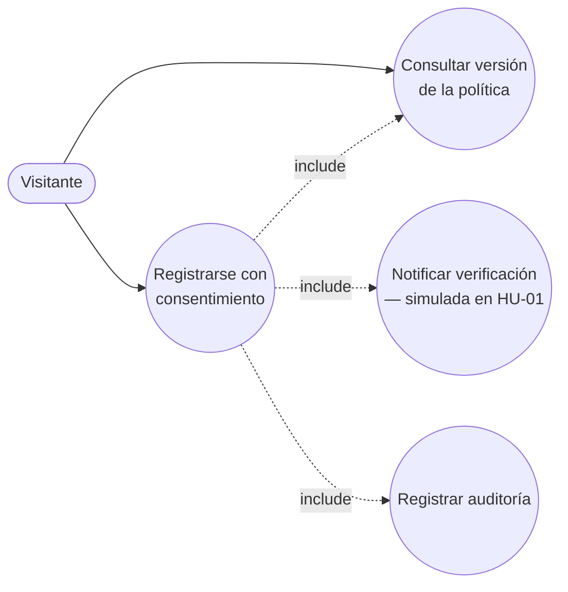
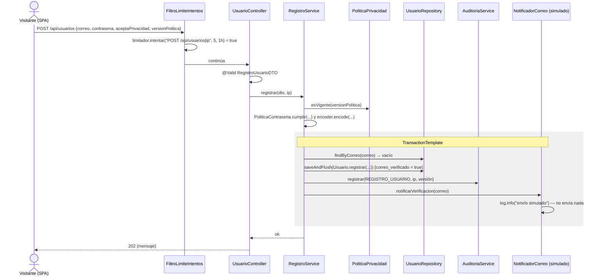
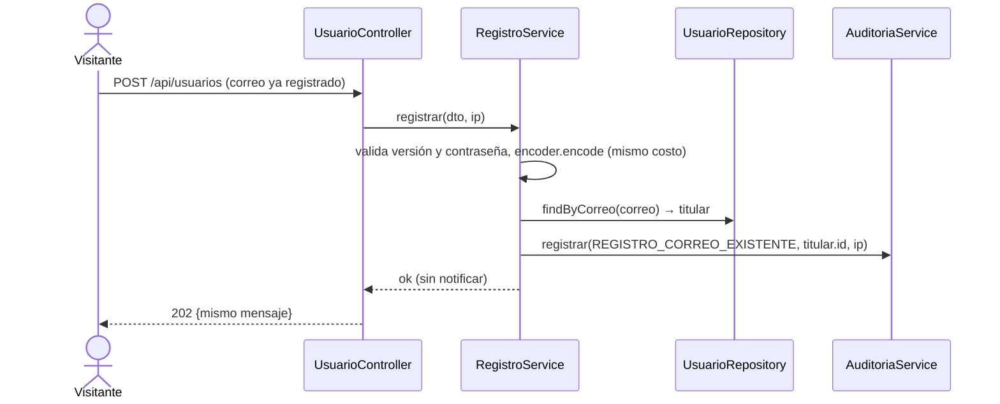
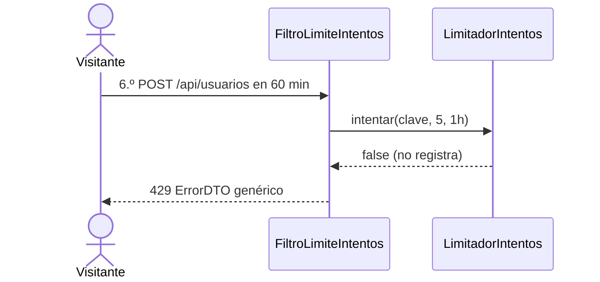
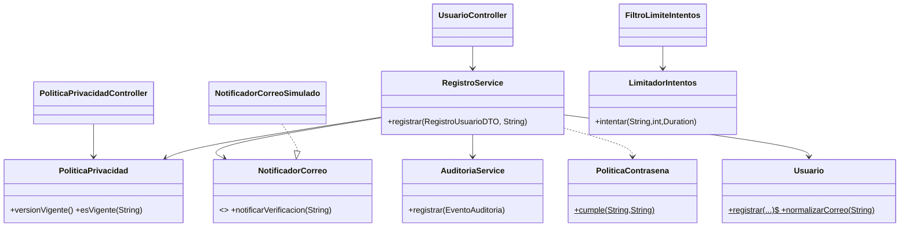

# HU-01 — Design: Registro de usuario con consentimiento

> Módulo `cuentas` · Sprint 1 · tamaño S · sin dependencias · sin patrones ★.
> HU-01 es la **primera historia del proyecto**: además de `cuentas`, construye los
> componentes transversales de `comun` que necesita (errores, auditoría, rate
> limiting, seguridad, reloj) y el kit base del frontend (`Boton`, `Campo`,
> `Alerta`, router y `api/cliente.js`), según `docs/requerimientos.md` §8 y
> `docs/frontend.md`. Hoy `2_Backend/src/main/java` solo tiene `EspacioYaApplication`:
> no hay nada que reutilizar todavía.
>
> **Sin correo real (S5, decisión del dueño 2026-10-27).** HU-01 no envía correos ni
> crea tokens: el registro llama a un puerto `NotificadorCorreo` cuya única
> implementación (`NotificadorCorreoSimulado`) solo escribe en el log. La cuenta nace
> con `correo_verificado = true`. HU-25 conectará el adaptador real a ese puerto sin
> tocar `RegistroService`.

## 1. Caso de uso



**Registrarse** — Precondición: visitante sin sesión. Flujo principal: (1) la SPA pide
la versión vigente; (2) el visitante llena correo, contraseña y marca la aceptación;
(3) la API cuenta el intento por IP, valida, crea la cuenta (ya verificada), registra
la auditoría y llama al notificador de correo (simulado); (4) responde 202 con el
mensaje de registro recibido. Flujos alternos: 429 (límite), 400 (validación,
consentimiento o versión), correo existente (mismo 202, sin notificar), 500 genérico
(error inesperado o fallo del notificador).

## 2. Archivos por módulo y capa

Paquete base `pe.edu.ulima.espacioya`. Todo es **nuevo** salvo lo marcado (M).

### `comun` (transversal, reutilizable por todas las historias)

| Capa / carpeta | Archivo | Para |
|---|---|---|
| `comun/error/` | `ReglaNegocioException` | Regla violada → 400. Constructores `(String mensaje)` y `(String campo, String mensaje)` |
| | `ErrorDTO`, `ErrorCampoDTO` | Forma única de error de toda la API |
| | `ManejadorGlobalErrores` | `@RestControllerAdvice` (R13, R24, R25) |
| `comun/auditoria/` | `Auditoria` (entidad), `AuditoriaRepository`, `AuditoriaService`, `EventoAuditoria` (record) | Componente de auditoría RNF-SEG-12 (R9, R16) |
| `comun/limite/` | `LimitadorIntentos`, `ReglaLimite` (record), `FiltroLimiteIntentos` | Rate limiting RNF-SEG-17 (R21–R23); lo reutilizan HU-03 y HU-04 |
| `comun/seguridad/` | `ConfiguracionSeguridad` | `SecurityFilterChain`, `PasswordEncoder` bcrypt(12) (R19), CORS (R27, R28) |
| `comun/configuracion/` | `ConfiguracionReloj` | Bean `Clock` (UTC) para probar plazos |
| `comun/web/` | `IpCliente` | `static String de(HttpServletRequest)` → `getRemoteAddr()` |

`comun/correo/` **no** se crea en HU-01: lo diseña HU-25 (Factory Method + Adapter).

### `cuentas`

| Capa | Archivo | Para |
|---|---|---|
| `domain/` | `Usuario`, `Rol`, `EstadoUsuario` | Cuenta (R1, R5, R8, R19, R20) |
| | `PoliticaContrasena` | Regla de contraseña §9.5 (R10–R12) |
| `repository/` | `UsuarioRepository` | Spring Data JPA |
| `service/` | `RegistroService` | Caso de uso registrar (R1–R3, R5–R20, R25) |
| | `NotificadorCorreo` (interfaz) | Puerto de notificación por correo del módulo (R3, R25) |
| | `NotificadorCorreoSimulado` | Única implementación en HU-01: solo log SLF4J (R4, R29, R30) |
| | `PoliticaPrivacidad` | Lee `espacioya.privacidad.version-vigente` (R7, R26) |
| `dto/` | `RegistroUsuarioDTO`, `MensajeDTO`, `VersionPoliticaDTO` | Entrada / salida |
| `controller/` | `UsuarioController`, `PoliticaPrivacidadController` | Endpoints |
| | `ReglasLimiteCuentas` | `@Configuration` que publica el bean `ReglaLimite` del registro |

### Recursos y configuración

| Archivo | Cambio |
|---|---|
| `2_Backend/pom.xml` | Sin cambios (no se agregan dependencias de backend) |
| `src/main/resources/application.properties` (M) | Propiedades de la §9 |
| `2_Backend/.env.example` (M) | `FRONTEND_URL` |
| `db/migration/V1_1__usuarios.sql` | Tabla `usuario` |
| `db/migration/V1_2__auditoria.sql` | Tabla `auditoria` |

### Frontend (`3_frontend/`)

Ver § 11 Pantallas.

## 3. Endpoints

| Método y ruta | Entrada | Éxito | Errores |
|---|---|---|---|
| `GET /api/politicas-privacidad/vigente` | — | 200 `VersionPoliticaDTO` | — |
| `POST /api/usuarios` | `RegistroUsuarioDTO` | 202 `MensajeDTO` (también si el correo ya existe) | 400 `ErrorDTO` (validación, consentimiento, versión, contraseña); 429 `ErrorDTO`; 500 `ErrorDTO` genérico |

Los dos son públicos (`permitAll`). No devuelven `Location` ni id.

### DTO

```java
public record RegistroUsuarioDTO(
        @NotBlank @Email @Size(max = 254) String correo,
        @NotNull String contrasena,          // reglas de contraseña en PoliticaContrasena
        @AssertTrue Boolean aceptaPrivacidad, // null o false → 400 (R6)
        @NotBlank String versionPolitica) { }

public record MensajeDTO(String mensaje) { }
public record VersionPoliticaDTO(String version) { }

// comun/error
public record ErrorDTO(String mensaje, List<ErrorCampoDTO> errores) { }   // errores: [] si no hay por campo
public record ErrorCampoDTO(String campo, String mensaje) { }
```

`RegistroUsuarioDTO` no tiene `rol`, `estado` ni `correoVerificado`: Jackson ignora
campos desconocidos (comportamiento por defecto de Spring Boot), y el servidor fija
esos valores (R20). **Esta es la forma del `ErrorDTO` que `docs/frontend.md` deja
al spec que crea el `ManejadorGlobalErrores`.**

### Mensajes (texto exacto)

| Situación | Código | `mensaje` | `errores` |
|---|---|---|---|
| Registro recibido (nuevo o existente) | 202 | "Te enviamos un correo de verificación. Revisa tu bandeja de entrada." | — |
| Bean Validation falla | 400 | "Revisa los datos del formulario." | uno por campo (`correo`: "Ingresa un correo válido."; `aceptaPrivacidad`: "Debes aceptar los términos y la política de privacidad."; `versionPolitica`/`contrasena`: ver abajo) |
| Contraseña no cumple (R10–R12) | 400 | "Revisa los datos del formulario." | `contrasena`: "La contraseña debe tener entre 8 y 64 caracteres, al menos una letra y un número, y no puede ser igual a tu correo." |
| Versión distinta (R7) | 400 | "Revisa los datos del formulario." | `versionPolitica`: "La política de privacidad se actualizó. Recarga la página y vuelve a aceptarla." |
| JSON mal formado | 400 | "Revisa los datos del formulario." | [] |
| Límite (R21) | 429 | "Hiciste demasiados intentos. Espera un momento e inténtalo de nuevo." | [] |
| Error inesperado / fallo del notificador | 500 | "Ocurrió un problema. Intenta de nuevo más tarde." | [] |

## 4. Clases y firmas públicas

```java
// cuentas/domain
public enum Rol { USUARIO, ARRENDADOR, ADMIN }
public enum EstadoUsuario { ACTIVA, SUSPENDIDA, ELIMINADA }

@Entity @Table(name = "usuario")
public class Usuario {
    protected Usuario() { }
    public static Usuario registrar(String correoNormalizado, String hashContrasena,
                                    String versionPolitica, Instant ahora); // rol USUARIO, ACTIVA, correoVerificado = true (S5)
    public static String normalizarCorreo(String correo);                // trim + toLowerCase(Locale.ROOT)
    public Long getId(); public String getCorreo(); public Rol getRol();
    public EstadoUsuario getEstado(); public boolean isCorreoVerificado();
    public String getVersionPolitica(); public Instant getFechaConsentimiento();
}

public final class PoliticaContrasena {
    public static final String REQUISITOS = "La contraseña debe tener entre 8 y 64 caracteres, ...";
    public static boolean cumple(String contrasena, String correoNormalizado);
    // longitud en code points 8..64; bytes UTF-8 ≤ 72; ≥1 Character.isLetter; ≥1 dígito '0'..'9';
    // !contrasena.equalsIgnoreCase(correoNormalizado)
}

// cuentas/repository
public interface UsuarioRepository extends JpaRepository<Usuario, Long> {
    Optional<Usuario> findByCorreo(String correoNormalizado);
}

// cuentas/service
public interface NotificadorCorreo {
    void notificarVerificacion(String correoNormalizado);
}

@Component
public class NotificadorCorreoSimulado implements NotificadorCorreo {
    private static final Logger log = LoggerFactory.getLogger(NotificadorCorreoSimulado.class);
    public void notificarVerificacion(String correoNormalizado);
    // log.info("Envío de correo de verificación simulado: no se envió ningún correo (HU-01).")
    // sin el correo en el mensaje (dato personal, Ley 29733)
}

public class RegistroService {
    public RegistroService(UsuarioRepository usuarios, PasswordEncoder encoder,
                           PoliticaPrivacidad politica, NotificadorCorreo notificador,
                           AuditoriaService auditoria, TransactionTemplate transacciones, Clock reloj);
    public void registrar(RegistroUsuarioDTO solicitud, String ip);
}
public class PoliticaPrivacidad {
    public PoliticaPrivacidad(@Value("${espacioya.privacidad.version-vigente}") String versionVigente);
    public String versionVigente();
    public boolean esVigente(String version);
}

// comun
public record EventoAuditoria(Long usuarioId, String accion, String entidad, Long entidadId,
                              String ip, String detalle) { }
public class AuditoriaService { public void registrar(EventoAuditoria evento); } // fecha = Clock

public record ReglaLimite(String metodo, String ruta, int maximo, Duration ventana) { }
public class LimitadorIntentos {
    public LimitadorIntentos(Clock reloj);
    public boolean intentar(String clave, int maximo, Duration ventana); // true = registrado; false = excedido (no registra)
}
public class FiltroLimiteIntentos extends OncePerRequestFilter {
    public FiltroLimiteIntentos(List<ReglaLimite> reglas, LimitadorIntentos limitador, JsonMapper json);
}
```

**Puerto `NotificadorCorreo`.** Vive en `cuentas/service` porque hoy solo lo usa
`cuentas` y su único método es de la verificación del registro. Es un puerto de
salida del módulo, no un puerto entre módulos (no se agrega a la tabla de
`docs/architecture.md`). `NotificadorCorreoSimulado` es el único bean que lo
implementa; no abre sockets, no usa `JavaMailSender` ni ninguna propiedad
`spring.mail.*` (R4); solo escribe una línea INFO con el mensaje de envío simulado (R29)
y nunca el correo del usuario (R30). HU-25 agregará un adaptador real (sobre `comun/correo`) y
reemplazará o desactivará el simulado; `RegistroService` no cambia porque depende solo
de la interfaz.

`ReglasLimiteCuentas` publica `new ReglaLimite("POST", "/api/usuarios", 5, Duration.ofHours(1))`
(constantes `MAXIMO_REGISTROS_POR_IP = 5`, `VENTANA_REGISTROS = Duration.ofHours(1)`).
La clave del limitador es `metodo + " " + ruta + "|" + ip`.

**`LimitadorIntentos`** guarda por clave una `Deque<Instant>` en un
`ConcurrentHashMap`; en cada intento (sincronizado por clave) descarta los instantes
con `≤ ahora − ventana`, y si quedan `maximo` devuelve `false` sin agregar (S2). Las
claves vacías se eliminan para que la memoria no crezca. En memoria basta: el sistema
es un monolito de una sola instancia.

**`FiltroLimiteIntentos`** corre antes del `DispatcherServlet`, por eso cuenta también
las solicitudes que luego fallan en Bean Validation o JSON mal formado (R22). Si una
regla coincide (método + ruta exacta) y `intentar` devuelve `false`, escribe 429 con el
`ErrorDTO` y no sigue la cadena. `OPTIONS` (preflight CORS) no coincide con ninguna regla.

**`ConfiguracionSeguridad`**: `csrf` deshabilitado, `httpBasic` y `formLogin`
deshabilitados, CORS con origen `espacioya.frontend.url` (R27, R28; el bean
`CorsConfigurationSource` debe llamarse `corsConfigurationSource` para que
`.cors(Customizer.withDefaults())` lo encuentre), `permitAll` para los dos
endpoints de §3 y `anyRequest().authenticated()`; bean
`PasswordEncoder = new BCryptPasswordEncoder(12)` (R19). HU-03 extiende esta clase con la
sesión. CSRF se apaga porque HU-01 no usa cookies ni sesión; si HU-03 elige cookie de
sesión, HU-03 decide el CSRF.

## 5. Flujo de `RegistroService.registrar`

1. Fuera de transacción: `correo = Usuario.normalizarCorreo(dto.correo())`.
2. Si `!politica.esVigente(dto.versionPolitica())` → `ReglaNegocioException("versionPolitica", …)` (R7).
3. Si `!PoliticaContrasena.cumple(dto.contrasena(), correo)` → `ReglaNegocioException("contrasena", REQUISITOS)` (R10–R12).
   Los pasos 2–3 (y Bean Validation en el controlador) ocurren **antes** de buscar el correo (R17).
4. `hash = encoder.encode(contrasena)` **siempre**, también si luego resulta que el correo
   existe: así el tiempo de respuesta no delata la existencia (R14).
5. `transacciones.execute(...)`:
   - `usuarios.findByCorreo(correo)` presente → camino **existente**:
     `auditoria.registrar(REGISTRO_CORREO_EXISTENTE)` y nada más; no se llama al
     notificador ni se modifica la cuenta (R15, R16).
   - si no → `saveAndFlush(Usuario.registrar(...))`,
     `auditoria.registrar(REGISTRO_USUARIO, detalle "versionPolitica=2026-10")`,
     `notificador.notificarVerificacion(correo)` (R1, R3, R8, R9).
   - La notificación ocurre **dentro** de la transacción y es el último paso: si lanza
     cualquier excepción, se revierte todo y el manejador responde 500 (R25). Con el
     simulado no falla, pero el contrato queda fijado para el adaptador real de HU-25.
6. Si `saveAndFlush` lanza `DataIntegrityViolationException` por `uq_usuario_correo`
   (carrera, R18), la transacción se revierte y `registrar` ejecuta el camino
   **existente** en una transacción nueva. El controlador responde 202 igual.

`AuditoriaService.registrar` es `@Transactional` (propagación por defecto): se une a
la transacción del registro, así que también se revierte con ella.

## 6. Diagramas de secuencia

### Flujo principal: registro exitoso



### Flujo de error: correo existente (respuesta indistinguible)



### Flujo de error: límite por IP



## 7. Diagrama de clases (resumen)



## 8. Migraciones Flyway

`V1_1__usuarios.sql`

```sql
CREATE TABLE usuario (
    id                   BIGINT GENERATED ALWAYS AS IDENTITY PRIMARY KEY,
    correo               VARCHAR(254) NOT NULL,
    hash_contrasena      VARCHAR(100) NOT NULL,
    rol                  VARCHAR(20)  NOT NULL,
    correo_verificado    BOOLEAN      NOT NULL DEFAULT FALSE,
    estado               VARCHAR(20)  NOT NULL,
    version_politica     VARCHAR(20)  NOT NULL,
    fecha_consentimiento TIMESTAMPTZ  NOT NULL,
    CONSTRAINT uq_usuario_correo UNIQUE (correo),
    CONSTRAINT ck_usuario_correo_normalizado CHECK (correo = lower(btrim(correo))),
    CONSTRAINT ck_usuario_rol CHECK (rol IN ('USUARIO', 'ARRENDADOR', 'ADMIN')),
    CONSTRAINT ck_usuario_estado CHECK (estado IN ('ACTIVA', 'SUSPENDIDA', 'ELIMINADA'))
);
```

`V1_2__auditoria.sql`

```sql
CREATE TABLE auditoria (
    id         BIGINT GENERATED ALWAYS AS IDENTITY PRIMARY KEY,
    usuario_id BIGINT REFERENCES usuario (id),
    accion     VARCHAR(60) NOT NULL,
    entidad    VARCHAR(60),
    entidad_id BIGINT,
    ip         VARCHAR(45),
    fecha      TIMESTAMPTZ NOT NULL,
    detalle    TEXT
);
CREATE INDEX ix_auditoria_usuario ON auditoria (usuario_id);
CREATE INDEX ix_auditoria_fecha ON auditoria (fecha);
```

Notas frente a `docs/modelo-datos.md`:

- `usuario` se crea **solo con las columnas que usan HU-01 y HU-03**. `nombre`,
  `telefono`, `foto_url` y `recordatorios_activos` las agregan HU-02/HU-20/HU-25 con
  su migración (no se cambia ningún nombre ni estado del modelo).
- `correo_verificado` conserva `DEFAULT FALSE` del modelo; `Usuario.registrar` lo fija
  en `true` de forma explícita (S5). Cuando HU-25 traiga el correo real, basta con
  cambiar la fábrica, sin migración.
- La tabla `token` **no** se crea en HU-01 (ya no hay token `VERIFICACION`); la crea
  HU-04 con su migración, con el `CHECK` de tipos que necesite.
- `ck_usuario_correo_normalizado` garantiza R5 en la BD; `uq_usuario_correo` es la
  restricción clave de HU-01 y resuelve la carrera R18.
- `auditoria.ip` y `usuario_id` son anulables: habrá eventos sin usuario o sin
  solicitud HTTP (procesos programados). La FK a `usuario` es solo en la BD; en JPA
  `Auditoria.usuarioId` es un `Long` para que `comun` no dependa de `cuentas`.
- Tipos de enum se guardan como `VARCHAR` + `@Enumerated(EnumType.STRING)` + `CHECK`.

## 9. Configuración (`application.properties`)

```properties
espacioya.privacidad.version-vigente=2026-10
espacioya.frontend.url=${FRONTEND_URL:http://localhost:5173}
```

Sin secretos en el repositorio: solo nombres en `.env.example`. No hay propiedades
`spring.mail.*` ni de correo (S5).

## 10. Excepciones y componentes de `comun`

| Excepción / caso | Código | Dónde |
|---|---|---|
| `ReglaNegocioException` (nueva) | 400 | `ManejadorGlobalErrores`; con `campo` → va en `errores` |
| `MethodArgumentNotValidException` | 400 | un `ErrorCampoDTO` por campo con el mensaje de la anotación |
| `HttpMessageNotReadableException` | 400 | mensaje genérico, sin detalle de Jackson |
| `Exception` (incluye un fallo del notificador) | 500 | genérico; traza solo al log (R24, R25) |
| 429 | 429 | lo escribe `FiltroLimiteIntentos` directamente, no es excepción |

`RecursoNoEncontradoException` y `AccesoDenegadoException` (de `docs/conventions.md`)
**no** se crean en HU-01 porque ningún R las usa; las agrega la primera historia que
las necesite.

**Puertos entre módulos:** ninguno. HU-01 no usa otros módulos ni crea
`CuentaService` (no hay consumidores todavía; YAGNI). `comun` no depende de `cuentas`.
`NotificadorCorreo` es un puerto interno de `cuentas` (ver §4).

**Seguridad de logs:** ni la contraseña, ni su hash, ni el correo del usuario se
escriben en logs (el correo en el notificador: R30). Solo SLF4J; nada de `System.out` (`docs/conventions.md`).

## 11. Pantallas

Kit nuevo en `src/components/ui/` (cada uno con su `.module.css`, solo tokens):

| Componente | Props | Nota |
|---|---|---|
| `Boton` | `variante` (`primario`, `secundario`, `peligro`, `peligro-confirmar`), `cargando`, `deshabilitado`, `onClick`, `tipo` (`button`/`submit`), `children` | Con `cargando` queda deshabilitado y muestra "Enviando…" |
| `Campo` | `etiqueta`, `nombre`, `tipo`, `valor`, `onChange`, `error`, `ayuda` | `tipo="checkbox"` renderiza la casilla con la etiqueta a la derecha y `valor` booleano; `etiqueta` acepta nodo (para el enlace a la política). `aria-invalid` y `aria-describedby` hacia error/ayuda |
| `Alerta` | `tipo` (`exito`, `atencion`, `error`, `info`), `children` | `role="alert"` para `error`, `role="status"` para el resto |

Infraestructura: `react-router-dom` (dependencia nueva, prevista en `docs/frontend.md`);
`main.jsx` monta `BrowserRouter`; `App.jsx` (M) define el encabezado y las rutas
`/`, `/registro`, `/privacidad`. `App.css` se reemplaza por un CSS Module si hace falta.

`src/api/cliente.js`: `peticion(ruta, { metodo, cuerpo })` sobre `fetch` con
`import.meta.env.VITE_API_URL`, JSON, y si `!res.ok` lanza un objeto
`{ mensaje, errores }` (el `ErrorDTO`); si no hay respuesta lanza
`{ mensaje: "No pudimos conectar. Intenta de nuevo.", errores: [] }`.

`src/api/cuentas.js`:

| Función | Endpoint |
|---|---|
| `obtenerVersionPrivacidad()` | `GET /api/politicas-privacidad/vigente` |
| `registrarUsuario({ correo, contrasena, aceptaPrivacidad, versionPolitica })` | `POST /api/usuarios` |

### Registro — `/registro` → `pages/cuentas/Registro.jsx`

- Al montar llama `obtenerVersionPrivacidad()` y guarda la versión; si falla, `Alerta`
  error y el botón queda deshabilitado.
- `Campo` correo (`email`), `Campo` contraseña (`password`, `ayuda` = requisitos de
  contraseña), `Campo` checkbox "Acepto los términos y la [política de privacidad]"
  (enlace a `/privacidad`, nueva pestaña), `Boton` primario "Crear cuenta" con `cargando`.
- Validación del cliente solo de ayuda: el botón se deshabilita si la casilla no está
  marcada (CA2 visible); el servidor revalida.
- **CA1:** 202 → se reemplaza el formulario por `Alerta` `exito` con el `mensaje` de la
  API ("Te enviamos un correo de verificación…"). Es el envío simulado de S5: no llega
  ningún correo.
- **CA2:** 400 con `errores[aceptaPrivacidad]` → error bajo la casilla; el formulario
  sigue visible y no hay mensaje de éxito.
- **CA3 (contraseña débil):** 400 → `Alerta` error con el `mensaje` y el texto de
  requisitos bajo `Campo` contraseña (borde rojo).
- **CA3 (correo existente):** la API responde 202 → se ve exactamente lo mismo que en CA1.
- Versión desactualizada: error bajo la casilla con el texto de la API.
- 429 / 500 / red: `Alerta` error con el mensaje tal cual.

### Política de privacidad — `/privacidad` → `pages/cuentas/Privacidad.jsx`

- Título "Política de privacidad y términos", la versión que devuelve
  `obtenerVersionPrivacidad()` y el texto que provee el equipo (supuesto S3).

### Inicio — `/` (en `App.jsx`)

- Encabezado "EspacioYa" y un enlace a `/registro`. Nada más (las demás pantallas las
  agregan sus historias).

**Estados:** HU-01 no muestra `EtiquetaEstado`. No hay estado nuevo. ⚠ Por S5 la cuenta
recién registrada queda en "correo verificado", no en "correo pendiente" como dice la
tabla "Estados del sistema" de `docs/architecture.md` ("Aplica también al usuario
recién registrado"). Esa nota de `docs/` la ajusta el dueño u orquestador; el spec no
edita `docs/`.

## 12. Plan de pruebas (R → test)

| R | Test |
|---|---|
| R1, R2, R5, R20 | `UsuarioControllerIT` (registro válido → `correo_verificado = true`; campos `rol`/`estado`/`correoVerificado: false` extra ignorados; correo con mayúsculas guardado normalizado), `UsuarioTest` |
| R3 | `RegistroServiceTest` (notificador llamado una vez con el correo normalizado), `UsuarioControllerIT` (el notificador falso capturó una llamada) |
| R4 | `NotificadorCorreoSimuladoTest` (sin colaboradores de red: constructores sin parámetros y solo campos `org.slf4j.*`) |
| R29, R30 | `NotificadorCorreoSimuladoTest` (`OutputCaptureExtension`: R29, la salida tiene una línea INFO con el mensaje de envío simulado; R30, ni la salida estándar ni la de error contienen el correo) |
| R6, R7, R13 | `UsuarioControllerIT` (400, BD sin filas, notificador sin llamadas) |
| R8, R9 | `RegistroServiceTest`, `UsuarioControllerIT` (fila de `auditoria` con IP y versión) |
| R10, R11, R12 | `PoliticaContrasenaTest` (límites 7/8/64/65, 73 bytes, sin letra, sin dígito, igual al correo en otro caso), `UsuarioControllerIT` (400 con `errores[contrasena]`) |
| R14, R15, R16 | `RegistroServiceTest` (camino existente: sin `save`, sin notificar, auditoría), `UsuarioControllerIT` (cuerpo y código idénticos a un registro nuevo) |
| R17 | `UsuarioControllerIT` (contraseña débil con correo existente = misma respuesta que con correo nuevo) |
| R18 | `UsuarioControllerIT` (dos hilos con `CountDownLatch` → una fila, dos 202) |
| R19 | `UsuarioControllerIT` (`hash_contrasena` empieza con `$2a$12$`, `matches` true; dos cuentas con la misma contraseña → hashes distintos) |
| R21, R23 | `LimitadorIntentosTest` (reloj mutable: 5 ok, 6.º falso, al avanzar 60 min vuelve a aceptar), `UsuarioControllerIT` (6.º → 429 con mensaje) |
| R22 | `UsuarioControllerIT` (5 solicitudes inválidas → la 6.ª válida recibe 429) |
| R24 | `ManejadorGlobalErroresTest` (MockMvc standalone con controlador de prueba que lanza `RuntimeException`; cuerpo sin `trace`/`exception`) |
| R25 | `RegistroServiceTest` + `UsuarioControllerIT` (notificador falso lanza → 500 y BD sin usuario) |
| R26 | `PoliticaPrivacidadControllerIT` |
| R27 | `UsuarioControllerIT` (preflight desde `espacioya.frontend.url` → 200 con ACAO; `POST` desde el frontend → 202 con ACAO) |
| R28 | `UsuarioControllerIT` (preflight desde otro origen → 403 sin ACAO) |

Reglas de las IT: `@Import(TestcontainersConfiguration.class)` y una
`@TestConfiguration` de prueba con un `NotificadorCorreo` falso `@Primary` que captura
llamadas (y puede configurarse para fallar) y un `Clock` controlable. Cada test usa una
**IP distinta** (`request.setRemoteAddr("10.0.0.n")`) para que el limitador, que es un
singleton, no mezcle pruebas.

## 13. Alternativas descartadas

1. **400 con mensaje genérico ante correo duplicado.** Descartada por decisión del
   dueño: un 400 en un formulario que con otro correo da 202 confirma que el correo
   existe (STRIDE I). Se responde 202 igual. No se avisa al titular: en HU-01 no hay
   correo (S5).
2. **201 Created con `Location`.** Descartada: en el caso duplicado sería falso y el
   `Location`/id delataría la diferencia. `202 Accepted` + mensaje es igual en ambos
   casos.
3. **Validar la contraseña con `@Pattern` en el DTO.** Descartada: la regla "distinta
   del correo" y el tope de 72 bytes necesitan los dos campos y no caben en una
   anotación simple; tenerla en `PoliticaContrasena` deja una sola fuente que HU-04
   (recuperación) reutiliza.
4. **Rate limiting con Bucket4j o en `@Valid` del controlador.** Bucket4j es una
   dependencia más para una ventana deslizante de 30 líneas; contar en el controlador
   dejaría fuera las solicitudes que fallan en Bean Validation, y §9.7 dice que cuentan
   todas. Se usa un filtro propio en `comun`.
5. **Mantener token `VERIFICACION` y endpoint de verificación con un SMTP de pruebas
   (Mailpit).** Descartada por decisión del dueño (S5): agrega dependencia, tabla,
   endpoint y pantalla que HU-01 no necesita, y obliga a HU-03 a un paso de
   verificación. El puerto `NotificadorCorreo` deja la puerta abierta a HU-25.
6. **Crear ya `comun/correo/` (`EnviadorCorreo`, `MensajeCorreo`) en vez de un puerto en
   `cuentas`.** Descartada: es exactamente lo que diseña HU-25 con Factory Method +
   Adapter; adelantarlo fijaría su diseño sin sus CA. Un puerto de un método en
   `cuentas` es lo mínimo para que HU-25 se conecte sin tocar `RegistroService`.
7. **Llamar al notificador sin interfaz (log directo en `RegistroService`).**
   Descartada: HU-25 tendría que editar el registro y el test no podría simular un
   fallo del envío (R25).
8. **Argon2.** Requiere Bouncy Castle (dependencia extra); bcrypt cumple RNF-SEG-05.
