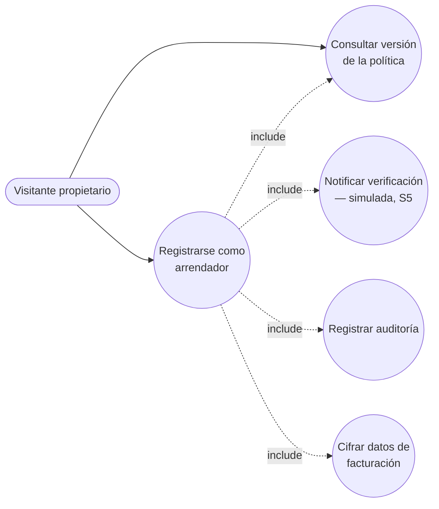
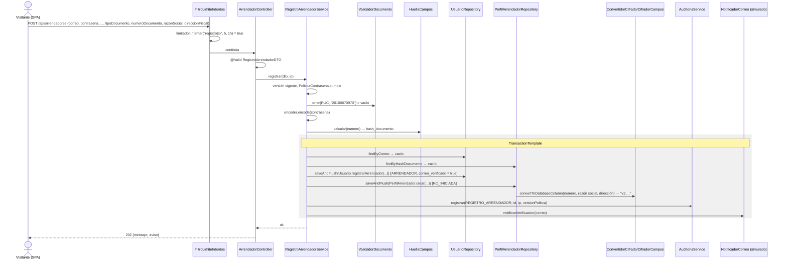
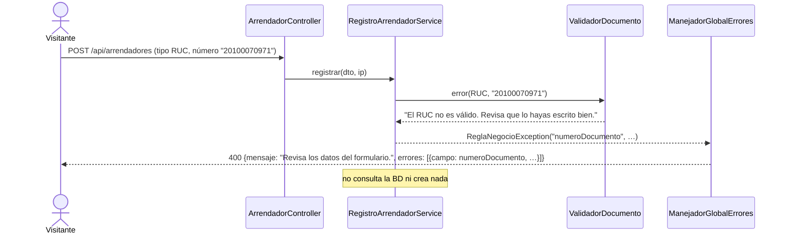
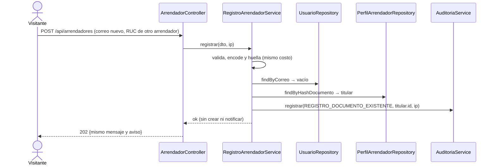
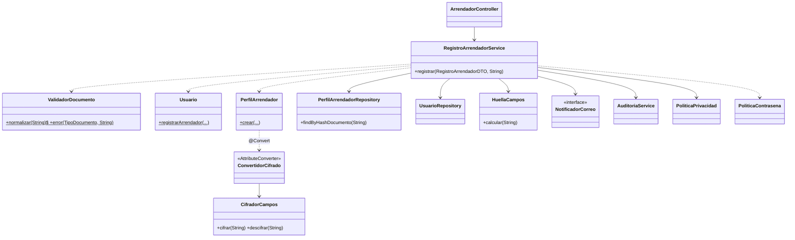

# HU-02 — Design: Registro de arrendador

> Módulo `cuentas` · Sprint 1 · tamaño S · depende de HU-01 (`done`) · sin patrones ★.
> Reutiliza todo lo que construyó HU-01 (`comun/error`, `comun/auditoria`, `comun/limite`,
> `comun/seguridad`, `comun/web`, `Clock`, `NotificadorCorreo`, `PoliticaPrivacidad`,
> `PoliticaContrasena`, kit `Boton`/`Campo`/`Alerta`, `api/cliente.js`) y construye el
> componente transversal **"Cifrado de campos sensibles en reposo"** (RNF-SEG-14,
> `docs/requerimientos.md` §8) en `comun/cifrado/`, que reutilizarán HU-05, HU-17 y HU-18.
>
> **Sin correo real (S5 de HU-01) y sin sesión (HU-03).** Ver ⚠ D1 en `requirements.md`:
> el arrendador nace con `correo_verificado = true` y el aviso de identidad se muestra en
> la confirmación del registro.

## 1. Decisiones (para revisión rápida del dueño)

Decisiones del dueño (obligatorias): huecos 4, 5 y 6 (`requirements.md`). Pendiente de
confirmar: **D1** (huecos 1-2). Decisiones técnicas del spec_author:

| # | Hueco | Decisión | Por qué |
|---|-------|----------|---------|
| DT-1 | 3 | **AES-256-GCM** con `javax.crypto` (JDK), IV aleatorio de 12 bytes (`SecureRandom`) por valor, tag de 128 bits. Valor guardado: `"v1:" + base64(iv ‖ texto_cifrado+tag)` en columna `TEXT`. **Sin dependencias nuevas.** | GCM cifra y autentica (detecta alteración, R36). El prefijo `v1:` permite rotar llave o algoritmo en HU-05/17/18 sin migración. `TEXT` base64 se lee y depura más fácil que `BYTEA` y JPA lo mapea como `String`. |
| DT-2 | 3 | Se aplica con un **`AttributeConverter<String,String>` JPA** (`ConvertidorCifrado`, bean de Spring) puesto con `@Convert` en cada campo cifrado. | El cifrado queda fuera del servicio y del dominio; HU-05/17/18 solo anotan sus campos. Spring Boot registra `SpringBeanContainer` en Hibernate, así que el convertidor recibe el bean `CifradorCampos` por constructor. |
| DT-3 | 3, 6 | **Dos llaves** por variable de entorno: `CIFRADO_LLAVE` (AES) y `CIFRADO_LLAVE_HUELLA` (HMAC), cada una 32 bytes en base64 (`openssl rand -base64 32`). En `application.properties` con default vacío; los componentes **fallan al arrancar** si falta una, si no mide 32 bytes (R38) o si son iguales (R39). El mensaje nombra la variable y nunca su valor. | RNF-ARQ-07. Llaves separadas: filtrar la de huella no permite descifrar, y viceversa. Fallar al arrancar evita guardar datos en claro o con una llave equivocada. |
| DT-4 | 3 | **Llaves de prueba** en `2_Backend/src/test/resources/config/application.properties` (solo dos propiedades, valores fijos marcados "solo pruebas"). Spring Boot carga `classpath:/config/` encima de `classpath:/application.properties`, así que las IT de HU-01 y HU-02 arrancan sin variables de entorno y el `application.properties` principal no cambia de forma. | No rompe las IT de HU-01 ni `EspacioYaApplicationIT`; no hay archivo `.env` ni `.key` trackeado (la regla de secretos de `init.sh` sigue verde). Las unitarias no levantan Spring y crean el cifrador con llaves de prueba en el propio test. |
| DT-5 | 6 | `hash_documento` = **HMAC-SHA256** (hex, 64 caracteres) del número normalizado con la llave de huella; índice único `uq_perfil_arrendador_hash_documento`. | AES-GCM con IV aleatorio no es determinístico: no admite índice único. Un SHA-256 simple se revierte probando los 10⁸ DNI posibles; el HMAC con llave secreta no. |
| DT-6 | 7 | Endpoint nuevo **`POST /api/arrendadores`** (público) con su `RegistroArrendadorDTO`; `POST /api/usuarios` no cambia. | El rol lo decide la ruta en el servidor (E), sin campo `rol` en ningún DTO. Mantener separados los DTO evita que HU-01 acepte campos de facturación. |
| DT-7 | 7 | **Cupo de rate limiting compartido**: 5 intentos por IP por hora sumando los dos registros (R42). `ReglaLimite` gana un componente `grupo` (la clave pasa a `grupo + "|" + ip`) con un constructor de 4 argumentos que conserva el comportamiento actual (`grupo = metodo + " " + ruta`). Las dos reglas de `ReglasLimiteCuentas` usan `grupo = "registro"`. | §9.7 habla de "intentos de registro por IP": con cupos separados un atacante tendría 10/h. El cambio en `comun/limite` es aditivo; ningún test de HU-01 construye `ReglaLimite` ni depende del texto de la clave. |
| DT-8 | 8 | Si el correo ya es de una cuenta (de cualquier rol, incluida una `USUARIO`), **202 idéntico sin cambios** y auditoría `REGISTRO_CORREO_EXISTENTE` (R22–R24). No se convierte un `USUARIO` en `ARRENDADOR`. | Sin sesión no se puede probar que quien envía es el titular; convertir sería una elevación de privilegios. La conversión, si se quiere, es otra historia. |
| DT-9 | 6 | Orden de comprobación dentro de la transacción: primero correo, luego documento. Si ambos existen gana el correo (`REGISTRO_CORREO_EXISTENTE`). Las carreras (R29, R30) se detectan por `DataIntegrityViolationException` de `uq_usuario_correo` o `uq_perfil_arrendador_hash_documento` y se resuelven en una transacción nueva con el mismo orden. | Mismo patrón probado en HU-01 (R18). |
| DT-10 | 12 | **Cifrado en tránsito = TLS del despliegue** (HTTPS en UAT, `docs/architecture.md` Stack). No se programa nada en HU-02; en local es HTTP. Se verifica en la caja negra de UAT (`docs/verification.md`). En código se cubre la parte verificable: la API no devuelve datos de facturación (R40) y el DTO no los imprime (R41). | TLS no se termina en Spring Boot en este proyecto; forzar HTTPS en local rompería el entorno de desarrollo. |
| DT-11 | 9 | FK `perfil_arrendador.usuario_id → usuario(id) ON DELETE CASCADE`. | `UsuarioControllerIT.preparar()` hace `DELETE FROM usuario`; sin cascada fallaría al haber perfiles de las IT de HU-02 en la misma BD. HU-22 anonimiza (no borra), así que la cascada no tiene efecto en producción. |
| DT-12 | 10 | **Servicio nuevo `RegistroArrendadorService`**; `RegistroService` de HU-01 **no se toca**. Reutiliza `PoliticaPrivacidad`, `PoliticaContrasena`, `Usuario.normalizarCorreo`, `NotificadorCorreo`, `AuditoriaService` y las constantes de acción de `RegistroService`. | Cero riesgo para las unitarias e IT de HU-01. La parte repetida (≈ 20 líneas: hash siempre, transacción, carrera) tiene además una segunda restricción (documento) que el núcleo de HU-01 no conoce. Ver alternativa 2. |
| DT-13 | 4 | `nombre` y `telefono` como columnas **nuevas y anulables** de `usuario` (los `USUARIO` de HU-01 no las tienen), en claro, con `CHECK` de formato del teléfono. `tipo_documento` queda **en claro** con su `CHECK (DNI, RUC)`; `numero_documento`, `razon_social` y `direccion_fiscal` van cifrados en columnas separadas. | Nombre y teléfono son datos de contacto (RNF-SEG-14 no los lista y RNF-SEG-16 ya limita quién los ve). El tipo solo dice si es persona o empresa; cifrarlo impediría el `CHECK` del modelo. **Dueño: si quieres el tipo cifrado también, dilo al aprobar.** |
| DT-14 | 4 | Longitudes: `nombre` ≤ 100, `razonSocial` ≤ 150, `direccionFiscal` ≤ 200 caracteres. | Cubren nombres y razones sociales reales de SUNAT; acotan el tamaño cifrado. |
| DT-15 | 13 | `docs/modelo-datos.md` cambia: `perfil_arrendador.datos_facturacion` se reemplaza por `razon_social (cifrada)` y `direccion_fiscal (cifrada)`, y se agrega `hash_documento (único)`; restricción `perfil_arrendador.hash_documento` único en "Restricciones clave". Lo hace el implementer en el mismo PR (regla del encabezado de ese archivo). | Regla del modelo de datos. |
| DT-16 | 11 | Frontend: `Campo` gana `tipo="select"` con prop `opciones` (`[{ valor, etiqueta }]`). Pantalla nueva `/registro-arrendador`. No se crea `EtiquetaEstado` (no se muestra un estado, solo el aviso). | `docs/frontend.md`: si falta un componente se agrega al kit. YAGNI con `EtiquetaEstado`: la primera historia que muestre un estado lo construye. |

## 2. Caso de uso



**Registrarse como arrendador** — Precondición: visitante sin sesión. Flujo principal:
(1) la SPA pide la versión vigente; (2) el visitante llena correo, contraseña, nombre,
teléfono, tipo y número de documento, razón social o nombre, dirección fiscal y marca la
aceptación; (3) la API cuenta el intento por IP (cupo compartido con `/api/usuarios`),
valida, crea el usuario `ARRENDADOR` (correo ya verificado, D1) y su perfil
(`NO_INICIADA`, facturación cifrada), audita y llama al notificador simulado; (4) responde
202 con el mensaje de registro recibido y el aviso de identidad. Flujos alternos: 429,
400 (validación, consentimiento, versión, contraseña, RUC/DNI), correo o documento
existente (mismo 202, sin crear nada), 500 genérico.

## 3. Archivos por módulo y capa

Paquete base `pe.edu.ulima.espacioya`. (N) nuevo · (M) modificado.

### `comun`

| Carpeta | Archivo | Para |
|---|---|---|
| `comun/cifrado/` (N) | `CifradorCampos` | AES-256-GCM: `cifrar`, `descifrar` (R34–R36, R38, R39) |
| | `HuellaCampos` | HMAC-SHA256 determinístico: `calcular` (R37, R38, R39) |
| | `ConvertidorCifrado` | `AttributeConverter<String,String>` que delega en `CifradorCampos` (R34) |
| `comun/limite/` (M) | `ReglaLimite` | Componente `grupo` + constructor de 4 argumentos (R42) |
| `comun/seguridad/` (M) | `ConfiguracionSeguridad` | `permitAll` para `POST /api/arrendadores` (R1) |

### `cuentas`

| Capa | Archivo | Para |
|---|---|---|
| `domain/` (M) | `Usuario` | Campos `nombre`, `telefono`; fábrica `registrarArrendador` (R1, R3, R4, R31) |
| `domain/` (N) | `PerfilArrendador` | Entidad `perfil_arrendador` (R2, R34, R37) |
| | `TipoDocumento`, `EstadoIdentidad` | Enums (R2, R16) |
| | `ValidadorDocumento` | Reglas DNI/RUC y mensajes (R17–R21) |
| `repository/` (N) | `PerfilArrendadorRepository` | `findByHashDocumento` (R25–R27) |
| `service/` (N) | `RegistroArrendadorService` | Caso de uso (R1–R10, R17–R30, R32, R33, R44) |
| `dto/` (N) | `RegistroArrendadorDTO`, `RegistroArrendadorRecibidoDTO` | Entrada / salida (R5, R8–R16, R40, R41) |
| `controller/` (N) | `ArrendadorController` | `POST /api/arrendadores` (R1, R5) |
| `controller/` (M) | `ReglasLimiteCuentas` | Regla del nuevo endpoint y grupo compartido (R42, R43) |

`RegistroService`, `UsuarioController`, `RegistroUsuarioDTO` y `NotificadorCorreoSimulado`
**no cambian**.

### Recursos, configuración y docs

| Archivo | Cambio |
|---|---|
| `2_Backend/pom.xml` | Sin cambios |
| `src/main/resources/application.properties` (M) | `espacioya.cifrado.llave` y `espacioya.cifrado.llave-huella` (§10) |
| `2_Backend/.env.example` (M) | `CIFRADO_LLAVE=` y `CIFRADO_LLAVE_HUELLA=` sin valor, con la forma de generarlas |
| `src/test/resources/config/application.properties` (N) | Llaves de prueba (DT-4) |
| `db/migration/V1_3__perfil_arrendador.sql` (N) | Columnas de `usuario` y tabla `perfil_arrendador` (§9) |
| `docs/modelo-datos.md` (M) | DT-15 |
| `docs/architecture.md` (M) | Principio 7: agregar "`perfil_arrendador.hash_documento` único (HU-02)" |

### Frontend (`3_frontend/src/`)

Ver § 12 Pantallas.

## 4. Endpoints

| Método y ruta | Entrada | Éxito | Errores |
|---|---|---|---|
| `POST /api/arrendadores` | `RegistroArrendadorDTO` | 202 `RegistroArrendadorRecibidoDTO` (también si el correo o el documento ya existen) | 400 `ErrorDTO` (validación, consentimiento, versión, contraseña, RUC/DNI); 429 `ErrorDTO`; 500 `ErrorDTO` genérico |
| `GET /api/politicas-privacidad/vigente` | (de HU-01, sin cambios) | 200 `VersionPoliticaDTO` | — |

Público (`permitAll`). Sin `Location` ni id. CORS: lo cubre la configuración de HU-01 para
`/api/**`.

### DTO

```java
public record RegistroArrendadorDTO(
        @NotBlank(message = MENSAJE_CORREO) @Email(message = MENSAJE_CORREO)
        @Size(max = 254, message = MENSAJE_CORREO) String correo,
        @NotNull(message = PoliticaContrasena.REQUISITOS) String contrasena,
        @NotNull(message = MENSAJE_ACEPTACION) @AssertTrue(message = MENSAJE_ACEPTACION) Boolean aceptaPrivacidad,
        @NotBlank(message = MENSAJE_VERSION_DESACTUALIZADA) String versionPolitica,
        @NotBlank(message = MENSAJE_NOMBRE) @Size(max = 100, message = MENSAJE_NOMBRE) String nombre,
        @NotNull(message = MENSAJE_TELEFONO) @Pattern(regexp = "9[0-9]{8}", message = MENSAJE_TELEFONO) String telefono,
        @NotNull(message = MENSAJE_TIPO_DOCUMENTO) @Pattern(regexp = "DNI|RUC", message = MENSAJE_TIPO_DOCUMENTO)
        String tipoDocumento,
        @NotBlank(message = ValidadorDocumento.MENSAJE_NUMERO_FALTA) String numeroDocumento,
        @NotBlank(message = MENSAJE_RAZON_SOCIAL) @Size(max = 150, message = MENSAJE_RAZON_SOCIAL) String razonSocial,
        @NotBlank(message = MENSAJE_DIRECCION) @Size(max = 200, message = MENSAJE_DIRECCION) String direccionFiscal) {
    // MENSAJE_CORREO, MENSAJE_ACEPTACION, MENSAJE_VERSION_DESACTUALIZADA: se referencian de RegistroUsuarioDTO.
    @Override public String toString(); // "RegistroArrendadorDTO[correo=***, contrasena=***, ..., tipoDocumento=RUC, ...]" (R41)
}

public record RegistroArrendadorRecibidoDTO(String mensaje, String aviso) { }
```

- `tipoDocumento` es `String` con `@Pattern` (no el enum) para que un valor desconocido
  dé un error **por campo** (R16) y no el 400 sin campos de Jackson.
- Sin `rol`, `estado`, `correoVerificado` ni `estadoIdentidad`: Jackson ignora campos
  desconocidos y el servidor los fija (R31).
- `toString` solo deja ver `aceptaPrivacidad`, `versionPolitica` y `tipoDocumento`.

### Mensajes (texto exacto)

| Situación | Código | `mensaje` | `errores` |
|---|---|---|---|
| Registro recibido (nuevo, correo o documento existente) | 202 | "Te enviamos un correo de verificación. Revisa tu bandeja de entrada." + `aviso`: "Para publicar tus espacios, primero debes verificar tu identidad." | — |
| Bean Validation | 400 | "Revisa los datos del formulario." | uno por campo: `correo` "Ingresa un correo válido."; `aceptaPrivacidad` "Debes aceptar los términos y la política de privacidad."; `nombre` "Ingresa tu nombre completo (máximo 100 caracteres)."; `telefono` "Ingresa un celular de 9 dígitos que empiece con 9."; `tipoDocumento` "Elige el tipo de documento: DNI o RUC."; `numeroDocumento` "Ingresa tu número de documento."; `razonSocial` "Ingresa la razón social o tu nombre (máximo 150 caracteres)."; `direccionFiscal` "Ingresa la dirección fiscal (máximo 200 caracteres)." |
| Contraseña (R10) / versión (R9) | 400 | "Revisa los datos del formulario." | igual que HU-01 |
| DNI ≠ 8 dígitos (R18) | 400 | "Revisa los datos del formulario." | `numeroDocumento`: "El DNI debe tener 8 dígitos." |
| RUC ≠ 11 dígitos (R19) | 400 | ídem | `numeroDocumento`: "El RUC debe tener 11 dígitos." |
| RUC prefijo (R20) | 400 | ídem | `numeroDocumento`: "El RUC debe empezar con 10, 15, 17 o 20." |
| RUC verificador (R21) | 400 | ídem | `numeroDocumento`: "El RUC no es válido. Revisa que lo hayas escrito bien." |
| Límite (R42) | 429 | "Hiciste demasiados intentos. Espera un momento e inténtalo de nuevo." | [] |
| Inesperado / notificador (R44) | 500 | "Ocurrió un problema. Intenta de nuevo más tarde." | [] |

Ningún mensaje repite el valor enviado (R40).

## 5. Clases y firmas públicas

```java
// comun/cifrado
@Component
public class CifradorCampos {
    public static final String VARIABLE_LLAVE = "CIFRADO_LLAVE";
    public CifradorCampos(@Value("${espacioya.cifrado.llave}") String llaveBase64,
                          @Value("${espacioya.cifrado.llave-huella}") String llaveHuellaBase64);
    // IllegalStateException("Falta CIFRADO_LLAVE o no es una llave AES-256 en base64 (32 bytes)") (R38)
    // IllegalStateException si llaveBase64 decodificada == llaveHuella decodificada (R39)
    public String cifrar(String claro);     // null → null; "v1:" + base64(iv(12) ‖ cifrado+tag(16))
    public String descifrar(String guardado); // null → null; AEADBadTagException / formato → IllegalStateException (R36)
}

@Component
public class HuellaCampos {
    public static final String VARIABLE_LLAVE = "CIFRADO_LLAVE_HUELLA";
    public HuellaCampos(@Value("${espacioya.cifrado.llave-huella}") String llaveBase64); // R38
    public String calcular(String claro);   // HmacSHA256 → hex minúsculas, 64 caracteres (R37)
}

@Component
@Converter
public class ConvertidorCifrado implements AttributeConverter<String, String> {
    public ConvertidorCifrado(CifradorCampos cifrador);
    public String convertToDatabaseColumn(String claro);  // cifrador.cifrar
    public String convertToEntityAttribute(String guardado); // cifrador.descifrar
}

// comun/limite (M)
public record ReglaLimite(String metodo, String ruta, int maximo, Duration ventana, String grupo) {
    public ReglaLimite(String metodo, String ruta, int maximo, Duration ventana); // grupo = metodo + " " + ruta
    public boolean aplicaA(String metodoSolicitud, String rutaSolicitud);         // sin cambios
    public String clave(String ip);                                               // grupo + "|" + ip
}

// cuentas/domain
public enum TipoDocumento { DNI, RUC }
public enum EstadoIdentidad { NO_INICIADA, EN_REVISION, VERIFICADA, RECHAZADA }

public final class ValidadorDocumento {
    public static final String MENSAJE_NUMERO_FALTA = "Ingresa tu número de documento.";
    public static final String MENSAJE_DNI = "El DNI debe tener 8 dígitos.";
    public static final String MENSAJE_RUC_LONGITUD = "El RUC debe tener 11 dígitos.";
    public static final String MENSAJE_RUC_PREFIJO = "El RUC debe empezar con 10, 15, 17 o 20.";
    public static final String MENSAJE_RUC_VERIFICADOR = "El RUC no es válido. Revisa que lo hayas escrito bien.";
    public static String normalizar(String numero);                         // trim; null → null
    public static Optional<String> error(TipoDocumento tipo, String numeroNormalizado); // vacío = válido
}

// Usuario (M): campos nuevos + fábrica; Usuario.registrar de HU-01 no cambia (nombre y telefono quedan null)
@Column(length = 100) private String nombre;
@Column(length = 9)   private String telefono;
public static Usuario registrarArrendador(String correoNormalizado, String hashContrasena, String nombre,
                                          String telefono, String versionPolitica, Instant ahora);
    // rol ARRENDADOR, ACTIVA, correoVerificado = true (S5 / ⚠ D1), nombre.trim()
public String getNombre(); public String getTelefono();

@Entity @Table(name = "perfil_arrendador")
public class PerfilArrendador implements Persistable<Long> {
    @Id @Column(name = "usuario_id") private Long usuarioId;
    @Enumerated(EnumType.STRING) private TipoDocumento tipoDocumento;
    @Convert(converter = ConvertidorCifrado.class) @Column(name = "numero_documento") private String numeroDocumento;
    @Column(name = "hash_documento", length = 64) private String hashDocumento;
    @Convert(converter = ConvertidorCifrado.class) @Column(name = "razon_social") private String razonSocial;
    @Convert(converter = ConvertidorCifrado.class) @Column(name = "direccion_fiscal") private String direccionFiscal;
    @Enumerated(EnumType.STRING) @Column(name = "estado_identidad") private EstadoIdentidad estadoIdentidad;
    @Column(name = "motivo_rechazo", length = 500) private String motivoRechazo;
    @Transient private boolean nuevo = true;   // @PostLoad/@PostPersist → false
    protected PerfilArrendador() { }
    public static PerfilArrendador crear(Long usuarioId, TipoDocumento tipo, String numeroNormalizado,
                                         String hashDocumento, String razonSocial, String direccionFiscal);
        // estadoIdentidad = NO_INICIADA, motivoRechazo = null; razonSocial/direccion con trim
    public Long getId(); public boolean isNew();
    public Long getUsuarioId(); public TipoDocumento getTipoDocumento(); public String getNumeroDocumento();
    public String getHashDocumento(); public String getRazonSocial(); public String getDireccionFiscal();
    public EstadoIdentidad getEstadoIdentidad(); public String getMotivoRechazo();
}

// cuentas/repository
public interface PerfilArrendadorRepository extends JpaRepository<PerfilArrendador, Long> {
    Optional<PerfilArrendador> findByHashDocumento(String hashDocumento);
}

// cuentas/service
@Service
public class RegistroArrendadorService {
    public static final String ACCION_REGISTRO_ARRENDADOR = "REGISTRO_ARRENDADOR";
    public static final String ACCION_DOCUMENTO_EXISTENTE = "REGISTRO_DOCUMENTO_EXISTENTE";
    // ACCION_CORREO_EXISTENTE se reutiliza de RegistroService
    public RegistroArrendadorService(UsuarioRepository usuarios, PerfilArrendadorRepository perfiles,
                                     PasswordEncoder encoder, PoliticaPrivacidad politica,
                                     NotificadorCorreo notificador, AuditoriaService auditoria,
                                     HuellaCampos huella, TransactionTemplate transacciones, Clock reloj);
    public void registrar(RegistroArrendadorDTO solicitud, String ip);
}

// cuentas/controller
@RestController @RequestMapping("/api/arrendadores")
public class ArrendadorController {
    public static final String AVISO_IDENTIDAD = "Para publicar tus espacios, primero debes verificar tu identidad.";
    public ArrendadorController(RegistroArrendadorService registroArrendadorService);
    @PostMapping @ResponseStatus(HttpStatus.ACCEPTED)
    public RegistroArrendadorRecibidoDTO registrar(@Valid @RequestBody RegistroArrendadorDTO solicitud,
                                                   HttpServletRequest peticion);
    // new RegistroArrendadorRecibidoDTO(UsuarioController.MENSAJE_REGISTRO_RECIBIDO, AVISO_IDENTIDAD)
}
```

**`PerfilArrendador` sin relación JPA a `Usuario`.** El id es el del usuario ya
guardado (PK = FK, ER 1-1 de `docs/modelo-datos.md`). Implementa `Persistable` para que
`save` haga `persist` y no un `merge` con `SELECT` previo (el id viene asignado). Una
`@OneToOne @MapsId` traería carga perezosa y proxies que HU-02 no necesita.

**`ConvertidorCifrado` como bean.** Hibernate pide la instancia al `SpringBeanContainer`
que configura Spring Boot, por eso puede tener constructor con el `CifradorCampos`.
`autoApply` es `false`: solo se cifran los campos anotados.

**`ReglasLimiteCuentas` (M):**
```java
public static final String GRUPO_REGISTRO = "registro";
new ReglaLimite("POST", "/api/usuarios", 5, VENTANA_REGISTROS, GRUPO_REGISTRO);
new ReglaLimite("POST", "/api/arrendadores", 5, VENTANA_REGISTROS, GRUPO_REGISTRO);
```
Una solicitud coincide con una sola regla (la ruta es exacta), así que cuenta una vez
en la clave común `registro|<ip>`.

**Puertos entre módulos:** ninguno. `comun/cifrado` no depende de `cuentas`.

## 6. Flujo de `RegistroArrendadorService.registrar`

1. Fuera de transacción: `correo = Usuario.normalizarCorreo(dto.correo())`,
   `numero = ValidadorDocumento.normalizar(dto.numeroDocumento())`,
   `tipo = TipoDocumento.valueOf(dto.tipoDocumento())` (ya validado por `@Pattern`).
2. `!politica.esVigente(versionPolitica)` → `ReglaNegocioException("versionPolitica", …)` (R9).
3. `!PoliticaContrasena.cumple(contrasena, correo)` → `ReglaNegocioException("contrasena", REQUISITOS)` (R10).
4. `ValidadorDocumento.error(tipo, numero)` presente → `ReglaNegocioException("numeroDocumento", mensaje)` (R17–R21).
   Los pasos 2–4 (y Bean Validation en el controlador, R8, R11–R16) ocurren **antes** de
   consultar la BD (R28).
5. `hash = encoder.encode(contrasena)` y `huellaDocumento = huella.calcular(numero)`
   **siempre** (el tiempo no delata si el correo o el documento existen).
6. `transacciones.executeWithoutResult(...)`:
   - `usuarios.findByCorreo(correo)` presente → auditar `REGISTRO_CORREO_EXISTENTE`
     (id existente, detalle `registro=ARRENDADOR`) y salir (R23, R24).
   - `perfiles.findByHashDocumento(huellaDocumento)` presente → auditar
     `REGISTRO_DOCUMENTO_EXISTENTE` (id del titular, detalle `registro=ARRENDADOR`) y salir (R26, R27).
   - si no: `usuario = usuarios.saveAndFlush(Usuario.registrarArrendador(...))`;
     `perfiles.saveAndFlush(PerfilArrendador.crear(usuario.getId(), tipo, numero, huellaDocumento,
     razonSocial, direccionFiscal))` (el convertidor cifra, R34);
     auditar `REGISTRO_ARRENDADOR` con detalle `versionPolitica=<v>` (R32; nunca datos de facturación, R33);
     `notificador.notificarVerificacion(correo)` como último paso (R6; si lanza, se revierte todo, R44).
7. `DataIntegrityViolationException` (carrera en `uq_usuario_correo` o
   `uq_perfil_arrendador_hash_documento`) → nueva transacción que repite solo las dos
   búsquedas del paso 6 y audita el camino existente que corresponda (R29, R30). El
   controlador responde 202 igual.

## 7. Diagramas de secuencia

### Flujo principal: registro exitoso



### Flujo de error: RUC inválido (CA2)



### Flujo de error: documento ya registrado (respuesta indistinguible)



## 8. Diagrama de clases (resumen)



## 9. Migración Flyway

`V1_3__perfil_arrendador.sql`

```sql
ALTER TABLE usuario
    ADD COLUMN nombre   VARCHAR(100),
    ADD COLUMN telefono VARCHAR(9),
    ADD CONSTRAINT ck_usuario_telefono CHECK (telefono IS NULL OR telefono ~ '^9[0-9]{8}$');

CREATE TABLE perfil_arrendador (
    usuario_id       BIGINT       PRIMARY KEY REFERENCES usuario (id) ON DELETE CASCADE,
    tipo_documento   VARCHAR(3)   NOT NULL,
    numero_documento TEXT         NOT NULL,   -- cifrado AES-256-GCM ("v1:" + base64)
    hash_documento   VARCHAR(64)  NOT NULL,   -- HMAC-SHA256 hex
    razon_social     TEXT         NOT NULL,   -- cifrado
    direccion_fiscal TEXT         NOT NULL,   -- cifrado
    estado_identidad VARCHAR(20)  NOT NULL,
    motivo_rechazo   VARCHAR(500),
    CONSTRAINT uq_perfil_arrendador_hash_documento UNIQUE (hash_documento),
    CONSTRAINT ck_perfil_arrendador_tipo_documento CHECK (tipo_documento IN ('DNI', 'RUC')),
    CONSTRAINT ck_perfil_arrendador_estado_identidad
        CHECK (estado_identidad IN ('NO_INICIADA', 'EN_REVISION', 'VERIFICADA', 'RECHAZADA'))
);
```

Notas: las columnas cifradas no llevan `CHECK` de formato (el texto cifrado no lo
permite); el formato lo garantiza `ValidadorDocumento`. `foto_url` y
`recordatorios_activos` de `usuario` no se tocan (HU-20/HU-25). `ddl-auto=validate`
exige que `Usuario` y `PerfilArrendador` coincidan con esta migración.

## 10. Configuración

```properties
# application.properties (M) — HU-02: cifrado de campos sensibles (RNF-SEG-14)
espacioya.cifrado.llave=${CIFRADO_LLAVE:}
espacioya.cifrado.llave-huella=${CIFRADO_LLAVE_HUELLA:}
```

`.env.example` (M): `CIFRADO_LLAVE=` y `CIFRADO_LLAVE_HUELLA=` con el comentario
"32 bytes en base64, distintas entre sí: `openssl rand -base64 32`. Sin ellas el backend
no arranca." `src/test/resources/config/application.properties` (N): las dos propiedades
con valores fijos de prueba y el comentario "solo pruebas; nunca usar fuera de tests".

## 11. Excepciones y componentes de `comun`

| Excepción / caso | Código | Dónde |
|---|---|---|
| `ReglaNegocioException("numeroDocumento" / "contrasena" / "versionPolitica", …)` (reutilizada) | 400 | `ManejadorGlobalErrores` |
| `MethodArgumentNotValidException` (reutilizado) | 400 | un error por campo |
| `IllegalStateException` de `CifradorCampos` / `HuellaCampos` al crearse | — | el contexto de Spring no arranca (R38, R39) |
| `IllegalStateException` al descifrar (R36) | 500 | `ManejadorGlobalErrores` genérico, sin detalle |
| `Exception` del notificador (R44) | 500 | genérico; traza solo al log |
| 429 | 429 | `FiltroLimiteIntentos` (reutilizado) |

Componentes reutilizados: `AuditoriaService`/`EventoAuditoria`, `LimitadorIntentos`,
`FiltroLimiteIntentos`, `ManejadorGlobalErrores`, `ErrorDTO`, `IpCliente`, `Clock`,
`PasswordEncoder` bcrypt(12), CORS. No se crean excepciones nuevas.

**Logs:** ni contraseña, ni número de documento, ni razón social, ni dirección fiscal,
ni teléfono, ni correo en logs ni en `auditoria.detalle` (R33, R41). Las excepciones de
cifrado no incluyen el texto claro ni la llave.

## 12. Pantallas

### Kit (M): `Campo` con `tipo="select"`

| Prop nueva | Uso |
|---|---|
| `opciones` | `[{ valor, etiqueta }]`; con `tipo="select"` renderiza `<select>` con la misma etiqueta, borde (`--color-borde-control`), error y ayuda que un campo de texto. Primera opción vacía "Elige una opción". |

Sin colores nuevos: solo tokens existentes.

### `src/api/cuentas.js` (M)

| Función | Endpoint |
|---|---|
| `registrarArrendador({ correo, contrasena, aceptaPrivacidad, versionPolitica, nombre, telefono, tipoDocumento, numeroDocumento, razonSocial, direccionFiscal })` | `POST /api/arrendadores` (nunca envía `rol`) |
| `obtenerVersionPrivacidad()` (de HU-01) | `GET /api/politicas-privacidad/vigente` |

`REQUISITOS_CONTRASENA` pasa de `Registro.jsx` a `pages/cuentas/textosCuentas.js` y lo
importan `Registro.jsx` y la pantalla nueva (sin duplicar).

### Registro de arrendador — `/registro-arrendador` → `pages/cuentas/RegistroArrendador.jsx` (N)

- Misma estructura que `Registro.jsx`: carga la versión al montar; `erroresPorCampo`.
- Título "Regístrate como arrendador". Secciones: **Acceso** (`Campo` correo, contraseña
  con `ayuda` = requisitos), **Contacto** (`Campo` "Nombre completo", `Campo` "Celular"
  `tipo="tel"` con `ayuda` "9 dígitos, empieza con 9"), **Facturación** (`Campo`
  `tipo="select"` "Tipo de documento" con opciones DNI/RUC, `Campo` "Número de documento"
  con `ayuda` "DNI: 8 dígitos · RUC: 11 dígitos", `Campo` "Razón social o nombre",
  `Campo` "Dirección fiscal"), casilla de aceptación con enlace a `/privacidad`, `Boton`
  primario "Crear cuenta de arrendador" con `cargando`.
- El cliente no valida RUC/DNI (sin reglas de negocio en el frontend); solo deshabilita
  el botón sin aceptación o sin versión.
- **CA1:** 202 → se reemplaza el formulario por `Alerta` `exito` con `mensaje`.
- **CA3 (⚠ D1):** en la misma confirmación, `Alerta` `atencion` con `aviso` ("Para
  publicar tus espacios, primero debes verificar tu identidad."). Nunca dice
  "verificado" a secas (RN-01). El aviso tras iniciar sesión lo muestra HU-03.
- **CA2:** 400 con `errores[numeroDocumento]` → `Alerta` error arriba ("Revisa los datos
  del formulario.") y el mensaje específico ("El RUC debe tener 11 dígitos.", etc.) bajo
  el `Campo` número con borde rojo; el formulario conserva lo escrito.
- Otros 400 por campo (`nombre`, `telefono`, `tipoDocumento`, `razonSocial`,
  `direccionFiscal`, `correo`, `contrasena`, `aceptaPrivacidad`/`versionPolitica`) bajo
  su `Campo`.
- Correo o documento existente → la API responde 202 → se ve exactamente igual que CA1.
- 429 / 500 / red: `Alerta` error con el mensaje tal cual.

### Enlaces (M)

- `App.jsx`: ruta `/registro-arrendador`; en `/`, un segundo enlace "¿Tienes un espacio?
  Regístrate como arrendador".
- `Registro.jsx`: enlace bajo el formulario "¿Tienes un espacio? Regístrate como
  arrendador" → `/registro-arrendador`.

**Estados:** no se muestra `EtiquetaEstado`; `NO_INICIADA` ya está en la tabla de
`docs/frontend.md` (neutro). No hay estado nuevo.

## 13. Plan de pruebas (R → test)

| R | Test |
|---|---|
| R1, R2, R3, R4, R5, R7 | `ArrendadorControllerIT` (registro válido: fila `usuario` ARRENDADOR/ACTIVA/verificado con nombre, teléfono, versión, fecha del reloj; fila `perfil_arrendador` NO_INICIADA; cuerpo exacto `{mensaje, aviso}`; correo con mayúsculas normalizado), `UsuarioTest` (`registrarArrendador`), `PerfilArrendadorTest` (`crear`) |
| R6 | `RegistroArrendadorServiceTest` (notificador una vez con el correo normalizado), `ArrendadorControllerIT` |
| R8, R9, R11–R16 | `ArrendadorControllerIT` (400 con el campo; sin filas en `usuario`/`perfil_arrendador`; notificador sin llamadas) |
| R10 | `ArrendadorControllerIT` (400 `errores[contrasena]`) |
| R17–R21 | `ValidadorDocumentoTest` (DNI 7/8/9 dígitos y con letras; RUC 10/11/12 dígitos; prefijos 10/15/17/20 válidos y 11/30 inválidos; `20100070970`, `20131312955`, `10460278975` válidos; `20100070971` verificador malo; casos de resto 10 → 0 y 11 → 1; número con espacios a los extremos se normaliza), `ArrendadorControllerIT` (un 400 por mensaje con `errores[numeroDocumento]`; tipo DNI con 11 dígitos → mensaje DNI) |
| R22, R23, R24 | `RegistroArrendadorServiceTest` (correo existente: sin `save`, sin notificar, auditoría), `ArrendadorControllerIT` (correo de un `USUARIO` de HU-01: mismo 202, la cuenta sigue `USUARIO`, sin perfil) |
| R25, R26, R27 | `RegistroArrendadorServiceTest`, `ArrendadorControllerIT` (mismo RUC con otro correo: mismo 202, una sola cuenta, auditoría con el id del titular) |
| R28 | `RegistroArrendadorServiceTest` (no consulta repositorios si versión, contraseña o documento fallan), `ArrendadorControllerIT` (RUC inválido con correo existente = misma respuesta que con correo nuevo) |
| R29, R30 | `ArrendadorControllerIT` (dos hilos con `CountDownLatch`: mismo correo; mismo documento → una cuenta, dos 202), `RegistroArrendadorServiceTest` (`DataIntegrityViolationException` → camino existente) |
| R31 | `ArrendadorControllerIT` (cuerpo con `rol: "ADMIN"`, `estado: "SUSPENDIDA"`, `correoVerificado: false`, `estadoIdentidad: "VERIFICADA"` → ignorados) |
| R32, R33 | `RegistroArrendadorServiceTest` (`ArgumentCaptor<EventoAuditoria>`), `ArrendadorControllerIT` (fila `REGISTRO_ARRENDADOR` con IP y versión; ningún `detalle` de la tabla contiene el número, la razón social, la dirección ni el teléfono) |
| R34 | `ArrendadorControllerIT` (`JdbcTemplate`: las 3 columnas empiezan con `v1:`, no contienen el claro y `CifradorCampos.descifrar` devuelve el original), `CifradorCamposTest` (ida y vuelta) |
| R35, R36 | `CifradorCamposTest` (dos cifrados del mismo valor distintos; un byte alterado → excepción; cifrado con otra llave → excepción) |
| R37 | `HuellaCamposTest` (determinista, 64 hex, distinta con otra llave, distinta del SHA-256 sin llave), `ArrendadorControllerIT` (`hash_documento` = `HuellaCampos.calcular(numero)`) |
| R38, R39 | `CifradorCamposTest` y `HuellaCamposTest` (llave vacía, base64 inválido, 16 bytes → `IllegalStateException` cuyo mensaje contiene el nombre de la variable y no el valor; llaves iguales → excepción) |
| R40 | `ArrendadorControllerIT` (cuerpo del 202 y de un 400 por RUC no contienen número, razón social, dirección, teléfono, nombre ni contraseña) |
| R41 | `RegistroArrendadorDTOTest` (`toString` sin esos valores) |
| R42, R43 | `ArrendadorControllerIT` (3 `POST /api/usuarios` + 2 `POST /api/arrendadores` inválidos desde la misma IP → el 6.º a `/api/arrendadores` recibe 429), `ReglaLimiteTest` (constructor de 4 argumentos conserva la clave `"POST /api/usuarios|ip"`; dos reglas del mismo grupo → misma clave) |
| R44 | `RegistroArrendadorServiceTest` (excepción del notificador se propaga), `ArrendadorControllerIT` (notificador falso falla → 500, sin filas en `usuario` ni `perfil_arrendador`) |

Reglas de las IT (`ArrendadorControllerIT`): `@Import({TestcontainersConfiguration.class,
Dobles.class})` con `NotificadorFalso` `@Primary` y `RelojControlable` `@Primary` (como
`UsuarioControllerIT`); `@BeforeEach` borra `auditoria`, `perfil_arrendador` y `usuario`;
**una IP distinta por test en el rango `10.2.x.x`** (HU-01 usa `10.1.x.x`; el cupo ahora es
compartido). Las llaves vienen de `src/test/resources/config/application.properties`.
`UsuarioControllerIT` y las demás pruebas de HU-01 no se modifican y deben seguir verdes.

## 14. Alternativas descartadas

1. **Extender `POST /api/usuarios` con un campo `tipoCuenta` o `rol`.** Descartada: el
   cliente elegiría el rol (STRIDE E, RNF-SEG-18) y `RegistroUsuarioDTO` cargaría campos
   de facturación opcionales con validación condicional.
2. **Extraer un núcleo común de `RegistroService` para los dos registros.** Descartada
   por ahora: obliga a reescribir `RegistroService` y su `RegistroServiceTest` (riesgo
   para HU-01, ya `done`) y el núcleo tendría que conocer la segunda restricción única
   (documento). Si una tercera historia necesita registrar cuentas, se extrae entonces.
3. **Jasypt o Bouncy Castle para cifrar.** Descartada: dependencia nueva para lo que el
   JDK ya hace (AES-GCM y HMAC en `javax.crypto`).
4. **Un solo blob JSON cifrado `datos_facturacion`.** Descartada por decisión del dueño
   (hueco 4): columnas separadas, cada una cifrada.
5. **Cifrado determinístico (AES-SIV o IV fijo) para poder poner índice único en
   `numero_documento`.** Descartada: con IV fijo GCM pierde su seguridad, y AES-SIV
   necesita otra librería. El HMAC aparte (DT-5) da unicidad sin debilitar el cifrado.
6. **Cifrar en el servicio en vez de un `AttributeConverter`.** Descartada: cada historia
   que guarde datos sensibles (HU-05, 17, 18) repetiría el cifrado y podría olvidarlo al
   leer o escribir. Si en la implementación el convertidor no recibiera el bean (no
   debería, ver § 5), el implementer lo documenta en `progress/impl_HU-02.md` y para.
7. **Cupos de rate limiting separados por endpoint.** Descartada (DT-7): duplica el
   límite de §9.7.
8. **Crear el arrendador con `correo_verificado = false` (CA1 literal).** Descartada por
   ahora (⚠ D1): sin token ni endpoint de verificación (S5) el arrendador nunca podría
   pasar a "correo verificado" ni iniciar sesión en HU-03.
