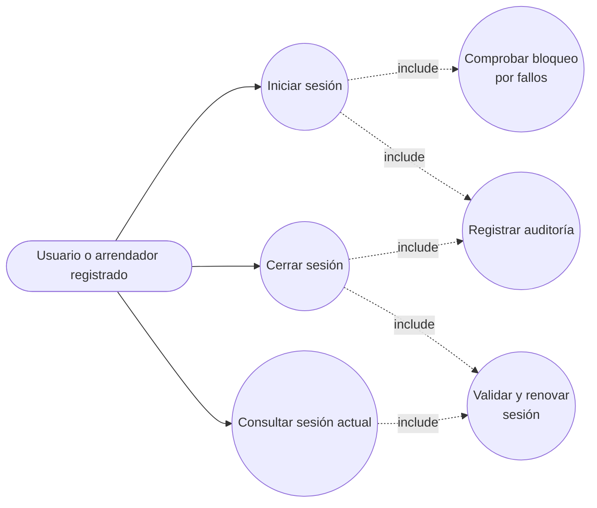
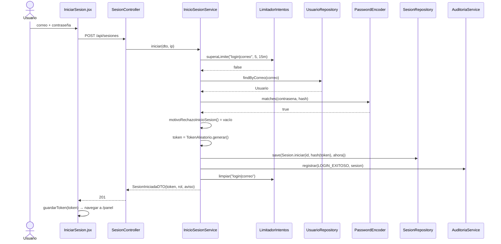
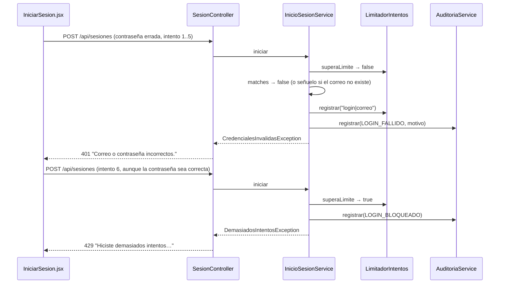
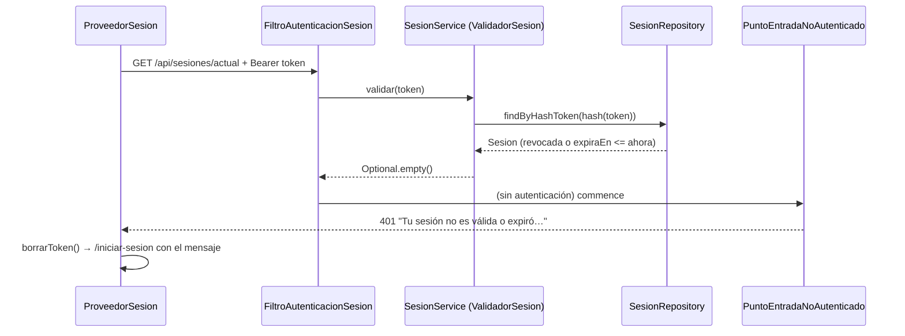
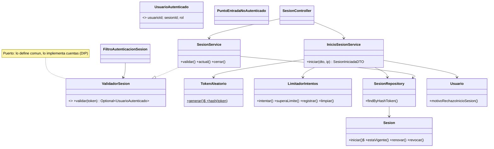

# HU-03 — Design: Inicio y cierre de sesión

> Módulo `cuentas` · Sprint 1 · tamaño S · depende de HU-01 y HU-02 (`done`) · sin
> patrones ★.
> Reutiliza `comun/error`, `comun/auditoria`, `comun/limite` (`LimitadorIntentos`),
> `comun/seguridad` (`PasswordEncoder`, CORS), `comun/web/IpCliente`, el bean `Clock`,
> `Usuario`/`UsuarioRepository`, `PerfilArrendador`/`PerfilArrendadorRepository`, el kit
> `Boton`/`Campo`/`Alerta` y `api/cliente.js`.
> Construye el componente transversal **"Gestión de sesión y tokens (invalidación,
> 30 min)"** (`docs/requerimientos.md` §8), que reutilizarán HU-04 (cerrar todas las
> sesiones), HU-09 (suspender) y HU-17 (MFA), y el puerto `comun.ValidadorSesion` ya
> previsto en `docs/architecture.md`.
>
> Las preguntas P1–P7 (`requirements.md`) tienen un valor por defecto aplicado en este
> diseño; el dueño las confirma al aprobar.

## 1. Decisiones (para revisión rápida del dueño)

| # | Pregunta | Decisión | Por qué |
|---|----------|----------|---------|
| DT-1 | P2 | **Token opaco** de 32 bytes (`SecureRandom`, base64url sin relleno). En la BD solo `hash_token` = SHA-256 hex con índice único. Sin JWT. | RNF-SEG-02 exige invalidación **en backend**: un JWT igual obligaría a consultar `sesion` en cada solicitud y añadiría una dependencia y un secreto sin beneficio. Con el hash, quien lea la BD no puede usar los tokens. |
| DT-2 | P2 | **Transporte:** encabezado `Authorization: Bearer <token>`. La SPA lo guarda en `sessionStorage` (se borra al cerrar la pestaña) y nunca en `localStorage` ni en cookies. CORS añade `Authorization` a los encabezados permitidos. | Backend (8080) y SPA (5173 / UAT) están en orígenes distintos: una cookie obligaría a `allowCredentials`, `SameSite=None` en UAT y protección CSRF. Con Bearer el navegador nunca envía el token solo, así que CSRF no aplica. El riesgo XSS se acota porque el token vale 30 min sin actividad y se revoca en backend. Ver alternativa 1. |
| DT-3 | — | **CSRF sigue deshabilitado** (se actualiza el comentario de `ConfiguracionSeguridad`) y `sessionManagement` pasa a `STATELESS`: Spring no crea `HttpSession`. | Consecuencia de DT-2. El comentario de HU-01 dejaba esta decisión a HU-03. |
| DT-4 | P6 | **Inactividad deslizante:** cada solicitud autenticada fija `expira_en = ahora + 30 min` (R24). Una sesión con `expira_en <= ahora` es inválida y no se renueva (R27). Sin tope absoluto. Las sesiones vencidas no se borran (sin jobs, §5 de architecture): se rechazan al consultarlas. | CA4 dice "30 minutos **inactivo**". El modelo ya tiene `expira_en`; moverlo basta, sin columna `ultima_actividad`. |
| DT-5 | P3 | **Bloqueo temporal por correo normalizado** (sin captcha): 5 fallos (401) en una ventana deslizante de 15 min → 429 con el mensaje de demasiados intentos, sin comparar la contraseña. Un login exitoso borra el contador. Se cuenta también para correos inexistentes (R17) para que el 429 no revele si la cuenta existe. | No hay captcha en el stack y agregarlo es una dependencia y un proveedor externo. Por correo protege la cuenta atacada aunque el atacante cambie de IP; el bloqueo dura como mucho 15 min, lo que acota el abuso de bloquear a otro a propósito. Por IP no frena ataques distribuidos y bloquearía a todos detrás de un mismo NAT (universidad). Ver alternativa 3. |
| DT-6 | P3 | El contador vive **en memoria** en `LimitadorIntentos` (como el de registro de HU-01), con clave `"login|" + correoNormalizado`. Se amplía con tres métodos aditivos: `superaLimite`, `registrar`, `limpiar`. `intentar` no cambia. | Reutiliza el componente transversal. Se pierde al reiniciar y no se comparte entre instancias: aceptable para un monolito con una instancia en UAT (mismo supuesto de HU-01). La comprobación y el registro no son atómicos entre sí: dos solicitudes simultáneas pueden colar un intento extra, lo que no cambia el orden de magnitud. |
| DT-7 | P1 | Las cuentas `ADMIN` reciben el **401 genérico** (`ROL_NO_PERMITIDO` en la auditoría). | No hay cuentas admin hasta el script interno y el panel admin exige restricción de IP hasta HU-17 (RNF-SEG-04). HU-06 habilita el acceso admin con su control; dejarlo abierto aquí crearía una puerta sin ese control. **Dueño: si quieres que el admin ya inicie sesión, dilo al aprobar.** |
| DT-8 | P4 | Mensajes: credenciales `"Correo o contraseña incorrectos."`; sesión `"Tu sesión no es válida o expiró. Inicia sesión de nuevo."`; bloqueo `ErrorDTO.MENSAJE_DEMASIADOS_INTENTOS` (el de HU-01). Mismo 401 y mismo cuerpo para contraseña errada, correo inexistente, correo no verificado, cuenta no activa y admin. | RNF-SEG-13: no se confirma si un correo existe ni su estado. "Suspendida no inicia sesión" (RN-01) sin decir por qué. |
| DT-9 | P5 | Aviso de identidad tras iniciar sesión solo para `ARRENDADOR` con `estado_identidad = NO_INICIADA`. El texto se mueve a `PerfilArrendador.AVISO_IDENTIDAD`; `ArrendadorController.AVISO_IDENTIDAD` pasa a referenciarlo (sin cambio visible para HU-02). | Cierra lo que HU-02 dejó para HU-03. `EN_REVISION` y `RECHAZADA` no se alcanzan hasta HU-05, que define sus propios avisos. El servicio no puede depender del controlador. |
| DT-10 | P7 | Varias sesiones simultáneas por usuario. `DELETE /api/sesiones/actual` revoca solo la del token. Índice `ix_sesion_usuario` para que HU-04/HU-09 revoquen todas las de un usuario. | HU-04 CA3 ("cerrar todas las sesiones activas") presupone que puede haber varias. |
| DT-11 | — | **TLS = el del despliegue** (HTTPS en UAT), como DT-10 de HU-02. En código se cubre lo verificable: el token no se guarda en claro (R3), la respuesta no lleva datos de más (R7) y el DTO no imprime la contraseña (R35). | TLS no se termina en Spring Boot en este proyecto. |
| DT-12 | — | Login con `TransactionTemplate` + `matches` fuera de la transacción; hash señuelo calculado una vez al construir el servicio (`encoder.encode` de un valor aleatorio). | Mismo patrón de `RegistroService` (tiempo constante, R14). bcrypt fuera de la transacción no retiene una conexión 250 ms. |
| DT-13 | — | Endpoints REST: `POST /api/sesiones` (crear → 201), `GET /api/sesiones/actual`, `DELETE /api/sesiones/actual` (204). La identidad sale siempre del token, nunca de un id en la URL. | RNF-ARQ-06 y RNF-SEG-01. `GET actual` permite a la SPA restaurar la sesión tras recargar y es el endpoint protegido con el que se prueba CA4. |
| DT-14 | — | Filtro de autenticación `FiltroAutenticacionSesion` en `comun/seguridad`, **no** `@Component` (se crea en `ConfiguracionSeguridad` y se registra con `addFilterBefore(..., UsernamePasswordAuthenticationFilter.class)`); consulta el puerto `ValidadorSesion` implementado por `cuentas.SesionService`. | `comun` no depende de `cuentas` (puerto de architecture). Si fuera `@Component`, Spring Boot lo registraría además como filtro de servlet y se ejecutaría dos veces. |
| DT-15 | — | `docs/modelo-datos.md`: `sesion` gana `hash_token (único)`. Lo actualiza el implementer en el mismo PR. `docs/frontend.md`: la estructura de carpetas gana `src/sesion/` y la línea "Cómo viaja la sesión" pasa a describir DT-2. | Regla del encabezado de `modelo-datos.md` y de `frontend.md`. |

## 2. Caso de uso



**Iniciar sesión** — Precondición: cuenta registrada (HU-01/HU-02). Flujo principal:
(1) el usuario envía correo y contraseña; (2) la API comprueba que el correo no esté
bloqueado; (3) busca la cuenta, compara la contraseña y verifica rol, correo verificado
y estado; (4) crea la sesión (hash del token, expira en 30 min), reinicia el contador,
audita `LOGIN_EXITOSO`; (5) responde 201 con token, rol y aviso; (6) la SPA guarda el
token y lleva al panel del rol. Flujos alternos: 400 (forma), 401 genérico (cuenta un
fallo, audita `LOGIN_FALLIDO`), 429 (bloqueado, audita `LOGIN_BLOQUEADO`).

**Cerrar sesión** — Precondición: sesión vigente. La API revoca la sesión, audita
`CIERRE_SESION`, responde 204; la SPA borra el token y vuelve a `/iniciar-sesion`.

**Consultar sesión actual** — Cada solicitud autenticada valida el token y renueva
`expira_en`. Con sesión revocada, vencida o token desconocido → 401; la SPA borra el
token y vuelve a `/iniciar-sesion` con el mensaje.

## 3. Archivos por módulo y capa

Paquete base `pe.edu.ulima.espacioya`. (N) nuevo · (M) modificado.

### `comun`

| Carpeta | Archivo | Para |
|---|---|---|
| `comun/seguridad/` (N) | `ValidadorSesion` | Puerto: `Optional<UsuarioAutenticado> validar(String token)` (architecture, R22, R24, R26–R28) |
| | `UsuarioAutenticado` | Record principal: `usuarioId`, `sesionId`, `rol` (R22) |
| | `FiltroAutenticacionSesion` | Lee `Authorization: Bearer`, llama al puerto, llena el `SecurityContext` (R22, R26–R28) |
| | `PuntoEntradaNoAutenticado` | `AuthenticationEntryPoint` → 401 + `ErrorDTO` con el mensaje de sesión inválida (R26–R28) |
| | `TokenAleatorio` | `generar()` (32 bytes base64url) y `hash(String)` (SHA-256 hex) (R3, R6); lo reutilizará HU-04 |
| `comun/seguridad/` (M) | `ConfiguracionSeguridad` | `permitAll` de `POST /api/sesiones`, `STATELESS`, filtro, punto de entrada, CORS con `Authorization`, comentario CSRF (R1, R22, R26–R28, R36) |
| `comun/error/` (N) | `CredencialesInvalidasException` | → 401 con el mensaje de credenciales inválidas (R9–R13) |
| | `DemasiadosIntentosException` | → 429 con `MENSAJE_DEMASIADOS_INTENTOS` (R16) |
| `comun/error/` (M) | `ErrorDTO` | Constantes `MENSAJE_CREDENCIALES_INVALIDAS`, `MENSAJE_SESION_INVALIDA` |
| | `ManejadorGlobalErrores` | Handlers de las dos excepciones nuevas (R9, R16) |
| `comun/limite/` (M) | `LimitadorIntentos` | `superaLimite`, `registrar`, `limpiar` (R16–R20) |

### `cuentas`

| Capa | Archivo | Para |
|---|---|---|
| `domain/` (N) | `Sesion` | Entidad `sesion`: `iniciar`, `estaVigente`, `renovar`, `revocar` (R2, R24, R25, R27) |
| `domain/` (M) | `Usuario` | `motivoRechazoInicioSesion()` (R11–R13) |
| | `PerfilArrendador` | Constante `AVISO_IDENTIDAD` (DT-9) |
| `domain/` (N) | `MotivoRechazoInicioSesion` | Enum de los motivos de R31 |
| `repository/` (N) | `SesionRepository` | `findByHashToken` (R22, R26–R28) |
| `service/` (N) | `InicioSesionService` | Caso de uso de login (R1–R21, R30–R32, R34) |
| | `SesionService` | Implementa `ValidadorSesion`; `actual`, `cerrar` (R22–R29, R33) |
| `dto/` (N) | `InicioSesionDTO` | Entrada `{correo, contrasena}` con Bean Validation y `toString` enmascarado (R15, R35) |
| | `SesionIniciadaDTO` | Salida `{token, rol, aviso}` (R1, R4, R5, R7) |
| | `SesionActualDTO` | Salida `{rol, aviso}` (R23) |
| `controller/` (N) | `SesionController` | `POST /api/sesiones`, `GET` y `DELETE /api/sesiones/actual` |
| `controller/` (M) | `ArrendadorController` | `AVISO_IDENTIDAD = PerfilArrendador.AVISO_IDENTIDAD` (DT-9) |

### Recursos, configuración y docs

| Archivo | Cambio |
|---|---|
| `db/migration/V1_4__sesion.sql` (N) | Tabla `sesion` (§ 9) |
| `application.properties` | Sin cambios: los plazos son constantes de dominio (como el límite de registro de HU-01) |
| `.env.example` | Sin cambios (no hay secretos nuevos: el token es opaco) |
| `docs/modelo-datos.md` (M) | `sesion`: `id, usuario_id, hash_token (único), creada_en, expira_en, revocada` (DT-15) |
| `docs/frontend.md` (M) | Carpeta `src/sesion/`; "Cómo viaja la sesión" según DT-2 (DT-15) |
| `docs/requerimientos.md` §8 | Sin cambios (el componente ya figura como de HU-03) |

### Frontend (`3_frontend/src/`)

Ver § 12.

## 4. Endpoints

| Método y ruta | Acceso | Entrada | Respuestas |
|---|---|---|---|
| `POST /api/sesiones` | público | `InicioSesionDTO` | **201** `SesionIniciadaDTO` (R1) · **400** `ErrorDTO` con errores por campo (R15) · **401** `ErrorDTO` credenciales inválidas (R9–R13) · **429** `ErrorDTO` demasiados intentos (R16) · 500 genérico |
| `GET /api/sesiones/actual` | sesión vigente | — | **200** `SesionActualDTO` (R23) · **401** `ErrorDTO` sesión inválida (R26–R28) |
| `DELETE /api/sesiones/actual` | sesión vigente | — | **204** sin cuerpo (R25) · **401** `ErrorDTO` sesión inválida (R26–R28) |

### DTO

```java
public record InicioSesionDTO(
        @NotBlank(message = MENSAJE_CORREO) @Size(max = 254, message = MENSAJE_CORREO) String correo,
        @NotBlank(message = MENSAJE_CONTRASENA) @Size(max = 72, message = MENSAJE_CONTRASENA) String contrasena) {
    public static final String MENSAJE_CORREO = "Ingresa tu correo.";
    public static final String MENSAJE_CONTRASENA = "Ingresa tu contraseña.";
    @Override public String toString() { return "InicioSesionDTO[correo=***, contrasena=***]"; } // R35
}

public record SesionIniciadaDTO(String token, String rol, String aviso) { }   // R1, R4, R5, R7
public record SesionActualDTO(String rol, String aviso) { }                   // R23
```

- No se valida el formato del correo ni la política de contraseña: cualquier valor no
  vacío que no coincida es un 401 genérico (no se da pista de qué está mal).
- `@Size(max = 72)`: bcrypt solo usa los primeros 72 bytes; acotar evita trabajo inútil.
- Campos desconocidos del cuerpo (p. ej. `rol`) se ignoran (Jackson por defecto, R8).

### Mensajes (texto exacto)

| Constante | Texto | Dónde |
|---|---|---|
| `ErrorDTO.MENSAJE_CREDENCIALES_INVALIDAS` | `Correo o contraseña incorrectos.` | 401 de login |
| `ErrorDTO.MENSAJE_SESION_INVALIDA` | `Tu sesión no es válida o expiró. Inicia sesión de nuevo.` | 401 de endpoint protegido |
| `ErrorDTO.MENSAJE_DEMASIADOS_INTENTOS` (existe) | `Hiciste demasiados intentos. Espera un momento e inténtalo de nuevo.` | 429 de login |
| `PerfilArrendador.AVISO_IDENTIDAD` (se mueve) | `Para publicar tus espacios, primero debes verificar tu identidad.` | `aviso` |
| `InicioSesionDTO.MENSAJE_CORREO` / `MENSAJE_CONTRASENA` | `Ingresa tu correo.` / `Ingresa tu contraseña.` | 400 por campo |

## 5. Clases y firmas públicas

```java
// comun/seguridad
public interface ValidadorSesion {
    Optional<UsuarioAutenticado> validar(String token);   // vacío si no existe, revocada o vencida; renueva si vigente
}
public record UsuarioAutenticado(Long usuarioId, Long sesionId, String rol) { }

public final class TokenAleatorio {
    public static final int BYTES = 32;
    public static String generar();            // SecureRandom, Base64.getUrlEncoder().withoutPadding()
    public static String hash(String token);   // SHA-256, hex minúsculas, 64 caracteres
}

public class FiltroAutenticacionSesion extends OncePerRequestFilter {
    public FiltroAutenticacionSesion(ValidadorSesion validador);
    // doFilterInternal: si hay "Authorization: Bearer <t>" y validar(t) está presente, pone en el
    // SecurityContext un UsernamePasswordAuthenticationToken(principal = UsuarioAutenticado,
    // authorities = ROLE_<rol>). Si no, sigue sin autenticar: el punto de entrada responde 401.
}

public class PuntoEntradaNoAutenticado implements AuthenticationEntryPoint {
    public PuntoEntradaNoAutenticado(JsonMapper json);   // 401 + ErrorDTO.de(MENSAJE_SESION_INVALIDA)
}

// comun/error
public class CredencialesInvalidasException extends RuntimeException { public CredencialesInvalidasException(); }
public class DemasiadosIntentosException extends RuntimeException { public DemasiadosIntentosException(); }

// comun/limite/LimitadorIntentos (M) — métodos nuevos; intentar(...) sin cambios
public boolean superaLimite(String clave, int maximo, Duration ventana); // purga vencidos; true si vigentes >= maximo; no registra
public void registrar(String clave);                                     // agrega Instant.now(reloj)
public void limpiar(String clave);                                       // borra la clave

// cuentas/domain
@Entity @Table(name = "sesion")
public class Sesion {
    public static final Duration INACTIVIDAD = Duration.ofMinutes(30);
    protected Sesion() { }
    public static Sesion iniciar(Long usuarioId, String hashToken, Instant ahora); // expiraEn = ahora + INACTIVIDAD
    public boolean estaVigente(Instant ahora);   // !revocada && ahora.isBefore(expiraEn)
    public void renovar(Instant ahora);          // expiraEn = ahora + INACTIVIDAD
    public void revocar();                       // revocada = true
    public Long getId(); public Long getUsuarioId(); public String getHashToken();
    public Instant getCreadaEn(); public Instant getExpiraEn(); public boolean isRevocada();
}

public enum MotivoRechazoInicioSesion {           // cuentas/domain
    CONTRASENA_INCORRECTA, CORREO_DESCONOCIDO, CORREO_NO_VERIFICADO, CUENTA_NO_ACTIVA, ROL_NO_PERMITIDO
}

// Usuario (M)
public Optional<MotivoRechazoInicioSesion> motivoRechazoInicioSesion();
// orden: rol ADMIN → ROL_NO_PERMITIDO; !correoVerificado → CORREO_NO_VERIFICADO; estado != ACTIVA → CUENTA_NO_ACTIVA
```

```java
// cuentas/repository
public interface SesionRepository extends JpaRepository<Sesion, Long> {
    Optional<Sesion> findByHashToken(String hashToken);
}

// cuentas/service
@Service
public class InicioSesionService {
    public static final String ACCION_LOGIN_EXITOSO = "LOGIN_EXITOSO";
    public static final String ACCION_LOGIN_FALLIDO = "LOGIN_FALLIDO";
    public static final String ACCION_LOGIN_BLOQUEADO = "LOGIN_BLOQUEADO";
    public static final int MAXIMO_FALLOS = 5;
    public static final Duration VENTANA_FALLOS = Duration.ofMinutes(15);
    public InicioSesionService(UsuarioRepository usuarios, PerfilArrendadorRepository perfiles,
                               SesionRepository sesiones, PasswordEncoder encoder, LimitadorIntentos limitador,
                               AuditoriaService auditoria, TransactionTemplate transacciones, Clock reloj);
    public SesionIniciadaDTO iniciar(InicioSesionDTO solicitud, String ip);
}

@Service
public class SesionService implements ValidadorSesion {
    public static final String ACCION_CIERRE_SESION = "CIERRE_SESION";
    public SesionService(SesionRepository sesiones, UsuarioRepository usuarios, PerfilArrendadorRepository perfiles,
                         AuditoriaService auditoria, Clock reloj);
    @Transactional public Optional<UsuarioAutenticado> validar(String token);
    @Transactional(readOnly = true) public SesionActualDTO actual(UsuarioAutenticado usuario);
    @Transactional public void cerrar(UsuarioAutenticado usuario, String ip);
    String avisoPara(Usuario usuario);   // paquete: lo usan ambos servicios (R4, R5, R23)
}

// cuentas/controller
@RestController @RequestMapping("/api/sesiones")
public class SesionController {
    @PostMapping @ResponseStatus(CREATED)
    public SesionIniciadaDTO iniciar(@Valid @RequestBody InicioSesionDTO solicitud, HttpServletRequest req);
    @GetMapping("/actual")
    public SesionActualDTO actual(@AuthenticationPrincipal UsuarioAutenticado usuario);
    @DeleteMapping("/actual") @ResponseStatus(NO_CONTENT)
    public void cerrar(@AuthenticationPrincipal UsuarioAutenticado usuario, HttpServletRequest req);
}
```

`avisoPara` puede ir en una clase de paquete `AvisoCuenta` si el implementer prefiere no
acoplar `InicioSesionService` a `SesionService`; el contrato (R4, R5) no cambia.

## 6. Flujo de `InicioSesionService.iniciar`

1. `correo = Usuario.normalizarCorreo(solicitud.correo())`; `clave = "login|" + correo`.
2. Si `limitador.superaLimite(clave, 5, 15 min)` → busca la cuenta solo para el id,
   audita `LOGIN_BLOQUEADO` (usuarioId o null, IP, sin detalle) y lanza
   `DemasiadosIntentosException` (429). No compara contraseña ni registra fallo (R16, R18,
   R32).
3. `usuario = usuarios.findByCorreo(correo)`.
4. Si no existe: `encoder.matches(contrasena, HASH_SENUELO)` (R14) → motivo
   `CORREO_DESCONOCIDO`.
5. Si existe: si `!encoder.matches(contrasena, usuario.getHashContrasena())` → motivo
   `CONTRASENA_INCORRECTA`; si no, `usuario.motivoRechazoInicioSesion()` (R11–R13).
6. Con motivo: `limitador.registrar(clave)` (R17), audita `LOGIN_FALLIDO` con
   `detalle = "motivo=" + motivo` (R31, R34) y lanza `CredencialesInvalidasException`
   (401, R9–R13).
7. Sin motivo: `token = TokenAleatorio.generar()`; en una transacción
   (`TransactionTemplate`): `sesiones.save(Sesion.iniciar(id, TokenAleatorio.hash(token),
   ahora))` y audita `LOGIN_EXITOSO` con entidad `sesion` y su id (R2, R3, R30).
8. `limitador.limpiar(clave)` (R20) y devuelve
   `new SesionIniciadaDTO(token, usuario.getRol().name(), avisoPara(usuario))` (R1, R4, R5,
   R8).

La auditoría de los pasos 2 y 6 usa `AuditoriaService.registrar` (propia transacción).

## 7. Diagramas de secuencia

### Flujo principal: inicio de sesión exitoso (CA1)



### Flujo de error: credenciales incorrectas y bloqueo (CA2, CA3)



### Flujo de error: sesión vencida por inactividad o cerrada (CA4)



Con sesión vigente, `validar` llama a `sesion.renovar(ahora)` (R24), carga el `Usuario`
para el rol y devuelve `UsuarioAutenticado`; el controlador recibe el principal.

## 8. Diagrama de clases (resumen)



## 9. Migración Flyway

`2_Backend/src/main/resources/db/migration/V1_4__sesion.sql`:

```sql
CREATE TABLE sesion (
    id         BIGINT GENERATED ALWAYS AS IDENTITY PRIMARY KEY,
    usuario_id BIGINT      NOT NULL REFERENCES usuario (id) ON DELETE CASCADE,
    hash_token CHAR(64)    NOT NULL,
    creada_en  TIMESTAMPTZ NOT NULL,
    expira_en  TIMESTAMPTZ NOT NULL,
    revocada   BOOLEAN     NOT NULL DEFAULT FALSE,
    CONSTRAINT uq_sesion_hash_token UNIQUE (hash_token),
    CONSTRAINT ck_sesion_hash_token CHECK (hash_token ~ '^[0-9a-f]{64}$'),
    CONSTRAINT ck_sesion_expira CHECK (expira_en > creada_en)
);
CREATE INDEX ix_sesion_usuario ON sesion (usuario_id);
```

- `ON DELETE CASCADE`: las IT de HU-01/HU-02 hacen `DELETE FROM usuario`; sin cascada
  fallarían si quedan sesiones (mismo motivo que DT-11 de HU-02). HU-22 anonimiza, no
  borra.
- La entidad `Sesion` mapea `hash_token` como `@Column(columnDefinition = "CHAR(64)")` o
  `length = 64` según lo que acepte `ddl-auto=validate`; el implementer lo ajusta.

## 10. Configuración (`ConfiguracionSeguridad`, M)

```java
http.csrf(AbstractHttpConfigurer::disable)   // Bearer en encabezado: el navegador no lo envía solo (DT-3)
    .httpBasic(AbstractHttpConfigurer::disable)
    .formLogin(AbstractHttpConfigurer::disable)
    .sessionManagement(s -> s.sessionCreationPolicy(SessionCreationPolicy.STATELESS))
    .cors(Customizer.withDefaults())
    .exceptionHandling(e -> e.authenticationEntryPoint(new PuntoEntradaNoAutenticado(json)))
    .addFilterBefore(new FiltroAutenticacionSesion(validador), UsernamePasswordAuthenticationFilter.class)
    .authorizeHttpRequests(a -> a
        // ... los tres permitAll de HU-01/HU-02 ...
        .requestMatchers(HttpMethod.POST, "/api/sesiones").permitAll()
        .anyRequest().authenticated());
// CORS: setAllowedHeaders(List.of("Content-Type", "Authorization"))   (R36)
```

`cadenaSeguridad` recibe por parámetro `ValidadorSesion` y `JsonMapper`. Sin propiedades
nuevas en `application.properties`.

## 11. Excepciones y componentes de `comun`

| Componente | Uso en HU-03 |
|---|---|
| `ErrorDTO` (M) | +`MENSAJE_CREDENCIALES_INVALIDAS`, +`MENSAJE_SESION_INVALIDA` |
| `ManejadorGlobalErrores` (M) | `CredencialesInvalidasException` → 401; `DemasiadosIntentosException` → 429; los demás sin cambios |
| `CredencialesInvalidasException` (N) | Justificación: `docs/conventions.md` lista 400/404/403; el login necesita 401 y no es una regla de negocio (400) |
| `DemasiadosIntentosException` (N) | 429 lanzado desde el servicio (el `FiltroLimiteIntentos` cuenta todas las solicitudes por IP y no sirve para "solo fallos") |
| `ReglaNegocioException`, `MethodArgumentNotValidException` | 400 de R15 (handler existente) |
| `AuditoriaService` + `EventoAuditoria` | `LOGIN_EXITOSO`, `LOGIN_FALLIDO`, `LOGIN_BLOQUEADO`, `CIERRE_SESION` |
| `LimitadorIntentos` (M) | Contador de fallos por correo (DT-5, DT-6). **No** se añade una `ReglaLimite` para `/api/sesiones` |
| `IpCliente` | IP de la auditoría (sin X-Forwarded-For; decisión transversal fuera de HU-03) |
| `PasswordEncoder` (bcrypt 12) | `matches` y hash señuelo |
| `Clock` | `creada_en`, `expira_en`, ventana de 15 min; `RelojControlable` en las IT |
| `ValidadorSesion` (N, puerto) | Agregado ya en la tabla de puertos de `docs/architecture.md`: no hace falta tocarla |

## 12. Pantallas

No se agregan componentes al kit: bastan `Boton`, `Campo` y `Alerta`. No hay estados
nuevos en la tabla de colores (no se muestra `EtiquetaEstado`).

### Sesión en el cliente (N)

| Archivo | Para |
|---|---|
| `src/api/tokenSesion.js` (N) | `leerToken()`, `guardarToken(token)`, `borrarToken()` sobre `sessionStorage` (clave `espacioya.token`), cada acceso en `try/catch` (DT-2) |
| `src/api/cliente.js` (M) | Si hay token, agrega `Authorization: Bearer <token>`. Si la respuesta es 401 **y** la solicitud llevó token: `borrarToken()` y avisa a los suscriptores de `alPerderSesion(callback)` con el `mensaje` del `ErrorDTO`. Acepta 204 sin cuerpo (devuelve `null`) |
| `src/api/cuentas.js` (M) | `iniciarSesion({ correo, contrasena })` → `POST /api/sesiones`; `obtenerSesionActual()` → `GET /api/sesiones/actual`; `cerrarSesion()` → `DELETE /api/sesiones/actual` |
| `src/sesion/ContextoSesion.js` (N) | `createContext` |
| `src/sesion/ProveedorSesion.jsx` (N) | Estado `{ rol, aviso } | null` y `cargando`. Al montar, si hay token llama a `obtenerSesionActual()`. Se suscribe a `alPerderSesion` → estado `null` y navega a `/iniciar-sesion` con `state.mensaje`. Expone `entrar(datos)` y `salir()` |
| `src/sesion/useSesion.js` (N) | `useContext(ContextoSesion)` |
| `src/sesion/RutaProtegida.jsx` (N) | Mientras `cargando`, nada; sin sesión → `<Navigate to="/iniciar-sesion" />`; con sesión → `children` |
| `src/main.jsx` (M) | Envuelve `<App />` en `<ProveedorSesion>` dentro de `BrowserRouter` |

El frontend no lleva su propio temporizador de inactividad: decide el backend (R24, R27).
El rol solo elige qué título y qué enlaces mostrar; no habilita nada (el backend valida
en cada solicitud).

### Iniciar sesión — `/iniciar-sesion` → `pages/cuentas/IniciarSesion.jsx` (N, + `.module.css`)

- `Campo` "Correo" (`tipo="email"`, `nombre="correo"`), `Campo` "Contraseña"
  (`tipo="password"`, `nombre="contrasena"`), `Boton` primario "Iniciar sesión" con
  `cargando`.
- **CA1:** 201 → `guardarToken(token)`, `entrar({ rol, aviso })` y navegar a `/panel`.
- **CA2:** 401 → `Alerta` de tipo `error` arriba del formulario con el mensaje del
  `ErrorDTO` tal cual ("Correo o contraseña incorrectos."). No se borra el correo; se
  borra la contraseña.
- **CA3:** 429 → `Alerta` `error` con "Hiciste demasiados intentos…".
- 400 → errores bajo cada `Campo`; red → "No pudimos conectar. Intenta de nuevo.".
- **CA4:** si se llega con `state.mensaje` (sesión perdida o cerrada), `Alerta` `info`
  con ese texto arriba del formulario.
- Enlace "¿No tienes cuenta? Regístrate" → `/registro`.
- Si ya hay sesión, `<Navigate to="/panel" />`.

### Panel — `/panel` → `pages/cuentas/Panel.jsx` (N, + `.module.css`), dentro de `RutaProtegida`

- Título según `rol`: `USUARIO` → "Mi cuenta"; `ARRENDADOR` → "Panel de arrendador".
  Texto secundario breve ("Aquí verás tus reservas" / "Aquí verás tus espacios"): las
  funciones llegan con sus historias.
- **CA1 + aviso HU-02:** si `aviso` no es nulo, `Alerta` de tipo `atencion` con el texto
  tal cual.
- Al montar llama a `obtenerSesionActual()` (refresca rol y aviso y renueva la sesión).

### Encabezado (`App.jsx`, M)

- Sin sesión: enlace "Iniciar sesión" → `/iniciar-sesion`.
- Con sesión: enlace "Mi panel" → `/panel` y `Boton` secundario "Cerrar sesión".
- **CA4 (cerrar):** "Cerrar sesión" → `cerrarSesion()`; con 204 **o** 401, `borrarToken()`,
  `salir()` y navegar a `/iniciar-sesion` con `state.mensaje = "Cerraste sesión."`
  (se muestra como `Alerta` `exito`). Error de red: `Alerta` de error y el token no se
  borra.
- Rutas nuevas: `/iniciar-sesion` y `/panel`. En `/` se agrega el enlace "Iniciar sesión".

## 13. Plan de pruebas (R → test)

Cada test lleva `@DisplayName("HU-03 R<n>: …")`. IT con `RelojControlable` `@Primary`,
`@BeforeEach` que borra `sesion`, `auditoria`, `perfil_arrendador`, `usuario`, y una IP
distinta por test (`10.3.x.x`). Las cuentas de prueba se crean con `UsuarioRepository`
(o los endpoints de registro) y se ajustan por `JdbcTemplate` para `correo_verificado`,
`estado` o `rol = ADMIN`.

| R | Test |
|---|---|
| R1 | `SesionControllerIT` (201, solo `token`/`rol`/`aviso`; correo con mayúsculas y espacios) |
| R2 | `SesionTest` (`iniciar`), `SesionControllerIT` (fila con fechas del reloj) |
| R3 | `TokenAleatorioTest` (hash = SHA-256 hex), `SesionControllerIT` (`hash_token` = hash del token devuelto y ≠ token) |
| R4, R5 | `InicioSesionServiceTest`, `SesionControllerIT` (arrendador recién registrado → aviso; usuario → null) |
| R6 | `TokenAleatorioTest` (43 caracteres base64url; dos llamadas distintas), `SesionControllerIT` (dos logins → tokens distintos) |
| R7 | `SesionControllerIT` (claves exactas del JSON) |
| R8 | `SesionControllerIT` (cuerpo con `"rol":"ADMIN"` → `rol` USUARIO) |
| R9–R13 | `InicioSesionServiceTest` (un test por motivo), `SesionControllerIT` (401 con cuerpo idéntico en los cinco casos y sin filas en `sesion`) |
| R14 | `InicioSesionServiceTest` (`matches` llamado una vez con el hash señuelo) |
| R15 | `SesionControllerIT` (correo vacío / contraseña vacía / contraseña de 73 → 400 por campo; luego 5 fallos siguen permitidos) |
| R16 | `SesionControllerIT` (5 fallos → 6.º con contraseña correcta = 429, sin sesión), `InicioSesionServiceTest` (no llama a `matches`) |
| R17 | `SesionControllerIT` (correo inexistente: 5 fallos → 429), `InicioSesionServiceTest` |
| R18 | `InicioSesionServiceTest` (429 no llama a `registrar`), `SesionControllerIT` (R15) |
| R19 | `LimitadorIntentosTest` (nuevos), `SesionControllerIT` (5 fallos, `avanzar(15 min + 1 s)` → login correcto 201) |
| R20 | `SesionControllerIT` (4 fallos, login correcto, 4 fallos más → sigue 401, no 429), `LimitadorIntentosTest` (`limpiar`) |
| R21 | `SesionControllerIT` (correo A bloqueado, correo B misma IP → 201) |
| R22 | `SesionControllerIT` (`GET actual` devuelve el rol de la sesión aunque se envíe `?usuarioId=`), `FiltroAutenticacionSesionTest` |
| R23 | `SesionControllerIT` |
| R24 | `SesionTest` (`renovar`), `SesionServiceTest`, `SesionControllerIT` (`avanzar(20 min)`, `GET`, `avanzar(20 min)`, `GET` → 200) |
| R25 | `SesionControllerIT` (204 y `revocada = true`) |
| R26 | `SesionControllerIT` (tras `DELETE`, `GET actual` → 401 con mensaje de sesión inválida), `SesionServiceTest` |
| R27 | `SesionTest` (límite exacto `expira_en == ahora` → no vigente), `SesionControllerIT` (`avanzar(30 min)` → 401 y `expira_en` sin cambio) |
| R28 | `SesionControllerIT` (sin encabezado, `Basic x`, token inventado → 401), `FiltroAutenticacionSesionTest` |
| R29 | `SesionControllerIT` (dos logins, cerrar uno, el otro sigue 200) |
| R30–R33 | `SesionControllerIT` (filas de `auditoria` por `JdbcTemplate`), `InicioSesionServiceTest`, `SesionServiceTest` |
| R34 | `InicioSesionServiceTest` (detalle solo `motivo=…` o nulo), `SesionControllerIT` (ningún `detalle` contiene el correo ni el token) |
| R35 | `InicioSesionDTOTest` |
| R36 | `SesionControllerIT` (`OPTIONS` con `Origin` y `Access-Control-Request-Headers: authorization`) |
| — | `ManejadorGlobalErroresTest` (M): 401 y 429 con su `ErrorDTO` |

Las unitarias e IT de HU-01 y HU-02 no se modifican, salvo la referencia a
`AVISO_IDENTIDAD` si alguna la usa (sigue existiendo en `ArrendadorController`).

## 14. Alternativas descartadas

1. **Cookie `HttpOnly; Secure; SameSite`** con el token. Protege mejor contra XSS, pero
   SPA y API están en orígenes distintos: exige `allowCredentials`, `SameSite=None` en
   UAT, `credentials: 'include'` y protección CSRF (token CSRF + cabecera), más piezas que
   probar en una historia S. Con Bearer, revocación en backend y 30 min de inactividad el
   riesgo residual es aceptable. Si el dueño prefiere cookie, cambian DT-2, DT-3, R36 y
   § 12.
2. **JWT firmado** (jjwt / oauth2-resource-server). Igual habría que consultar `sesion` en
   cada solicitud para cumplir RNF-SEG-02 (revocación), así que la ventaja de no ir a BD
   desaparece; añade dependencia, secreto en `.env` y rotación de llaves.
3. **Contador por IP con `ReglaLimite` + `FiltroLimiteIntentos`.** El filtro cuenta todas
   las solicitudes (también los éxitos) y solo por IP: no cumple "5 **fallos**" (CA3),
   bloquearía a toda una red NAT y no frena un ataque distribuido contra una cuenta.
4. **Captcha** en lugar de bloqueo. El CA permite cualquiera de los dos; el captcha exige
   un proveedor externo (Adapter, llaves, red en las pruebas) y una dependencia en el
   frontend que `docs/frontend.md` obliga a discutir.
5. **Sesión HTTP de Spring (`JSESSIONID`) + Spring Session JDBC.** Usa cookie (mismos
   problemas que 1) y su propia tabla, distinta de `sesion` del modelo de datos.
6. **Expiración absoluta de 30 min desde el login.** No cumple "30 minutos inactivo":
   cerraría la sesión de quien está usando la aplicación.
