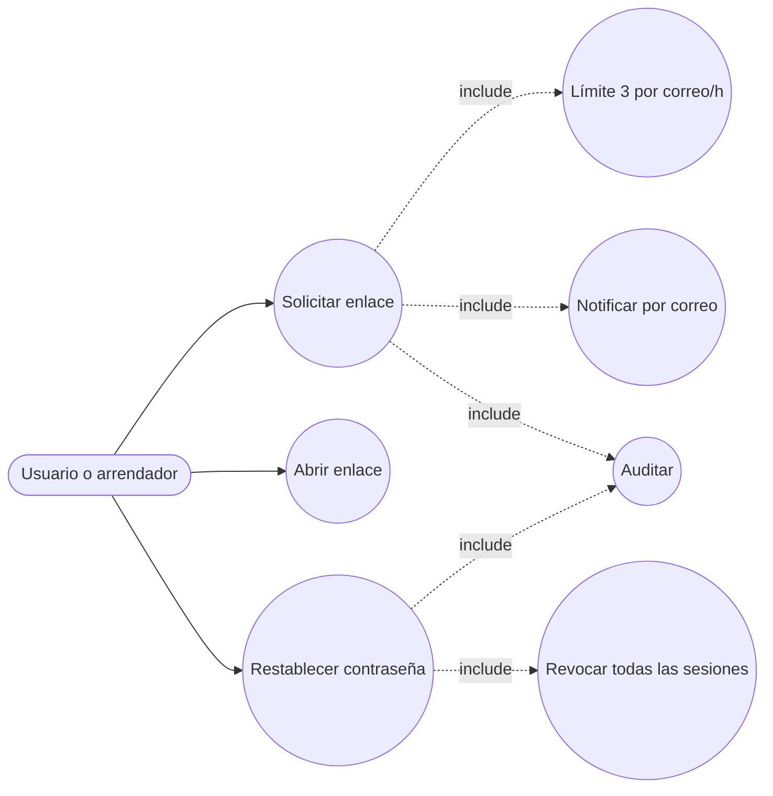
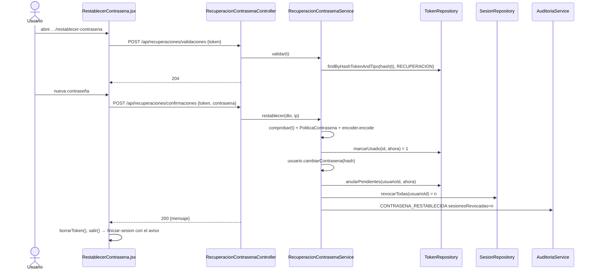
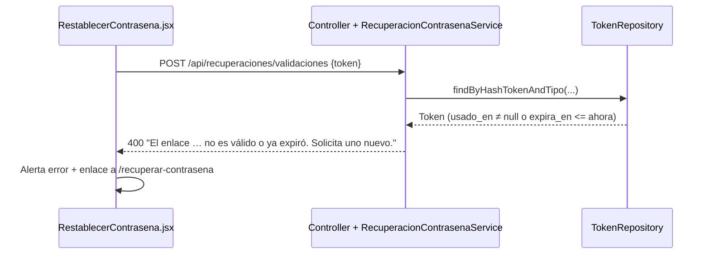

# HU-04 — Design: Recuperación de contraseña

> Módulo `cuentas` · Sprint 1 · tamaño S · depende de HU-03 (`done`) · sin patrones ★.
> Reutiliza `comun/seguridad/TokenAleatorio`, `comun/limite/LimitadorIntentos`,
> `comun/auditoria`, `comun/error`, `comun/web/IpCliente`, el bean `Clock`, `PasswordEncoder`
> (bcrypt 12), `PoliticaContrasena`, `Usuario.normalizarCorreo` y
> `motivoRechazoInicioSesion()`, `MensajeDTO`, el puerto `NotificadorCorreo` (HU-01) y la tabla
> `sesion` con su índice `ix_sesion_usuario` (HU-03). Frontend: kit `Boton`/`Campo`/`Alerta`,
> `api/cliente.js`, `tokenSesion.js` y `useSesion`.
> D1–D4 son decisiones del dueño; S1–S12 son supuestos a confirmar (`requirements.md`).

## 1. Decisiones

| # | Decisión | Por qué |
|---|----------|---------|
| DT-1 (S5) | Tres endpoints públicos con ruta fija y el token en el **cuerpo**: `POST /api/recuperaciones` (solicitar), `.../validaciones` (comprobar al abrir), `.../confirmaciones` (restablecer). | Un token en la URL queda en los logs de acceso. Con ruta fija bastan `permitAll` exactos. |
| DT-2 (S5) | Enlace `…/restablecer-contrasena#token=<t>`. La pantalla lee el fragmento y lo quita de la barra de direcciones. | El fragmento no viaja en la solicitud ni en el `Referer`. |
| DT-3 (S4) | Uso único con `UPDATE token SET usado_en = :ahora WHERE id = :id AND usado_en IS NULL AND expira_en > :ahora`; 0 filas → rechazo (R22). | En PostgreSQL (READ COMMITTED) la segunda confirmación espera el bloqueo de fila, reevalúa el `WHERE` y no afecta filas. Sin `@Version` ni bloqueo pesimista. |
| DT-4 (S4, S7) | Cambio de hash, uso del token, anulación de pendientes, revocación de sesiones y auditoría en **una** transacción (`TransactionTemplate`); bcrypt **antes**, fuera de ella. | Todo o nada; bcrypt (~250 ms) no retiene una conexión (patrón de `RegistroService`). |
| DT-5 (D3, S9) | Límite en el servicio con `limitador.intentar("recuperacion|" + correo, 3, 1 h)` **antes** de buscar la cuenta. Sin `ReglaLimite` por IP (S12). | Cuenta igual exista o no la cuenta. `intentar` no registra lo rechazado (R11). |
| DT-6 (D1, D2) | `NotificadorCorreo` gana `notificarRecuperacion(correo, enlace)` (sin método `default`, para que todo adaptador lo implemente). `NotificadorCorreoSimulado` recibe `boolean registrarEnlace` de la propiedad de desarrollo. El servicio arma el enlace con `espacioya.frontend.url`. | El simulado sigue sin colaboradores de red; HU-25 moverá el puerto a `comun/correo`. |
| DT-7 (S2) | "Cuenta habilitada" = `usuario.motivoRechazoInicioSesion()` vacío (regla de HU-03). Se aplica al solicitar, validar y confirmar. | Una sola regla; un admin o suspendido no recupera acceso por esta vía. |
| DT-8 (S6) | Enlace inválido → `ReglaNegocioException(MENSAJE_ENLACE_INVALIDO)` (400 sin campo). Política → `ReglaNegocioException("contrasena", REQUISITOS)` (400 con campo). | Sin excepciones nuevas. La SPA distingue por si hay errores por campo. 400 y no 404: es el envío lo que se rechaza. |
| DT-9 (S1) | `V1_5__token.sql` + `spring.flyway.out-of-order=true`. | Ver alternativa 1. Con Testcontainers (BD vacía) no cambia nada. |
| DT-10 (D4) | La confirmación responde 200 con `MensajeDTO`; no crea sesión. La SPA borra su token local y va a `/iniciar-sesion` con el mensaje. | Una sola fuente del texto; la sesión local quedó revocada por R21. |

## 2. Caso de uso y flujos



**Solicitar** (`solicitar(correo, ip)`): (1) normaliza; (2) si `!limitador.intentar(...)` →
audita `NO_EMITIDA motivo=LIMITE_SUPERADO` (con el id de la cuenta si existe) y termina; (3) `findByCorreo`: vacío →
`CORREO_DESCONOCIDO`; `motivoRechazoInicioSesion()` presente → ese motivo; (4) en transacción:
`anularPendientes`, `token = TokenAleatorio.generar()`, `save(Token.recuperacion(...))`,
`notificador.notificarRecuperacion(correo, enlace)`, audita `RECUPERACION_SOLICITADA`. El
controlador responde siempre 202 con el mensaje de solicitud recibida.

**Comprobar** (privado, lo usan validar y restablecer): forma (`TokenAleatorio.tieneFormato`,
sin hash ni consulta, R17) → `findByHashTokenAndTipo` → `usado_en` → `expira_en` → cuenta
habilitada. Devuelve el token y el usuario o un `MotivoRechazoRecuperacion`.

**Validar**: con motivo → `ReglaNegocioException(MENSAJE_ENLACE_INVALIDO)`; si no, nada (204).
No audita (S6).

**Restablecer**: (1) comprobar; con motivo → audita `RECUPERACION_RECHAZADA` y 400; (2)
`PoliticaContrasena.cumple(contrasena, usuario.getCorreo())` o 400 por campo (R23); (3)
`hash = encoder.encode(contrasena)`; (4) en transacción: `marcarUsado` == 0 → devuelve
"rechazado"; si no, recarga el `Usuario` (entidad gestionada) y `cambiarContrasena(hash)`,
`anularPendientes`, `n = sesiones.revocarTodas(id)`, audita `CONTRASENA_RESTABLECIDA
sesionesRevocadas=n`; (5) si fue rechazado: audita `TOKEN_USADO` fuera de la transacción y 400
(R22); (6) `limitador.limpiar(InicioSesionService.PREFIJO_CLAVE + correo)` (R24).

## 3. Secuencias

### Flujo principal: restablecer (CA3)



### Flujo de error: enlace expirado o usado (CA2)



## 4. Archivos por módulo y capa

Paquete base `pe.edu.ulima.espacioya`. (N) nuevo · (M) modificado.

| Archivo | Para |
|---|---|
| `comun/seguridad/TokenAleatorio` (M) | `tieneFormato(String)`: no nulo y `^[A-Za-z0-9_-]{43}$` (R17) |
| `comun/seguridad/ConfiguracionSeguridad` (M) | `permitAll` de los tres `POST` (R1, R15, R18) |
| `cuentas/domain/Token` (N) | Entidad `token` (§ 6) (R2, R3, R16, R19) |
| `cuentas/domain/TipoToken` (N) | Enum `RECUPERACION` |
| `cuentas/domain/MotivoRechazoRecuperacion` (N) | `TOKEN_DESCONOCIDO`, `TOKEN_EXPIRADO`, `TOKEN_USADO`, `CUENTA_NO_HABILITADA` (R29) |
| `cuentas/domain/Usuario` (M) | `cambiarContrasena(String nuevoHash)` (R18) |
| `cuentas/repository/TokenRepository` (N) | Búsqueda, `marcarUsado`, `anularPendientes` (R6, R16, R19, R20, R22) |
| `cuentas/repository/SesionRepository` (M) | `revocarTodas(usuarioId)` (R21) |
| `cuentas/service/NotificadorCorreo` (M) | `notificarRecuperacion(correoNormalizado, enlace)` (R5) |
| `cuentas/service/NotificadorCorreoSimulado` (M) | Implementa el método nuevo según la propiedad (R13, R14) |
| `cuentas/service/InicioSesionService` (M) | `PREFIJO_CLAVE` pasa de `private` a paquete (R24); sin cambio de comportamiento |
| `cuentas/service/RecuperacionContrasenaService` (N) | Caso de uso (R1–R30) |
| `cuentas/dto/SolicitudRecuperacionDTO`, `TokenRecuperacionDTO`, `RestablecimientoContrasenaDTO` (N) | Entrada (§ 5) (R12, R31) |
| `cuentas/controller/RecuperacionContrasenaController` (N) | Endpoints (§ 5) |
| `db/migration/V1_5__token.sql` (N) | Tabla `token` (§ 7) |
| `application.properties` (M) | `spring.flyway.out-of-order=true`; `espacioya.correo.simulado.registrar-enlace=${CORREO_SIMULADO_REGISTRAR_ENLACE:false}` |
| `2_Backend/.env.example` (M) | `CORREO_SIMULADO_REGISTRAR_ENLACE=false` con el aviso "solo desarrollo; nunca `true` en UAT" |
| `docs/modelo-datos.md` (M) | `token`: + `creado_en`, `hash_token (único, SHA-256 hex)`; restricción en "Restricciones clave" (S3) |
| Tests existentes (M) | `NotificadorCorreoSimuladoTest` (constructor con `boolean`), `NotificadorFalso` de `UsuarioControllerIT` y `ArrendadorControllerIT` (implementan el método nuevo) |

`docs/architecture.md` no cambia: no hay puerto nuevo entre módulos (el puerto sigue en
`cuentas`, D2).

## 5. Endpoints y DTO

| Método y ruta | Acceso | Entrada | Respuestas |
|---|---|---|---|
| `POST /api/recuperaciones` | público | `SolicitudRecuperacionDTO` | **202** `MensajeDTO` (R1) · **400** error en `correo` (R12) |
| `POST /api/recuperaciones/validaciones` | público | `TokenRecuperacionDTO` | **204** (R15) · **400** `ErrorDTO` enlace inválido (R16) |
| `POST /api/recuperaciones/confirmaciones` | público | `RestablecimientoContrasenaDTO` | **200** `MensajeDTO` (R18) · **400** enlace inválido (R16, R22) · **400** requisitos en `contrasena` (R23) |

```java
public record SolicitudRecuperacionDTO(
        @NotBlank(message = MENSAJE_CORREO) @Email(message = MENSAJE_CORREO)
        @Size(max = 254, message = MENSAJE_CORREO) String correo) {
    public static final String MENSAJE_CORREO = RegistroUsuarioDTO.MENSAJE_CORREO;  // "Ingresa un correo válido."
    @Override public String toString() { return "SolicitudRecuperacionDTO[correo=***]"; }
}
public record TokenRecuperacionDTO(String token) {                       // sin Bean Validation: la forma
    @Override public String toString() { return "TokenRecuperacionDTO[token=***]"; }  // la revisa el servicio (R17)
}
public record RestablecimientoContrasenaDTO(String token,
        @NotNull(message = PoliticaContrasena.REQUISITOS) String contrasena) {
    @Override public String toString() { return "RestablecimientoContrasenaDTO[token=***, contrasena=***]"; }
}
```

Mensajes: constantes `MENSAJE_SOLICITUD_RECIBIDA`, `MENSAJE_ENLACE_INVALIDO` y
`MENSAJE_CONTRASENA_RESTABLECIDA` en `RecuperacionContrasenaService`, con los textos de
`requirements.md` § Definiciones.

## 6. Clases y firmas públicas

```java
// cuentas/domain
@Entity @Table(name = "token")
public class Token {
    public static final Duration VIGENCIA_RECUPERACION = Duration.ofMinutes(30);
    protected Token() { }
    public static Token recuperacion(Long usuarioId, String hashToken, Instant ahora); // expiraEn = ahora + 30 min
    public boolean fueUsado();                    // usadoEn != null
    public boolean expiro(Instant ahora);         // !ahora.isBefore(expiraEn)
    public Long getId(); public Long getUsuarioId(); public TipoToken getTipo(); public String getHashToken();
    public Instant getCreadoEn(); public Instant getExpiraEn(); public Instant getUsadoEn();
}
// Usuario (M)
public void cambiarContrasena(String nuevoHash);

// cuentas/repository
public interface TokenRepository extends JpaRepository<Token, Long> {
    Optional<Token> findByHashTokenAndTipo(String hashToken, TipoToken tipo);
    @Modifying @Query("update Token t set t.usadoEn = :ahora where t.id = :id and t.usadoEn is null and t.expiraEn > :ahora")
    int marcarUsado(Long id, Instant ahora);
    @Modifying @Query("update Token t set t.usadoEn = :ahora where t.usuarioId = :usuarioId and t.tipo = :tipo "
            + "and t.usadoEn is null and t.expiraEn > :ahora")
    int anularPendientes(Long usuarioId, TipoToken tipo, Instant ahora);
}
// SesionRepository (M)
@Modifying @Query("update Sesion s set s.revocada = true where s.usuarioId = :usuarioId and s.revocada = false")
int revocarTodas(Long usuarioId);

// cuentas/service
public interface NotificadorCorreo {
    void notificarVerificacion(String correoNormalizado);
    void notificarRecuperacion(String correoNormalizado, String enlace);
}
@Component
public class NotificadorCorreoSimulado implements NotificadorCorreo {
    public NotificadorCorreoSimulado(@Value("${espacioya.correo.simulado.registrar-enlace:false}") boolean registrarEnlace);
    // apagada: "Envío de correo de recuperación simulado: no se envió ningún correo (HU-04)."
    // encendida: "[Solo desarrollo] Enlace de recuperación simulado: <enlace>"   (nunca el correo)
}
@Service
public class RecuperacionContrasenaService {
    public static final String ACCION_SOLICITADA = "RECUPERACION_SOLICITADA";
    public static final String ACCION_NO_EMITIDA = "RECUPERACION_NO_EMITIDA";
    public static final String ACCION_RECHAZADA = "RECUPERACION_RECHAZADA";
    public static final String ACCION_RESTABLECIDA = "CONTRASENA_RESTABLECIDA";
    public static final int MAXIMO_SOLICITUDES = 3;
    public static final Duration VENTANA_SOLICITUDES = Duration.ofHours(1);
    public RecuperacionContrasenaService(UsuarioRepository usuarios, TokenRepository tokens,
            SesionRepository sesiones, NotificadorCorreo notificador, PasswordEncoder encoder,
            LimitadorIntentos limitador, AuditoriaService auditoria, TransactionTemplate transacciones,
            Clock reloj, @Value("${espacioya.frontend.url}") String urlFrontend);
    public void solicitar(String correo, String ip);
    public void validar(String token);
    public void restablecer(RestablecimientoContrasenaDTO solicitud, String ip);
}
```

Las consultas `@Modifying` corren dentro de la transacción del servicio; el implementer añade
`clearAutomatically`/`flushAutomatically` si las pruebas lo piden.

## 7. Migración `V1_5__token.sql`

```sql
CREATE TABLE token (
    id         BIGINT GENERATED ALWAYS AS IDENTITY PRIMARY KEY,
    usuario_id BIGINT      NOT NULL REFERENCES usuario (id) ON DELETE CASCADE,
    tipo       VARCHAR(20) NOT NULL,
    hash_token CHAR(64)    NOT NULL,
    creado_en  TIMESTAMPTZ NOT NULL,
    expira_en  TIMESTAMPTZ NOT NULL,
    usado_en   TIMESTAMPTZ,
    CONSTRAINT uq_token_hash_token UNIQUE (hash_token),
    CONSTRAINT ck_token_hash_token CHECK (hash_token ~ '^[0-9a-f]{64}$'),
    CONSTRAINT ck_token_tipo CHECK (tipo IN ('VERIFICACION', 'RECUPERACION')),
    CONSTRAINT ck_token_expira CHECK (expira_en > creado_en)
);
CREATE INDEX ix_token_usuario ON token (usuario_id);
```

`ON DELETE CASCADE` evita tocar la limpieza de las IT existentes (borran `usuario`), como en
`sesion`. Mapeo de `hash_token` igual que en `Sesion` (HU-03 § 9).

## 8. Componentes de `comun` y excepciones

`TokenAleatorio` (`generar`, `hash`, + `tieneFormato`); `LimitadorIntentos` (`intentar` con
clave `recuperacion|`, `limpiar` con la clave `login|` de HU-03); `AuditoriaService` (detalle
solo `motivo=…` o `sesionesRevocadas=n`, R30); `ReglaNegocioException` (400 de enlace inválido
y de política) y el handler existente de `MethodArgumentNotValidException` (R12); `IpCliente`,
`Clock`, `PasswordEncoder`. No se agregan excepciones ni constantes a `ErrorDTO`.

## 9. Pantallas

Sin componentes nuevos en el kit (`Boton`, `Campo`, `Alerta`) ni estados nuevos en la tabla de
colores.

- `src/api/cuentas.js` (M): `solicitarRecuperacion({ correo })`,
  `validarEnlaceRecuperacion(token)`, `restablecerContrasena({ token, contrasena })`, todas
  con `autenticada: false`.
- `App.jsx` (M): rutas públicas `/recuperar-contrasena` y `/restablecer-contrasena`.
- `pages/cuentas/textosCuentas.js` (M): `CONTRASENAS_NO_COINCIDEN = "Las contraseñas no coinciden."`.

**Iniciar sesión** (`IniciarSesion.jsx`, M): enlace "¿Olvidaste tu contraseña?" →
`/recuperar-contrasena`, bajo el campo de contraseña. El aviso de `state` ya admite `tipo`.

**Recuperar contraseña** — `/recuperar-contrasena` → `pages/cuentas/RecuperarContrasena.jsx`
(N, + `.module.css`): `Campo` "Correo" (`tipo="email"`) y `Boton` primario "Enviar enlace" con
`cargando`. **CA1:** 202 → oculta el formulario y muestra `Alerta` `exito` con el mensaje de la
API tal cual. 400 → error bajo el `Campo`; red → "No pudimos conectar. Intenta de nuevo.".
Enlace "Volver a iniciar sesión".

**Restablecer contraseña** — `/restablecer-contrasena` →
`pages/cuentas/RestablecerContrasena.jsx` (N, + `.module.css`):
- Al montar, lee `token` del fragmento (`useLocation().hash`), lo guarda en el estado y
  reemplaza la URL sin el fragmento (`navegar(ruta, { replace: true })`, DT-2). Luego llama a
  `validarEnlaceRecuperacion(token)` (también sin token: el backend lo rechaza).
- **CA2:** 400 → `Alerta` `error` con el mensaje de la API y enlace "Solicitar un enlace nuevo"
  → `/recuperar-contrasena`; no se muestra el formulario.
- 204 → `Campo` "Nueva contraseña" (`password`, `ayuda` = `REQUISITOS_CONTRASENA`), `Campo`
  "Repite la contraseña" (comparación solo en el cliente) y `Boton` primario "Cambiar
  contraseña".
- **CA3 / D4:** 200 → `borrarToken()`, `salir()` y navega a `/iniciar-sesion` con
  `state = { mensaje, tipo: 'exito' }`.
- 400 con errores por campo → bajo "Nueva contraseña"; 400 sin campo → vista de CA2.

## 10. Plan de pruebas (R → test)

`@DisplayName("HU-04 R<n>: …")`. `RecuperacionContrasenaControllerIT` (Testcontainers):
`RelojControlable` y un `NotificadorFalso` (guarda correo y enlace) como `@Primary`;
`@BeforeEach` borra `token`, `sesion`, `auditoria`, `perfil_arrendador`, `usuario` y avanza el
reloj 1 h; cuentas creadas con `POST /api/usuarios` y ajustadas por `JdbcTemplate`.

| R | Test |
|---|---|
| R1, R7, R8, R9, R12 | IT: cuerpo idéntico para cuenta existente, inexistente, suspendida, admin y 4.ª solicitud; sin filas en `token` ni llamadas al notificador en R7–R9; 400 por `correo` |
| R2, R3, R4 | IT: fila con fechas del reloj (+30 min), `hash_token` = `TokenAleatorio.hash` del token del enlace; dos solicitudes → tokens distintos. `TokenTest` |
| R5 | IT: una llamada con correo normalizado y enlace `<url>/restablecer-contrasena#token=…` |
| R6, R20 | IT: el primer enlace se rechaza tras pedir otro / tras restablecer con otro |
| R9, R10, R11 | IT: 3 solicitudes → 4.ª sin token; tras `avanzar(1 h)` vuelve a emitir; correo inexistente consume cupo; 400 no consume. Servicio: `intentar` antes de `findByCorreo` |
| R13, R14 | `NotificadorCorreoSimuladoTest` (salida capturada con la propiedad en `false` y en `true`) |
| R15, R16 | IT: 204 vigente; 400 con forma inválida, desconocido, `avanzar(30 min)`, usado, cuenta suspendida tras emitir |
| R17 | `RecuperacionContrasenaServiceTest`: sin llamadas a `TokenRepository`. `TokenAleatorioTest` (`tieneFormato`) |
| R18, R19, R25 | IT: login con la nueva contraseña 201 y con la anterior 401; segundo uso 400; respuesta sin `token`; sin filas nuevas en `sesion` |
| R21 | IT: dos sesiones abiertas → tras confirmar, `GET /api/sesiones/actual` con cada una → 401 |
| R22 | Servicio: `marcarUsado` = 0 → 400, sin `cambiarContrasena` ni `revocarTodas` |
| R23 | IT: contraseña sin dígito / igual al correo → 400 en `contrasena`; luego el mismo token sirve |
| R24 | IT: 5 fallos de login → restablecer → login correcto 201 |
| R26–R30 | IT (filas de `auditoria`) y servicio: acción, usuario, entidad, motivo; ningún `detalle` contiene token, hash ni correo |
| R31 | `RecuperacionDTOTest` |
| — | `UsuarioTest` (`cambiarContrasena`); IT de HU-01/HU-02/HU-03 siguen verdes |

## 11. Alternativas descartadas

1. **`V2_2__token.sql`** sin `out-of-order` (R1 del explorador). Evita la propiedad, pero rompe
   la numeración por sprint (`docs/conventions.md`) y choca con la `V2_n` prevista para HU-06.
   Recrear las BD locales no sirve si UAT ya aplicó `V2_1`.
2. **Token en la query o en la ruta** (`?token=` o `/api/recuperaciones/{token}`). Queda en el
   historial, en el `Referer` y en los logs de acceso; con ruta variable el `permitAll` exacto
   no sirve.
3. **429 al superar el límite.** Más claro para el usuario, pero dice "este correo ya pidió 3";
   el dueño prefirió el 202 silencioso (D3).
4. **Iniciar sesión al restablecer.** Ahorra un paso, pero crea una sesión justo después de
   revocarlas todas; el dueño prefirió volver al login (D4).
5. **Mover el puerto a `comun/correo` ya.** Toca HU-01/HU-02 y sus tests; es alcance de HU-25
   (D2).
