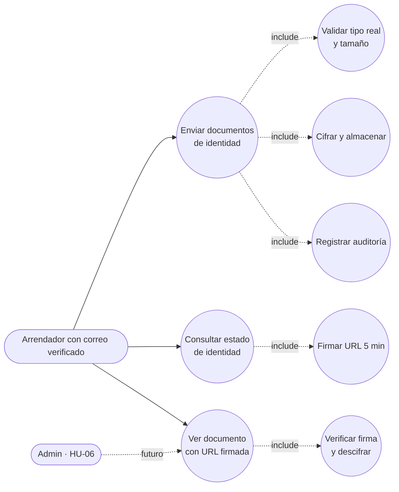
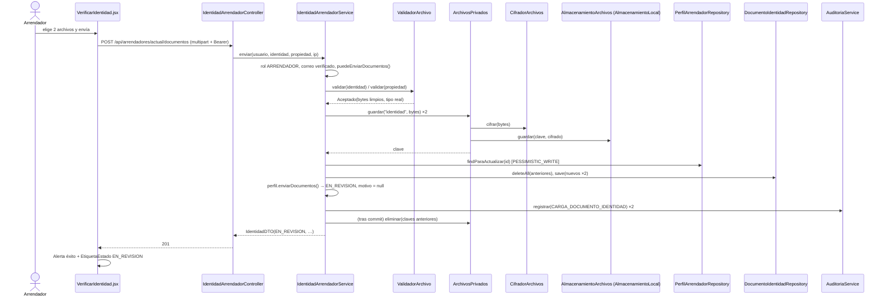
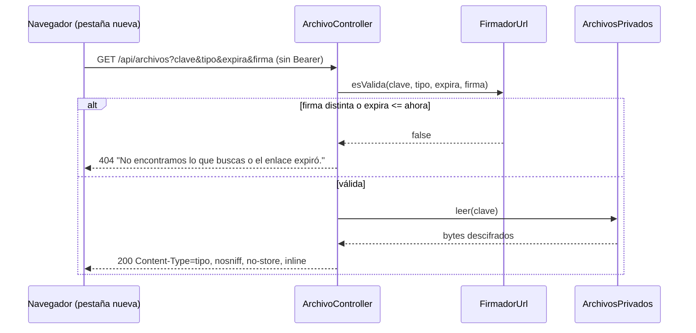
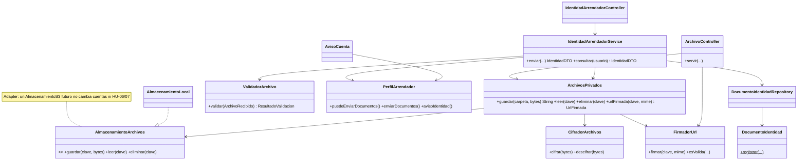

# HU-05 — Design: Envío de documentos de identidad del arrendador

> Módulo `cuentas` · Sprint 2 · tamaño M · depende de HU-02 (`done`; HU-03 también `done`) ·
> sin patrones ★ (aplica **Adapter** por el principio 5 de `docs/architecture.md`).
> Reutiliza `comun/error`, `comun/auditoria`, `comun/cifrado` (`LlaveCifrado`, llave
> `CIFRADO_LLAVE`), `comun/seguridad` (`UsuarioAutenticado`, filtro y punto de entrada de
> HU-03), `comun/web/IpCliente`, el bean `Clock`, `Usuario`/`UsuarioRepository`,
> `PerfilArrendador`/`PerfilArrendadorRepository`, `AvisoCuenta`, el kit `Boton`/`Campo`/
> `Alerta` y `api/cliente.js`.
> Construye el componente transversal **"Almacenamiento privado cifrado con URL firmada"**
> (`docs/requerimientos.md` §8) en `comun/almacenamiento/`, que reutilizarán HU-06
> (documentos para el admin) y HU-07 (fotos). Construye también `EtiquetaEstado` y el
> `Campo` de archivo del kit, y las excepciones `AccesoDenegadoException` y
> `RecursoNoEncontradoException` que `docs/conventions.md` ya lista.
>
> Las preguntas P1–P16 (`requirements.md`) tienen un valor por defecto aplicado en este
> diseño; el dueño las confirma al aprobar.

## 1. Decisiones (para revisión rápida del dueño)

| # | Pregunta | Decisión | Por qué |
|---|----------|----------|---------|
| DT-1 | P1 | Interfaz propia **`AlmacenamientoArchivos`** (Adapter: `guardar`, `leer`, `eliminar` de bytes por clave) con una sola implementación **`AlmacenamientoLocal`** (directorio `espacioya.almacenamiento.directorio`, por defecto `./almacenamiento`, ignorado por git). Encima, el servicio **`ArchivosPrivados`** de `comun` cifra, valida la clave, delega en el adaptador y firma URLs. Nadie fuera de `comun/almacenamiento` toca el adaptador. | Principio 5 y "Qué NO hacer": el almacenamiento va detrás de un Adapter. No hay SDK de AWS en el `pom.xml` ni MinIO en local; agregar una dependencia se discute antes. Con la interfaz, un `AlmacenamientoS3` posterior no cambia ni a `cuentas` ni a HU-06/HU-07. **Dueño:** en UAT el directorio debe estar en un volumen persistente (o pedir la tarea S3). |
| DT-2 | P2 | **Cifrado de la app** con AES-256-GCM: `comun/cifrado/CifradorArchivos` (nuevo, mismo paquete para usar `LlaveCifrado`), llave `CIFRADO_LLAVE`, IV aleatorio de 12 bytes por archivo, tag de 128. Formato en disco: `"EYA1"` (4 bytes ASCII) ‖ IV ‖ cifrado+tag. | Mismo algoritmo y llave de HU-02 (DT-1): sin secretos nuevos para cifrar y sin depender del proveedor. GCM autentica: un archivo alterado en disco no se descifra (falla en vez de servir basura). El prefijo `EYA1` permite rotar el formato sin migrar. `CifradorCampos` trabaja con `String`; una clase aparte evita mezclar base64 y binario. |
| DT-3 | P3 | **URL firmada propia:** `ArchivosPrivados.urlFirmada(clave, tipoMime)` devuelve `/api/archivos?clave=…&tipo=…&expira=<epoch s>&firma=<base64url(HMAC-SHA256(clave \n tipo \n expira))>`, válida **5 min**, con la llave nueva `ALMACENAMIENTO_LLAVE_FIRMA`. `GET /api/archivos` es público (la firma es la autorización), valida la firma en tiempo constante y el vencimiento, descifra y sirve. Cualquier fallo → 404 genérico. | El navegador abre el documento en otra pestaña o en un ``, que no envían `Authorization`: hace falta un enlace que se autorice solo y caduque pronto (RNF-SEG-15). Como el cifrado es de la app (DT-2), aun con S3 el archivo tendría que pasar por el backend para descifrarse: la URL apunta siempre a la API. Llave propia por el mismo argumento de llaves separadas de HU-02 (DT-3). El tipo va firmado porque `comun` no puede leer `documento_identidad` (no depende de `cuentas`). |
| DT-4 | P4 | Dos partes multipart obligatorias en una sola solicitud: `documentoIdentidad` → `tipo = IDENTIDAD` y `documentoPropiedad` → `tipo = PROPIEDAD` (enum `TipoDocumentoIdentidad`). | RF-A-14 nombra exactamente dos documentos. Enviarlos juntos hace atómico el paso a `EN_REVISION`: el admin nunca ve un expediente a medias. |
| DT-5 | P5 | Límite **5 242 880 bytes por archivo** (`ValidadorArchivo.TAMANO_MAXIMO`), inclusivo. Multipart: `max-file-size=6MB`, `max-request-size=13MB`, `server.tomcat.max-swallow-size=20MB`. Entre 5 MiB y 6 MB lo rechaza el servicio con error por campo (R9); por encima, `MaxUploadSizeExceededException` → 400 con el mismo mensaje sin campo (R13). | Con los valores por defecto de Spring (1 MB) un archivo válido de 2 MB fallaría con 500. El margen de 1 MB deja que casi todos los excesos lleguen al servicio y digan qué campo falló. `max-swallow-size` evita que Tomcat corte la conexión antes de enviar la respuesta. |
| DT-6 | — | **Tipo real por *magic bytes*** (sin Apache Tika): se ignoran el `Content-Type` y la extensión declarados (R10, R11). | Tres firmas fijas bastan; Tika sería una dependencia pesada para tres formatos. |
| DT-7 | P6 | **Imágenes re-codificadas** con `javax.imageio` (JDK): se lee primero el tamaño con `ImageReader` (sin decodificar) y se rechaza si supera 40 000 000 píxeles; luego se decodifica y se vuelve a escribir en el mismo formato (JPEG calidad 0.9; PNG sin pérdida). Lo que no decodifica → *imagen ilegible*. **PDF sin cambios.** | RNF-SEG-08 cita a HU-05. Re-codificar elimina EXIF (GPS, cámara) y cualquier contenido extra (políglotas). El tope de píxeles evita una bomba de descompresión (un PNG pequeño de 50 000 × 50 000). Sanear PDF exige una librería (PDFBox) que no está en el stack; el PDF se sirve con `nosniff` y `inline` desde un origen de API, sin ejecutarse en la SPA. JPEG CMYK que ImageIO no lee se rechaza: el arrendador puede reenviar en PDF. |
| DT-8 | P7 | **Reenvío reemplaza:** en la misma transacción se borran las filas anteriores y se insertan las nuevas; los archivos anteriores se borran **después del commit** (si falla, se registra en el log y queda un huérfano cifrado). `PerfilArrendador.enviarDocumentos()` pone `EN_REVISION` y `motivoRechazo = null`. | Minimización (Ley 29733): no se conservan documentos que ya no sirven. Borrar archivos antes del commit perdería los vigentes si la transacción falla. Restricción `UNIQUE (arrendador_id, tipo)`: nunca hay dos documentos vigentes del mismo tipo. |
| DT-9 | P8 | Solo `NO_INICIADA` o `RECHAZADA` envían. Otro estado → `ReglaNegocioException` sin campo → **400** con el mensaje *estado no permitido* (handler existente). | RN-01. `docs/conventions.md` admite 400/409 para reglas; 400 reutiliza el handler sin tocarlo. |
| DT-10 | P14 | La restricción de rol y de correo verificado se comprueba **en el servicio** y lanza `AccesoDenegadoException` (nueva, `comun/error`) → **403** con `ErrorDTO.MENSAJE_ACCESO_DENEGADO`. No se usa `hasRole` en `ConfiguracionSeguridad`. | Con `hasRole` haría falta un `AccessDeniedHandler` para que el 403 tenga forma de `ErrorDTO` (explorador § 1.2). La excepción ya está prevista en `docs/conventions.md` y la reutilizarán HU-06 y siguientes. La comprobación va antes de leer las partes (R20). |
| DT-11 | — | Errores de las dos partes **juntos**: `ValidacionException(List<ErrorCampoDTO>)` nueva en `comun/error` → 400 con `MENSAJE_VALIDACION` y un error por parte (R15). | `ReglaNegocioException` lleva un solo campo; el arrendador corregiría uno, reenviaría y recién vería el otro. HU-07 (5 fotos) la reutiliza. |
| DT-12 | P13 | `AvisoCuenta` delega en `PerfilArrendador.avisoIdentidad()`: `NO_INICIADA` → aviso de HU-02 (sin cambio), `EN_REVISION` → *aviso en revisión*, `RECHAZADA` → *aviso rechazada* + motivo, `VERIFICADA` → `null`. `SesionActualDTO` **no cambia**. | CA3 dice "cuando entro a mi panel, veo el motivo": el panel ya pinta el `aviso` sin llamadas extra. No ampliar el DTO mantiene HU-03 R23 ("solo `rol` y `aviso`"). **Esto reemplaza HU-03 R5** para `EN_REVISION` y `RECHAZADA` (antes `aviso` nulo); las IT de HU-03 no prueban esos estados, así que siguen verdes. |
| DT-13 | P9 | `GET /api/arrendadores/actual/identidad` devuelve estado, motivo, `puedeEnviar` (lo decide el servidor, principio 6) y los documentos vigentes con URL firmada nueva en cada consulta. `POST` responde lo mismo. | Una sola fuente para la pantalla. El frontend no deduce reglas del estado. |
| DT-14 | — | **Concurrencia:** el paso transaccional relee el perfil con `PESSIMISTIC_WRITE` (`findParaActualizar`) y vuelve a comprobar el estado. Dos envíos simultáneos: el segundo espera, ve `EN_REVISION` y recibe 400 (sus archivos nuevos se borran). | Sin bloqueo, ambos verían `NO_INICIADA`; el `UNIQUE` evitaría duplicados pero con un 500. |
| DT-15 | P16 | Migración **`V2_1__documento_identidad.sql`**. | `docs/conventions.md`: `V<sprint>_<n>`; HU-05 es del sprint 2. Flyway ordena `V1_4 < V2_1`. HU-06 (sprint 2) usa `V2_2` o la siguiente libre. |
| DT-16 | P10 | HU-05 **no** construye endpoints de admin. `ArchivosPrivados.urlFirmada` (público en `comun`) y la tabla quedan listos; HU-06 agrega en `cuentas` el método de servicio que lista los documentos de un arrendador para `administracion` (dirección `administracion → cuentas` permitida). | El admin no inicia sesión hasta HU-06 (DT-7 de HU-03): un endpoint de admin aquí no se podría probar de punta a punta ni tendría el control de IP (RNF-SEG-04). |
| DT-17 | — | Docs que el implementer actualiza en el mismo PR: `docs/modelo-datos.md` (`documento_identidad`: valores de `tipo`, `UNIQUE (arrendador_id, tipo)`, `ruta_archivo` = clave aleatoria, `tamano` = bytes recibidos); `docs/frontend.md` (`Campo tipo="archivo"`, `EtiquetaEstado` construido); `2_Backend/.env.example` (`ALMACENAMIENTO_LLAVE_FIRMA`, `ALMACENAMIENTO_DIRECTORIO`); `.gitignore` (`2_Backend/almacenamiento/`). | Reglas de cabecera de `modelo-datos.md` y `frontend.md`; `docs/conventions.md` (secretos). |

## 2. Caso de uso



**Enviar documentos** — Precondición: sesión vigente de un `ARRENDADOR` con correo verificado
en `NO_INICIADA` o `RECHAZADA`. Flujo principal: (1) el arrendador elige los dos archivos y
envía; (2) la API comprueba rol, correo y estado; (3) valida cada parte (vacía, tamaño, firma,
imagen decodificable) y re-codifica las imágenes; (4) cifra y guarda los dos archivos; (5) en
una transacción bloquea el perfil, borra los documentos anteriores, inserta los nuevos, pasa
a `EN_REVISION`, limpia el motivo y audita cada carga; (6) tras el commit borra los archivos
anteriores; (7) responde 201 con el estado y los documentos. Flujos alternos: 400 por parte
(audita `CARGA_DOCUMENTO_RECHAZADA`), 400 por estado (audita), 403 por rol o correo, 401 sin
sesión.

**Consultar estado** — Devuelve estado, motivo (si `RECHAZADA`), `puedeEnviar` y los
documentos vigentes con URL firmada de 5 min.

**Ver documento** — El navegador abre la URL firmada; la API valida firma y vencimiento,
descifra y sirve el archivo con `nosniff` y `no-store`. Firma inválida o vencida → 404.

## 3. Archivos por módulo y capa

Paquete base `pe.edu.ulima.espacioya`. (N) nuevo · (M) modificado.

### `comun`

| Carpeta | Archivo | Para |
|---|---|---|
| `comun/almacenamiento/` (N) | `AlmacenamientoArchivos` | Interfaz Adapter: `guardar`, `leer`, `eliminar` de bytes por clave (R30, R31) |
| | `AlmacenamientoLocal` | `@Component`: archivos en `espacioya.almacenamiento.directorio`, crea carpetas, escritura atómica (temporal + `move`) (R30) |
| | `ArchivosPrivados` | `@Service`: genera clave `<carpeta>/<UUID>`, valida la forma de la clave, cifra/descifra con `CifradorArchivos`, delega en el adaptador y firma URLs (R27, R30, R34, R38) |
| | `FirmadorUrl` | `@Component`: HMAC-SHA256 con `espacioya.almacenamiento.llave-firma`; `firmar`, `esValida` (tiempo constante + vencimiento); valida la llave al arrancar (R36–R39) |
| | `UrlFirmada` | Record `url`, `expiraEn` (R25, R38) |
| | `ArchivoController` | `GET /api/archivos` público: valida firma y vencimiento, descifra y responde con los encabezados de R35 (R34–R37) |
| | `ValidadorArchivo` | `@Component`: tamaño, firma de tipo real, re-codificación de imágenes y tope de píxeles; devuelve `ArchivoValidado` o un `MotivoRechazoArchivo` (R6, R8–R12, R32, R33) |
| | `ArchivoRecibido` | Record `contenido` (bytes o `null` si no se leyó por exceso de tamaño), `tamano` (R8, R9) |
| | `ArchivoValidado` | Record `contenido` (limpio), `tipo` (`TipoArchivo`), `tamanoRecibido` |
| | `TipoArchivo` | Enum `PDF`, `PNG`, `JPEG` con `mime` y `extension` (R11, R35) |
| | `MotivoRechazoArchivo` | Enum `VACIO`, `TAMANO_EXCEDIDO`, `TIPO_NO_PERMITIDO`, `IMAGEN_ILEGIBLE` con su mensaje por defecto (R8–R12, R41) |
| `comun/cifrado/` (N) | `CifradorArchivos` | `@Component`: `cifrar(byte[])`, `descifrar(byte[])` AES-256-GCM, formato `EYA1 ‖ iv ‖ cifrado+tag` (R30) |
| `comun/cifrado/` (M) | `LlaveCifrado` | Pasa a `public` (§ 11) para validar la llave de firma (R39) |
| `comun/error/` (N) | `AccesoDenegadoException` | → 403 `MENSAJE_ACCESO_DENEGADO` (R17, R18) |
| | `RecursoNoEncontradoException` | → 404 `MENSAJE_RECURSO_NO_ENCONTRADO` (R36, R37) |
| | `ValidacionException` | `List<ErrorCampoDTO>` → 400 `MENSAJE_VALIDACION` + errores (R8–R12, R15) |
| `comun/error/` (M) | `ErrorDTO` | +`MENSAJE_ACCESO_DENEGADO`, +`MENSAJE_RECURSO_NO_ENCONTRADO`, +`MENSAJE_ARCHIVO_DEMASIADO_GRANDE` |
| | `ManejadorGlobalErrores` | Handlers de las tres excepciones nuevas y de `MaxUploadSizeExceededException` (400, R13) y `MultipartException` (400 `MENSAJE_VALIDACION`) |
| `comun/seguridad/` (M) | `ConfiguracionSeguridad` | `permitAll` de `GET /api/archivos` (R34) |

### `cuentas`

| Capa | Archivo | Para |
|---|---|---|
| `domain/` (N) | `DocumentoIdentidad` | Entidad `documento_identidad`: `registrar(...)` (R3) |
| | `TipoDocumentoIdentidad` | Enum `IDENTIDAD`, `PROPIEDAD` (R3) |
| `domain/` (M) | `PerfilArrendador` | `puedeEnviarDocumentos()`, `enviarDocumentos()`, `avisoIdentidad()`, constantes `AVISO_IDENTIDAD_EN_REVISION`, `AVISO_IDENTIDAD_RECHAZADA` (R2, R4, R16, R24, R28, R29) |
| `repository/` (N) | `DocumentoIdentidadRepository` | `findByArrendadorIdOrderByTipoAsc`, `deleteByArrendadorId` (R5, R25) |
| `repository/` (M) | `PerfilArrendadorRepository` | `findParaActualizar(Long)` con `@Lock(PESSIMISTIC_WRITE)` (DT-14) |
| `service/` (N) | `IdentidadArrendadorService` | Casos de uso `enviar` y `consultar` (R1–R27, R40–R42) |
| `service/` (M) | `AvisoCuenta` | Delega en `PerfilArrendador.avisoIdentidad()` (R28, R29) |
| `dto/` (N) | `IdentidadDTO` | Salida `{estadoIdentidad, motivoRechazo, puedeEnviar, documentos}` (R1, R21–R25) |
| | `DocumentoIdentidadDTO` | Salida `{id, tipo, tipoMime, tamano, subidoEn, url, urlExpiraEn}` (R25) |
| `controller/` (N) | `IdentidadArrendadorController` | `POST /api/arrendadores/actual/documentos`, `GET /api/arrendadores/actual/identidad` |

### Recursos, configuración y docs

| Archivo | Cambio |
|---|---|
| `db/migration/V2_1__documento_identidad.sql` (N) | Tabla `documento_identidad` (§ 9) |
| `application.properties` (M) | Multipart, Tomcat, almacenamiento (§ 10) |
| `src/test/resources/config/application.properties` (M) | Llave de firma de prueba y directorio temporal (§ 10) |
| `2_Backend/.env.example` (M) | `ALMACENAMIENTO_LLAVE_FIRMA=`, `ALMACENAMIENTO_DIRECTORIO=` con comentario |
| `.gitignore` (M) | `2_Backend/almacenamiento/` |
| `docs/modelo-datos.md` (M) | DT-17 |
| `docs/frontend.md` (M) | Kit: `Campo` con `tipo="archivo"` (prop `accept`); `EtiquetaEstado` construido por HU-05 |

### Frontend (`3_frontend/src/`)

Ver § 13.

## 4. Endpoints

| Método y ruta | Acceso | Entrada | Respuestas |
|---|---|---|---|
| `POST /api/arrendadores/actual/documentos` | sesión vigente, `ARRENDADOR` | `multipart/form-data`: `documentoIdentidad`, `documentoPropiedad` (archivos) | **201** `IdentidadDTO` (R1) · **400** `ErrorDTO` con `errores[]` por parte (R8–R12, R15) · **400** `ErrorDTO` *tamaño excedido* sin campo (R13) · **400** `ErrorDTO` *estado no permitido* (R16) · **401** sesión inválida (R19) · **403** acceso denegado (R17, R18) · 500 genérico |
| `GET /api/arrendadores/actual/identidad` | sesión vigente, `ARRENDADOR` | — | **200** `IdentidadDTO` (R21–R25) · **401** (R19) · **403** (R17) |
| `GET /api/archivos?clave&tipo&expira&firma` | público (firma) | query | **200** bytes con `Content-Type` = `tipo` y encabezados de R35 (R34) · **404** `ErrorDTO` *recurso no encontrado* (R36, R37; también clave mal formada, parámetro faltante, tipo no permitido o archivo inexistente) |

`/actual` sigue el patrón de `/api/sesiones/actual`: la identidad sale del token (R7).

### DTO

```java
public record IdentidadDTO(String estadoIdentidad, String motivoRechazo, boolean puedeEnviar,
                           List<DocumentoIdentidadDTO> documentos) { }            // R1, R21–R24
public record DocumentoIdentidadDTO(Long id, String tipo, String tipoMime, long tamano,
                                    Instant subidoEn, String url, Instant urlExpiraEn) { } // R25
```

- Nombres de las partes: `IdentidadArrendadorController.PARTE_IDENTIDAD = "documentoIdentidad"`,
  `PARTE_PROPIEDAD = "documentoPropiedad"`; son también los `campo` de `errores[]`.
- `@RequestPart(required = false) MultipartFile`: la falta de una parte la reporta el servicio
  como error de campo (R8), no Spring con un 400 genérico.
- `url` es relativa a la API (`/api/archivos?...`); la SPA le antepone `VITE_API_URL`.

### Mensajes (texto exacto)

| Constante | Texto | Dónde |
|---|---|---|
| `IdentidadArrendadorService.MENSAJE_FALTA_IDENTIDAD` | `Sube tu documento de identidad (DNI o RUC).` | 400 campo `documentoIdentidad` (R8) |
| `IdentidadArrendadorService.MENSAJE_FALTA_PROPIEDAD` | `Sube el documento que acredita la propiedad o autorización del espacio.` | 400 campo `documentoPropiedad` (R8) |
| `MotivoRechazoArchivo.TAMANO_EXCEDIDO` = `ErrorDTO.MENSAJE_ARCHIVO_DEMASIADO_GRANDE` | `El archivo debe pesar como máximo 5 MB.` | 400 por campo (R9) y sin campo (R13) |
| `MotivoRechazoArchivo.TIPO_NO_PERMITIDO` | `El archivo debe ser PDF, JPG o PNG.` | 400 por campo (R10) |
| `MotivoRechazoArchivo.IMAGEN_ILEGIBLE` | `No pudimos leer la imagen. Revisa que no esté dañada y vuelve a subirla.` | 400 por campo (R12) |
| `IdentidadArrendadorService.MENSAJE_ESTADO_NO_PERMITIDO` | `Ya enviaste tus documentos o tu identidad ya está verificada.` | 400 (R16) |
| `ErrorDTO.MENSAJE_ACCESO_DENEGADO` | `No tienes permiso para realizar esta acción.` | 403 (R17, R18) |
| `ErrorDTO.MENSAJE_RECURSO_NO_ENCONTRADO` | `No encontramos lo que buscas o el enlace expiró.` | 404 (R36, R37) |
| `PerfilArrendador.AVISO_IDENTIDAD_EN_REVISION` | `Estamos revisando tus documentos de identidad. Te avisaremos cuando terminemos.` | `aviso` (R28) |
| `PerfilArrendador.AVISO_IDENTIDAD_RECHAZADA` | `Tu identidad fue rechazada. Vuelve a subir tus documentos. Motivo: ` (+ motivo) | `aviso` (R29) |
| `ErrorDTO.MENSAJE_VALIDACION` (existe) | `Revisa los datos del formulario.` | `mensaje` de 400 por campo |

## 5. Clases y firmas públicas

```java
// comun/almacenamiento
public interface AlmacenamientoArchivos {                 // Adapter del proveedor
    void guardar(String clave, byte[] contenido);
    Optional<byte[]> leer(String clave);
    void eliminar(String clave);                           // idempotente
}

@Component
public class AlmacenamientoLocal implements AlmacenamientoArchivos {
    public AlmacenamientoLocal(@Value("${espacioya.almacenamiento.directorio}") Path directorio);
}

public record UrlFirmada(String url, Instant expiraEn) { }

@Component
public class FirmadorUrl {
    public static final String VARIABLE_LLAVE = "ALMACENAMIENTO_LLAVE_FIRMA";
    public static final Duration DURACION = Duration.ofMinutes(5);
    public FirmadorUrl(@Value("${espacioya.almacenamiento.llave-firma}") String llave,
                       @Value("${espacioya.cifrado.llave}") String llaveCifrado,
                       @Value("${espacioya.cifrado.llave-huella}") String llaveHuella, Clock reloj); // R39
    public UrlFirmada firmar(String clave, String tipoMime);             // expira = ahora + DURACION (R38)
    public boolean esValida(String clave, String tipoMime, long expira, String firma); // MessageDigest.isEqual + expira > ahora
}

@Service
public class ArchivosPrivados {
    public ArchivosPrivados(AlmacenamientoArchivos almacenamiento, CifradorArchivos cifrador, FirmadorUrl firmador);
    public String guardar(String carpeta, byte[] contenido);   // clave = carpeta + "/" + UUID.randomUUID(); cifra (R27, R30)
    public Optional<byte[]> leer(String clave);                 // valida forma de la clave y descifra
    public void eliminar(String clave);
    public UrlFirmada urlFirmada(String clave, String tipoMime);
    static boolean claveValida(String clave);                   // ^[a-z]+/[0-9a-f]{8}-[0-9a-f]{4}-[0-9a-f]{4}-[0-9a-f]{4}-[0-9a-f]{12}$
}

@RestController
public class ArchivoController {
    @GetMapping("/api/archivos")
    public ResponseEntity<byte[]> servir(@RequestParam(required = false) String clave,
            @RequestParam(required = false) String tipo, @RequestParam(required = false) Long expira,
            @RequestParam(required = false) String firma);  // cualquier fallo → RecursoNoEncontradoException
}

@Component
public class ValidadorArchivo {
    public static final long TAMANO_MAXIMO = 5L * 1024 * 1024;       // 5 242 880 (R6, R9)
    public static final long PIXELES_MAXIMOS = 40_000_000L;           // R12
    public ResultadoValidacion validar(ArchivoRecibido archivo);
    public sealed interface ResultadoValidacion {
        record Aceptado(ArchivoValidado archivo) implements ResultadoValidacion { }
        record Rechazado(MotivoRechazoArchivo motivo) implements ResultadoValidacion { }
    }
}
// orden: contenido null o tamano == 0 → VACIO (si tamano > 0 y contenido null → TAMANO_EXCEDIDO);
// tamano > TAMANO_MAXIMO → TAMANO_EXCEDIDO; firma desconocida → TIPO_NO_PERMITIDO;
// PNG/JPEG: ImageReader sin reader, dimensiones > PIXELES_MAXIMOS, read null o IOException → IMAGEN_ILEGIBLE;
// PNG/JPEG aceptado: contenido = ImageIO.write(imagen, mismo formato); PDF: contenido tal cual (R33).

public record ArchivoRecibido(byte[] contenido, long tamano) { }
public record ArchivoValidado(byte[] contenido, TipoArchivo tipo, long tamanoRecibido) { }
public enum TipoArchivo { PDF("application/pdf", "pdf"), PNG("image/png", "png"), JPEG("image/jpeg", "jpg");
    public String mime(); public String extension(); public static Optional<TipoArchivo> deMime(String mime); }
public enum MotivoRechazoArchivo { VACIO, TAMANO_EXCEDIDO, TIPO_NO_PERMITIDO, IMAGEN_ILEGIBLE; public String mensaje(); }

// comun/cifrado
@Component
public class CifradorArchivos {
    public CifradorArchivos(@Value("${espacioya.cifrado.llave}") String llaveBase64);  // LlaveCifrado.decodificar
    public byte[] cifrar(byte[] claro);        // "EYA1" ‖ iv(12) ‖ cifrado+tag(16)
    public byte[] descifrar(byte[] guardado);  // IllegalStateException sin detalle si está alterado
}

// comun/error
public class AccesoDenegadoException extends RuntimeException { public AccesoDenegadoException(); }
public class RecursoNoEncontradoException extends RuntimeException { public RecursoNoEncontradoException(); }
public class ValidacionException extends RuntimeException {
    public ValidacionException(List<ErrorCampoDTO> errores); public List<ErrorCampoDTO> getErrores(); }
```

```java
// cuentas/domain
public enum TipoDocumentoIdentidad { IDENTIDAD, PROPIEDAD }

@Entity @Table(name = "documento_identidad")
public class DocumentoIdentidad {
    protected DocumentoIdentidad() { }
    public static DocumentoIdentidad registrar(Long arrendadorId, TipoDocumentoIdentidad tipo, String rutaArchivo,
                                               String tipoMime, int tamano, Instant subidoEn);
    public Long getId(); public Long getArrendadorId(); public TipoDocumentoIdentidad getTipo();
    public String getRutaArchivo(); public String getTipoMime(); public int getTamano(); public Instant getSubidoEn();
}

// PerfilArrendador (M)
public static final String AVISO_IDENTIDAD_EN_REVISION = "...";   // § 4
public static final String AVISO_IDENTIDAD_RECHAZADA = "...";     // § 4, prefijo
public boolean puedeEnviarDocumentos();   // NO_INICIADA || RECHAZADA
public void enviarDocumentos();           // IllegalStateException si !puedeEnviarDocumentos(); EN_REVISION; motivoRechazo = null
public String avisoIdentidad();           // NO_INICIADA → AVISO_IDENTIDAD; EN_REVISION → …; RECHAZADA → prefijo + motivo; VERIFICADA → null

// cuentas/repository
public interface DocumentoIdentidadRepository extends JpaRepository<DocumentoIdentidad, Long> {
    List<DocumentoIdentidad> findByArrendadorIdOrderByTipoAsc(Long arrendadorId);
}
// PerfilArrendadorRepository (M)
@Lock(LockModeType.PESSIMISTIC_WRITE) @Query("select p from PerfilArrendador p where p.usuarioId = :id")
Optional<PerfilArrendador> findParaActualizar(@Param("id") Long id);

// cuentas/service
@Service
public class IdentidadArrendadorService {
    public static final String ACCION_CARGA_DOCUMENTO = "CARGA_DOCUMENTO_IDENTIDAD";
    public static final String ACCION_CARGA_RECHAZADA = "CARGA_DOCUMENTO_RECHAZADA";
    public static final String CARPETA = "identidad";
    public IdentidadArrendadorService(UsuarioRepository usuarios, PerfilArrendadorRepository perfiles,
            DocumentoIdentidadRepository documentos, ValidadorArchivo validador, ArchivosPrivados archivos,
            AuditoriaService auditoria, TransactionTemplate transacciones, Clock reloj);
    public IdentidadDTO enviar(UsuarioAutenticado usuario, ArchivoRecibido identidad, ArchivoRecibido propiedad, String ip);
    @Transactional(readOnly = true) public IdentidadDTO consultar(UsuarioAutenticado usuario);
}

// cuentas/controller
@RestController @RequestMapping("/api/arrendadores/actual")
public class IdentidadArrendadorController {
    @PostMapping(path = "/documentos", consumes = MediaType.MULTIPART_FORM_DATA_VALUE) @ResponseStatus(CREATED)
    public IdentidadDTO enviar(@AuthenticationPrincipal UsuarioAutenticado usuario,
            @RequestPart(name = PARTE_IDENTIDAD, required = false) MultipartFile identidad,
            @RequestPart(name = PARTE_PROPIEDAD, required = false) MultipartFile propiedad, HttpServletRequest req);
    @GetMapping("/identidad")
    public IdentidadDTO consultar(@AuthenticationPrincipal UsuarioAutenticado usuario);
}
```

El controlador convierte cada `MultipartFile` en `ArchivoRecibido` (`null`/vacío → `new
ArchivoRecibido(null, 0)`; `getSize() > TAMANO_MAXIMO` → `new ArchivoRecibido(null, size)` sin
leer los bytes; si no, `getBytes()`), así el servicio no depende de Spring Web (principio 2).

## 6. Flujo de `IdentidadArrendadorService.enviar`

1. Si `usuario.rol() != "ARRENDADOR"` → `AccesoDenegadoException` (R17). Carga `Usuario`; si
   `!isCorreoVerificado()` → `AccesoDenegadoException` (R18). No se toca el contenido (R20).
2. Carga el perfil; si `!perfil.puedeEnviarDocumentos()` → audita `CARGA_DOCUMENTO_RECHAZADA`
   con `detalle = "estado=" + estado` y lanza `ReglaNegocioException(null,
   MENSAJE_ESTADO_NO_PERMITIDO)` (R16, R41).
3. `validador.validar` de cada parte. Por cada `Rechazado`: `ErrorCampoDTO(parte, mensaje)`
   (con `VACIO` → *falta identidad* / *falta propiedad*). Si hay errores: audita
   `CARGA_DOCUMENTO_RECHAZADA` con `detalle = "documentoIdentidad=TIPO_NO_PERMITIDO;…"` y lanza
   `ValidacionException(errores)` (R8–R12, R14, R15, R41).
4. `claveIdentidad = archivos.guardar("identidad", …)`, `clavePropiedad = …` (R27, R30). Si
   falla el segundo, se elimina el primero.
5. `transacciones.execute(...)`: `perfil = perfiles.findParaActualizar(id)`; si ya no
   `puedeEnviarDocumentos()` → excepción de R16; `anteriores = documentos.findByArrendadorId…`;
   `documentos.deleteAll(anteriores)` + `flush`; guarda los dos `DocumentoIdentidad.registrar(…,
   ahora)`; `perfil.enviarDocumentos()`; audita `CARGA_DOCUMENTO_IDENTIDAD` por documento con
   `detalle = "tipo=IDENTIDAD;mime=application/pdf;tamano=12345"` (R2–R5, R40, R42).
   Si la transacción lanza → `archivos.eliminar` de las dos claves nuevas y relanza (R14).
6. Tras el commit: `archivos.eliminar` de las rutas de `anteriores` (`try/catch` + `log.warn`
   sin la clave en el mensaje de usuario) (R5).
7. Devuelve `consultar(usuario)` (R1).

La auditoría de los pasos 2 y 3 usa `AuditoriaService.registrar` fuera de la transacción del
caso de uso (como `LOGIN_FALLIDO` en HU-03). La IP sale de `IpCliente.de(req)`.

`consultar`: rol ≠ `ARRENDADOR` → 403; arma `IdentidadDTO(estado, motivo si RECHAZADA,
puedeEnviar && correoVerificado, documentos)` con `archivos.urlFirmada(ruta, tipoMime)` por
documento (R21–R25, R38).

## 7. Diagramas de secuencia

### Flujo principal: envío aceptado (CA1)



### Flujo de error: archivo no permitido (CA2)

```mermaid
sequenceDiagram
  participant SPA as VerificarIdentidad.jsx
  participant C as IdentidadArrendadorController
  participant S as IdentidadArrendadorService
  participant V as ValidadorArchivo
  participant AU as AuditoriaService
  SPA->>C: POST … (documentoIdentidad = .exe renombrado a .pdf; documentoPropiedad 7 MB)
  C->>C: propiedad.getSize() > 5 MiB → ArchivoRecibido(null, size)
  C->>S: enviar(...)
  S->>V: validar(identidad)
  V-->>S: Rechazado(TIPO_NO_PERMITIDO)
  S->>V: validar(propiedad)
  V-->>S: Rechazado(TAMANO_EXCEDIDO)
  S->>AU: registrar(CARGA_DOCUMENTO_RECHAZADA, "documentoIdentidad=TIPO_NO_PERMITIDO;documentoPropiedad=TAMANO_EXCEDIDO")
  S-->>C: ValidacionException([2 errores])
  C-->>SPA: 400 {mensaje: "Revisa los datos del formulario.", errores: [...]}
  SPA->>SPA: error bajo cada Campo de archivo
```

### Flujo: ver un documento con URL firmada (STRIDE I)



## 8. Diagrama de clases (resumen)



No hace falta un puerto nuevo entre módulos: `cuentas` usa `comun` (dirección permitida) y
`comun` no conoce `cuentas` (el tipo MIME viaja firmado en la URL, DT-3).

## 9. Migración Flyway

`2_Backend/src/main/resources/db/migration/V2_1__documento_identidad.sql`:

```sql
-- HU-05: documentos de identidad del arrendador. El contenido NO está aquí: vive cifrado en el
-- almacenamiento privado; ruta_archivo es la clave aleatoria (identidad/<UUID>).
CREATE TABLE documento_identidad (
    id            BIGINT GENERATED ALWAYS AS IDENTITY PRIMARY KEY,
    arrendador_id BIGINT       NOT NULL REFERENCES perfil_arrendador (usuario_id) ON DELETE CASCADE,
    tipo          VARCHAR(20)  NOT NULL,
    ruta_archivo  VARCHAR(100) NOT NULL,
    tipo_mime     VARCHAR(30)  NOT NULL,
    tamano        INTEGER      NOT NULL,
    subido_en     TIMESTAMPTZ  NOT NULL,
    CONSTRAINT uq_documento_identidad_arrendador_tipo UNIQUE (arrendador_id, tipo),
    CONSTRAINT uq_documento_identidad_ruta UNIQUE (ruta_archivo),
    CONSTRAINT ck_documento_identidad_tipo CHECK (tipo IN ('IDENTIDAD', 'PROPIEDAD')),
    CONSTRAINT ck_documento_identidad_mime CHECK (tipo_mime IN ('application/pdf', 'image/jpeg', 'image/png')),
    CONSTRAINT ck_documento_identidad_tamano CHECK (tamano BETWEEN 1 AND 5242880)
);
```

- `ON DELETE CASCADE`: las IT de HU-01/02/03 hacen `DELETE FROM perfil_arrendador` y
  `DELETE FROM usuario`; sin cascada fallarían si quedan documentos (mismo motivo que DT-11 de
  HU-02 y `V1_4`). La cascada borra filas, no archivos: las IT usan un directorio temporal.
- `UNIQUE (arrendador_id, tipo)` sirve de índice por arrendador (DT-8) y es la garantía en BD
  de "como mucho un documento vigente por tipo" (principio 7).
- `tamano` = bytes **recibidos** (validados ≤ 5 MiB); la imagen re-codificada puede medir
  distinto y no se guarda su tamaño.
- Sin columna binaria (R31). `ddl-auto=validate`: la entidad mapea exactamente estas columnas
  (`tipo` con `@Enumerated(STRING)`, `length = 20`).

## 10. Configuración

`application.properties` (M):

```properties
# Subida de documentos (HU-05). El servicio valida 5 MiB por archivo; este margen deja que
# casi todo exceso llegue al servicio y se informe por campo.
spring.servlet.multipart.max-file-size=6MB
spring.servlet.multipart.max-request-size=13MB
server.tomcat.max-swallow-size=20MB

# Almacenamiento privado de archivos (HU-05, RNF-SEG-15). Directorio fuera del repo y de la BD;
# en UAT, un volumen persistente. La llave firma las URL de 5 min: 32 bytes en base64,
# distinta de las de cifrado. Sin ella el backend no arranca.
espacioya.almacenamiento.directorio=${ALMACENAMIENTO_DIRECTORIO:./almacenamiento}
espacioya.almacenamiento.llave-firma=${ALMACENAMIENTO_LLAVE_FIRMA:}
```

`src/test/resources/config/application.properties` (M):

```properties
# Llave de firma SOLO PARA PRUEBAS (HU-05). Nunca usar fuera de los tests.
espacioya.almacenamiento.llave-firma=cHJ1ZWJhcy1lc3BhY2lveWEtZmlybWEtdXJsLTAwMDM=
espacioya.almacenamiento.directorio=${java.io.tmpdir}/espacioya-it-almacenamiento
```

`ConfiguracionSeguridad` (M): `.requestMatchers(HttpMethod.GET, "/api/archivos").permitAll()`.
CORS no cambia (multipart usa `Content-Type`, ya permitido).

## 11. Excepciones y componentes de `comun`

| Componente | Uso en HU-05 |
|---|---|
| `AccesoDenegadoException` (N) | 403 de R17/R18. Prevista en `docs/conventions.md` |
| `RecursoNoEncontradoException` (N) | 404 de R36/R37. Prevista en `docs/conventions.md`; mensaje genérico que no dice si la clave existe |
| `ValidacionException` (N) | 400 con varios errores de campo (DT-11). Justificación: `ReglaNegocioException` admite un solo campo |
| `ReglaNegocioException` (existe) | 400 *estado no permitido* (R16) |
| `ManejadorGlobalErrores` (M) | 403, 404, 400 (`ValidacionException`), 400 `MaxUploadSizeExceededException` con `MENSAJE_ARCHIVO_DEMASIADO_GRANDE` (R13; se declara antes del handler genérico de `Exception`), 400 `MultipartException` con `MENSAJE_VALIDACION` |
| `AuditoriaService` + `EventoAuditoria` | `CARGA_DOCUMENTO_IDENTIDAD`, `CARGA_DOCUMENTO_RECHAZADA` (R40–R42). Las solicitudes cortadas por R13 antes del controlador no se auditan (no hay usuario resuelto en el handler); queda en el log |
| `LlaveCifrado` (M) | Pasa de clase y método de paquete a `public final class` con `public static byte[] decodificar(String, String)` (sin otro cambio), para que `FirmadorUrl` (`comun.almacenamiento`) valide su llave con la misma regla y el mismo mensaje sin valor (R39). `CifradorArchivos` la usa para `CIFRADO_LLAVE` |
| `IpCliente` | IP de la auditoría |
| `Clock` | `subido_en`, `expira` de la URL; `RelojControlable` en las IT |
| `LimitadorIntentos` | **No** se usa (P11) |
| `NotificadorCorreo` | **No** se usa (P12) |

## 12. Seguridad (resumen STRIDE)

| Control | Cómo |
|---|---|
| (I) cifrado en reposo | `ArchivosPrivados.guardar` siempre cifra (nadie llama al adaptador directo) |
| (I) privado | Directorio fuera de `static/` y del repo; ningún endpoint lista ni sirve por clave sin firma |
| (I) URL corta | 5 min, HMAC con llave propia, `no-store`; ningún log imprime la URL completa |
| (E) propiedad | Los documentos se buscan siempre por `usuario.usuarioId()` de la sesión; no hay id en la URL de `cuentas`; `GET /api/archivos` sin firma válida → 404 |
| (T) tipo real y tamaño | `ValidadorArchivo` (firmas, 5 MiB, píxeles, re-codificación); clave validada con regex antes de tocar disco (sin *path traversal*) |
| (R) registro | Una fila de auditoría por documento aceptado y una por envío rechazado |

## 13. Pantallas

### Kit (`components/ui/`)

| Componente | Cambio |
|---|---|
| `Campo` (M) | Nuevo `tipo="archivo"`: `<input type="file">` **no controlado** con prop `accept`; llama `onChange(evento.target.files[0] ?? null)`. Reutiliza etiqueta, `ayuda`, `error` y `aria-describedby`. Sin colores nuevos |
| `EtiquetaEstado` (N, + `.module.css`) | Prop `estado` (enum de la API). Mapa de texto y tipo: `VERIFICADA` "Identidad verificada" (éxito), `EN_REVISION` "Identidad en revisión" (atención), `RECHAZADA` "Identidad rechazada" (error), `NO_INICIADA` "Identidad sin verificar" (neutro). Colores de `tokens.css` según la tabla "Color de cada estado"; siempre muestra el texto. Estados de otras entidades los agrega su historia |

No hay estados nuevos en la tabla de colores de `docs/frontend.md` (identidad ya figura).

### API del cliente

| Archivo | Cambio |
|---|---|
| `src/api/cliente.js` (M) | Si `cuerpo instanceof FormData`: no pone `Content-Type` (el navegador agrega el *boundary*) y no hace `JSON.stringify`. Exporta `urlApi(ruta)` = `VITE_API_URL + ruta` para las URL firmadas |
| `src/api/cuentas.js` (M) | `enviarDocumentosIdentidad({ documentoIdentidad, documentoPropiedad })` → arma `FormData` → `POST /api/arrendadores/actual/documentos`; `obtenerIdentidad()` → `GET /api/arrendadores/actual/identidad` |

### Verificar identidad — `/panel/identidad` → `pages/cuentas/VerificarIdentidad.jsx` (N, + `.module.css`), dentro de `RutaProtegida`

- Al montar llama a `obtenerIdentidad()`. Mientras carga, texto secundario "Cargando…".
- Encabezado "Verificación de identidad" + `EtiquetaEstado estado={estadoIdentidad}`.
- **CA3:** si `motivoRechazo` no es nulo, `Alerta` de tipo `error` con "Motivo del rechazo:
  " + motivo, tal cual.
- Si `estadoIdentidad = EN_REVISION`, `Alerta` `info` con "Estamos revisando tus documentos.
  Te avisaremos cuando terminemos." (sin formulario).
- Si hay `documentos`: lista con "Documento de identidad" / "Documento de propiedad o
  autorización", fecha `subidoEn` y un enlace "Ver" (`target="_blank"`, `rel="noopener
  noreferrer"`) a `urlApi(url)`. Texto de ayuda: "El enlace vence en unos minutos; recarga la
  página para obtener uno nuevo."
- **Formulario solo si `puedeEnviar`** (lo decide el servidor):
  - `Campo tipo="archivo"` "Documento de identidad (DNI o RUC)", `nombre="documentoIdentidad"`,
    `accept=".pdf,.jpg,.jpeg,.png,application/pdf,image/jpeg,image/png"`, `ayuda="PDF, JPG o
    PNG de hasta 5 MB."`.
  - `Campo tipo="archivo"` "Documento de propiedad o autorización del espacio",
    `nombre="documentoPropiedad"`, mismos `accept` y `ayuda`.
  - Ayuda del cliente (no regla): si falta un archivo o `file.size > 5 * 1024 * 1024`, error
    bajo ese `Campo` sin enviar. El servidor revalida siempre.
  - `Boton` primario "Enviar documentos" con `cargando`.
- **CA1:** 201 → actualiza la pantalla con la respuesta, `Alerta` `exito` "Recibimos tus
  documentos. Tu identidad está en revisión." y refresca la sesión (`obtenerSesionActual()` +
  `entrar`) para que el panel muestre el nuevo aviso.
- **CA2:** 400 con `errores[]` → `Alerta` `error` con `mensaje` arriba y cada error bajo su
  `Campo` (`campo` = `nombre`). 400 sin `errores` (estado, tamaño cortado por R13) → solo la
  `Alerta`. 403 → `Alerta` `error` con el mensaje. Red → "No pudimos conectar. Intenta de nuevo.".
- Si el rol de la sesión no es `ARRENDADOR`, `<Navigate to="/panel" />` (solo elige qué
  mostrar; el backend responde 403 igual).

### Panel — `pages/cuentas/Panel.jsx` (M)

- **CA3:** el `aviso` ya llega con el motivo cuando la identidad está rechazada (R29). Tipo de
  `Alerta`: sigue `atencion` para todos los avisos (el panel no conoce el estado y no lo deduce
  del texto).
- Para `ARRENDADOR`: enlace "Verificar mi identidad" → `/panel/identidad` (estilo de enlace, no
  botón primario).

### `App.jsx` (M)

- Ruta nueva `/panel/identidad` envuelta en `RutaProtegida`.

## 14. Plan de pruebas (R → test)

Cada test lleva `@DisplayName("HU-05 R<n>: …")`. IT con `RelojControlable` `@Primary`,
`@BeforeEach` que borra `documento_identidad`, `sesion`, `auditoria`, `perfil_arrendador`,
`usuario` y vacía el directorio temporal de almacenamiento; IP por test en `10.5.x.x`. Los
arrendadores se crean como en `SesionControllerIT.crearArrendador` y se inicia sesión por la
API; los estados `RECHAZADA` (con motivo), `VERIFICADA` y `correo_verificado = false` se
fuerzan con `JdbcTemplate`. Archivos de prueba generados en el test (PDF mínimo `%PDF-1.4…`,
PNG/JPEG con `ImageIO`, JPEG con segmento `APP1 Exif` insertado a mano, PNG con `tEXt`), nunca
archivos del repo. Multipart con `MockMvcRequestBuilders.multipart(...).file(new
MockMultipartFile(...))`.

| R | Test |
|---|---|
| R1, R2, R3 | `IdentidadArrendadorControllerIT` (201, `estadoIdentidad`, fila de perfil y dos filas con tipo/mime/tamaño/`subido_en` del reloj), `IdentidadArrendadorServiceTest` |
| R4 | `IdentidadArrendadorControllerIT` (desde `RECHAZADA` con motivo → `motivo_rechazo` nulo), `PerfilArrendadorTest` (`enviarDocumentos`) |
| R5 | `IdentidadArrendadorControllerIT` (forzar `RECHAZADA` tras un primer envío, reenviar → solo 2 filas nuevas y los archivos anteriores ya no existen en el directorio) |
| R6 | `ValidadorArchivoTest` (PDF de 5 242 880 bytes aceptado; 5 242 881 rechazado) |
| R7 | `IdentidadArrendadorControllerIT` (parámetro y parte `arrendadorId` de otro arrendador → documentos del de la sesión) |
| R8 | `IdentidadArrendadorControllerIT` (sin parte / parte de 0 bytes → 400 con `campo` y mensaje), `ValidadorArchivoTest` (`VACIO`) |
| R9 | `ValidadorArchivoTest`, `IdentidadArrendadorControllerIT` (5 242 881 bytes → 400 campo) |
| R10, R11 | `ValidadorArchivoTest` (texto plano y ZIP con nombre `.pdf` y `application/pdf` → `TIPO_NO_PERMITIDO`), `IdentidadArrendadorControllerIT` (PNG declarado como `x.pdf`/`application/pdf` → aceptado con `tipo_mime = image/png`) |
| R12 | `ValidadorArchivoTest` (cabecera PNG + basura → `IMAGEN_ILEGIBLE`; PNG con dimensiones declaradas 8000 × 6000 → rechazado sin decodificar) |
| R13 | `ManejadorGlobalErroresTest` (`MaxUploadSizeExceededException` → 400 con `MENSAJE_ARCHIVO_DEMASIADO_GRANDE`) |
| R14 | `IdentidadArrendadorControllerIT` (tras cada 400: estado igual, 0 filas, directorio vacío), `IdentidadArrendadorServiceTest` (fallo en la transacción → `eliminar` de las claves nuevas) |
| R15 | `IdentidadArrendadorControllerIT` (dos partes inválidas → `errores` con 2 elementos) |
| R16 | `IdentidadArrendadorControllerIT` (`EN_REVISION` y `VERIFICADA` → 400 con mensaje), `PerfilArrendadorTest` (`puedeEnviarDocumentos`, `enviarDocumentos` lanza) |
| R17 | `IdentidadArrendadorControllerIT` (cuenta `USUARIO` → 403 en POST y GET) |
| R18 | `IdentidadArrendadorControllerIT` (`correo_verificado = false` con sesión ya iniciada → 403) |
| R19 | `IdentidadArrendadorControllerIT` (sin `Authorization` → 401 con `MENSAJE_SESION_INVALIDA`) |
| R20 | `IdentidadArrendadorServiceTest` (403 y R16: `validador` y `archivos` sin interacciones) |
| R21–R25 | `IdentidadArrendadorControllerIT` (claves exactas del JSON; motivo solo si `RECHAZADA`; `puedeEnviar` por estado; dos documentos con `url` y `urlExpiraEn`), `IdentidadArrendadorServiceTest` |
| R26 | `IdentidadArrendadorControllerIT` (la respuesta no contiene el nombre original enviado ni el número de documento) |
| R27 | `IdentidadArrendadorControllerIT` (`ruta_archivo` cumple `^identidad/<uuid>$` y ninguna columna ni archivo lleva el nombre original), `ArchivosPrivadosTest` |
| R28, R29 | `PerfilArrendadorTest` (`avisoIdentidad` por estado), `IdentidadArrendadorControllerIT` (`GET /api/sesiones/actual` en `EN_REVISION` y en `RECHAZADA` con motivo) |
| R30 | `CifradorArchivosTest` (ida y vuelta; dos cifrados distintos; alterado → excepción), `IdentidadArrendadorControllerIT` (bytes en disco ≠ contenido y no empiezan con `%PDF`; descifrados = contenido) |
| R31 | `IdentidadArrendadorControllerIT` (`information_schema.columns` de `documento_identidad` sin `bytea`/`oid`) |
| R32 | `ValidadorArchivoTest` (JPEG con `Exif` y PNG con `tEXt` → contenido aceptado sin esas marcas) |
| R33 | `ValidadorArchivoTest`, `IdentidadArrendadorControllerIT` (PDF descifrado idéntico) |
| R34, R35 | `ArchivoControllerIT` o en `IdentidadArrendadorControllerIT` (`GET` de la `url` devuelta, sin Bearer → 200, bytes, encabezados) |
| R36 | `FirmadorUrlTest`, IT (firma alterada, `clave` o `tipo` cambiados → 404 con mensaje) |
| R37 | `FirmadorUrlTest`, IT (`avanzar(5 min)` → 404) |
| R38 | `FirmadorUrlTest`, IT (`urlExpiraEn` = reloj + 5 min) |
| R39 | `FirmadorUrlTest` (vacía, corta, igual a `CIFRADO_LLAVE` → `IllegalStateException` que nombra la variable y no contiene el valor) |
| R40–R42 | `IdentidadArrendadorControllerIT` (filas de `auditoria` por `JdbcTemplate`: 2 cargas con detalle `tipo=…;mime=…;tamano=…`; rechazos con `<parte>=<MOTIVO>` y `estado=…`; ningún detalle contiene el nombre original, la clave ni el número), `IdentidadArrendadorServiceTest` |
| — | `ManejadorGlobalErroresTest` (M): 403, 404, `ValidacionException`, `MultipartException` |
| — | `SesionControllerIT` y demás IT de HU-01/02/03 siguen verdes sin cambios (DT-12) |

## 15. Alternativas descartadas

1. **Guardar los archivos en PostgreSQL (`bytea`).** Prohibido por `docs/architecture.md`
   ("no guardar archivos en la base de datos") y engorda backups y consultas.
2. **S3 con URL prefirmada del proveedor y cifrado SSE-KMS ahora.** Exige el SDK de AWS
   (dependencia nueva que se discute antes), credenciales en local y en las IT (o un MinIO que
   hoy no existe) y deja el cifrado en manos de la infraestructura. La interfaz
   `AlmacenamientoArchivos` permite agregarlo después sin tocar `cuentas` (P1).
3. **Servir el archivo desde un endpoint autenticado con Bearer** (sin URL firmada). No
   cumple "URL firmada de corta duración" (RNF-SEG-15) y obligaría a la SPA a descargar el
   blob con `fetch` y crear un `blob:` para mostrarlo; tampoco serviría al admin de HU-06 de la
   misma forma.
4. **Apache Tika para detectar el tipo.** Dependencia grande para tres firmas fijas (DT-6).
5. **`hasRole("ARRENDADOR")` en `ConfiguracionSeguridad`.** Necesita un `AccessDeniedHandler`
   nuevo para que el 403 tenga forma de `ErrorDTO` y reparte la regla entre configuración y
   servicio (DT-10).
6. **Conservar los documentos anteriores como historial.** Más datos personales retenidos sin
   un CA que lo pida; complica la restricción "uno vigente por tipo" (DT-8).
7. **Ampliar `SesionActualDTO` con `estadoIdentidad` y `motivoRechazo`.** Rompe HU-03 R23
   ("solo `rol` y `aviso`") y sus IT; el aviso con el motivo cumple CA3 sin tocar el contrato
   (DT-12).
