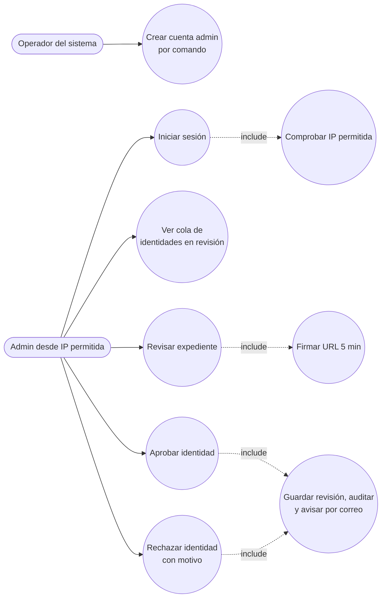
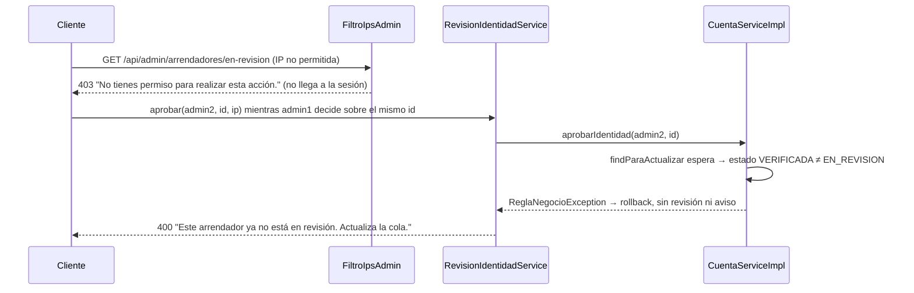

# HU-06 — Design: Revisión de identidad de arrendadores

> Módulo `administracion` (nuevo) · Sprint 2 · tamaño M · depende de HU-05 (`done`) · sin ★.
> Reutiliza `comun/error`, `comun/auditoria`, `ArchivosPrivados.urlFirmada`, el filtro de sesión de
> HU-03, `IpCliente`, `Clock`, `PasswordEncoder`, `PoliticaContrasena`, `PoliticaPrivacidad`,
> `CuentaService` (HU-07), `findParaActualizar` y `DocumentoIdentidadDTO` (HU-05),
> `NotificadorCorreo`, el kit y `api/cliente.js`. Construye `administracion`, el **control de IPs**
> en `comun/seguridad` (lo reutilizan HU-09 y HU-27), el **comando de creación de admins** y el
> **`Modal`**. D1–D4: decisiones del dueño; S1–S16 (`requirements.md`): supuestos a confirmar.

## 1. Decisiones (para revisión rápida del dueño)

| # | Origen | Decisión | Por qué |
|---|--------|----------|---------|
| DT-1 | D2, S12 | `comun/seguridad/IpsPermitidasAdmin` (`@Component`) parsea `espacioya.admin.ips-permitidas` con `IpAddressMatcher` de Spring Security (IPv4, IPv6 y CIDR; sin dependencias nuevas) y expone `permite(String ip)`. `FiltroIpsAdmin` (`OncePerRequestFilter`, **no** `@Component`) se agrega en `ConfiguracionSeguridad` **antes** de `FiltroAutenticacionSesion`: si la ruta empieza con `/api/admin/` y la IP no está permitida, escribe 403 `ErrorDTO(MENSAJE_ACCESO_DENEGADO)` y corta. | Antes de autenticar: desde fuera no se distingue si hay sesión ni si el panel existe. Mismo cuerpo que la falta de rol (S12). No es `@Component` para que Spring Boot no lo registre además como filtro del contenedor (igual que `FiltroAutenticacionSesion`). Lista vacía → ningún `IpAddressMatcher` → nadie (R5). Una entrada inválida lanza en el constructor → el contexto no arranca (R11). |
| DT-2 | D1 | `Usuario`: `motivoRechazoInicioSesion()` **deja de rechazar al `ADMIN`** (solo correo y estado); nuevo `motivoRechazoRecuperacion()` = `ADMIN → ROL_NO_PERMITIDO` y luego la regla anterior; nuevo `esAdmin()`. `RecuperacionContrasenaService` (líneas 96 y 170) pasa a usar `motivoRechazoRecuperacion()`. `InicioSesionService.motivoRechazo`, tras validar la contraseña: si `esAdmin()` y `!ipsAdmin.permite(ip)` → `IP_NO_PERMITIDA` (nuevo valor de `MotivoRechazoInicioSesion`); si no, `motivoRechazoInicioSesion()`. | Separa las dos reglas sin cambiar la conducta de HU-04 (mismo motivo `ROL_NO_PERMITIDO` en su auditoría: sus tests no cambian). La IP es dato de infraestructura: la decide el servicio con un componente de `comun` (dirección `cuentas → comun` permitida); el dominio solo sabe si la cuenta es admin. La IP se comprueba después de la contraseña: una contraseña incorrecta sigue auditando `CONTRASENA_INCORRECTA`. |
| DT-3 | D3, S14 | `application.properties`: `server.forward-headers-strategy=native` y `server.tomcat.remoteip.internal-proxies=${PROXIES_CONFIANZA:}`. Tomcat (`RemoteIpValve`) reescribe `getRemoteAddr()` solo si la conexión viene de un proxy de confianza; `IpCliente` no cambia. | Una sola fuente de IP para auditoría, límite de intentos, login admin y filtro. Vacío por defecto = nadie es proxy de confianza = conducta actual (local y tests). En UAT se pone la regex del ALB (y de CloudFront si llega directo). Leer `X-Forwarded-For` a mano permitiría falsificarlo (descartado, § 13). |
| DT-4 | D4, S15 | `cuentas/service/CreacionAdminService.crear(correo, contrasena)` (transacción) + `cuentas/service/CreadorAdmin implements ApplicationRunner`, `@ConditionalOnProperty(name = "espacioya.admin.crear", havingValue = "true")`, que lee `espacioya.admin.correo` / `espacioya.admin.contrasena` (`ADMIN_CORREO`, `ADMIN_CONTRASENA`), llama al servicio y **cierra el contexto** (`ConfigurableApplicationContext.close()`). Cualquier error → `IllegalStateException` → el arranque falla (código ≠ 0). `Usuario.registrarAdmin(...)` nueva. | Reutiliza bcrypt, política y auditoría del backend; ningún endpoint ni secreto en el repo. Cerrar el contexto convierte el arranque en un comando de una vez (§ 9). El servicio se prueba sin arrancar nada. |
| DT-5 | S1, S2 | `administracion` es dueño del caso de uso y de `revision_identidad`; `cuentas` es dueño del estado. `RevisionIdentidadService.aprobar/rechazar` (`@Transactional`) llama a `CuentaService.aprobarIdentidad/rechazarIdentidad` (propagación `REQUIRED`: misma transacción), guarda la `RevisionIdentidad` y audita. `CuentaServiceImpl` relee el perfil con `findParaActualizar` (`PESSIMISTIC_WRITE`) y aplica `PerfilArrendador.aprobarIdentidad()` / `rechazarIdentidad(motivo)`. | Todo o nada (R29–R33, R40). El bloqueo serializa dos admins: el segundo espera, ve el estado nuevo y recibe 400 (R39). Dirección `administracion → cuentas` permitida: **no hace falta puerto nuevo**; solo se amplía la interfaz pública `CuentaService` (la tabla de `docs/architecture.md` se anota, § 3). |
| DT-6 | S2, R41 | Rol `ADMIN` comprobado en `RevisionIdentidadService` **y** en cada método nuevo de `CuentaServiceImpl` (`AccesoDenegadoException`, patrón de `habilitacionArrendador`). Sin `hasRole` en `ConfiguracionSeguridad`. | DT-10 de HU-05: el 403 sale con forma de `ErrorDTO` sin `AccessDeniedHandler`. Defensa en profundidad: un futuro caller de `CuentaService` no salta la regla. |
| DT-7 | S3 | `NotificadorCorreo` gana `notificarIdentidadAprobada(String correo)` y `notificarIdentidadRechazada(String correo, String motivo)`. `CuentaServiceImpl` los registra con `TransactionSynchronizationManager.registerSynchronization(afterCommit)`; un fallo del envío se registra con `log.warn` sin datos y no revierte la decisión. | No avisar una decisión que hizo rollback (pendiente de HU-04 para HU-25). El puerto solo recibe correo y motivo: el correo nunca lleva documentos (RNF-SEG-16). HU-25 moverá el puerto a `comun/correo` y redactará el contenido (§ 4, textos guía). |
| DT-8 | S4, S6, S10 | Cola: consulta JPQL en `PerfilArrendadorRepository` que une `PerfilArrendador`, `Usuario` y `DocumentoIdentidad` por id, filtra `EN_REVISION` + `ACTIVA` + rol `ARRENDADOR`, agrupa por arrendador con `min(subidoEn)` y ordena por esa fecha y por id. Devuelve una proyección `(arrendadorId, enviadoEn)`; luego se cargan usuarios y perfiles por id (`findAllById`). Sin paginación. | Sin columna nueva (S4). El volumen de UAT es pequeño. Las entidades de `cuentas` no tienen asociaciones JPA entre sí (solo ids): el *join* por igualdad de ids es el patrón posible. |
| DT-9 | S5, S6 | Expediente: un `GET` por arrendador que firma las URL al abrirlo (`ArchivosPrivados.urlFirmada`, 5 min) y reutiliza `DocumentoIdentidadDTO`. Respuestas de cola y expediente con `CacheControl.noStore()` explícito. | Las URL vencen 5 min después de que el admin abre el expediente, no de que cargó la cola. Spring Security ya pone `no-store` por defecto, pero el controlador lo fija para no depender de eso (R26). |
| DT-10 | S7 | Rutas `/api/admin/arrendadores/...` con dos `POST` de decisión que responden `201` con `RevisionIdentidadDTO`. El `{id}` es el arrendador revisado, no el actor (que sale de la sesión): no choca con `docs/conventions.md`. | Prefijo único para el filtro (HU-09 y HU-27 lo reutilizan). Dos endpoints: el motivo solo se valida en el rechazo con Bean Validation (R35). `201`: cada decisión crea una fila de `revision_identidad`. |
| DT-11 | S1, S11 | Migración `V2_3__revision_identidad.sql` (§ 8). Entidad `administracion/domain/RevisionIdentidad` con `arrendadorId` y `adminId` como `Long` (sin asociación JPA a entidades de `cuentas`). | Modelo de datos (fila `revision_identidad`, HU-06). La migración solo depende de `V1_1` y `V1_3` (números menores). |
| DT-12 | S8 | `ArchivoController.servir` captura también `UncheckedIOException` → `RecursoNoEncontradoException` con `log.warn` sin la clave. Nada más cambia en `comun/almacenamiento`. | Cierra la observación del review de HU-05 asignada a "HU-06/HU-07". |
| DT-13 | — | Docs que el implementer actualiza en el mismo PR: `docs/modelo-datos.md` (`revision_identidad` en el grupo de administración, tipos y `CHECK`), `docs/architecture.md` (métodos nuevos de `CuentaService`; control de IPs en "Seguridad transversal"), `docs/frontend.md` (`Modal` construido por HU-06), `docs/requerimientos.md` §9-4 ("se mantiene hasta HU-17; HU-17 decide"), `README.md` (comando de creación de admin y configuración de IPs/proxies), `2_Backend/.env.example` (variables de § 9, sin valores). | Reglas de cabecera de esos archivos y `docs/conventions.md` (secretos). |

## 2. Caso de uso



**Revisar y decidir (CA1–CA3)** — Precondición: admin con sesión desde una IP permitida. Flujo:
(1) abre la cola por fecha de envío; (2) abre un expediente (datos y documentos con URL firmada);
(3) aprueba o rechaza con motivo y confirma en el `Modal`; (4) la API bloquea el perfil, comprueba
`EN_REVISION`, cambia el estado, guarda la revisión y audita en una transacción; (5) tras el
commit, avisa por correo; (6) responde 201. Alternos: IP → 403; sin sesión → 401; rol → 403;
motivo → 400 por campo; ya decidido → 400; arrendador inexistente o no activo → 404.

## 3. Archivos por módulo y capa

Paquete base `pe.edu.ulima.espacioya`. (N) nuevo · (M) modificado.

| Módulo / capa | Archivo | Para |
|---|---|---|
| Módulo / capa | Archivos | Para |
|---|---|---|
| `comun/seguridad/` | `IpsPermitidasAdmin` (N), `FiltroIpsAdmin` (N), `ConfiguracionSeguridad` (M: filtro antes de `FiltroAutenticacionSesion`) | R5, R7, R8, R10–R12 |
| `comun/almacenamiento/` | `ArchivoController` (M) | R44 |
| `cuentas/domain/` (M) | `Usuario` (`registrarAdmin`, `esAdmin`, `motivoRechazoRecuperacion`), `MotivoRechazoInicioSesion` (`+IP_NO_PERMITIDA`), `PerfilArrendador` (`aprobarIdentidad`, `rechazarIdentidad`) | R1, R3, R6, R15, R28, R32, R38 |
| `cuentas/repository/` (M) | `PerfilArrendadorRepository.findEnRevision()` | R20–R22 |
| `cuentas/service/` (M) | `InicioSesionService` (IP del admin), `RecuperacionContrasenaService` (regla de recuperación), `CuentaService`/`CuentaServiceImpl` (4 métodos), `NotificadorCorreo`/`NotificadorCorreoSimulado` (2 avisos) | R1–R6, R20–R25, R28, R30, R32, R34, R37–R41, R45 |
| `cuentas/service/` (N) | `CreacionAdminService`, `CreadorAdmin` | R15–R19 |
| `cuentas/dto/` (N) | `ArrendadorEnRevisionDTO`, `ExpedienteIdentidadDTO` | R20, R23 |
| `administracion/` (N) | `domain/RevisionIdentidad`, `domain/DecisionIdentidad`, `repository/RevisionIdentidadRepository`, `service/RevisionIdentidadService`, `dto/MotivoRechazoDTO`, `dto/RevisionIdentidadDTO`, `controller/RevisionIdentidadController` | R9, R20–R43 |
| Recursos | `V2_3__revision_identidad.sql` (N), `application.properties` (M) | § 8, § 9 |

`administracion` usa `cuentas` solo vía `CuentaService` y sus DTO, nunca sus repositorios.
Docs en DT-13; frontend en § 11.

## 4. Endpoints

Todos bajo `/api/admin/`: pasan primero por `FiltroIpsAdmin` (403, R7), luego por la sesión
(401, R8) y luego por el rol en el servicio (403, R9). El cuerpo se valida con `@Valid` antes del
servicio (como HU-07 R52).

| Método y ruta | Entrada | Respuestas |
|---|---|---|
| `GET /api/admin/arrendadores/en-revision` | — | **200** `ArrendadorEnRevisionDTO[]` + `no-store` (R20–R22, R26) · 401 · 403 |
| `GET /api/admin/arrendadores/{id}/identidad` | — | **200** `ExpedienteIdentidadDTO` + `no-store` (R23, R24, R26) · **404** (R25) · 401 · 403 |
| `POST /api/admin/arrendadores/{id}/identidad/aprobacion` | — | **201** `RevisionIdentidadDTO` (R27) · **400** *ya revisada* (R38) · **404** (R37) · 401 · 403 |
| `POST /api/admin/arrendadores/{id}/identidad/rechazo` | JSON `MotivoRechazoDTO` | **201** `RevisionIdentidadDTO` (R31) · **400** campo `motivo` (R35) · **400** *ya revisada* · **404** · 401 · 403 |

`{id}` no numérico → 400 genérico de Spring (handler existente). Sin cuerpo en el rechazo → 400
genérico (`HttpMessageNotReadableException`); `{}` → 400 en el campo `motivo`.

```java
// cuentas/dto
public record ArrendadorEnRevisionDTO(Long arrendadorId, String nombre, String razonSocial,
                                      String tipoDocumento, Instant enviadoEn) { }                  // R20
public record ExpedienteIdentidadDTO(Long arrendadorId, String nombre, String correo, String telefono,
        String tipoDocumento, String numeroDocumento, String razonSocial, String direccionFiscal,
        String estadoIdentidad, Instant enviadoEn, List<DocumentoIdentidadDTO> documentos) { }      // R23, R24
// administracion/dto
public record MotivoRechazoDTO(@NotBlank(message = M_MOTIVO) @Size(max = 500, message = M_MOTIVO) String motivo) {
    public MotivoRechazoDTO { motivo = motivo == null ? null : motivo.strip(); }                     // R35
}
public record RevisionIdentidadDTO(String decision, String estadoIdentidad, Instant fecha) { }      // R27, R31
```

### Mensajes (texto exacto)

| Constante | Texto | Dónde |
|---|---|---|
| `MotivoRechazoDTO.M_MOTIVO` | `Escribe el motivo del rechazo (hasta 500 caracteres).` | campo `motivo` (R35) |
| `CuentaServiceImpl.MENSAJE_YA_REVISADA` | `Este arrendador ya no está en revisión. Actualiza la cola.` | 400 (R38) |

Existentes en `ErrorDTO`: `MENSAJE_ACCESO_DENEGADO` (R7, R9), `MENSAJE_RECURSO_NO_ENCONTRADO`
(R25, R37, R44), `MENSAJE_CREDENCIALES_INVALIDAS` (R2), `MENSAJE_SESION_INVALIDA` (R8). El
simulado escribe solo `Envío de correo de identidad aprobada simulado: no se envió ningún correo
(HU-06).` (o `rechazada`). Textos guía para el correo real de HU-25 (no son R): "Tu identidad fue
verificada. Ya puedes publicar tus espacios." / "Tu identidad fue rechazada. Motivo: <motivo>.
Vuelve a subir tus documentos desde tu panel." (nunca "verificado" a secas, RN-01).

## 5. Clases y firmas públicas

```java
// comun/seguridad
@Component public class IpsPermitidasAdmin {   // VARIABLE = "ADMIN_IPS_PERMITIDAS"
    public IpsPermitidasAdmin(@Value("${espacioya.admin.ips-permitidas}") String lista); // inválida → IllegalStateException
    public boolean permite(String ip); }                                                   // null o lista vacía → false
public class FiltroIpsAdmin extends OncePerRequestFilter {   // PREFIJO = "/api/admin/"; IP con IpCliente.de(...)
    public FiltroIpsAdmin(IpsPermitidasAdmin ips, JsonMapper json); }

// cuentas/domain — Usuario (M) y PerfilArrendador (M)
public static Usuario registrarAdmin(String correoNormalizado, String hash, String versionPolitica, Instant ahora);
public boolean esAdmin();
public Optional<MotivoRechazoInicioSesion> motivoRechazoInicioSesion();   // solo CORREO_NO_VERIFICADO, CUENTA_NO_ACTIVA
public Optional<MotivoRechazoInicioSesion> motivoRechazoRecuperacion();   // ADMIN → ROL_NO_PERMITIDO; luego lo anterior
public void aprobarIdentidad();               // IllegalStateException si != EN_REVISION; VERIFICADA, motivo = null
public void rechazarIdentidad(String motivo); // IllegalStateException si != EN_REVISION o motivo en blanco; RECHAZADA

// cuentas/repository — PerfilArrendadorRepository (M): JPQL de DT-8 (constructor expression, enums calificados)
record EnRevision(Long arrendadorId, Instant enviadoEn) { }
List<EnRevision> findEnRevision();

// cuentas/service — CuentaService (M): cada método lanza AccesoDenegadoException si rol != ADMIN (R41)
List<ArrendadorEnRevisionDTO> arrendadoresEnRevision(UsuarioAutenticado admin);              // R20–R22
ExpedienteIdentidadDTO expedienteIdentidad(UsuarioAutenticado admin, Long arrendadorId);      // R23–R25
String aprobarIdentidad(UsuarioAutenticado admin, Long arrendadorId);                         // → "VERIFICADA"
String rechazarIdentidad(UsuarioAutenticado admin, Long arrendadorId, String motivo);         // → "RECHAZADA"
// CuentaServiceImpl(UsuarioRepository, PerfilArrendadorRepository, DocumentoIdentidadRepository,
//                   ArchivosPrivados, NotificadorCorreo); MENSAJE_YA_REVISADA
// NotificadorCorreo (M): void notificarIdentidadAprobada(String correo); void notificarIdentidadRechazada(String correo, String motivo);
@Service public class CreacionAdminService {   // ACCION_CREACION_ADMIN = "CREACION_ADMIN"
    public CreacionAdminService(UsuarioRepository usuarios, PasswordEncoder encoder, PoliticaPrivacidad politica,
                                AuditoriaService auditoria, TransactionTemplate transacciones, Clock reloj);
    public Long crear(String correo, String contrasena); }   // R15–R18
@Component @ConditionalOnProperty(name = "espacioya.admin.crear", havingValue = "true")
public class CreadorAdmin implements ApplicationRunner {     // run: servicio.crear(...); log sin el correo; contexto.close()
    public CreadorAdmin(CreacionAdminService servicio, ConfigurableApplicationContext contexto,
                        @Value("${espacioya.admin.correo:}") String correo,
                        @Value("${espacioya.admin.contrasena:}") String contrasena); }

// administracion
public enum DecisionIdentidad { APROBADA, RECHAZADA }
@Entity @Table(name = "revision_identidad") public class RevisionIdentidad {   // getters de todas las columnas
    public static RevisionIdentidad aprobar(Long arrendadorId, Long adminId, Instant fecha);
    public static RevisionIdentidad rechazar(Long arrendadorId, Long adminId, String motivo, Instant fecha); }
@Service public class RevisionIdentidadService {   // ACCION_APROBADA/RECHAZADA = "IDENTIDAD_…"; ENTIDAD_PERFIL
    public RevisionIdentidadService(CuentaService cuentas, RevisionIdentidadRepository revisiones,
                                    AuditoriaService auditoria, Clock reloj);
    @Transactional(readOnly = true) public List<ArrendadorEnRevisionDTO> cola(UsuarioAutenticado admin);
    @Transactional(readOnly = true) public ExpedienteIdentidadDTO expediente(UsuarioAutenticado admin, Long id);
    @Transactional public RevisionIdentidadDTO aprobar(UsuarioAutenticado admin, Long id, String ip);
    @Transactional public RevisionIdentidadDTO rechazar(UsuarioAutenticado admin, Long id, String motivo, String ip); }
// RevisionIdentidadController: @RequestMapping("/api/admin/arrendadores"); GET devuelven ResponseEntity con
// CacheControl.noStore(); POST con @ResponseStatus(CREATED); rechazo con @Valid @RequestBody MotivoRechazoDTO; IP con IpCliente.
```

## 6. Flujos

**`RevisionIdentidadService.rechazar`** (`@Transactional`; `aprobar` es igual sin motivo):
(1) `admin.rol() != ADMIN` → `AccesoDenegadoException` (R9); (2) `estado =
cuentas.rechazarIdentidad(admin, id, motivo)`; dentro, `CuentaServiceImpl`: rol (R41) →
`perfiles.findParaActualizar(id)` y `usuarios.findById(id)`; si falta alguno, no es `ARRENDADOR`
o no está `ACTIVA` → `RecursoNoEncontradoException` (R37); si `estado != EN_REVISION` →
`ReglaNegocioException(MENSAJE_YA_REVISADA)` (R38); `perfil.rechazarIdentidad(motivo)` (R32);
registra el aviso `afterCommit` con el correo y el motivo (R34); (3) `ahora = Instant.now(reloj)`;
`revision = revisiones.save(RevisionIdentidad.rechazar(id, admin.usuarioId(), motivo, ahora))`
(R33); (4) audita `IDENTIDAD_RECHAZADA` con `decision=RECHAZADA;revision=<id>` (R42, R43);
(5) `new RevisionIdentidadDTO("RECHAZADA", estado, ahora)` (R31). Cualquier excepción revierte
todo y la sincronización no se dispara (R40).

**Cola:** rol (×2) → `findEnRevision()` → `findAllById` de usuarios y perfiles → DTO en el
orden de la consulta (R20–R22). **Expediente:** rol (×2) → busca `id` en las mismas condiciones
que la cola (perfil `EN_REVISION`, usuario `ACTIVA` y `ARRENDADOR`) o 404 sin firmar (R25) →
documentos con `findByArrendadorIdOrderByTipoAsc` y `aDto` con `urlFirmada` (R23, R24);
`enviadoEn` = menor `subidoEn`.

**Login admin** (`InicioSesionService`): bloqueo por correo → contraseña → si `esAdmin()` y
`!ipsAdmin.permite(ip)` → `IP_NO_PERMITIDA` (401, auditoría y fallo contado como cualquier
motivo: R2–R4) → `motivoRechazoInicioSesion()` → sesión (R1).

## 7. Diagramas de secuencia

### Flujo principal: rechazar con motivo (CA3; aprobar, CA2, sigue el mismo camino)

```mermaid
sequenceDiagram
  actor A as Admin (IP permitida)
  participant SPA as RevisarIdentidad.jsx
  participant FI as FiltroIpsAdmin
  participant C as RevisionIdentidadController
  participant S as RevisionIdentidadService
  participant CS as CuentaService (CuentaServiceImpl)
  participant RR as RevisionIdentidadRepository
  participant N as NotificadorCorreo
  A->>SPA: Rechazar → motivo en el Modal → Confirmar
  SPA->>FI: POST /api/admin/arrendadores/{id}/identidad/rechazo {motivo}
  FI->>C: IP permitida ✔ → filtro de sesión → UsuarioAutenticado ADMIN
  C->>S: @Valid MotivoRechazoDTO (recortado) → rechazar(admin, id, motivo, ip)
  S->>CS: rechazarIdentidad(admin, id, motivo)
  CS->>CS: findParaActualizar(id) [PESSIMISTIC_WRITE] · ACTIVA ✔ · EN_REVISION ✔
  CS->>CS: perfil.rechazarIdentidad(motivo) · registerSynchronization(afterCommit)
  CS-->>S: "RECHAZADA"
  S->>RR: save(RevisionIdentidad.rechazar(...)) · auditoría "decision=RECHAZADA;revision=7"
  Note over S,N: commit
  CS->>N: notificarIdentidadRechazada(correo, motivo)
  S-->>C: RevisionIdentidadDTO
  C-->>SPA: 201 → vuelve a la cola con Alerta éxito
```

### Flujo de error: IP no permitida y decisión ya tomada



## 8. Migración Flyway

`2_Backend/src/main/resources/db/migration/V2_3__revision_identidad.sql` (antes de crearla,
actualizar `develop` y confirmar que `V2_3` sigue libre; si no, la siguiente `V2_n`):

```sql
-- HU-06: historial de decisiones del admin sobre la identidad de un arrendador. El estado vigente
-- sigue en perfil_arrendador; esta tabla registra quién decidió qué, cuándo y por qué (STRIDE R).
CREATE TABLE revision_identidad (
    id            BIGINT GENERATED ALWAYS AS IDENTITY PRIMARY KEY,
    arrendador_id BIGINT       NOT NULL REFERENCES perfil_arrendador (usuario_id) ON DELETE CASCADE,
    admin_id      BIGINT       NOT NULL REFERENCES usuario (id),
    decision      VARCHAR(20)  NOT NULL,
    motivo        VARCHAR(500),
    fecha         TIMESTAMPTZ  NOT NULL,
    CONSTRAINT ck_revision_identidad_decision CHECK (decision IN ('APROBADA', 'RECHAZADA')),
    CONSTRAINT ck_revision_identidad_motivo CHECK (
        (decision = 'APROBADA' AND motivo IS NULL)
        OR (decision = 'RECHAZADA' AND motivo IS NOT NULL AND length(btrim(motivo)) > 0))
);
CREATE INDEX ix_revision_identidad_arrendador ON revision_identidad (arrendador_id, fecha);
```

`arrendador_id` en cascada como `documento_identidad` (las IT borran `perfil_arrendador`);
`admin_id` sin cascada (borrar un admin no borra sus decisiones; `NO ACTION` se comprueba al final
de la sentencia, así que el `DELETE FROM usuario` de otras IT sigue funcionando). La entidad mapea
exactamente estas columnas (`ddl-auto=validate`).

## 9. Configuración

`application.properties` (M):

```properties
# Panel admin (HU-06, RNF-SEG-04): hasta HU-17 (MFA) solo se entra desde estas IPs. Lista separada
# por comas de IPs o rangos CIDR. Vacía = nadie entra. En UAT, las IPs de quienes administran.
espacioya.admin.ips-permitidas=${ADMIN_IPS_PERMITIDAS:127.0.0.1,::1}

# IP real detrás de CloudFront/ALB (HU-06, D3). Tomcat solo cree a X-Forwarded-For si la conexión
# viene de un proxy de confianza (expresión regular). Vacía = nadie es proxy: se usa la IP de la conexión.
server.forward-headers-strategy=native
server.tomcat.remoteip.internal-proxies=${PROXIES_CONFIANZA:}

# Comando de creación de cuentas admin (HU-06, D4). Solo con ADMIN_CREAR=true; las credenciales
# vienen de variables de entorno y nunca se escriben en el repositorio.
espacioya.admin.crear=${ADMIN_CREAR:false}
espacioya.admin.correo=${ADMIN_CORREO:}
espacioya.admin.contrasena=${ADMIN_CONTRASENA:}
```

Comando (README, sección del backend; desde la raíz, con la base levantada):
`ADMIN_CREAR=true ADMIN_CORREO=<correo> ADMIN_CONTRASENA=<contraseña> ./2_Backend/mvnw -f
2_Backend/pom.xml spring-boot:run -Dspring-boot.run.arguments=--server.port=0` → crea la cuenta,
escribe "Cuenta admin creada" en el log y termina. Luego se borran las variables de la sesión del
terminal. En UAT, igual como tarea única del contenedor.

## 10. Excepciones y componentes de `comun`

**No se agrega ninguna excepción.** Se reutilizan `AccesoDenegadoException` (403 por rol, R9,
R41; el filtro escribe el mismo `ErrorDTO`, R7), `RecursoNoEncontradoException` (404, R25, R37,
R44), `ReglaNegocioException` (400 *ya revisada*, R38) y el handler de
`MethodArgumentNotValidException` (400 campo `motivo`, R35). Componentes de `comun` sin cambios:
`AuditoriaService` (`IDENTIDAD_APROBADA`/`RECHAZADA`, `CREACION_ADMIN`, `LOGIN_FALLIDO` con
`IP_NO_PERMITIDA`), `ArchivosPrivados.urlFirmada` (URL de 5 min, R24), `IpCliente` (la IP real la
pone Tomcat, R13, R14) y `LimitadorIntentos` (cuenta el fallo de R2, R4).

## 11. Pantallas

### Kit — `components/ui/Modal.jsx` (N, + `.module.css`)

Props `abierto`, `titulo`, `onConfirmar`, `onCerrar`, `children`, `textoConfirmar`, `variante`
(`primario` o `peligro-confirmar`) y `cargando`. Usa `<dialog>` con `showModal()` cuando `abierto`
(foco atrapado y `Esc` → `onCerrar`); pie con `Boton secundario` "Cancelar" y el `Boton` de
confirmación con `variante` y `cargando`. Fondo `--color-superficie`, borde `--color-borde`,
radio `--radio-tarjeta`; el fondo oscurecido con `color-mix(in srgb, var(--color-texto) 50%,
transparent)` (sin colores literales). `docs/frontend.md` lo anota como construido por HU-06.

### API — `src/api/administracion.js` (N)

`listarIdentidadesEnRevision()` → `GET …/en-revision`; `obtenerExpedienteIdentidad(id)` →
`GET …/{id}/identidad`; `aprobarIdentidad(id)` → `POST …/{id}/identidad/aprobacion`;
`rechazarIdentidad(id, motivo)` → `POST …/{id}/identidad/rechazo` con `{ motivo }` (prefijo
`/api/admin/arrendadores`).

En ambas pantallas: dentro de `RutaProtegida`; rol de la sesión ≠ `ADMIN` → `<Navigate
to="/panel" />` (la API responde 403 igual); "Cargando…" en texto secundario; errores de la API
(403 por IP o rol, 404, 400 sin `errores`) → `Alerta error` con el mensaje tal cual; red → "No
pudimos conectar. Intenta de nuevo."; nunca se muestran ids.

**Cola — `/admin/identidades` → `pages/administracion/ColaIdentidades.jsx` (N, + `.module.css`).**
Título "Identidades en revisión". **CA1:** una `Tarjeta` por arrendador en el orden recibido
(`titulo` = nombre; razón social, tipo de documento, "Enviado el <fecha y hora local>",
`EtiquetaEstado estado="EN_REVISION"`; `acciones` = enlace "Revisar" →
`/admin/identidades/:id`). Lista vacía: "No hay arrendadores esperando la revisión de su
identidad.". Mensaje de éxito recibido por el estado de navegación → `Alerta exito` arriba.

**Revisar — `/admin/identidades/:id` → `pages/administracion/RevisarIdentidad.jsx` (N, + `.module.css`).**

- **CA1:** nombre + `EtiquetaEstado`; lista de definición con correo, teléfono, tipo y número de
  documento, razón social, dirección fiscal y fecha de envío; documentos ("Documento de
  identidad" / "Documento de propiedad o autorización") con enlace "Ver" (`target="_blank"`,
  `rel="noopener noreferrer"`) a `urlApi(url)` y la ayuda "El enlace vence en unos minutos;
  recarga la página para obtener uno nuevo." (como `VerificarIdentidad.jsx`).
- **CA2:** `Boton primario` "Aprobar identidad" (único primario) → `Modal variante="primario"`,
  "¿Aprobar la identidad de <nombre>?", texto "Podrá publicar sus espacios y le avisaremos por
  correo.", confirmar "Aprobar".
- **CA3:** `Boton peligro` "Rechazar identidad" → `Modal variante="peligro-confirmar"`, "Rechazar
  la identidad de <nombre>", `Campo tipo="textarea"` "Motivo del rechazo" (`nombre="motivo"`,
  ayuda "El arrendador lo verá en su panel y en el correo. Hasta 500 caracteres."), confirmar
  "Rechazar"; motivo vacío → error bajo el `Campo` sin enviar (ayuda, no regla).
- 201 → navega a la cola con "Aprobaste la identidad de <nombre>." o "Rechazaste la identidad de
  <nombre>. Le avisamos el motivo por correo.". 400 con `errores` → error bajo el `Campo` del
  `Modal`; *ya revisada* o 404 → `Modal` cerrado, `Alerta error` y enlace "Volver a la cola".

### Panel y rutas

- `pages/cuentas/Panel.jsx` (M): textos para `ADMIN` ("Panel de administración", "Revisa las
  identidades de los arrendadores.") y enlace "Revisar identidades" → `/admin/identidades`.
- `App.jsx` (M): rutas `/admin/identidades` y `/admin/identidades/:id` en `RutaProtegida`.
- Sin estados nuevos en "Color de cada estado": `EtiquetaEstado` ya mapea `EN_REVISION`.

## 12. Plan de pruebas (R → test)

Cada test lleva `@DisplayName("HU-06 R<n>: …")`. IT con Testcontainers, `RelojControlable`
`@Primary`, `NotificadorFalso` que registra llamadas, `@BeforeEach` que borra
`revision_identidad`, `documento_identidad`, `sesion`, `auditoria`, `perfil_arrendador` y
`usuario` y vacía el directorio de almacenamiento. Admin creado con `CreacionAdminService` (o
`UPDATE usuario SET rol = 'ADMIN'`), inicia sesión por la API desde `127.0.0.1`; IP no permitida
`10.6.x.x`. Arrendadores en `EN_REVISION` enviando documentos por la API de HU-05 (o forzado con
`JdbcTemplate`, con `subido_en` distintos para el orden).

| R | Test (`RIT` = `RevisionIdentidadControllerIT`) |
|---|---|
| R1–R4 | `SesionControllerIT` (admin desde `127.0.0.1` → 201 `rol=ADMIN`; desde `10.3.x.x` → 401 idéntico, sin sesión, `motivo=IP_NO_PERMITIDA`, 5 fallos → 429), `InicioSesionServiceTest` |
| R5, R10, R11 | `IpsPermitidasAdminTest` (vacía; IPv4; `::1` = `0:0:0:0:0:0:0:1`; CIDR v4 y v6; `abc`, `10.0.0.0/99` → excepción con `ADMIN_IPS_PERMITIDAS` sin el valor); `RIT` con lista vacía (`@TestPropertySource`) → 403 |
| R6 | `RecuperacionContrasenaControllerIT` (nuevo: admin desde `127.0.0.1`, sin token), `UsuarioTest` |
| R7, R8, R12 | `FiltroIpsAdminTest`; `RIT` (IP no permitida con y sin Bearer → 403; permitida sin Bearer → 401; `GET /api/archivos` firmado desde `10.6.x.x` → 200) |
| R9 | `RIT` (`USUARIO` y `ARRENDADOR` → 403 en los 4 endpoints), `RevisionIdentidadServiceTest` |
| R13, R14 | `IpRealIT` (`RANDOM_PORT`, HTTP real a `POST /api/sesiones` con `X-Forwarded-For`: proxies = loopback → `auditoria.ip` del encabezado; vacío → `127.0.0.1`) |
| R15–R19 | `CreacionAdminServiceTest` (fila y flags; variables inválidas o correo existente → excepción sin `save` y sin el valor), `CreacionAdminServiceIT` (`encoder.matches`), `CreadorAdminTest` (`ApplicationContextRunner`: sin propiedad no hay bean; con ella llama y cierra el contexto) |
| R20–R22, R26 | `RIT` (fechas distintas + empate; `VERIFICADA`, `RECHAZADA`, `NO_INICIADA` y `SUSPENDIDA` excluidos; claves exactas; `no-store`) |
| R23–R25 | `RIT` (claves exactas, número descifrado, `urlExpiraEn` = reloj + 5 min y su `GET` → 200; `VERIFICADA`, `USUARIO`, inexistente → 404) |
| R27–R34 | `RIT` (cuerpo, perfil, fila con `admin_id` de la sesión aunque el cuerpo traiga otro, motivo recortado, un aviso en `NotificadorFalso`; aviso de sesión del arrendador nulo tras aprobar) |
| R35 | `RIT` (`{}`, `""`, `"   "`, 501 caracteres → 400 campo `motivo`, sin cambios), `MotivoRechazoDTOTest` |
| R36 | `RIT` (`INSERT` por `JdbcTemplate` que viola cada `CHECK` → `DataIntegrityViolationException`) |
| R37, R38 | `RIT` (404 y 400 por cada caso, sin cambios, fila ni aviso), `PerfilArrendadorTest` (fuera de `EN_REVISION` lanzan) |
| R39 | `RIT` (dos hilos con `CountDownLatch` → un 201, un 400, una fila, un aviso) |
| R40, R41 | `CuentaServiceImplTest` (`initSynchronization()`: aviso solo en `afterCommit`, ninguno tras `ROLLED_BACK`; rol ≠ `ADMIN` → `AccesoDenegadoException` sin repositorios); `RIT` de R7–R9, R35, R37, R38 sin avisos |
| R42, R43 | `RIT` (fila de `auditoria` exacta; el detalle no contiene motivo, número, correo ni `/api/archivos`) |
| R44 · R45 | `ArchivoControllerTest` (`UncheckedIOException` → 404) · `NotificadorCorreoSimuladoTest` (`OutputCaptureExtension`) |

## 13. Alternativas descartadas

1. **Endpoint de login propio para el admin** — duplica HU-03 (bloqueo, auditoría, sesión) sin ganar seguridad (D1).
2. **Quitar al `ADMIN` de la regla sin separar la recuperación** — el admin recuperaría su contraseña por correo antes de MFA (D1).
3. **Control de IPs solo en el WAF** — no se prueba en local ni en las IT; puede sumarse en UAT además del filtro (D2).
4. **Leer `X-Forwarded-For` en `IpCliente`** — falsificable si no se valida quién es el proxy; Tomcat ya lo resuelve (D3).
5. **Admin sembrado en una migración o SQL con hash pegado** — secretos en el repo, sin política ni auditoría (D4).
6. **`hasRole("ADMIN")` en `ConfiguracionSeguridad`** — exige un `AccessDeniedHandler` para el `ErrorDTO` (DT-10 de HU-05).
7. **Sin tabla `revision_identidad`** — se pierde el historial cuando hay varios rechazos y se aparta del modelo (S1).
8. **DTO propios en `administracion` copiados de `cuentas`** — mapeo duplicado: son contrato de `CuentaService`.
9. **Cola con documentos y URL firmadas para todos** — URL que vencen antes de mirarlas y documentos expuestos sin necesidad (S6).
