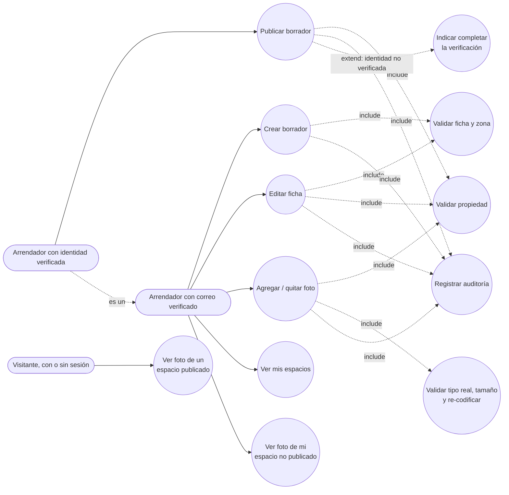
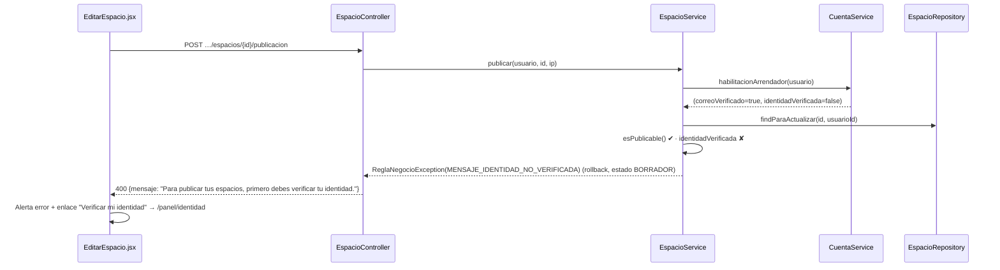
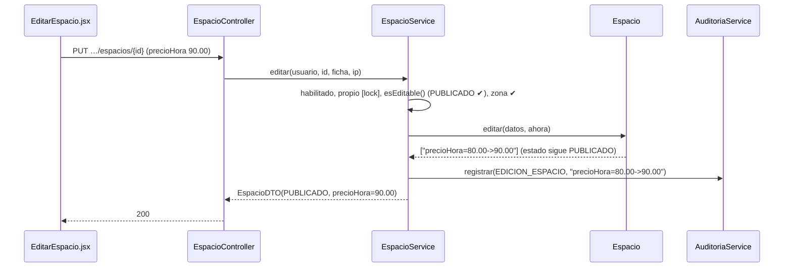
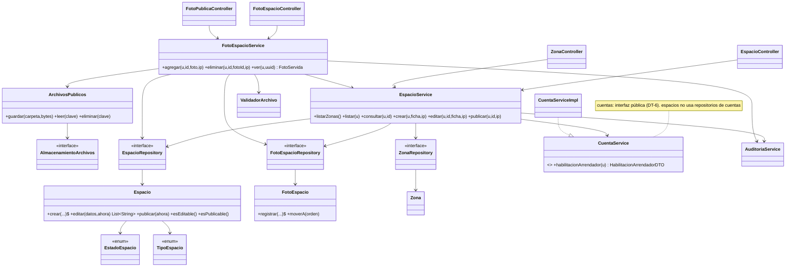

# HU-07 — Design: Publicar y editar un espacio

> Módulo `espacios` (nuevo) · Sprint 2 · tamaño M · depende de HU-02 (`done`; HU-03 y HU-05
> también `done`) · visible en el catálogo tras HU-06 (nadie llega a `VERIFICADA` hasta
> entonces; las IT fuerzan el estado con `JdbcTemplate`) · sin patrones ★ (DAO/Repository).
> Reutiliza `comun/error` (`ReglaNegocioException`, `AccesoDenegadoException`,
> `RecursoNoEncontradoException`, `ManejadorGlobalErrores`), `comun/auditoria`,
> `comun/almacenamiento` de HU-05 (`ValidadorArchivo` y el adaptador de disco
> `AlmacenamientoArchivos`/`AlmacenamientoLocal`; **no** `ArchivosPrivados`, `FirmadorUrl` ni
> `ArchivoController`), `comun/seguridad` (`UsuarioAutenticado`, filtro y punto de entrada de
> HU-03), `comun/web/IpCliente`, el bean `Clock`, `TransactionTemplate`, el kit `Boton`/`Campo`/
> `Alerta`/`EtiquetaEstado` y `api/cliente.js` (`FormData`, `urlApi`, token).
> Crea el paquete `espacios`, la interfaz pública `CuentaService` de `cuentas`, el servicio
> transversal `comun/almacenamiento/ArchivosPublicos` (fotos sin cifrar), en el kit `Tarjeta` y
> `Campo tipo="textarea"`, y en `api/cliente.js` la función `peticionArchivo` (descarga binaria
> con token).
>
> Las preguntas P1–P16 (`requirements.md`) tienen un valor por defecto aplicado en este
> diseño; el dueño las confirma al aprobar. **P4 y P5 ya las decidió el dueño** en la revisión
> del 2026-10-28 (fotos públicas sin cifrar con URL estable; `descripcion` obligatoria de 10 a
> 2000).

## 1. Decisiones (para revisión rápida del dueño)

| # | Pregunta | Decisión | Por qué |
|---|----------|----------|---------|
| DT-1 | P1 | Tabla **`zona`** (`codigo` PK, `nombre`) sembrada en la migración con los 43 distritos de Lima Metropolitana y los 7 del Callao (§ 9). `espacio.zona` es FK a `zona(codigo)`. Entidad de solo lectura `Zona`; `GET /api/zonas` la lista. | HU-10 busca "por zona": con texto libre, "Surco", "Santiago de Surco" y "surco " serían zonas distintas y la búsqueda fallaría. Una tabla da integridad en BD (principio 7) y, a diferencia de un enum Java + `CHECK` de 50 valores, la lista y sus nombres con tildes viven en un solo lugar que el frontend lee de la API (sin duplicar la lista en la SPA). **Cambia `docs/modelo-datos.md`** (DT-15). |
| DT-2 | P2, P14 | Ficha en JSON (`POST`/`PUT`) y fotos **una por solicitud** (`POST …/fotos`, `DELETE …/fotos/{fotoId}`). La foto nueva va con `orden = n + 1`; al quitar una, las siguientes bajan un lugar. Sin reordenamiento. | Cinco fotos de 5 MB juntas (25 MB) exceden `max-request-size=13MB`; subir de a una cabe en la configuración de HU-05 sin tocarla y cada error de archivo se informa solo. Una foto necesita un espacio al que pertenecer: el borrador existe antes. Reordenar no lo pide ningún CA (YAGNI); la principal es `orden = 1`. |
| DT-3 | P3 | Publicar exige **≥ 1 foto**. | HU-10 CA2 muestra la "foto principal" y HU-11 CA1 las fotos: un espacio publicado sin fotos rompería esas pantallas. |
| DT-4 | P4 (decidida por el dueño) | Fotos **sin cifrar** en el mismo directorio de almacenamiento, vía el nuevo `comun/almacenamiento/ArchivosPublicos` (DT-18), clave `espacios/<UUID>` aleatoria. Se sirven en **`GET /api/fotos/{uuid}`** (`FotoPublicaController` de `espacios`), URL estable `/api/fotos/<UUID>` en `FotoEspacioDTO.url`. Visibilidad: espacio `PUBLICADO` → cualquiera, `Cache-Control: public, max-age=3600`; otro estado → solo el dueño con sesión, `Cache-Control: no-store`; cualquier otro caso → el mismo 404 genérico, sin caché (R39, R54, R55). Siempre `Content-Type` real (de `foto_espacio.tipo_mime`, nunca del cliente) y `X-Content-Type-Options: nosniff`. La ruta es `permitAll` en `ConfiguracionSeguridad`; el filtro de HU-03 igual autentica si llega un `Bearer` válido, así que el controlador recibe el usuario o `null`. | El dueño decidió que las fotos de un espacio no son sensibles: son el contenido del catálogo público (HU-10/11). Una URL estable permite caché del navegador y CDN, y el catálogo no tiene que firmar en cada consulta. `docs/requerimientos.md` §8 ya refleja que HU-07 reutiliza solo la validación, la re-codificación y el adaptador de disco. Las fotos de borradores siguen sin exponerse: el UUID no es adivinable y, aun conocido, sin ser el dueño se responde 404 sin revelar que existe. `max-age=3600` (1 h) acota cuánto tiempo una caché puede seguir mostrando una foto de un espacio que dejó de estar publicado (HU-21/HU-27). **Contradice** la línea "ni servirlos con URL pública" de `docs/architecture.md` ("Qué NO hacer"): el implementer la acota a documentos en el mismo PR (DT-15). |
| DT-5 | — | Validación de la foto con **`ValidadorArchivo` sin cambios**: el servicio de `espacios` trata un `Aceptado` de tipo `PDF` como `TIPO_NO_PERMITIDO` y traduce `VACIO` y `TIPO_NO_PERMITIDO` a mensajes propios de foto. Los demás motivos usan el mensaje de HU-05. | Reutiliza tipo real por *magic bytes*, 5 MiB, tope de píxeles y re-codificación sin EXIF (R29–R33) sin tocar `comun` ni el mensaje "PDF, JPG o PNG" que HU-05 sigue mostrando. Un PDF llega a leerse como documento válido, pero se descarta antes de almacenarse. |
| DT-6 | P10 | Interfaz pública **`cuentas.service.CuentaService`** con `HabilitacionArrendadorDTO habilitacionArrendador(UsuarioAutenticado)`; implementación `CuentaServiceImpl`. Lanza `AccesoDenegadoException` si el rol no es `ARRENDADOR`; devuelve `correoVerificado` e `identidadVerificada`. | Principio 5: `espacios` usa la interfaz del servicio de `cuentas`, nunca sus repositorios. La dirección `espacios → cuentas` está permitida: **no hace falta puerto nuevo**. `docs/architecture.md` ya nombra `CuentaService`; solo se crea. Un record de dos booleanos evita exponer `PerfilArrendador` (entidad) fuera de `cuentas`. |
| DT-7 | P9 | Rutas del dueño bajo **`/api/arrendadores/actual/espacios`**. `GET /api/zonas` aparte. | Mismo patrón `/actual` de HU-05: la identidad sale del token, nunca de la URL (RNF-SEG-01). `GET /api/espacios/{id}` queda para la ficha pública de HU-11 sin chocar con un endpoint privado. |
| DT-8 | P8 | Espacio inexistente o ajeno → `RecursoNoEncontradoException` → **404** genérico. Las consultas siempre filtran por `arrendador_id` de la sesión (`findByIdAndArrendadorId`), nunca cargan por id y comparan después. | `docs/conventions.md` ("no existe o no es tuyo → 404"): no revela qué ids existen. Filtrar en la consulta hace imposible olvidar la comparación (RNF-SEG-19). |
| DT-9 | P7 | CA3 → `ReglaNegocioException` sin campo → **400** con *identidad no verificada*. | El 403 de `ManejadorGlobalErrores` tiene mensaje genérico fijo y CA3 pide "indicar completar la verificación". 400 con mensaje reutiliza el handler sin tocarlo. El texto es el del aviso de HU-02 (`PerfilArrendador.AVISO_IDENTIDAD`), copiado como constante de `espacios` porque `espacios` no importa clases de dominio de `cuentas`. |
| DT-10 | P6 | `EstadoEspacio` con los **5 estados** del modelo y `CHECK` en BD. Editable: `BORRADOR`, `PUBLICADO`, `PAUSADO`. Publicable: solo `BORRADOR`. Editar no cambia el estado. | Crear el enum completo evita una migración en HU-21/HU-27. `PAUSADO`/`BAJA`/`OCULTO` no se alcanzan en HU-07: los tests los fuerzan con `JdbcTemplate`. |
| DT-11 | P5 (decidida por el dueño) | `FichaEspacioDTO` (record de entrada) con Bean Validation y **constructor compacto que recorta** los textos antes de validar (un `null` sigue `null`; `@NotBlank` lo rechaza). Todos los campos son obligatorios; `descripcion` lleva `@NotBlank` + `@Size(min = 10, max = 2000)` y se guarda en `espacio.descripcion VARCHAR(2000) NOT NULL`. `precioHora` es `BigDecimal` (`@Digits(integer = 6, fraction = 2)`, `@DecimalMin("1.00")`, `@DecimalMax("100000.00")`); en BD `NUMERIC(8,2)`. `tipo` llega como `String` con `@Pattern`. La zona la comprueba el servicio. | Con `@Valid` en el controlador, los errores de varios campos salen juntos por el handler existente de `MethodArgumentNotValidException` (R4). Recortar antes de validar evita que `"   a  "` pase `@Size(min = 3)`. `BigDecimal` no pierde centavos. `tipo` como enum haría que un valor inválido fallara en Jackson con un 400 sin campo. Ocurre antes del servicio, por eso R52. |
| DT-12 | — | **Concurrencia:** publicar, editar y agregar o quitar fotos releen el espacio con `PESSIMISTIC_WRITE` (`findParaActualizar`). La BD garantiza `orden BETWEEN 1 AND 5` y `UNIQUE (espacio_id, orden) DEFERRABLE INITIALLY DEFERRED`. | Dos subidas simultáneas con 4 fotos: la segunda espera, cuenta 5 y recibe 400 (su archivo se borra). El `UNIQUE` diferido permite renumerar al quitar una foto dentro de la transacción sin chocar con el orden en que Hibernate ejecuta los `UPDATE`. |
| DT-13 | P12 | Auditoría con constantes en los servicios: `CREACION_ESPACIO`, `EDICION_ESPACIO`, `PUBLICACION_ESPACIO`, `FOTO_ESPACIO_AGREGADA`, `FOTO_ESPACIO_ELIMINADA`, `FOTO_ESPACIO_RECHAZADA`; entidad `espacio`. `Espacio.editar(...)` devuelve la lista de cambios (`campo=anterior->nuevo`, `descripcion` solo con el nombre). Los rechazos de foto se auditan fuera de la transacción (como HU-05). | (R) pide "quién, cuándo, qué cambió": el dominio sabe qué cambió sin consultas extra. La ficha es pública (catálogo): sus valores no son datos sensibles; la descripción se omite por su largo. |
| DT-14 | P11, P15 | Sin rate limiting (tampoco en `GET /api/fotos/{uuid}`), sin borrar espacios, sin bloqueo optimista. | RNF-SEG-17 no fija límite para HU-07 y `FiltroLimiteIntentos` no admite rutas con variables (explorador); inventar un número va contra las reglas del spec. La ruta pública de fotos solo lee: valida la forma del UUID antes de consultar la BD, busca por un índice único (`uq_foto_espacio_ruta`) y las respuestas públicas son cacheables. La baja es HU-21. Ningún CA trata ediciones simultáneas. |
| DT-15 | P16 | Migración **`V2_2__espacio.sql`** con `zona` (+ datos), `espacio` y `foto_espacio`. Docs que el implementer actualiza en el mismo PR: `docs/modelo-datos.md` (tabla `zona`; `espacio.zona` FK; `espacio.descripcion` obligatoria; `espacio.creado_en`, `actualizado_en`; `foto_espacio.tipo_mime`; `foto_espacio.ruta_archivo` = clave sin cifrar; restricciones de § 9), `docs/frontend.md` (kit: `Tarjeta` construida por HU-07, `Campo tipo="textarea"`, estados de `Espacio` en `EtiquetaEstado`; `peticionArchivo` en `api/cliente.js`), `docs/architecture.md` (nota: `CuentaService` creada por HU-07; en "Qué NO hacer", la prohibición de URL pública se acota a documentos y se nombra la excepción de las fotos de espacios, decidida por el dueño — DT-4). | `docs/conventions.md` (`V<sprint>_<n>`; si HU-06 toma `V2_2` antes, se renombra). Reglas de cabecera de `modelo-datos.md` y `frontend.md`. |
| DT-16 | — | Helper `comun/web/ArchivoMultipart.recibido(MultipartFile)` (lo que hoy es el método privado `recibido` de `IdentidadArrendadorController`), usado por `FotoEspacioController` y por `IdentidadArrendadorController` (refactor sin cambio de conducta). | No duplicar la conversión que evita leer los bytes de un archivo que ya excede 5 MiB. Va en `comun/web` (capa web) para que `ArchivoRecibido` siga sin depender de Spring Web. |
| DT-17 | P13 | HU-07 **no** implementa nada de reservas. CA4 "las reservas ya pagadas conservan su precio" lo cumple HU-12 al copiar `precio_hora` a `reserva.precio_hora_aplicado`. | La tabla `reserva` no existe; un test sobre ella no es posible en HU-07. El modelo de datos ya fija la columna. Queda anotado en la trazabilidad. |
| DT-18 | P4 | Nuevo **`comun/almacenamiento/ArchivosPublicos`** (`@Service`): `String guardar(String carpeta, byte[])` → `carpeta/<UUID>` sin cifrar, `Optional<byte[]> leer(String clave)`, `void eliminar(String clave)`, con la misma validación de carpeta y clave que `ArchivosPrivados` (reutiliza su `claveValida`, mismo paquete) antes de tocar el adaptador. Solo cambia el javadoc de `AlmacenamientoArchivos` ("lo usan `ArchivosPrivados` (cifrado) y `ArchivosPublicos` (sin cifrar)"). | `AlmacenamientoArchivos` es el adaptador (Adapter) del proveedor y su contrato dice que fuera de `comun.almacenamiento` nadie lo usa directo: un servicio hermano en `comun` mantiene esa frontera, evita path traversal con la misma regla de clave y deja a un futuro adaptador S3 cubrir ambos casos. Ponerlo en `espacios` obligaría a `espacios` a usar el adaptador directo y a duplicar la validación de claves. Las fotos de perfil (HU-20) podrán reutilizarlo. |
| DT-20 | — (documentada tras la observación 3 de la revisión) | **`actualizado_en` refleja cualquier cambio visible del espacio, incluidas sus fotos.** `FotoEspacioService.registrar` (agregar) y `quitar` (eliminar, tras renumerar) llaman a `Espacio.tocar(Instant.now(reloj))`, que asigna `actualizadoEn = ahora` sin condiciones y sin cambiar el estado, dentro de la misma transacción que inserta o borra la fila de `foto_espacio` (con el espacio bloqueado por `findParaActualizar`). Si la transacción falla, el cambio se revierte con ella. Los rechazos (cupo, tipo, tamaño) no llegan a esa transacción y no lo cambian. Ningún R lo exige ni lo prohíbe; no agrega R nuevos. | Las fotos son parte de la ficha que ve el catálogo (HU-10/11): para el dueño y para quien ordene o cachee por fecha de modificación, agregar o quitar una foto es una modificación del espacio tanto como editar un campo. Contrasta con `editar`, que solo toca `actualizadoEn` si algún campo cambió: una operación de foto aceptada siempre cambia algo. |
| DT-19 | P4 | **Frontend: fotos en la pantalla del dueño por `peticionArchivo` (blob).** Un `` no envía el encabezado `Authorization` (el token vive en `tokenSesion.js`, no en una cookie), así que la foto de un borrador daría 404. `EditarEspacio.jsx` carga cada foto con `peticionArchivo(foto.url)` (fetch con `Bearer`, devuelve `Blob`), la muestra con `URL.createObjectURL` y la libera con `URL.revokeObjectURL` al cambiar o desmontar (componente `pages/espacios/FotoDelEspacio.jsx`). Se usa para todos los estados (un solo camino). El catálogo público (HU-10/11) usará `` directo, que funciona sin sesión para `PUBLICADO`. | Alternativas descartadas en § 15: token en la query (`?token=`) queda en logs y en el historial; cookie de sesión cambiaría el modelo de autenticación de HU-03 (CSRF); URL firmada fue descartada por el dueño. El blob solo afecta la pantalla del dueño (≤ 5 fotos). `no-store` en borradores evita que la foto quede en caché compartida. |

## 2. Caso de uso



**Crear borrador (CA1)** — Precondición: sesión vigente de un `ARRENDADOR` con correo
verificado. Flujo: (1) completa la ficha y guarda; (2) la API valida la ficha (Bean Validation),
el rol, el correo y la zona; (3) guarda el espacio en `BORRADOR` y audita `CREACION_ESPACIO`;
(4) responde 201; la pantalla pasa a la edición para agregar fotos. Alternos: 400 por campo,
403 por rol o correo, 401 sin sesión.

**Agregar foto** — Precondición: espacio propio editable con < 5 fotos. Flujo: valida rol,
correo, propiedad, estado y cupo; valida la foto (tipo real PNG/JPEG, ≤ 5 MiB, decodificable) y
la re-codifica; la guarda sin cifrar (`espacios/<UUID>`); en una transacción bloquea el espacio,
revalida cupo, inserta la fila con `orden = n + 1` y audita. Alternos: 400 por foto o cupo
(auditado), 404 ajeno.

**Ver una foto** — Actor: cualquier visitante (espacio `PUBLICADO`) o el dueño con sesión (otro
estado). Flujo: `GET /api/fotos/{uuid}` → valida la forma del UUID, busca la foto y su espacio,
decide la visibilidad y devuelve los bytes con su tipo real. Alterno: no visible o inexistente →
404 genérico.

**Publicar (CA2/CA3)** — Precondición: espacio propio en `BORRADOR`. Flujo: valida rol, correo,
propiedad, estado, identidad verificada y ≥ 1 foto; pasa a `PUBLICADO`, audita y responde 200.
Alterno CA3: identidad no verificada → 400 con el mensaje que pide verificar la identidad.

**Editar (CA4)** — Igual que crear sobre un espacio propio editable; un `PUBLICADO` sigue
`PUBLICADO` y sus cambios se ven en la siguiente consulta.

## 3. Archivos por módulo y capa

Paquete base `pe.edu.ulima.espacioya`. (N) nuevo · (M) modificado.

### `espacios` (N)

| Capa | Archivo | Para |
|---|---|---|
| `domain/` | `Espacio` | Entidad `espacio`: `crear`, `editar` (devuelve cambios), `publicar`, `esEditable`, `esPublicable` (R1, R2, R12–R14, R19–R23, R46) |
| | `DatosEspacio` | Record de dominio con la ficha ya validada (R2, R21) |
| | `EstadoEspacio` | Enum `BORRADOR`, `PUBLICADO`, `PAUSADO`, `BAJA`, `OCULTO` (DT-10) |
| | `TipoEspacio` | Enum `CANCHA`, `ESTADIO`, `AUDITORIO` |
| | `FotoEspacio` | Entidad `foto_espacio`: `registrar`, `moverA(int)` (R26, R34) |
| | `Zona` | Entidad de solo lectura `zona` (R5, R8) |
| `repository/` | `EspacioRepository` | `findByArrendadorIdOrderByCreadoEnDesc`, `findByIdAndArrendadorId`, `findParaActualizar` (`PESSIMISTIC_WRITE`) (R9, R10, R40, DT-12) |
| | `FotoEspacioRepository` | `findByEspacioIdOrderByOrdenAsc`, `findByIdAndEspacioId`, `countByEspacioId`, `findByRutaArchivo` (R10, R25, R27, R34, R36, R39, R54, R55) |
| | `ZonaRepository` | `JpaRepository<Zona, String>` (R5, R8) |
| `service/` | `EspacioService` | `listarZonas`, `listar`, `consultar`, `crear`, `editar`, `publicar` (R1–R24, R40–R43, R45–R48, R52, R53) |
| | `FotoEspacioService` | `agregar`, `eliminar`, `ver` (R25–R37, R39, R44, R49–R51, R54, R55) |
| `dto/` | `FichaEspacioDTO` | Entrada con Bean Validation y recorte (R3, R4, DT-11). `capacidad` se lee con `FichaEspacioDTO.SoloEntero`: solo un número JSON entero; cualquier otro valor queda `null` y lo rechaza `@NotNull` con `M_CAPACIDAD` (sin truncar decimales; corrección tras la observación 1 de la revisión) |
| | `EspacioDTO`, `FotoEspacioDTO` | Salida del detalle; la foto con `url` estable (R10, R11) |
| | `FotoServida` | Record interno `contenido`, `tipoMime`, `publica` que `ver` entrega al controlador (R39, R54) |
| | `EspacioResumenDTO` | Salida del listado (R9) |
| | `ZonaDTO` | `{codigo, nombre}` (R8) |
| `controller/` | `EspacioController` | `GET`/`POST /api/arrendadores/actual/espacios`, `GET`/`PUT …/{id}`, `POST …/{id}/publicacion` |
| | `FotoEspacioController` | `POST …/{id}/fotos` (multipart), `DELETE …/{id}/fotos/{fotoId}` |
| | `ZonaController` | `GET /api/zonas` |
| | `FotoPublicaController` | `GET /api/fotos/{uuid}`: cabeceras de R39, R54, R55 |

### `cuentas`

| Capa | Archivo | Para |
|---|---|---|
| `service/` (N) | `CuentaService` | Interfaz pública para otros módulos (DT-6) |
| `service/` (N) | `CuentaServiceImpl` | `@Service`: usa `UsuarioRepository` y `PerfilArrendadorRepository` (R15, R41, R42) |
| `dto/` (N) | `HabilitacionArrendadorDTO` | Record `correoVerificado`, `identidadVerificada` |
| `controller/` (M) | `IdentidadArrendadorController` | Usa `ArchivoMultipart.recibido` (DT-16), sin cambio de conducta |

### `comun`

| Carpeta | Archivo | Para |
|---|---|---|
| `comun/web/` (N) | `ArchivoMultipart` | `static ArchivoRecibido recibido(MultipartFile)` (DT-16) |
| `comun/almacenamiento/` (N) | `ArchivosPublicos` | Guardar, leer y eliminar sin cifrar con clave validada (DT-18; R33, R35, R37, R39, R54) |
| `comun/almacenamiento/` (M) | `AlmacenamientoArchivos` | Solo el javadoc: lo usan `ArchivosPrivados` y `ArchivosPublicos` (DT-18) |
| `comun/seguridad/` (M) | `ConfiguracionSeguridad` | `.requestMatchers(HttpMethod.GET, "/api/fotos/*").permitAll()` con comentario (DT-4; R39, R43, R55) |

`comun/error`, `comun/auditoria`, `ArchivosPrivados`, `FirmadorUrl`, `ArchivoController` y
`ValidadorArchivo` **no cambian**. Las demás rutas nuevas quedan bajo
`anyRequest().authenticated()`.

### Recursos y docs

| Archivo | Cambio |
|---|---|
| `db/migration/V2_2__espacio.sql` (N) | § 9 |
| `docs/modelo-datos.md`, `docs/frontend.md`, `docs/architecture.md` (M) | DT-15 |

### Frontend (`3_frontend/src/`)

Ver § 13.

## 4. Endpoints

Todos exigen sesión vigente (401 con `MENSAJE_SESION_INVALIDA` si no, R43), salvo
`GET /api/fotos/{uuid}`, que es público y decide la visibilidad por el estado del espacio.

| Método y ruta | Rol | Entrada | Respuestas |
|---|---|---|---|
| `GET /api/fotos/{uuid}` | ninguno (sesión opcional) | — | **200** `image/jpeg`/`image/png` + `nosniff` + `Cache-Control: public, max-age=3600` si el espacio está `PUBLICADO` (R39) · **200** + `Cache-Control: no-store` si no está publicado y lo pide su dueño (R54) · **404** `MENSAJE_RECURSO_NO_ENCONTRADO` con `Cache-Control` que incluye `no-store` (el de Spring Security por defecto) en cualquier otro caso (R55) |
| `GET /api/zonas` | cualquiera | — | **200** `ZonaDTO[]` (R8) |
| `GET /api/arrendadores/actual/espacios` | `ARRENDADOR` | — | **200** `EspacioResumenDTO[]` (R9) · **403** (R41) |
| `POST /api/arrendadores/actual/espacios` | `ARRENDADOR` + correo verificado | JSON `FichaEspacioDTO` | **201** `EspacioDTO` (R1) · **400** `errores[]` por campo (R4, R5) · **403** (R41, R42) |
| `GET /api/arrendadores/actual/espacios/{id}` | `ARRENDADOR` | — | **200** `EspacioDTO` (R10) · **403** (R41) · **404** (R40) |
| `PUT /api/arrendadores/actual/espacios/{id}` | `ARRENDADOR` + correo verificado | JSON `FichaEspacioDTO` | **200** `EspacioDTO` (R20) · **400** por campo (R4, R5) · **400** *estado no editable* (R23) · **403** · **404** |
| `POST /api/arrendadores/actual/espacios/{id}/publicacion` | `ARRENDADOR` + correo verificado | — | **200** `EspacioDTO` `PUBLICADO` (R12) · **400** *solo borrador* / *identidad no verificada* / *sin fotos* (R14–R17) · **403** · **404** |
| `POST /api/arrendadores/actual/espacios/{id}/fotos` | `ARRENDADOR` + correo verificado | `multipart/form-data`: `foto` | **201** `EspacioDTO` (R25) · **400** campo `foto` (R28–R31) · **400** *máximo de fotos* (R27) · **400** *estado no editable* (R23) · **400** *tamaño excedido* sin campo si lo corta Spring (handler de HU-05) · **403** · **404** |
| `DELETE /api/arrendadores/actual/espacios/{id}/fotos/{fotoId}` | `ARRENDADOR` + correo verificado | — | **200** `EspacioDTO` (R34) · **400** *estado no editable* (R23) · **403** · **404** (R36, R40) |

`{id}` y `{fotoId}` no numéricos → 400 genérico de Spring (handler existente).

### DTO

```java
public record FichaEspacioDTO(
        @NotBlank(message = M_NOMBRE) @Size(min = 3, max = 100, message = M_NOMBRE) String nombre,
        @NotNull(message = M_TIPO) @Pattern(regexp = "CANCHA|ESTADIO|AUDITORIO", message = M_TIPO) String tipo,
        @NotBlank(message = M_DIRECCION) @Size(min = 5, max = 200, message = M_DIRECCION) String direccion,
        @NotBlank(message = M_ZONA) @Size(max = 40, message = M_ZONA) String zona,
        @NotNull(message = M_CAPACIDAD) @Min(value = 1, message = M_CAPACIDAD)
        @Max(value = 100_000, message = M_CAPACIDAD) Integer capacidad,
        @NotNull(message = M_PRECIO) @DecimalMin(value = "1.00", message = M_PRECIO)
        @DecimalMax(value = "100000.00", message = M_PRECIO)
        @Digits(integer = 6, fraction = 2, message = M_PRECIO) BigDecimal precioHora,
        @NotBlank(message = M_DESCRIPCION) @Size(min = 10, max = 2000, message = M_DESCRIPCION) String descripcion) {
    public FichaEspacioDTO { /* strip() de nombre, direccion, zona, descripcion si no son null (null sigue null) */ }
    public DatosEspacio aDatos();   // TipoEspacio.valueOf(tipo)
}

public record EspacioDTO(Long id, String nombre, String tipo, String direccion, String zona, String zonaNombre,
                         int capacidad, BigDecimal precioHora, String descripcion, String estado,
                         Instant creadoEn, Instant actualizadoEn, List<FotoEspacioDTO> fotos) { }   // R10
public record FotoEspacioDTO(Long id, int orden, String url) { }   // R11: url = "/api/fotos/" + UUID de ruta_archivo
public record EspacioResumenDTO(Long id, String nombre, String tipo, String zona, String zonaNombre,
                                BigDecimal precioHora, String estado) { }                            // R9
public record ZonaDTO(String codigo, String nombre) { }                                              // R8
```

- El cuerpo no tiene `id`, `arrendadorId` ni `estado`: Jackson ignora propiedades desconocidas
  (configuración por defecto de Spring Boot), así que se descartan (R3).
- `precioHora` se serializa como número JSON con 2 decimales (`80.00`).
- Parte multipart: `FotoEspacioController.PARTE_FOTO = "foto"` (también el `campo` de
  `errores[]`), `@RequestPart(required = false)` para que la falta la reporte el servicio (R28).

### Mensajes (texto exacto)

| Constante | Texto | Dónde |
|---|---|---|
| `FichaEspacioDTO.M_NOMBRE` | `Escribe un nombre de 3 a 100 caracteres.` | campo `nombre` (R4) |
| `FichaEspacioDTO.M_TIPO` | `Elige el tipo de espacio.` | campo `tipo` (R4) |
| `FichaEspacioDTO.M_DIRECCION` | `Escribe una dirección de 5 a 200 caracteres.` | campo `direccion` (R4) |
| `FichaEspacioDTO.M_ZONA` = `EspacioService.MENSAJE_ZONA` | `Elige una zona de la lista.` | campo `zona` (R4, R5) |
| `FichaEspacioDTO.M_CAPACIDAD` | `La capacidad debe ser un número entero entre 1 y 100 000.` | campo `capacidad` (R4) |
| `FichaEspacioDTO.M_PRECIO` | `El precio por hora debe estar entre S/ 1.00 y S/ 100 000.00, con hasta 2 decimales.` | campo `precioHora` (R4) |
| `FichaEspacioDTO.M_DESCRIPCION` | `Escribe una descripción de 10 a 2000 caracteres.` | campo `descripcion` (R4) |
| `EspacioService.MENSAJE_IDENTIDAD_NO_VERIFICADA` | `Para publicar tus espacios, primero debes verificar tu identidad.` | 400 (R15) |
| `EspacioService.MENSAJE_SOLO_BORRADOR` | `Solo puedes publicar un espacio que está en borrador.` | 400 (R14) |
| `EspacioService.MENSAJE_SIN_FOTOS` | `Agrega al menos una foto antes de publicar.` | 400 (R17) |
| `EspacioService.MENSAJE_ESTADO_NO_EDITABLE` | `Este espacio ya no se puede editar.` | 400 (R23) |
| `FotoEspacioService.MENSAJE_MAXIMO_FOTOS` | `Ya tienes 5 fotos. Quita una para subir otra.` | 400 (R27) |
| `FotoEspacioService.MENSAJE_FALTA_FOTO` | `Elige una foto.` | campo `foto` (R28) |
| `FotoEspacioService.MENSAJE_TIPO_FOTO` | `La foto debe ser JPG o PNG.` | campo `foto` (R30) |
| `ErrorDTO.MENSAJE_ARCHIVO_DEMASIADO_GRANDE` (existe) | `El archivo debe pesar como máximo 5 MB.` | campo `foto` (R29) |
| `MotivoRechazoArchivo.IMAGEN_ILEGIBLE` (existe) | `No pudimos leer la imagen. Revisa que no esté dañada y vuelve a subirla.` | campo `foto` (R31) |
| `ErrorDTO.MENSAJE_ACCESO_DENEGADO` (existe) | `No tienes permiso para realizar esta acción.` | 403 (R41, R42) |
| `ErrorDTO.MENSAJE_RECURSO_NO_ENCONTRADO` (existe) | `No encontramos lo que buscas o el enlace expiró.` | 404 (R36, R40, R55) |
| `ErrorDTO.MENSAJE_VALIDACION` (existe) | `Revisa los datos del formulario.` | `mensaje` de los 400 por campo |

## 5. Clases y firmas públicas

```java
// espacios/domain
public enum EstadoEspacio { BORRADOR, PUBLICADO, PAUSADO, BAJA, OCULTO }
public enum TipoEspacio { CANCHA, ESTADIO, AUDITORIO }
public record DatosEspacio(String nombre, TipoEspacio tipo, String direccion, String zona, int capacidad,
                           BigDecimal precioHora, String descripcion) { }

@Entity @Table(name = "espacio")
public class Espacio {
    protected Espacio() { }
    public static Espacio crear(Long arrendadorId, DatosEspacio datos, Instant ahora);   // BORRADOR, creado = actualizado = ahora
    public List<String> editar(DatosEspacio datos, Instant ahora);  // IllegalStateException si !esEditable();
                                                                    // devuelve ["precioHora=80.00->90.00", "descripcion", …];
                                                                    // actualizadoEn = ahora solo si la lista no está vacía
    public void publicar(Instant ahora);    // IllegalStateException si estado != BORRADOR; PUBLICADO
    public void tocar(Instant ahora);       // actualizadoEn = ahora, sin condiciones ni cambio de estado;
                                            // FotoEspacioService lo llama al agregar o quitar una foto (DT-20)
    public boolean esEditable();            // BORRADOR, PUBLICADO, PAUSADO
    public boolean esPublicable();          // BORRADOR
    public Long getId(); public Long getArrendadorId(); public String getNombre(); public TipoEspacio getTipo();
    public String getDireccion(); public String getZona(); public int getCapacidad(); public BigDecimal getPrecioHora();
    public String getDescripcion(); public EstadoEspacio getEstado(); public Instant getCreadoEn();
    public Instant getActualizadoEn();
}
// Orden fijo de los cambios: nombre, tipo, direccion, zona, capacidad, precioHora, descripcion.
// precioHora se compara con compareTo (80.0 == 80.00) y se escribe con toPlainString() de escala 2.

@Entity @Table(name = "foto_espacio")
public class FotoEspacio {
    protected FotoEspacio() { }
    public static FotoEspacio registrar(Long espacioId, String rutaArchivo, String tipoMime, int orden); // 1..5
    public void moverA(int orden);          // IllegalArgumentException fuera de 1..5
    public Long getId(); public Long getEspacioId(); public String getRutaArchivo(); public String getTipoMime();
    public int getOrden();
}

@Entity @Table(name = "zona") @org.hibernate.annotations.Immutable
public class Zona { protected Zona() { } public String getCodigo(); public String getNombre(); }

// espacios/repository
public interface EspacioRepository extends JpaRepository<Espacio, Long> {
    List<Espacio> findByArrendadorIdOrderByCreadoEnDesc(Long arrendadorId);
    Optional<Espacio> findByIdAndArrendadorId(Long id, Long arrendadorId);
    @Lock(LockModeType.PESSIMISTIC_WRITE)
    @Query("select e from Espacio e where e.id = :id and e.arrendadorId = :arrendadorId")
    Optional<Espacio> findParaActualizar(@Param("id") Long id, @Param("arrendadorId") Long arrendadorId);
}
public interface FotoEspacioRepository extends JpaRepository<FotoEspacio, Long> {
    List<FotoEspacio> findByEspacioIdOrderByOrdenAsc(Long espacioId);
    Optional<FotoEspacio> findByIdAndEspacioId(Long id, Long espacioId);
    long countByEspacioId(Long espacioId);
    Optional<FotoEspacio> findByRutaArchivo(String rutaArchivo);   // índice de uq_foto_espacio_ruta (R39, R54, R55)
}
public interface ZonaRepository extends JpaRepository<Zona, String> { }

// espacios/service
@Service
public class EspacioService {
    public static final String ACCION_CREACION = "CREACION_ESPACIO";
    public static final String ACCION_EDICION = "EDICION_ESPACIO";
    public static final String ACCION_PUBLICACION = "PUBLICACION_ESPACIO";
    public static final String ENTIDAD_ESPACIO = "espacio";
    // + MENSAJE_* de § 4
    public EspacioService(EspacioRepository espacios, FotoEspacioRepository fotos, ZonaRepository zonas,
                          CuentaService cuentas, AuditoriaService auditoria, Clock reloj);
    public static final String RUTA_FOTOS = "/api/fotos/";   // url de FotoEspacioDTO = RUTA_FOTOS + UUID (R11)
    @Transactional(readOnly = true) public List<ZonaDTO> listarZonas();                                  // R8
    @Transactional(readOnly = true) public List<EspacioResumenDTO> listar(UsuarioAutenticado usuario);   // R9
    @Transactional(readOnly = true) public EspacioDTO consultar(UsuarioAutenticado usuario, Long id);    // R10, R11
    @Transactional public EspacioDTO crear(UsuarioAutenticado usuario, FichaEspacioDTO ficha, String ip);            // R1–R6, R45
    @Transactional public EspacioDTO editar(UsuarioAutenticado usuario, Long id, FichaEspacioDTO ficha, String ip);  // R20–R23, R46, R47
    @Transactional public EspacioDTO publicar(UsuarioAutenticado usuario, Long id, String ip);                       // R12–R18, R48
    // paquete: Long arrendadorHabilitado(UsuarioAutenticado) — rol + correo (R41, R42); lo usa FotoEspacioService
}

@Service
public class FotoEspacioService {
    public static final String ACCION_FOTO_AGREGADA = "FOTO_ESPACIO_AGREGADA";
    public static final String ACCION_FOTO_ELIMINADA = "FOTO_ESPACIO_ELIMINADA";
    public static final String ACCION_FOTO_RECHAZADA = "FOTO_ESPACIO_RECHAZADA";
    public static final String CARPETA = "espacios";
    public static final String CAMPO_FOTO = "foto";
    public static final int MAXIMO_FOTOS = 5;
    // + MENSAJE_* de § 4
    public FotoEspacioService(EspacioService espacioService, EspacioRepository espacios, FotoEspacioRepository fotos,
                              ValidadorArchivo validador, ArchivosPublicos archivos, AuditoriaService auditoria,
                              TransactionTemplate transacciones, Clock reloj);
    public EspacioDTO agregar(UsuarioAutenticado usuario, Long espacioId, ArchivoRecibido foto, String ip);   // R25–R33, R37, R44, R49, R50
    public EspacioDTO eliminar(UsuarioAutenticado usuario, Long espacioId, Long fotoId, String ip);          // R34–R36, R49
    /** usuario puede ser null (sin sesión). @throws RecursoNoEncontradoException en todos los casos de R55. */
    @Transactional(readOnly = true) public FotoServida ver(UsuarioAutenticado usuario, String uuid);       // R39, R54, R55
}
public record FotoServida(byte[] contenido, String tipoMime, boolean publica) { }   // espacios/dto

// espacios/controller
@RestController @RequestMapping("/api/arrendadores/actual/espacios")
public class EspacioController {
    @GetMapping public List<EspacioResumenDTO> listar(@AuthenticationPrincipal UsuarioAutenticado usuario);
    @PostMapping @ResponseStatus(CREATED)
    public EspacioDTO crear(@AuthenticationPrincipal UsuarioAutenticado usuario, @Valid @RequestBody FichaEspacioDTO ficha,
                            HttpServletRequest peticion);
    @GetMapping("/{id}") public EspacioDTO consultar(@AuthenticationPrincipal UsuarioAutenticado usuario, @PathVariable Long id);
    @PutMapping("/{id}")
    public EspacioDTO editar(@AuthenticationPrincipal UsuarioAutenticado usuario, @PathVariable Long id,
                             @Valid @RequestBody FichaEspacioDTO ficha, HttpServletRequest peticion);
    @PostMapping("/{id}/publicacion")
    public EspacioDTO publicar(@AuthenticationPrincipal UsuarioAutenticado usuario, @PathVariable Long id,
                               HttpServletRequest peticion);
}
@RestController @RequestMapping("/api/arrendadores/actual/espacios/{id}/fotos")
public class FotoEspacioController {
    public static final String PARTE_FOTO = FotoEspacioService.CAMPO_FOTO;
    @PostMapping(consumes = MediaType.MULTIPART_FORM_DATA_VALUE) @ResponseStatus(CREATED)
    public EspacioDTO agregar(@AuthenticationPrincipal UsuarioAutenticado usuario, @PathVariable Long id,
                              @RequestPart(name = PARTE_FOTO, required = false) MultipartFile foto, HttpServletRequest peticion);
    @DeleteMapping("/{fotoId}")
    public EspacioDTO eliminar(@AuthenticationPrincipal UsuarioAutenticado usuario, @PathVariable Long id,
                               @PathVariable Long fotoId, HttpServletRequest peticion);
}
@RestController
public class ZonaController { @GetMapping("/api/zonas") public List<ZonaDTO> listar(); }
@RestController
public class FotoPublicaController {
    // @AuthenticationPrincipal es null si no hay Bearer válido (el principal anónimo no es UsuarioAutenticado).
    @GetMapping("/api/fotos/{uuid}")
    public ResponseEntity<byte[]> ver(@AuthenticationPrincipal UsuarioAutenticado usuario, @PathVariable String uuid);
    // 200: contentType(tipoMime), header nosniff, cacheControl(publica ? CacheControl.maxAge(1h).cachePublic()
    //                                                              : CacheControl.noStore())
}
// El 404 de R55 lo arma ManejadorGlobalErrores (RecursoNoEncontradoException), sin cambios. Su Cache-Control
// (no-cache, no-store, max-age=0, must-revalidate) lo pone el CacheControlHeadersWriter por defecto de Spring
// Security, que solo escribe si la respuesta no trae Cache-Control propio: por eso el 200 conserva el del controlador.
```

```java
// comun/almacenamiento — fotos públicas sin cifrar (DT-18)
@Service
public class ArchivosPublicos {
    public ArchivosPublicos(AlmacenamientoArchivos almacenamiento);
    public String guardar(String carpeta, byte[] contenido);   // carpeta ^[a-z]+$ o IllegalArgumentException; → carpeta/<UUID>
    public Optional<byte[]> leer(String clave);                // clave inválida (ArchivosPrivados.claveValida) → empty, sin tocar el disco
    public void eliminar(String clave);                        // clave inválida → no hace nada
}
```

```java
// cuentas/service — interfaz pública para otros módulos (docs/architecture.md, "Puertos entre módulos")
public interface CuentaService {
    /** @throws AccesoDenegadoException si el rol de la sesión no es ARRENDADOR. */
    HabilitacionArrendadorDTO habilitacionArrendador(UsuarioAutenticado usuario);
}
@Service
public class CuentaServiceImpl implements CuentaService {
    public CuentaServiceImpl(UsuarioRepository usuarios, PerfilArrendadorRepository perfiles);
    @Transactional(readOnly = true) public HabilitacionArrendadorDTO habilitacionArrendador(UsuarioAutenticado usuario);
    // rol ≠ ARRENDADOR → AccesoDenegadoException; correoVerificado = usuario.isCorreoVerificado();
    // identidadVerificada = perfil.getEstadoIdentidad() == VERIFICADA
}
public record HabilitacionArrendadorDTO(boolean correoVerificado, boolean identidadVerificada) { }

// comun/web
public final class ArchivoMultipart {
    public static ArchivoRecibido recibido(MultipartFile archivo);  // null/vacío → (null, 0); > TAMANO_MAXIMO → (null, size)
}
```

## 6. Flujos de los servicios

**`EspacioService.crear`** (`@Transactional`): (1) `arrendadorHabilitado(usuario)`: `cuentas
.habilitacionArrendador` (403 por rol) y, si `!correoVerificado`, `AccesoDenegadoException`
(R41, R42); (2) `zonas.existsById(ficha.zona())` o `ReglaNegocioException("zona",
MENSAJE_ZONA)` (R5); (3) `espacios.save(Espacio.crear(usuarioId, ficha.aDatos(),
Instant.now(reloj)))` (R2, R3); (4) audita `CREACION_ESPACIO` con `detalle =
"tipo=CANCHA;zona=MIRAFLORES;capacidad=20;precioHora=80.00"` (R45); (5) devuelve el DTO (R1).

**`editar`** (`@Transactional`): (1) habilitado; (2) `findParaActualizar(id, usuarioId)` o
`RecursoNoEncontradoException` (R40); (3) `!esEditable()` → `ReglaNegocioException(
MENSAJE_ESTADO_NO_EDITABLE)` (R23); (4) zona (R5); (5) `cambios = espacio.editar(datos, ahora)`;
(6) si no está vacía, audita `EDICION_ESPACIO` con `String.join(";", cambios)` (R46, R47);
(7) DTO (R20–R22).

**`publicar`** (`@Transactional`): (1) habilitado (guarda `identidadVerificada`); (2) espacio
propio con bloqueo (R40); (3) `!esPublicable()` → *solo borrador* (R14); (4)
`!identidadVerificada` → *identidad no verificada* (R15); (5) `fotos.countByEspacioId(id) == 0`
→ *sin fotos* (R17); (6) `espacio.publicar(ahora)`; audita `PUBLICACION_ESPACIO` con
`estado=BORRADOR->PUBLICADO` (R12, R13, R48). Las excepciones revierten: nada cambia (R18).

**`consultar`/`listar`**: rol (403); `findByIdAndArrendadorId` (404) o
`findByArrendadorIdOrderByCreadoEnDesc`; nombres de zona con `zonas.findAllById`/`findAll`;
fotos con `findByEspacioIdOrderByOrdenAsc` y `url = RUTA_FOTOS + ruta.substring("espacios/".length())`
por foto, sin tocar el almacenamiento (R9–R11). No exige correo verificado (solo lectura de lo
propio).

**`FotoEspacioService.agregar`** (no transaccional, como `IdentidadArrendadorService.enviar`):

1. `espacioService.arrendadorHabilitado(usuario)` (R41, R42).
2. `espacios.findByIdAndArrendadorId` (R40); `!esEditable()` → *estado no editable* (R23).
3. `fotos.countByEspacioId(id) >= 5` → audita `FOTO_ESPACIO_RECHAZADA` `fotos=MAXIMO` y lanza
   `ReglaNegocioException(MENSAJE_MAXIMO_FOTOS)` (R27, R50). Hasta aquí no se miró el archivo (R44).
4. `validador.validar(foto)`: `Rechazado(VACIO)` → *falta foto*; `Rechazado(TIPO_NO_PERMITIDO)` o
   `Aceptado` con tipo `PDF` → *tipo de foto* (motivo `TIPO_NO_PERMITIDO`); otro `Rechazado` →
   `motivo.mensaje()`. Si se rechaza: audita `foto=<MOTIVO>` y lanza
   `ReglaNegocioException(CAMPO_FOTO, mensaje)` (R28–R31, R50).
5. `clave = archivos.guardar(CARPETA, aceptado.contenido())` (`ArchivosPublicos`: re-codificada,
   sin cifrar, `espacios/<UUID>`: R33, R37).
6. `transacciones.execute(...)`: `findParaActualizar` (R40), revalida `esEditable` y
   `countByEspacioId < 5` (si no, misma excepción que 2–3); `fotos.save(FotoEspacio.registrar(id,
   clave, mime, n + 1))`; `espacio.tocar(Instant.now(reloj))` (`actualizado_en` del espacio = ahora,
   en la misma transacción: DT-20); audita `FOTO_ESPACIO_AGREGADA` con
   `foto=<id>;orden=<n+1>;mime=image/jpeg;tamano=<bytes recibidos>` (R25, R26, R49, R51). Si la
   transacción lanza → `archivos.eliminar(clave)` y relanza (R32); si fue por cupo, audita
   `fotos=MAXIMO`.
7. Devuelve `espacioService.consultar(usuario, id)` (R25).

**`eliminar`**: (1) habilitado; (2) espacio propio (R40) y editable (R23); (3) transacción:
`findParaActualizar`; `fotos.findByIdAndEspacioId(fotoId, id)` o `RecursoNoEncontradoException`
(R36); `fotos.delete(foto)`; cada foto con `orden > foto.orden` → `moverA(orden - 1)`;
`espacio.tocar(Instant.now(reloj))` (DT-20); audita `FOTO_ESPACIO_ELIMINADA` `foto=<id>;orden=<orden>` (R34, R49); devuelve
la clave. (4) Tras el commit, `archivos.eliminar(clave)` con `try/catch` + `log.warn` sin la
clave (R35). (5) `consultar`. Desde ese momento `GET /api/fotos/<UUID>` responde 404 (R55).

**`ver(usuario, uuid)`** (`@Transactional(readOnly = true)`, sin auditoría):

1. `uuid` no cumple `^[0-9a-f]{8}-[0-9a-f]{4}-[0-9a-f]{4}-[0-9a-f]{4}-[0-9a-f]{12}$` →
   `RecursoNoEncontradoException` sin consultar la BD (R55; descarta path traversal).
2. `fotos.findByRutaArchivo(CARPETA + "/" + uuid)` o 404 (R55).
3. `espacios.findById(foto.getEspacioId())` (existe por la FK). `publica = estado == PUBLICADO`.
4. Si `!publica` y (`usuario == null` o `!usuario.usuarioId().equals(espacio.getArrendadorId())`) → 404 (R55).
   No se consulta el rol ni el correo: basta ser el dueño (lectura de lo propio).
5. `archivos.leer(foto.getRutaArchivo())` o 404 (archivo ausente, R55).
6. `new FotoServida(bytes, foto.getTipoMime(), publica)`; el controlador arma el 200 (R39, R54).

Todas las ramas de 404 lanzan la misma `RecursoNoEncontradoException` sin mensaje propio: el
cuerpo es idéntico y no revela si la foto existe.

La IP sale de `IpCliente.de(peticion)` en el controlador.

## 7. Diagramas de secuencia

### Flujo principal: crear borrador y publicarlo (CA1, CA2)

```mermaid
sequenceDiagram
  actor A as Arrendador
  participant SPA as EditarEspacio.jsx
  participant C as EspacioController
  participant S as EspacioService
  participant CS as CuentaService
  participant ZR as ZonaRepository
  participant ER as EspacioRepository
  participant FR as FotoEspacioRepository
  participant AU as AuditoriaService
  A->>SPA: completa la ficha y guarda
  SPA->>C: POST /api/arrendadores/actual/espacios (JSON + Bearer)
  C->>C: @Valid FichaEspacioDTO (recorta y valida)
  C->>S: crear(usuario, ficha, ip)
  S->>CS: habilitacionArrendador(usuario)
  CS-->>S: (correoVerificado=true, identidadVerificada=true)
  S->>ZR: existsById(zona)
  S->>ER: save(Espacio.crear(...)) [BORRADOR]
  S->>AU: registrar(CREACION_ESPACIO, "tipo=…;zona=…;capacidad=…;precioHora=…")
  S-->>C: EspacioDTO(BORRADOR, fotos=[])
  C-->>SPA: 201
  Note over A,SPA: agrega fotos (diagrama siguiente)
  A->>SPA: Publicar
  SPA->>C: POST …/espacios/{id}/publicacion
  C->>S: publicar(usuario, id, ip)
  S->>CS: habilitacionArrendador(usuario)
  S->>ER: findParaActualizar(id, usuarioId) [PESSIMISTIC_WRITE]
  S->>S: esPublicable() ✔, identidadVerificada ✔
  S->>FR: countByEspacioId(id) = 2 ✔
  S->>S: espacio.publicar(ahora) → PUBLICADO
  S->>AU: registrar(PUBLICACION_ESPACIO, "estado=BORRADOR->PUBLICADO")
  S-->>C: EspacioDTO(PUBLICADO)
  C-->>SPA: 200 → Alerta éxito + EtiquetaEstado PUBLICADO
```

### Flujo de error: publicar sin identidad verificada (CA3)



### Agregar una foto (STRIDE T/I)

```mermaid
sequenceDiagram
  participant SPA as EditarEspacio.jsx
  participant C as FotoEspacioController
  participant FS as FotoEspacioService
  participant S as EspacioService
  participant V as ValidadorArchivo
  participant AP as ArchivosPublicos
  participant ER as EspacioRepository
  participant FR as FotoEspacioRepository
  participant AU as AuditoriaService
  SPA->>C: POST …/espacios/{id}/fotos (multipart foto)
  C->>C: ArchivoMultipart.recibido(foto)
  C->>FS: agregar(usuario, id, recibido, ip)
  FS->>S: arrendadorHabilitado(usuario)
  FS->>ER: findByIdAndArrendadorId(id, usuarioId) → editable
  FS->>FR: countByEspacioId(id) = 1 (< 5)
  FS->>V: validar(recibido)
  alt PDF, otro tipo, vacía, > 5 MiB o ilegible
    V-->>FS: Rechazado(motivo) / Aceptado(PDF)
    FS->>AU: registrar(FOTO_ESPACIO_RECHAZADA, "foto=TIPO_NO_PERMITIDO")
    FS-->>C: ReglaNegocioException("foto", mensaje)
    C-->>SPA: 400 {errores:[{campo:"foto", …}]}
  else PNG/JPEG válida
    V-->>FS: Aceptado(bytes re-codificados sin EXIF, JPEG)
    FS->>AP: guardar("espacios", bytes) → sin cifrar → clave espacios/<UUID>
    FS->>ER: findParaActualizar(id, usuarioId) [tx]
    FS->>FR: countByEspacioId = 1 → save(FotoEspacio(orden=2))
    FS->>AU: registrar(FOTO_ESPACIO_AGREGADA, "foto=7;orden=2;mime=image/jpeg;tamano=…")
    FS->>S: consultar(usuario, id) → url estable /api/fotos/<UUID>
    C-->>SPA: 201 EspacioDTO
  end
```

### Ver una foto (P4, STRIDE I)

```mermaid
sequenceDiagram
  actor V as Visitante o dueño
  participant F as FiltroAutenticacionSesion
  participant C as FotoPublicaController
  participant FS as FotoEspacioService
  participant FR as FotoEspacioRepository
  participant ER as EspacioRepository
  participant AP as ArchivosPublicos
  V->>F: GET /api/fotos/{uuid} (Bearer opcional; permitAll)
  F->>C: usuario o null
  C->>FS: ver(usuario, uuid)
  FS->>FS: forma de UUID ✔ (si no → 404 sin BD)
  FS->>FR: findByRutaArchivo("espacios/" + uuid)
  FS->>ER: findById(espacioId)
  alt espacio PUBLICADO
    FS->>AP: leer(clave)
    FS-->>C: FotoServida(publica=true)
    C-->>V: 200 image/* · nosniff · Cache-Control: public, max-age=3600
  else no publicado y usuario es el dueño
    FS->>AP: leer(clave)
    FS-->>C: FotoServida(publica=false)
    C-->>V: 200 image/* · nosniff · Cache-Control: no-store
  else no publicado y sin sesión u otra cuenta, o foto inexistente
    FS-->>C: RecursoNoEncontradoException
    C-->>V: 404 "No encontramos lo que buscas…" (no-store)
  end
```

### Editar un espacio publicado (CA4, STRIDE R)



## 8. Diagrama de clases (resumen)



**Puertos:** ninguno nuevo. `espacios → cuentas` (vía `CuentaService`) y `espacios → comun`
son direcciones permitidas. `espacios.ReservasDelEspacio` sigue siendo de HU-08/HU-21.

## 9. Migración Flyway

`2_Backend/src/main/resources/db/migration/V2_2__espacio.sql`:

```sql
-- HU-07: espacios del arrendador, sus fotos y el catálogo de zonas.
-- Las fotos NO están aquí: viven sin cifrar en el directorio de almacenamiento (no son sensibles,
-- decisión del dueño); ruta_archivo es la clave aleatoria (espacios/<UUID>) y su UUID forma la URL
-- estable /api/fotos/<UUID>.
CREATE TABLE zona (
    codigo VARCHAR(40) PRIMARY KEY,
    nombre VARCHAR(60) NOT NULL,
    CONSTRAINT uq_zona_nombre UNIQUE (nombre)
);

INSERT INTO zona (codigo, nombre) VALUES
    -- Lima Metropolitana (43 distritos)
    ('ANCON', 'Ancón'), ('ATE', 'Ate'), ('BARRANCO', 'Barranco'), ('BRENA', 'Breña'),
    ('CARABAYLLO', 'Carabayllo'), ('CHACLACAYO', 'Chaclacayo'), ('CHORRILLOS', 'Chorrillos'),
    ('CIENEGUILLA', 'Cieneguilla'), ('COMAS', 'Comas'), ('EL_AGUSTINO', 'El Agustino'),
    ('INDEPENDENCIA', 'Independencia'), ('JESUS_MARIA', 'Jesús María'), ('LA_MOLINA', 'La Molina'),
    ('LA_VICTORIA', 'La Victoria'), ('LIMA', 'Lima (Cercado)'), ('LINCE', 'Lince'),
    ('LOS_OLIVOS', 'Los Olivos'), ('LURIGANCHO', 'Lurigancho-Chosica'), ('LURIN', 'Lurín'),
    ('MAGDALENA_DEL_MAR', 'Magdalena del Mar'), ('MIRAFLORES', 'Miraflores'),
    ('PACHACAMAC', 'Pachacámac'), ('PUCUSANA', 'Pucusana'), ('PUEBLO_LIBRE', 'Pueblo Libre'),
    ('PUENTE_PIEDRA', 'Puente Piedra'), ('PUNTA_HERMOSA', 'Punta Hermosa'),
    ('PUNTA_NEGRA', 'Punta Negra'), ('RIMAC', 'Rímac'), ('SAN_BARTOLO', 'San Bartolo'),
    ('SAN_BORJA', 'San Borja'), ('SAN_ISIDRO', 'San Isidro'),
    ('SAN_JUAN_DE_LURIGANCHO', 'San Juan de Lurigancho'),
    ('SAN_JUAN_DE_MIRAFLORES', 'San Juan de Miraflores'), ('SAN_LUIS', 'San Luis'),
    ('SAN_MARTIN_DE_PORRES', 'San Martín de Porres'), ('SAN_MIGUEL', 'San Miguel'),
    ('SANTA_ANITA', 'Santa Anita'), ('SANTA_MARIA_DEL_MAR', 'Santa María del Mar'),
    ('SANTA_ROSA', 'Santa Rosa'), ('SANTIAGO_DE_SURCO', 'Santiago de Surco'),
    ('SURQUILLO', 'Surquillo'), ('VILLA_EL_SALVADOR', 'Villa El Salvador'),
    ('VILLA_MARIA_DEL_TRIUNFO', 'Villa María del Triunfo'),
    -- Callao (7 distritos)
    ('CALLAO', 'Callao'), ('BELLAVISTA', 'Bellavista'),
    ('CARMEN_DE_LA_LEGUA_REYNOSO', 'Carmen de la Legua-Reynoso'), ('LA_PERLA', 'La Perla'),
    ('LA_PUNTA', 'La Punta'), ('MI_PERU', 'Mi Perú'), ('VENTANILLA', 'Ventanilla');

CREATE TABLE espacio (
    id             BIGINT GENERATED ALWAYS AS IDENTITY PRIMARY KEY,
    arrendador_id  BIGINT        NOT NULL REFERENCES perfil_arrendador (usuario_id) ON DELETE CASCADE,
    nombre         VARCHAR(100)  NOT NULL,
    tipo           VARCHAR(20)   NOT NULL,
    direccion      VARCHAR(200)  NOT NULL,
    zona           VARCHAR(40)   NOT NULL REFERENCES zona (codigo),
    capacidad      INTEGER       NOT NULL,
    precio_hora    NUMERIC(8, 2) NOT NULL,
    descripcion    VARCHAR(2000) NOT NULL,
    estado         VARCHAR(20)   NOT NULL,
    creado_en      TIMESTAMPTZ   NOT NULL,
    actualizado_en TIMESTAMPTZ   NOT NULL,
    CONSTRAINT ck_espacio_tipo CHECK (tipo IN ('CANCHA', 'ESTADIO', 'AUDITORIO')),
    CONSTRAINT ck_espacio_estado CHECK (estado IN ('BORRADOR', 'PUBLICADO', 'PAUSADO', 'BAJA', 'OCULTO')),
    CONSTRAINT ck_espacio_capacidad CHECK (capacidad BETWEEN 1 AND 100000),
    CONSTRAINT ck_espacio_precio_hora CHECK (precio_hora BETWEEN 1 AND 100000)
);
CREATE INDEX ix_espacio_arrendador ON espacio (arrendador_id);

CREATE TABLE foto_espacio (
    id           BIGINT GENERATED ALWAYS AS IDENTITY PRIMARY KEY,
    espacio_id   BIGINT       NOT NULL REFERENCES espacio (id) ON DELETE CASCADE,
    ruta_archivo VARCHAR(100) NOT NULL,
    tipo_mime    VARCHAR(30)  NOT NULL,
    orden        SMALLINT     NOT NULL,
    CONSTRAINT uq_foto_espacio_ruta UNIQUE (ruta_archivo),
    -- Diferida: al quitar una foto se renumeran las siguientes dentro de la misma transacción.
    CONSTRAINT uq_foto_espacio_orden UNIQUE (espacio_id, orden) DEFERRABLE INITIALLY DEFERRED,
    CONSTRAINT ck_foto_espacio_orden CHECK (orden BETWEEN 1 AND 5),
    CONSTRAINT ck_foto_espacio_mime CHECK (tipo_mime IN ('image/jpeg', 'image/png'))
);
```

- `ON DELETE CASCADE` en `espacio → perfil_arrendador` y `foto_espacio → espacio`: las IT de
  HU-01…05 hacen `DELETE FROM perfil_arrendador`/`usuario`; sin cascada fallarían si quedan
  espacios (mismo motivo que `V2_1`). La baja real de un espacio es lógica (HU-21) y la
  eliminación de cuentas es anonimización (HU-22): la cascada no se usa en la aplicación.
- `zona` sin cascada: sus filas son catálogo; ninguna IT las borra.
- `UNIQUE (espacio_id, orden)` sirve de índice por espacio. `ix_espacio_arrendador` para R9.
  `uq_foto_espacio_ruta` sirve de índice para `findByRutaArchivo` (R39, R54, R55).
- `descripcion` es `NOT NULL` (P5); el mínimo de 10 caracteres lo valida `FichaEspacioDTO`
  (igual que los mínimos de `nombre` y `direccion`, sin `CHECK`).
  Los índices de búsqueda por `(estado, tipo, zona)` los agrega HU-10.
- `ddl-auto=validate`: `orden` es `SMALLINT` → `@Column(columnDefinition = "smallint")` o
  `short` en la entidad; `precio_hora` `@Column(precision = 8, scale = 2)`.
- `uq_zona_nombre` evita dos zonas con el mismo nombre visible.

## 10. Configuración

- `application.properties`: sin cambios. El multipart de HU-05 (`max-file-size=6MB`) admite una
  foto por solicitud y las fotos usan el mismo `espacioya.almacenamiento.directorio`
  (subcarpeta `espacios/`).
- `ConfiguracionSeguridad` (M): antes de `anyRequest().authenticated()`,

  ```java
  // Fotos de espacios (HU-07, DT-4): públicas si el espacio está publicado; si no, el servicio
  // exige ser el dueño. El filtro de sesión igual autentica si llega un Bearer válido.
  .requestMatchers(HttpMethod.GET, "/api/fotos/*").permitAll()
  ```

  Solo `GET` y un segmento: `POST`/`DELETE` de fotos siguen bajo `/api/arrendadores/actual/…`
  con sesión. Las cabeceras por defecto de Spring Security (`nosniff`, `Cache-Control` sin caché
  cuando la respuesta no trae uno propio) no cambian.

## 11. Excepciones y componentes de `comun`

| Componente | Uso en HU-07 |
|---|---|
| `ReglaNegocioException` (existe) | 400 con campo (`zona`, `foto`) y sin campo (estado, identidad, fotos, cupo) |
| `MethodArgumentNotValidException` → handler (existe) | 400 con `errores[]` de `FichaEspacioDTO` (R4) |
| `AccesoDenegadoException` (existe) | 403 (R41, R42) |
| `RecursoNoEncontradoException` (existe) | 404 (R36, R40) |
| `MaxUploadSizeExceededException` → handler (existe) | 400 *tamaño excedido* sin campo si la foto pasa de 6 MB |
| `ValidacionException` | **No** se usa: una foto por solicitud → un solo campo |
| `ValidadorArchivo`, `ArchivoRecibido`, `ArchivoValidado`, `TipoArchivo`, `MotivoRechazoArchivo` | DT-5, sin cambios |
| `AlmacenamientoArchivos` / `AlmacenamientoLocal` (existe) | Adaptador de disco, usado solo a través de `ArchivosPublicos` (DT-18) |
| `ArchivosPublicos` (N) | Guardar sin cifrar (`espacios/<UUID>`), leer y eliminar (R33, R35, R37, R39, R54) |
| `ArchivosPrivados` + `FirmadorUrl` + `ArchivoController` | **No** se usan para fotos (P4): siguen solo para documentos de HU-05/HU-06 |
| `AuditoriaService` + `EventoAuditoria` | DT-13 (R45–R51) |
| `IpCliente` | IP de la auditoría |
| `Clock` | `creado_en`, `actualizado_en`; `RelojControlable` en las IT |
| `LimitadorIntentos` / `ReglaLimite` | **No** se usan (P11) |
| `ArchivoMultipart` (N, `comun/web`) | DT-16 |

## 12. Seguridad (resumen STRIDE)

| Control | Cómo |
|---|---|
| (E) propiedad en cada edición | Toda operación sobre `{id}` busca con `arrendador_id` de la sesión (`findByIdAndArrendadorId` / `findParaActualizar`); la foto con `findByIdAndEspacioId`. Ajeno = inexistente = 404 |
| (E) rol | `CuentaService.habilitacionArrendador` en cada operación; el rol nunca llega del cliente |
| (S) identidad | Sin `usuarioId`/`arrendadorId` en URL ni cuerpo; R3 los ignora si llegan |
| (T) tipo y tamaño | `ValidadorArchivo` (firmas, 5 MiB, píxeles) + rechazo de PDF; clave aleatoria, nunca el nombre del archivo; `{uuid}` de la URL validado con regex antes de formar la clave (sin path traversal) |
| (I) metadatos | Re-codificación con ImageIO (sin EXIF/GPS, R33) antes de guardar: lo que se publica no lleva la ubicación ni el dispositivo del arrendador |
| (I) fotos de borradores | Sin cifrar por decisión del dueño (no son sensibles), pero no expuestas: clave `espacios/<UUID>` aleatoria (122 bits), `GET /api/fotos/{uuid}` solo las entrega si el espacio está `PUBLICADO` o al dueño con sesión; si no, el mismo 404 que una foto inexistente (R55). Respuestas no públicas con `no-store`; públicas con `public, max-age=3600`. `Content-Type` del valor guardado (`image/jpeg`/`image/png`), nunca del cliente, y `nosniff` |
| (I) minimización | Los DTO no llevan `arrendador_id`, contacto ni claves (R7) |
| (R) registro | Creación, edición con diff, publicación, fotos agregadas/eliminadas/rechazadas (R45–R51) |
| Integridad en BD | `CHECK` de tipo, estado, capacidad, precio, orden y mime; FK a `zona`; `UNIQUE (espacio_id, orden)` |

## 13. Pantallas

### Kit (`components/ui/`)

| Componente | Cambio |
|---|---|
| `Campo` (M) | Nuevo `tipo="textarea"`: `<textarea>` controlado con las mismas clases, etiqueta, `ayuda`, `error` y `aria-describedby`; prop opcional `filas` (por defecto 4). Sin colores nuevos |
| `Tarjeta` (N, + `.module.css`) | Props `titulo`, `children`, `acciones` (nodo opcional al pie). Fondo `--color-superficie`, borde `--color-borde`, radio `--radio-tarjeta`, espacios `--espacio-*`. Si al unir la rama `develop` ya trae una `Tarjeta` (p. ej. de HU-06), se usa esa con las mismas props |
| `EtiquetaEstado` (M) | Agrega al mapa los estados de `Espacio` según `docs/frontend.md`: `PUBLICADO` "Publicado" (éxito), `PAUSADO` "Pausado" (atención), `OCULTO` "Oculto" (error), `BORRADOR` "Borrador" (neutro), `BAJA` "De baja" (neutro). No chocan con las claves de identidad |

No hay estados nuevos en la tabla "Color de cada estado" (Espacio ya figura).

### API del cliente — `src/api/espacios.js` (N)

| Función | Endpoint |
|---|---|
| `listarZonas()` | `GET /api/zonas` |
| `listarMisEspacios()` | `GET /api/arrendadores/actual/espacios` |
| `obtenerMiEspacio(id)` | `GET /api/arrendadores/actual/espacios/{id}` |
| `crearEspacio(ficha)` | `POST /api/arrendadores/actual/espacios` |
| `editarEspacio(id, ficha)` | `PUT /api/arrendadores/actual/espacios/{id}` |
| `publicarEspacio(id)` | `POST /api/arrendadores/actual/espacios/{id}/publicacion` |
| `subirFotoEspacio(id, archivo)` | `POST …/{id}/fotos` (`FormData` con `foto`) |
| `eliminarFotoEspacio(id, fotoId)` | `DELETE …/{id}/fotos/{fotoId}` |
| `descargarFotoEspacio(url)` | `GET /api/fotos/{uuid}` con `peticionArchivo` (DT-19) |

### `src/api/cliente.js` (M)

- Nueva `export async function peticionArchivo(ruta)`: `fetch` `GET` a `${URL_BASE}${ruta}` con
  `Authorization: Bearer <token>` si hay token (como `peticion`), y devuelve `respuesta.blob()`
  si `ok`. Errores con el mismo objeto `{ estado, mensaje, errores }` que `peticion` (red →
  `ERROR_RED`; 401 con token → borra el token y avisa a los suscriptores). `peticion` no cambia.

### Foto del dueño — `pages/espacios/FotoDelEspacio.jsx` (N, + `.module.css`)

- Props `url`, `alt`. Al montar o cambiar `url`: `descargarFotoEspacio(url)` →
  `URL.createObjectURL(blob)` → ``; al desmontar o cambiar `url`,
  `URL.revokeObjectURL`. Mientras carga, un recuadro con fondo `--color-superficie` y el texto
  secundario "Cargando foto…"; si falla, texto secundario "No pudimos mostrar esta foto.". Solo
  tokens. No va al kit: es específico de espacios (si HU-10/11 lo necesita, se mueve).

Textos compartidos de la UI (nombres de tipo `CANCHA` → "Cancha", `ESTADIO` → "Estadio",
`AUDITORIO` → "Auditorio"; formato de precio `S/ 80.00`) en `pages/espacios/textosEspacios.js`.
Son presentación, no reglas: el servidor valida el tipo.

### Mis espacios — `/panel/espacios` → `pages/espacios/MisEspacios.jsx` (N, + `.module.css`), dentro de `RutaProtegida`

- Al montar llama a `listarMisEspacios()`. Mientras carga, texto secundario "Cargando…".
- Título "Mis espacios" y `Boton` primario "Crear un espacio" → navega a `/panel/espacios/nuevo`.
- Si `sesion.aviso` no es nulo: `Alerta` `atencion` con el aviso y enlace "Verificar mi
  identidad" → `/panel/identidad` (puede crear borradores, pero no publicar: RN-01).
- Lista vacía: texto secundario "Aún no tienes espacios. Crea el primero y guárdalo como
  borrador.".
- Un `Tarjeta` por espacio: `titulo` = nombre; contenido: tipo, `zonaNombre`, precio
  `S/ 80.00 por hora` (`--color-texto`, negrita) y `EtiquetaEstado estado={estado}`; `acciones`
  = enlace "Editar" → `/panel/espacios/{id}`.
- Error de la API → `Alerta` `error` con el mensaje; red → "No pudimos conectar. Intenta de nuevo.".
- Si el rol de la sesión no es `ARRENDADOR`, `<Navigate to="/panel" />` (la API responde 403 igual).

### Crear / editar espacio — `/panel/espacios/nuevo` y `/panel/espacios/:id` → `pages/espacios/EditarEspacio.jsx` (N, + `.module.css`), dentro de `RutaProtegida`

- Al montar: `listarZonas()` y, si hay `:id`, `obtenerMiEspacio(id)` para llenar el formulario.
  404 → `Alerta` `error` con el mensaje y enlace "Volver a mis espacios".
- Encabezado "Nuevo espacio" o el nombre + `EtiquetaEstado estado={estado}`.
- **Formulario** (todos con `Campo`):
  - "Nombre del espacio" (`nombre`); "Tipo" (`select`, `tipo`, opciones Cancha/Estadio/
    Auditorio); "Zona" (`select`, `zona`, opciones `{ valor: codigo, etiqueta: nombre }` de
    `listarZonas`); "Dirección" (`direccion`); "Capacidad (personas)" (`number`, `capacidad`);
    "Precio por hora (S/)" (`number`, `precioHora`, `ayuda` "Precio único por hora, en soles.");
    "Descripción" (`textarea`, `descripcion`, `ayuda` "De 10 a 2000 caracteres. Cuenta qué
    incluye el espacio."). Todos los campos son obligatorios; ninguno se marca "Opcional".
  - `Boton` **primario** "Guardar borrador" (nuevo) o "Guardar cambios" (edición), con `cargando`.
    Es el único primario de la pantalla.
- **CA1:** 201 → navega a `/panel/espacios/{id}` con `Alerta` `exito` "Guardamos tu espacio como
  borrador. Agrega fotos y publícalo cuando tu identidad esté verificada.".
- **Errores de la ficha:** 400 con `errores[]` → `Alerta` `error` con `mensaje` arriba y cada
  error bajo su `Campo` (`campo` = `nombre`). 400 sin `errores` (estado no editable) o 403 →
  solo la `Alerta`.
- **CA4:** si `estado` es `PUBLICADO`, `Alerta` `info` arriba: "Este espacio está publicado: los
  cambios que guardes se verán de inmediato en el catálogo.". 200 → `Alerta` `exito` "Guardamos
  los cambios." y el formulario muestra la respuesta.
- **Fotos** (solo en edición, sección "Fotos (hasta 5)"):
  - Cada foto con `<FotoDelEspacio url={foto.url} alt="Foto N del espacio">` (blob con token,
    DT-19: así se ven también las de un borrador), la de `orden = 1` con
    el texto "Principal"; bajo cada una `Boton` `peligro` "Quitar foto" → `eliminarFotoEspacio`
    (sin `Modal`: la acción se deshace subiendo la foto otra vez).
  - `Campo tipo="archivo"` "Agregar foto", `nombre="foto"`,
    `accept=".jpg,.jpeg,.png,image/jpeg,image/png"`, `ayuda` "JPG o PNG de hasta 5 MB.", y
    `Boton` `secundario` "Subir foto" con `cargando`. Ayuda del cliente (no regla): sin archivo o
    `size > 5 MB` → error bajo el `Campo` sin enviar; con 5 fotos el botón queda deshabilitado
    con el texto "Ya tienes 5 fotos. Quita una para subir otra.". El servidor revalida siempre.
  - 201/200 → reemplaza el espacio con la respuesta. 400 con `errores` → error bajo el `Campo`
    "Agregar foto"; 400 sin `errores` → `Alerta` `error`.
  - Las `url` son estables: tras subir o quitar se usa la respuesta nueva y solo se descargan
    las fotos cuya `url` cambió (React por `key={foto.id}`).
- **Publicación** (solo si `estado` es `BORRADOR`, sección "Publicación"): texto "Cuando lo
  publiques, tu espacio aparecerá en el catálogo." y `Boton` `secundario` "Publicar".
  - **CA2:** 200 → `Alerta` `exito` "Tu espacio está publicado." y `EtiquetaEstado` `PUBLICADO`.
  - **CA3:** 400 → `Alerta` `error` con el `mensaje` tal cual; si `sesion.aviso` no es nulo,
    dentro de la alerta un enlace "Verificar mi identidad" → `/panel/identidad`.
  - 400 *sin fotos* → `Alerta` `error` con el mensaje.
- Si el rol no es `ARRENDADOR`, `<Navigate to="/panel" />`.

### Panel — `pages/cuentas/Panel.jsx` (M)

- Para `ARRENDADOR`, enlace "Mis espacios" → `/panel/espacios` junto al de "Verificar mi
  identidad".

### `App.jsx` (M)

- Rutas `/panel/espacios`, `/panel/espacios/nuevo` y `/panel/espacios/:id`, cada una en
  `RutaProtegida`. `nuevo` se declara antes de `:id`.

## 14. Plan de pruebas (R → test)

Cada test lleva `@DisplayName("HU-07 R<n>: …")`. IT con Testcontainers, `RelojControlable`
`@Primary`, `@BeforeEach` que borra `foto_espacio`, `espacio`, `sesion`, `auditoria`,
`documento_identidad`, `perfil_arrendador` y `usuario` (no `zona`) y vacía el directorio
temporal de almacenamiento; IP por test en `10.7.x.x`. Arrendadores creados como en
`IdentidadArrendadorControllerIT` e iniciando sesión por la API; `VERIFICADA`,
`correo_verificado = false` y los estados `PAUSADO`/`BAJA`/`OCULTO` se fuerzan con
`JdbcTemplate`. Imágenes generadas en el test (`ArchivosDePrueba` de HU-05: PNG/JPEG con
`ImageIO`, JPEG con `APP1 Exif`, PNG con `tEXt`, PDF mínimo), nunca archivos del repo.

| R | Test |
|---|---|
| R1, R2 | `EspacioControllerIT` (201, `estado`, `fotos` vacía; fila con `arrendador_id`, valores recortados, `BORRADOR`, fechas del reloj), `EspacioTest` (`crear`) |
| R3 | `EspacioControllerIT` (cuerpo con `arrendadorId` de otro, `estado: "PUBLICADO"` e `id` → espacio del de la sesión en `BORRADOR`; igual en `PUT`) |
| R4 | `FichaEspacioDTOTest` (Validator: cada campo en el límite aceptado y fuera de él; recorte; `precioHora` con 3 decimales; `descripcion` ausente, `""`, `"     "` y 9 caracteres → inválida con `M_DESCRIPCION`; 10 y 2000 caracteres → válida; `"  " + 9 caracteres + "  "` → inválida; 2001 → inválida; `capacidadDesdeJson`: `capacidad` leída de JSON como `20.7`, `0.5`, `20.0`, `1e2`, `"20"`, `true`, objeto, arreglo o fuera de `int` → `null` e inválida con `M_CAPACIDAD`), `EspacioControllerIT` (ficha con 3 campos inválidos → 3 errores; ficha sin `descripcion` → 400 campo `descripcion`; `capacidadNoEntera`: `20.7`, `0.5`, `"20"`, `"20.7"`, `true` → 400 campo `capacidad`, sin truncar) |
| R5 | `EspacioControllerIT` (`zona: "NARNIA"` → 400 campo `zona`), `EspacioServiceTest` |
| R6 | `EspacioControllerIT` (tras R4/R5: 0 filas nuevas; `PUT` inválido: fila igual) |
| R7 | `EspacioControllerIT` (claves exactas del JSON de R1, R9 y R10; la respuesta no contiene `arrendadorId`, correo ni `espacios/`) |
| R8 | `ZonaControllerIT` (50 zonas, solo `codigo` y `nombre`, ordenadas por nombre) |
| R9 | `EspacioControllerIT` (dos arrendadores: cada uno ve solo los suyos, del más reciente al más antiguo) |
| R10, R11 | `EspacioControllerIT` y `FotoEspacioControllerIT` (fotos por `orden`; `url` = `/api/fotos/<UUID de ruta_archivo>`, sin `?`; dos `GET` con el reloj avanzado 1 h → misma `url`; claves de cada foto exactamente `id`, `orden`, `url`) |
| R12, R13 | `EspacioControllerIT` (`VERIFICADA` + 1 foto → 200 `PUBLICADO`, fila y `actualizado_en`), `EspacioTest` (`publicar`) |
| R14 | `EspacioControllerIT` (publicar un `PUBLICADO` y un `PAUSADO` → 400), `EspacioTest` (`publicar` lanza) |
| R15 | `EspacioControllerIT` (`NO_INICIADA`, `EN_REVISION`, `RECHAZADA` → 400 con el mensaje) |
| R16 | `EspacioServiceTest` (sin identidad y sin fotos → mensaje de identidad; `PUBLICADO` sin identidad → *solo borrador*) |
| R17 | `EspacioControllerIT` (`VERIFICADA` sin fotos → 400) |
| R18 | `EspacioControllerIT` (tras R14/R15/R17: `estado` y `actualizado_en` iguales) |
| R19 | `EspacioControllerIT` (crear, editar y subir foto con `VERIFICADA` → sigue `BORRADOR`) |
| R20, R21 | `EspacioControllerIT` (`PUT` → 200, fila actualizada, `estado`/`creado_en` iguales, `actualizado_en` del reloj), `EspacioTest` (`editar` sin cambios no toca `actualizadoEn`) |
| R22 | `EspacioControllerIT` (editar un `PUBLICADO` → `GET` detalle y listado con los nuevos valores y `PUBLICADO`) |
| R23 | `EspacioControllerIT` y `FotoEspacioControllerIT` (`BAJA`, `OCULTO` → 400 en `PUT`, `POST …/fotos`, `DELETE …/fotos/{id}`; `PAUSADO` → 200 en `PUT`), `EspacioTest` (`esEditable`) |
| R24 | `EspacioControllerIT` (`precioHora: 80.5` → `precio_hora = 80.50`; columna `numeric(8,2)` en `information_schema`) |
| R25, R26 | `FotoEspacioControllerIT` (201; `orden` 1, luego 2; fila con `tipo_mime` real y `ruta_archivo` `^espacios/<uuid>$`) |
| R27 | `FotoEspacioControllerIT` (sexta foto → 400 sin archivo nuevo en el directorio), `FotoEspacioServiceTest` |
| R28 | `FotoEspacioControllerIT` (sin parte / 0 bytes → 400 campo `foto`) |
| R29 | `FotoEspacioControllerIT` (5 242 881 bytes → 400 campo `foto`) |
| R30 | `FotoEspacioControllerIT` (PDF válido → 400 *tipo de foto*; texto con nombre `x.jpg` e `image/jpeg` → 400), `FotoEspacioServiceTest` (`Aceptado(PDF)` → rechazo) |
| R31 | `FotoEspacioControllerIT` (cabecera PNG + basura → 400 *imagen ilegible*) |
| R32 | `FotoEspacioControllerIT` (tras cada 400: filas y directorio sin cambios), `FotoEspacioServiceTest` (fallo en la transacción → `archivos.eliminar(clave)`) |
| R33 | `FotoEspacioControllerIT` (JPEG con `Exif` y PNG con `tEXt` → el archivo en disco no contiene esas marcas) |
| R34, R35 | `FotoEspacioControllerIT` (3 fotos, quitar la 2 → `orden` 1 y 2 en el orden previo; fila y archivo eliminados), `FotoEspacioTest` (`moverA`) |
| R36 | `FotoEspacioControllerIT` (`fotoId` de otro espacio propio → 404 y ambas fotos siguen) |
| R37 | `FotoEspacioControllerIT` (archivo `<directorio>/espacios/<UUID>` existe, empieza con la firma JPEG/PNG y es igual a los bytes que devuelve `GET /api/fotos/<UUID>`; `information_schema` sin `bytea`/`oid` en `foto_espacio`), `ArchivosPublicosTest` (guarda sin transformar con un adaptador falso; carpeta inválida → `IllegalArgumentException`; `leer`/`eliminar` con clave `../x` o mal formada no tocan el adaptador) |
| R38 | `EspacioRepositoryIT` o `FotoEspacioControllerIT` (`INSERT` con `orden = 6` y `orden` repetido por `JdbcTemplate` → `DataIntegrityViolationException`) |
| R39 | `FotoPublicaControllerIT` (espacio `PUBLICADO`: `GET` de la `url` sin `Authorization`, con Bearer de otra cuenta y del dueño → 200, bytes iguales al archivo, `Content-Type: image/jpeg` y `image/png`, `X-Content-Type-Options: nosniff`, `Cache-Control: public, max-age=3600`) |
| R54 | `FotoPublicaControllerIT` (espacio en `BORRADOR` y forzado a `PAUSADO`: dueño con Bearer → 200 con `Cache-Control: no-store` y `nosniff`), `FotoEspacioServiceTest` (`ver` con el dueño → `publica = false`) |
| R55 | `FotoPublicaControllerIT` (foto de `BORRADOR` sin `Authorization`, con token inválido y con Bearer de otro arrendador → 404; UUID inexistente, `no-es-uuid`, UUID en mayúsculas, `..` dentro del valor y foto ya eliminada → 404; todos con el mismo cuerpo `{mensaje: MENSAJE_RECURSO_NO_ENCONTRADO}` y `Cache-Control` con `no-store`; archivo borrado del disco con fila presente → 404), `FotoEspacioServiceTest` (UUID mal formado → 404 sin llamar a repositorios) |
| R40 | `EspacioControllerIT` y `FotoEspacioControllerIT` (espacio de otro arrendador e id inexistente → 404 en `GET`, `PUT`, publicación, `POST`/`DELETE` fotos; nada cambia) |
| R41 | `EspacioControllerIT` (cuenta `USUARIO` → 403 en cada endpoint con cuerpo válido), `CuentaServiceImplTest` |
| R42 | `EspacioControllerIT` (`correo_verificado = false` con sesión iniciada → 403 en `POST`, `PUT`, publicación, fotos; `GET` → 200) |
| R43 | `EspacioControllerIT`, `ZonaControllerIT` (sin `Authorization` → 401 con `MENSAJE_SESION_INVALIDA`; `POST`/`DELETE` de fotos sin sesión → 401 aunque `GET /api/fotos/*` sea público) |
| R44 | `FotoEspacioServiceTest` (rol, correo, propiedad, estado y cupo → `validador` y `archivos.guardar` sin interacciones) |
| R45 | `EspacioControllerIT` (fila de `auditoria` con `CREACION_ESPACIO`, `espacio`, id, IP y detalle exacto) |
| R46, R47 | `EspacioControllerIT` (`precioHora` y `descripcion` cambiados → `precioHora=80.00->90.00;descripcion`; `PUT` idéntico → sin fila nueva), `EspacioTest` (`editar` devuelve cambios en orden fijo) |
| R48 | `EspacioControllerIT` (`PUBLICACION_ESPACIO` con `estado=BORRADOR->PUBLICADO`) |
| R49 | `FotoEspacioControllerIT` (`FOTO_ESPACIO_AGREGADA` con `foto=…;orden=…;mime=…;tamano=…`; `FOTO_ESPACIO_ELIMINADA`) |
| R50 | `FotoEspacioControllerIT` (`foto=TIPO_NO_PERMITIDO`, `fotos=MAXIMO`) |
| R51 | `FotoEspacioControllerIT` (ningún `detalle` contiene el nombre original enviado ni `espacios/`) |
| R52 | `EspacioControllerIT` (cuenta `USUARIO` con ficha inválida → 400 por campo) |
| R53 | `EspacioServiceTest` (rol antes que correo; correo antes que propiedad; propiedad antes que estado), `EspacioControllerIT` (espacio ajeno en `BAJA` → 404, no 400) |
| — | `CuentaServiceImplTest` (`USUARIO` → `AccesoDenegadoException`; combinaciones de correo e identidad) |
| — | `IdentidadArrendadorControllerIT` y demás IT de HU-01…05 siguen verdes (DT-16, cascadas de § 9) |

## 15. Alternativas descartadas

1. **Zona como texto libre.** La búsqueda de HU-10 por zona dependería de que todos escriban
   igual ("Surco" / "Santiago de Surco" / "surco"); normalizar texto no resuelve sinónimos (DT-1).
2. **Zona como enum Java con `CHECK` de 50 valores.** La lista y sus nombres con tildes
   tendrían que repetirse en la SPA; agregar una zona exigiría cambiar código y migración. La
   tabla los deja en un solo lugar (DT-1).
3. **Ficha y fotos en una sola solicitud multipart.** Cinco fotos de 5 MB superan el límite de
   13 MB de HU-05 (habría que subirlo a ~30 MB para toda la API), un error de una foto
   invalidaría toda la ficha y editar obligaría a reenviar todas las fotos (DT-2).
4. **Endpoints del dueño en `/api/espacios/{id}`.** Chocarían con la ficha pública de HU-11
   (misma ruta, distinto acceso y distintos campos) (DT-7).
5. **Consultar `perfil_arrendador` desde `espacios` con `PerfilArrendadorRepository`.** Viola el
   principio 5 ("no llamar al repositorio de otro módulo") (DT-6).
6. **Fotos cifradas en el almacenamiento privado de HU-05 con URL firmada de 5 min** (primera
   versión de este spec). Descartada por el dueño: las fotos no son sensibles; cifrarlas y firmar
   en cada consulta del catálogo no protege nada y obliga a `no-store` (sin caché) y a URL que
   vencen mientras el usuario navega (DT-4).
7. **Directorio estático servido por Spring (`/static/espacios/**`) para todas las fotos.** No
   permite ocultar las fotos de borradores ni de espacios despublicados; el controlador decide por
   el estado (DT-4).
8. **Token de sesión en la query (`/api/fotos/{uuid}?token=…`) para el `` del dueño.** El
   token quedaría en logs del servidor, del proxy y en el historial del navegador; se usa
   `peticionArchivo` con el encabezado `Authorization` (DT-19).
9. **Cookie de sesión para que el `` envíe la identidad.** Cambiaría el modelo de HU-03
   (token en encabezado, sin CSRF) para toda la API (DT-19).
10. **`ArchivosPublicos` dentro de `espacios`.** Obligaría a `espacios` a usar el adaptador de
    `comun.almacenamiento` directamente (su contrato lo prohíbe) y a duplicar la validación de
    claves (DT-18).
11. **403 para CA3.** El 403 del manejador global tiene mensaje genérico fijo y CA3 pide indicar
   qué hacer; cambiar el handler para mensajes variables afectaría a HU-05 (DT-9).
12. **`descripcion` opcional** (primera versión). Descartada por el dueño: la ficha de HU-11 la
    muestra y un espacio sin descripción quedaría pobre en el catálogo (P5).
13. **Volver a `BORRADOR` al editar un publicado.** Contradice CA4 ("los cambios se reflejan en
   el catálogo") y sacaría el espacio del catálogo en cada corrección (DT-10).
