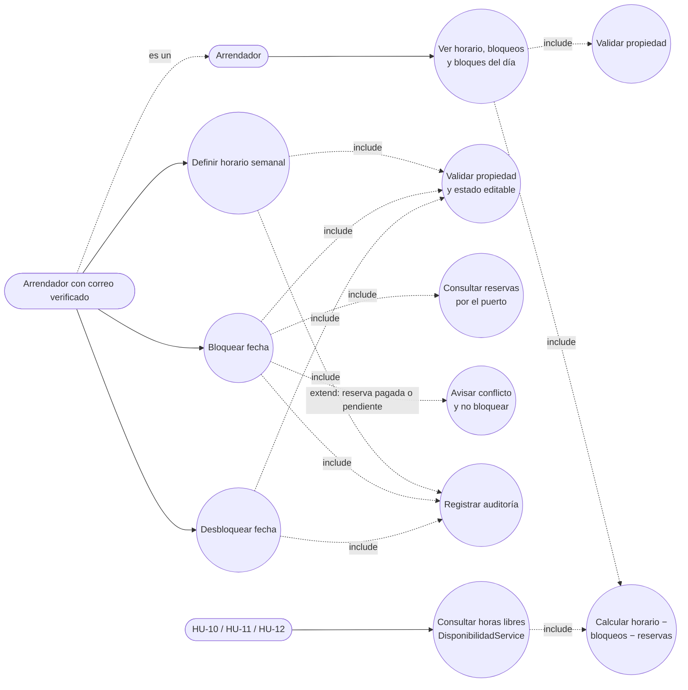
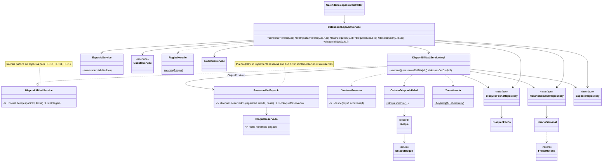

# HU-08 — Design: Disponibilidad del espacio

> Módulo `espacios` · Sprint 2 · tamaño M · depende de HU-07 (`done`) · sin patrones ★
> (DAO/Repository). Reutiliza de HU-07 `EspacioRepository.findByIdAndArrendadorId` /
> `findParaActualizar` (`PESSIMISTIC_WRITE`), `EspacioService.arrendadorHabilitado` (package-private:
> rol + correo), `EspacioService.MENSAJE_ESTADO_NO_EDITABLE`, `Espacio.esEditable()`,
> `FichaEspacioDTO.SoloEntero` (enteros JSON estrictos) y `CuentaService.habilitacionArrendador`; de
> `comun`: `comun/error` (`ReglaNegocioException`, `ValidacionException`, `AccesoDenegadoException`,
> `RecursoNoEncontradoException`, `ManejadorGlobalErrores`) sin cambios, `comun/auditoria`,
> `comun/web/IpCliente`, el bean `Clock`; del frontend, `Boton`, `Campo`, `Alerta`,
> `EtiquetaEstado`, `Tarjeta` y `api/cliente.js`.
> Crea: la utilidad `comun/configuracion/ZonaHoraria` (zona `America/Lima`), el puerto
> `espacios.service.puertos.ReservasDelEspacio` (ya previsto en `docs/architecture.md`), la primera
> interfaz pública de `espacios` (`DisponibilidadService`, para HU-10/11/12), las tablas
> `horario_semanal` y `bloqueo_fecha`, y en el kit `SelectorBloques` (previsto en
> `docs/frontend.md`) y las props `min`/`max` de `Campo`.
>
> Las preguntas P1–P12 (`requirements.md`) tienen un valor por defecto aplicado en este diseño;
> el dueño las confirma al aprobar.

## 1. Decisiones (para revisión rápida del dueño)

| # | Pregunta | Decisión | Por qué |
|---|----------|----------|---------|
| DT-1 | P1 | **Zona `America/Lima`** en una utilidad nueva `comun/configuracion/ZonaHoraria` (`LIMA`, `hoy(Clock)`, `ahora(Clock)` con `LocalDate.ofInstant(reloj.instant(), LIMA)`). El bean `Clock` sigue en UTC; `creado_en` y auditoría no cambian. | Hoy no hay ningún `ZoneId` en el código y "hoy" en UTC cambia de día a las 19:00 de Lima: un arrendador que bloquea "mañana" a las 20:00 tendría un día corrido. Va en `comun` porque HU-10/11/12 la necesitan igual (principio 9). Se usa `reloj.instant()` y no `reloj.withZone(...)` para que funcione con el `RelojControlable` de las IT. |
| DT-2 | P2 | Ventana = **56 días desde *hoy* inclusive** (`VentanaReserva.desde(hoy)`: `hasta = hoy + 55`). Un bloque de *hoy* deja de estar libre cuando llega su hora de inicio (`fecha.atTime(h, 0)` no posterior a *ahora local*). | "Las próximas 8 semanas" = 8 × 7 días contando hoy. Un value object de dominio deja la regla en un solo lugar para HU-10 (filtrar por fecha) y HU-12 (validar bloques pedidos). Que un bloque empezado no se ofrezca evita reservar una hora que ya corre. |
| DT-3 | P3 | **Varias franjas por día**, sin superponerse (contiguas permitidas). El horario se **reemplaza completo** con `PUT …/horario` (lista; vacía = sin horario). En BD: borrado masivo de las filas del espacio + inserción de las nuevas en la misma transacción, con el espacio bloqueado. | Cubre "8–13 y 15–22" (almuerzo) sin un modelo más complejo, y el modelo ya permite varias filas por día. Reemplazar completo hace la operación idempotente, simple de auditar como `antes → después` y de probar. Superposición en código (no `EXCLUDE` en BD: alternativa 3). El tope de 168 franjas sale de la regla (sin superposición caben como mucho 24 por día × 7), no es un número inventado. |
| DT-4 | P4 | `dia_semana`, `hora_inicio`, `hora_fin` como **`SMALLINT`** (no `TIME`): día ISO 1–7, inicio 0–23, fin 1–24 exclusivo. En JSON, enteros estrictos con `FichaEspacioDTO.SoloEntero` (un `8.5` o `"8"` → `null` → error por campo). | `LocalTime` no representa 24:00 y "hasta medianoche" es común en canchas. Con bloques de hora en punto, un entero hace imposible un "8:30" sin `CHECK` extra. Misma granularidad que `reserva_bloque (fecha, hora_inicio)` de HU-12: se recomienda a HU-12 `hora_inicio SMALLINT` (anotado en `docs/modelo-datos.md`). |
| DT-5 | P5 | Bloqueo de **día completo**, solo dentro de la ventana; repetir → 400 *ya bloqueada*; **desbloqueo** con `DELETE …/bloqueos/{fecha}` (204; si no está bloqueada → 404). Identificado por la fecha, sin exponer ids. La lista solo muestra fechas ≥ *hoy*. | El modelo solo tiene `fecha`; bloquear horas sueltas equivale a quitarlas del horario. Fuera de la ventana un bloqueo no cambia nada que se pueda reservar. Un 400 explícito al repetir es más claro para el arrendador que un éxito silencioso. Sin desbloqueo, un error de fecha no tendría arreglo. |
| DT-6 | P6 | **CA3 → 400 sin campo** (`ReglaNegocioException`): *reserva pagada* si hay algún bloque de una reserva `CONFIRMADA`; si no, *reserva pendiente* si hay alguno de una `PENDIENTE_PAGO` vigente. No se audita el intento rechazado. | Permitir el bloqueo con una pendiente dejaría que el webhook de HU-13 confirme después una reserva en un día bloqueado. 400 reutiliza el manejador sin tocar `comun/error` (mismo criterio que HU-07 DT-9); un 409 obligaría a añadir una excepción y un handler en `comun` para un solo caso. El rechazo no cambia el calendario, así que (R) "cada cambio" no lo exige y evita auditar fuera de la transacción. |
| DT-7 | P10 | Puerto **`espacios.service.puertos.ReservasDelEspacio`** con `List<BloqueReservado> bloquesReservados(Long espacioId, LocalDate desde, LocalDate hasta)`; `BloqueReservado(fecha, horaInicio, pagado)`. `DisponibilidadServiceImpl` lo recibe como **`ObjectProvider<ReservasDelEspacio>`** y, si no hay bean, usa "sin reservas". HU-12 solo agrega su `@Service` que lo implementa; HU-21 reutiliza el mismo método con un rango de fechas (o le agrega uno). | `espacios` no puede depender de `reservas` (dirección `espacios ← reservas`); el puerto ya está en la tabla de `docs/architecture.md`. Un rango (no una sola fecha) sirve a CA3, al cálculo del día, a HU-21 ("reservas futuras") y a una futura consulta por lotes de HU-10. `ObjectProvider` evita una implementación vacía registrada como bean que chocaría con la de HU-12 (alternativa 4). En las IT, un doble del puerto en el contexto de prueba fuerza CA3. |
| DT-8 | P9 | **Interfaz pública `espacios.service.DisponibilidadService`** con `List<Integer> horasLibres(Long espacioId, LocalDate fecha)` (solo espacios `PUBLICADO`; vacío fuera de la ventana), implementada por `DisponibilidadServiceImpl`. El cálculo puro vive en el dominio: `CalculoDisponibilidad.bloquesDelDia(...)`. El dueño ve el resultado con `GET …/{id}/disponibilidad?fecha=` (estados `LIBRE`, `RESERVADO`, `BLOQUEADO`, `PASADO`). | §8 de `docs/requerimientos.md`: el cálculo lo construye HU-08 y lo reutilizan HU-10/11/12; principio 5: otros módulos usan la interfaz del servicio (precedente `CuentaService`). Separar el cálculo en el dominio lo hace probable sin BD (R22–R26). La consulta del dueño da algo observable para CA1/CA2 en la caja negra sin adelantar la ficha pública de HU-11. |
| DT-9 | P8 | Escrituras (`PUT …/horario`, `POST`/`DELETE …/bloqueos`): rol + correo (`EspacioService.arrendadorHabilitado`) → propiedad con bloqueo (`findParaActualizar`) → `esEditable()` (si no, `MENSAJE_ESTADO_NO_EDITABLE` de HU-07). Lecturas: solo rol (`CuentaService.habilitacionArrendador`) + `findByIdAndArrendadorId`. Ajeno = inexistente = 404. | Mismo orden y mismos mensajes que HU-07 (R53 de HU-07), así el arrendador ve una sola regla. Filtrar por `arrendador_id` en la consulta hace imposible olvidar la comparación (RNF-SEG-19). |
| DT-10 | — | **Concurrencia:** `PUT …/horario`, `POST`/`DELETE …/bloqueos` releen el espacio con `PESSIMISTIC_WRITE`; `UNIQUE (espacio_id, fecha)` y `UNIQUE (espacio_id, dia_semana, hora_inicio)` como red de seguridad. **Contrato para HU-12:** al crear o confirmar una reserva debe tomar el mismo bloqueo del espacio (o releer `bloqueo_fecha` y el horario dentro de su transacción tras bloquearlo) para no reservar en un día que se acaba de bloquear. Se anota en `docs/architecture.md`. | Dos `POST` simultáneos de la misma fecha: el segundo espera, ve el bloqueo y responde *ya bloqueada* (R40). El orden "bloquear fecha" vs "crear reserva" solo es seguro si ambos serializan sobre la misma fila. |
| DT-11 | P12 (R de STRIDE) | Auditoría con constantes en `CalendarioEspacioService`: `HORARIO_ESPACIO_ACTUALIZADO` (`antes=…;despues=…`), `BLOQUEO_FECHA_CREADO` y `BLOQUEO_FECHA_ELIMINADO` (`fecha=AAAA-MM-DD`); entidad `espacio`, `entidadId` = id del espacio. Un `PUT` con el mismo conjunto de franjas no audita. | (R) pide "registro de cada cambio de disponibilidad". Con entidad `espacio` toda la historia de un espacio (ficha, fotos, calendario) sale con un filtro. El horario completo cabe en el detalle (≤ 168 × 7 caracteres) y es público (no es dato sensible). |
| DT-12 | P11 | Sin rate limiting, sin job, sin tabla de bloques materializados. | HU-08 no tiene (D); `FiltroLimiteIntentos` no admite rutas con `{id}`. La simplificación de la historia dice "se calculan al consultar; no se generan con un job". |
| DT-13 | P12 | Migración **`V2_4__disponibilidad.sql`** (§ 9). Docs que el implementer actualiza en el mismo PR: `docs/modelo-datos.md` (tipos y restricciones de `horario_semanal` y `bloqueo_fecha`; recomendación `reserva_bloque.hora_inicio SMALLINT`), `docs/architecture.md` (fila del puerto `ReservasDelEspacio` con su firma y el contrato de bloqueo de DT-10; nota de `DisponibilidadService` como interfaz pública de `espacios`; zona `America/Lima` en `ZonaHoraria`), `docs/frontend.md` (`SelectorBloques` construido por HU-08 con sus props; `Campo` con `min`/`max`). | `docs/conventions.md` (`V<sprint>_<n>`; si otra historia toma `V2_4` antes, se renombra). Reglas de cabecera de `modelo-datos.md`, `architecture.md` ("si una historia necesita un puerto nuevo… lo agrega a esta tabla") y `frontend.md`. |
| DT-14 | — | **Fechas como texto validado**, no `LocalDate` en el DTO: `BloqueoFechaDTO.fecha` es `String` con `@NotBlank` + `@Pattern("\\d{4}-\\d{2}-\\d{2}")`; el servicio la convierte con `LocalDate.parse` (calendario estricto) y, si falla, lanza `ReglaNegocioException("fecha", MENSAJE_FECHA_INVALIDA)`. Igual para `?fecha=` (`@RequestParam(required = false)`) y `{fecha}` del `DELETE`. Las respuestas sí usan `LocalDate` (Jackson la escribe `AAAA-MM-DD`). | Con `LocalDate` en el record, un `"2026-13-01"` falla en Jackson con un 400 genérico **sin campo** y la pantalla no podría señalar el `Campo` (mismo motivo que `tipo` como `String` en HU-07 DT-11). |

## 2. Caso de uso



**Definir horario (CA1)** — Precondición: sesión de un `ARRENDADOR` con correo verificado y un
espacio propio editable. Flujo: (1) arma las franjas por día y guarda; (2) la API valida forma
(Bean Validation), rol, correo, propiedad y estado; (3) valida rangos y superposición; (4) con el
espacio bloqueado, reemplaza las filas de `horario_semanal`; (5) si cambió, audita; (6) responde
200 con el horario ordenado. Alternos: 400 por franja, 400 *estado no editable*, 403, 404, 401.

**Bloquear fecha (CA2/CA3)** — Precondición: igual. Flujo: valida forma, rol, correo, propiedad
(con bloqueo), estado, fecha de calendario, ventana, que no esté bloqueada, y consulta el puerto
de reservas para esa fecha; sin reservas activas guarda el bloqueo, audita y responde 201.
Alternos: CA3 → 400 *reserva pagada*; pendiente → 400 *reserva pendiente*; 400 *fuera de
ventana* / *ya bloqueada* / *fecha inválida*.

**Ver bloques del día** — Precondición: espacio propio. Flujo: valida fecha y ventana, lee
horario del día de la semana, si está bloqueada y las reservas del puerto, y calcula los bloques
con su estado. Lo mismo, solo para `PUBLICADO` y devolviendo las horas libres, hace
`DisponibilidadService.horasLibres` para otros módulos.

## 3. Archivos por módulo y capa

Paquete base `pe.edu.ulima.espacioya`. (N) nuevo · (M) modificado.

### `espacios`

| Capa | Archivo | Para |
|---|---|---|
| `domain/` (N) | `HorarioSemanal` | Entidad `horario_semanal`: `de(espacioId, FranjaHoraria)`, `aFranja()` (R2, R8, R9) |
| | `BloqueoFecha` | Entidad `bloqueo_fecha`: `de(espacioId, fecha)` (R11, R16, R18) |
| | `FranjaHoraria` | Record `(diaSemana, horaInicio, horaFin)`: `seSuperponeCon`, `contiene(hora)`, `aTexto()`; orden natural día → inicio (R1, R5, R6, R41) |
| | `ReglasHorario` | `revisar(List<FranjaHoraria>)` → problemas por índice: `RANGO`, `SUPERPUESTA` (R5, R6) |
| | `VentanaReserva` | Record `(desde, hasta)`: `DIAS = 56`, `desde(hoy)`, `contiene(fecha)` (R13, R15, R27, R31) |
| | `EstadoBloque` | Enum `LIBRE`, `RESERVADO`, `BLOQUEADO`, `PASADO` (R23–R26) |
| | `Bloque` | Record `(horaInicio, estado)` + `horaFin()` (R22) |
| | `CalculoDisponibilidad` | Cálculo puro `bloquesDelDia(...)` (R22–R26, R28) |
| `repository/` (N) | `HorarioSemanalRepository` | Listado por espacio y por día; borrado masivo por espacio (R2, R3, R8, R22) |
| | `BloqueoFechaRepository` | `existsByEspacioIdAndFecha`, `findByEspacioIdAndFecha`, listado desde *hoy* (R14–R17, R23) |
| `service/puertos/` (N) | `ReservasDelEspacio`, `BloqueReservado` | Puerto que implementará `reservas` (DT-7; R19–R21, R24) |
| `service/` (N) | `DisponibilidadService` | Interfaz pública: `horasLibres` (DT-8; R30, R31) |
| | `DisponibilidadServiceImpl` | `horasLibres` + métodos de paquete para el calendario del dueño (R21–R31) |
| | `CalendarioEspacioService` | Horario, bloqueos y bloques del día del dueño (R1–R20, R22, R27, R32–R44) |
| `dto/` (N) | `HorarioDTO`, `FranjaDTO` | Entrada y salida del horario, Bean Validation (R1, R4, R8, R37, R38) |
| | `BloqueoFechaDTO` | Entrada y salida de `POST …/bloqueos` (R10, R12, R38) |
| | `BloqueosDTO` | `desde`, `hasta`, `fechas` (R15) |
| | `DisponibilidadDiaDTO`, `BloqueDTO` | Bloques del día (R22, R45) |
| `controller/` (N) | `CalendarioEspacioController` | `GET`/`PUT …/{id}/horario`, `GET`/`POST …/{id}/bloqueos`, `DELETE …/{id}/bloqueos/{fecha}`, `GET …/{id}/disponibilidad` |

`Espacio`, `EspacioRepository`, `EspacioService`, `FichaEspacioDTO` y los controladores de HU-07
**no cambian** (se reutilizan `arrendadorHabilitado`, `MENSAJE_ESTADO_NO_EDITABLE`,
`findByIdAndArrendadorId`, `findParaActualizar`, `findById` y `SoloEntero`).

### `comun`

| Carpeta | Archivo | Para |
|---|---|---|
| `comun/configuracion/` (N) | `ZonaHoraria` | `LIMA`, `hoy(Clock)`, `ahora(Clock)` (DT-1; R29) |

`comun/error`, `comun/auditoria`, `comun/seguridad` y `comun/limite` **no cambian**. Las rutas nuevas
quedan bajo `anyRequest().authenticated()`.

### Recursos y docs

| Archivo | Cambio |
|---|---|
| `db/migration/V2_4__disponibilidad.sql` (N) | § 9 |
| `docs/modelo-datos.md`, `docs/architecture.md`, `docs/frontend.md` (M) | DT-13 |

### Frontend (`3_frontend/src/`)

Ver § 13.

## 4. Endpoints

Todos exigen sesión vigente (401 con `MENSAJE_SESION_INVALIDA`, R35) y cuelgan de
`/api/arrendadores/actual/espacios/{id}` (patrón `/actual` de HU-07: la identidad sale del token).

| Método y ruta | Rol | Entrada | Respuestas |
|---|---|---|---|
| `GET …/{id}/horario` | `ARRENDADOR` | — | **200** `HorarioDTO` (R8) · **403** (R33) · **404** (R32) |
| `PUT …/{id}/horario` | `ARRENDADOR` + correo verificado | JSON `HorarioDTO` | **200** `HorarioDTO` (R1–R3) · **400** `errores[]` por campo (R4–R6) · **400** *estado no editable* (R36) · **403** (R33, R34) · **404** (R32) |
| `GET …/{id}/bloqueos` | `ARRENDADOR` | — | **200** `BloqueosDTO` (R15) · **403** · **404** |
| `POST …/{id}/bloqueos` | `ARRENDADOR` + correo verificado | JSON `BloqueoFechaDTO` | **201** `BloqueoFechaDTO` (R10, R11) · **400** campo `fecha`: *fecha inválida* / *fuera de ventana* / *ya bloqueada* (R12–R14, R40) · **400** sin campo: *reserva pagada* / *reserva pendiente* (R19, R20) · **400** *estado no editable* (R36) · **403** · **404** |
| `DELETE …/{id}/bloqueos/{fecha}` | `ARRENDADOR` + correo verificado | — | **204** (R16) · **400** campo `fecha` *fecha inválida* (R12) · **400** *estado no editable* (R36) · **403** · **404** (R17, R32) |
| `GET …/{id}/disponibilidad?fecha=AAAA-MM-DD` | `ARRENDADOR` | query `fecha` | **200** `DisponibilidadDiaDTO` (R22–R26) · **400** campo `fecha`: *fecha inválida* / *fuera de ventana* (R12, R27) · **403** · **404** |

`{id}` no numérico → 400 genérico de Spring (handler existente).

### DTO

```java
public record HorarioDTO(
        @NotNull(message = M_FRANJAS) @Size(max = 168, message = M_FRANJAS)
        List<@NotNull(message = FranjaDTO.M_FRANJA) @Valid FranjaDTO> franjas) {
    public static final String M_FRANJAS = "Envía la lista de franjas del horario (como mucho 168).";
    public List<FranjaHoraria> aFranjas();          // en el orden recibido (los índices de errores[] se refieren a él)
    public static HorarioDTO de(List<FranjaHoraria> franjas);   // salida ordenada día → inicio
}

public record FranjaDTO(
        @NotNull(message = M_DIA) @Min(value = 1, message = M_DIA) @Max(value = 7, message = M_DIA)
        @JsonDeserialize(using = FichaEspacioDTO.SoloEntero.class) Integer diaSemana,
        @NotNull(message = M_HORA_INICIO) @Min(value = 0, message = M_HORA_INICIO) @Max(value = 23, message = M_HORA_INICIO)
        @JsonDeserialize(using = FichaEspacioDTO.SoloEntero.class) Integer horaInicio,
        @NotNull(message = M_HORA_FIN) @Min(value = 1, message = M_HORA_FIN) @Max(value = 24, message = M_HORA_FIN)
        @JsonDeserialize(using = FichaEspacioDTO.SoloEntero.class) Integer horaFin) { }

public record BloqueoFechaDTO(
        @NotBlank(message = M_FECHA) @Pattern(regexp = "\\d{4}-\\d{2}-\\d{2}", message = M_FECHA) String fecha) {
    public static final String M_FECHA = "Elige una fecha válida.";
}

public record BloqueosDTO(LocalDate desde, LocalDate hasta, List<LocalDate> fechas) { }        // R15
public record DisponibilidadDiaDTO(LocalDate fecha, boolean bloqueada, List<BloqueDTO> bloques) { }  // R22
public record BloqueDTO(int horaInicio, int horaFin, String estado) { }                          // estado = EstadoBloque.name()
```

- El handler de `MethodArgumentNotValidException` ya arma `errores[]` con el campo anidado
  (`franjas[2].horaFin`, `franjas[0]` si el elemento es `null`) (R4).
- Propiedades desconocidas (`id`, `espacioId`, `arrendadorId`) se ignoran (configuración por
  defecto de Jackson en Spring Boot) (R37).
- Ejemplo: `{"franjas":[{"diaSemana":1,"horaInicio":8,"horaFin":22},{"diaSemana":6,"horaInicio":8,"horaFin":13},{"diaSemana":6,"horaInicio":15,"horaFin":24}]}`.

### Mensajes (texto exacto)

| Constante | Texto | Dónde |
|---|---|---|
| `HorarioDTO.M_FRANJAS` | `Envía la lista de franjas del horario (como mucho 168).` | campo `franjas` (R4) |
| `FranjaDTO.M_FRANJA` | `Completa la franja.` | campo `franjas[i]` nulo (R4) |
| `FranjaDTO.M_DIA` | `Elige un día de la semana.` | `franjas[i].diaSemana` (R4) |
| `FranjaDTO.M_HORA_INICIO` | `La hora de inicio debe ser una hora en punto entre 00:00 y 23:00.` | `franjas[i].horaInicio` (R4) |
| `FranjaDTO.M_HORA_FIN` | `La hora de fin debe ser una hora en punto entre 01:00 y 24:00.` | `franjas[i].horaFin` (R4) |
| `CalendarioEspacioService.MENSAJE_RANGO_HORAS` | `La hora de fin debe ser posterior a la de inicio.` | `franjas[i]` (R5) |
| `CalendarioEspacioService.MENSAJE_FRANJAS_SUPERPUESTAS` | `Esta franja se cruza con otra del mismo día.` | `franjas[j]` (R6) |
| `BloqueoFechaDTO.M_FECHA` = `CalendarioEspacioService.MENSAJE_FECHA_INVALIDA` | `Elige una fecha válida.` | campo `fecha` (R12) |
| `CalendarioEspacioService.MENSAJE_FUERA_DE_VENTANA` | `Elige una fecha entre hoy y las próximas 8 semanas.` | campo `fecha` (R13, R27) |
| `CalendarioEspacioService.MENSAJE_YA_BLOQUEADA` | `Esta fecha ya está bloqueada.` | campo `fecha` (R14, R40) |
| `CalendarioEspacioService.MENSAJE_RESERVA_PAGADA` | `No puedes bloquear esta fecha porque tiene reservas pagadas.` | 400 sin campo (R19, CA3) |
| `CalendarioEspacioService.MENSAJE_RESERVA_PENDIENTE` | `Esta fecha tiene una reserva en proceso de pago. Inténtalo de nuevo en unos minutos.` | 400 sin campo (R20) |
| `EspacioService.MENSAJE_ESTADO_NO_EDITABLE` (existe) | `Este espacio ya no se puede editar.` | 400 (R36) |
| `ErrorDTO.MENSAJE_ACCESO_DENEGADO` (existe) | `No tienes permiso para realizar esta acción.` | 403 (R33, R34) |
| `ErrorDTO.MENSAJE_RECURSO_NO_ENCONTRADO` (existe) | `No encontramos lo que buscas o el enlace expiró.` | 404 (R17, R32) |
| `ErrorDTO.MENSAJE_VALIDACION` (existe) | `Revisa los datos del formulario.` | `mensaje` de los 400 por campo |

## 5. Clases y firmas públicas

```java
// comun/configuracion
public final class ZonaHoraria {
    public static final ZoneId LIMA = ZoneId.of("America/Lima");
    public static LocalDate hoy(Clock reloj);           // LocalDate.ofInstant(reloj.instant(), LIMA)
    public static LocalDateTime ahora(Clock reloj);     // LocalDateTime.ofInstant(reloj.instant(), LIMA)
}

// espacios/domain
public record FranjaHoraria(int diaSemana, int horaInicio, int horaFin) implements Comparable<FranjaHoraria> {
    public boolean seSuperponeCon(FranjaHoraria otra);  // mismo día y horaInicio < otra.horaFin && otra.horaInicio < horaFin
    public boolean contiene(int hora);                  // horaInicio <= hora < horaFin
    public String aTexto();                             // "1:8-22"
    public int compareTo(FranjaHoraria otra);           // día, luego inicio, luego fin
}

public final class ReglasHorario {
    public enum Problema { RANGO, SUPERPUESTA }
    public record ProblemaFranja(int indice, Problema problema) { }
    /** RANGO para cada franja con horaFin <= horaInicio; si no hay ninguno, SUPERPUESTA para cada franja j que se
     *  superpone con alguna de índice menor. Lista vacía = horario válido. */
    public static List<ProblemaFranja> revisar(List<FranjaHoraria> franjas);
}

public record VentanaReserva(LocalDate desde, LocalDate hasta) {
    public static final int DIAS = 56;
    public static VentanaReserva desde(LocalDate hoy);  // (hoy, hoy.plusDays(DIAS - 1))
    public boolean contiene(LocalDate fecha);
}

public enum EstadoBloque { LIBRE, RESERVADO, BLOQUEADO, PASADO }
public record Bloque(int horaInicio, EstadoBloque estado) { public int horaFin(); }

public final class CalculoDisponibilidad {
    /** Un Bloque por cada hora de las franjas del día de la semana ISO de `fecha`, ascendente. Precedencia:
     *  BLOQUEADO (si bloqueada) > RESERVADO (hora en horasReservadas) > PASADO (fecha.atTime(h,0) no es posterior
     *  a ahoraLocal) > LIBRE. No consulta nada: el llamador ya filtró las franjas y las reservas. */
    public static List<Bloque> bloquesDelDia(LocalDate fecha, List<FranjaHoraria> franjasDelDia, boolean bloqueada,
                                             Set<Integer> horasReservadas, LocalDateTime ahoraLocal);
}

@Entity @Table(name = "horario_semanal")
public class HorarioSemanal {
    protected HorarioSemanal() { }
    public static HorarioSemanal de(Long espacioId, FranjaHoraria franja);
    public FranjaHoraria aFranja();
    public Long getId(); public Long getEspacioId();
    // dia_semana, hora_inicio, hora_fin: campos short (columnas SMALLINT, ddl-auto=validate)
}

@Entity @Table(name = "bloqueo_fecha")
public class BloqueoFecha {
    protected BloqueoFecha() { }
    public static BloqueoFecha de(Long espacioId, LocalDate fecha);
    public Long getId(); public Long getEspacioId(); public LocalDate getFecha();
}

// espacios/repository
public interface HorarioSemanalRepository extends JpaRepository<HorarioSemanal, Long> {
    List<HorarioSemanal> findByEspacioIdOrderByDiaSemanaAscHoraInicioAsc(Long espacioId);
    List<HorarioSemanal> findByEspacioIdAndDiaSemanaOrderByHoraInicioAsc(Long espacioId, short diaSemana);
    // JPQL masivo: se ejecuta en el acto, antes de insertar las franjas nuevas. Con deleteAll + saveAll,
    // Hibernate ejecutaría los INSERT antes que los DELETE y chocaría con uq_horario_semanal_inicio.
    @Modifying(flushAutomatically = true, clearAutomatically = true)
    @Query("delete from HorarioSemanal h where h.espacioId = :espacioId")
    int borrarDelEspacio(@Param("espacioId") Long espacioId);
}
public interface BloqueoFechaRepository extends JpaRepository<BloqueoFecha, Long> {
    boolean existsByEspacioIdAndFecha(Long espacioId, LocalDate fecha);
    Optional<BloqueoFecha> findByEspacioIdAndFecha(Long espacioId, LocalDate fecha);
    List<BloqueoFecha> findByEspacioIdAndFechaGreaterThanEqualOrderByFechaAsc(Long espacioId, LocalDate desde);
}

// espacios/service/puertos — lo implementa reservas (HU-12); espacios no depende de reservas
public interface ReservasDelEspacio {
    /** Bloques retenidos por reservas activas del espacio (PENDIENTE_PAGO vigente o CONFIRMADA) con fecha entre
     *  desde y hasta, ambas inclusive. pagado = la reserva está CONFIRMADA. */
    List<BloqueReservado> bloquesReservados(Long espacioId, LocalDate desde, LocalDate hasta);
}
public record BloqueReservado(LocalDate fecha, int horaInicio, boolean pagado) { }

// espacios/service — interfaz pública para busqueda y reservas (HU-10, HU-11, HU-12)
public interface DisponibilidadService {
    /** Horas de inicio (0–23) de los bloques LIBRE del espacio en la fecha, ascendentes. Vacía si el espacio no
     *  existe, no está PUBLICADO o la fecha está fuera de la ventana de 8 semanas. */
    List<Integer> horasLibres(Long espacioId, LocalDate fecha);
}

@Service
public class DisponibilidadServiceImpl implements DisponibilidadService {
    public DisponibilidadServiceImpl(EspacioRepository espacios, HorarioSemanalRepository horarios,
                                     BloqueoFechaRepository bloqueos, ObjectProvider<ReservasDelEspacio> reservas,
                                     Clock reloj);
    @Transactional(readOnly = true) public List<Integer> horasLibres(Long espacioId, LocalDate fecha);   // R30, R31
    // paquete (los usa CalendarioEspacioService):
    VentanaReserva ventana();                                           // VentanaReserva.desde(ZonaHoraria.hoy(reloj))
    List<BloqueReservado> reservasDelDia(Long espacioId, LocalDate f);  // puerto o List.of() si no hay bean (R21)
    List<Bloque> bloquesDelDia(Long espacioId, LocalDate fecha);        // franjas del día + bloqueo + reservas (R22–R28)
}

@Service
public class CalendarioEspacioService {
    public static final String ACCION_HORARIO = "HORARIO_ESPACIO_ACTUALIZADO";
    public static final String ACCION_BLOQUEO_CREADO = "BLOQUEO_FECHA_CREADO";
    public static final String ACCION_BLOQUEO_ELIMINADO = "BLOQUEO_FECHA_ELIMINADO";
    public static final String CAMPO_FECHA = "fecha";
    // + MENSAJE_* de § 4
    public CalendarioEspacioService(EspacioService espacioService, CuentaService cuentas, EspacioRepository espacios,
                                    HorarioSemanalRepository horarios, BloqueoFechaRepository bloqueos,
                                    DisponibilidadServiceImpl disponibilidad, AuditoriaService auditoria);
    @Transactional(readOnly = true) public HorarioDTO consultarHorario(UsuarioAutenticado usuario, Long id);       // R8
    @Transactional public HorarioDTO reemplazarHorario(UsuarioAutenticado usuario, Long id, HorarioDTO horario,
                                                       String ip);                                                 // R1–R7, R41, R42
    @Transactional(readOnly = true) public BloqueosDTO listarBloqueos(UsuarioAutenticado usuario, Long id);        // R15
    @Transactional public BloqueoFechaDTO bloquear(UsuarioAutenticado usuario, Long id, BloqueoFechaDTO bloqueo,
                                                   String ip);                                                     // R10–R14, R19–R21, R40, R43
    @Transactional public void desbloquear(UsuarioAutenticado usuario, Long id, String fecha, String ip);          // R12, R16, R17, R44
    @Transactional(readOnly = true) public DisponibilidadDiaDTO disponibilidad(UsuarioAutenticado usuario, Long id,
                                                                               String fecha);                      // R12, R22–R27
}

// espacios/controller
@RestController @RequestMapping("/api/arrendadores/actual/espacios/{id}")
public class CalendarioEspacioController {
    @GetMapping("/horario")
    public HorarioDTO horario(@AuthenticationPrincipal UsuarioAutenticado usuario, @PathVariable Long id);
    @PutMapping("/horario")
    public HorarioDTO reemplazarHorario(@AuthenticationPrincipal UsuarioAutenticado usuario, @PathVariable Long id,
                                        @Valid @RequestBody HorarioDTO horario, HttpServletRequest peticion);
    @GetMapping("/bloqueos")
    public BloqueosDTO bloqueos(@AuthenticationPrincipal UsuarioAutenticado usuario, @PathVariable Long id);
    @PostMapping("/bloqueos") @ResponseStatus(CREATED)
    public BloqueoFechaDTO bloquear(@AuthenticationPrincipal UsuarioAutenticado usuario, @PathVariable Long id,
                                    @Valid @RequestBody BloqueoFechaDTO bloqueo, HttpServletRequest peticion);
    @DeleteMapping("/bloqueos/{fecha}") @ResponseStatus(NO_CONTENT)
    public void desbloquear(@AuthenticationPrincipal UsuarioAutenticado usuario, @PathVariable Long id,
                            @PathVariable String fecha, HttpServletRequest peticion);
    @GetMapping("/disponibilidad")
    public DisponibilidadDiaDTO disponibilidad(@AuthenticationPrincipal UsuarioAutenticado usuario,
                                               @PathVariable Long id,
                                               @RequestParam(name = "fecha", required = false) String fecha);
}
```

## 6. Flujos de los servicios

Pasos comunes:

- **Escritura (`habilitadoYEditable`)**: (a) `espacioService.arrendadorHabilitado(usuario)` (403 por
  rol o correo, R33, R34); (b) `espacios.findParaActualizar(id, usuarioId)` o
  `RecursoNoEncontradoException` (R32); (c) `!espacio.esEditable()` →
  `ReglaNegocioException(EspacioService.MENSAJE_ESTADO_NO_EDITABLE)` (R36).
- **Lectura (`propio`)**: (a) `cuentas.habilitacionArrendador(usuario)` (403 por rol, R33); (b)
  `espacios.findByIdAndArrendadorId(id, usuarioId)` o 404 (R32).
- **`fecha(texto)`**: `null`, en blanco o `LocalDate.parse` con `DateTimeParseException` (incluye
  `2026-02-30`, porque `ISO_LOCAL_DATE` es estricto) → `ReglaNegocioException(CAMPO_FECHA,
  MENSAJE_FECHA_INVALIDA)` (R12).

**`reemplazarHorario`** (`@Transactional`): (1) escritura; (2) `nuevas = horario.aFranjas()`;
`ReglasHorario.revisar(nuevas)`; si hay problemas → `ValidacionException` con un
`ErrorCampoDTO("franjas[" + i + "]", mensaje)` por problema (R5, R6); (3) `antes =
horarios.findByEspacioId…()` como `FranjaHoraria` ordenadas; `despues = nuevas` ordenadas; (4)
`horarios.borrarDelEspacio(id)`; `horarios.saveAll(despues → HorarioSemanal.de(id, f))` (R2, R3);
(5) si `!antes.equals(despues)` → audita `HORARIO_ESPACIO_ACTUALIZADO` con `detalle =
"antes=" + texto(antes) + ";despues=" + texto(despues)` donde `texto` une `aTexto()` con `,` y una
lista vacía se escribe `ninguna` (p. ej. `antes=ninguna;despues=1:8-22,2:8-22`) (R41, R42); (6)
`HorarioDTO.de(despues)` (R1). Las excepciones revierten la transacción (R7).

**`consultarHorario`**: lectura; `HorarioDTO.de(...)` con las filas ordenadas (R8).

**`bloquear`** (`@Transactional`): (1) escritura (R32–R36); (2) `f = fecha(bloqueo.fecha())` (R12);
(3) `!disponibilidad.ventana().contiene(f)` → `ReglaNegocioException(CAMPO_FECHA,
MENSAJE_FUERA_DE_VENTANA)` (R13); (4) `bloqueos.existsByEspacioIdAndFecha(id, f)` →
`ReglaNegocioException(CAMPO_FECHA, MENSAJE_YA_BLOQUEADA)` (R14; con el espacio bloqueado, una
segunda solicitud simultánea llega aquí y cae en este caso: R40); (5) `reservas =
disponibilidad.reservasDelDia(id, f)`; alguna `pagado` → `ReglaNegocioException(MENSAJE_RESERVA_PAGADA)`
(R19); si no y la lista no está vacía → `ReglaNegocioException(MENSAJE_RESERVA_PENDIENTE)` (R20);
(6) `bloqueos.save(BloqueoFecha.de(id, f))` (R11); (7) audita `BLOQUEO_FECHA_CREADO`
`fecha=<f>` (R43); (8) `new BloqueoFechaDTO(f.toString())` (R10).

**`desbloquear`** (`@Transactional`): (1) escritura; (2) `f = fecha(texto)` (R12); (3)
`bloqueos.findByEspacioIdAndFecha(id, f)` o `RecursoNoEncontradoException` (R17); (4)
`bloqueos.delete(...)`; audita `BLOQUEO_FECHA_ELIMINADO` `fecha=<f>` (R16, R44). Sin comprobar la
ventana: quitar un bloqueo nunca crea un conflicto.

**`listarBloqueos`**: lectura; `v = disponibilidad.ventana()`; `new BloqueosDTO(v.desde(),
v.hasta(), findByEspacioIdAndFechaGreaterThanEqualOrderByFechaAsc(id, v.desde()) → fechas)` (R15).

**`disponibilidad(usuario, id, texto)`**: lectura; `f = fecha(texto)` (R12); fuera de
`ventana()` → `MENSAJE_FUERA_DE_VENTANA` campo `fecha` (R27); `bloques =
disponibilidad.bloquesDelDia(id, f)`; `new DisponibilidadDiaDTO(f, bloqueos.existsBy…(id, f),
bloques → BloqueDTO(h, h + 1, estado.name()))` (R22–R26, R45).

**`DisponibilidadServiceImpl.bloquesDelDia(id, f)`**: `franjas =
horarios.findByEspacioIdAndDiaSemanaOrderByHoraInicioAsc(id, (short) f.getDayOfWeek().getValue())`;
`bloqueada = bloqueos.existsByEspacioIdAndFecha(id, f)`; `horasReservadas = reservasDelDia(id, f)
→ horaInicio` (si `bloqueada`, no hace falta consultar el puerto); `CalculoDisponibilidad
.bloquesDelDia(f, franjas, bloqueada, horasReservadas, ZonaHoraria.ahora(reloj))` (R22–R29).
Nada se guarda (R28).

**`reservasDelDia(id, f)`**: `reservas.getIfAvailable()`; `null` → `List.of()` (R21); si no,
`puerto.bloquesReservados(id, f, f)`.

**`horasLibres(espacioId, fecha)`** (`@Transactional(readOnly = true)`): `fecha` fuera de
`ventana()` → `List.of()`; `espacios.findById(espacioId)` vacío o con estado ≠ `PUBLICADO` →
`List.of()` (R31); si no, `bloquesDelDia` filtrado a `LIBRE` → `horaInicio` (R30). Sin
auditoría, sin comprobar sesión: lo llama otro módulo, que ya decidió quién consulta.

La IP sale de `IpCliente.de(peticion)` en el controlador. Toda auditoría usa
`new EventoAuditoria(usuarioId, accion, EspacioService.ENTIDAD_ESPACIO, espacioId, ip, detalle)`.

## 7. Diagramas de secuencia

### Flujo principal: definir horario y ver los bloques de un día (CA1, CA2)

```mermaid
sequenceDiagram
  actor A as Arrendador
  participant SPA as DisponibilidadEspacio.jsx
  participant C as CalendarioEspacioController
  participant S as CalendarioEspacioService
  participant ES as EspacioService
  participant ER as EspacioRepository
  participant HR as HorarioSemanalRepository
  participant D as DisponibilidadServiceImpl
  participant BR as BloqueoFechaRepository
  participant P as ReservasDelEspacio (puerto)
  participant AU as AuditoriaService
  A->>SPA: Lunes a viernes 8:00–22:00 · Guardar horario
  SPA->>C: PUT …/espacios/{id}/horario (JSON + Bearer)
  C->>C: @Valid HorarioDTO (forma de cada franja)
  C->>S: reemplazarHorario(usuario, id, horario, ip)
  S->>ES: arrendadorHabilitado(usuario)
  S->>ER: findParaActualizar(id, usuarioId) [PESSIMISTIC_WRITE]
  S->>S: esEditable() ✔ · ReglasHorario.revisar() = []
  S->>HR: findByEspacioIdOrderBy…() → antes
  S->>HR: borrarDelEspacio(id) · saveAll(5 franjas)
  S->>AU: registrar(HORARIO_ESPACIO_ACTUALIZADO, "antes=ninguna;despues=1:8-22,…,5:8-22")
  S-->>C: HorarioDTO ordenado
  C-->>SPA: 200 → Alerta éxito
  A->>SPA: elige una fecha (lunes dentro de 8 semanas)
  SPA->>C: GET …/espacios/{id}/disponibilidad?fecha=2026-11-02
  C->>S: disponibilidad(usuario, id, "2026-11-02")
  S->>ER: findByIdAndArrendadorId(id, usuarioId)
  S->>D: ventana().contiene(fecha) ✔ · bloquesDelDia(id, fecha)
  D->>HR: findByEspacioIdAndDiaSemana…(id, 1)
  D->>BR: existsByEspacioIdAndFecha(id, fecha) = false
  D->>P: bloquesReservados(id, fecha, fecha) (o [] sin implementación)
  D->>D: CalculoDisponibilidad.bloquesDelDia(...) → 14 × LIBRE
  S-->>C: DisponibilidadDiaDTO
  C-->>SPA: 200 → SelectorBloques (solo lectura)
```

### Flujo de error: bloquear una fecha con una reserva pagada (CA3)

```mermaid
sequenceDiagram
  participant SPA as DisponibilidadEspacio.jsx
  participant C as CalendarioEspacioController
  participant S as CalendarioEspacioService
  participant ES as EspacioService
  participant ER as EspacioRepository
  participant BR as BloqueoFechaRepository
  participant D as DisponibilidadServiceImpl
  participant P as ReservasDelEspacio (puerto, HU-12)
  SPA->>C: POST …/espacios/{id}/bloqueos {"fecha":"2026-11-07"}
  C->>C: @Valid BloqueoFechaDTO (forma AAAA-MM-DD)
  C->>S: bloquear(usuario, id, bloqueo, ip)
  S->>ES: arrendadorHabilitado(usuario)
  S->>ER: findParaActualizar(id, usuarioId) → editable
  S->>S: fecha válida ✔ · dentro de la ventana ✔
  S->>BR: existsByEspacioIdAndFecha = false
  S->>D: reservasDelDia(id, fecha)
  D->>P: bloquesReservados(id, fecha, fecha)
  P-->>D: [BloqueReservado(2026-11-07, 18, pagado=true)]
  D-->>S: lista con pagado
  S-->>C: ReglaNegocioException(MENSAJE_RESERVA_PAGADA) (rollback, sin bloqueo ni auditoría)
  C-->>SPA: 400 {mensaje: "No puedes bloquear esta fecha porque tiene reservas pagadas."}
  SPA->>SPA: Alerta error en la sección "Fechas bloqueadas"; la fecha no aparece en la lista
```

## 8. Diagrama de clases (resumen)



**Puertos:** se crea `espacios.ReservasDelEspacio`, que ya figura en la tabla "Puertos entre
módulos" de `docs/architecture.md` ("HU-08 y HU-21"); el implementer completa su fila con la
firma y el contrato de bloqueo de DT-10. `busqueda → espacios` y `reservas → espacios` (vía
`DisponibilidadService`) son direcciones permitidas: no hace falta otro puerto.

## 9. Migración Flyway

`2_Backend/src/main/resources/db/migration/V2_4__disponibilidad.sql`:

```sql
-- HU-08: horario semanal en bloques de 1 hora y fechas bloqueadas de cada espacio.
-- Los bloques libres no se guardan: se calculan al consultar (horario − bloqueos − reservas).
-- Horas como enteros: hora_inicio 0–23 y hora_fin 1–24 (exclusivo; 24 = medianoche). dia_semana ISO: 1 = lunes.
CREATE TABLE horario_semanal (
    id          BIGINT GENERATED ALWAYS AS IDENTITY PRIMARY KEY,
    espacio_id  BIGINT   NOT NULL REFERENCES espacio (id) ON DELETE CASCADE,
    dia_semana  SMALLINT NOT NULL,
    hora_inicio SMALLINT NOT NULL,
    hora_fin    SMALLINT NOT NULL,
    CONSTRAINT ck_horario_semanal_dia CHECK (dia_semana BETWEEN 1 AND 7),
    CONSTRAINT ck_horario_semanal_horas CHECK (hora_inicio >= 0 AND hora_fin <= 24 AND hora_inicio < hora_fin),
    -- La superposición entre franjas la impide el servicio con el espacio bloqueado; esto evita al menos dos
    -- franjas que empiezan a la misma hora el mismo día. Sirve también de índice por espacio y día.
    CONSTRAINT uq_horario_semanal_inicio UNIQUE (espacio_id, dia_semana, hora_inicio)
);

CREATE TABLE bloqueo_fecha (
    id         BIGINT GENERATED ALWAYS AS IDENTITY PRIMARY KEY,
    espacio_id BIGINT NOT NULL REFERENCES espacio (id) ON DELETE CASCADE,
    fecha      DATE   NOT NULL,
    CONSTRAINT uq_bloqueo_fecha UNIQUE (espacio_id, fecha)
);
```

- `ON DELETE CASCADE` hacia `espacio`, como `foto_espacio`: `EspaciosControllerSoporte.prepararBase()`
  borra `espacio` y las IT de HU-01…07 borran `perfil_arrendador`/`usuario`; sin cascada fallarían.
  La baja real es lógica (HU-21): la aplicación no borra espacios.
- `uq_bloqueo_fecha` sirve de índice para `existsBy…`/`findBy…` y para el listado desde *hoy* (R18).
- `ddl-auto=validate`: `dia_semana`, `hora_inicio`, `hora_fin` → campos `short` en `HorarioSemanal`;
  `fecha` → `LocalDate`.
- Sin `EXCLUDE USING gist` (alternativa 3).

## 10. Configuración

- `application.properties`: sin cambios.
- `ConfiguracionSeguridad`: sin cambios (todas las rutas nuevas exigen sesión).
- `ConfiguracionReloj`: sin cambios (el `Clock` sigue en UTC; la zona la aplica `ZonaHoraria`).

## 11. Excepciones y componentes de `comun`

| Componente | Uso en HU-08 |
|---|---|
| `MethodArgumentNotValidException` → handler (existe) | 400 con `errores[]` de `HorarioDTO`/`FranjaDTO`/`BloqueoFechaDTO` (R4, R12 forma, R38) |
| `ValidacionException` (existe) | 400 con varios `franjas[i]` (R5, R6) |
| `ReglaNegocioException` (existe) | 400 con campo `fecha` (R12–R14, R27) y sin campo (R19, R20, R36) |
| `AccesoDenegadoException` (existe) | 403 (R33, R34) |
| `RecursoNoEncontradoException` (existe) | 404 (R17, R32) |
| `AuditoriaService` + `EventoAuditoria` | DT-11 (R41–R44) |
| `IpCliente` | IP de la auditoría |
| `Clock` + `ZonaHoraria` (N) | *hoy*, *ahora local*, ventana (R29); `RelojControlable` en las IT |
| `LimitadorIntentos` / `ReglaLimite` | **No** se usan (P11) |
| `CuentaService.habilitacionArrendador` (cuentas) | Rol en las lecturas (R33) |

No se añade ninguna excepción nueva a `comun/error`.

## 12. Seguridad (resumen STRIDE)

| Control | Cómo |
|---|---|
| (E) solo el dueño modifica el calendario | Cada operación busca el espacio con `arrendador_id` de la sesión (`findByIdAndArrendadorId` / `findParaActualizar`); ajeno = inexistente = 404 (R32). Escrituras exigen correo verificado (R34) y estado editable (R36). |
| (E) rol | `CuentaService.habilitacionArrendador` en cada operación (R33); el rol nunca llega del cliente |
| (S) identidad | Sin `usuarioId`/`arrendadorId`/`espacioId` en el cuerpo; se ignoran si llegan (R37) |
| (T) entrada | Enteros estrictos y rangos por Bean Validation; rangos y superposición en el dominio; fechas con calendario estricto y ventana; `CHECK` y `UNIQUE` en BD (R4–R6, R9, R12, R13, R18) |
| (R) registro | Cambio de horario con `antes`/`después`, bloqueo y desbloqueo (R41–R44) |
| (I) minimización | Los DTO no llevan `arrendador_id`, ids de filas ni datos de reservas (R45) |
| Integridad / concurrencia | `PESSIMISTIC_WRITE` sobre el espacio en cada escritura; contrato para HU-12 (DT-10, R40) |

## 13. Pantallas

### Kit (`components/ui/`)

| Componente | Cambio |
|---|---|
| `Campo` (M) | Props opcionales `min` y `max`, pasadas al `<input>` de la rama genérica (para `tipo="date"`). Sin colores nuevos. Lo demás no cambia |
| `SelectorBloques` (N, + `.module.css`) | Previsto en `docs/frontend.md` para HU-11/12; lo construye HU-08 por ser la primera que lo necesita. Props: `bloques` (`[{ horaInicio, horaFin, libre, detalle }]`; `detalle` es un texto opcional que se muestra en el bloque ocupado, p. ej. "Bloqueado"), `seleccionados` (arreglo de `horaInicio`, por defecto `[]`), `onCambiar` (opcional; si falta, el selector es **solo lectura**: los bloques no son botones). Cada bloque muestra `HH:00–HH:00`. Estilos fijos de `docs/frontend.md` ("Bloques horarios") con los tokens `--bloque-libre-*`, `--bloque-seleccionado-*`, `--bloque-ocupado-*` (ocupado: tachado, sin clic, con su `detalle` como texto, no solo color). Con `onCambiar`, cada bloque libre es un `<button aria-pressed>` y al pulsarlo llama `onCambiar` con el arreglo nuevo. Lista vacía: no renderiza nada (la pantalla pone su propio texto) |

Los estados de bloque (`LIBRE`, `RESERVADO`, `BLOQUEADO`, `PASADO`) **no** se agregan a la tabla
"Color de cada estado" ni a `EtiquetaEstado`: se pintan con los tres estilos de bloque de
`docs/frontend.md` (`LIBRE` → libre; los otros tres → ocupado con su texto).

### API del cliente — `src/api/espacios.js` (M)

| Función | Endpoint |
|---|---|
| `obtenerHorario(id)` | `GET /api/arrendadores/actual/espacios/{id}/horario` |
| `guardarHorario(id, franjas)` | `PUT …/{id}/horario` con `{ franjas }` |
| `listarBloqueos(id)` | `GET …/{id}/bloqueos` |
| `bloquearFecha(id, fecha)` | `POST …/{id}/bloqueos` con `{ fecha }` |
| `desbloquearFecha(id, fecha)` | `DELETE …/{id}/bloqueos/{fecha}` (204 → `null`) |
| `consultarDisponibilidad(id, fecha)` | `GET …/{id}/disponibilidad?fecha=…` (con `encodeURIComponent`) |

Textos de presentación en `pages/espacios/textosEspacios.js` (M): `DIAS_SEMANA` (`1` → "Lunes" …
`7` → "Domingo"), `formatoHora(h)` (`8` → "08:00", `24` → "24:00"), `TEXTO_ESTADO_BLOQUE`
(`RESERVADO` → "Reservado", `BLOQUEADO` → "Bloqueado", `PASADO` → "Ya pasó"). Son presentación,
no reglas: el servidor valida y calcula todo.

### Disponibilidad — `/panel/espacios/:id/disponibilidad` → `pages/espacios/DisponibilidadEspacio.jsx` (N, + `.module.css`), dentro de `RutaProtegida`

- Al montar: `obtenerMiEspacio(id)` (nombre y estado, HU-07), `obtenerHorario(id)` y
  `listarBloqueos(id)`. Mientras carga, texto secundario "Cargando…". 404 → `Alerta` `error` con el
  mensaje y enlace "Volver a mis espacios". Rol distinto de `ARRENDADOR` → `<Navigate to="/panel" />`.
- Encabezado: "Disponibilidad de <nombre>" + `EtiquetaEstado estado={estado}` y enlace "Volver a
  mis espacios". Si el estado es `BAJA` u `OCULTO`, `Alerta` `info` "Este espacio ya no se puede
  editar." y los controles de edición quedan deshabilitados (el servidor responde 400 igual).
- **Sección "Horario semanal"** (`Tarjeta`, CA1): una fila por día (Lunes … Domingo). Cada día lista
  sus franjas; cada franja tiene dos `Campo tipo="select"` "Desde" (opciones 00:00–23:00) y
  "Hasta" (01:00–24:00, con "24:00 (medianoche)") y un `Boton secundario` "Quitar". Debajo,
  `Boton secundario` "Agregar franja" (crea 08:00–22:00 por defecto). Un día sin franjas muestra el
  texto secundario "Cerrado". Ayuda: "Los bloques son de 1 hora. Se pueden reservar en las próximas
  8 semanas.".
  - `Boton` **primario** "Guardar horario" con `cargando` (único primario de la pantalla). Envía las
    franjas en el orden en que se muestran (día y luego posición) y guarda el índice de cada una para
    ubicar los errores.
  - **CA1:** 200 → `Alerta` `exito` "Guardamos el horario. Esos bloques ya se pueden reservar en las
    próximas 8 semanas." y el formulario muestra la respuesta (ordenada).
  - 400 con `errores[]` → `Alerta` `error` con `mensaje` y cada error bajo su franja: `franjas[i]` y
    `franjas[i].horaFin` bajo "Hasta", `franjas[i].horaInicio` bajo "Desde", `franjas[i].diaSemana`
    en la fila del día. 400 sin `errores` (estado no editable) o 403 → solo la `Alerta`.
- **Sección "Fechas bloqueadas"** (`Tarjeta`, CA2, CA3):
  - `Campo tipo="date"` "Fecha a bloquear" con `min = desde` y `max = hasta` de `BloqueosDTO`
    (ayuda del cliente; el servidor revalida) y `ayuda` "Ese día no se podrá reservar ninguna hora.";
    `Boton secundario` "Bloquear fecha" con `cargando`.
  - **CA2:** 201 → `Alerta` `exito` "Bloqueamos el <fecha en texto>. Sus bloques ya no están
    disponibles." y se recarga `listarBloqueos`.
  - Error con `errores[]` (`fecha`) → bajo el `Campo`. **CA3:** 400 sin `errores` → `Alerta` `error`
    con el `mensaje` tal cual ("No puedes bloquear esta fecha porque tiene reservas pagadas."); la
    fecha no se agrega a la lista. Lo mismo para *reserva pendiente*.
  - Lista de fechas bloqueadas (formato "sábado 7 de noviembre de 2026" con `Intl.DateTimeFormat`
    `es-PE`), cada una con `Boton secundario` "Desbloquear" → `desbloquearFecha` → recarga la lista y
    `Alerta` `exito` "Desbloqueamos el <fecha>." (sin `Modal`: se deshace bloqueándola otra vez).
    Lista vacía: texto secundario "No tienes fechas bloqueadas.".
- **Sección "Ver un día"** (`Tarjeta`, vista previa de CA1/CA2): `Campo tipo="date"` "Fecha"
  (`min`/`max` de la ventana) → `consultarDisponibilidad(id, fecha)` al cambiar. Resultado con
  `SelectorBloques` **solo lectura**: `libre = estado === 'LIBRE'`, `detalle =
  TEXTO_ESTADO_BLOQUE[estado]`. Si `bloqueada`, texto secundario "Esta fecha está bloqueada.". Sin
  bloques: texto secundario "Ese día el espacio está cerrado según tu horario.". Error de la API →
  `Alerta` `error` en la sección. Tras guardar el horario o (des)bloquear, si hay una fecha elegida
  se vuelve a consultar.
- Error de red en cualquier llamada → `Alerta` `error` "No pudimos conectar. Intenta de nuevo.".

### Mis espacios — `pages/espacios/MisEspacios.jsx` (M)

- `acciones` de cada `Tarjeta`: "Editar" y, al lado, enlace "Disponibilidad" →
  `/panel/espacios/{id}/disponibilidad`.

### Editar espacio — `pages/espacios/EditarEspacio.jsx` (M)

- En edición (con `:id`), enlace "Definir disponibilidad" → `/panel/espacios/{id}/disponibilidad`
  junto al encabezado.

### `App.jsx` (M)

- Ruta `/panel/espacios/:id/disponibilidad` en `RutaProtegida`, declarada junto a las de HU-07.

## 14. Plan de pruebas (R → test)

Cada test lleva `@DisplayName("HU-08 R<n>: …")`. IT con Testcontainers en el paquete
`espacios.controller`, extendiendo `EspaciosControllerSoporte` (un solo contexto, `RelojControlable`
`@Primary` que avanza 1 h por test). Las fechas se calculan siempre a partir de
`ZonaHoraria.hoy(reloj)` (nunca literales). Las tablas nuevas se vacían por la cascada al borrar
`espacio` en `prepararBase()`. IP por test en `10.8.x.x`. CA3 se prueba con un doble
`ReservasDelEspacioFalso` registrado en `EspaciosControllerSoporte.Dobles` (devuelve `[]` salvo que
el test le cargue bloques; se limpia en `prepararBase()`); el `ObjectProvider` lo encuentra como
implementación del puerto. `correo_verificado = false` y los estados `BAJA`/`OCULTO`/`BORRADOR`/
`PUBLICADO` se fuerzan con `JdbcTemplate` (helpers existentes).

| R | Test |
|---|---|
| R1, R2 | `CalendarioEspacioControllerIT` (PUT L–V 8–22 → 200 ordenado; filas exactas en `horario_semanal`; segundo PUT con otro horario → solo las filas nuevas), `CalendarioEspacioServiceTest` |
| R3 | `CalendarioEspacioControllerIT` (PUT `franjas: []` → 200 vacío y 0 filas) |
| R4 | `HorarioDTOTest` (Validator: día 0 y 8, inicio −1 y 24, fin 0 y 25, nulos, elemento nulo, 169 franjas, `franjas` ausente), `CalendarioEspacioControllerIT` (`8.5`, `"8"`, `true` → 400 en `franjas[0].horaInicio`; tres campos inválidos → tres errores) |
| R5 | `ReglasHorarioTest` (fin = inicio y fin < inicio → `RANGO`), `CalendarioEspacioControllerIT` (400 en `franjas[1]` con el mensaje) |
| R6 | `ReglasHorarioTest` (8–12 y 11–14 → `SUPERPUESTA` en el índice mayor; 8–12 y 12–14 → válido; mismas horas en días distintos → válido), `CalendarioEspacioControllerIT` |
| R7 | `CalendarioEspacioControllerIT` (tras R4/R5/R6/R36: filas iguales a las previas) |
| R8 | `CalendarioEspacioControllerIT` (GET sin horario → `[]`; tras PUT → mismo orden; espacio en `BAJA` → 200) |
| R9 | `CalendarioEspacioControllerIT` o `HorarioSemanalRepositoryIT` (`INSERT` por `JdbcTemplate` con día 8, fin 25, inicio = fin, inicio repetido → `DataIntegrityViolationException`) |
| R10, R11 | `CalendarioEspacioControllerIT` (POST *hoy + 3* → 201 `{fecha}`; fila en `bloqueo_fecha`) |
| R12 | `CalendarioEspacioControllerIT` (`"2026-02-30"`, `"07/11/2026"`, ausente → 400 campo `fecha` en POST; `?fecha=abc` y sin `fecha` en GET; `DELETE …/bloqueos/abc`), `CalendarioEspacioServiceTest` |
| R13 | `CalendarioEspacioControllerIT` (*hoy − 1* y *hoy + 56* → 400; *hoy* y *hoy + 55* → 201) |
| R14 | `CalendarioEspacioControllerIT` (misma fecha dos veces → 201 y luego 400 campo `fecha`) |
| R15 | `CalendarioEspacioControllerIT` (`desde` = *hoy*, `hasta` = *hoy + 55*; bloqueo pasado insertado por `JdbcTemplate` no aparece; orden ascendente) |
| R16 | `CalendarioEspacioControllerIT` (DELETE → 204 y fila eliminada) |
| R17 | `CalendarioEspacioControllerIT` (DELETE de fecha no bloqueada → 404; otro bloqueo intacto) |
| R18 | `CalendarioEspacioControllerIT` (`INSERT` duplicado por `JdbcTemplate` → `DataIntegrityViolationException`) |
| R19 | `CalendarioEspacioControllerIT` (doble con `BloqueReservado(f, 18, true)` → 400 sin `errores` con el mensaje; 0 filas, 0 auditorías `BLOQUEO_FECHA_CREADO`), `CalendarioEspacioServiceTest` (pagada y pendiente a la vez → *reserva pagada*) |
| R20 | `CalendarioEspacioControllerIT` (doble con `pagado = false` → 400 *reserva pendiente*; 0 filas) |
| R21 | `DisponibilidadServiceImplTest` (`ObjectProvider` vacío → `reservasDelDia` = `[]` y bloques `LIBRE`), `EspacioYaApplicationIT` (el contexto arranca sin implementación del puerto) |
| R22 | `CalculoDisponibilidadTest` (lunes 8–10 y 14–16 → bloques 8, 9, 14, 15 con `horaFin`), `CalendarioEspacioControllerIT` (claves exactas `fecha`, `bloqueada`, `bloques[].horaInicio/horaFin/estado`) |
| R23 | `CalculoDisponibilidadTest` (bloqueada → todos `BLOQUEADO`, aun con reservas), `CalendarioEspacioControllerIT` (tras POST bloqueo → GET disponibilidad todo `BLOQUEADO`) |
| R24 | `CalculoDisponibilidadTest` (hora reservada → `RESERVADO`), `CalendarioEspacioControllerIT` (doble con un bloque → ese `RESERVADO`) |
| R25 | `CalculoDisponibilidadTest` (*hoy* a las 10:30 → 8, 9, 10 `PASADO`, 11 `LIBRE`; a las 10:00 exactas → 10 `PASADO`) |
| R26 | `CalculoDisponibilidadTest` (sin bloqueo ni reservas, fecha futura → todos `LIBRE`) |
| R27 | `CalendarioEspacioControllerIT` (GET con *hoy − 1* y *hoy + 56* → 400 campo `fecha`) |
| R28 | `CalendarioEspacioControllerIT` (cambiar el horario y consultar de nuevo → refleja el cambio sin otra acción; `information_schema` sin tablas de bloques materializados) |
| R29 | `ZonaHorariaTest` (instante `2026-10-29T03:00:00Z` → *hoy* = 2026-10-28, 22:00), `DisponibilidadServiceImplTest` (ventana con ese reloj: `desde` = 2026-10-28) |
| R30 | `DisponibilidadServiceImplTest` (espacio `PUBLICADO` con horario, un bloqueo en otra fecha y una reserva → solo las horas `LIBRE`), `DisponibilidadServiceImplIT` (contra la BD con el contexto real) |
| R31 | `DisponibilidadServiceImplTest` (espacio inexistente, `BORRADOR`, `PAUSADO`; fecha *hoy − 1* y *hoy + 56* → `[]`) |
| R32 | `CalendarioEspacioControllerIT` (espacio de otro arrendador e id inexistente → 404 en los 6 endpoints; nada cambia) |
| R33 | `CalendarioEspacioControllerIT` (cuenta `USUARIO` → 403 en los 6 endpoints con cuerpo válido) |
| R34 | `CalendarioEspacioControllerIT` (`correo_verificado = false` → 403 en PUT, POST, DELETE; GET → 200) |
| R35 | `CalendarioEspacioControllerIT` (sin `Authorization` → 401 con `MENSAJE_SESION_INVALIDA` en los 6) |
| R36 | `CalendarioEspacioControllerIT` (`BAJA` y `OCULTO` → 400 en PUT, POST, DELETE; `PAUSADO` → 200/201) |
| R37 | `CalendarioEspacioControllerIT` (cuerpo con `espacioId` de otro espacio y `arrendadorId` → se aplica al `{id}` de la URL) |
| R38 | `CalendarioEspacioControllerIT` (cuenta `USUARIO` con franja inválida → 400 por campo; con `fecha: "x"` → 400 campo `fecha`) |
| R39 | `CalendarioEspacioServiceTest` (rol antes que correo; correo antes que propiedad; propiedad antes que estado; estado antes que fecha; fuera de ventana antes que ya bloqueada; ya bloqueada antes que reservas), `CalendarioEspacioControllerIT` (espacio ajeno en `BAJA` → 404) |
| R40 | `CalendarioEspacioControllerIT` (dos POST simultáneos con `CountDownLatch` → un 201, un 400 *ya bloqueada*, una sola fila) |
| R41 | `CalendarioEspacioControllerIT` (auditoría `HORARIO_ESPACIO_ACTUALIZADO`, entidad `espacio`, id, IP, `antes=ninguna;despues=1:8-22,…`), `FranjaHorariaTest` (`aTexto`) |
| R42 | `CalendarioEspacioControllerIT` (PUT idéntico, en otro orden → sin fila nueva) |
| R43 | `CalendarioEspacioControllerIT` (`BLOQUEO_FECHA_CREADO` con `fecha=<f>`) |
| R44 | `CalendarioEspacioControllerIT` (`BLOQUEO_FECHA_ELIMINADO` con `fecha=<f>`) |
| R45 | `CalendarioEspacioControllerIT` (claves exactas de los tres DTO; la respuesta no contiene `arrendadorId`, `id`, `usuario` ni `monto`) |
| — | `VentanaReservaTest` (`desde(hoy)` → `hasta = hoy + 55`; `contiene` en los bordes) |
| — | IT de HU-01…07 siguen verdes (cascada de § 9) |

## 15. Alternativas descartadas

1. **Generar los bloques de las próximas 8 semanas en una tabla con un job.** La historia lo
   descarta explícitamente ("no se generan con un job") y obligaría a regenerar al cambiar el
   horario o bloquear (DT-12).
2. **Horas como `TIME` (`LocalTime`).** No representa 24:00 ("hasta medianoche") y admite minutos
   que no existen en bloques de 1 hora; habría que usar 23:59 y convertir (DT-4).
3. **Restricción `EXCLUDE USING gist (espacio_id WITH =, dia_semana WITH =, int4range(...) WITH &&)`
   contra franjas superpuestas.** Requiere la extensión `btree_gist` (`CREATE EXTENSION`, que puede
   exigir superusuario en UAT); la superposición ya la impide el servicio con el espacio bloqueado y
   el horario se reemplaza completo (DT-3).
4. **Implementación vacía del puerto registrada como `@Component` (o con `@ConditionalOnMissingBean`).**
   Cuando HU-12 agregue la suya habría dos beans del mismo tipo (falla el arranque o hay que
   acordarse de borrarla); `@ConditionalOnMissingBean` no es fiable fuera de autoconfiguraciones por
   el orden de registro. `ObjectProvider` no exige tocar nada en HU-12 (DT-7).
5. **409 Conflict para CA3.** Obligaría a una excepción y un handler nuevos en `comun/error` solo
   para este caso; el 400 con mensaje ya es lo que usa todo el proyecto para reglas violadas y la
   pantalla lo muestra igual (DT-6).
6. **Permitir bloquear una fecha con una reserva pendiente de pago.** El pago podría confirmarse
   después y dejaría una reserva pagada en un día bloqueado, justo lo que CA3 quiere evitar (DT-6).
7. **Editar franjas una por una (`POST`/`DELETE …/horario/{franjaId}`).** Más endpoints, ids
   expuestos y auditoría fragmentada; el horario es pequeño y reemplazarlo completo es idempotente
   (DT-3).
8. **"Hoy" en UTC.** Entre las 19:00 y las 24:00 de Lima el servidor ya estaría en el día siguiente:
   el arrendador no podría bloquear "hoy" ni vería bien qué horas quedan (DT-1).
9. **Exponer ya una ruta pública `/api/espacios/{id}/disponibilidad`.** Es la ficha de HU-11 (otra
   dueña, rate limiting de RNF-SEG-17); HU-08 deja listo el servicio `DisponibilidadService` sin
   adelantar esa decisión (DT-8).
10. **Auditar también el intento de bloqueo rechazado por CA3.** No es un cambio de disponibilidad y
    obligaría a auditar fuera de la transacción que se revierte; se puede añadir si el dueño lo pide
    (DT-6).
