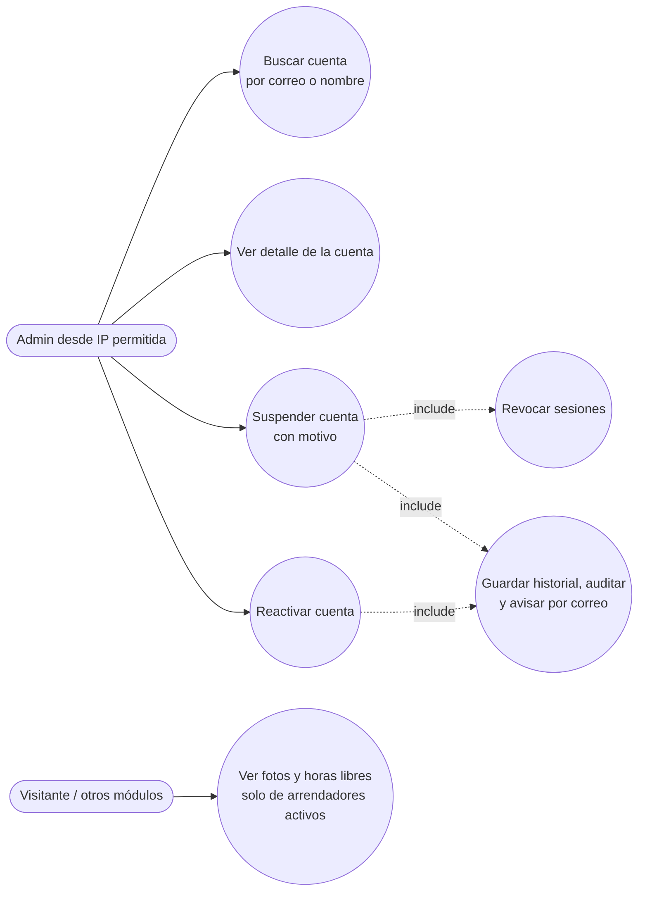
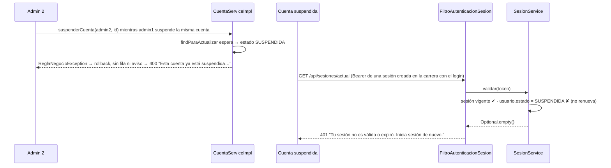

# HU-09 — Design: Suspensión y reactivación de cuentas

> Módulo `administracion` · Sprint 3 · tamaño S · depende de HU-06 (`done`) · sin ★. Reutiliza el panel
> admin de HU-06 tal cual (`FiltroIpsAdmin` sobre `/api/admin/**`, rol en el servicio y otra vez en
> `CuentaService`, aviso `afterCommit`, `Modal`, `api/administracion.js`), `SesionRepository.revocarTodas`
> (HU-04), `AuditoriaService`, `IpCliente`, `Clock` y el kit. D1–D4: decisiones del dueño; S1–S15
> (`requirements.md`): supuestos a confirmar.

## 1. Decisiones (para revisión rápida del dueño)

| # | Origen | Decisión | Por qué |
|---|--------|----------|---------|
| DT-1 | S2, S8 | `administracion` es dueño del caso de uso y de `suspension_cuenta`; `cuentas` es dueño de `usuario.estado` y de las sesiones. `CuentaAdminService.suspender/reactivar` (`@Transactional`) llama a `CuentaService.suspenderCuenta/reactivarCuenta` (propagación `REQUIRED`), guarda la `SuspensionCuenta` y audita. | Todo o nada (R15–R18, R39), igual que HU-06 DT-5. `administracion → cuentas` está permitido: **sin puerto nuevo**, solo se amplía `CuentaService`. |
| DT-2 | S3 | `CuentaServiceImpl` relee la cuenta con `UsuarioRepository.findParaActualizar(id)` (`PESSIMISTIC_WRITE`), comprueba en este orden: existe (404) → gestionable (400 *no gestionable*) → estado (400 *ya suspendida* / *ya activa*); luego `Usuario.suspender()` y **después** `sesiones.revocarTodas(id)`. | El bloqueo serializa dos admins (R38). `revocarTodas` tiene `flushAutomatically` + `clearAutomatically`: el estado se escribe antes del `UPDATE` de sesiones y la entidad queda *detached*; por eso el correo se lee **antes** de revocar y la entidad no se vuelve a usar. |
| DT-3 | D3 | `SesionService.validar` filtra `usuario.getEstado() == ACTIVA` antes de `sesion.renovar(...)`; si no, devuelve vacío → el filtro responde 401 *sesión inválida* (HU-03). | Cierra la carrera login-vs-suspensión (`InicioSesionService` lee la cuenta y crea la sesión en dos pasos): una sesión que nazca tras la revocación tampoco sirve. `revocarTodas` queda como limpieza explícita (R16). |
| DT-4 | D1 | `CuentaService.cuentaActiva(Long)` y `arrendadoresNoActivos()` **sin rol** (no reciben `UsuarioAutenticado`). `FotoEspacioService.ver`: `publica = PUBLICADO && cuentas.cuentaActiva(arrendadorId)`. `DisponibilidadServiceImpl.horasLibres`: tras comprobar `PUBLICADO`, si `!cuentaActiva(arrendadorId)` → `List.of()`. | Dirección `espacios → cuentas` permitida (ya la usa `EspacioService.habilitacionArrendador`). Sin columna en `espacio` ni estado duplicado; "conservan su estado" se cumple literalmente (R26). HU-10/HU-11 usan `arrendadoresNoActivos()` en su consulta paginada (`e.arrendadorId not in :ids`): **si el conjunto está vacío deben omitir esa condición** (una colección vacía en `not in` no es portable en JPQL); se documenta en `docs/architecture.md`. |
| DT-5 | S4 | Búsqueda: `CuentaAdminService` recorta y valida `q` (3–100, si no `ReglaNegocioException("q", M_BUSQUEDA)`). `CuentaServiceImpl` arma `patron = "%" + escapar(texto.toLowerCase(Locale.ROOT)) + "%"` (escapa `\`, luego `%` y `_` con `\`) y llama a `UsuarioRepository.buscar(patron, Limit.of(21))`; si vuelven 21, `hayMas = true` y se devuelven 20. | `correo` ya está en minúsculas (CHECK de `V1_1`); `nombre` se compara con `lower(...)`. Pedir 21 evita un `count`. Sin paginación (HU-06 S6). Si `Limit` no aplica a `@Query`, usar `PageRequest.of(0, 21)`. |
| DT-6 | S5, S6 | `Usuario.esGestionablePorAdmin()` = rol `USUARIO`/`ARRENDADOR` y estado ≠ `ELIMINADA`. `suspender()` / `reactivar()` lanzan `IllegalStateException` fuera de `ACTIVA`/`SUSPENDIDA` o si no es gestionable (la regla vive en el dominio; el servicio comprueba antes para dar el 400). `puedeSuspender`/`puedeReactivar` salen del dominio en el detalle. | La pantalla no decide reglas (`docs/frontend.md`, principio 1). Un admin no se puede suspender a sí mismo porque es `ADMIN` (D2). |
| DT-7 | S5 | Detalle compuesto: `CuentaService.detalleCuenta` → `DetalleCuentaDTO`; `administracion` agrega `suspension` (último `SUSPENSION` de `suspension_cuenta`, solo si `estado = SUSPENDIDA`) en `CuentaAdminDTO(cuenta, suspension)`. | Cada módulo devuelve lo suyo; sin copiar campos de `cuentas` en un DTO de `administracion` (HU-06, alternativa 8). |
| DT-8 | D4, S8 | `NotificadorCorreo` gana `notificarCuentaSuspendida(correo, motivo)` y `notificarCuentaReactivada(correo)`, enviados con el `despuesDelCommit` existente de `CuentaServiceImpl` (su `log.warn` pasa a un texto genérico, sin "identidad"). | Mismo patrón que HU-06 DT-7: no se avisa una acción que hizo rollback (R39). |
| DT-9 | S1 | Controlador `CuentaAdminController` en `/api/admin/cuentas`: `GET` con `CacheControl.noStore()`; `POST` `201` con `IpCliente.de(peticion)`. `q` como `@RequestParam(required = false)` para que su falta llegue al servicio y salga como error del campo `q` (R6). | Hereda el filtro de IPs sin tocar `comun` (R42). El `{id}` es la cuenta objetivo; el actor sale de la sesión. |
| DT-10 | S11 | `CuentaAdminService` tiene su propio `exigirAdmin` (copia del de `RevisionIdentidadService`). | No tocar HU-06 en una historia S; HU-27 puede extraerlo. |
| DT-11 | — | Docs del mismo PR (las actualiza el implementer): `docs/architecture.md` (métodos nuevos de `CuentaService`; regla "HU-10/HU-11/HU-12 filtran por arrendador activo con `arrendadoresNoActivos()`/`cuentaActiva()`" y la rama de colección vacía; contrato ampliado de `horasLibres`; `validar` rechaza cuentas no `ACTIVA`), `docs/modelo-datos.md` (`suspension_cuenta`, su `CHECK` y el diagrama ER), `docs/frontend.md` (`EtiquetaEstado` con los estados de cuenta, HU-09). | Reglas de cabecera de esos archivos; D1 pide documentar el filtro para HU-10/11/12. |

## 2. Caso de uso



**Suspender (CA2)** — Precondición: admin con sesión desde IP permitida. (1) busca la cuenta; (2) abre
el detalle; (3) "Suspender cuenta" → motivo en el `Modal` → confirmar; (4) la API bloquea la fila de
`usuario`, comprueba gestionable y `ACTIVA`, cambia el estado, revoca las sesiones, guarda el historial
y audita en una transacción; (5) tras el commit, avisa por correo; (6) 201 y el detalle se recarga.
Alternos: IP → 403; sin sesión → 401; rol → 403; motivo → 400 por campo; no gestionable, ya suspendida
→ 400; inexistente → 404. **Reactivar (CA3)** es igual sin motivo ni revocación.

## 3. Archivos por módulo y capa

Paquete base `pe.edu.ulima.espacioya`. (N) nuevo · (M) modificado.

| Módulo / capa | Archivos | Para |
|---|---|---|
| `cuentas/domain/` (M) | `Usuario` (`esGestionablePorAdmin`, `suspender`, `reactivar`) | R9, R15, R30, R35–R37 |
| `cuentas/repository/` (M) | `UsuarioRepository` (`findParaActualizar`, `buscar`, `findIdsArrendadoresNoActivos`) | R1–R5, R28, R38 |
| `cuentas/dto/` (N) | `CuentaResumenDTO`, `BusquedaCuentasDTO`, `DetalleCuentaDTO`, `CambioEstadoCuentaDTO` | R1, R7, R14, R44 |
| `cuentas/service/` (M) | `CuentaService`/`CuentaServiceImpl` (6 métodos; inyecta `SesionRepository`), `SesionService` (`validar`), `NotificadorCorreo`/`NotificadorCorreoSimulado` (2 avisos) | R1–R12, R15, R16, R18, R21, R27, R28, R30, R32, R34–R40, R47 |
| `espacios/service/` (M) | `FotoEspacioService` (`ver`), `DisponibilidadService` (javadoc), `DisponibilidadServiceImpl` (`horasLibres`) | R22–R25 |
| `administracion/` (N) | `domain/AccionSuspension`, `domain/SuspensionCuenta`, `repository/SuspensionCuentaRepository`, `service/CuentaAdminService`, `dto/MotivoSuspensionDTO`, `dto/AccionCuentaDTO`, `dto/SuspensionVigenteDTO`, `dto/CuentaAdminDTO`, `controller/CuentaAdminController` | R1–R19, R29, R31, R34–R46 |
| Recursos | `V3_1__suspension_cuenta.sql` (N) | § 8 |

`administracion` usa `cuentas` solo vía `CuentaService` y sus DTO; `espacios` solo vía `CuentaService`.

## 4. Endpoints

Todos pasan por `FiltroIpsAdmin` (403, R42), la sesión (401) y el rol en el servicio (403, R41).

| Método y ruta | Entrada | Respuestas |
|---|---|---|
| `GET /api/admin/cuentas?q=` | query `q` | **200** `BusquedaCuentasDTO` + `no-store` (R1–R5, R13) · **400** campo `q` (R6) · 401 · 403 |
| `GET /api/admin/cuentas/{id}` | — | **200** `CuentaAdminDTO` + `no-store` (R7–R11, R13) · **404** (R12) · 401 · 403 |
| `POST /api/admin/cuentas/{id}/suspension` | JSON `MotivoSuspensionDTO` | **201** `AccionCuentaDTO` (R14) · **400** campo `motivo` (R19) · **400** *no gestionable* / *ya suspendida* (R35, R36) · **404** (R34) · 401 · 403 |
| `POST /api/admin/cuentas/{id}/reactivacion` | — (se ignora el cuerpo) | **201** `AccionCuentaDTO` (R29) · **400** *no gestionable* / *ya activa* (R35, R37) · **404** · 401 · 403 |

```java
// cuentas/dto
public record CuentaResumenDTO(Long id, String nombre, String correo, String rol, String estado) { }   // R1
public record BusquedaCuentasDTO(List<CuentaResumenDTO> cuentas, boolean hayMas) { }                 // R1–R3
public record DetalleCuentaDTO(Long id, String nombre, String correo, String telefono, String rol, String estado,
        boolean correoVerificado, String estadoIdentidad, boolean puedeSuspender, boolean puedeReactivar) { } // R7–R9
public record CambioEstadoCuentaDTO(String estado, int sesionesRevocadas) { }                        // R14, R44
// administracion/dto
public record MotivoSuspensionDTO(@NotBlank(message = M_MOTIVO) @Size(max = 500, message = M_MOTIVO) String motivo) {
    public MotivoSuspensionDTO { motivo = motivo == null ? null : motivo.strip(); } }                // R19
public record SuspensionVigenteDTO(String motivo, Instant fecha) { }                                 // R10
public record CuentaAdminDTO(DetalleCuentaDTO cuenta, SuspensionVigenteDTO suspension) { }           // R7, R10, R11
public record AccionCuentaDTO(String accion, String estado, Instant fecha) { }                       // R14, R29
```

### Mensajes (texto exacto)

| Constante | Texto | Dónde |
|---|---|---|
| `CuentaAdminService.M_BUSQUEDA` | `Escribe de 3 a 100 caracteres del correo o del nombre.` | campo `q` (R6) |
| `MotivoSuspensionDTO.M_MOTIVO` | `Escribe el motivo de la suspensión (hasta 500 caracteres).` | campo `motivo` (R19) |
| `CuentaServiceImpl.MENSAJE_NO_GESTIONABLE` | `Esta cuenta no se puede suspender ni reactivar.` | 400 (R35) |
| `CuentaServiceImpl.MENSAJE_YA_SUSPENDIDA` | `Esta cuenta ya está suspendida. Actualiza la página.` | 400 (R36) |
| `CuentaServiceImpl.MENSAJE_YA_ACTIVA` | `Esta cuenta ya está activa. Actualiza la página.` | 400 (R37) |

Existentes en `ErrorDTO`: `MENSAJE_ACCESO_DENEGADO`, `MENSAJE_RECURSO_NO_ENCONTRADO`,
`MENSAJE_SESION_INVALIDA`, `MENSAJE_CREDENCIALES_INVALIDAS`. El simulado escribe solo `Envío de correo de
cuenta suspendida simulado: no se envió ningún correo (HU-09).` (o `reactivada`). Textos guía para HU-25
(no son R): "Suspendimos tu cuenta. Motivo: <motivo>." / "Reactivamos tu cuenta. Ya puedes iniciar sesión."

## 5. Clases y firmas públicas

```java
// cuentas/domain — Usuario (M)
public boolean esGestionablePorAdmin();   // rol USUARIO o ARRENDADOR y estado != ELIMINADA
public void suspender();                  // IllegalStateException si no es gestionable o estado != ACTIVA
public void reactivar();                  // IllegalStateException si no es gestionable o estado != SUSPENDIDA

// cuentas/repository — UsuarioRepository (M)
@Lock(PESSIMISTIC_WRITE) @Query("select u from Usuario u where u.id = :id")
Optional<Usuario> findParaActualizar(@Param("id") Long id);
@Query("""select u from Usuario u where u.correo like :patron escape '\\'
          or lower(u.nombre) like :patron escape '\\' order by u.correo asc""")
List<Usuario> buscar(@Param("patron") String patron, Limit limite);
@Query("select u.id from Usuario u where u.rol = <Rol.ARRENDADOR> and u.estado <> <EstadoUsuario.ACTIVA>")
List<Long> findIdsArrendadoresNoActivos();                                     // enums calificados, como DT-8 de HU-06

// cuentas/service — CuentaService (M). Los cuatro primeros lanzan AccesoDenegadoException si rol != ADMIN (R40)
BusquedaCuentasDTO buscarCuentas(UsuarioAutenticado admin, String textoRecortado);             // R1–R5
DetalleCuentaDTO detalleCuenta(UsuarioAutenticado admin, Long cuentaId);                        // R7–R9, R12
CambioEstadoCuentaDTO suspenderCuenta(UsuarioAutenticado admin, Long cuentaId, String motivo);  // R15, R16, R18
CambioEstadoCuentaDTO reactivarCuenta(UsuarioAutenticado admin, Long cuentaId);                 // R30, R32
boolean cuentaActiva(Long usuarioId);      // sin rol (D1, R27)
Set<Long> arrendadoresNoActivos();         // sin rol (D1, R28); vacío → el llamador omite su "not in"
// CuentaServiceImpl(UsuarioRepository, PerfilArrendadorRepository, DocumentoIdentidadRepository,
//                   ArchivosPrivados, NotificadorCorreo, SesionRepository)
// NotificadorCorreo (M): void notificarCuentaSuspendida(String correo, String motivo);
//                        void notificarCuentaReactivada(String correo);

// administracion
public enum AccionSuspension { SUSPENSION, REACTIVACION }
@Entity @Table(name = "suspension_cuenta") public class SuspensionCuenta {   // ids Long, sin asociaciones JPA
    public static SuspensionCuenta suspender(Long usuarioId, Long adminId, String motivo, Instant fecha); // motivo en blanco → IAE
    public static SuspensionCuenta reactivar(Long usuarioId, Long adminId, Instant fecha); }            // getters
public interface SuspensionCuentaRepository extends JpaRepository<SuspensionCuenta, Long> {
    Optional<SuspensionCuenta> findFirstByUsuarioIdAndAccionOrderByFechaDescIdDesc(Long usuarioId,
                                                                                    AccionSuspension accion); }
@Service public class CuentaAdminService {   // ACCION_SUSPENDIDA/REACTIVADA = "CUENTA_…"; ENTIDAD_USUARIO = "usuario"
    public CuentaAdminService(CuentaService cuentas, SuspensionCuentaRepository suspensiones,
                              AuditoriaService auditoria, Clock reloj);
    @Transactional(readOnly = true) public BusquedaCuentasDTO buscar(UsuarioAutenticado admin, String q);
    @Transactional(readOnly = true) public CuentaAdminDTO detalle(UsuarioAutenticado admin, Long id);
    @Transactional public AccionCuentaDTO suspender(UsuarioAutenticado admin, Long id, String motivo, String ip);
    @Transactional public AccionCuentaDTO reactivar(UsuarioAutenticado admin, Long id, String ip); }
// CuentaAdminController: @RequestMapping("/api/admin/cuentas"), patrón de RevisionIdentidadController (DT-9).
```

## 6. Flujos

**`CuentaAdminService.suspender`** (`@Transactional`; `reactivar` igual sin motivo ni sesiones):
(1) rol ≠ `ADMIN` → `AccesoDenegadoException` (R41); (2) `cambio = cuentas.suspenderCuenta(admin, id,
motivo)`; dentro, `CuentaServiceImpl`: rol (R40) → `findParaActualizar(id)` o 404 (R34) → no gestionable
→ 400 (R35) → `SUSPENDIDA` → 400 *ya suspendida* (R36) → `cuenta.suspender()` (R15) → `correo =
cuenta.getCorreo()` → `n = sesiones.revocarTodas(id)` (R16) → aviso `afterCommit` (R18) →
`CambioEstadoCuentaDTO("SUSPENDIDA", n)`; (3) `ahora = Instant.now(reloj)`; `registro =
suspensiones.save(SuspensionCuenta.suspender(id, admin.usuarioId(), motivo, ahora))` (R17); (4) audita
`CUENTA_SUSPENDIDA` con `accion=SUSPENSION;registro=<id>;sesionesRevocadas=<n>` (R44, R46);
(5) `new AccionCuentaDTO("SUSPENSION", cambio.estado(), ahora)` (R14). Cualquier excepción revierte
todo y el aviso no sale (R39).

**Buscar:** rol → recorta `q`; nulo o fuera de 3–100 → 400 campo `q` sin llamar a `CuentaService` (R6) →
`buscarCuentas` (rol otra vez, DT-5). **Detalle:** rol → `detalleCuenta` (404 si no existe) → si `estado =
SUSPENDIDA`, `findFirstBy…(id, SUSPENSION)` → `SuspensionVigenteDTO`; si no, `null` (R10, R11).

## 7. Diagramas de secuencia

### Flujo principal: suspender con motivo (CA2; reactivar, CA3, sigue el mismo camino)

```mermaid
sequenceDiagram
  actor A as Admin (IP permitida)
  participant SPA as DetalleCuenta.jsx
  participant FI as FiltroIpsAdmin
  participant C as CuentaAdminController
  participant S as CuentaAdminService
  participant CS as CuentaServiceImpl
  participant SR as SesionRepository
  participant H as SuspensionCuentaRepository
  participant N as NotificadorCorreo
  A->>SPA: Suspender cuenta → motivo en el Modal → Confirmar
  SPA->>FI: POST /api/admin/cuentas/{id}/suspension {motivo}
  FI->>C: IP permitida ✔ → sesión → UsuarioAutenticado ADMIN
  C->>S: @Valid MotivoSuspensionDTO → suspender(admin, id, motivo, ip)
  S->>CS: suspenderCuenta(admin, id, motivo)
  CS->>CS: findParaActualizar(id) [FOR UPDATE] · gestionable ✔ · ACTIVA ✔ · suspender()
  CS->>SR: revocarTodas(id) (flush del estado, luego UPDATE de sesiones)
  CS->>CS: registerSynchronization(afterCommit)
  CS-->>S: CambioEstadoCuentaDTO("SUSPENDIDA", 2)
  S->>H: save(SuspensionCuenta.suspender(...)) · auditoría "accion=SUSPENSION;registro=5;sesionesRevocadas=2"
  Note over S,N: commit
  CS->>N: notificarCuentaSuspendida(correo, motivo)
  C-->>SPA: 201 → recarga el detalle con Alerta éxito
```

### Flujo de error: suspensión simultánea y sesión de una cuenta suspendida



## 8. Migración Flyway

`2_Backend/src/main/resources/db/migration/V3_1__suspension_cuenta.sql` (antes de crearla, actualizar
`develop` y confirmar que `V3_1` sigue libre; si no, la siguiente `V3_n`). Solo depende de `V1_1`.

```sql
-- HU-09: historial de suspensiones y reactivaciones hechas por un admin. El estado vigente sigue en
-- usuario.estado; esta tabla registra quién hizo qué, cuándo y por qué (STRIDE R).
CREATE TABLE suspension_cuenta (
    id          BIGINT GENERATED ALWAYS AS IDENTITY PRIMARY KEY,
    usuario_id  BIGINT       NOT NULL REFERENCES usuario (id) ON DELETE CASCADE,
    admin_id    BIGINT       NOT NULL REFERENCES usuario (id),
    accion      VARCHAR(20)  NOT NULL,
    motivo      VARCHAR(500),
    fecha       TIMESTAMPTZ  NOT NULL,
    CONSTRAINT ck_suspension_cuenta_accion CHECK (accion IN ('SUSPENSION', 'REACTIVACION')),
    CONSTRAINT ck_suspension_cuenta_motivo CHECK (
        (accion = 'REACTIVACION' AND motivo IS NULL)
        OR (accion = 'SUSPENSION' AND motivo IS NOT NULL AND length(btrim(motivo)) > 0))
);
CREATE INDEX ix_suspension_cuenta_usuario ON suspension_cuenta (usuario_id, fecha);
```

`admin_id` sin cascada como `revision_identidad` (el `DELETE FROM usuario` de las IT sigue funcionando:
`NO ACTION` se comprueba al final de la sentencia). La entidad mapea exactamente estas columnas
(`ddl-auto=validate`). `docs/modelo-datos.md` la agrega en "Administración" (DT-11).

## 9. Excepciones y componentes de `comun`

**No se agrega ninguna excepción.** `AccesoDenegadoException` (R40, R41), `RecursoNoEncontradoException`
(R12, R22, R34), `ReglaNegocioException` (con campo `q`, R6; sin campo, R35–R37) y el handler de
`MethodArgumentNotValidException` (R19). Sin cambios en `comun`: `FiltroIpsAdmin` (R42),
`AuditoriaService` (R44, R45), `IpCliente`, `Clock`, `FiltroAutenticacionSesion` (consume el vacío de
`validar`, R21).

## 10. Pantallas

En ambas: dentro de `RutaProtegida`; rol ≠ `ADMIN` → `<Navigate to="/panel" />`; "Cargando…" en texto
secundario; errores de la API → `Alerta error` con el mensaje tal cual; red → "No pudimos conectar.
Intenta de nuevo."; nunca se muestran ids. Patrón de `ColaIdentidades.jsx` / `RevisarIdentidad.jsx`.

**API — `src/api/administracion.js` (M):** `buscarCuentas(texto)` → `GET /api/admin/cuentas?q=` (con
`encodeURIComponent`); `obtenerCuenta(id)` → `GET …/{id}`; `suspenderCuenta(id, motivo)` → `POST
…/{id}/suspension` con `{ motivo }`; `reactivarCuenta(id)` → `POST …/{id}/reactivacion`.

**Buscar — `/admin/cuentas` → `pages/administracion/BuscarCuentas.jsx` (N, + `.module.css`).** Título
"Buscar cuentas". `<form>` con `Campo` "Correo o nombre" (`nombre="q"`, ayuda "Al menos 3 caracteres.")
y `Boton primario` "Buscar" con `cargando`. **CA1:** una `Tarjeta` por cuenta en el orden recibido
(`titulo` = nombre o, si es nulo, correo; correo, rol con `NOMBRES_ROL`, `EtiquetaEstado estado={estado}`;
`acciones` = enlace "Ver cuenta" → `/admin/cuentas/:id`). `hayMas` → `Alerta info` "Hay más de 20
resultados. Escribe más del correo o del nombre para acotar." Lista vacía tras buscar: "No encontramos
cuentas con ese correo o nombre." 400 con `errores` → error bajo el `Campo`.

**Detalle — `/admin/cuentas/:id` → `pages/administracion/DetalleCuenta.jsx` (N, + `.module.css`).**

- **CA1:** nombre (o correo) + `EtiquetaEstado` del estado; lista de definición con correo, teléfono,
  rol, "Correo verificado: Sí/No" e identidad (`EtiquetaEstado` de `estadoIdentidad`, solo si no es
  nulo). Con `suspension`: "Suspendida el <fecha y hora local>" y "Motivo: <motivo>". Enlace "Volver a
  la búsqueda" → `/admin/cuentas`.
- **CA2:** solo si `puedeSuspender`: `Boton peligro` "Suspender cuenta" → `Modal
  variante="peligro-confirmar"`, título "Suspender la cuenta de <nombre o correo>", texto "Se cerrarán
  sus sesiones, no podrá iniciar sesión y sus espacios dejarán de mostrarse.", `Campo tipo="textarea"`
  "Motivo de la suspensión" (`nombre="motivo"`, ayuda "Se lo enviaremos por correo. Hasta 500
  caracteres."), confirmar "Suspender"; motivo vacío → error bajo el `Campo` sin enviar (ayuda).
- **CA3:** solo si `puedeReactivar`: `Boton primario` "Reactivar cuenta" (único primario) → `Modal
  variante="primario"`, "¿Reactivar la cuenta de <nombre o correo>?", texto "Podrá iniciar sesión y sus
  espacios volverán a mostrarse.", confirmar "Reactivar".
- Sin ninguna de las dos: texto secundario "Esta cuenta no se puede suspender ni reactivar desde el
  panel." (`ADMIN`, `ELIMINADA`).
- 201 → cierra el `Modal`, recarga el detalle y muestra `Alerta exito` "Suspendiste la cuenta. Cerramos
  sus sesiones y le enviamos el motivo por correo." o "Reactivaste la cuenta. Le avisamos por correo.".
  400 con `errores` → bajo el `Campo` del `Modal`; 400 sin `errores` o 404 → `Modal` cerrado, `Alerta
  error` y recarga.

**Kit y textos:** `components/ui/EtiquetaEstado.jsx` (M) suma `ACTIVA` ("Activa", éxito), `SUSPENDIDA`
("Suspendida", error) y `ELIMINADA` ("Eliminada", neutro), ya presentes en "Color de cada estado" (sin
estados nuevos en la tabla). `textosAdministracion.js` (M) suma `NOMBRES_ROL` (`USUARIO` "Usuario",
`ARRENDADOR` "Arrendador", `ADMIN` "Administrador"). Sin componentes nuevos.

**Panel y rutas:** `pages/cuentas/Panel.jsx` (M): descripción del `ADMIN` "Revisa identidades y gestiona
cuentas." y enlace "Buscar cuentas" → `/admin/cuentas`. `App.jsx` (M): rutas `/admin/cuentas` y
`/admin/cuentas/:id` en `RutaProtegida`. La expulsión del suspendido ya la hace `api/cliente.js` (401).

## 11. Plan de pruebas (R → test)

Cada test lleva `@DisplayName("HU-09 R<n>: …")`. `CAIT` = `CuentaAdminControllerIT` (Testcontainers,
`RelojControlable` `@Primary`, `NotificadorFalso` que registra avisos, `@BeforeEach` que borra
`suspension_cuenta`, `revision_identidad`, `sesion`, `auditoria`, `perfil_arrendador` y `usuario`; admin
creado como en `RevisionIdentidadControllerIT`, IP permitida `127.0.0.1`, no permitida `10.9.x.x`).

| R | Test |
|---|---|
| R1–R5, R13 | `CAIT` (claves exactas; 21 coincidencias → 20 y `hayMas`; `%`, `_`, `\` literales; mayúsculas en `q` y en `nombre`; `ADMIN` y `ELIMINADA` incluidas; `no-store`), `CuentaServiceImplTest` (patrón escapado) |
| R6 | `CAIT` (sin `q`, `"  ab "`, 101 caracteres → 400 campo `q`), `CuentaAdminServiceTest` (sin llamar a `CuentaService`) |
| R7–R12 | `CAIT` (claves exactas; `estadoIdentidad` nulo para `USUARIO`; banderas por rol y estado; motivo y fecha de la última suspensión; `null` tras reactivar; inexistente → 404), `UsuarioTest` (`esGestionablePorAdmin`) |
| R14–R18 | `CAIT` (cuerpo; `usuario.estado`; dos sesiones del suspendido revocadas y la de otra cuenta no; fila con `admin_id` de la sesión aunque el cuerpo traiga otro; un aviso con correo y motivo recortado) |
| R19 | `CAIT` (`{}`, `""`, `"   "`, 501 caracteres → 400, sin cambios), `MotivoSuspensionDTOTest` |
| R20, R33 | `CAIT` (`POST /api/sesiones` tras suspender → 401 idéntico a credenciales inválidas; tras reactivar → 201) |
| R21 | `SesionServiceTest` (cuenta `SUSPENDIDA` y `ELIMINADA` → vacío y `expira_en` sin cambio), `CAIT` (sesión insertada por `JdbcTemplate` tras suspender → 401 *sesión inválida* en `GET /api/sesiones/actual`) |
| R22, R24 | `FotoPublicaControllerIT` (M: `UPDATE usuario SET estado='SUSPENDIDA'` → 404 sin sesión; `ACTIVA` otra vez → 200 con `public, max-age=3600`), `FotoEspacioServiceTest` (M) |
| R23, R25 | `DisponibilidadServiceImplIT` (M: igual, lista vacía / con horas), `DisponibilidadServiceImplTest` (M) |
| R26 | `CAIT` (espacio `PUBLICADO` insertado por `JdbcTemplate`; suspender y reactivar por la API → sigue `PUBLICADO`) |
| R27, R28 | `CuentaServiceImplIT` (N: `ACTIVA`/`SUSPENDIDA`/inexistente; conjunto con arrendadores `SUSPENDIDA` y `ELIMINADA`, sin `USUARIO` suspendidos; vacío si no hay) |
| R29–R32 | `CAIT` (cuerpo, estado, fila sin motivo, un aviso de reactivación) |
| R34–R37 | `CAIT` (404; `ADMIN`, el propio admin y `ELIMINADA` → 400 *no gestionable*; ya suspendida / ya activa → 400; sin fila, sin cambios ni aviso), `UsuarioTest` (`suspender`/`reactivar` fuera de estado lanzan) |
| R38 | `CAIT` (dos hilos con `CountDownLatch` → un 201, un 400, una fila, un aviso) |
| R39, R40 | `CuentaServiceImplTest` (`initSynchronization()`: avisos solo en `afterCommit`, ninguno tras `ROLLED_BACK`; rol ≠ `ADMIN` en los 4 métodos → `AccesoDenegadoException` sin repositorios), `CAIT` de R19, R34–R37 sin avisos |
| R41, R42 | `CAIT` (`USUARIO` y `ARRENDADOR` → 403 en los 4 endpoints; IP no permitida con y sin Bearer → 403), `CuentaAdminServiceTest` |
| R43 | `CAIT` (`INSERT` por `JdbcTemplate` que viola cada `CHECK` → `DataIntegrityViolationException`), `SuspensionCuentaTest` |
| R44–R46 | `CAIT` (fila de `auditoria` exacta; el detalle no contiene motivo ni correo), `CuentaAdminServiceTest` |
| R47 | `NotificadorCorreoSimuladoTest` (M, `OutputCaptureExtension`) |

## 12. Alternativas descartadas

1. **Columna `arrendador_suspendido` en `espacio`** (opción b del punto 6) — duplica `usuario.estado` y se
   desincroniza si otra vía lo cambia; altera `espacio` (D1).
2. **Join JPQL de `espacio` con `Usuario`** — acopla `espacios`/`busqueda` al dominio de `cuentas`
   (`docs/architecture.md`, "Qué NO hacer").
3. **Pasar los espacios a `OCULTO`** — `OCULTO` es de moderación (HU-27) y al reactivar no se sabría el
   estado anterior; contradice "conservan su estado".
4. **Solo `revocarTodas`, sin tocar `validar`** — deja la carrera login-vs-suspensión con una sesión que
   se renueva sin fin (D3).
5. **Motivo en `auditoria.detalle` o columnas en `usuario`** — contradice HU-06 S16 y pierde el historial
   de suspensiones repetidas (S2).
6. **`PATCH /api/admin/cuentas/{id}` con `{estado, motivo}`** — el cliente enviaría el estado y un solo
   endpoint mezclaría dos validaciones distintas (S1).
7. **Extraer `exigirAdmin` a `comun/seguridad`** — refactor de HU-06 en una historia S; queda para HU-27
   (S11).
