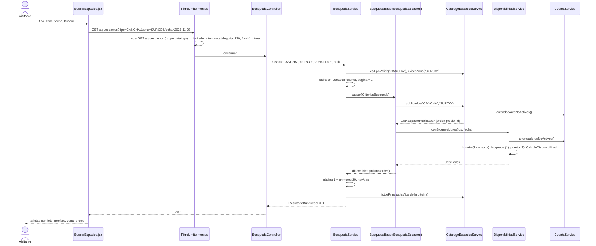
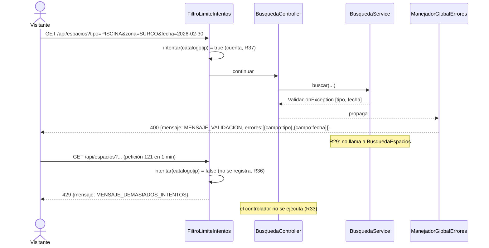
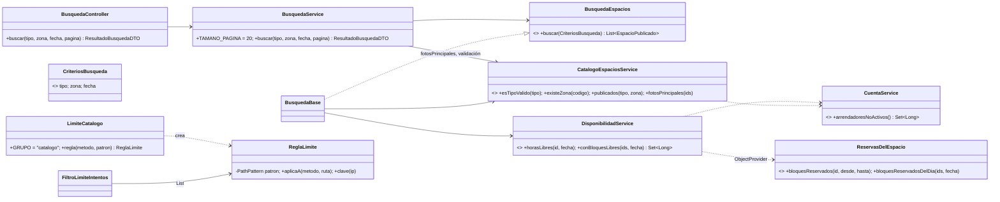

# HU-10 — Design: Búsqueda por tipo, zona y fecha

> Requirements: `specs/HU-10/requirements.md` (R1–R47). Reutiliza HU-07 (catálogo `zona`, `espacio`,
> `foto_espacio`, URL `/api/fotos/<UUID>`), HU-08 (`DisponibilidadService`, `CalculoDisponibilidad`,
> `VentanaReserva`, `ZonaHoraria`, puerto `ReservasDelEspacio`), HU-09 (`CuentaService.arrendadoresNoActivos`,
> `cuentaActiva`) y el rate limiting de `comun/limite` (HU-01/HU-02). HU-10 no es ★: no tiene patrón
> obligatorio, pero deja la búsqueda base como interfaz envolvible para el Decorator de HU-23 (§ 11).
> Las decisiones que el dueño debe confirmar están en § 15.

## 1. Decisiones técnicas

| Id | Decisión | Por qué |
|----|----------|---------|
| DT-1 | Ruta pública `GET /api/espacios?tipo=&zona=&fecha=&pagina=` en el módulo `busqueda` (`BusquedaController`), `permitAll` en `ConfiguracionSeguridad`. | `docs/conventions.md`: recurso en plural; HU-11 colgará `/api/espacios/{id}` del mismo recurso. |
| DT-2 | `GET /api/zonas` pasa a `permitAll`. | La pantalla pública necesita las zonas sin sesión. El catálogo no tiene datos personales (STRIDE I, riesgo aceptado). Reemplaza la parte de `GET /api/zonas` de HU-07 R43 (el test `ZonaControllerIT.sinSesion` cambia, § 13). |
| DT-3 | `busqueda` solo usa interfaces públicas de `espacios`: `DisponibilidadService` (M, nuevo método en lote `conBloquesLibres`) y `CatalogoEspaciosService` (N). Nunca repositorios de `espacios` ni de `cuentas`. | `docs/architecture.md` principio 5 y "Qué NO hacer". La dirección `busqueda → espacios` está permitida: no hace falta puerto. |
| DT-4 | Filtro de visibilidad (RN-15, HU-09 D1) dentro de `espacios`: `CatalogoEspaciosServiceImpl.publicados` consulta `estado = PUBLICADO` y `arrendadorId not in :excluidos` con `CuentaService.arrendadoresNoActivos()`, **omitiendo la condición si el conjunto está vacío** (dos consultas JPQL, § 5.3). | Regla documentada en `docs/architecture.md` § Puertos ("arrendadores no ACTIVA"). `busqueda` no lee `usuario`. |
| DT-5 | Disponibilidad en lote: `conBloquesLibres(Collection<Long>, LocalDate) → Set<Long>` en `DisponibilidadServiceImpl`. Una consulta de espacios, una de `arrendadoresNoActivos`, una de horario del día de la semana, una de bloqueos de la fecha y una llamada al puerto para todo el lote; luego `CalculoDisponibilidad.bloquesDelDia` por espacio en memoria. | `docs/architecture.md` "HU-10 (búsqueda por fecha)": `horasLibres` por candidato es N+1. Reutiliza el cálculo puro: el resultado es idéntico a `horasLibres` (R30). |
| DT-6 | El puerto `ReservasDelEspacio` gana un método **default** `bloquesReservadosDelDia(Collection<Long> espacioIds, LocalDate fecha) → Map<Long, List<BloqueReservado>>` que llama al método existente por cada id. | No rompe el doble `ReservasDelEspacioFalso` de las IT de `espacios` ni el contrato que implementará HU-12; HU-12 puede sobrescribirlo con una sola consulta. Sin bean del puerto, no se llama (como R21 de HU-08). |
| DT-7 | Paginación **en memoria** sobre la lista ordenada de disponibles: `publicados(tipo, zona)` (ordenado en SQL por `precio_hora, id`) → `conBloquesLibres` → filtro que conserva el orden → `skip((n−1)·20).limit(20)`; `hayMas = total > n·20`. Las fotos principales se cargan **solo para la página** (una consulta). | "Al menos un bloque libre" depende de las horas ya empezadas y de las reservas (puerto en Java): no se puede expresar en SQL sin duplicar `CalculoDisponibilidad`. El universo es tipo × zona (un distrito), del orden de decenas. Ver alternativa A2. |
| DT-8 | Tamaño fijo `TAMANO_PAGINA = 20`; el cliente no lo elige (parámetros extra se ignoran). Sin total en la respuesta. | CA2, RNF-USA-01, STRIDE (I/D) "máximo 20 resultados por página". Sin total se revela menos del catálogo (precedente HU-09 `hayMas`). |
| DT-9 | Orden: `precio_hora ASC, id ASC`. | Estable para paginar (R9). Ningún CA lo fija (§ 15 D4). |
| DT-10 | Validación en `BusquedaService` con los parámetros como **texto** (`@RequestParam(required = false) String`), acumulando un `ErrorCampoDTO` por campo en orden `tipo`, `zona`, `fecha`, `pagina` → `ValidacionException` (400). La fecha se valida con `VentanaReserva.desde(ZonaHoraria.hoy(reloj))`. | Mismo estilo que HU-08 (fecha como texto, `LocalDate.parse` estricto). Con `int`/`LocalDate` en el `@RequestParam`, Spring respondería 400 genérico sin campo. `docs/architecture.md` pide usar `VentanaReserva` para validar la fecha de la búsqueda. |
| DT-11 | Rate limiting: `ReglaLimite` pasa de `record` a `final class` con los **mismos constructores y accesores** (`metodo()`, `ruta()`, `maximo()`, `ventana()`, `grupo()`, `aplicaA`, `clave`) y un `PathPattern` precompilado (`PathPatternParser.defaultInstance.parse(ruta)`). `aplicaA` usa `patron.matches(PathContainer.parsePath(ruta))`. | §9.9 pide patrones (`/api/espacios/{id}`) sin romper HU-01/02. Un `record` no puede guardar el patrón compilado sin exponerlo como componente. Un literal en `PathPattern` coincide solo consigo mismo (R43). `PathContainer` compara segmentos **decodificados**, como Spring MVC al elegir el controlador: `/api/%65spacios` ya no esquiva el límite (R44). Un patrón inválido lanza `PatternParseException` (`IllegalArgumentException`) al crear el bean (R45). |
| DT-12 | `FiltroLimiteIntentos` descuenta **un intento por grupo** por solicitud (`Set<String>` de grupos ya contados en el bucle). | Con patrones, dos reglas del mismo grupo pueden coincidir con la misma ruta (R46); hoy contaría dos veces. |
| DT-13 | Cupo del catálogo en `busqueda/controller/LimiteCatalogo` (`@Component`): lee `espacioya.limite.catalogo.maximo` y `.ventana`, valida (`maximo ≥ 1`, `ventana > 0`, si no `IllegalStateException`) y expone `regla(metodo, patron)` con `GRUPO = "catalogo"`. `ReglasLimiteBusqueda` (`@Configuration`) registra el `@Bean` de `GET /api/espacios`. HU-11 y HU-23 solo agregan su `@Bean` con `limite.regla("GET", "/api/espacios/{id}")`, etc. | §9.9: cifra y ventana configurables; un solo cupo compartido. Mismo patrón que `cuentas/controller/ReglasLimiteCuentas`. |
| DT-14 | Configuración en `application.properties` (no existe `application.yml` en el proyecto): `espacioya.limite.catalogo.maximo=${LIMITE_CATALOGO_MAXIMO:120}`, `espacioya.limite.catalogo.ventana=${LIMITE_CATALOGO_VENTANA:PT1M}` (ISO-8601). Se documentan en `2_Backend/.env.example`. | `docs/conventions.md` "Configuración y secretos". Un solo archivo de configuración. Los tests bajan la cifra con `@SpringBootTest(properties = …)`. |
| DT-15 | Índice `ix_espacio_busqueda ON espacio (estado, tipo, zona, precio_hora, id)` en `V3_2__indices_busqueda.sql`. Ninguna tabla nueva. | HU-07 design: "Los índices de búsqueda por (estado, tipo, zona) los agrega HU-10". Las columnas de orden evitan el sort. Las consultas en lote de horario, bloqueos y fotos ya tienen índice (`uq_horario_semanal_inicio`, `uq_bloqueo_fecha`, `uq_foto_espacio_orden`, todos con `espacio_id` primero). |
| DT-16 | Foto principal = `foto_espacio.orden = 1` (HU-07). Si falta, `fotoPrincipal = null` (R16) y el espacio se muestra igual. | Publicar exige foto, pero HU-10 no depende de que nunca se pueda quitar. |
| DT-17 | Sin auditoría. | La búsqueda es lectura pública y no es acción sensible (RNF-SEG-12 no la pide); auditar cada búsqueda sería un vector de DoS sobre la tabla. |
| DT-18 | El filtro de rate limiting corre después de la cadena de Spring Security (filtro de servlet `@Component` con orden por defecto). | Ya es así para HU-01/02. Las rutas de HU-10 son `permitAll`, así que siempre llegan al filtro. |

## 2. Archivos

`M` = modificar, `N` = nuevo. Raíz backend: `2_Backend/src/main/java/pe/edu/ulima/espacioya/` (abreviada
`J/`), tests `2_Backend/src/test/java/pe/edu/ulima/espacioya/` (`T/`), recursos
`2_Backend/src/main/resources/` (`R/`).

### `comun`
| Archivo | | Qué |
|---------|---|-----|
| `J/comun/limite/ReglaLimite.java` | M | `record` → `final class` con `PathPattern` (DT-11). |
| `J/comun/limite/FiltroLimiteIntentos.java` | M | Un intento por grupo por solicitud (DT-12). |
| `J/comun/seguridad/ConfiguracionSeguridad.java` | M | `permitAll` para `GET /api/espacios` y `GET /api/zonas`. |

### `espacios`
| Archivo | | Qué |
|---------|---|-----|
| `J/espacios/service/DisponibilidadService.java` | M | `Set<Long> conBloquesLibres(Collection<Long> espacioIds, LocalDate fecha)`. |
| `J/espacios/service/DisponibilidadServiceImpl.java` | M | Implementación en lote (§ 6.2). `horasLibres` no cambia. |
| `J/espacios/service/CatalogoEspaciosService.java` | N | Interfaz pública del catálogo para `busqueda`. |
| `J/espacios/service/CatalogoEspaciosServiceImpl.java` | N | Implementación (§ 6.3). |
| `J/espacios/service/EspacioPublicado.java` | N | `record` que cruza a `busqueda` (no es entidad ni DTO de la API). |
| `J/espacios/service/puertos/ReservasDelEspacio.java` | M | Método `default bloquesReservadosDelDia` (DT-6). |
| `J/espacios/repository/EspacioRepository.java` | M | `buscarPublicados`, `buscarPublicadosExcluyendo`. |
| `J/espacios/repository/HorarioSemanalRepository.java` | M | `findByEspacioIdInAndDiaSemana`. |
| `J/espacios/repository/BloqueoFechaRepository.java` | M | `espaciosBloqueados`. |
| `J/espacios/repository/FotoEspacioRepository.java` | M | `findByEspacioIdInAndOrden`. |
| `J/espacios/service/EspacioService.java` | — | Sin cambios: `CatalogoEspaciosServiceImpl` está en el mismo paquete y reutiliza `static urlDe(FotoEspacio)` (de paquete). |
| `R/db/migration/V3_2__indices_busqueda.sql` | N | DT-15. |

### `busqueda` (módulo nuevo en código; ya previsto en `docs/architecture.md`)
| Archivo | | Qué |
|---------|---|-----|
| `J/busqueda/controller/BusquedaController.java` | N | `GET /api/espacios`. |
| `J/busqueda/controller/LimiteCatalogo.java` | N | Cupo configurable y fábrica de reglas del grupo catálogo (DT-13). |
| `J/busqueda/controller/ReglasLimiteBusqueda.java` | N | `@Bean ReglaLimite` de `GET /api/espacios`. |
| `J/busqueda/dto/ResultadoBusquedaDTO.java` | N | `record(int pagina, List<ResultadoEspacioDTO> resultados, boolean hayMas)`. |
| `J/busqueda/dto/ResultadoEspacioDTO.java` | N | `record(Long id, String nombre, String zona, String zonaNombre, BigDecimal precioHora, String fotoPrincipal)`. |
| `J/busqueda/service/CriteriosBusqueda.java` | N | `record(String tipo, String zona, LocalDate fecha)` (ya validados). |
| `J/busqueda/service/BusquedaEspacios.java` | N | Interfaz envolvible (HU-23). |
| `J/busqueda/service/BusquedaBase.java` | N | Implementación base. |
| `J/busqueda/service/BusquedaService.java` | N | Validación, paginación y armado del DTO. |

`busqueda` no tiene `domain` ni `repository` en HU-10: no guarda nada.

### Configuración
| Archivo | | Qué |
|---------|---|-----|
| `R/application.properties` | M | Dos propiedades de DT-14. |
| `2_Backend/.env.example` | M | `LIMITE_CATALOGO_MAXIMO=`, `LIMITE_CATALOGO_VENTANA=` con comentario. |

### Frontend (`3_frontend/src/`)
| Archivo | | Qué |
|---------|---|-----|
| `components/ui/Imagen.jsx` + `Imagen.module.css` | N | Kit: imagen con proporción fija y "Sin foto" (§ 12). |
| `api/busqueda.js` | N | `buscarEspacios`. |
| `pages/busqueda/BuscarEspacios.jsx` + `.module.css` | N | Pantalla pública. |
| `pages/busqueda/textosBusqueda.js` | N | Textos de CA3 y `ventanaBusqueda()`. |
| `App.jsx` | M | Ruta `/buscar` y enlaces. |

### Docs (los actualiza el implementer en el mismo PR)
`docs/architecture.md` (tabla de puertos: método default de `ReservasDelEspacio`; `CatalogoEspaciosService`
como segunda interfaz pública de `espacios`; `conBloquesLibres` hecho; `ReglaLimite` con patrones y grupo
`catalogo`; quitar "HU-10" de lo que "no existe" en § Disponibilidad), `docs/frontend.md` (fila `Imagen`
en el kit) y `docs/modelo-datos.md` (mención del índice `ix_espacio_busqueda` en la fila de `espacio`; no
es una restricción, solo rendimiento).

## 3. Caso de uso y secuencias

**Caso de uso CU-10 "Buscar espacios disponibles".** Actor: visitante o usuario (con o sin sesión).
Precondición: ninguna. Flujo principal: (1) abre `/buscar`; (2) el sistema carga las zonas; (3) elige tipo,
zona y fecha y pulsa "Buscar"; (4) el sistema valida, aplica el cupo por IP y devuelve la página 1;
(5) ve nombre, foto, zona y precio; (6) pasa de página. Alternos: (4a) datos inválidos → errores por campo;
(4b) sin resultados → mensaje y sugerencia (CA3); (4c) cupo agotado → 429 con mensaje genérico.

### 3.1 Flujo principal



### 3.2 Flujos de error (400 y 429)



## 4. Endpoint, DTO y mensajes

### `GET /api/espacios`
- **Seguridad:** `permitAll`. Si llega un Bearer válido, se autentica pero no cambia nada; si es inválido,
  se trata como anónimo (comportamiento de `FiltroAutenticacionSesion`, R12).
- **Rate limiting:** grupo `catalogo`, 120 por IP por minuto (configurable).
- **Parámetros (query, todos texto):** `tipo`, `zona`, `fecha` (obligatorios), `pagina` (opcional, por
  defecto 1). Otros parámetros se ignoran (R22).
- **200** `ResultadoBusquedaDTO`:
  ```json
  {
    "pagina": 1,
    "resultados": [
      { "id": 12, "nombre": "Cancha Los Olivos", "zona": "LOS_OLIVOS", "zonaNombre": "Los Olivos",
        "precioHora": 80.00, "fotoPrincipal": "/api/fotos/3f0c…" }
    ],
    "hayMas": false
  }
  ```
- **400** `ErrorDTO(MENSAJE_VALIDACION, [ErrorCampoDTO(campo, mensaje)…])` (R23–R28).
- **429** `ErrorDTO(MENSAJE_DEMASIADOS_INTENTOS)` desde el filtro (R33).

### `GET /api/zonas` (HU-07, sin cambios de forma)
Pasa a `permitAll` (R13). No cuenta en el cupo (no hay regla para esa ruta, R38).

### Mensajes (constantes en `BusquedaService`)
| Constante | Texto | Requirement |
|-----------|-------|-------------|
| `MENSAJE_TIPO_INVALIDO` | "Elige un tipo de espacio." | R23 |
| `MENSAJE_ZONA_INVALIDA` | "Elige una zona de la lista." | R24 |
| `MENSAJE_FECHA_INVALIDA` | "Elige una fecha válida." (mismo texto que HU-08 `BloqueoFechaDTO.M_FECHA`) | R25 |
| `MENSAJE_FUERA_DE_VENTANA` | "Elige una fecha entre hoy y las próximas 8 semanas." (mismo texto que HU-08) | R26 |
| `MENSAJE_PAGINA_INVALIDA` | "La página no es válida." | R27 |
| `CAMPO_TIPO`, `CAMPO_ZONA`, `CAMPO_FECHA`, `CAMPO_PAGINA` | `"tipo"`, `"zona"`, `"fecha"`, `"pagina"` | R23–R28 |

Los textos de HU-08 se copian (no se importan de `CalendarioEspacioService`, que es una clase concreta de
otro módulo); un test de `BusquedaServiceTest` compara ambos textos para que no se separen.

## 5. Clases y firmas públicas

### 5.1 `comun/limite`

```java
public final class ReglaLimite {
    public ReglaLimite(String metodo, String ruta, int maximo, Duration ventana, String grupo); // parsea el patrón
    public ReglaLimite(String metodo, String ruta, int maximo, Duration ventana);              // grupo = metodo + " " + ruta
    public String metodo();  public String ruta();  public int maximo();
    public Duration ventana();  public String grupo();
    public boolean aplicaA(String metodoSolicitud, String rutaSolicitud); // método sin mayúsculas + PathPattern
    public String clave(String ip);                                       // grupo + "|" + ip
}
```
- `aplicaA`: si `PathContainer.parsePath(rutaSolicitud)` lanza `IllegalArgumentException` (escape `%`
  mal formado), devuelve `false`: Spring MVC tampoco enruta esa solicitud a un controlador.
- `toString` con método, ruta y grupo (logs). `equals`/`hashCode` no se usan; no se definen.

`FiltroLimiteIntentos.doFilterInternal` (M):
```java
var contados = new HashSet<String>();
for (var regla : reglas) {
    if (regla.aplicaA(metodo, ruta) && contados.add(regla.grupo())
            && !limitador.intentar(regla.clave(ip), regla.maximo(), regla.ventana())) {
        rechazar(respuesta); return;
    }
}
```

### 5.2 `espacios/service`

```java
public interface DisponibilidadService {
    List<Integer> horasLibres(Long espacioId, LocalDate fecha);          // HU-08, sin cambios
    /** Ids de espacioIds con horasLibres(id, fecha) no vacía (R30). Vacío si la colección está vacía o la
     *  fecha está fuera de la ventana (R32). Consulta en lote (R31). */
    Set<Long> conBloquesLibres(Collection<Long> espacioIds, LocalDate fecha);
}

public interface CatalogoEspaciosService {
    boolean esTipoValido(String tipo);                     // CANCHA, ESTADIO, AUDITORIO exacto; null → false
    boolean existeZona(String codigo);                     // ZonaRepository.existsById; null/blank → false
    /** Espacios PUBLICADO de arrendadores ACTIVA del tipo y zona, por precio_hora y id ascendentes.
     *  IllegalArgumentException si el tipo no es válido. */
    List<EspacioPublicado> publicados(String tipo, String zona);
    /** espacioId → URL /api/fotos/<UUID> de su foto con orden 1; los que no la tienen no aparecen. */
    Map<Long, String> fotosPrincipales(Collection<Long> espacioIds);
}

public record EspacioPublicado(Long id, String nombre, String tipo, String zona, String zonaNombre,
                               BigDecimal precioHora) { }
```

`ReservasDelEspacio` (M):
```java
/** Reservas activas del día por espacio. Por defecto, una llamada a bloquesReservados por id; reservas
 *  (HU-12) puede sobrescribirlo con una sola consulta. Los ids sin reservas pueden faltar en el mapa. */
default Map<Long, List<BloqueReservado>> bloquesReservadosDelDia(Collection<Long> espacioIds, LocalDate fecha) {
    var porEspacio = new HashMap<Long, List<BloqueReservado>>();
    for (var id : espacioIds) { porEspacio.put(id, bloquesReservados(id, fecha, fecha)); }
    return porEspacio;
}
```

### 5.3 `espacios/repository` (M)

```java
// EspacioRepository
@Query("select e from Espacio e where e.estado = :estado and e.tipo = :tipo and e.zona = :zona "
        + "order by e.precioHora asc, e.id asc")
List<Espacio> buscarPublicados(@Param("estado") EstadoEspacio estado, @Param("tipo") TipoEspacio tipo,
                               @Param("zona") String zona);

// Variante con exclusión: solo se llama si el conjunto no está vacío (HU-09 D1).
@Query("select e from Espacio e where e.estado = :estado and e.tipo = :tipo and e.zona = :zona "
        + "and e.arrendadorId not in :excluidos order by e.precioHora asc, e.id asc")
List<Espacio> buscarPublicadosExcluyendo(@Param("estado") EstadoEspacio estado, @Param("tipo") TipoEspacio tipo,
                                         @Param("zona") String zona,
                                         @Param("excluidos") Collection<Long> excluidos);

// HorarioSemanalRepository
List<HorarioSemanal> findByEspacioIdInAndDiaSemana(Collection<Long> espacioIds, short diaSemana);

// BloqueoFechaRepository
@Query("select b.espacioId from BloqueoFecha b where b.espacioId in :ids and b.fecha = :fecha")
List<Long> espaciosBloqueados(@Param("ids") Collection<Long> ids, @Param("fecha") LocalDate fecha);

// FotoEspacioRepository
List<FotoEspacio> findByEspacioIdInAndOrden(Collection<Long> espacioIds, short orden);
```
Ningún método se llama con una colección vacía: los servicios cortan antes (R32).

`conBloquesLibres` usa `espacios.findAllById(ids)` para recomprobar `PUBLICADO` (no hace falta consulta
nueva).

### 5.4 `busqueda`

```java
public record CriteriosBusqueda(String tipo, String zona, LocalDate fecha) { }

/** Búsqueda envolvible (HU-23 Decorator): devuelve todos los disponibles, ya ordenados, sin paginar. */
public interface BusquedaEspacios {
    List<EspacioPublicado> buscar(CriteriosBusqueda criterios);
}

@Service
public class BusquedaBase implements BusquedaEspacios {
    public BusquedaBase(CatalogoEspaciosService catalogo, DisponibilidadService disponibilidad);
    public List<EspacioPublicado> buscar(CriteriosBusqueda criterios);
}

@Service
public class BusquedaService {
    public static final int TAMANO_PAGINA = 20;
    // constantes de § 4
    public BusquedaService(BusquedaEspacios busqueda, CatalogoEspaciosService catalogo, Clock reloj);
    @Transactional(readOnly = true)
    public ResultadoBusquedaDTO buscar(String tipo, String zona, String fecha, String pagina);
}

@RestController
public class BusquedaController {
    public BusquedaController(BusquedaService busquedaService);
    @GetMapping("/api/espacios")
    public ResultadoBusquedaDTO buscar(@RequestParam(required = false) String tipo,
                                       @RequestParam(required = false) String zona,
                                       @RequestParam(required = false) String fecha,
                                       @RequestParam(required = false) String pagina);
}

@Component
public class LimiteCatalogo {
    public static final String GRUPO = "catalogo";
    public LimiteCatalogo(@Value("${espacioya.limite.catalogo.maximo}") int maximo,
                          @Value("${espacioya.limite.catalogo.ventana}") Duration ventana); // IllegalStateException si inválidos
    public int maximo();  public Duration ventana();
    public ReglaLimite regla(String metodo, String patron); // new ReglaLimite(metodo, patron, maximo, ventana, GRUPO)
}

@Configuration
public class ReglasLimiteBusqueda {
    public static final String RUTA_BUSQUEDA = "/api/espacios";
    @Bean public ReglaLimite reglaLimiteBusqueda(LimiteCatalogo limite); // limite.regla("GET", RUTA_BUSQUEDA)
}
```

## 6. Flujos del servicio

### 6.1 `BusquedaService.buscar`
1. `errores = []`.
2. `tipo`: si `!catalogo.esTipoValido(tipo)` → `(tipo, MENSAJE_TIPO_INVALIDO)`.
3. `zona`: si `zona == null || zona.isBlank() || !catalogo.existeZona(zona)` → `(zona, MENSAJE_ZONA_INVALIDA)`.
4. `fecha`: nula/en blanco o `LocalDate.parse` falla → `(fecha, MENSAJE_FECHA_INVALIDA)`; si se parsea y
   `!VentanaReserva.desde(ZonaHoraria.hoy(reloj)).contiene(f)` → `(fecha, MENSAJE_FUERA_DE_VENTANA)`.
5. `pagina`: nula → 1; si no coincide con `^[0-9]+$` o `Integer.parseInt` falla o vale 0 →
   `(pagina, MENSAJE_PAGINA_INVALIDA)`.
6. Si `errores` no está vacío → `throw new ValidacionException(errores)` (R28, R29: aún no se llamó a
   `BusquedaEspacios`).
7. `todos = busqueda.buscar(new CriteriosBusqueda(tipo, zona, f))`.
8. `desde = (long) (n − 1) * TAMANO_PAGINA` (en `long`, sin desbordar); `pagina = todos.stream().skip(desde)
   .limit(TAMANO_PAGINA).toList()`; `hayMas = todos.size() > desde + TAMANO_PAGINA`.
9. `fotos = pagina.isEmpty() ? Map.of() : catalogo.fotosPrincipales(ids de pagina)`.
10. Devuelve `ResultadoBusquedaDTO(n, pagina → ResultadoEspacioDTO(id, nombre, zona, zonaNombre,
    precioHora, fotos.get(id)), hayMas)`.

### 6.2 `DisponibilidadServiceImpl.conBloquesLibres`
1. Si `espacioIds` vacío o `!ventana().contiene(fecha)` → `Set.of()` (R32).
2. `noActivos = cuentas.arrendadoresNoActivos()`.
3. `visibles = espacios.findAllById(espacioIds)` filtrando `estado == PUBLICADO` y
   `!noActivos.contains(arrendadorId)` → ids. Si vacío → `Set.of()`.
4. `franjas = horarios.findByEspacioIdInAndDiaSemana(visibles, (short) fecha.getDayOfWeek().getValue())`
   agrupadas por `espacioId` → `List<FranjaHoraria>`. `conHorario = visibles ∩ claves`. Si vacío → `Set.of()`.
5. `bloqueados = Set.copyOf(bloqueos.espaciosBloqueados(conHorario, fecha))`; `candidatos = conHorario −
   bloqueados`. Si vacío → `Set.of()`.
6. `reservas = puerto == null ? Map.of() : puerto.bloquesReservadosDelDia(candidatos, fecha)`.
7. `ahora = ZonaHoraria.ahora(reloj)`; para cada candidato: `CalculoDisponibilidad.bloquesDelDia(fecha,
   franjas(id), false, horasReservadas(id), ahora)` con `horasReservadas` = horas de los `BloqueReservado`
   con `fecha` igual a la pedida; se queda si algún bloque es `LIBRE`.
8. Devuelve el conjunto (R30, R31).

### 6.3 `CatalogoEspaciosServiceImpl`
- `esTipoValido`: `tipo != null && Arrays.stream(TipoEspacio.values()).anyMatch(t -> t.name().equals(tipo))`.
- `existeZona`: `codigo != null && !codigo.isBlank() && zonas.existsById(codigo)`.
- `publicados` (`@Transactional(readOnly = true)`): `excluidos = cuentas.arrendadoresNoActivos()`; si
  vacío → `buscarPublicados(PUBLICADO, TipoEspacio.valueOf(tipo), zona)`, si no →
  `buscarPublicadosExcluyendo(…, excluidos)`; `zonaNombre = zonas.findById(zona).map(Zona::getNombre)`;
  mapea a `EspacioPublicado`.
- `fotosPrincipales`: vacío → `Map.of()`; si no, `fotos.findByEspacioIdInAndOrden(ids, (short) 1)` →
  `Map<espacioId, EspacioService.urlDe(foto)>`.

### 6.4 `BusquedaBase.buscar`
`candidatos = catalogo.publicados(tipo, zona)`; si vacío → `List.of()` sin llamar a disponibilidad;
`libres = disponibilidad.conBloquesLibres(ids, fecha)`; devuelve `candidatos` filtrados por `libres`
conservando el orden.

## 7. Migración

`V3_2__indices_busqueda.sql` (sprint 3; la última en `develop` es `V3_1`; si al unir otra historia del
sprint 3 ya tomó `V3_2`, se renombra al siguiente libre, `docs/conventions.md`):

```sql
-- HU-10: búsqueda pública por tipo y zona de espacios publicados, ordenada por precio (DT-15).
CREATE INDEX ix_espacio_busqueda ON espacio (estado, tipo, zona, precio_hora, id);
```
Sin tablas ni restricciones nuevas. No depende de migraciones de número mayor.

## 8. Excepciones (`comun/error`)
- Reutiliza `ValidacionException` (400 con varios campos) y `ErrorDTO.MENSAJE_VALIDACION`.
- El 429 lo escribe `FiltroLimiteIntentos` con `ErrorDTO.MENSAJE_DEMASIADOS_INTENTOS` (sin cambios).
- No se añade ninguna excepción. `IllegalStateException` (R40) e `IllegalArgumentException` (R45) son
  fallos de arranque, no respuestas HTTP.

## 9. Componentes de `comun` reutilizados
| Componente | Uso |
|------------|-----|
| `comun/limite/LimitadorIntentos` | Ventana deslizante en memoria; los rechazados no cuentan (R34, R36). Sin cambios. |
| `comun/limite/ReglaLimite`, `FiltroLimiteIntentos` | Extendidos (DT-11, DT-12). |
| `comun/web/IpCliente` | IP del cliente (Tomcat `RemoteIpValve`; sin leer `X-Forwarded-For` a mano). |
| `comun/configuracion/ZonaHoraria` | *Hoy* y *ahora* en Lima. |
| `comun/error/ManejadorGlobalErrores`, `ValidacionException`, `ErrorDTO` | 400 por campo. |
| `comun/seguridad/ConfiguracionSeguridad` | Dos `permitAll`. |
| Auditoría | No se usa (DT-17). |

## 10. Seguridad (STRIDE de la historia)
- **(I/D) scraping:** cupo de 120/min por IP compartido (R33–R41), 20 por página fijos (R17, R22), sin
  total (DT-8), validación antes de calcular (R29), disponibilidad en lote (R31) para que una búsqueda no
  dispare N consultas.
- **(I) riesgo aceptado:** respuesta con solo seis campos (R14); sin dirección (la da HU-11 en la ficha),
  ni `arrendadorId`, ni datos del arrendador (RNF-SEG-16). La foto se sirve por `FotoPublicaController`,
  que ya oculta las de espacios no visibles.

## 11. Diagrama de clases


HU-23 agregará decoradores `implements BusquedaEspacios` que envuelven a `BusquedaBase` (y se marcan
`@Primary` o se componen en una `@Configuration`); `BusquedaService` no cambia.

## 12. Pantallas

### Buscar espacios — `/buscar` → `pages/busqueda/BuscarEspacios.jsx` (+ `BuscarEspacios.module.css`)
Pública (sin `RutaProtegida`). Enlace "Buscar espacios" en la página `/` y en el encabezado de `App.jsx`
(con y sin sesión).

- **Kit:** `Campo` (`select` tipo, `select` zona, `date` fecha con `min`/`max`), `Boton` (primario
  "Buscar" con `cargando`; secundarios "Anterior" / "Siguiente"), `Alerta`, `Tarjeta`, e **`Imagen` (nuevo
  en el kit)**.
- **`Imagen` (N):** `components/ui/Imagen.jsx` + `.module.css`. Props `src`, `alt`. Proporción 4:3
  (`aspect-ratio`), `object-fit: cover`, `--radio`, `loading="lazy"`. Si `src` es nulo, una caja
  `--color-gris-suave` con el texto "Sin foto" en `--color-texto-secundario` (R16). Se anota en
  `docs/frontend.md` (tabla del kit). HU-11 lo reutiliza en la ficha.
- **API:** `api/busqueda.js` → `buscarEspacios({ tipo, zona, fecha, pagina })` =
  `peticion('/api/espacios?' + new URLSearchParams({ tipo, zona, fecha, pagina }), { autenticada: false })`.
  Zonas con `listarZonas()` de `api/espacios.js` (ahora pública; con o sin token responde 200).
- **Estado en la URL:** el formulario escribe `?tipo=&zona=&fecha=&pagina=` con `useSearchParams`; cuando
  los tres filtros están en la URL la pantalla busca, así "Atrás" y un enlace compartido funcionan.
- **Fecha:** por defecto *hoy*; `min`/`max` de `ventanaBusqueda()` en `textosBusqueda.js` (hoy y hoy + 55
  en `America/Lima` con `Intl.DateTimeFormat('en-CA', { timeZone: 'America/Lima' })`). Es solo ayuda: el
  servidor revalida (R26).
- **Tipos:** `TIPOS_ESPACIO` y `formatoPrecio` de `pages/espacios/textosEspacios.js` (se reutilizan).

**Cómo muestra cada CA:**
| CA | Presentación |
|----|--------------|
| CA1 | Lista de resultados tal como llega; el filtro lo decide el servidor (R1–R9). |
| CA2 | Una `Tarjeta` por resultado: `titulo` = `nombre`; dentro, `Imagen` (`src = urlApi(fotoPrincipal)` o nulo, `alt = "Foto de " + nombre`), `zonaNombre` en texto secundario y `formatoPrecio(precioHora) + " por hora"` en `--color-texto` negrita. Pie de la lista: "Página n", `Boton secundario` "Anterior" (deshabilitado en la 1) y "Siguiente" (deshabilitado si `!hayMas`). Sin enlace a la ficha hasta HU-11. |
| CA3 | `resultados` vacío en la página 1: texto secundario "No encontramos espacios disponibles para esa fecha en esa zona." y debajo "Prueba con otra fecha o con otra zona." (`textosBusqueda.js`). En una página > 1 vacía: "No hay más resultados." y el botón "Anterior". |
| 400 | Errores de `tipo`, `zona` y `fecha` bajo su `Campo` (prop `error`); `pagina` (solo si alguien edita la URL) y cualquier otro en `Alerta error` con el mensaje del `ErrorDTO`. |
| 429 | `Alerta error` con el mensaje genérico tal cual. |
| Red | `Alerta error` "No pudimos conectar. Intenta de nuevo." (de `cliente.js`). |
| Zonas | Si falla la carga de zonas, `Alerta error` con el mensaje y el `select` vacío. |

Ningún estado nuevo para `EtiquetaEstado` (la búsqueda no muestra estados).

## 13. Plan de pruebas

| Test | Tipo | Cubre |
|------|------|-------|
| `T/comun/limite/ReglaLimiteTest` (M; los 3 existentes intactos) | unit | R42 (`/api/espacios/{id}` vs `/api/espacios/7`, `/api/espacios`, `/api/espacios/7/fotos`; `/api/fotos/*`), R43 (literal; método en minúsculas), R44 (`/api/%65spacios` aplica a la regla `/api/espacios`), R45 (`"/api/{"` lanza `IllegalArgumentException`) |
| `T/comun/limite/FiltroLimiteIntentosTest` (N) | unit (`MockHttpServletRequest`, `LimitadorIntentos` real con `Clock` fijo) | R46 (dos reglas del mismo grupo que coinciden → un intento), R33 (429, JSON con `MENSAJE_DEMASIADOS_INTENTOS`, la cadena no se invoca), R36 |
| `T/busqueda/controller/LimiteCatalogoTest` (N) | unit | R40 (`maximo` 0, `ventana` cero o negativa → `IllegalStateException`), R41 (`regla` con grupo `catalogo`; dos reglas distintas comparten `clave(ip)`) |
| `T/busqueda/service/BusquedaServiceTest` (N) | unit (Mockito, `Clock` fijo) | R18–R21 (45 disponibles: páginas 1, 2, 3, 4), R19, R16 (`fotoPrincipal` nulo), R23–R28 (cada caso de R27; orden de errores), R25/R26 textos iguales a HU-08, R29 (`verifyNoInteractions(busqueda)`), R10 (conserva el orden recibido), `fotosPrincipales` solo con los ids de la página |
| `T/busqueda/service/BusquedaBaseTest` (N) | unit | R2, R10 (filtra por `conBloquesLibres` conservando el orden), sin candidatos no llama a disponibilidad |
| `T/espacios/service/DisponibilidadServiceImplTest` (M) | unit | R31 (`verify(…, times(1))` de horario, bloqueos y `bloquesReservadosDelDia` con 3 ids), R32 (vacío y fuera de ventana: `verifyNoInteractions`), R7, R8 (hoy a las 10:00 con franja 8–10 → excluido; 8–11 → incluido) |
| `T/espacios/service/DisponibilidadServiceImplIT` (M) | IT | R30 (para un conjunto de espacios variado, `conBloquesLibres` = `{id : !horasLibres(id, f).isEmpty()}`) |
| `T/espacios/service/CatalogoEspaciosServiceImplTest` (N) | unit | R4 (conjunto vacío → `buscarPublicados`; no vacío → `buscarPublicadosExcluyendo`), `esTipoValido`, `existeZona` con `null`/blank |
| `T/busqueda/controller/BusquedaControllerIT` (N) | IT (Testcontainers, `RelojControlable` en `2026-10-28T15:00:00Z` = 10:00 en Lima, doble de `ReservasDelEspacio` como `@Bean`, IP distinta por test `10.10.x.x`) | R1, R2, R3, R4, R5, R6, R7, R8, R9 (45 espacios, unión de 3 páginas), R10, R11, R12, R14 (`containsOnlyKeys`), R15, R16, R17, R19, R21, R22, R23–R28 por HTTP |
| `T/espacios/controller/ZonaControllerIT` (M) | IT | R13: `sinSesion` pasa a esperar 200 con las 50 zonas, `@DisplayName("HU-10 R13: sin sesión el catálogo de zonas responde 200 (reemplaza HU-07 R43 para /api/zonas)")` |
| `T/busqueda/controller/LimiteCatalogoIT` (N) | IT (`@SpringBootTest(properties = {"espacioya.limite.catalogo.maximo=3", "espacioya.limite.catalogo.ventana=PT1M"})`, `RelojControlable`) | R33 (4.ª → 429, cuerpo), R34 (avanzar 61 s → 200), R35 (otra IP → 200), R36 (tras dos 429 y avanzar hasta que salga solo la más antigua, entra exactamente una), R37 (tres 400 agotan el cupo), R38 (`/api/zonas` 200 y `/api/fotos/<UUID>` no 429 con el cupo agotado, y no lo consumen), R44 (`/api/%65spacios` cuenta), R47 (6.º `POST /api/usuarios` desde una IP → 429) |
| `T/busqueda/controller/LimiteCatalogoPorDefectoIT` o un test en `BusquedaControllerIT` | IT | R39 (`LimiteCatalogo.maximo() == 120`, `ventana() == PT1M` sin propiedades) |
| `T/cuentas/controller/ArrendadorControllerIT` (sin cambios) | IT | R47 (HU-02 R42, R43 siguen verdes) |

Reglas: `@DisplayName("HU-10 R<n>: …")` en cada test; las IT llevan `@Import(TestcontainersConfiguration.class)`;
ninguna IT de HU-01…HU-09 se modifica salvo `ZonaControllerIT.sinSesion`.

## 14. Alternativas descartadas

| # | Alternativa | Por qué no |
|---|-------------|-----------|
| A1 | Llamar `horasLibres` por cada candidato desde `busqueda`. | N+1 consultas por búsqueda (`docs/architecture.md` lo descarta); una búsqueda pública sería un amplificador de carga. |
| A2 | Paginar en SQL (`LIMIT 20 OFFSET …`) filtrando "tiene horario ese día y no está bloqueado" con `EXISTS`. | Las horas ya empezadas de hoy y las reservas (puerto, otro módulo) no están en esa consulta: una página podría traer espacios sin bloques libres y quedar con menos de 20 aunque haya más. Reescribir `CalculoDisponibilidad` en SQL duplica la regla RN-04. Si el catálogo crece, se puede añadir ese `EXISTS` como prefiltro sin cambiar la API. |
| A3 | Devolver `total` y número de páginas. | Ningún CA lo pide y revela el tamaño del catálogo a un scraper (STRIDE I/D). |
| A4 | Dejar `ReglaLimite` con `equals` y registrar una regla por cada ruta concreta. | Imposible para `/api/espacios/{id}` (HU-11); §9.9 pide patrones. |
| A5 | Usar `AntPathMatcher` en `aplicaA`. | Compara la ruta cruda: `/api/%65spacios` escaparía del límite. `PathPattern` es el que usa Spring MVC para enrutar. |
| A6 | Filtro `busqueda` con tamaño de página elegido por el cliente (`size`, máx. 20). | Más superficie sin beneficio para los CA; el STRIDE fija 20. |
| A7 | Zona como texto libre / búsqueda por nombre. | HU-07 fijó la zona como catálogo por código. |
| A8 | Endpoint público aparte para las zonas (`/api/busqueda/zonas`). | Duplica `GET /api/zonas` sin aportar nada; el catálogo no es sensible. |

## 15. Decisiones abiertas para el dueño

Propuestas en la bitácora de `progress/HU-10.md` (2026-10-29) y aplicadas en este spec. **Sebastian Garate**
las confirma al aprobar o pide cambios:

| # | Decisión | Requirements |
|---|----------|--------------|
| D1 | Endpoint público `GET /api/espacios?tipo=&zona=&fecha=&pagina=` (permitAll). | R1, R12 |
| D2 | `GET /api/zonas` pasa a ser público (deja sin efecto HU-07 R43 para esa ruta). | R13 |
| D3 | `pagina` desde 1, tamaño fijo 20 no configurable, respuesta `pagina` + `resultados` + `hayMas`, sin total. | R17–R22 |
| D4 | Orden: `precioHora` ascendente y luego `id`. | R10 |
| D5 | Fecha inválida o fuera de hoy…hoy+55: 400 en `fecha`, textos de HU-08. | R25, R26 |
| D6 | Tipo o zona inexistentes o ausentes: 400 en su campo; los tres filtros obligatorios. | R23, R24, R28 |
| D7 | Disponibilidad en lote en `DisponibilidadService.conBloquesLibres` (sin N+1) y método default en el puerto `ReservasDelEspacio` (avisar a Eduardo Saldaña, HU-12). | R30–R32 |
| D8 | Índice `(estado, tipo, zona, precio_hora, id)` en `V3_2__indices_busqueda.sql`. | — (rendimiento) |
| D9 | Configuración en `application.properties` (no hay `application.yml`), variables `LIMITE_CATALOGO_MAXIMO` / `LIMITE_CATALOGO_VENTANA`. | R39 |
| D10 | Las búsquedas con 400 cuentan en el cupo (como el registro, §9.7). | R37 |
| D11 | Espacio publicado sin foto 1: se muestra con "Sin foto". | R16 |
| D12 | Pantalla pública en `/buscar` con los filtros en la URL; sin enlace a la ficha hasta HU-11. | § 12 |
