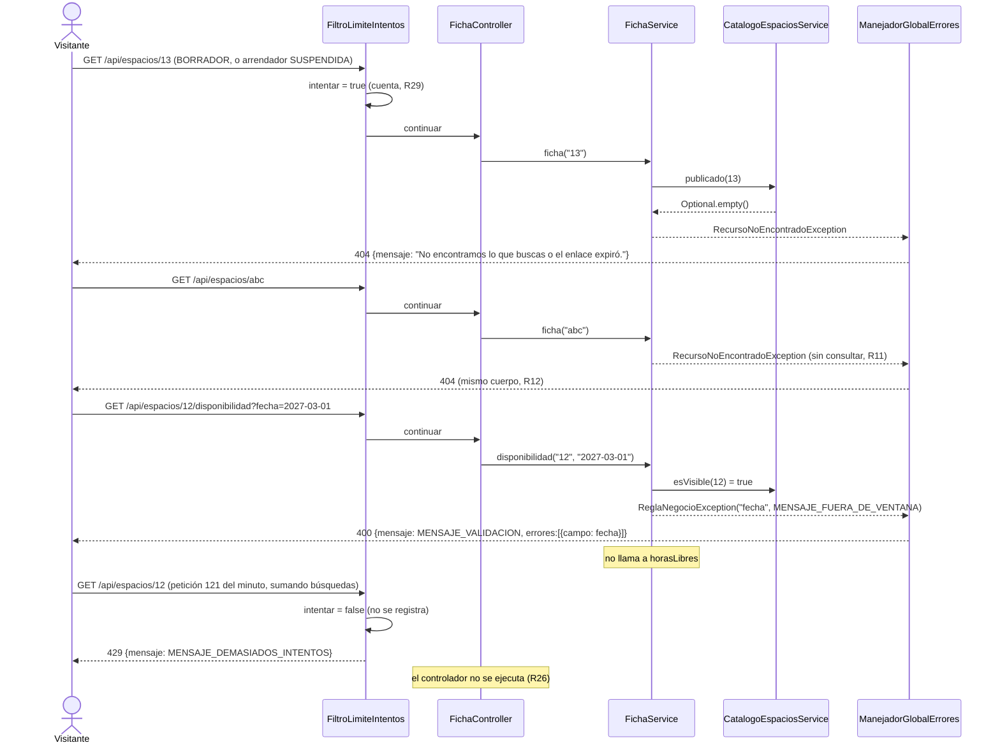
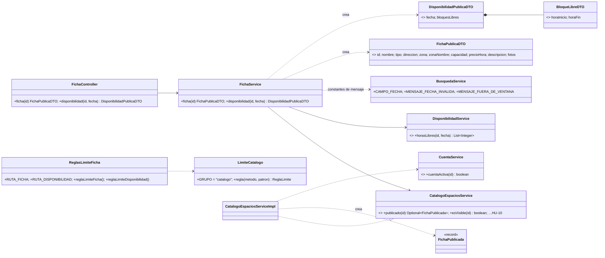

# HU-11 — Design: Detalle del espacio

> Requirements: `specs/HU-11/requirements.md` (R1–R33, decisiones de producto D1–D8). Reutiliza HU-07
> (`espacio`, `zona`, `foto_espacio`, URL `/api/fotos/<UUID>`, `EspacioService.urlDe`), HU-08
> (`DisponibilidadService.horasLibres`, `VentanaReserva`, `ZonaHoraria`, `SelectorBloques`), HU-09
> (`CuentaService.cuentaActiva`) y HU-10 (`CatalogoEspaciosService`, `LimiteCatalogo`, `ReglaLimite` con patrones,
> `Imagen`, `api/busqueda.js`, `ventanaBusqueda()`). HU-11 no es ★: no tiene patrón obligatorio.
> **Sin migración, sin auditoría, sin cambios en `DisponibilidadService`.**

## 1. Decisiones técnicas

Resuelven los huecos técnicos 1–11 de `progress/explore_HU-11.md`.

| Id | Decisión | Por qué |
|----|----------|---------|
| DT-1 | **Dos rutas públicas** en `busqueda` (`FichaController`): `GET /api/espacios/{id}` (ficha) y `GET /api/espacios/{id}/disponibilidad?fecha=` (bloques libres del día). La pantalla hace las dos llamadas al abrir y solo la segunda al cambiar la fecha. (Hueco técnico 3.) | CA2 cambia la fecha sin recargar fotos ni descripción. HU-07 DT-7 y HU-10 DT-1 reservaron `/api/espacios/{id}`; HU-08 dejó la ruta pública de disponibilidad a HU-11 (`specs/HU-08/design.md`). El nombre `disponibilidad` repite el de la ruta del dueño (`/api/arrendadores/actual/espacios/{id}/disponibilidad`), así el vocabulario de la API es uno solo. Ver A1. |
| DT-2 | `CatalogoEspaciosService` (interfaz pública de `espacios`, HU-10) gana **dos métodos**: `Optional<FichaPublicada> publicado(Long espacioId)` y `boolean esVisible(Long espacioId)`. Nuevo `record FichaPublicada` en `espacios/service` (cruza a `busqueda`; no es DTO de la API). `EspacioPublicado` **no se toca** (lo usan HU-10 y HU-23). (Hueco 1.) | `busqueda` no lee repositorios de `espacios` ni de `cuentas` (HU-10 DT-3, `docs/architecture.md` principio 5). `CatalogoEspaciosServiceImpl` está en el mismo paquete que `EspacioService` y reutiliza `static urlDe(FotoEspacio)` (de paquete). Ampliar `EspacioPublicado` obligaría a cargar dirección, descripción y capacidad en cada búsqueda. `esVisible` evita cargar fotos y descripción solo para el 404 de la ruta de disponibilidad. |
| DT-3 | Visibilidad = `estado == PUBLICADO` **y** `CuentaService.cuentaActiva(arrendadorId)` (regla HU-09 D1 para la ficha, `docs/architecture.md`). Se evalúa en `espacios` (`publicado`, `esVisible`). La identidad del arrendador no se mira (como HU-10 y `horasLibres`: se exige solo al publicar). | Misma definición que la búsqueda, las fotos (`FotoEspacioService.ver`) y `horasLibres`: un espacio visible en la búsqueda abre su ficha y viceversa. |
| DT-4 | DTO de salida en `busqueda/dto`: `FichaPublicaDTO`, `DisponibilidadPublicaDTO` y `BloqueLibreDTO`. **No** se llama `FichaEspacioDTO`: ese nombre ya es la entrada de crear/editar de HU-07 (`espacios/dto`). Sin `arrendadorId`, `estado`, `creadoEn`, `actualizadoEn` ni la clave de almacenamiento (`espacios/<UUID>`); `fotos` es una lista de URL ya armadas. (Hueco 2.) | RNF-SEG-16, STRIDE (I), R7, R19. Records de Java (`docs/conventions.md`). |
| DT-5 | El `{id}` llega como **`String`** (`@PathVariable String id`) y `FichaService` lo valida con `^[0-9]{1,19}$` + `Long.parseLong` (sin desbordar) + `> 0`. Si no es un id bien escrito → `RecursoNoEncontradoException` (**404 genérico**, el mismo de un espacio invisible). (Hueco 4.) | Con `@PathVariable Long`, `abc` lanza `MethodArgumentTypeMismatchException`, que `ManejadorGlobalErrores.inesperado` no trata como 4xx propio (no es un `ErrorResponse`): terminaría en 500 con log de error, o en 400 según la versión. Un 404 para todo lo que no es una ficha visible no revela nada (R11, R12) y no ensucia los logs. Mismo estilo que HU-10 DT-10 (parámetros como texto). |
| DT-6 | 404 indistinguible: "no existe", "no `PUBLICADO`", "arrendador no `ACTIVA`" e "id mal escrito" lanzan el mismo `RecursoNoEncontradoException()` → `ErrorDTO.MENSAJE_RECURSO_NO_ENCONTRADO`. (Hueco 4.) | Patrón de `FotoEspacioService.ver` (HU-07 R55). No permite enumerar borradores ni arrendadores suspendidos. |
| DT-7 | **Disponibilidad:** `FichaService.disponibilidad(id, fecha)` (1) valida el id (DT-5), (2) `catalogo.esVisible(id)` o 404, (3) valida la fecha con `LocalDate.parse` estricto y `VentanaReserva.desde(ZonaHoraria.hoy(reloj))` → `ReglaNegocioException("fecha", …)` (400 con un error en `fecha`), (4) `disponibilidad.horasLibres(id, fecha)` → `BloqueLibreDTO(h, h + 1)`. Primero el recurso (404), después la fecha (400): R23. `horasLibres` **no cambia** (D1). (Hueco 5.) | `horasLibres` devuelve `[]` en silencio para un espacio invisible o una fecha fuera de ventana; la ruta pública los distingue antes: 404 coherente con la ficha y 400 con los textos de HU-08/HU-10 (`docs/architecture.md`: "usar `VentanaReserva` para validar la fecha de la ficha"). `horasLibres` vuelve a comprobar visibilidad y ventana: redundante pero barato, y sin carrera peligrosa (es lectura). |
| DT-8 | `fecha` **obligatoria** en la ruta de disponibilidad: ausente o vacía → 400 *fecha inválida* (R21). No hay valor por defecto en el servidor. (Hueco 6.) | La pantalla siempre la envía (D6 la fija en el cliente). Un "hoy" implícito en el servidor haría que la misma URL cambie de significado a medianoche y no aporta nada a CA2. Mismo criterio que HU-10 R25. |
| DT-9 | **Sin caché HTTP**: las dos respuestas salen con el `Cache-Control: no-cache, no-store, max-age=0, must-revalidate` que Spring Security ya agrega a toda respuesta; no se escribe código, se prueba (R24). (Hueco 7.) | Los bloques cambian con cada reserva (HU-12) y la ficha deja de ser visible si el arrendador es suspendido. Las fotos sí se cachean 1 h (HU-07), sin cambios. |
| DT-10 | **Sin auditoría** (R25) y **sin migración**. (Hueco 8.) | Precedente HU-10 DT-17: auditar lecturas públicas es un vector de DoS sobre `auditoria`; RNF-SEG-12 no lo pide. La ficha lee por PK de `espacio` y por `uq_foto_espacio_orden (espacio_id, orden)`; no hace falta índice. |
| DT-11 | **Rate limiting:** nueva `@Configuration ReglasLimiteFicha` en `busqueda/controller` con **dos** `@Bean ReglaLimite`: `limite.regla("GET", "/api/espacios/{id}")` y `limite.regla("GET", "/api/espacios/{id}/disponibilidad")` (un `PathPattern` `/{id}` no cubre la subruta). Grupo `catalogo`: un solo cupo con la búsqueda (R28). `ReglasLimiteBusqueda` (HU-10) no se toca. | `docs/architecture.md` § "Rate limiting por patrón": HU-11 solo registra sus `@Bean`. `{id}` coincide con cualquier segmento (también `abc`): las peticiones con id mal escrito también cuentan (R29). |
| DT-12 | **Seguridad de rutas:** `ConfiguracionSeguridad` agrega `permitAll` para `GET /api/espacios/*` y `GET /api/espacios/*/disponibilidad`. Ninguna otra ruta bajo `/api/espacios/**` existe; cualquier otra subruta sigue `authenticated()`. Un Bearer inválido en ruta pública se trata como anónimo (comportamiento de `FiltroAutenticacionSesion`, R8). | Mismo patrón que HU-10 DT-1 (`GET /api/espacios` exacto). |
| DT-13 | `FichaService` vive en `busqueda/service`, `@Transactional(readOnly = true)`; usa las constantes de mensaje y campo de fecha **públicas** de `BusquedaService` (`CAMPO_FECHA`, `MENSAJE_FECHA_INVALIDA`, `MENSAJE_FUERA_DE_VENTANA`), mismo módulo. `BusquedaService` no cambia. | Un solo texto por mensaje en `busqueda` (y `BusquedaServiceTest` ya comprueba que coinciden con HU-08). No se modifica código de HU-10 (otro dueño). Ver A4. |
| DT-14 | **Frontend:** ruta pública `/espacios/:id` → `pages/busqueda/FichaEspacio.jsx`; funciones `obtenerEspacio(id)` y `consultarBloquesLibres(id, fecha)` en `api/busqueda.js` con `autenticada: false`; textos en `pages/busqueda/textosFicha.js`; componente **`Galeria`** nuevo en el kit; `SelectorBloques` sin cambios (solo lectura); enlace "Ver espacio" en cada `Tarjeta` de `BuscarEspacios.jsx` por su prop `acciones`, con `?fecha=` de la búsqueda; las respuestas viejas se descartan al cambiar rápido de fecha (patrón `activo` de `BuscarEspacios.jsx`). (Hueco 10.) | `docs/frontend.md`: un archivo de API por módulo, kit propio, rutas en español. `Tarjeta` no tiene prop de enlace y no hace falta cambiarla. |
| DT-15 | **Pruebas:** IT con rango de IP propio (`10.12.x.x` en `FichaControllerIT`, `10.13.x.x` en `LimiteFichaIT`), prueba de cupo compartido búsqueda + ficha + disponibilidad, prueba de minimización con datos reconocibles del arrendador. (Hueco 9.) | `progress/explore_HU-11.md` § 4: HU-10 usa `10.10` y `10.11`. `LimiteFichaIT` usa las mismas propiedades que `LimiteCatalogoIT` (`maximo=3`): comparten contexto y limitador, pero no IP. |
| DT-16 | **Coordinación** (hueco 11): el contrato para HU-12 (Eduardo Saldaña) está en § 13; HU-23 y HU-24 (Release 2) extienden la ficha agregando campos al `FichaPublicaDTO` (características, promedio de reseñas) sin romperlo. | HU-12 CA4 "vuelvo a la ficha después" depende de la ruta `/espacios/:id`. |

## 2. Archivos

`M` = modificar, `N` = nuevo. Raíz backend: `2_Backend/src/main/java/pe/edu/ulima/espacioya/` (`J/`), tests
`2_Backend/src/test/java/pe/edu/ulima/espacioya/` (`T/`).

### `comun`
| Archivo | | Qué |
|---------|---|-----|
| `J/comun/seguridad/ConfiguracionSeguridad.java` | M | `permitAll` para `GET /api/espacios/*` y `GET /api/espacios/*/disponibilidad` (DT-12). |

### `espacios`
| Archivo | | Qué |
|---------|---|-----|
| `J/espacios/service/CatalogoEspaciosService.java` | M | `publicado(Long)` y `esVisible(Long)` (DT-2). |
| `J/espacios/service/CatalogoEspaciosServiceImpl.java` | M | Implementación (§ 6.2). Usa `EspacioRepository.findById`, `FotoEspacioRepository.findByEspacioIdOrderByOrdenAsc`, `ZonaRepository.findById`, `CuentaService.cuentaActiva` — todos ya existen. |
| `J/espacios/service/FichaPublicada.java` | N | `record` de cruce a `busqueda`. |
| `J/espacios/service/DisponibilidadService*.java`, `EspacioService.java`, repositorios | — | **Sin cambios** (D1, DT-2). |

### `busqueda`
| Archivo | | Qué |
|---------|---|-----|
| `J/busqueda/controller/FichaController.java` | N | `GET /api/espacios/{id}` y `GET /api/espacios/{id}/disponibilidad`. |
| `J/busqueda/controller/ReglasLimiteFicha.java` | N | Dos `@Bean ReglaLimite` del grupo catálogo y las constantes de ruta (DT-11). |
| `J/busqueda/dto/FichaPublicaDTO.java` | N | Salida de la ficha. |
| `J/busqueda/dto/DisponibilidadPublicaDTO.java` | N | Salida de la disponibilidad. |
| `J/busqueda/dto/BloqueLibreDTO.java` | N | `record(int horaInicio, int horaFin)`. |
| `J/busqueda/service/FichaService.java` | N | Validación de id y fecha, 404, armado de DTO (§ 6.1). |
| `J/busqueda/**` de HU-10 | — | Sin cambios. |

Sin migración (DT-10). Sin cambios en `application.properties` (el cupo ya existe).

### Frontend (`3_frontend/src/`)
| Archivo | | Qué |
|---------|---|-----|
| `components/ui/Galeria.jsx` + `Galeria.module.css` | N | Kit: foto principal + miniaturas (D4, § 12). |
| `api/busqueda.js` | M | `obtenerEspacio(id)`, `consultarBloquesLibres(id, fecha)`. |
| `pages/busqueda/FichaEspacio.jsx` + `FichaEspacio.module.css` | N | Pantalla pública de la ficha. |
| `pages/busqueda/textosFicha.js` | N | Política de cancelación (D5), "sin bloques" (D1), textos de la ficha. |
| `pages/busqueda/BuscarEspacios.jsx` | M | Enlace "Ver espacio" en cada `Tarjeta` (prop `acciones`) a `/espacios/:id?fecha=<fecha>`. |
| `App.jsx` | M | Ruta pública `/espacios/:id`. |

### Docs (los actualiza el implementer en el mismo PR)
`docs/architecture.md` (§ `CatalogoEspaciosService`: `publicado` y `esVisible`; § Disponibilidad, punto HU-11:
"hecho: ruta pública `GET /api/espacios/{id}/disponibilidad` con `horasLibres`, solo libres"; § Rate limiting:
rutas de la ficha registradas) y `docs/frontend.md` (fila `Galeria` en el kit y en la lista de carpetas;
`SelectorBloques`: la ficha de HU-11 lo usa en solo lectura con solo libres). Ningún puerto nuevo: la dirección
`busqueda → espacios` está permitida. Ningún estado nuevo en "Color de cada estado".

## 3. Caso de uso y secuencias

**Caso de uso CU-11 "Ver la ficha de un espacio".** Actor: visitante o usuario (con o sin sesión).
Precondición: ninguna. Flujo principal: (1) desde un resultado de búsqueda pulsa "Ver espacio" (o abre
`/espacios/:id` directamente); (2) el sistema muestra fotos, nombre, tipo, zona, dirección, capacidad, precio por
hora, descripción y la política de cancelación; (3) muestra los bloques libres de la fecha inicial (D6);
(4) el usuario cambia la fecha; (5) el sistema muestra los bloques libres de ese día. Alternos: (2a) el espacio no
existe o no es visible → mensaje genérico y enlace "Buscar espacios"; (3a/5a) sin bloques libres → "No hay
bloques libres este día. Prueba con otra fecha."; (5b) fecha fuera de las 8 semanas → error bajo el campo;
(*) cupo del catálogo agotado → 429 con mensaje genérico.

### 3.1 Flujo principal

```mermaid
sequenceDiagram
    actor V as Visitante
    participant UI as FichaEspacio.jsx
    participant F as FiltroLimiteIntentos
    participant C as FichaController
    participant S as FichaService
    participant CAT as CatalogoEspaciosService
    participant D as DisponibilidadService
    participant CU as CuentaService

    V->>UI: abre /espacios/12?fecha=2026-11-02
    UI->>F: GET /api/espacios/12
    F->>F: regla GET /api/espacios/{id} (grupo catalogo) → intentar(catalogo|ip) = true
    F->>C: continuar
    C->>S: ficha("12")
    S->>S: id bien escrito → 12
    S->>CAT: publicado(12)
    CAT->>CAT: findById(12), estado = PUBLICADO
    CAT->>CU: cuentaActiva(arrendadorId) = true
    CAT->>CAT: zona.nombre, fotos por orden → urlDe
    CAT-->>S: Optional[FichaPublicada]
    S-->>C: FichaPublicaDTO
    C-->>UI: 200 (Cache-Control no-store)
    UI->>F: GET /api/espacios/12/disponibilidad?fecha=2026-11-02
    F->>F: regla …/{id}/disponibilidad (mismo grupo) → intentar = true
    F->>C: continuar
    C->>S: disponibilidad("12", "2026-11-02")
    S->>CAT: esVisible(12) = true
    S->>S: fecha bien escrita y en VentanaReserva
    S->>D: horasLibres(12, 2026-11-02)
    D-->>S: [8, 9, 10, 14]
    S-->>C: DisponibilidadPublicaDTO(fecha, [8–9, 9–10, 10–11, 14–15])
    C-->>UI: 200
    UI-->>V: Galeria, datos, política, SelectorBloques (solo lectura)
    V->>UI: cambia la fecha a 2026-11-03
    UI->>UI: URL ?fecha=2026-11-03 (replace)
    UI->>F: GET /api/espacios/12/disponibilidad?fecha=2026-11-03
    Note over UI: solo se recarga la disponibilidad; respuestas viejas se descartan
```

### 3.2 Flujos de error (404, 400 y 429)



## 4. Endpoints, DTO y mensajes

### `GET /api/espacios/{id}`
- **Seguridad:** `permitAll`. Bearer válido: se autentica pero no cambia nada; inválido: anónimo (R8).
- **Rate limiting:** grupo `catalogo` (120 por IP por minuto, configurable; compartido con la búsqueda).
- **Path:** `id` texto; id bien escrito según `requirements.md` § Definiciones.
- **200** `FichaPublicaDTO`:
  ```json
  {
    "id": 12, "nombre": "Cancha Los Olivos", "tipo": "CANCHA",
    "direccion": "Av. Universitaria 1234, Los Olivos", "zona": "LOS_OLIVOS", "zonaNombre": "Los Olivos",
    "capacidad": 22, "precioHora": 80.00,
    "descripcion": "Cancha de grass sintético con iluminación…",
    "fotos": ["/api/fotos/3f0c…", "/api/fotos/9a1b…"]
  }
  ```
- **404** 404 genérico (R9–R12). **429** `ErrorDTO(MENSAJE_DEMASIADOS_INTENTOS)` desde el filtro (R26).
- Encabezado `Cache-Control: no-cache, no-store, max-age=0, must-revalidate` (Spring Security, R24).

### `GET /api/espacios/{id}/disponibilidad?fecha=AAAA-MM-DD`
- **Seguridad y rate limiting:** igual que la ficha (misma cuota, R28).
- **Query:** `fecha` texto, obligatoria (DT-8). Otros parámetros se ignoran.
- **200** `DisponibilidadPublicaDTO`:
  ```json
  { "fecha": "2026-11-02",
    "bloquesLibres": [ { "horaInicio": 8, "horaFin": 9 }, { "horaInicio": 14, "horaFin": 15 } ] }
  ```
  Lista vacía si el día no tiene horario, está bloqueado, todo está reservado o ya pasó (R15–R18).
- **404** 404 genérico si el id no es bien escrito o el espacio no es visible (R20, R23).
- **400** `ErrorDTO(MENSAJE_VALIDACION, [ErrorCampoDTO("fecha", …)])` (R21, R22).
- **429** como la ficha (R27).

### Mensajes
| Origen | Texto | Requirement |
|--------|-------|-------------|
| `ErrorDTO.MENSAJE_RECURSO_NO_ENCONTRADO` | "No encontramos lo que buscas o el enlace expiró." | R9–R12, R20, R23 |
| `BusquedaService.MENSAJE_FECHA_INVALIDA` (reutilizada) | "Elige una fecha válida." | R21 |
| `BusquedaService.MENSAJE_FUERA_DE_VENTANA` (reutilizada) | "Elige una fecha entre hoy y las próximas 8 semanas." | R22 |
| `BusquedaService.CAMPO_FECHA` (reutilizada) | `"fecha"` | R21, R22 |
| `ErrorDTO.MENSAJE_VALIDACION` | "Revisa los datos del formulario." | R21, R22 |
| `ErrorDTO.MENSAJE_DEMASIADOS_INTENTOS` | (sin cambios) | R26, R27 |

## 5. Clases y firmas públicas

### 5.1 `espacios/service`

```java
public interface CatalogoEspaciosService {
    // HU-10, sin cambios: esTipoValido, existeZona, publicados, fotosPrincipales
    /** Ficha de un espacio PUBLICADO de arrendador ACTIVA (HU-09 D1); vacío si es null, no existe o no es
     *  visible (HU-11 R31, R32). Sin sesión. */
    Optional<FichaPublicada> publicado(Long espacioId);
    /** true solo si el espacio existe, está PUBLICADO y su arrendador está ACTIVA (HU-11 R33). null → false. */
    boolean esVisible(Long espacioId);
}

/** Espacio visible con los datos de su ficha pública, tal como cruza a busqueda (HU-11). No es un DTO de la API:
 *  no lleva arrendadorId, estado, fechas de auditoría ni claves de almacenamiento. */
public record FichaPublicada(Long id, String nombre, String tipo, String direccion, String zona,
                             String zonaNombre, int capacidad, BigDecimal precioHora, String descripcion,
                             List<String> fotos) { }
```

### 5.2 `busqueda`

```java
public record FichaPublicaDTO(Long id, String nombre, String tipo, String direccion, String zona,
                              String zonaNombre, int capacidad, BigDecimal precioHora, String descripcion,
                              List<String> fotos) {
    public static FichaPublicaDTO de(FichaPublicada ficha);
}
public record BloqueLibreDTO(int horaInicio, int horaFin) { }
public record DisponibilidadPublicaDTO(LocalDate fecha, List<BloqueLibreDTO> bloquesLibres) { }

@Service
public class FichaService {
    public FichaService(CatalogoEspaciosService catalogo, DisponibilidadService disponibilidad, Clock reloj);
    /** 404 (RecursoNoEncontradoException) si el id no es bien escrito o el espacio no es visible. */
    @Transactional(readOnly = true)
    public FichaPublicaDTO ficha(String id);
    /** 404 como ficha (antes que la fecha, R23); 400 (ReglaNegocioException en "fecha") si la fecha no es
     *  válida o está fuera de la ventana. */
    @Transactional(readOnly = true)
    public DisponibilidadPublicaDTO disponibilidad(String id, String fecha);
}

@RestController
public class FichaController {
    public FichaController(FichaService fichaService);
    @GetMapping(ReglasLimiteFicha.RUTA_FICHA)
    public FichaPublicaDTO ficha(@PathVariable String id);
    @GetMapping(ReglasLimiteFicha.RUTA_DISPONIBILIDAD)
    public DisponibilidadPublicaDTO disponibilidad(@PathVariable String id,
                                                   @RequestParam(required = false) String fecha);
}

@Configuration
public class ReglasLimiteFicha {
    public static final String RUTA_FICHA = "/api/espacios/{id}";
    public static final String RUTA_DISPONIBILIDAD = "/api/espacios/{id}/disponibilidad";
    @Bean public ReglaLimite reglaLimiteFicha(LimiteCatalogo limite);          // limite.regla("GET", RUTA_FICHA)
    @Bean public ReglaLimite reglaLimiteDisponibilidad(LimiteCatalogo limite); // limite.regla("GET", RUTA_DISPONIBILIDAD)
}
```

El `ReglaLimite` de HU-10 recibe la ruta como `PathPattern`, así que las constantes sirven a la vez para
`@GetMapping` y para la regla (como `RUTA_BUSQUEDA`).

## 6. Flujos del servicio

### 6.1 `FichaService`
- `idValido(String texto) → Long` (privado): `null` si `texto` es nulo, no coincide con `^[0-9]{1,19}$`,
  `Long.parseLong` lanza `NumberFormatException` (mayor que `Long.MAX_VALUE`) o vale 0.
- `ficha(id)`: `n = idValido(id)`; si `null` → `throw new RecursoNoEncontradoException()` **sin** llamar al
  catálogo (R11); `catalogo.publicado(n).map(FichaPublicaDTO::de).orElseThrow(RecursoNoEncontradoException::new)`.
- `disponibilidad(id, fecha)`:
  1. `n = idValido(id)`; si `null` o `!catalogo.esVisible(n)` → `RecursoNoEncontradoException` (R20, R23).
  2. `f`: `fecha` nula/en blanco o `LocalDate.parse` lanza `DateTimeParseException` →
     `ReglaNegocioException(CAMPO_FECHA, MENSAJE_FECHA_INVALIDA)` (R21).
  3. `!VentanaReserva.desde(ZonaHoraria.hoy(reloj)).contiene(f)` →
     `ReglaNegocioException(CAMPO_FECHA, MENSAJE_FUERA_DE_VENTANA)` (R22).
  4. `horas = disponibilidad.horasLibres(n, f)`; devuelve `new DisponibilidadPublicaDTO(f, horas → new
     BloqueLibreDTO(h, h + 1))` (R13, R14; `horasLibres` ya viene ascendente).
  En los pasos 1–3 no se llama a `horasLibres` (R20).

### 6.2 `CatalogoEspaciosServiceImpl` (M)
- `esVisible(id)` (`@Transactional(readOnly = true)`): `id != null && espacios.findById(id).filter(e ->
  e.getEstado() == PUBLICADO).filter(e -> cuentas.cuentaActiva(e.getArrendadorId())).isPresent()`.
- `publicado(id)` (`@Transactional(readOnly = true)`): si `id == null` → `Optional.empty()`; `espacio =
  espacios.findById(id)` filtrado como `esVisible` (una sola lectura del espacio); si vacío → `Optional.empty()`;
  `zonaNombre = zonas.findById(e.getZona()).map(Zona::getNombre).orElse(e.getZona())`;
  `fotos = this.fotos.findByEspacioIdOrderByOrdenAsc(id).stream().map(EspacioService::urlDe).toList()`;
  devuelve `new FichaPublicada(id, nombre, tipo.name(), direccion, zona, zonaNombre, capacidad, precioHora,
  descripcion, fotos)`. Ningún campo del arrendador se lee más allá de `arrendadorId` para `cuentaActiva`.

## 7. Migraciones
Ninguna (DT-10). Se leen `espacio` (PK), `zona` (PK), `foto_espacio` (`uq_foto_espacio_orden`) y, vía
`horasLibres`, `horario_semanal` y `bloqueo_fecha` con sus índices existentes.

## 8. Excepciones (`comun/error`)
- Reutiliza `RecursoNoEncontradoException` (404 genérico), `ReglaNegocioException(campo, mensaje)` (400 con un
  error en `fecha` y `MENSAJE_VALIDACION`) y el 429 de `FiltroLimiteIntentos`.
- No se añade ninguna excepción ni se modifica `ManejadorGlobalErrores` (DT-5 evita
  `MethodArgumentTypeMismatchException`).

## 9. Componentes de `comun` reutilizados
| Componente | Uso |
|------------|-----|
| `comun/limite/ReglaLimite`, `FiltroLimiteIntentos`, `LimitadorIntentos` (vía `busqueda/controller/LimiteCatalogo`) | Cupo compartido (DT-11). Sin cambios. |
| `comun/web/IpCliente` | IP del cliente para el cupo (sin cambios). |
| `comun/configuracion/ZonaHoraria` | *Hoy* en Lima para la ventana. |
| `comun/error/*` | 404 genérico y 400 por campo. |
| `comun/seguridad/ConfiguracionSeguridad` | Dos `permitAll` (DT-12); encabezados `no-store` por defecto (DT-9). |
| Auditoría | No se usa (DT-10). |

## 10. Seguridad (STRIDE de la historia)
- **(I) Minimización:** `FichaPublicaDTO` lleva diez campos del espacio y nada del arrendador (R2, R7);
  `FichaPublicada` ni siquiera transporta el `arrendadorId`. La disponibilidad solo dice qué horas están libres,
  no por qué las demás no lo están (R19). 404 indistinguible (R9–R12): no se puede saber si un id es un borrador o
  de un arrendador suspendido. Las fotos siguen por `FotoPublicaController`, que ya oculta las de espacios no
  visibles.
- **(D) Rate limiting compartido con HU-10:** dos reglas del grupo `catalogo` (R26–R30); un scraper que recorre
  ids (`/api/espacios/1`, `/2`, …) consume el mismo cupo que la búsqueda, también con ids inexistentes o mal
  escritos (R29). El id mal escrito se rechaza sin consultar la base (R11).

## 11. Diagrama de clases



## 12. Pantallas

### Ficha del espacio — `/espacios/:id` → `pages/busqueda/FichaEspacio.jsx` (+ `FichaEspacio.module.css`)
Pública (sin `RutaProtegida`), registrada en `App.jsx`. Se llega desde "Ver espacio" en los resultados de
`/buscar` (`BuscarEspacios.jsx`, prop `acciones` de `Tarjeta` con un `Link` a
`/espacios/${id}?fecha=${fecha de la búsqueda}`) o por enlace directo.

- **Kit:** `Galeria` (**nuevo**), `Imagen` (dentro de `Galeria`), `Campo` (`tipo="date"` con `min`/`max`),
  `SelectorBloques` (**sin** `onCambiar`: solo lectura; sin cambios en el componente), `Alerta`. Ningún botón
  primario (D2: no hay acción principal hasta HU-12). Ningún estado nuevo para `EtiquetaEstado`.
- **`Galeria` (N):** `components/ui/Galeria.jsx` + `.module.css`. Props `fotos` (arreglo de URL ya completas,
  0–5) y `alt` (texto base, p. ej. el nombre del espacio). Muestra la foto elegida en grande con `Imagen`
  (`alt = "<alt>, foto n de N"`) y, si hay más de una, una fila de miniaturas: cada una es un
  `<button type="button" aria-pressed>` con un `Imagen` dentro y `aria-label="Ver foto n de N"`; la elegida lleva
  borde `--color-primario` (el foco visible es el de `index.css`). Empieza en la primera (orden 1). Sin fotos:
  un `Imagen` con `src = null` ("Sin foto"). Estado interno solo del índice elegido; no llama a la API. Solo
  tokens (`--espacio-*`, `--radio`), sin colores literales. Se anota en `docs/frontend.md` (kit y carpetas).
- **API (`api/busqueda.js`, `autenticada: false`):**
  - `obtenerEspacio(id)` → `peticion(\`/api/espacios/${encodeURIComponent(id)}\`, { autenticada: false })`.
  - `consultarBloquesLibres(id, fecha)` → `peticion(\`/api/espacios/${encodeURIComponent(id)}/disponibilidad?${new URLSearchParams({ fecha })}\`, { autenticada: false })`.
- **Fecha (D6):** inicial = `?fecha=` de la URL si existe; si no, `ventanaBusqueda().hoy` (hoy en Lima). El
  `Campo date` usa `min = hoy` y `max = hasta` de `ventanaBusqueda()` (solo ayuda; el servidor revalida). Al
  cambiarla: `setSearchParams({ fecha }, { replace: true })` y se piden solo los bloques. Una respuesta que llega
  después de otro cambio de fecha se descarta (bandera `activo` en el `useEffect`, como `BuscarEspacios.jsx`).
- **Textos (`pages/busqueda/textosFicha.js`):** `TITULO_POLITICA = "Política de cancelación"`;
  `POLITICA_CANCELACION` = ["Si cancelas con 48 horas o más de anticipación, te devolvemos el 100 %.",
  "Si cancelas con menos de 48 horas, no hay reembolso.", "Si el arrendador cancela, te devolvemos el 100 %."]
  (RN-06, D5); `SIN_BLOQUES = "No hay bloques libres este día. Prueba con otra fecha."` (D1);
  `ENLACE_BUSCAR = "Buscar espacios"`; `CARGANDO = "Cargando…"`; `TITULO_BLOQUES = "Bloques libres"`.
- **Datos (D7):** `nombreTipo(tipo)` y `formatoPrecio(precioHora)` de `pages/espacios/textosEspacios.js`.

**Cómo muestra cada CA:**
| CA / caso | Presentación |
|-----------|--------------|
| CA1 | `h1` con `nombre`; debajo, en texto secundario, `nombreTipo(tipo) · zonaNombre`; `Galeria` con `fotos.map(urlApi)`; "Dirección: `direccion`"; "Capacidad: `capacidad` personas"; precio `formatoPrecio(precioHora) + " por hora"` en `--color-texto` con `--peso-negrita`; `descripcion` en párrafo (respetando saltos de línea con CSS `white-space: pre-line`); sección "Política de cancelación" con las tres líneas de `POLITICA_CANCELACION`. Nada del arrendador (D3). |
| CA2 | Sección "Bloques libres": `Campo tipo="date"` etiqueta "Fecha" y debajo `SelectorBloques bloques={bloquesLibres.map(b => ({ ...b, libre: true }))}` sin `onCambiar`. Con lista vacía (el componente no renderiza nada) se muestra en texto secundario `SIN_BLOQUES`. Mientras carga: `CARGANDO` en texto secundario. |
| 400 de fecha | `error` del `Campo` fecha con el mensaje del `ErrorDTO` (`errores[0].mensaje`). |
| 404 (D8) | En lugar de la ficha: `Alerta error` con el mensaje del `ErrorDTO` tal cual y debajo un `Link` "Buscar espacios" a `/buscar`. Si el 404 llega en la disponibilidad (el espacio dejó de ser visible), igual. |
| 429 / otro error | `Alerta error` con el mensaje tal cual (ficha) o en lugar de los bloques (disponibilidad). |
| Red | `Alerta error` "No pudimos conectar. Intenta de nuevo." (`cliente.js`). |

## 13. Contrato para HU-12 (Eduardo Saldaña) y Release 2

HU-11 deja la ficha **de solo lectura** (D2). HU-12 la extiende así, sin romper HU-11:

- **Ruta de la ficha:** `/espacios/:id?fecha=AAAA-MM-DD` (pública). Es el destino de "vuelvo a la ficha
  después" (HU-12 CA4): HU-12 guarda esa URL completa (con `fecha`) al mandar al login y vuelve a ella.
- **Pantalla:** HU-12 agrega en `FichaEspacio.jsx` el estado `seleccionados`, pasa `seleccionados` y
  `onCambiar` a `SelectorBloques` (el componente ya lo soporta) y agrega el **único botón primario** "Reservar"
  debajo de la sección "Bloques libres". Al cambiar la fecha, la selección se vacía.
- **Datos que HU-12 puede usar:** `FichaPublicaDTO.id` y `precioHora` (solo para mostrar; el monto lo calcula el
  servidor, principio 6), `DisponibilidadPublicaDTO.fecha` y `bloquesLibres[].horaInicio` (las horas a
  reservar). Las funciones `obtenerEspacio` y `consultarBloquesLibres` de `api/busqueda.js` no cambian de firma;
  tras una reserva, HU-12 vuelve a llamar a `consultarBloquesLibres` para refrescar.
- **Servidor:** `GET /api/espacios/{id}/disponibilidad` es solo de consulta. La reserva **no** se valida con
  esta ruta sino con `DisponibilidadService` dentro de su transacción (`docs/architecture.md`, "HU-12
  (reservar)"). Los DTO de HU-11 se pueden **ampliar** con campos nuevos, no cambiar ni quitar.
- **HU-23 / HU-24 (Release 2):** agregan campos a `FichaPublicaDTO` (características, promedio y reseñas) vía
  nuevos métodos o campos de `FichaPublicada`; las secciones nuevas van después de la descripción.

## 14. Plan de pruebas

| Test | Tipo | Cubre |
|------|------|-------|
| `T/busqueda/service/FichaServiceTest` (N) | unit (Mockito, `Clock` fijo en `2026-10-28T15:00:00Z`) | R11 (cada id mal escrito → `RecursoNoEncontradoException` y `verifyNoInteractions(catalogo)`), R9/R32 (`publicado` vacío → 404), R1 (mapeo `FichaPublicada` → DTO), R13, R14 (`[8, 9, 14]` → `8–9, 9–10, 14–15` en orden), R18 (`[]` → lista vacía), R20 (`esVisible` false → 404 y `verifyNoInteractions(disponibilidad)`), R21 (`null`, `""`, `"2026-02-30"`, `"02/11/2026"`), R22 (ayer, hoy + 56) con campo `fecha` y textos de `BusquedaService`, R23 (id invisible + fecha mala → 404) |
| `T/espacios/service/CatalogoEspaciosServiceImplTest` (M; tests de HU-10 intactos) | unit (Mockito) | R31 (fotos en orden ascendente con `urlDe`, `zonaNombre`), R32 (`null`, inexistente, cada estado no `PUBLICADO`, `cuentaActiva = false`), R33 (`esVisible` en los mismos casos) |
| `T/busqueda/controller/FichaControllerIT` (N) | IT (Testcontainers, `RelojControlable` en `2026-10-28T15:00:00Z` = miércoles 10:00 en Lima, doble `ReservasDelEspacio` como `@Bean`, IP `10.12.x.x` por test; datos con `JdbcTemplate` y arrendador con correo `arrendador.secreto@correo.pe`, teléfono `999111222`, razón social y documento reconocibles) | R1, R2 (`containsOnlyKeys`), R3, R4, R5 (3 fotos insertadas en orden 3, 1, 2 → salen 1, 2, 3), R6, R7 (el cuerpo no contiene el correo, el teléfono, el nombre, la razón social, el documento, `espacios/` ni `arrendadorId`), R8 (Bearer inválido en las dos rutas → 200), R9 (inexistente y cada estado por SQL), R10 (`SUSPENDIDA`, `ELIMINADA`), R11 (`abc`, `0`, `-1`, `1.5`, `99999999999999999999` → 404), R12 (cuerpos iguales), R13, R14, R15 (bloqueo de la fecha), R16 (doble del puerto con la hora 9 reservada), R17 (hoy con franja 8–12 → solo 11), R18 (día sin franjas), R19 (`containsOnlyKeys` de respuesta y bloque), R20, R21, R22, R23, R24 (`Cache-Control` contiene `no-store` en R1 y R13), R25 (`count(*)` de `auditoria` igual antes y después) |
| `T/busqueda/controller/LimiteFichaIT` (N) | IT (`@SpringBootTest(properties = {"espacioya.limite.catalogo.maximo=3", "espacioya.limite.catalogo.ventana=PT1M"})`, `RelojControlable`, IP `10.13.x.x`) | R26 (4.ª ficha → 429 con el mensaje), R27 (4.ª disponibilidad → 429), R28 (1 búsqueda + 1 ficha + 1 disponibilidad → la 4.ª de cualquiera es 429), R29 (tres 404 de id `abc` y un 400 de fecha agotan el cupo) |
| `T/busqueda/controller/ReglasLimiteFichaTest` (N) | unit | R30 (las dos reglas tienen grupo `catalogo`; `aplicaA("GET", "/api/espacios/7")` y `("GET", "/api/espacios/7/disponibilidad")`; la regla de la ficha no aplica a `/api/espacios` ni a la subruta) |
| Tests existentes (472 unitarios + IT de HU-01…HU-10) | — | Siguen verdes sin modificarse. `CatalogoEspaciosService` solo gana métodos; ningún doble lo implementa a mano (Mockito). |

Reglas: `@DisplayName("HU-11 R<n>: …")` en cada test; las IT llevan `@Import(TestcontainersConfiguration.class)`.

## 15. Alternativas descartadas

| # | Alternativa | Por qué no |
|---|-------------|-----------|
| A1 | Una sola llamada: la ficha incluye los bloques de hoy (o de `?fecha=`). | Al cambiar la fecha (CA2) habría que volver a bajar fotos, descripción y datos, o tener igual una segunda ruta. Mezcla un recurso estable con uno que cambia con cada reserva. |
| A2 | Mostrar también los bloques ocupados como "No disponible" (nuevo método en `DisponibilidadService` que colapse `RESERVADO`/`BLOQUEADO`/`PASADO`). | D1: la dueña eligió solo libres; CA2 pide "los bloques libres"; cambiaría una interfaz de `espacios` que usan HU-10 y HU-12 sin necesidad. Queda abierto para HU-12 si lo pide. |
| A3 | `@PathVariable Long id` con el 400/500 de Spring para ids no numéricos. | Respuesta distinta para `abc` y para un id inexistente, y un `log.error` por cada id mal escrito (vector de ruido en logs). DT-5. |
| A4 | Extraer a una clase compartida la validación de fecha de `BusquedaService` y usarla en las dos. | Modifica código de HU-10 (otro dueño) y sus tests para ahorrar diez líneas. Las constantes de texto sí se comparten (DT-13). |
| A5 | Responder 200 con `bloquesLibres` vacía para un espacio invisible (confiar en `horasLibres`). | Incoherente con la ficha (404) y confuso para HU-12; con 404 se sabe que el espacio ya no está disponible. |
| A6 | Devolver la política de cancelación en el DTO. | Es fija y no configurable (RN-06, "Qué NO hacer": política configurable descartada); el texto es de presentación (D5). |
| A7 | Mostrar el nombre del arrendador ("Publicado por …"). | D3; ningún CA lo pide y exigiría un método nuevo en `CuentaService` (RNF-SEG-16). |
| A8 | Galería con lista o rejilla de `Imagen` del mismo tamaño. | D4: la dueña eligió principal grande + miniaturas. |
