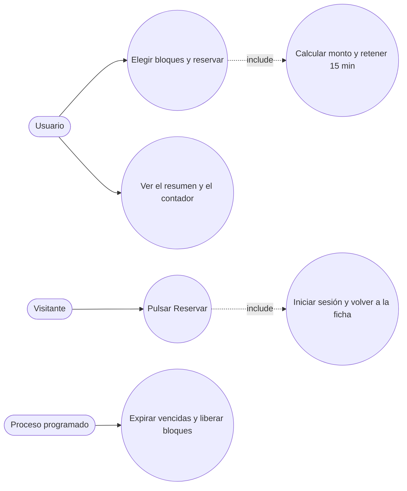
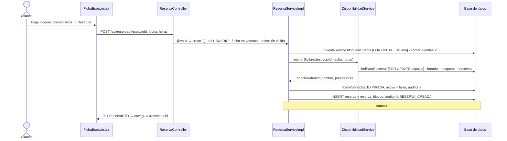
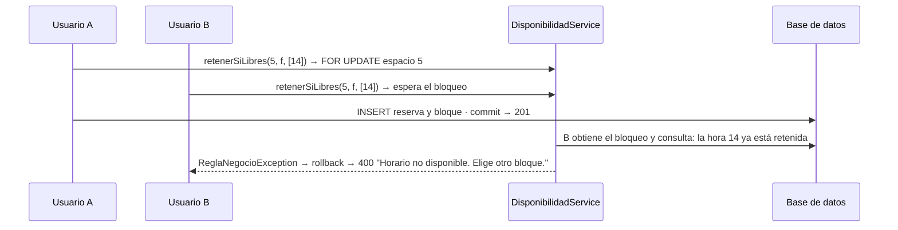

# HU-12 — Design: Reserva con bloqueo temporal

> Módulo `reservas` (nuevo) · Sprint 3 · tamaño M · depende de HU-03, HU-08 y HU-11 · sin ★. Reutiliza
> `DisponibilidadService`, el puerto `ReservasDelEspacio`, `VentanaReserva`, `ZonaHoraria`, `CuentaService`,
> `CatalogoEspaciosService`, `AuditoriaService`, `IpCliente`, `Clock`, `ManejadorGlobalErrores` y el kit. D1–D4:
> decisiones del dueño; S1–S11 (`requirements.md`): supuestos a confirmar.

## 1. Decisiones (para revisión rápida del dueño)

| # | Origen | Decisión | Por qué |
|---|--------|----------|---------|
| DT-1 | D4, HU-08 DT-10 | **Orden fijo de bloqueos:** `usuario → espacio → reserva`. `ReservaServiceImpl.crear` abre la transacción con `TransactionTemplate`, llama a `cuentas.bloquearCuenta(id)`, cuenta las vigentes, llama a `disponibilidad.retenerSiLibres(...)`, libera las vencidas que chocan e inserta. | El bloqueo del usuario serializa su cupo aunque reserve dos espacios (R28); el del espacio serializa a dos usuarios (R19) y a la reserva con el bloqueo de fechas y la edición de precio (R24). Un solo orden evita interbloqueos. El proceso programado solo toma una fila de `reserva` por transacción y nunca `espacio`. |
| DT-2 | punto 13 | `DisponibilidadService.retenerSiLibres(espacioId, fecha, horas)` (`MANDATORY`) bloquea con `EspacioRepository.findParaReservar` (nuevo, sin filtrar por dueño) como **primera lectura** de `Espacio` en la transacción; aplica la regla de HU-09 D1 con `cuentaActiva(arrendadorId)`; calcula con `bloquesDelDia` y devuelve `EspacioRetenido(nombre, precioHora)`. | Precio y estado se leen bajo el bloqueo: sin segunda lectura ni instancia desactualizada. El record **no** lleva `arrendadorId`, a diferencia del explorador: nadie lo usa aún (YAGNI); HU-13 lo amplía. |
| DT-3 | D2 | **Capa 1, lectura:** los tres filtros (puerto, cupo y `GET`) comparan con *ahora*; vigente si `ahora < expira_en`. **Capa 2, proceso:** `ExpiracionReservas.expirarVencidas()` lee los ids vencidos y expira cada uno en su transacción. **Capa 3, al crear:** bajo el bloqueo del espacio, `liberarVencidas` expira las que retienen esas horas. | Exactitud al segundo sin escritura en lecturas, estado y auditoría duraderos, y sin falso conflicto durante el intervalo del proceso. El índice parcial no entiende el tiempo: una vencida sigue con `activo = true` hasta que alguien la expira. |
| DT-4 | D2 | **Trampa del `flush`:** la liberación usa `ReservaBloqueRepository.desactivarDeReserva`, un `UPDATE` JPQL con `@Modifying(flushAutomatically = true)` que llega a la BD en el acto, antes del `INSERT` de los bloques nuevos. | Con entidades sucias, Hibernate ejecuta los `INSERT` antes que los `UPDATE` y chocaría con el índice. Lo protege una IT (R17). |
| DT-5 | D2 | El proceso bloquea la fila con `ReservaRepository.findParaActualizar(id)`, espera sin `SKIP LOCKED`, y revalida `estaVencida(ahora)` (R16). | Solo retiene una fila y cada competidor (crear, webhook de HU-13) termina enseguida. Con la revalidación también es seguro con dos instancias del backend. |
| DT-6 | D2 | `ProgramacionExpiracion`: `@Configuration` con `@EnableScheduling`, `@ConditionalOnProperty(activa=true)` y `@Scheduled(fixedDelayString = "${espacioya.reservas.expiracion.intervalo}")`. Propiedades con variables `RESERVAS_EXPIRACION_ACTIVA` (`true`) y `RESERVAS_EXPIRACION_INTERVALO` (`PT1M`); `src/test/resources/config/application.properties` la apaga. | Sin dependencias nuevas. Apagado en las IT para no competir con sus limpiezas; las pruebas llaman a `expirarVencidas()` tras avanzar `RelojControlable`. `fixedDelay` evita que dos pasadas se solapen. |
| DT-7 | puntos 5, 11 | `crear` no lleva `@Transactional`: `TransactionTemplate` por dentro y `catch (DataIntegrityViolationException)` por fuera. Si la causa más específica nombra `uq_reserva_bloque_activo`, 400 *horario no disponible*; si no, se relanza (500 genérico). | Precedente `RegistroService`: con `@Transactional`, el fallo llega al confirmar y no se puede capturar ahí. El camino normal es la comprobación bajo bloqueo; el `catch` es la última defensa (R22). Sin la distinción, otro fallo de integridad se disfrazaría de conflicto (R23). |
| DT-8 | D1 | El rol se comprueba en `ReservaServiceImpl` (`"USUARIO".equals(usuario.rol())`), como el resto del proyecto; no se usa `hasRole`. `ConfiguracionSeguridad` no cambia: `/api/reservas/**` ya exige sesión. | Roles en el servicio; el 401 lo da `PuntoEntradaNoAutenticado` (R35). |
| DT-9 | D3 | `GET` usa `findByIdAndUsuarioId` y `@PathVariable String id`; un id mal escrito es 404, igual que `FichaService`. | Ajena e inexistente son lo mismo (RNF-SEG-19). Con `Long` el fallo de conversión caería en el manejador genérico como 500. |
| DT-10 | puntos 14, 15 | `reservas` sin asociaciones JPA (ids `Long`, como `SuspensionCuenta` y `HorarioSemanal`). `reserva_bloque` conserva sus filas al liberarse: HU-14 mostrará el horario de reservas pasadas. Sin `cancelada_por` ni `cancelada_en`. | `docs/modelo-datos.md`: cada historia crea solo lo que necesita. |
| DT-11 | punto 4 | El cupo es regla de negocio, no rate limiting: `LimitadorIntentos` cuenta eventos en una ventana y va por IP; aquí el cupo se libera al expirar o pagar y es por usuario. | Se aclara en `docs/requerimientos.md` §8. Sin cambios en `comun`. |

**Sin puerto nuevo:** `reservas → espacios` y `→ cuentas` ya están permitidas; solo se amplían sus interfaces públicas.

## 2. Caso de uso



**Reservar (CA1)** — Precondición: usuario con sesión en la ficha. (1) elige bloques consecutivos; (2) pulsa
"Reservar"; (3) la API valida, bloquea usuario y espacio, comprueba cupo y disponibilidad, calcula el monto y guarda en
una transacción; (4) 201 y la pantalla `/reservas/:id` con el contador. Alternos: sin sesión → login y vuelta (CA4);
bloque tomado → 400 y la ficha refresca (CA3); cupo → 400; rol → 403; espacio no visible → 404.
**Expirar (CA2)** — Sin pago en 15 minutos deja de ocupar y el proceso, o la siguiente reserva, la pasa a `EXPIRADA`.

## 3. Archivos por módulo y capa

Paquete base `pe.edu.ulima.espacioya`. (N) nuevo · (M) modificado.

| Módulo / capa | Archivos | Para |
|---|---|---|
| `reservas/domain/` (N) | `EstadoReserva`, `Reserva`, `ReservaBloque`, `SeleccionBloques` | R2–R4, R9, R11, R16, R32, R39, R40 |
| `reservas/repository/` (N) | `ReservaRepository`, `ReservaBloqueRepository`, `BloqueActivo` | R4, R6, R7, R10, R12, R17, R27, R37, R38 |
| `reservas/dto/` (N) | `CrearReservaDTO`, `ReservaDTO` | R1, R5, R29, R30, R32, R37, R40, R41 |
| `reservas/service/` (N) | `ReservaService`, `ReservaServiceImpl`, `ExpiracionReservas`, `ProgramacionExpiracion`, `ReservasDelEspacioImpl` | R1–R44 |
| `reservas/controller/` (N) | `ReservaController` | R1, R35, R37, R38 |
| `espacios/` (M) | `repository/EspacioRepository` (`findParaReservar`), `service/DisponibilidadService` + `Impl` (`retenerSiLibres`, `MENSAJE_HORARIO_NO_DISPONIBLE`), `service/EspacioRetenido` (N), `service/CatalogoEspaciosService` + `Impl` (`nombres`) | R3, R18, R19, R24, R25, R33, R37 |
| `cuentas/service/` (M) | `CuentaService` + `Impl` (`bloquearCuenta`) | R25, R28 |
| Recursos | `V3_3__reservas.sql` (N), `application.properties` (M), `src/test/resources/config/application.properties` (M), `.env.example` (M) | § 8, R13, R14 |
| Tests de otras historias (M) | `BusquedaControllerIT`, `EspaciosControllerSoporte` (`@Primary`), `DisponibilidadServiceImplIT` (comentario de la línea 33) | S10 |

## 4. Endpoints

| Método y ruta | Entrada | Respuestas |
|---|---|---|
| `POST /api/reservas` | JSON `CrearReservaDTO` | **201** `ReservaDTO` (R1) · **400** por campo (R29–R32) · **400** *horario no disponible* (R18, R22) · **400** *cupo* (R26) · **401** (R35) · **403** (R36) · **404** (R33) |
| `GET /api/reservas/{id}` | — | **200** `ReservaDTO` (R37, R39, R40) · **401** (R35) · **404** (R38) |

```java
public record CrearReservaDTO(
        @NotNull(message = M_ESPACIO) @Positive(message = M_ESPACIO)
        @JsonDeserialize(using = SoloIdEntero.class) Long espacioId,                      // R29
        @NotBlank(message = M_FECHA) @Pattern(regexp = "\\d{4}-\\d{2}-\\d{2}", message = M_FECHA) String fecha, // R30
        @NotEmpty(message = M_HORAS)
        @JsonDeserialize(contentUsing = FichaEspacioDTO.SoloEntero.class) List<Integer> horas) { } // R32
// SoloIdEntero: como SoloEntero para long; otro valor se lee como null. Un decimal o texto en horas es un elemento null,
// y SeleccionBloques lo rechaza con los demás errores de horas, en el campo "horas" (sin rutas horas[i]).

public record ReservaDTO(Long id, Long espacioId, String espacioNombre, String estado, LocalDate fecha,
        int horaInicio, int horaFin, BigDecimal precioHora, BigDecimal montoTotal,
        Instant expiraEn, long segundosRestantes) { }                                     // R37, R40, R41
```

### Mensajes (texto exacto)

| Constante | Texto | Dónde |
|---|---|---|
| `DisponibilidadService.MENSAJE_HORARIO_NO_DISPONIBLE` | `Horario no disponible. Elige otro bloque.` | 400 sin campo (R18, R22) |
| `ReservaServiceImpl.MENSAJE_CUPO` | `Ya tienes 3 reservas pendientes de pago. Paga una o espera a que expire para reservar otra.` | 400 sin campo (R26) |
| `CrearReservaDTO.M_ESPACIO` | `Elige un espacio válido.` | campo `espacioId` (R29) |
| `CrearReservaDTO.M_FECHA` | `Elige una fecha válida.` | campo `fecha` (R30) |
| `ReservaServiceImpl.MENSAJE_FUERA_DE_VENTANA` | `Elige una fecha entre hoy y las próximas 8 semanas.` | campo `fecha` (R31) |
| `CrearReservaDTO.M_HORAS` | `Elige uno o más bloques consecutivos.` | campo `horas` (R32) |

`reservas` no importa `CalendarioEspacioService` ni `busqueda`: repite los dos textos de fecha, como ya hizo `busqueda`.
Existentes en `ErrorDTO`: `MENSAJE_SESION_INVALIDA`, `MENSAJE_ACCESO_DENEGADO`, `MENSAJE_RECURSO_NO_ENCONTRADO`.

## 5. Clases y firmas públicas

```java
// reservas/domain
public enum EstadoReserva { PENDIENTE_PAGO, CONFIRMADA, EXPIRADA, CANCELADA }
@Entity @Table(name = "reserva") public class Reserva {     // constructor protegido; getters; ids Long
    public static final int MINUTOS_RETENCION_RESERVA = 15;
    public static Reserva pendiente(Long usuarioId, Long espacioId, BigDecimal precioHora, int bloques, Instant ahora);
    public boolean esVigente(Instant ahora);        // PENDIENTE_PAGO y ahora < expiraEn
    public boolean estaVencida(Instant ahora);      // PENDIENTE_PAGO y ahora >= expiraEn
    public EstadoReserva estadoEn(Instant ahora);   // EXPIRADA si está vencida; si no, estado (R39)
    public long segundosRestantes(Instant ahora);   // 0 si no está vigente (R40)
    public void expirar(Instant ahora); }           // IllegalStateException si no está vencida
@Entity @Table(name = "reserva_bloque") public class ReservaBloque {  // hora_inicio → short, como HorarioSemanal
    public ReservaBloque(Long reservaId, Long espacioId, LocalDate fecha, int horaInicio); }  // activo = true
public final class SeleccionBloques { // esValida: 1–24, sin nulos, 0–23, sin repetir, consecutivas al ordenarlas
    public static boolean esValida(List<Integer> horas); public static List<Integer> ordenadas(List<Integer> horas); }

// reservas/repository (enums calificados en el JPQL real)
public record BloqueActivo(Long espacioId, LocalDate fecha, short horaInicio, EstadoReserva estado) { }
public interface ReservaRepository extends JpaRepository<Reserva, Long> {
    Optional<Reserva> findByIdAndUsuarioId(Long id, Long usuarioId);
    long contarVigentes(Long usuarioId, Instant ahora);       // PENDIENTE_PAGO y expiraEn > ahora
    List<Long> findIdsVencidas(Instant ahora);                // PENDIENTE_PAGO y expiraEn <= ahora
    @Lock(PESSIMISTIC_WRITE) Optional<Reserva> findParaActualizar(Long id);
    @Lock(PESSIMISTIC_WRITE) List<Reserva> findVencidasQueRetienen(Long espacioId, LocalDate fecha,
                                                                   Collection<Short> horas, Instant ahora); }
public interface ReservaBloqueRepository extends JpaRepository<ReservaBloque, Long> {
    List<ReservaBloque> findByReservaIdOrderByHoraInicioAsc(Long reservaId);
    @Modifying(flushAutomatically = true) int desactivarDeReserva(Long reservaId);   // DT-4
    // Ambas: b.activo y (CONFIRMADA o PENDIENTE_PAGO con expiraEn > ahora), con "join Reserva r on r.id = b.reservaId"
    List<BloqueActivo> bloquesActivos(Long espacioId, LocalDate desde, LocalDate hasta, Instant ahora);
    List<BloqueActivo> bloquesActivosDelDia(Collection<Long> espacioIds, LocalDate fecha, Instant ahora); }

// reservas/service. ReservaServiceImpl inyecta los dos repositorios, DisponibilidadService, CatalogoEspaciosService,
// CuentaService, ExpiracionReservas, AuditoriaService, TransactionTemplate y Clock.
public interface ReservaService {
    ReservaDTO crear(UsuarioAutenticado usuario, CrearReservaDTO datos, String ip);
    ReservaDTO consultar(UsuarioAutenticado usuario, String id); }
@Service public class ExpiracionReservas {     // ACCION_RESERVA_EXPIRADA = "RESERVA_EXPIRADA"; ENTIDAD = "reserva"
    public int expirarVencidas();              // una transacción por reserva; devuelve cuántas expiró (R9, R15, R16)
    @Transactional(propagation = MANDATORY)
    public void liberarVencidas(Long espacioId, LocalDate fecha, List<Integer> horas, Instant ahora); } // R17
@Service public class ReservasDelEspacioImpl implements ReservasDelEspacio { }   // sobrescribe bloquesReservadosDelDia

// espacios (M)
@Lock(PESSIMISTIC_WRITE) Optional<Espacio> findParaReservar(Long id);            // EspacioRepository; sin filtrar dueño
public record EspacioRetenido(String nombre, BigDecimal precioHora) { }
String MENSAJE_HORARIO_NO_DISPONIBLE = "Horario no disponible. Elige otro bloque.";   // DisponibilidadService
/** @throws RecursoNoEncontradoException si no es visible. @throws ReglaNegocioException si alguna hora no es libre. */
EspacioRetenido retenerSiLibres(Long espacioId, LocalDate fecha, List<Integer> horas); // @Transactional(MANDATORY)
Map<Long, String> nombres(Collection<Long> espacioIds);   // CatalogoEspaciosService: sin filtro de visibilidad; sin sesión

// cuentas (M)
/** Bloquea la fila de la cuenta hasta el fin de la transacción del llamador (HU-12 D4). */
void bloquearCuenta(Long usuarioId);   // @Transactional(MANDATORY); findParaActualizar; 404 si no existe
```

## 6. Flujos

**`ReservaServiceImpl.crear`** (sin `@Transactional`, DT-7): (1) rol ≠ `USUARIO` → `AccesoDenegadoException` (R36); (2)
parsea `fecha` (R30) y comprueba `VentanaReserva.desde(ZonaHoraria.hoy(reloj))` (R31); (3)
`SeleccionBloques.esValida(horas)` o `ReglaNegocioException("horas", M_HORAS)` (R32); (4) dentro de
`transacciones.execute`: `cuentas.bloquearCuenta(id)` → `ahora = Instant.now(reloj)` → `contarVigentes >= 3` → 400
*cupo* (R26, R27) → `retenido = disponibilidad.retenerSiLibres(...)` (R18, R33) →
`expiracion.liberarVencidas(...)` (R17) → `reservas.save(Reserva.pendiente(...))` (R2, R3) →
`bloques.saveAllAndFlush(...)` (R4) → audita `RESERVA_CREADA` (R42); (5) arma el `ReservaDTO`; (6) `catch` de DT-7.

**`retenerSiLibres`:** `findParaReservar(id)` → filtra `PUBLICADO` y `cuentas.cuentaActiva(arrendadorId)` → vacío: 404
(R33) → `bloquesDelDia(id, fecha)` filtrado a `LIBRE` → si no contiene todas las horas, 400 (R18) →
`new EspacioRetenido(...)`. El `@Transactional(MANDATORY)` se aplica porque `reservas` llama por el proxy (R25).

**`expirarVencidas`:** por cada id de `findIdsVencidas(ahora)`, en `transacciones.execute`: `findParaActualizar(id)`
filtrado con `estaVencida(ahora)` → vacío: nada (R16) → `expirar`. Un `catch (RuntimeException)` por id registra
`log.warn` solo con el id y sigue (R15). **`liberarVencidas`:** `findVencidasQueRetienen(...)` y `expirar` por cada una
(R17). **`expirar` (privado):** `reserva.expirar(ahora)` → `bloques.desactivarDeReserva(id)` (R10) → audita (R43).

**`consultar`** (`@Transactional(readOnly = true)`): id bien escrito y `findByIdAndUsuarioId` o 404 (R38) → filas de
`findByReservaIdOrderByHoraInicioAsc` (R37) → `catalogo.nombres(...)` → `estadoEn(ahora)` y `segundosRestantes(ahora)`
(R39, R40). `horaFin` = última hora + 1.

**`ReservasDelEspacioImpl`** (`@Transactional(readOnly = true)`): `bloquesReservados` → `bloquesActivos(...)`;
`bloquesReservadosDelDia` → `Map.of()` si `espacioIds` está vacía; si no, `bloquesActivosDelDia(...)` agrupado por
espacio. `pagado = estado == CONFIRMADA`.

## 7. Diagramas de secuencia

### Flujo principal: reservar (CA1)



### Flujo de error: dos usuarios con el mismo bloque (CA3)



## 8. Migración Flyway

`V3_3__reservas.sql`: en `develop` la última es `V3_2`. Antes de crearla, actualizar `develop` y usar el siguiente
`V3_n` libre; si otro lo toma antes de unir, se renombra (`docs/conventions.md`). Solo depende de `V1_1` y `V2_2`.

```sql
CREATE TABLE reserva (
    id                   BIGINT GENERATED ALWAYS AS IDENTITY PRIMARY KEY,
    usuario_id           BIGINT        NOT NULL REFERENCES usuario (id),
    espacio_id           BIGINT        NOT NULL REFERENCES espacio (id),
    estado               VARCHAR(20)   NOT NULL,
    precio_hora_aplicado NUMERIC(8,2)  NOT NULL,
    monto_total          NUMERIC(10,2) NOT NULL,
    creada_en            TIMESTAMPTZ   NOT NULL,
    expira_en            TIMESTAMPTZ   NOT NULL,
    CONSTRAINT ck_reserva_estado CHECK (estado IN ('PENDIENTE_PAGO', 'CONFIRMADA', 'EXPIRADA', 'CANCELADA')),
    CONSTRAINT ck_reserva_montos CHECK (precio_hora_aplicado > 0 AND monto_total > 0),
    CONSTRAINT ck_reserva_expira CHECK (expira_en > creada_en)
);
CREATE INDEX ix_reserva_usuario_estado ON reserva (usuario_id, estado);
CREATE INDEX ix_reserva_vencimiento ON reserva (expira_en) WHERE estado = 'PENDIENTE_PAGO';

CREATE TABLE reserva_bloque (
    id          BIGINT GENERATED ALWAYS AS IDENTITY PRIMARY KEY,
    reserva_id  BIGINT   NOT NULL REFERENCES reserva (id) ON DELETE CASCADE,
    espacio_id  BIGINT   NOT NULL REFERENCES espacio (id),
    fecha       DATE     NOT NULL,
    hora_inicio SMALLINT NOT NULL,
    activo      BOOLEAN  NOT NULL DEFAULT TRUE,
    CONSTRAINT ck_reserva_bloque_hora CHECK (hora_inicio BETWEEN 0 AND 23)
);
-- Última defensa contra la doble reserva (RNF-SEG-09): un bloque liberado deja de contar.
CREATE UNIQUE INDEX uq_reserva_bloque_activo ON reserva_bloque (espacio_id, fecha, hora_inicio) WHERE activo;
CREATE INDEX ix_reserva_bloque_reserva ON reserva_bloque (reserva_id);
```

`monto_total` es `(10,2)` porque 24 × 100 000.00 no cabe en `(8,2)`. Cascada solo de `reserva` a sus bloques: borrar
un usuario o un espacio con reservas debe fallar. `ddl-auto=validate`: `hora_inicio` se mapea a `short`.

## 9. Excepciones y componentes de `comun`

**Ninguna excepción nueva y sin cambios en `comun`.** `ReglaNegocioException` (con campo: R30–R32; sin campo: R18, R22,
R26), `AccesoDenegadoException` (R36), `RecursoNoEncontradoException` (R33, R38), el manejador de
`MethodArgumentNotValidException` (R29, R30, R32), `AuditoriaService` (R42, R43), `IpCliente`, `ZonaHoraria` y `Clock`.

## 10. Pantallas

Errores en `Alerta error` con el mensaje tal cual, sin ids. Textos en `pages/reservas/textosReservas.js` (N). Los
estados de reserva ya están en "Color de cada estado".

**API — `src/api/reservas.js` (N):** `crearReserva({ espacioId, fecha, horas })` → `POST /api/reservas`;
`obtenerReserva(id)` → `GET /api/reservas/{id}`.

**Ficha — `/espacios/:id?fecha=` → `pages/busqueda/FichaEspacio.jsx` (M).** Usa `Boton` y `useSesion`; `SelectorBloques`
gana `seleccionados` y `onCambiar` (contrato de HU-11 § 13).

- **Quién ve qué (D1):** `puedeReservar = !sesion || sesion.rol === 'USUARIO'`. `ARRENDADOR` y `ADMIN`: selector de solo
  lectura y sin botón. Mientras `cargando` de `useSesion` sea `true`, "Reservar" va deshabilitado: `sesion` nula aún no
  significa visitante.
- **Selección:** se guarda como `{ consulta, horas }` junto a `consultaBloques`, y se deriva: al cambiar la fecha se
  vacía sin efecto. `sonConsecutivas(horas)` es ayuda: si no lo son, texto secundario "Elige bloques seguidos." El
  servidor revalida.
- **Botón:** único primario "Reservar", debajo de "Bloques libres". Con sesión, deshabilitado sin una selección
  consecutiva; `cargando` durante el envío. Sin sesión, siempre activo.
- **CA1:** 201 → `navegar('/reservas/:id')`. El monto solo se ve allí: la ficha no calcula el total.
- **CA3:** 400 → `Alerta error` encima del selector con el mensaje tal cual, selección vacía y bloques recargados con
  un contador `recarga` en el efecto de `consultarBloquesLibres`. Igual con *cupo*. Un 404 recarga y cae en la vista de
  no encontrado de HU-11.
- **CA4:** sin sesión → `navegar('/iniciar-sesion', { state: { retorno: `/espacios/${id}?fecha=${fecha}`, mensaje:
  'Inicia sesión para reservar.', tipo: 'info' } })`, con la `fecha` en uso, no copiando `location`. Un 401 con sesión
  caducada lo atiende `ProveedorSesion`: la ficha no muestra `Alerta`.

**Inicio de sesión (⚠ S3) — `pages/cuentas/IniciarSesion.jsx` (M).** `const retorno = aviso?.retorno ?? '/panel'`, en
**las dos** salidas: `<Navigate to={retorno} replace />` y `navegar(retorno, { replace: true })`. Si solo cambia la
segunda, la primera gana al volver a renderizar tras `entrar()`.

**`sesion/ProveedorSesion.jsx` (M, HU-03).** `alPerderSesion` agrega `retorno: pathname + search` de `window.location`
al `state`, salvo que ya esté en `/iniciar-sesion`. No se usa `useLocation`: volvería a suscribirse en cada navegación.

**Resumen — `/reservas/:id` → `pages/reservas/ResumenReserva.jsx` (N, + `.module.css`), en `RutaProtegida`.** `Tarjeta`
con título `espacioNombre`, `EtiquetaEstado`, fecha, horario `formatoHora(horaInicio)–formatoHora(horaFin)`, precio por
hora y monto (`formatoPrecio`, `--color-texto`, `--peso-negrita`). Enlace "Volver al espacio" → `/espacios/:espacioId`.

- **CA1, `PENDIENTE_PAGO`:** "Tus bloques están retenidos por:" + `CuentaRegresiva segundos={segundosRestantes}
  alTerminar={recargar}`. HU-13 pondrá aquí "Pagar".
- **CA2:** al llegar a cero se vuelve a pedir `obtenerReserva`; el estado lo decide el servidor. Con `EXPIRADA`: `Alerta
  info` "Se acabó el tiempo. Liberamos los bloques: puedes reservar de nuevo."
- 404 → `Alerta error` y enlace a `/buscar`.

**Kit:** `components/ui/EtiquetaEstado.jsx` (M): `PENDIENTE_PAGO` "Pendiente de pago" (atención), `CONFIRMADA`
"Confirmada" (éxito), `EXPIRADA` "Expirada" (neutro), `CANCELADA` "Cancelada" (neutro). **Componente nuevo:**
`components/ui/CuentaRegresiva.jsx` (+ `.module.css`, props `segundos` y `alTerminar`): calcula el fin al montarse y
muestra `mm:ss` con `role="timer"`, usando `setInterval` contra `Date.now()` para no atrasarse con la pestaña en
segundo plano; llama a `alTerminar` una sola vez. `App.jsx` (M): ruta `/reservas/:id`.

## 11. Plan de pruebas (R → test)

`RCIT` = `ReservaControllerIT` (Testcontainers, contexto propio con `RelojControlable` `@Primary` y el puerto real;
datos con `JdbcTemplate`; `DELETE FROM reserva` antes y después de cada test, por las FK sin cascada).

| R | Test |
|---|---|
| R1–R5 | `RCIT` (claves exactas; horas en desorden; 3 bloques a S/ 80.50 = 241.50; `usuarioId`, `montoTotal`, `estado` y `expiraEn` del cuerpo ignorados), `ReservaTest` (`pendiente`: 15 min, sin redondeo) |
| R6–R8, R12 | `ReservasDelEspacioImplIT` (vigente, confirmada, vencida, expirada, de otro espacio; rango inclusive; `pagado`), `ReservasDelEspacioImplTest` (una sola consulta; lista vacía sin consultar), `RCIT` (R8 con la ruta pública) |
| R9–R11, R15, R16 | `ExpiracionReservasTest` (Mockito, `Clock` fijo: fallo en una no detiene las demás; vigente, confirmada o ya expirada tras el bloqueo → sin cambio ni auditoría), `RCIT` (avanzar 15 min y `expirarVencidas()`: `EXPIRADA`, `activo = false`, bloque libre otra vez; 14:59 no expira, 15:00 sí), `ReservaTest` (`estaVencida` en el límite; `expirar` fuera de estado lanza) |
| R13, R14 | `ProgramacionExpiracionTest` (`ApplicationContextRunner` con doble de `ExpiracionReservas`: `activa=true` e intervalo corto → se invoca; `activa=false` → sin bean; `application.properties` trae `PT1M`) |
| **R17** | `RCIT` (**trampa del `flush`**: vencida sin procesar con `activo = true`; otro usuario reserva el bloque → 201, la vieja queda `EXPIRADA` y hay una sola fila activa) |
| R18 | `RCIT` (retenida, confirmada, fecha bloqueada, hora empezada, fuera de horario → 400 sin filas), `DisponibilidadServiceImplTest` (M: bloqueo antes de calcular; hora no libre) |
| **R19, R28** | `ReservaConcurrenciaIT` (dos hilos reales con `CountDownLatch` y `MockMvc`: un 201, un 400 y una fila activa; R28: un 201, un 400 *cupo* y 3 vigentes) |
| **R20, R21** | `RCIT` (`INSERT` por `JdbcTemplate`: dos activas → `DataIntegrityViolationException`; activa + inactivas → aceptado; dos inactivas → aceptado) |
| R22, R23 | `ReservaServiceImplTest` (`saveAllAndFlush` lanza con causa que nombra `uq_reserva_bloque_activo` → 400; otra → se relanza) |
| R24 | `ReservaConcurrenciaIT` (reserva y bloqueo de fecha a la vez: queda solo uno) |
| R25 | `ReservaConcurrenciaIT` (ambos métodos sin transacción → `IllegalTransactionStateException`) |
| R26, R27 | `RCIT` (3 vigentes → 400; con una vencida, una `CONFIRMADA` y una `EXPIRADA` no cuentan), `ReservaServiceImplTest` (sin `retenerSiLibres` al superar el cupo) |
| R29–R34 | `RCIT` (`espacioId` ausente, 0, `5.5`, `"5"`; fecha ausente, `2026-02-30`, ayer, *hoy + 56*; horas ausentes, vacías, `[14,16]`, `[14,14]`, `[24]`, `[14.5]`; espacio inexistente, `PAUSADO` y arrendador suspendido → 404), `CrearReservaDTOTest`, `SeleccionBloquesTest`, `ReservaServiceImplTest` (orden de R34) |
| R35, R36 | `RCIT` (sin token → 401 en ambas rutas; `ARRENDADOR` y `ADMIN` → 403 sin filas) |
| R37–R41 | `RCIT` (claves exactas; ajena, inexistente y `abc` → mismo 404; vencida sin procesar → `EXPIRADA` y la fila sigue `PENDIENTE_PAGO`; espacio pausado → sigue el nombre; `segundosRestantes` = 900 y 0), `ReservaTest` (`estadoEn`, `segundosRestantes`) |
| R42–R44 | `RCIT` (fila exacta de `auditoria`, también la expiración por la capa 3; rechazos sin auditoría) |
| R45 | `RCIT` (`INSERT` que viola cada `CHECK`) |

## 12. Lo que necesitará HU-13 (no se construye ahora, ⚠ S2)

`reservas` implementará `pagos.ReservasPorCobrar`, que HU-13 define:

- **Obtener:** id, usuario dueño, `montoTotal`, `expiraEn` y vigencia con `esVigente(ahora)`, no solo por estado.
- **Confirmar:** `Reserva.confirmar()` nuevo, respetando `usuario → espacio → reserva`. `retenerSiLibres` **no sirve**:
  las horas ya las retiene la propia reserva. Hace falta otro método que solo tome el bloqueo del espacio (HU-08 DT-10) y
  luego `findParaActualizar` de la reserva, revalidando vigencia: el proceso y el webhook compiten por esa fila.
- **Cobro y correos:** comprobar `cuentaActiva` antes del checkout (⚠ S5); el arrendador no está en `EspacioRetenido`.

## 13. Alternativas descartadas

1. **Solo proceso programado** — un bloque vencido seguiría retenido hasta un intervalo más (D2).
2. **Solo expiración perezosa al consultar** — sin consultas no habría `EXPIRADA` ni auditoría, `activo` seguiría en
   `true` y el índice bloquearía el bloque para siempre; además `horasLibres` es de solo lectura y público.
3. **`pg_advisory_xact_lock` por usuario en `reservas`** — evita tocar `cuentas`, pero es específico de PostgreSQL y
   queda fuera del orden de bloqueos por filas del resto del sistema (D4).
4. **409 con excepción y manejador nuevos para CA3** — HU-08 DT-6 y su alternativa 5 ya lo descartaron; tocaría `comun`.
5. **Solo la restricción única, sin bloquear `espacio`** — no resuelve el bloqueo de fechas ni el precio leído sin
   bloqueo, y convierte el caso normal en excepción de BD que aborta la transacción.
6. **`?retorno=` en la URL** — obliga a validar contra redirección abierta; `state` no se puede forjar con un enlace.
7. **Asociaciones JPA `Reserva` → `ReservaBloque` con cascada** — la liberación dependería del orden de `flush` (DT-4).

## 14. Adenda 2026-11-16: escenarios de calidad AC001 y AC002

Requisitos en `requirements.md`, "Adenda 2026-11-16". **Sin cambios de producción, migraciones, endpoints, DTO ni
excepciones.** Solo dos métodos `@Test` nuevos en
`2_Backend/src/test/java/pe/edu/ulima/espacioya/reservas/controller/ReservaConcurrenciaIT.java`, al lado de los existentes.

### 14.1 Cómo se arman

- Reutilizan lo que ya tiene la clase: `aLaVez(List<Callable<MvcResult>>)` (un hilo por solicitud con
  `Executors.newFixedThreadPool(solicitudes.size())` y un `CountDownLatch` de salida), `estados`, `RONDAS`, `BLOQUEOS`, y de
  `ReservasControllerSoporte`: `crearUsuario`, `token`, `reservar`, `con`, `bloquesActivos`, `fecha`, `espacioId`,
  `HORARIO_NO_DISPONIBLE`. Si hace falta un ayudante privado nuevo (por ejemplo, contar respuestas por estado o leer el
  `mensaje` de cada 400), va dentro de la misma clase de prueba.
- Los usuarios extra se crean una vez por prueba, con correos únicos (p. ej. `usuario<n>@correo.pe`), y sus sesiones se
  obtienen antes de la primera ronda, fuera de la carrera.
- Entre rondas se limpia como las pruebas existentes: `UPDATE reserva SET estado = 'CONFIRMADA'` (AC001, como
  `dosUsuariosElMismoBloque`) o `DELETE FROM reserva` y `DELETE FROM bloqueo_fecha` (AC002, como `reservaYBloqueoDeFecha`).
- `@DisplayName` con el formato del proyecto, citando historia, requisito existente y escenario:
  - `"HU-12 R19 (AC001): 20 usuarios a la vez con el mismo bloque: un 201, 19 rechazos y una fila activa"`.
  - `"HU-12 R24 (AC002): 10 reservas y 10 bloqueos de la misma fecha a la vez: nunca coexisten bloqueo y reserva"`.

### 14.2 Qué ejercitan

El mismo camino que R19 y R24: `ReservaServiceImpl.crear` → `CuentaService.bloquearCuenta` (usuario) →
`DisponibilidadService.retenerSiLibres` (bloqueo de `espacio`, HU-08 DT-10) → inserción en `reserva_bloque`
(`uq_reserva_bloque_activo`), frente a `CalendarioEspacioService` de HU-08, que toma el mismo bloqueo de `espacio` antes
de crear el bloqueo de fecha. Con 20 hilos, las solicitudes se serializan en el bloqueo de `espacio`; la carrera ya no es
entre dos sino entre veinte.

### 14.3 Límites a vigilar

- **Pool de conexiones.** Las pruebas usan el pool por defecto (Hikari, 10 conexiones; no hay ajuste en
  `src/test/resources/config/application.properties`). Con 20 hilos, la mitad espera conexión. Si una solicitud agota la
  espera, el ajuste permitido es solo en la configuración de prueba (`spring.datasource.hikari.*`), documentado (ver
  "Reglas de la adenda").
- **Tiempo por solicitud.** `aLaVez` espera hasta `SEGUNDOS_MAXIMOS` (30 s) por respuesta; no se cambia salvo que la
  ejecución muestre que hace falta, y se documenta.
- **Límites por IP.** Ninguna `ReglaLimite` cubre estas rutas hoy; si eso cambiara, se usa `token(correo, origen)` con
  otra IP de prueba, sin tocar producción.

### 14.4 Alternativas descartadas

8. **Subir a 20 la cantidad de `dosUsuariosElMismoBloque` y `reservaYBloqueoDeFecha`.** Cambia pruebas aprobadas y
   pierde la evidencia de R19 y R24 con dos solicitudes; la adenda solo agrega.
9. **Una clase nueva `EscenariosCalidadIT`.** Duplicaría `aLaVez` y la base de datos de `ReservasControllerSoporte`; las
   pruebas nuevas son de las mismas reglas y viven junto a ellas.
10. **AC002 con los 10 usuarios pidiendo la misma hora.** La mayoría perdería contra otra reserva y no contra el bloqueo, y
   la prueba mezclaría R19 con R24; con horas distintas la única carrera que importa es reserva frente a bloqueo.
