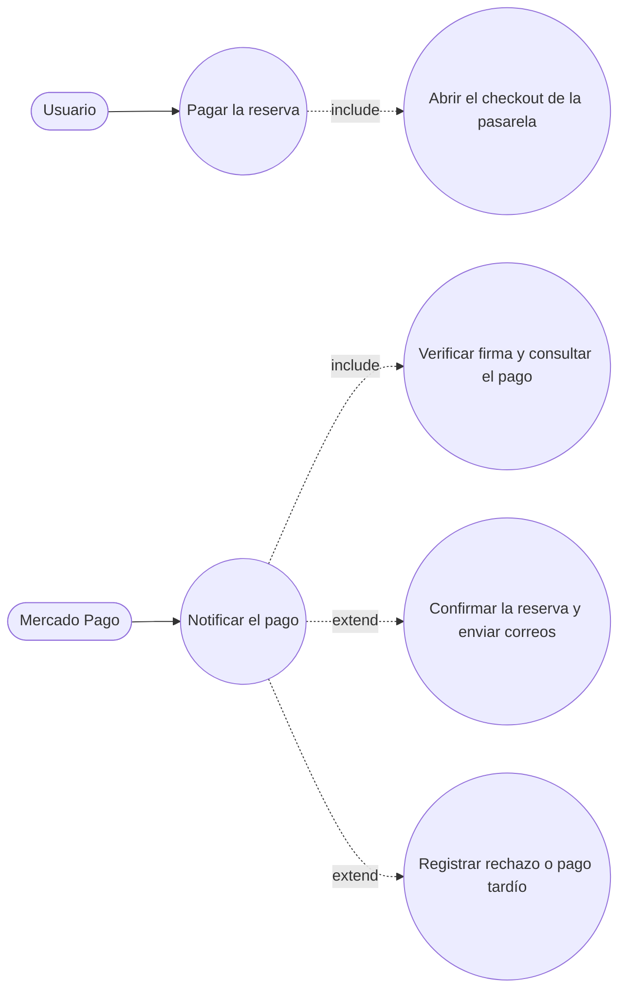
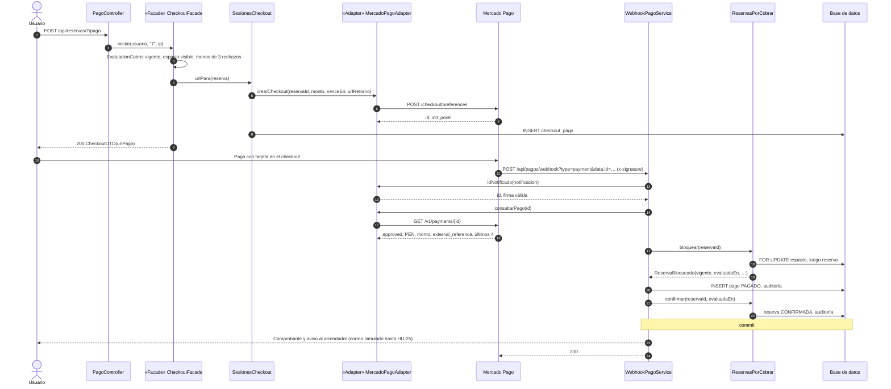
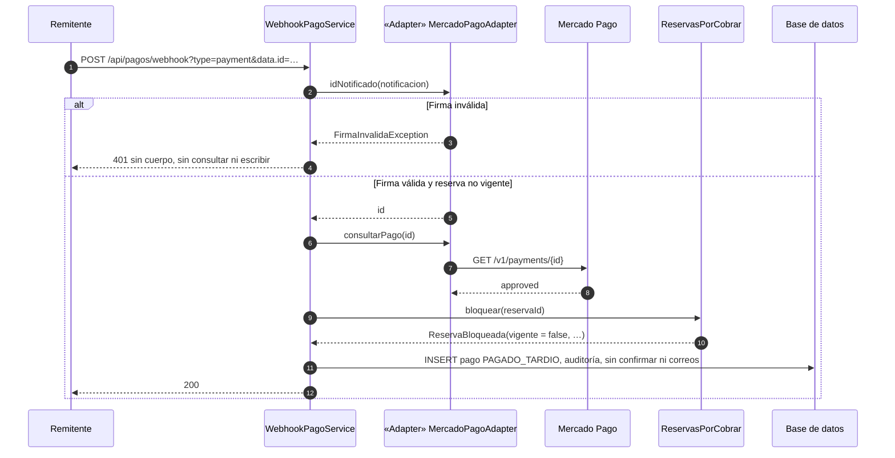
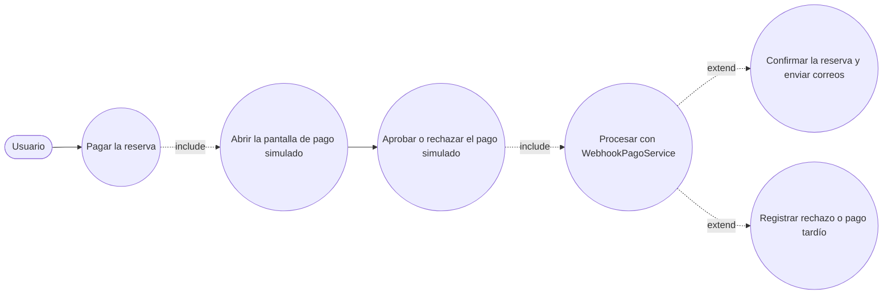
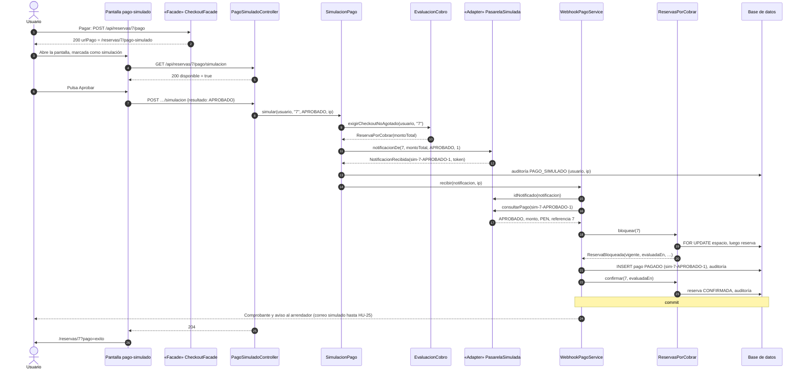
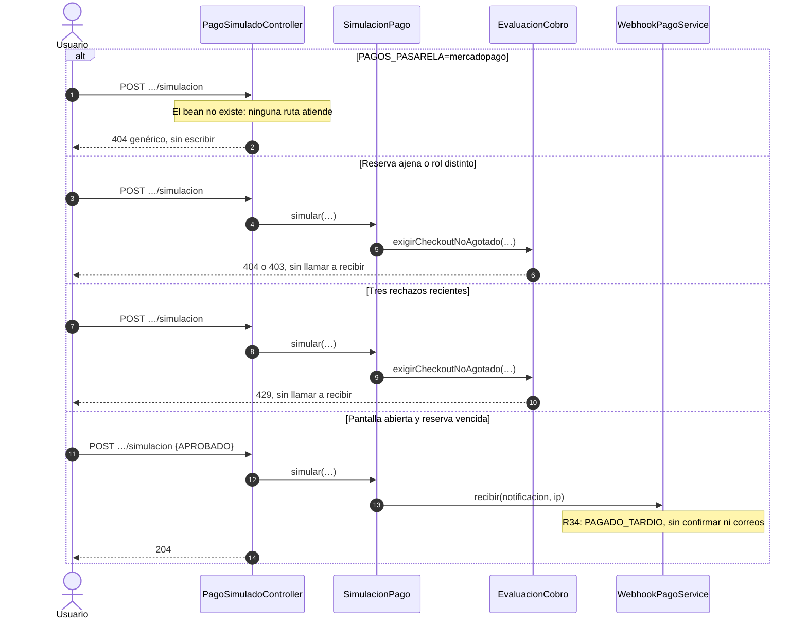

# HU-13 — Design: Pago con tarjeta

> Módulo `pagos` (nuevo) · Sprint 4 · tamaño M · ★ Adapter y Facade · depende de HU-12. D1–D7, H1–H6 y S1–S14:
> `requirements.md`. Sin puerto nuevo: `pagos.ReservasPorCobrar` ya estaba previsto; lo define `pagos` y lo implementa
> `reservas`, porque `reservas → pagos` es la dirección permitida.
>
> **Adenda 2026-10-30 (D7 revisada, D8, D9): § 14.** Lo de §§ 1–13 sigue vigente salvo lo que § 14 marca. Mercado Pago no se
> conecta por ahora: el adaptador queda listo y UAT usa la simulada, con S1 **sin comprobar**.

## 1. Decisiones técnicas

| # | Origen | Decisión | Por qué |
|---|--------|----------|---------|
| DT-1 | explorador 8 | **`RestClient` + HMAC propio, sin el SDK oficial.** Comprobado el 2026-10-30: `sdk-java:3.7.0` compila y corre en Java 25.0.5 con Boot 4.1.2, así que la compatibilidad no lo descarta. Se descarta porque trae al menos 16 librerías (dos clientes HTTP, Velocity, BeanUtils, Gson), guarda token y timeouts en estáticos y fija `BASE_URL`, lo que impide apuntar las IT a un doble por URL. | Solo hacen falta 3 llamadas y un HMAC de unas 20 líneas. `RestClient` ya está en `spring-web` (probado en Java 25 contra un doble). El riesgo de la firma se cubre con el vector de § 11, aceptado por el validador oficial. |
| DT-2 | explorador 1, H4 | `id_transaccion_pasarela` guarda el **`id` del pago** de Mercado Pago, como texto. | Cada intento es un pago con id propio: los reintentos no chocan con el `UNIQUE`, y HU-16 lo usa para reembolsar. |
| DT-3 | explorador 2, S13 | `checkout_pago` con `UNIQUE (reserva_id)`: un enlace por reserva, sin estado. | La reserva tiene un solo `expira_en`, así que el enlace no cambia. El HTTP va fuera de transacción; quien pierde la carrera relee la fila (R7). |
| DT-4 | explorador 3 | Los 3 intentos se cuentan con **filas `RECHAZADO`** de los últimos 30 min, no con `LimitadorIntentos`. | Las filas ya existen por (R), sobreviven a un reinicio y el `UNIQUE` evita contar doble un aviso repetido. |
| DT-5 | explorador 5 | **Orden del webhook:** firma → consulta (sin transacción) → `TransactionTemplate`: `bloquear` (proyección de `espacio_id`, `bloquearEspacio`, `findParaActualizar`) → `ahora` → ¿existe? → clasificar → `INSERT pago` → `confirmar` → auditoría. `catch` fuera, por nombre de restricción. | Ninguna llamada externa retiene filas. La proyección evita cargar `Reserva` antes del bloqueo y quedarse con una copia vieja. Serializa dos avisos iguales (R43) y al webhook con el proceso (R37). |
| DT-6 | HU-12 | El webhook no toma el bloqueo de `usuario`. | Solo protege el cupo y confirmar lo reduce. Un subconjunto de `usuario → espacio → reserva` no crea ciclos. |
| DT-7 | explorador 4 | `bloquear` devuelve `ReservaBloqueada` con lo necesario para los correos, `vigente` y `evaluadaEn`; `confirmar(id, evaluadaEn)` usa ese instante. | `pagos` no importa `reservas` ni `espacios`, y `Reserva.confirmar` no falla por milisegundos. `EspacioRetenido` no se toca. |
| DT-8 | explorador 6 | Sin proceso de cierre: basta `expiration_date_to`. El cierre explícito solo ocurre al tercer rechazo, tras el commit. | Mercado Pago vence solo. |
| DT-9 | explorador 7, D7 | `@ConditionalOnProperty(name = "espacioya.pagos.pasarela", havingValue = …)` en cada implementación. **Sin fábrica.** `PasarelaSimulada` avisa con `log.warn` al arrancar. | Spring ya resuelve cuál instanciar. Sin valor no hay bean y el backend no arranca (R57). |
| DT-10 | explorador 9 | Dos métodos nuevos en `NotificadorCorreo`, sin `default`; `despuesDelCommit` pasa a `comun/transaccion/DespuesDelCommit`. | Precedente de HU-04, HU-06 y HU-09. Copiarlo duplicaría un componente transversal. |
| DT-11 | explorador 10 | `GET` propio en `pagos`, sin ampliar `ReservaDTO`. | HU-14 reutiliza ese DTO; `reservas` no debe saber de intentos. |
| DT-12 | explorador 11 | Auditoría del webhook con `usuario_id` nulo, `origen=WEBHOOK` y la IP de la solicitud. | No actuó el usuario, como HU-12 S9. |
| DT-13 | explorador 12, 13 | Id de ruta como texto (HU-12 DT-9). `ServicioExternoException` en `comun/error` → 503. | `comun` no conoce `pagos`; también servirá a correo y almacenamiento. |
| DT-14 | H3, H4 | El controlador del webhook **no lee el cuerpo**. | La firma de Mercado Pago no lo cubre: no se confía en datos sin firmar. |
| DT-15 | proveedor | `JdkClientHttpRequestFactory`: conexión 3 s, lectura 7 s. | Mercado Pago espera 22 s; el webhook hace a lo sumo 2 llamadas: 20 s. |

## 2. Caso de uso



**Pagar (CA1)** — Precondición: reserva propia con pago disponible. (1) "Pagar"; (2) la API responde `urlPago`; (3) el
usuario paga en Mercado Pago; (4) la pasarela notifica; (5) la API consulta el pago, confirma y envía correos tras el
commit; (6) el usuario vuelve a `/reservas/:id?pago=exito`. **Alternos:** rechazado → reintenta (CA3); 3 rechazos → 429
(D4); expirada o último minuto → 400 (CA4, D3); aprobado tardío → `PAGADO_TARDIO` (D2).

## 3. Archivos por módulo y capa

Paquete base `pe.edu.ulima.espacioya`. (N) nuevo · (M) modificado.

| Módulo / capa | Archivos | Para |
|---|---|---|
| `pagos/domain/` (N) | `Pago`, `EstadoPago`, `CheckoutPago`, `MotivoNoDisponible`, `ReglasPago` | R10–R13, R30–R34, R39 |
| `pagos/repository/` (N) | `PagoRepository`, `CheckoutPagoRepository` | R6, R7, R13, R19, R42 |
| `pagos/dto/` (N) | `CheckoutDTO`, `EstadoPagoDTO` | R1, R19, R20 |
| `pagos/service/` (N) | `CheckoutFacade`, `EvaluacionCobro`, `SesionesCheckout`, `WebhookPagoService`, `AvisosPago` | R1–R21, R25–R53 |
| `pagos/service/pasarela/` (N) | `PasarelaPago`, `MercadoPagoAdapter`, `PasarelaSimulada`, `SolicitudCheckout`, `CheckoutCreado`, `NotificacionRecibida`, `PagoConsultado`, `ResultadoPasarela`, `FirmaInvalidaException` | R2–R5, R24–R28, R55–R58 |
| `pagos/service/puertos/` (N) | `ReservasPorCobrar`, `ReservaPorCobrar`, `ReservaBloqueada` | R36, R38 |
| `pagos/controller/` (N) | `PagoController`, `WebhookPagoController` | R1, R15, R16, R19, R22–R24 |
| `reservas/` (M) | `domain/Reserva`, `repository/ReservaRepository`, `service/ReservasPorCobrarImpl` (N) | R31, R32, R36–R38, R53 |
| `espacios/service/` (M) | `DisponibilidadService` + `Impl`, `EspacioBloqueado` (N) | R35, R36, R38 |
| `cuentas/service/` (M) | `CuentaService` + `Impl`, `NotificadorCorreo` + `NotificadorCorreoSimulado`, `ComprobantePago` (N), `AvisoReservaPagada` (N) | R48, R49 |
| `comun/` (M) | `transaccion/DespuesDelCommit` (N), `error/ServicioExternoException` (N), `error/ErrorDTO`, `error/ManejadorGlobalErrores`, `seguridad/ConfiguracionSeguridad` | R17, R22, R27, R51 |
| Recursos | `V4_1__pago.sql` (N), `application.properties`, `src/test/resources/config/application.properties`, `.env.example` (M) | § 8, R55–R58 |
| Dobles de otras historias (M) | `NotificadorCorreo` en `RevisionIdentidadControllerIT`, `CuentaAdminControllerIT`, `UsuarioControllerIT`, `ArrendadorControllerIT`, `RecuperacionContrasenaControllerIT` | DT-10 |

**Propiedades** `espacioya.pagos.*`, con nombres neutros y secretos solo por entorno: `pasarela` (`PAGOS_PASARELA`, sin
valor por defecto), `llave-secreta` (`PAGOS_LLAVE_SECRETA`), `secreto-webhook` (`PAGOS_SECRETO_WEBHOOK`), `url-notificacion`
(`PAGOS_URL_NOTIFICACION`), `url-api` (`PAGOS_URL_API`, `https://api.mercadopago.com`) y `margen-cierre`
(`PAGOS_MARGEN_CIERRE`, `PT1M`). En `src/test/resources/config`: `pasarela=simulada` y `secreto-webhook=secreto-solo-pruebas`.

## 4. Endpoints

| Método y ruta | Entrada | Respuestas |
|---|---|---|
| `POST /api/reservas/{id}/pago` | Sin cuerpo (se ignora) | **200** `CheckoutDTO` (R1) · **400** *pago no disponible* (R10–R12) · **401** (R16) · **403** (R14) · **404** (R15) · **429** (R13) · **503** (R17) |
| `GET /api/reservas/{id}/pago` | — | **200** `EstadoPagoDTO` (R19) · **401** (R16) · **404** (R15) |
| `POST /api/pagos/webhook` (público, ruta exacta) | Parámetros de URL y encabezados | **200** vacío (R23, R28–R30, R33, R34, R39, R42, R44) · **401** vacío (R24) · **503** (R27) |

```java
public record CheckoutDTO(String urlPago) { }
public record EstadoPagoDTO(String ultimoResultado, boolean intentosAgotados, boolean pagoDisponible) { }
```

| Constante | Texto |
|---|---|
| `EvaluacionCobro.MENSAJE_PAGO_NO_DISPONIBLE` | `Esta reserva ya no se puede pagar. Busca otro horario para reservar de nuevo.` |
| `ErrorDTO.MENSAJE_SERVICIO_EXTERNO` (N) | `No pudimos conectar con el servicio de pagos. Intenta de nuevo en unos minutos.` |

**Traducción a Mercado Pago** (`Authorization: Bearer <llave>`). `crearCheckout` → `POST /checkout/preferences`:

```json
{ "items": [{ "title": "Reserva EspacioYa #7", "quantity": 1, "unit_price": 241.50, "currency_id": "PEN" }],
  "external_reference": "7", "notification_url": "<url-notificacion>", "binary_mode": true, "expires": true,
  "expiration_date_from": "<ahora>", "expiration_date_to": "<venceEn>",
  "payment_methods": { "installments": 1, "excluded_payment_types": [{ "id": "ticket" }, { "id": "atm" },
    { "id": "bank_transfer" }, { "id": "digital_wallet" }, { "id": "digital_currency" }] },
  "back_urls": { "success": "<retorno>?pago=exito", "failure": "<retorno>?pago=fallo", "pending": "<retorno>?pago=fallo" },
  "auto_return": "approved" }
```

Fechas con `yyyy-MM-dd'T'HH:mm:ss.SSSXXX` en `ZonaHoraria.LIMA`. `back_urls` y `auto_return` solo con frontend HTTPS
(⚠ S12). Sin datos del pagador. Se lee `id` e `init_point`, nunca `sandbox_init_point` (H6). `cerrarCheckout` → `PUT
/checkout/preferences/{id}` con `expires = true` y `expiration_date_to = ahora`. `consultarPago` → `GET /v1/payments/{id}`:
`id`, `status`, `transaction_amount`, `currency_id`, `external_reference`, `card.last_four_digits` (si no son 4 dígitos, `null`).

## 5. Patrones y clases

**Adapter.** `PasarelaPago` es la interfaz que espera `pagos`; `MercadoPagoAdapter` traduce a la API REST (Adaptee) y
`PasarelaSimulada` es la otra implementación. Solo traduce: formato, HMAC y `status`. Las reglas ("tardío", "tercer rechazo",
"coincide") viven en `ReglasPago`. **Facade.** `CheckoutFacade` es la única entrada del `PagoController`: coordina
`EvaluacionCobro`, `SesionesCheckout` y la auditoría, sin contener reglas. El webhook **no** pasa por ella. Lo que el
Adapter y la Facade no deben hacer viene de las notas del dueño «Patrón Adapter» y «Patrón Facade»; esas notas no cubren
webhooks ni idempotencia.

```mermaid
classDiagram
  class CheckoutFacade {
    <<Facade>>
    +iniciar(usuario, reservaId, ip) CheckoutDTO
    +estado(usuario, reservaId) EstadoPagoDTO
  }
  class PasarelaPago {
    <<Target>>
    +crearCheckout(solicitud) CheckoutCreado
    +cerrarCheckout(idCheckout)
    +idNotificado(notificacion) Optional
    +consultarPago(id) PagoConsultado
  }
  <<Adapter>> MercadoPagoAdapter
  <<Adapter>> PasarelaSimulada
  <<Adaptee>> ApiMercadoPago
  <<Puerto>> ReservasPorCobrar
  PagoController --> CheckoutFacade
  WebhookPagoController --> WebhookPagoService
  CheckoutFacade --> EvaluacionCobro
  CheckoutFacade --> SesionesCheckout
  EvaluacionCobro --> ReservasPorCobrar
  EvaluacionCobro --> ReglasPago
  SesionesCheckout --> PasarelaPago
  SesionesCheckout --> CheckoutPago
  WebhookPagoService --> PasarelaPago
  WebhookPagoService --> ReservasPorCobrar
  WebhookPagoService --> ReglasPago
  WebhookPagoService --> Pago
  WebhookPagoService --> AvisosPago
  PasarelaPago <|.. MercadoPagoAdapter
  PasarelaPago <|.. PasarelaSimulada
  MercadoPagoAdapter --> ApiMercadoPago
  ReservasPorCobrar <|.. ReservasPorCobrarImpl
```

```java
// pagos/service/pasarela: sin tipos del proveedor. Las fallas de red o de la API lanzan ServicioExternoException.
public interface PasarelaPago {
    CheckoutCreado crearCheckout(SolicitudCheckout solicitud);
    void cerrarCheckout(String idCheckout);
    /** Vacío si no es type=payment. @throws FirmaInvalidaException si falta el id o la firma no es válida. */
    Optional<String> idNotificado(NotificacionRecibida notificacion);
    PagoConsultado consultarPago(String idTransaccion); }
public record SolicitudCheckout(Long reservaId, BigDecimal monto, Instant venceEn, String urlRetorno) { }
public record CheckoutCreado(String idCheckout, String urlPago) { }
public record NotificacionRecibida(Map<String, String> parametros, Map<String, String> encabezados) { }
public enum ResultadoPasarela { APROBADO, RECHAZADO, SIN_RESULTADO }
public record PagoConsultado(String idTransaccion, ResultadoPasarela resultado, BigDecimal monto, String moneda,
                             String ultimos4, String referencia) { }

// pagos/service/puertos (lo implementa reservas)
public interface ReservasPorCobrar {
    Optional<ReservaPorCobrar> deUsuario(Long reservaId, Long usuarioId);
    Optional<ReservaBloqueada> bloquear(Long reservaId);              // MANDATORY
    void confirmar(Long reservaId, Instant evaluadaEn); }             // MANDATORY; IllegalStateException si no es vigente
public record ReservaPorCobrar(Long id, BigDecimal montoTotal, Instant expiraEn, boolean vigente, boolean espacioVisible) { }
public record ReservaBloqueada(Long id, Long usuarioId, Long arrendadorId, String espacioNombre, LocalDate fecha,
        int horaInicio, int horaFin, BigDecimal montoTotal, boolean vigente, Instant evaluadaEn) { }

// pagos/domain. Entidades con ids Long y sin asociaciones JPA, como Reserva.
public enum EstadoPago { PAGADO, RECHAZADO, PAGADO_TARDIO, MONTO_DISTINTO, REEMBOLSADO, REEMBOLSO_FALLIDO }
public enum MotivoNoDisponible { NO_VIGENTE, ULTIMO_TRAMO, ESPACIO_NO_VISIBLE, INTENTOS_AGOTADOS }
public final class ReglasPago {   // MAXIMO_RECHAZOS = 3, VENTANA_RECHAZOS = 30 min, MONEDA = "PEN"
    /** null si está disponible; orden de R18. */
    public static MotivoNoDisponible motivoNoDisponible(boolean vigente, Instant expiraEn, boolean espacioVisible,
                                                        long rechazosRecientes, Instant ahora, Duration margen);
    /** MONTO_DISTINTO, PAGADO_TARDIO o PAGADO, en ese orden. Compara con compareTo: 241.5 es igual a 241.50. */
    public static EstadoPago estadoDeAprobado(BigDecimal monto, String moneda, BigDecimal montoReserva, boolean vigente); }

// Módulos existentes (M)
public void confirmar(Instant ahora);                                 // Reserva: IllegalStateException si !esVigente(ahora)
Optional<Long> findEspacioIdById(Long id);                            // ReservaRepository: proyección, "select r.espacioId"
EspacioBloqueado bloquearEspacio(Long espacioId);                     // MANDATORY; findParaReservar, sin filtros (D6)
public record EspacioBloqueado(Long arrendadorId, String nombre) { }
String correoDe(Long usuarioId);                                      // CuentaService: sin sesión ni rol; 404 si no existe
void notificarPagoConfirmado(String correo, ComprobantePago comprobante);        // NotificadorCorreo
void notificarReservaPagada(String correoArrendador, AvisoReservaPagada aviso);  // NotificadorCorreo
```

`ComprobantePago` y `AvisoReservaPagada` llevan los campos de D5. `PagoRepository` agrega `existsByIdTransaccionPasarela`,
el conteo de rechazos por reserva, estado y `creadoEn >= desde`, y el último pago de la reserva.

## 6. Flujos

**`CheckoutFacade.iniciar`** (sin transacción: hay HTTP dentro): `evaluacion.exigirDisponible` → `sesiones.urlPara` → audita
→ `CheckoutDTO`. **`estado`** (`readOnly`): `evaluacion` más `findFirstByReservaId…`.

**`EvaluacionCobro`:** rol (R14) → id y `deUsuario` (R15) → cuenta rechazos → `motivoNoDisponible` → `INTENTOS_AGOTADOS`:
`DemasiadosIntentosException` (R13); otro: `ReglaNegocioException` (R10–R12).

**`SesionesCheckout.urlPara`:** `findByReservaId` (R6) → `crearCheckout` con `venceEn = expiraEn − margen` y
`urlRetorno = <frontend>/reservas/<id>` (R2–R5) → `save` en `TransactionTemplate` → `catch` de `uq_checkout_pago_reserva`:
relee la fila ganadora (R7).

**`ReservasPorCobrarImpl.bloquear`:** `findEspacioIdById` → `bloquearEspacio` → `findParaActualizar` → bloques →
`ahora` → `ReservaBloqueada` (R36). **`confirmar`:** `findParaActualizar` → `reserva.confirmar(evaluadaEn)` → audita (R31, R53);
no toca `reserva_bloque` (R32). **`deUsuario`:** `findByIdAndUsuarioId` y `catalogo.esVisible`.

**`WebhookPagoService.recibir`** (sin `@Transactional`): `idNotificado`, vacío: fin (R23) → `consultarPago` (R25–R27) →
`SIN_RESULTADO`: fin (R28) → en `transacciones.execute`: (1) `bloquear(referencia)`, vacío: audita y fin (R29); (2)
`existsByIdTransaccionPasarela`: fin (R42); (3) `RECHAZADO` o `estadoDeAprobado` (R30, R33–R35, R39); (4) `saveAndFlush` y
audita (R52); (5) `PAGADO`: `confirmar` y `avisos.programar` (R31, R48, R49); `RECHAZADO` con 3 o más recientes:
`DespuesDelCommit.ejecutar(cerrar)` (R40, R41). Por fuera, `catch` de `uq_pago_id_transaccion`: fin (R44); otra violación
se relanza. **Controlador:** atrapa `FirmaInvalidaException` → `log.warn` sin datos y 401 vacío. Los encabezados van en un
mapa que no distingue mayúsculas.

**`AvisosPago.programar`:** lee `correoDe` dentro de la transacción y registra un `DespuesDelCommit.ejecutar` por correo, para
que el fallo de uno no impida el otro (R48–R51).

**`MercadoPagoAdapter.idNotificado`:** `type` ≠ `payment`: vacío (R23). Toma `data.id` o `data_id`, separa `ts` y `v1`, arma
`id:…;request-id:…;ts:…;`, calcula el HMAC y compara con `MessageDigest.isEqual`. Usa los valores tal como llegaron (R24).

**`PasarelaSimulada`** (D7 revisada): recuerda los montos en memoria y, por la adenda, `crearCheckout` devuelve la URL de la
pantalla simulada, ya no `<urlRetorno>?pago=exito` (§ 14.6). En local también se simula con
`POST /api/pagos/webhook?type=payment&data.id=sim-7-APROBADO-1` y `x-signature` igual al secreto configurado.

## 7. Diagramas de secuencia

### Flujo principal: pago aprobado (CA1, CA2)



### Flujo de error: firma inválida o reserva expirada (STRIDE S/T, D2)



## 8. Migración Flyway

`V4_1__pago.sql`: en `develop` la última es `V3_3`. Antes de crearla, actualizar `develop` y usar el siguiente `V4_n` libre:
HU-14, HU-15 y HU-16 son del mismo sprint. Solo depende de `V3_3`.

```sql
-- Pagos con tarjeta (HU-13). id_transaccion_pasarela guarda el id del pago en la pasarela: cada intento tiene el suyo.
CREATE TABLE pago (
    id                      BIGINT GENERATED ALWAYS AS IDENTITY PRIMARY KEY,
    reserva_id              BIGINT        NOT NULL REFERENCES reserva (id),
    id_transaccion_pasarela VARCHAR(100)  NOT NULL,
    monto                   NUMERIC(10,2) NOT NULL,
    estado                  VARCHAR(20)   NOT NULL,
    ultimos4                VARCHAR(4),
    creado_en               TIMESTAMPTZ   NOT NULL,
    CONSTRAINT uq_pago_id_transaccion UNIQUE (id_transaccion_pasarela),
    CONSTRAINT ck_pago_estado CHECK (estado IN ('PAGADO', 'RECHAZADO', 'PAGADO_TARDIO', 'MONTO_DISTINTO',
                                                'REEMBOLSADO', 'REEMBOLSO_FALLIDO')),
    CONSTRAINT ck_pago_monto CHECK (monto > 0),
    CONSTRAINT ck_pago_ultimos4 CHECK (ultimos4 ~ '^[0-9]{4}$')
);
CREATE INDEX ix_pago_reserva_estado ON pago (reserva_id, estado, creado_en);
-- Una reserva no se cobra dos veces (HU-15 y HU-19 leen este pago).
CREATE UNIQUE INDEX uq_pago_reserva_pagado ON pago (reserva_id) WHERE estado = 'PAGADO';

-- Un enlace por reserva: su vencimiento depende solo de reserva.expira_en.
CREATE TABLE checkout_pago (
    id          BIGINT GENERATED ALWAYS AS IDENTITY PRIMARY KEY,
    reserva_id  BIGINT       NOT NULL REFERENCES reserva (id) ON DELETE CASCADE,
    id_checkout VARCHAR(100) NOT NULL,
    url_pago    TEXT         NOT NULL,
    creado_en   TIMESTAMPTZ  NOT NULL,
    CONSTRAINT uq_checkout_pago_reserva UNIQUE (reserva_id)
);
```

`ultimos4` es `VARCHAR(4)`: con `ddl-auto=validate`, Hibernate espera `varchar` para un `String` *(general; lo confirma
`EspacioYaApplicationIT`)*. `pago` no lleva cascada: las IT que crean pagos los borran antes que la reserva.

## 9. Excepciones y componentes de `comun`

**Nuevas:** `ServicioExternoException` en `comun/error` (503, sin detalle; R17, R27) y `FirmaInvalidaException` en `pagos`.
**Reutilizadas:** `ReglaNegocioException`, `DemasiadosIntentosException`, `AccesoDenegadoException`,
`RecursoNoEncontradoException`, `AuditoriaService`, `IpCliente`, `ZonaHoraria` y `Clock`. Un fallo imprevisto del webhook es
un 500 y la pasarela reintenta. `ConfiguracionSeguridad` gana `requestMatchers(HttpMethod.POST,
"/api/pagos/webhook").permitAll()`. Sin rate limiting en el webhook: un 429 frenaría a la propia pasarela.

## 10. Pantallas

**API — `src/api/pagos.js` (N):** `iniciarPago(reservaId)` → `POST /api/reservas/{id}/pago`; `obtenerEstadoPago(reservaId)`
→ `GET /api/reservas/{id}/pago`. Sin dependencias nuevas.

**Resumen — `/reservas/:id` → `pages/reservas/ResumenReserva.jsx` (M), con `textosReservas.js` (M).** Sin ruta nueva ni
componentes nuevos: usa `Boton`, `Alerta`, `Tarjeta`, `EtiquetaEstado` y `CuentaRegresiva`. El parámetro `?pago=` **solo
elige el mensaje**: nunca confirma nada.

| Situación | Qué muestra |
|---|---|
| **CA1:** `PENDIENTE_PAGO` y `pagoDisponible` | Único primario **"Pagar"**, con `cargando`. 200 → `window.location.assign(urlPago)` en la misma pestaña, para conservar `sessionStorage` |
| **CA1:** `?pago=exito` y sigue `PENDIENTE_PAGO` | `Alerta info` "Estamos confirmando tu pago…". Relee cada 3 s, hasta 10 veces, sin `SE_ACABO_EL_TIEMPO`. Al agotarse: `Alerta atencion` "Tu pago sigue en revisión. Si se aprueba, recibirás el comprobante por correo." |
| **CA1:** `CONFIRMADA` con `?pago=exito` | `Alerta exito` "Tu reserva está confirmada. Te enviamos el comprobante por correo." |
| **CA3:** `ultimoResultado = RECHAZADO` o `?pago=fallo`, con `pagoDisponible` | `Alerta error` "Tu pago no se aprobó. Puedes intentarlo de nuevo mientras tu reserva siga vigente." y "Pagar" |
| **D4:** `intentosAgotados` | `Alerta atencion` "Alcanzaste el máximo de intentos de pago. Tus bloques siguen retenidos hasta que la reserva expire; después puedes reservar de nuevo." Sin "Pagar" |
| **D3, D6:** vigente, sin `pagoDisponible` ni intentos agotados | `Alerta info` "Esta reserva ya no se puede pagar. Cuando expire, puedes reservar de nuevo." Sin "Pagar" |
| **CA4:** `EXPIRADA` | `SE_ACABO_EL_TIEMPO`, ya existente, y "Volver al espacio" |
| **D2:** `ultimoResultado` `PAGADO_TARDIO` o `MONTO_DISTINTO` | `Alerta atencion` "Recibimos un pago que no pudimos aplicar a esta reserva. Gestionaremos su devolución." |
| Error de la API (400, 429, 503) | `Alerta error` con el mensaje tal cual y relectura de reserva y estado |

**Colores:** `PAGADO_TARDIO` y `MONTO_DISTINTO` no están en "Color de cada estado": van en **Atención**, fila Pago de
`docs/frontend.md`. HU-13 no los muestra con `EtiquetaEstado`, así que el kit no cambia; HU-28 los agregará al mapa.

## 11. Plan de pruebas (R → test)

`PCIT` = `PagoControllerIT` (con `simulada`). `WIT` = `WebhookPagoIT`, con **`MercadoPagoAdapter` real** contra
`StubMercadoPago` (`com.sun.net.httpserver`, URL por `@DynamicPropertySource`). Ambas con Testcontainers y `RelojControlable`;
limpian `pago` y luego `reserva`. **Vector de firma** (aceptado por el validador oficial 3.7.0): secreto
`secreto-solo-pruebas`, id `185919482939`, `x-request-id` `r-1`, `ts` `1704908010` →
`v1=fb7ed4b3bca94a9f1d45fbbde824844a98e2e4be60b95470649d3d62a0085ebf`.

| R | Test |
|---|---|
| R1, R3, R6, R8, R9, R14–R16, R18 | `PCIT`, `EvaluacionCobroTest` (orden de R18, sin pasarela al rechazar) |
| R2, R4, R5, R17, R24, R27 | `MercadoPagoAdapterTest` (cuerpo exacto; `-05:00`; `back_urls` solo con HTTPS; 500, 404 y tiempo agotado; vector; `x-signature` malformada) |
| **R7** | `PagoConcurrenciaIT` (dos hilos: una fila, misma URL), `SesionesCheckoutTest` |
| R10–R13 | `ReglasPagoTest` (`expira_en − 61 s`, `− 60 s`; 2 y 3 rechazos; rechazo de hace 30 y de 31 min), `PCIT` |
| R19–R21 | `PCIT` (claves exactas; `null` sin pagos; las filas no cambian) |
| R22–R29 | `WIT` (sin `Authorization`; `topic=payment` y `merchant_order` sin llamadas al doble; firma mala, `ts` e id alterados; `data.id` y `data_id`; cuerpo `approved` con consulta `rejected`; `pending`, `refunded`; referencia inexistente, nula y no numérica; 503 sin filas) |
| R30–R35 | `WIT` (filas exactas; `241.5` frente a `241.50`; otro monto; `USD`; `EXPIRADA`; vencida sin procesar; segundo pago sobre `CONFIRMADA`; espacio pausado y cuentas suspendidas), `ReglasPagoTest`, `ReservaTest` (`confirmar`) |
| R36 | `ReservasPorCobrarImplTest` (`InOrder`: proyección → `bloquearEspacio` → `findParaActualizar` → reloj) |
| **R37, R38, R43** | `PagoConcurrenciaIT` (webhook frente a `expirarVencidas`: solo los dos resultados permitidos; dos webhooks iguales: una fila y dos correos; métodos sin transacción) |
| R39–R41 | `WIT` (`RECHAZADO` tras `PAGADO` no toca `CONFIRMADA`; `PUT` solo al tercero; `PUT` con 500 → 200) |
| R42, R44 | `WIT` (mismo id con `payment.created` y `payment.updated`), `WebhookPagoServiceTest` (violación por nombre; otra se relanza) |
| R45–R47 | `WIT` (`INSERT` por `JdbcTemplate` que viola cada restricción) |
| R48–R51 | `WIT` con doble de `NotificadorCorreo` (campos exactos; nada con tardío, distinto o rechazado; fallo → 200), `DespuesDelCommitTest` |
| R52–R54 | `WIT` (filas exactas de `auditoria`; sin firma ni llaves en `detalle`) |
| R55–R58 | `SeleccionPasarelaTest` (`ApplicationContextRunner`: cada valor, vacío, otro, llaves faltantes) |

## 12. Lo que queda listo sin construirlo

- **HU-14:** `CONFIRMADA` sale de `Reserva.confirmar` y `ReservaDTO` no cambió.
- **HU-15:** un solo `PAGADO` por reserva. `PagoService` no se crea porque nadie lo usa aún: lo crea esa historia.
- **HU-16:** `id_transaccion_pasarela` sirve para reembolsar; agrega `reembolsar` a `PasarelaPago` y, si el PO cambia el
  alcance, atiende `PAGADO_TARDIO`. **HU-26** reutiliza lo de HU-16.
- **HU-19 y HU-28:** `monto` y `ultimos4` se guardan desde hoy; deben contar solo `PAGADO` (HU-28, también los reembolsados).

## 13. Alternativas descartadas

1. **SDK oficial de Mercado Pago:** funciona, pero sus dependencias y su estado estático pesan más que 3 llamadas (DT-1).
2. **Factory Method para elegir la pasarela:** Spring ya resuelve cuál instanciar; una fábrica solo agregaría clases.
3. **Confirmar al volver el navegador:** contradice RNF-CUM-02; `?pago=exito` no prueba nada.
4. **Estado `INICIADO` en `pago`:** mezcla enlaces con transacciones y exige un id que aún no existe.
5. **Una preferencia por cada "Pagar":** dos enlaces abiertos permiten pagar dos veces.
6. **`LimitadorIntentos`:** se pierde al reiniciar y un aviso repetido contaría doble (DT-4).
7. **Confirmar si los bloques siguen activos aunque venció:** contradice `esVigente` y D2.

## 14. Adenda 2026-10-30: pago simulado (D7 revisada, D8, D9)

**Idea central.** La pantalla simulada hace de "página de la pasarela": elige un resultado y le entrega a
`WebhookPagoService.recibir` la misma `NotificacionRecibida` que entregaría el controlador del webhook. Desde ahí todo es el
camino ya revisado. **`WebhookPagoService`, `CheckoutFacade`, `PagoController`, `WebhookPagoController`, `MercadoPagoAdapter`
y `PasarelaPago` no cambian.** Tampoco la base de datos: sin migración.

### 14.1 Decisiones técnicas

| # | Origen | Decisión | Por qué |
|---|--------|----------|---------|
| DT-16 | D9 | `SimulacionPago` llama a `webhook.recibir(notificacion, ip)` y nada más cambia el pago. No toca `ReservasPorCobrar` ni `pago`. | Un solo camino: bloqueos (R36), vigencia, monto, tardío, cierre al tercer rechazo, idempotencia y correos tras el commit salen del mismo código. `WebhookPagoService` sigue siendo el único que confirma. |
| DT-17 | D9 | `PagoSimuladoController` y `SimulacionPago` llevan el mismo `@ConditionalOnProperty(havingValue = "simulada")` que `PasarelaSimulada`, y `SimulacionPago` inyecta la clase concreta `PasarelaSimulada`. | Con `mercadopago` la ruta no existe: lo impide el backend sin un `if`. Si alguien quitara la condición, el contexto no arrancaría porque falta ese bean: dos defensas (R81, R82). |
| DT-18 | Adapter | `notificacionDe` es un método público de `PasarelaSimulada`, **fuera de `PasarelaPago`**. | El Target no cambia y `MercadoPagoAdapter` no gana un método vacío. El adaptador solo traduce: arma la notificación que produciría una pasarela, sin decidir reglas. |
| DT-19 | Facade | Controlador propio, no `PagoController`. `CheckoutFacade` no interviene. | La Facade "coordina y no confirma nada" y es la entrada de `PagoController`: sigue siendo cierto. Un endpoint condicional dentro de `PagoController` obligaría a un `if`. |
| DT-20 | pedido, S10 | **Monto tras un reinicio:** cada `POST` lee `monto_total` con `EvaluacionCobro` y lo escribe en `montos` dentro de `notificacionDe`, justo antes de `recibir`. | `consultarPago` encuentra el monto aunque el mapa esté vacío. Sin migración ni puerto nuevo, y vale con varias instancias, porque todo ocurre en la misma solicitud (R72). El `curl` del webhook en local conserva su límite tras reiniciar (R27). |
| DT-21 | R42, S17 | Ids deterministas calculados con datos de la base: `sim-<r>-APROBADO-1` y `sim-<r>-RECHAZADO-<filas + 1>`. | Dos **Aprobar** son el mismo pago y el `exists` de R42 los resuelve bajo el bloqueo; con ids distintos el segundo sería un `PAGADO_TARDIO` falso. Un contador en memoria repetiría ids tras reiniciar y perdería rechazos (R70). |
| DT-22 | S16 | **Token interno:** `PasarelaSimulada` genera 32 bytes con `SecureRandom` al crearse y `idNotificado` acepta `x-signature` igual al secreto configurado (si existe) o a ese token, en tiempo constante. | La pantalla funciona con `PAGOS_SECRETO_WEBHOOK` vacío y la ruta pública queda cerrada en UAT (R83, R84). El token no sale del proceso. **No es una firma de proveedor:** no prueba nada de S1. |
| DT-23 | S15 | `POST` comprueba solo rol, reserva, rechazos y checkout. Vigencia, último tramo y espacio visible no se repiten. | Quien pulsa con la pantalla abierta está en el caso real de un comprador dentro del checkout: decide `ReglasPago` bajo los bloqueos, y así `PAGADO_TARDIO` se demuestra sin terminal. Los 3 rechazos sí cortan porque equivalen al checkout cerrado (R40). Los botones no se ofrecen si no hay pago disponible (R60), así se cumple CA4. |
| DT-24 | STRIDE R | `SimulacionPago` audita `PAGO_SIMULADO` con el usuario y la IP **antes** de `recibir`. | R52 y R53 dicen `origen=WEBHOOK` con `usuario_id` nulo, porque el camino es ese. Sin este registro nadie sabría quién aprobó. El orden deja rastro aunque `recibir` falle. |
| DT-25 | frontend | `POST` responde **204**. La pantalla navega con `replace` a `/reservas/:id?pago=exito` o `?pago=fallo`. | `?pago=` sigue eligiendo solo el mensaje: `ResumenReserva` relee reserva y pago y el servidor decide. Atrás no regresa a los botones. |
| DT-26 | `docs/conventions.md` | Ruta `/api/reservas/{id}/pago/simulacion`, en singular. | Las rutas van en plural, pero hay una por reserva y `/pago` ya sentó el precedente. |
| DT-27 | frontend | La pantalla decide si se muestra con `GET …/simulacion`, no con una variable `VITE_`. | Con `mercadopago`, la ruta del frontend existe en el build, pero sin respuesta 200 no muestra datos ni botones. |

### 14.2 Caso de uso



**Pagar con la simulada (D9)** — Precondición: `PAGOS_PASARELA=simulada` y reserva propia con pago disponible. (1) "Pagar";
(2) la API responde la URL de la pantalla; (3) la pantalla comprueba `disponible`; (4) el usuario pulsa **Aprobar**; (5)
`WebhookPagoService` confirma y envía correos tras el commit; (6) vuelve a `/reservas/:id?pago=exito`. **Alternos:**
**Rechazar** → reintenta (CA3); tercer rechazo → 429 (D4); pantalla abierta hasta vencer y **Aprobar** → `PAGADO_TARDIO` (D2);
sin pago disponible al entrar → sin botones (CA4).

### 14.3 Archivos

| Módulo / capa | Archivos | Para |
|---|---|---|
| `pagos/service/pasarela/` (M) | `PasarelaSimulada`: URL de la pantalla, token, `notificacionDe`, Javadoc y `log.warn` | R59, R72, R83–R85 |
| `pagos/service/` (N) | `SimulacionPago` | R60, R62, R71, R78, R79, R86 |
| `pagos/service/` (M) | `EvaluacionCobro`: `exigirRol`, `exigirCheckoutNoAgotado`. `SesionesCheckout`: `existe` | R60, R74, R75, R77–R79 |
| `pagos/repository/` (M) | `PagoRepository.countByReservaIdAndEstado`, `CheckoutPagoRepository.existsByReservaId` | R60, R70, R78 |
| `pagos/dto/` (N) | `SimulacionDTO`, `SimularPagoDTO` | R60, R71, R73, R80 |
| `pagos/controller/` (N) | `PagoSimuladoController` | R60–R62, R73, R76, R81, R82 |
| Recursos (M) | Comentarios de `application.properties`; `2_Backend/.env.example` | D7 revisada |
| Frontend (N) | `pages/pagos/PagoSimulado.jsx`, `PagoSimulado.module.css`, `textosPagos.js` | Pantalla, § 14.10 |
| Frontend (M) | `src/api/pagos.js`, `src/App.jsx`, `pages/reservas/ResumenReserva.jsx` | Pantalla, DEF-01, DEF-02 |
| Docs (M) | `README.md`, `docs/architecture.md`, `docs/requerimientos.md`, `docs/frontend.md` | D7, D8, D9, DEF-03, DEF-04 |

### 14.4 Endpoints

Solo existen con `espacioya.pagos.pasarela=simulada`. `ConfiguracionSeguridad` no cambia: `anyRequest().authenticated()` ya
exige sesión. Con `mercadopago`, sin sesión responde 401 y con sesión 404 (mensaje genérico de `ManejadorGlobalErrores`).

| Método y ruta | Entrada | Respuestas |
|---|---|---|
| `GET /api/reservas/{id}/pago/simulacion` | — | **200** `SimulacionDTO` (R60) · **401** (R76) · **403** (R74) · **404** (R75, R82) |
| `POST /api/reservas/{id}/pago/simulacion` | `SimularPagoDTO` | **204** (R62) · **400** validación (R73) · **400** *pago no disponible* (R78) · **401** (R76) · **403** (R74) · **404** (R75, R82) · **429** (R77) |

```java
public record SimulacionDTO(boolean disponible) { }
public record SimularPagoDTO(@NotNull @Pattern(regexp = "APROBADO|RECHAZADO") String resultado) { }
```

`@Valid` corre antes que el servicio, por eso R79 parte de un cuerpo válido. Spring ignora los campos extra (R71). `{id}` llega
como texto (HU-12 DT-9). No se agrega rate limiting: exige sesión y `APROBADO` es idempotente, y `RECHAZADO` se corta en 3.

### 14.5 Patrones y clases

**Adapter.** Sigue siendo *solo traducir*, como pide la nota del dueño «Patrón Adapter» (errores comunes: lógica de negocio
en el Adapter). `PasarelaSimulada` no decide nada: arma la notificación y responde `consultarPago`. **Facade.** La nota
«Patrón Facade» dice coordinar sin hacer el trabajo: `CheckoutFacade` no se toca y `SimulacionPago` no es otra fachada del
subsistema, sino la entrada de un caso de uso que solo existe con la simulada. **Sin Factory Method:** `@ConditionalOnProperty`
sigue eligiendo. La regla "una condición por implementación en vez de un `if`" es criterio general, no de las notas: estas no
cubren inyección condicional, simuladores de pasarela ni pruebas en UAT.

```mermaid
classDiagram
  class PasarelaPago {
    <<Target>>
    +crearCheckout(solicitud) CheckoutCreado
    +cerrarCheckout(idCheckout)
    +idNotificado(notificacion) Optional
    +consultarPago(id) PagoConsultado
  }
  class PasarelaSimulada {
    <<Adapter>>
    +notificacionDe(reservaId, monto, resultado, intento) NotificacionRecibida
  }
  class SimulacionPago {
    <<solo con simulada>>
    +consultar(usuario, reservaId) SimulacionDTO
    +simular(usuario, reservaId, resultado, ip)
  }
  class PagoSimuladoController {
    <<solo con simulada>>
  }
  <<Adapter>> MercadoPagoAdapter
  PasarelaPago <|.. PasarelaSimulada
  PasarelaPago <|.. MercadoPagoAdapter
  PagoSimuladoController --> SimulacionPago
  SimulacionPago --> EvaluacionCobro
  SimulacionPago --> SesionesCheckout
  SimulacionPago --> PasarelaSimulada
  SimulacionPago --> WebhookPagoService
  SimulacionPago --> PagoRepository
  WebhookPagoService --> PasarelaPago
  WebhookPagoService --> ReservasPorCobrar
```

```java
// pagos/service/SimulacionPago: @Service, @ConditionalOnProperty. Sin @Transactional: recibir abre la suya (DT-5).
public SimulacionDTO consultar(UsuarioAutenticado usuario, String reservaId);
public void simular(UsuarioAutenticado usuario, String reservaId, ResultadoPasarela resultado, String ip);

// PasarelaSimulada, fuera de PasarelaPago
public NotificacionRecibida notificacionDe(Long reservaId, BigDecimal monto, ResultadoPasarela resultado, long intento);

// EvaluacionCobro (M)
public void exigirRol(UsuarioAutenticado usuario);                                            // la usa exigirDisponible
public ReservaPorCobrar exigirCheckoutNoAgotado(UsuarioAutenticado usuario, String reservaId); // rol, reserva, rechazos

public boolean existe(Long reservaId);                                 // SesionesCheckout
boolean existsByReservaId(Long reservaId);                             // CheckoutPagoRepository
long countByReservaIdAndEstado(Long reservaId, EstadoPago estado);     // PagoRepository
```

### 14.6 Flujos

**`PasarelaSimulada.crearCheckout`:** recuerda el monto y devuelve `<urlRetorno>/pago-simulado`, que es el `init_point` de la
simulada. `SesionesCheckout` no cambia: guarda esa URL en `checkout_pago` y la reutiliza (R6).

**`PasarelaSimulada.notificacionDe`:** `montos.put(reserva, monto)` → arma `sim-<reserva>-<resultado>-<intento>` → devuelve
`NotificacionRecibida({type=payment, data.id=<id>}, {x-signature=<token interno>})`.

**`SimulacionPago.consultar`:** `exigirRol` → `evaluacion.resumen` (R75) → `pagoDisponible && sesiones.existe`. Solo lee (R61).

**`SimulacionPago.simular`:** `exigirCheckoutNoAgotado` (R74, R75, R77) → sin fila, `ReglaNegocioException` con
`MENSAJE_PAGO_NO_DISPONIBLE` (R78) → `intento`: 1 si `APROBADO`; si no, `countByReservaIdAndEstado(id, RECHAZADO) + 1` (R70) →
`notificacionDe` con `reserva.montoTotal()` (R71, R72) → audita `PAGO_SIMULADO` (R86) → `webhook.recibir(notificacion, ip)`.

**`PagoSimuladoController`:** `IpCliente.de`, `@AuthenticationPrincipal`, `ResultadoPasarela.valueOf(cuerpo.resultado())`; `POST`
devuelve 204. Sin reglas.

**Qué decide quién.** `POST`: permiso y corte de intentos. `WebhookPagoService` y `ReglasPago`: todo lo demás, con los bloqueos
`espacio → reserva` de R36.

| Regla | Con la simulada | Requirement |
|---|---|---|
| Vigencia evaluada tras los bloqueos | Igual | R36, R63 |
| Monto y moneda | Se ejecuta; siempre coincide, porque el monto sale de la reserva (⚠ S20) | R33, R71 |
| Tardío | Igual, con la pantalla abierta hasta vencer | R34, R65 |
| 3 rechazos | Cierre tras el commit, que solo escribe en el log, y 429 en `POST` | R40, R67, R77 |
| Idempotencia | Mismo `exists`, con ids deterministas | R42, R68, R69 |
| Correos tras el commit | Igual | R48–R51, R64 |

### 14.7 Diagramas de secuencia

#### Flujo principal: pago simulado aprobado (CA1, CA2, D9)



#### Flujo de error: sin permiso, intentos agotados o pasarela real (STRIDE E, D, D8)



### 14.8 Migración Flyway

Ninguna. `pago` y `checkout_pago` ya sirven: `id_transaccion_pasarela` admite `sim-…` y `url_pago` guarda la URL de la pantalla.

### 14.9 Excepciones y componentes de `comun`

Sin excepciones nuevas. **Reutilizadas:** `AccesoDenegadoException`, `RecursoNoEncontradoException`, `ReglaNegocioException`,
`DemasiadosIntentosException`, `AuditoriaService` e `IpCliente`. Si `recibir` lanzara `FirmaInvalidaException` sería un error de
programación: responde 500 genérico, y `SimulacionPagoTest` comprueba que el token de `notificacionDe` pasa `idNotificado`.

### 14.10 Pantallas

**API — `src/api/pagos.js` (M):** `obtenerSimulacion(reservaId)` → `GET …/pago/simulacion`; `simularPago(reservaId, resultado)`
→ `POST …/pago/simulacion` con `{ resultado }`. Sin dependencias nuevas.

**Pago simulado — `/reservas/:id/pago-simulado` → `pages/pagos/PagoSimulado.jsx` (N), con `RutaProtegida`.** Usa `Alerta`,
`Boton`, `Tarjeta` y `Link`; sin componentes nuevos, colores ni estados nuevos. **No tiene ningún campo:** ni tarjeta, ni monto
editable, ni apariencia de pasarela. Lee `obtenerSimulacion` y `obtenerReserva` (espacio, fecha, horario y monto, del servidor).

| Situación | Qué muestra |
|---|---|
| Cargando | `CARGANDO`, sin título ni botones |
| **D9:** `disponible = true` | Título "Pago simulado". Arriba, siempre, `Alerta atencion` "Simulación: esta pantalla no es una pasarela de pago. No se cobra nada ni se usa ninguna tarjeta.". `Tarjeta` con espacio, fecha, horario y monto. `Boton` primario **"Aprobar pago simulado"** y secundario **"Rechazar pago simulado"**, ambos deshabilitados mientras uno envía |
| **CA1:** 204 tras Aprobar | `navegar('/reservas/:id?pago=exito', { replace: true })`: `ResumenReserva` muestra `RESERVA_CONFIRMADA` |
| **CA3:** 204 tras Rechazar | `navegar('/reservas/:id?pago=fallo', { replace: true })`: `PAGO_RECHAZADO` y "Pagar", que vuelve a esta pantalla (R6) |
| **D4:** tercer rechazo | `ResumenReserva` muestra `INTENTOS_AGOTADOS`, sin "Pagar" |
| **D2:** pantalla abierta hasta vencer y Aprobar | `ResumenReserva` muestra `PAGO_NO_APLICADO` |
| **CA4, D3, D6:** `disponible = false` | `Alerta atencion` de simulación, `Alerta info` "Este pago simulado ya no está disponible.", sin botones, y "Volver a la reserva" |
| **D8:** 404 o 403 en la lectura (`mercadopago`, reserva ajena u otro rol) | Solo `Alerta error` con el mensaje tal cual y `ENLACE_BUSCAR`: sin título, datos ni botones |
| Error de `POST` (400, 404, 429) | `Alerta error` con el mensaje tal cual y relectura de `obtenerSimulacion` |

**Ruta en `src/App.jsx`:** junto a `/reservas/:id`, con `RutaProtegida`. **`ResumenReserva`:** no cambia su flujo:
`window.location.assign(urlPago)` lleva igual a la pantalla simulada o al checkout.

### 14.11 Defectos de la revisión

**DEF-01 — `ResumenReserva.jsx`.** Un `useEffect` escucha `pageshow`: si `evento.persisted`, `setPagando(false)` y `recargar()`, y
retira el listener al desmontar. Cubre volver con Atrás desde la pantalla simulada o desde el checkout real.

**DEF-02 — `ResumenReserva.jsx`.** Si falla una lectura y la anterior trajo datos con `?pago=exito`, `setRespuesta` conserva
`datos`, `pago` y `lectura` anteriores. El temporizador ya avanza `sondeos`, así que esa lectura cuenta. Al agotarse se muestra
`PAGO_EN_REVISION`. Fuera del sondeo, el error se muestra como hoy.

**DEF-03 — Guía de T23 (`progress/impl_HU-13.md`) y `README.md`.** Ver T35: conforme a D8, los pasos quedan como guía para
cuando se conecte Mercado Pago.

**DEF-04 — `docs/requerimientos.md`, RF-E-04.** Ver T36. CA4 de `docs/historias/HU-13.md` dice lo mismo y no se pidió cambiarla:
ver C5 en § 14.13.

### 14.12 Plan de pruebas (R → test)

`PSIT` = `PagoSimuladoIT` (nueva: simulada, PostgreSQL real, `RelojControlable`, doble de `NotificadorCorreo`). `PSSIT` =
`PagoSimuladoSinSecretoIT` (nueva: `espacioya.pagos.secreto-webhook=` vacío, como UAT). `SPT` = `SimulacionPagoTest` (nueva,
Mockito). `PST` = `PasarelaSimuladaTest` (M).

| R | Test |
|---|---|
| R59 | `PST.creaUnCheckoutSimulado` (M), `PagoControllerIT.iniciaElPago` (M), `PSIT` (`POST /pago` dos veces: misma URL) |
| R60, R61 | `PSIT` (`true` con checkout; `false` sin fila, vencida, último tramo, espacio pausado y 3 rechazos; las filas no cambian), `SPT` |
| R62 | `SPT` (`verify` de una sola llamada a `recibir`, con el id esperado; orden: comprobaciones → notificación → auditoría → `recibir`), `PST` (lo de `notificacionDe` pasa `idNotificado`), `PSIT` (204 sin cuerpo) |
| R63, R64 | `PSIT` (fila exacta, `CONFIRMADA`, bloque `pagado`, `RESERVA_CONFIRMADA`; un solo comprobante y un aviso, y nada si la transacción no se confirma) |
| R65 | `PSIT` (`RelojControlable` pasado `expira_en`: `PAGADO_TARDIO`, reserva sin cambios, sin correos; también con `EXPIRADA`) |
| R66, R67 | `PSIT` (fila `RECHAZADO`; al tercero se llama `cerrar`, con espía de `PasarelaPago`) |
| R68 | `PSIT` (segundo `APROBADO`: 204, una fila, sin correos, y sigue `CONFIRMADA`) |
| **R69** | `PSIT` (hilos reales con `CountDownLatch`: un `PAGADO`, ningún `PAGADO_TARDIO`, dos correos) |
| R70 | `PSIT` (dos rechazos, dos ids, sin usar memoria), `SPT` (`intento` sale del conteo) |
| R71 | `PSIT` (cuerpo con `monto`, `estado`, `usuarioId`: fila por `monto_total`), `SPT` |
| R72 | `PSIT` (fila de `checkout_pago` creada por `JdbcTemplate`, sin pasar por el bean, como tras reiniciar: `APROBADO` confirma), `PST` (instancia nueva) |
| R73 | `PSIT` (sin campo, `SIN_RESULTADO`, `PAGADO`, JSON inválido: 400, sin filas) |
| R74–R79 | `PSIT` (`ARRENDADOR`; id mal escrito, ajeno, inexistente; sin sesión; 3 rechazos; sin fila; orden con combinaciones), `EvaluacionCobroTest` (M), `SesionesCheckoutTest` (M) |
| R80 | `PSIT` (claves exactas), `SPT` (componentes de los `record`) |
| R81, R82 | `WebhookPagoIT` (M, contexto `mercadopago`: sin beans; `GET` y `POST` con sesión 404, sin sesión 401, filas sin cambios; el `init_point` no apunta a la pantalla) |
| R83, R84 | `PSSIT` (webhook 401 con cualquier `x-signature`, incluida vacía; la pantalla aprueba), `PST.sinSecretoNadaPasa` (R24, existente) |
| R85 | `PST` (dos instancias, tokens distintos; distinto del secreto), `PSIT` (el token no aparece en respuestas, `auditoria` ni `pago`) |
| R86, R87 | `PSIT` (fila exacta de `auditoria`, también en un segundo `APROBADO`; `id_transaccion_pasarela` con `sim-`) |

Ninguna prueba existente de `WebhookPagoServiceTest`, `WebhookPagoIT` o `PagoConcurrenciaIT` debe cambiar, salvo agregar R81 y R82.
Si cambia alguna, es señal de que se creó otro camino.

### 14.13 Riesgos y contradicciones con reglas del proyecto

**Contradicciones.** Se declaran; el dueño las decide al aprobar. Esta adenda no cambia esas reglas.

| # | Regla | Qué pasa con D7, D8 o D9 | Tratamiento propuesto |
|---|---|---|---|
| C1 | RNF-CUM-01, `docs/architecture.md` (Stack) y STRIDE I/T: el pago ocurre en el checkout de una pasarela certificada | En UAT no hay pasarela certificada hasta T23. La tarjeta tampoco existe: nadie la escribe | Se declara en `requerimientos.md` § 9 y en el informe |
| C2 | RNF-CUM-02, `architecture.md` (PCI DSS) y STRIDE S/T: el estado cambia solo por webhook con firma verificada | El camino es el mismo, pero en la simulada la "firma" es un token del propio proceso y el resultado lo elige el usuario. **El control no se demuestra en UAT** | R24 sigue probado con el vector oficial y `WebhookPagoIT`. S1 queda abierto |
| C3 | `architecture.md` principio 6, "Qué NO hacer" y `CHECKPOINTS.md` C3: el cliente nunca decide estados | `resultado` lo decide el cliente. No envía un estado, pero en la práctica decide el desenlace | Excepción acotada, pedida por el dueño: solo existe con la simulada (R81, R82) y queda auditada (R86) |
| C4 | `docs/specs.md`, `docs/verification.md` y `CHECKPOINTS.md` C6: toda historia `done` tiene sus tasks marcadas | T23 pasa a texto sin casilla, por decisión del dueño: `init.sh` dejará cerrar con una prueba sin ejecutar. **`done` no significará que Mercado Pago funciona** | Sección "Diferida" en `tasks.md`, T40 en `requerimientos.md` § 9 y declaración en el informe. Antes, la adenda requiere aprobación aunque el estado siga `in_progress`: `init.sh` no lo controla |
| C5 | CA1 y CA4 de `docs/historias/HU-13.md` | CA1 dice "en el checkout de la pasarela" y en UAT es una simulación. CA4 sigue diciendo "expira junto con la reserva", contra D3, y DEF-04 solo corrige RF-E-04 | No se tocan. Decide el dueño con Ariel Enriquez (PO), que además debe aceptar la historia en la review (Definition of Done, parte 2) |

**Riesgos.**

| # | Riesgo | Impacto | Respuesta |
|---|---|---|---|
| RS-1 | **Mientras esté la simulada, quien tenga una cuenta en UAT puede aprobar su propio pago.** Confirma la reserva sin cobro y ocupa bloques reales del entorno | Bajo en UAT, alto si la simulada llegara a un entorno con dinero real | Riesgo aceptado para UAT. Sesión, rol, propiedad, `PAGO_SIMULADO` y prefijo `sim-`. No hay tal entorno en el proyecto: si existiera, `simulada` no debe configurarse ahí |
| RS-2 | **No hay pasarela certificada en UAT hasta T23.** Video y caja negra demuestran el flujo y las reglas, no la integración real | Alto para las conclusiones del informe | El informe lo declara (D7). Probado aparte: un pago aislado por `curl` con notificación y consulta, fuera de la aplicación |
| RS-3 | La firma real no coincide al conectar (S1), o los tipos excluidos o el cierre fallan (S5, S6) | Alto: habría que cambiar código ya cerrado | T23 como guía; si (a) falla, la historia vuelve a `in_progress` o `blocked` |
| RS-4 | Alguien define `PAGOS_SECRETO_WEBHOOK` en UAT con la simulada | Medio: quien lo conozca aprueba pagos de cualquier reserva con `curl` | Vacío en UAT (S16), documentado en README y `.env.example`, y probado en R83 |
| RS-5 | Las filas `sim-` en UAT se cuentan como pagos reales en HU-15, HU-16, HU-19 y HU-28. HU-16 debe implementar `reembolsar` también en `PasarelaSimulada` | Medio | Aviso al equipo (T41). Prefijo `sim-` para filtrarlas o limpiarlas al conectar |
| RS-6 | Al cambiar a `mercadopago`, una reserva pendiente conserva la URL simulada y `sim-checkout-<id>` en `checkout_pago` | Bajo: 404 en la pantalla durante 15 minutos como máximo | Cambiar sin reservas pendientes; va en la guía de T23 (T35) |
| RS-7 | `curl` al webhook simulado en local tras reiniciar sigue respondiendo 503 | Bajo: solo desarrollo | La pantalla no tiene ese límite (R72). Documentado en README |

### 14.14 Alternativas descartadas

8. **`WebhookPagoService.procesar(id, ip)` sin firma:** también reutiliza el camino, pero crea una entrada sin verificación que
   existiría con `mercadopago`, y obliga a tocar una clase ya revisada. Pasar por `recibir` la deja igual.
9. **Confirmar desde `SimulacionPago` con `ReservasPorCobrar`:** sería el segundo camino con otras reglas que D9 prohíbe.
10. **Agregar `simular` a `PasarelaPago`:** ensucia el Target y deja un método vacío en `MercadoPagoAdapter`.
11. **Endpoint en `PagoController` con un `if` por pasarela:** la ruta existiría con `mercadopago` y una condición olvidada la
    abriría. Además mezcla la simulación con la Facade.
12. **Repetir `exigirDisponible` en el `POST`:** dejaría `PAGADO_TARDIO` inalcanzable desde la pantalla, y el dueño pidió las
    mismas reglas (⚠ S15).
13. **Guardar el monto en `checkout_pago` o leerlo con un puerto desde `PasarelaSimulada`:** una migración, o una dependencia del
    adaptador hacia el dominio, para algo que `EvaluacionCobro` ya leyó en la misma solicitud.
14. **Poner el monto en el id simulado:** cambia el formato del `curl` y da un dato sin valor: el monto ya lo tiene el servidor.
15. **Usar `PAGOS_SECRETO_WEBHOOK` para la notificación interna:** obligaría a definirlo en UAT y abriría la ruta pública (R83).
16. **HMAC real en la simulada:** parecería evidencia de S1 sin serlo.
17. **Variable `VITE_` para ocultar la pantalla:** el frontend no impide nada, y D9 exige que lo impida el backend.
18. **Botones Aprobar y Rechazar dentro de `/reservas/:id`:** rompen "un solo primario" y mezclan la app con lo que hace la pasarela.

## 15. Adenda 2026-11-16: escenario de calidad AC003

Requisitos en `requirements.md`, "Adenda 2026-11-16". **Sin cambios de producción, migraciones, endpoints, DTO ni
excepciones.** Solo un método `@Test` nuevo en
`2_Backend/src/test/java/pe/edu/ulima/espacioya/pagos/controller/PagoConcurrenciaIT.java`, al lado de los existentes.

### 15.1 Cómo se arma

- Igual que `dosWebhooksIguales`, con 5 solicitudes en lugar de 2: por ronda, `notificador.reiniciar()`, `vigente()`,
  `pagoEnLaPasarela("approved", reserva)` y `aLaVez` con 5 veces `() -> notificar(id).andReturn()`. Reutiliza `aLaVez`,
  `estados`, `RONDAS`, `pagosDe`, `estadoDeReserva`, `notificador.comprobantes()`, `notificador.avisos()` y
  `borrarReservas()`.
- La "confirmación una sola vez" se lee en `auditoria`: filas con acción `RESERVA_CONFIRMADA` y la entidad de esa reserva
  (la limpieza entre rondas no borra la auditoría, por eso se filtra por el id de la reserva). Si hace falta un ayudante
  privado, va dentro de la misma clase de prueba.
- `@DisplayName`: `"HU-13 R43 (AC003): cinco notificaciones iguales a la vez dejan una fila, una confirmación y un correo
  de cada tipo"`.

### 15.2 Qué ejercita

El camino de R42–R44: `WebhookPagoController` → `WebhookPagoService.recibir` → `MercadoPagoAdapter.idNotificado` y
`consultarPago` (contra `StubMercadoPago`) → `ReservasPorCobrar.bloquear` (bloqueo de espacio y reserva) → lectura del id
→ `INSERT` en `pago` con `uq_pago_id_transaccion` como última defensa → `confirmar` → `AvisosPago` después del commit.
Con 5 hilos, cuatro deben terminar en R42 (ya existe) o R44 (violación de unicidad), sin confirmar ni enviar correos.

### 15.3 Límites a vigilar

- Cada notificación hace una llamada HTTP a `StubMercadoPago` antes de bloquear; si el doble atiende de a una, las cinco
  llegan escalonadas y la carrera es menor. No se cambia el doble para forzarla: el resultado se mide tal cual y se
  documenta.
- Pool de conexiones por defecto (Hikari, 10): 5 hilos caben. Cualquier ajuste, solo en la configuración de prueba y
  documentado.

### 15.4 Alternativas descartadas

19. **Subir a 5 la cantidad de `dosWebhooksIguales`.** Cambia una prueba aprobada y pierde la evidencia de R43 tal como se
    redactó; la adenda solo agrega.
20. **Medir AC003 con la pantalla de pago simulado (`PagoSimuladoIT`).** Esa ruta no es la entrega repetida de la pasarela
    que describe el escenario; el webhook firmado sí lo es.
