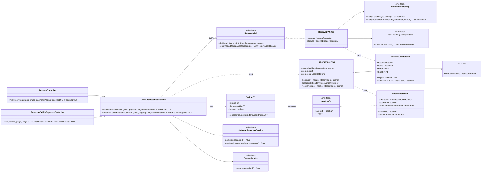
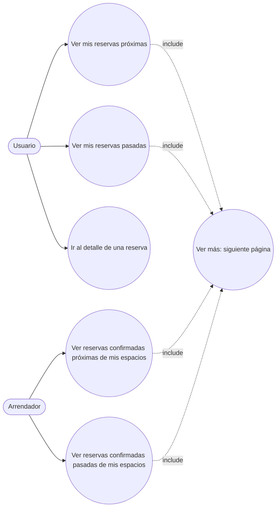
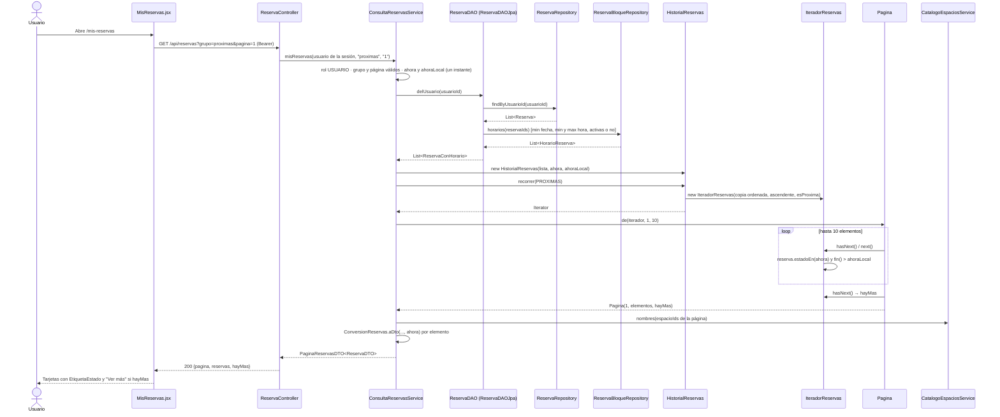
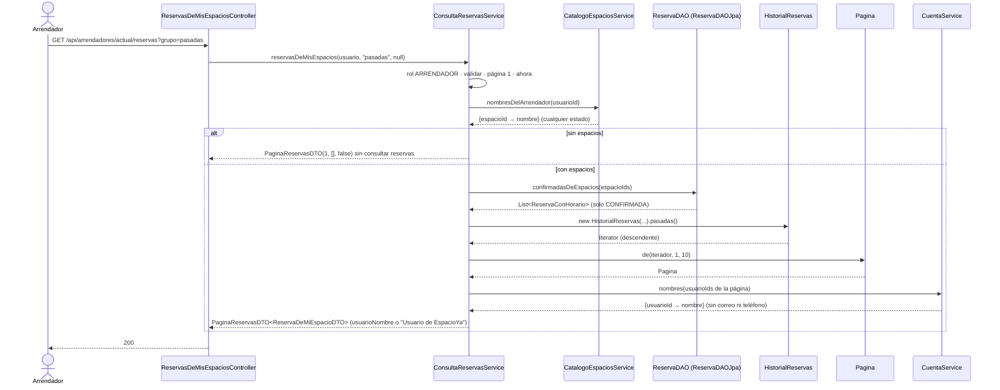

# HU-14 — Design: Mis reservas

> Módulo `reservas` · Sprint 4 · tamaño S · depende de HU-12 (`done`) y HU-13 (`done`, `ec51197`: HU-14 no usa su
> código de producción; contrato verificado en § 11.3) · ★ **Iterator** y **DAO**. Reutiliza `Reserva.estadoEn`, `ReservaDTO`,
> `ReservaRepository`, `ReservaBloqueRepository`, `CatalogoEspaciosService.nombres`, `CuentaService`, `ZonaHoraria`,
> `Clock`, `ValidacionException`, `AccesoDenegadoException`, `ManejadorGlobalErrores` y el kit (`Tarjeta`,
> `EtiquetaEstado`, `Boton`, `Alerta`). D1–D12: decisiones confirmadas por Adriana Callupe el 2026-10-31 (`requirements.md`). Revisado el 2026-10-31 tras integrar HU-13
> (`progress/explore_HU-14_HU-13.md`).

## 1. Decisiones

| # | Hueco | Decisión | Por qué |
|---|-------|----------|---------|
| DT-1 | T1 | **Endpoints:** usuario `GET /api/reservas?grupo=&pagina=` en `ReservaController` (hoy libre); arrendador `GET /api/arrendadores/actual/reservas?grupo=&pagina=` en un controlador nuevo `ReservasDeMisEspaciosController`, dentro de `reservas`. `ConfiguracionSeguridad` no cambia: `anyRequest().authenticated()` ya da el 401. | Patrón de la casa: la identidad sale del token y el arrendador usa `/api/arrendadores/actual/...` (HU-05, HU-07). Ninguna ruta acepta un id de dueño (R7). |
| DT-2 | T2 | **Un grupo por solicitud** (`grupo=proximas|pasadas`), cada uno con su `pagina`. Respuesta genérica `PaginaReservasDTO<T>(pagina, reservas, hayMas)`, sin total, como `ResultadoBusquedaDTO` (HU-10 DT-8). El usuario recibe el **`ReservaDTO` de HU-12 sin cambios**; el arrendador, un DTO nuevo `ReservaDeMiEspacioDTO` sin `usuarioId`, correo, teléfono ni pago. | El servidor decide el corte (principio 6) y cada grupo pagina por su cuenta. Reusar `ReservaDTO` evita un segundo contrato para lo mismo que muestra `/reservas/:id` (aviso de HU-12 en `history.md`). El arrendador necesita un DTO propio para fijar sus claves exactas (R20). |
| DT-3 | T3 | **DAO forma B.** Interfaz `reservas/repository/ReservaDAO` con dos métodos cuyo **primer parámetro es siempre el dueño** (`delUsuario(usuarioId)`, `confirmadasDeEspacios(espacioIds)`), y su implementación `ReservaDAOJpa` (`@Repository`), que combina `ReservaRepository` y `ReservaBloqueRepository` en `ReservaConHorario`. El servicio solo conoce `ReservaDAO`. | Es el primer DAO **explícito** del repo (★ capítulo 8): hace visible en el diagrama la abstracción del acceso a datos. La "reserva con su horario" vive en dos tablas; el DAO esconde las dos consultas y la unión en memoria (R35), y su firma impide pedir reservas sin dueño (STRIDE E/I). Las pruebas del servicio simulan una sola interfaz. No reemplaza a Spring Data: lo usa por dentro, así que "un repositorio por agregado" se mantiene. |
| DT-4 | T4 | **Iterator GoF.** `HistorialReservas` (agregado) guarda una copia **privada** ordenada y no la expone; entrega `proximas()`, `pasadas()` y `recorrer(grupo)` como `java.util.Iterator`. Cada uno es un `IteradorReservas` (iterador concreto, de paquete) que avanza en un sentido y filtra con `ReservaConHorario.esProxima(ahora, ahoraLocal)`. `Pagina.de(iterador, n, 10)` consume el recorrido: salta `(n − 1) × 10`, toma 10 y `hayMas = iterador.hasNext()`. `remove()` lanza `UnsupportedOperationException`. | "Recorrer próximas y pasadas sin exponer la colección" (`architecture.md`). El corte se fija **una vez por solicitud** (un solo `Instant` y su hora de Lima), así que el estado del DTO coincide con el grupo. La página no materializa el grupo entero y `hayMas` sale del propio iterador. Vive en `domain`: no depende de Spring. |
| DT-5 | T5 | **Contratos nuevos, sin puertos:** `CatalogoEspaciosService.nombresDelArrendador(arrendadorId) → Map<Long, String>` (todos sus espacios, cualquier estado) y `CuentaService.nombres(usuarioIds) → Map<Long, String>` (solo nombre no en blanco). Ver § 11. | `reservas → espacios` y `reservas → cuentas` ya están permitidas (`architecture.md`, "Puertos entre módulos"); solo se amplían las interfaces públicas, como hizo HU-12 con `nombres`. Leer `Espacio` o `Usuario` desde `reservas` está prohibido ("Qué NO hacer"). |
| DT-6 | T6 | **El estado se lee siempre con `estadoEn(ahora)`.** El DAO no filtra por tiempo; la clasificación y el `estado` del DTO usan el mismo `ahora`. La única condición de estado en SQL es `estado = CONFIRMADA` para el arrendador, que es equivalente porque `estadoEn` de una `CONFIRMADA` es siempre `CONFIRMADA`. | Una vencida sin procesar sigue `PENDIENTE_PAGO` en la fila (HU-12 D2). Repetir la regla del vencimiento en JPQL abriría la puerta a que diverjan (alternativa 2). |
| DT-7 | T7 | **Sin migración ni índice nuevo.** El usuario usa `ix_reserva_usuario_estado` (prefijo `usuario_id`); el horario usa `ix_reserva_bloque_reserva`. `reserva(espacio_id)` queda sin índice. | Volumen de UAT pequeño (YAGNI). La `V4_1` ya es de HU-13 (`V4_1__pago.sql`); si hiciera falta un índice, iría en una `V4_n__indice_reserva_espacio.sql` con un `n` libre, sin cambiar este diseño. |
| DT-8 | T8 | **Pruebas:** IT nueva `MisReservasControllerIT` que **extiende** `ReservasControllerSoporte` (mismo paquete, mismo contexto en caché, `RelojControlable` en 2026-10-28T15:00Z = 10:00 de Lima) con IP `10.16.x.x` (`10.14.x.x` es de HU-12 y `10.15.x.x` de HU-13); las pasadas, las fechas distintas y los estados raros se siembran con `filaReserva` y `filaBloque`, y un caso de punta a punta de CA2 llega a `CONFIRMADA` por la API con la pasarela simulada, con su propio `@AfterEach` que borra `pago` antes de la limpieza del soporte (D9). IT del DAO `ReservaDAOJpaIT` al estilo de `ReservasDelEspacioImplIT`. Unitarias del Iterator, de `Pagina`, del DAO (Mockito) y del servicio. **Ningún test existente cambia ni se borra:** solo se **agregan** casos a `CuentaServiceImplTest` y `CatalogoEspaciosServiceImplTest`. Las dos interfaces ampliadas solo las implementan sus `Impl` (verificado: no hay dobles que dejen de compilar). | Reutiliza el soporte de HU-12 sin tocarlo; un rango de IP por historia evita compartir cupos. `pago` no tiene cascada desde `reserva` y `ReservasControllerSoporte.limpiar()` no lo borra: en JUnit 5 el `@AfterEach` de la subclase corre antes que el de la superclase. |
| DT-9 | T9 | **Frontend:** `api/reservas.js` gana `listarMisReservas` y `listarReservasDeMisEspacios`; pantallas `MisReservas.jsx` y `ReservasDeMisEspacios.jsx` con una sección compartida de página (`SeccionReservas.jsx`) que muestra un `Boton secundario` "Ver más" mientras `hayMas`. **Sin componente nuevo en el kit** y sin `Imagen` (D6). | Dos listas en una pantalla no encajan con `?pagina=` en la URL de `BuscarEspacios`; "Ver más" por sección es más simple. Extraer `Paginacion` al kit exigiría tocar `frontend.md` para un solo uso. |
| DT-10 | D8 | El rol se comprueba en `ConsultaReservasService` (`"USUARIO"` o `"ARRENDADOR"`) **antes** de validar los parámetros y sin tocar el DAO; los parámetros se validan juntos con `ValidacionException` (R31), como `BusquedaService`. Transacción `@Transactional(readOnly = true)`; sin auditoría (una consulta no es acción sensible, RNF-SEG-12). | Mismo criterio que HU-12 DT-8. Un rol ajeno no debe aprender nada de los parámetros. R38. |
| DT-11 | — | La conversión `Reserva → ReservaDTO` de `ReservaServiceImpl.aDto` se mueve a `reservas/service/ConversionReservas` (clase final de paquete, método estático que recibe el `ahora`). `consultar` y `crear` la usan con `Instant.now(reloj)` como hoy. | Una sola fuente para el ReservaDTO (R11, R12) sin duplicar código. El resultado no cambia: los tests de HU-12 siguen verdes sin tocarlos. |
| DT-12 | D3 | **Clasificación y página en memoria** sobre todas las reservas del dueño, como hace HU-10 con la búsqueda. | Una persona tiene decenas de reservas, no miles. Riesgo aceptado: si el volumen crece, se pasa el corte a SQL (alternativa 2) sin cambiar la API. |
| DT-13 | D1 | El texto "Usuario de EspacioYa" lo pone el **servidor** (`ConsultaReservasService.NOMBRE_USUARIO_POR_DEFECTO`). | `usuarioNombre` nunca es nulo en la API (R19 verificable) y el frontend no decide nada. |

**Sin puerto nuevo** y **sin cambios en `comun`**. La tabla "Puertos entre módulos" no cambia.

## 2. Patrones ★ (Iterator y DAO)

| Rol GoF / J2EE | Clase en HU-14 | Qué hace |
|---|---|---|
| **Iterator** · Aggregate | `reservas.domain.HistorialReservas` | Recibe la lista del DAO, la copia y la ordena una vez (ascendente por fecha, `horaInicio`, id); nunca la devuelve. Fábrica de iteradores: `proximas()`, `pasadas()`, `recorrer(grupo)` |
| **Iterator** · Iterator | `java.util.Iterator<ReservaConHorario>` | Contrato `hasNext()` / `next()` que usan el servicio y `Pagina` |
| **Iterator** · ConcreteIterator | `reservas.domain.IteradorReservas` (de paquete) | Cursor sobre la copia privada, en un sentido (ascendente para próximas, descendente para pasadas) y con un criterio (`esProxima` o su negación). `next()` sin elementos → `NoSuchElementException` |
| **Iterator** · Client | `reservas.domain.Pagina.de(...)` y `ConsultaReservasService` | Consumen el recorrido sin conocer la colección ni el criterio |
| **DAO** · DataAccessObject | `reservas.repository.ReservaDAO` | Interfaz: reservas con horario **siempre** de un dueño |
| **DAO** · implementación | `reservas.repository.ReservaDAOJpa` | Une `Reserva` y su horario con dos consultas (R35) |
| **DAO** · DataSource | `ReservaRepository`, `ReservaBloqueRepository` (Spring Data JPA) | Consultas JPQL |
| **DAO** · TransferObject | `reservas.domain.ReservaConHorario` | Reserva + `fecha`, `horaInicio`, `horaFin` |
| **DAO** · BusinessObject | `ConsultaReservasService` | Solo conoce `ReservaDAO` |

### Diagrama de clases



## 3. Caso de uso



**Mis reservas (CA1)** — Precondición: usuario con sesión. (1) abre `/mis-reservas` desde su panel; (2) la pantalla
pide `grupo=proximas` y `grupo=pasadas`, página 1; (3) la API lee sus reservas con el DAO, fija el corte, recorre el
grupo con el iterador y responde la página; (4) cada tarjeta muestra espacio, fecha, horario, monto y estado; (5) "Ver
más" pide la página siguiente. Alternos: sin sesión → login (R1); rol `ARRENDADOR` o `ADMIN` → 403 (R2); sin reservas →
texto de lista vacía.
**Reservas de mis espacios (CA2)** — Precondición: arrendador con sesión. Igual, en `/panel/reservas`, solo con
`CONFIRMADA` y con el nombre mostrado del usuario. Sin espacios → lista vacía sin consultar reservas (R21).

## 4. Archivos por módulo y capa

Paquete base `pe.edu.ulima.espacioya`. (N) nuevo · (M) modificado.

| Módulo / capa | Archivos | Para |
|---|---|---|
| `reservas/domain/` (N) | `GrupoReservas`, `ReservaConHorario`, `HistorialReservas`, `IteradorReservas`, `Pagina` | R4, R5, R13, R14, R22–R28, R32 |
| `reservas/repository/` (N) | `ReservaDAO`, `ReservaDAOJpa`, `HorarioReserva` | R6, R8, R15, R16, R33–R35 |
| `reservas/repository/` (M) | `ReservaRepository` (`findByUsuarioId`, `findByEspacioIdInAndEstado`), `ReservaBloqueRepository` (`horarios`) | R33–R35 |
| `reservas/dto/` (N) | `PaginaReservasDTO`, `ReservaDeMiEspacioDTO` | R4, R5, R12, R13, R14, R20, R26, R27 |
| `reservas/service/` (N) | `ConsultaReservasService`, `ConversionReservas` | R2–R32, R38 |
| `reservas/service/` (M) | `ReservaServiceImpl` (usa `ConversionReservas`, DT-11) | — (HU-12 R37–R41 sin cambio) |
| `reservas/controller/` (N/M) | `ReservasDeMisEspaciosController` (N), `ReservaController` (M: `GET` sin id) | R1–R5, R7, R13, R14, R28–R30 |
| `espacios/service/` (M) | `CatalogoEspaciosService` + `Impl` (`nombresDelArrendador`) | R16, R17, R21, R37 |
| `cuentas/service/` y `repository/` (M) | `CuentaService` + `Impl` (`nombres`), `UsuarioRepository` (`nombresDe`), `cuentas/repository/NombreCuenta` (N) | R18, R19, R36 |
| Frontend | `api/reservas.js` (M), `pages/reservas/{MisReservas,ReservasDeMisEspacios,SeccionReservas}.jsx` (N, + `.module.css`), `pages/reservas/textosReservas.js` (M), `pages/cuentas/Panel.jsx` (M), `App.jsx` (M) | § 12 |
| Docs (implementer) | `docs/architecture.md`, `docs/frontend.md` | § 11, § 12 |

**Sin migración** (DT-7). **Ningún test existente cambia**; solo se agregan casos (DT-8).

## 5. Endpoints

| Método y ruta | Entrada | Respuestas |
|---|---|---|
| `GET /api/reservas` | `grupo` (obligatorio: `proximas` o `pasadas`), `pagina` (opcional, por defecto 1) | **200** `PaginaReservasDTO<ReservaDTO>` (R4–R12, R22–R28, R32) · **400** por campo `grupo` y/o `pagina` (R29–R31) · **401** (R1) · **403** (R2) |
| `GET /api/arrendadores/actual/reservas` | igual | **200** `PaginaReservasDTO<ReservaDeMiEspacioDTO>` (R13–R21, R22–R28, R32) · **400** (R29–R31) · **401** (R1) · **403** (R3) |

`GET /api/reservas/{id}` y `POST /api/reservas` no cambian.

```java
/** Una página de un grupo de reservas (HU-14): sin total (como HU-10 DT-8). */
public record PaginaReservasDTO<T>(int pagina, List<T> reservas, boolean hayMas) {
    public PaginaReservasDTO { reservas = List.copyOf(reservas); }
}

/** Reserva de un espacio vista por su arrendador (HU-14 CA2): sin usuarioId, correo, teléfono ni pago (R20). */
public record ReservaDeMiEspacioDTO(Long id, Long espacioId, String espacioNombre, String usuarioNombre,
        String estado, LocalDate fecha, int horaInicio, int horaFin, BigDecimal montoTotal) { }
```

Ejemplo `GET /api/reservas?grupo=proximas`:
`{"pagina":1,"reservas":[{"id":7,"espacioId":3,"espacioNombre":"Cancha Los Pinos","estado":"CONFIRMADA",
"fecha":"2026-11-02","horaInicio":18,"horaFin":20,"precioHora":80.50,"montoTotal":161.00,
"expiraEn":"2026-10-28T15:15:00Z","segundosRestantes":0}],"hayMas":false}`

### Mensajes (texto exacto)

| Constante | Texto | Dónde |
|---|---|---|
| `ConsultaReservasService.MENSAJE_GRUPO` | `Elige próximas o pasadas.` | campo `grupo` (R30) |
| `ConsultaReservasService.MENSAJE_PAGINA` | `La página no es válida.` | campo `pagina` (R29); mismo texto que `BusquedaService.MENSAJE_PAGINA_INVALIDA`, repetido porque `reservas` no importa `busqueda` |
| `ConsultaReservasService.NOMBRE_USUARIO_POR_DEFECTO` | `Usuario de EspacioYa` | `usuarioNombre` (R19) |
| `ErrorDTO.MENSAJE_SESION_INVALIDA` (existente) | — | 401 (R1) |
| `ErrorDTO.MENSAJE_ACCESO_DENEGADO` (existente) | — | 403 (R2, R3) |

Con errores de campo, el `ErrorDTO` lleva `MENSAJE_VALIDACION` y la lista `errores` (como HU-10).

## 6. Clases y firmas públicas

```java
// reservas/domain (N)
public enum GrupoReservas { PROXIMAS, PASADAS;
    /** Solo "proximas" o "pasadas" exactos (minúsculas, sin espacios); si no, vacío (R30). */
    public static Optional<GrupoReservas> desde(String texto); }

public record ReservaConHorario(Reserva reserva, LocalDate fecha, int horaInicio, int horaFin) {
    public LocalDateTime inicio();                       // fecha.atTime(horaInicio)
    public LocalDateTime fin();                          // fecha.atStartOfDay().plusHours(horaFin): 24 → día siguiente
    /** Estado leído PENDIENTE_PAGO o CONFIRMADA y fin posterior a ahoraLocal (D2, R22, R23). */
    public boolean esProxima(Instant ahora, LocalDateTime ahoraLocal); }

/** Agregado del Iterator: recorre próximas y pasadas sin exponer la colección (★ HU-14). */
public final class HistorialReservas {
    public HistorialReservas(Collection<ReservaConHorario> reservas, Instant ahora, LocalDateTime ahoraLocal);
    public Iterator<ReservaConHorario> proximas();       // ascendente por (inicio, id) — R24
    public Iterator<ReservaConHorario> pasadas();        // descendente por (inicio, id) — R25
    public Iterator<ReservaConHorario> recorrer(GrupoReservas grupo); }
// Sin getters de la lista ni Iterable sobre todas: el único acceso es por un recorrido.

final class IteradorReservas implements Iterator<ReservaConHorario> {   // de paquete
    IteradorReservas(List<ReservaConHorario> ordenadas, boolean ascendente, Predicate<ReservaConHorario> criterio);
    public boolean hasNext(); public ReservaConHorario next(); }        // remove(): el default lanza

public record Pagina<T>(int numero, List<T> elementos, boolean hayMas) {
    /** Salta (numero − 1) × tamano con aritmética long, toma hasta tamano y hayMas = recorrido.hasNext() (R26, R27, R32). */
    public static <T> Pagina<T> de(Iterator<T> recorrido, int numero, int tamano); }

// reservas/repository (N)
/** DAO de reservas con su horario: toda consulta exige su dueño (★ HU-14, STRIDE E/I). */
public interface ReservaDAO {
    List<ReservaConHorario> delUsuario(Long usuarioId);                         // R33
    List<ReservaConHorario> confirmadasDeEspacios(Collection<Long> espacioIds); // R34: vacía → List.of() sin consultar
}
@Repository class ReservaDAOJpa implements ReservaDAO {
    ReservaDAOJpa(ReservaRepository reservas, ReservaBloqueRepository bloques); }
// Spring Data no la toma como repositorio: ReservaDAO no extiende Repository.
public record HorarioReserva(Long reservaId, LocalDate fecha, short horaInicio, short horaUltima) { }
// Si Hibernate no resuelve el constructor con short para min/max, usar Short (mismo criterio que BloqueActivo).

// reservas/repository (M)
List<Reserva> findByUsuarioId(Long usuarioId);                                              // ReservaRepository
List<Reserva> findByEspacioIdInAndEstado(Collection<Long> espacioIds, EstadoReserva estado); // ReservaRepository
@Query("select new pe.edu.ulima.espacioya.reservas.repository.HorarioReserva("
     + "b.reservaId, min(b.fecha), min(b.horaInicio), max(b.horaInicio)) "
     + "from ReservaBloque b where b.reservaId in :reservaIds group by b.reservaId")
List<HorarioReserva> horarios(@Param("reservaIds") Collection<Long> reservaIds);            // ReservaBloqueRepository
// Sin filtro por activo: el horario de una pasada sale de sus filas liberadas (HU-12 DT-10, R8).

// reservas/dto (N): PaginaReservasDTO<T>, ReservaDeMiEspacioDTO (§ 5)

// reservas/service (N)
@Service public class ConsultaReservasService {
    public static final int TAMANO_PAGINA = 10;
    public static final String MENSAJE_GRUPO, MENSAJE_PAGINA, NOMBRE_USUARIO_POR_DEFECTO;   // § 5
    public ConsultaReservasService(ReservaDAO dao, CatalogoEspaciosService catalogo, CuentaService cuentas, Clock reloj);
    /** @throws AccesoDenegadoException si el rol no es USUARIO. @throws ValidacionException grupo o pagina. */
    @Transactional(readOnly = true)
    public PaginaReservasDTO<ReservaDTO> misReservas(UsuarioAutenticado usuario, String grupo, String pagina);
    /** @throws AccesoDenegadoException si el rol no es ARRENDADOR. @throws ValidacionException grupo o pagina. */
    @Transactional(readOnly = true)
    public PaginaReservasDTO<ReservaDeMiEspacioDTO> reservasDeMisEspacios(UsuarioAutenticado usuario, String grupo,
                                                                          String pagina); }
final class ConversionReservas {   // DT-11
    static ReservaDTO aDto(Reserva reserva, String espacioNombre, LocalDate fecha, int horaInicio, int horaFin,
                           Instant ahora); }   // estadoEn(ahora).name(), segundosRestantes(ahora)

// reservas/controller
@GetMapping public PaginaReservasDTO<ReservaDTO> misReservas(@AuthenticationPrincipal UsuarioAutenticado usuario,
        @RequestParam(required = false) String grupo, @RequestParam(required = false) String pagina); // ReservaController (M)
@RestController @RequestMapping("/api/arrendadores/actual/reservas")
public class ReservasDeMisEspaciosController {
    @GetMapping public PaginaReservasDTO<ReservaDeMiEspacioDTO> listar(UsuarioAutenticado usuario, String grupo,
                                                                      String pagina); }

// espacios (M) — CatalogoEspaciosService
/** Id → nombre de todos los espacios del arrendador, en cualquier estado y sin filtro de visibilidad (HU-14 CA2);
 *  vacío si el id es null o no tiene espacios. Sin sesión ni rol: el llamador pasa el id de la sesión. */
Map<Long, String> nombresDelArrendador(Long arrendadorId);   // Impl: EspacioRepository.findByArrendadorIdOrderByCreadoEnDesc

// cuentas (M) — CuentaService
/** Id → nombre de las cuentas con nombre no nulo ni en blanco; las demás no aparecen. Nunca correo ni teléfono
 *  (RNF-SEG-16). Sin sesión ni rol. Colección vacía → Map.of() sin consultar (HU-14 D1). */
Map<Long, String> nombres(Collection<Long> usuarioIds);
public record NombreCuenta(Long id, String nombre) { }       // cuentas/repository (N), proyección
@Query("select new pe.edu.ulima.espacioya.cuentas.repository.NombreCuenta(u.id, u.nombre) "
     + "from Usuario u where u.id in :ids and u.nombre is not null")
List<NombreCuenta> nombresDe(@Param("ids") Collection<Long> ids);   // UsuarioRepository; el blanco se filtra en Java
```

## 7. Flujos

**`ConsultaReservasService.misReservas`** (`readOnly`): (1) rol ≠ `USUARIO` → `AccesoDenegadoException` (R2), sin tocar
el DAO; (2) `GrupoReservas.desde(grupo)` y `pagina(pagina)` (criterio de HU-10); si alguno falla, `ValidacionException`
con todos los errores (R29–R31); (3) `ahora = Instant.now(reloj)` y `ahoraLocal = LocalDateTime.ofInstant(ahora,
ZonaHoraria.LIMA)`, **un solo instante** (DT-4); (4) `dao.delUsuario(usuario.usuarioId())` (R6, R33); (5) `new
HistorialReservas(lista, ahora, ahoraLocal).recorrer(grupo)` → `Pagina.de(iterador, n, 10)` (R22–R28, R32); (6) si la
página no está vacía, `catalogo.nombres(espacioIds de la página)` (R9); (7) cada elemento →
`ConversionReservas.aDto(..., ahora)` (R8, R10–R12); (8) `new PaginaReservasDTO<>(n, dtos, hayMas)`.

**`reservasDeMisEspacios`** (`readOnly`): (1) rol ≠ `ARRENDADOR` → 403 (R3); (2) validación igual; (3) `espacios =
catalogo.nombresDelArrendador(usuario.usuarioId())` (R16, R17, R37); vacío → `PaginaReservasDTO(n, [], false)` sin DAO
(R21); (4) `dao.confirmadasDeEspacios(espacios.keySet())` (R15, R34); (5) mismo `HistorialReservas` y `Pagina`; (6) si
la página no está vacía, `cuentas.nombres(usuarioIds de la página)` (solo los de la página: minimización); (7)
`ReservaDeMiEspacioDTO` con `espacioNombre` del mapa de espacios y `usuarioNombre` = nombre o
`NOMBRE_USUARIO_POR_DEFECTO` (R18–R20).

**`ReservaDAOJpa.delUsuario`**: `reservas.findByUsuarioId(id)` → vacía: `List.of()` sin segunda consulta → si no,
`bloques.horarios(ids)` → mapa por `reservaId` → `new ReservaConHorario(r, h.fecha(), h.horaInicio(), h.horaUltima() + 1)`.
Una reserva sin filas de `reserva_bloque` (no ocurre por la aplicación) se omite. **`confirmadasDeEspacios`**: colección
vacía → `List.of()` sin consultar; si no, `findByEspacioIdInAndEstado(ids, CONFIRMADA)` y el mismo paso de horarios.

**`IteradorReservas`**: guarda un índice; `hasNext()` avanza hasta el siguiente elemento que cumple el criterio (sin
consumirlo); `next()` lo entrega o lanza `NoSuchElementException`. `pasadas()` recorre la misma copia de atrás hacia
adelante con `not esProxima`.

## 8. Diagramas de secuencia

### Flujo principal: Mis reservas próximas (CA1), con DAO e Iterator



### Flujo principal: Reservas de mis espacios (CA2)



### Flujo de error: rol equivocado y parámetros inválidos

```mermaid
sequenceDiagram
  actor X as Cliente
  participant C as ReservaController
  participant S as ConsultaReservasService
  participant DAO as ReservaDAO
  participant M as ManejadorGlobalErrores
  X->>C: GET /api/reservas?grupo=todas (token de ARRENDADOR)
  C->>S: misReservas(...)
  S-->>M: AccesoDenegadoException (antes de validar; sin DAO)
  M-->>X: 403 "No tienes permiso para realizar esta acción."
  X->>C: GET /api/reservas?grupo=todas&pagina=0 (token de USUARIO)
  C->>S: misReservas(...)
  S-->>M: ValidacionException [grupo, pagina] (sin DAO)
  M-->>X: 400 con los dos errores de campo
  Note over S,DAO: El DAO solo se invoca con el id de la sesión
```

## 9. Migración Flyway

**Ninguna** (DT-7). HU-14 lee `reserva` y `reserva_bloque` tal como las dejó `V3_3__reservas.sql`, y `usuario.nombre`
(`V1_3`). No lee `pago`, que existe desde HU-13 (`V4_1__pago.sql`) y no se lee: el estado del pago y el comprobante
son de HU-28 (D11). Solo la IT de punta a punta de CA2 escribe en `pago` (por la API) y lo borra al terminar (DT-8).

## 10. Excepciones y componentes de `comun`

**Ninguna excepción nueva y sin cambios en `comun`.** `AccesoDenegadoException` (R2, R3), `ValidacionException` con
`ErrorCampoDTO` (R29–R31), el 401 de `PuntoEntradaNoAutenticado` (R1), `ZonaHoraria.LIMA` y `Clock`. No se usan
`AuditoriaService` (R38) ni `LimitadorIntentos` (RNF-SEG-17 no fija cupo para estas consultas).

## 11. Contratos con otros módulos

### 11.1 `espacios` — avisar a **Sebastian Garate** (HU-07, HU-08, HU-10)

`CatalogoEspaciosService.nombresDelArrendador(arrendadorId) → Map<Long, String>`: todos los espacios del arrendador en
cualquier estado, sin filtro de visibilidad y sin sesión. Es para que `reservas` no lea `EspacioRepository`. Nada
existente cambia; el javadoc de la interfaz ya nombra a HU-14. Si alguna vez un espacio se borra físicamente, sus
reservas dejarían de verse para el arrendador: hoy la FK sin cascada lo impide.

### 11.2 `cuentas` — avisar a **Jorge Quispe** (HU-01, HU-03, HU-09)

`CuentaService.nombres(usuarioIds) → Map<Long, String>`: solo el nombre no en blanco, sin sesión ni rol, nunca correo ni
teléfono. **HU-20** (Adriana Callupe, Release 2) completa el nombre del usuario sin cambiar este contrato. **HU-22**
(anonimizar): si deja `nombre` nulo o vacío, el arrendador verá "Usuario de EspacioYa", que es lo correcto.
`CuentaService.correoDe(usuarioId)` existe desde HU-13 (para el webhook de pagos), pero **no** debe usarse para el
arrendador: devolvería el correo del usuario (RNF-SEG-16, R20).

### 11.3 HU-13 — contrato **verificado** contra HU-13 (`ec51197`) (H2, H5)

HU-14 no usa ninguna clase de `pagos` ni de HU-13 en producción (la IT de punta a punta de CA2 solo llama a la API de
pagos, D9). Los siete puntos se verificaron contra el código de HU-13 (`progress/explore_HU-14_HU-13.md` § 2 P1 y § 3);
sin acción para Eduardo Saldaña. Si una historia futura los cambia, avisa a Adriana Callupe y HU-14 ajusta su
clasificación:

1. **(H2) Nombre del estado.** Un pago aprobado deja `reserva.estado = 'CONFIRMADA'`, el valor que ya existe en
   `EstadoReserva`, en `ck_reserva_estado` y en `EtiquetaEstado`. HU-13 **no** agrega un estado intermedio (por
   ejemplo, "pago en proceso") sin coordinarlo: con el diseño actual, un estado desconocido caería en `pasadas` y no se
   le mostraría al arrendador.
2. **(H2) Transición.** Solo una `PENDIENTE_PAGO` **vigente** pasa a `CONFIRMADA` (RN-03, HU-12 § 12). HU-13 no reabre
   una `EXPIRADA` ni cambia `expira_en` de una reserva confirmada.
3. **Horario.** Al confirmar (`Reserva.confirmar`), HU-13 no borra filas de `reserva_bloque`; sigue habiendo al menos una por reserva. HU-14
   lee todas, activas o no.
4. **Monto.** `reserva.monto_total` sigue siendo el monto cobrado; HU-14 lo muestra como "Monto" (no lee `pago.monto`).
5. **(H5) Concurrencia.** HU-14 solo lee, en transacciones `readOnly`, sin bloqueos: no entra en el orden
   `usuario → espacio → reserva` ni compite con el webhook ni con el proceso de expiración. Basta con que HU-13 no
   cambie la semántica de `estado` y `expira_en`.
6. **Datos de pago.** HU-14 no muestra estado del pago, comprobante ni `ultimos4` (D11, HU-28). HU-13 los expone por
   su propio `GET /api/reservas/{id}/pago` (`EstadoPagoDTO`), no por los DTO de HU-14.
7. **Pagar.** El botón "Pagar" está en `/reservas/:id` (`ResumenReserva`, HU-13); "Mis reservas" enlaza ahí **todas**
   las reservas del usuario (D10), así que también llega al aviso de pago no aplicado.

### 11.4 Historias que dependen de HU-14

- **HU-15 (Kevin Chan):** cada tarjeta deja libre `acciones` de `Tarjeta` para "Cancelar" en las `CONFIRMADA` próximas
  (usuario y arrendador). Una `CANCELADA` aparece en las pasadas del usuario (D2) y desaparece de la lista del
  arrendador (solo `CONFIRMADA`, R15); si HU-15 quiere mostrársela, amplía `confirmadasDeEspacios` o agrega un método al
  DAO.
- **HU-21 y HU-22 (RN-16, RN-17, "reservas futuras"):** pueden reutilizar `ReservaConHorario.esProxima`.
- **HU-24 (Adriana Callupe) y HU-26 (Ariel Enriquez):** cuelgan de las pasadas; `ReservaDTO` se puede **ampliar** con
  campos nuevos, sin quitar ni cambiar los existentes.

## 12. Pantallas

Textos en `pages/reservas/textosReservas.js` (M). Errores en `Alerta error` con el mensaje tal cual. Fecha con
`formatoFecha`, horario `formatoHora(horaInicio)–formatoHora(horaFin)` y monto `formatoPrecio` (de
`pages/espacios/textosEspacios.js`), monto en `--color-texto` con `--peso-negrita`. **Ningún componente nuevo en el kit**
y ningún estado nuevo en "Color de cada estado": los cuatro de `Reserva` ya están.

**API — `src/api/reservas.js` (M):**
- `listarMisReservas({ grupo, pagina })` → `GET /api/reservas?grupo=…&pagina=…`.
- `listarReservasDeMisEspacios({ grupo, pagina })` → `GET /api/arrendadores/actual/reservas?grupo=…&pagina=…`.

Ambas arman la consulta con `URLSearchParams`.

**Sección compartida — `pages/reservas/SeccionReservas.jsx` (N, + `.module.css`).** No es del kit: solo la usan las dos
pantallas de reservas. Props `titulo`, `grupo`, `cargar` (una de las dos funciones de la API), `textoVacio` y
`renderReserva`. Al montarse pide la página 1 (patrón `activo` en el efecto, como `ResumenReserva`). Muestra un `<h3>`
con el título, la lista de tarjetas y, si `hayMas`, un `Boton variante="secundario"` "Ver más" con `cargando` que pide la
página siguiente y **agrega** sus elementos sin repetir ids. Lista vacía en la página 1: texto secundario `textoVacio`.
Error: `Alerta error` con el mensaje, sin borrar lo ya cargado.

**Mis reservas — `/mis-reservas` → `pages/reservas/MisReservas.jsx` (N, + `.module.css`), en `RutaProtegida`.**
`<h2>` "Mis reservas" y dos `SeccionReservas`: "Próximas" (`proximas`, "Aún no tienes reservas próximas.") y "Pasadas"
(`pasadas`, "Aún no tienes reservas pasadas.").

- **CA1:** cada reserva es una `Tarjeta` con `titulo = espacioNombre`, `EtiquetaEstado estado={estado}` y un `<dl>` con
  Fecha, Horario y Monto. El orden y la separación son los del servidor.
- **`acciones`:** enlace "Ver espacio" → `/espacios/:espacioId` (D6; si ya no es visible, la ficha muestra el 404 de
  HU-11) y, en **todas** las reservas, en cualquier estado, enlace "Ver reserva" → `/reservas/:id` (D10). Esa pantalla
  (`ResumenReserva`, HU-13) ya tiene el botón "Pagar" para una `PENDIENTE_PAGO` vigente y el aviso de pago no aplicado
  (`PAGADO_TARDIO`, `MONTO_DISTINTO`); HU-14 no la modifica. Sin `CuentaRegresiva` en la lista.
- **403** (un arrendador que escribe la URL): `Alerta error` con el mensaje tal cual, en cada sección.

**Reservas de mis espacios — `/panel/reservas` → `pages/reservas/ReservasDeMisEspacios.jsx` (N, + `.module.css`), en
`RutaProtegida`.** `<h2>` "Reservas de mis espacios" y dos `SeccionReservas` con `listarReservasDeMisEspacios`:
"Próximas" ("Aún no tienes reservas confirmadas próximas.") y "Pasadas" ("Aún no tienes reservas confirmadas
pasadas.").

- **CA2:** `Tarjeta` con `titulo = espacioNombre`, `EtiquetaEstado`, y `<dl>` con Reservado por (`usuarioNombre` tal
  cual), Fecha, Horario y Monto. Nunca correo ni teléfono: la API no los envía.
- **`acciones`:** enlace "Ver espacio" → `/panel/espacios/:espacioId` (la página del dueño, que funciona en cualquier
  estado). HU-15 agregará "Cancelar".

**Panel — `pages/cuentas/Panel.jsx` (M).** `USUARIO`: la descripción pasa a ser un enlace "Mis reservas" →
`/mis-reservas`. `ARRENDADOR`: enlace "Reservas de mis espacios" → `/panel/reservas`, junto a "Mis espacios".
**`App.jsx` (M):** las dos rutas en `<RutaProtegida>`. `RutaProtegida` no cambia (D7).

## 13. Plan de pruebas (R → test)

`MRIT` = `MisReservasControllerIT` (extiende `ReservasControllerSoporte`; reloj en 2026-10-28T15:00Z = miércoles 10:00 de
Lima; IP `10.16.x.x`; segundo usuario y segundo arrendador con su espacio creados en el propio test; reservas pasadas,
fechas distintas y estados raros sembrados con `filaReserva` y `filaBloque`; un caso de punta a punta de CA2 por la API
con la pasarela simulada, D9). `MRIT` tiene su propio `@AfterEach` que borra `pago` antes de la limpieza de
`ReservasControllerSoporte` (que no se toca). Cada test lleva
`@DisplayName("HU-14 R<n>: …")`.

| R | Test |
|---|---|
| R1–R3 | `MRIT` (sin token → 401 en las dos rutas; `ARRENDADOR` y `ADMIN` en `/api/reservas` → 403; `USUARIO` y `ADMIN` en la del arrendador → 403, también con `grupo` inválido), `ConsultaReservasServiceTest` (403 sin invocar el DAO ni el catálogo) |
| R4, R5, R8–R12 | `MRIT` (próximas y pasadas; claves exactas del ReservaDTO; horario de una `EXPIRADA` con filas `activo = false`; espacio `PAUSADO` conserva el nombre; vencida sin procesar → `EXPIRADA` en pasadas y la fila sigue `PENDIENTE_PAGO`; `segundosRestantes` 900 y 0) |
| R6, R7 | `MRIT` (reservas de otro usuario no aparecen; `?usuarioId=<otro>` y `?arrendadorId=<otro>` se ignoran) |
| R4, R13, R15 (CA2 de punta a punta, D9) | `MRIT` (`POST /api/reservas` → `POST /api/reservas/{id}/pago` → `POST /api/reservas/{id}/pago/simulacion` con `{"resultado":"APROBADO"}` → la reserva aparece en `GET /api/arrendadores/actual/reservas?grupo=proximas` del arrendador del espacio y como `CONFIRMADA` en `GET /api/reservas?grupo=proximas` del usuario; sin `JdbcTemplate` para llegar a `CONFIRMADA`) |
| R13–R21 | `MRIT` (solo `CONFIRMADA`; pendiente vigente, vencida, `EXPIRADA` y `CANCELADA` de sus espacios no aparecen; espacios de otro arrendador no aparecen; espacio `PAUSADO` y `BAJA` sí; usuario con nombre → su nombre; sin nombre y con nombre `"   "` → "Usuario de EspacioYa"; claves exactas y ausencia del correo del usuario en el cuerpo; arrendador sin espacios → vacía), `ConsultaReservasServiceTest` (sin espacios → DAO no invocado; `cuentas.nombres` solo con los ids de la página) |
| R22, R23 | `HistorialReservasTest` (con `ahoraLocal` 10:00: fin 10:00 → pasada; fin 11:00 → próxima; 23–24 a las 23:59 → próxima; vigente y `CONFIRMADA` futuras → próximas; vencida en `expiraEn` exacto, `EXPIRADA` y `CANCELADA` futuras → pasadas), `MRIT` (el límite de las 10:00 de punta a punta) |
| R24, R25 | `HistorialReservasTest` (orden por fecha, hora e id en los dos sentidos; empate por id), `MRIT` (orden en la respuesta) |
| R26, R27, R32 | `PaginaTest` (0, 10 y 11 elementos; página 2 de 11 → 1 y `hayMas = false`; página 2 147 483 647 → vacía sin desbordar), `MRIT` (11 próximas: página 1 con 10 y `hayMas`, página 2 con 1; página 5 → vacía) |
| R28–R31 | `MRIT` (sin `pagina` → 1; `pagina` `0`, `-1`, `abc`, `1.5`, `2147483648` → 400 en `pagina`; `grupo` ausente, `PROXIMAS`, `todas`, `""` → 400 en `grupo`; los dos a la vez → un 400 con dos errores), `GrupoReservasTest` |
| — (Iterator) | `HistorialReservasTest` (lista vacía: `hasNext()` falso; `next()` agotado → `NoSuchElementException`; `remove()` → `UnsupportedOperationException`; la lista de entrada modificada después no altera el recorrido) |
| R33–R35 | `ReservaDAOJpaIT` (Testcontainers sin MockMvc: nunca filas de otro usuario ni de otros espacios; solo `CONFIRMADA`; horario con filas inactivas; `horaFin = 24`), `ReservaDAOJpaTest` (Mockito: una llamada a cada repositorio; sin reservas no llama a `horarios`; colección vacía no consulta; reserva sin horario se omite) |
| R36 | `CuentaServiceImplTest` (M: nombre en blanco no aparece; colección vacía → `Map.of()` sin repositorio), `MRIT` (R18, R19 de punta a punta) |
| R37 | `CatalogoEspaciosServiceImplTest` (M: incluye `BORRADOR`, `PAUSADO`, `BAJA`, `OCULTO`; excluye los de otro arrendador; `null` → vacío) |
| R38 | `MRIT` (cuenta de filas de `auditoria` y valores de `reserva` iguales antes y después de las dos rutas) |
| HU-12 (regresión) | `ReservaServiceImplTest`, `ReservaControllerIT`, `ReservaConcurrenciaIT` siguen verdes sin cambios tras DT-11 |

## 14. Alternativas descartadas

1. **DAO forma A (solo ampliar `ReservaRepository` y llamarlo DAO).** Más barata, pero el patrón no se ve en el diagrama
   (★), el servicio quedaría acoplado a Spring Data y a dos repositorios, y la unión del horario se repetiría en cada
   caso de uso.
2. **Corte, orden y página en SQL** (`GROUP BY` por reserva, `HAVING` con hoy y la hora de Lima, `LIMIT/OFFSET`).
   Duplica en JPQL la regla del vencimiento que ya vive en `estadoEn` (DT-6), vuelve compleja la consulta y deja al
   Iterator sin papel. Se reconsidera solo si el volumen por persona crece (DT-12).
3. **Respuesta agrupada `{ proximas: [...], pasadas: [...] }` en una sola llamada** (lo que sugería el explorador).
   Con paginación independiente por grupo exigiría dos parámetros de página y devolvería datos que la pantalla no pidió.
4. **Iterador que pide páginas al DAO bajo demanda.** Une los dos patrones, pero necesita la alternativa 2 para paginar
   en SQL.
5. **JPQL que una `Reserva` con `Espacio` por `arrendadorId`.** `reservas` leería la entidad de `espacios`: prohibido
   ("Qué NO hacer").
6. **Leer `pago` para mostrar el estado del pago o el comprobante.** Existe desde HU-13 (`V4_1`) y no se lee: es de
   HU-28 (D11), y HU-13 ya lo expone en `/reservas/:id` por su propio `GET /api/reservas/{id}/pago`.
7. **El texto "Usuario de EspacioYa" en el frontend.** El contrato tendría `usuarioNombre` nulo y la regla viviría en
   la pantalla (DT-13).
8. **Componente `Paginacion` en el kit.** Un solo uso y obligaría a cambiar `frontend.md`; "Ver más" basta (DT-9).
