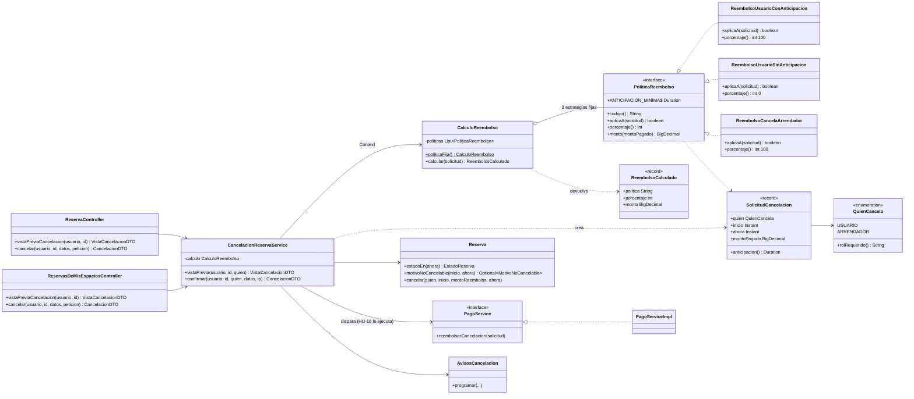
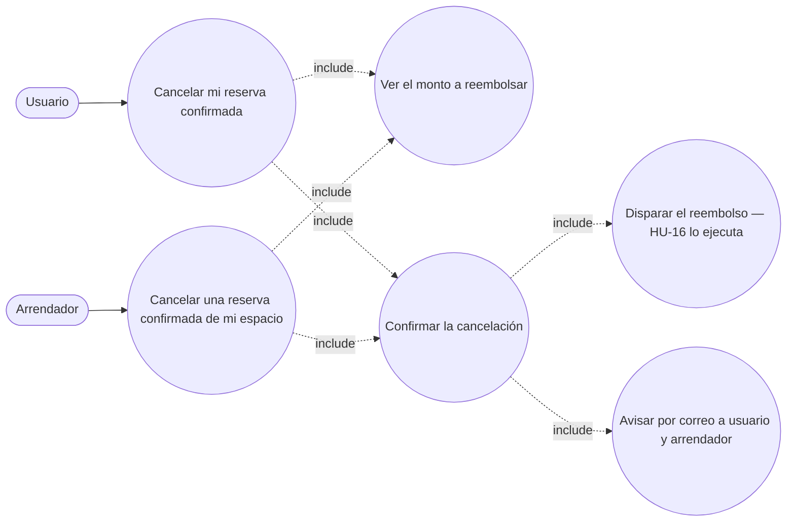
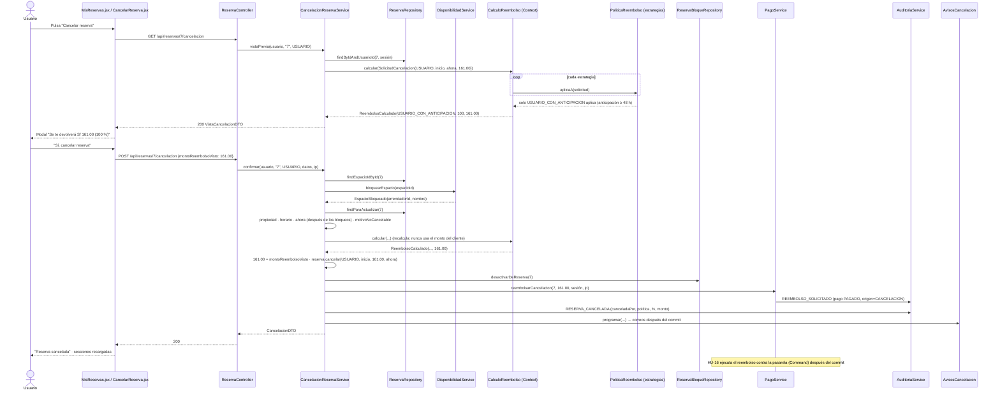
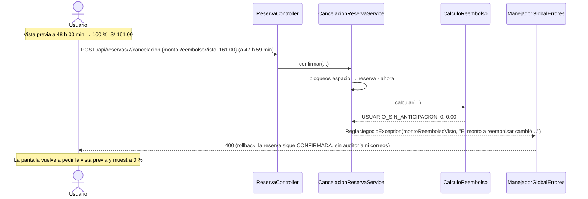
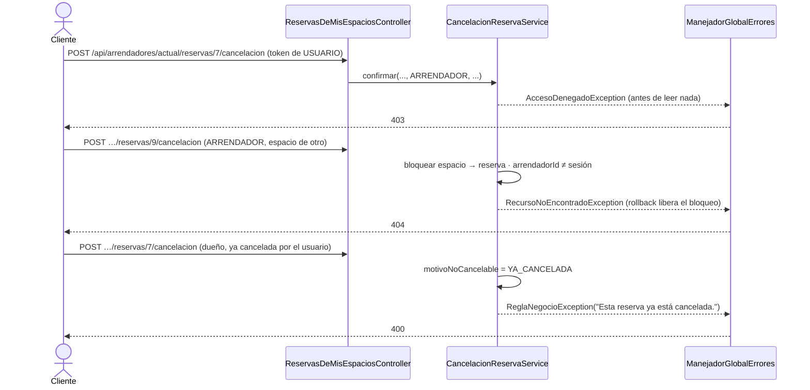

# HU-15 — Design: Cancelación de reservas

> Módulo `reservas` (y `pagos` para el punto de extensión del reembolso) · Sprint 4 · tamaño S · depende de HU-13
> (`done`) y HU-14 (`done`) · ★ **Strategy**. Reutiliza `Reserva.estadoEn`, `ReservaConHorario`, `ConversionReservas`,
> `ReservaRepository.findEspacioIdById` / `findParaActualizar`, `ReservaBloqueRepository.findByReservaIdOrderByHoraInicioAsc`
> / `desactivarDeReserva`, `DisponibilidadService.bloquearEspacio`, `CatalogoEspaciosService.nombres` /
> `nombresDelArrendador`, `CuentaService.correoDe`, `NotificadorCorreo`, `DespuesDelCommit`, `AuditoriaService`,
> `ZonaHoraria`, `Clock`, `IpCliente`, las excepciones de `comun/error` y el kit (`Tarjeta`, `Boton`, `Modal`, `Alerta`,
> `EtiquetaEstado`). D1–D12: decisiones por defecto en `requirements.md`, a confirmar por Kevin Chan.

## 1. Decisiones

| # | Tema | Decisión | Por qué |
|---|------|----------|---------|
| DT-1 | Endpoints (D1) | Usuario: `GET` y `POST /api/reservas/{id}/cancelacion` en `ReservaController`. Arrendador: `GET` y `POST /api/arrendadores/actual/reservas/{id}/cancelacion` en `ReservasDeMisEspaciosController`. Las cuatro delegan en **un** servicio nuevo, `CancelacionReservaService`, pasándole `QuienCancela.USUARIO` o `QuienCancela.ARRENDADOR` según la ruta. `ConfiguracionSeguridad` no cambia (`anyRequest().authenticated()` ya da el 401). | Mismo patrón que HU-14 DT-1: la identidad sale del token y el arrendador usa `/api/arrendadores/actual/...`. La cancelación es un recurso hijo de la reserva (como `/pago` de HU-13): `GET` lee la vista previa y `POST` crea la cancelación. |
| DT-2 | ★ Strategy | `reservas/domain`: interfaz `PoliticaReembolso` (Strategy) y tres estrategias concretas (`ReembolsoUsuarioConAnticipacion`, `ReembolsoUsuarioSinAnticipacion`, `ReembolsoCancelaArrendador`). El contexto `CalculoReembolso` recibe la lista de estrategias y elige **la única** cuyo `aplicaA(solicitud)` es verdadero; el servicio no tiene ningún `if` ni `switch` sobre quién cancela ni sobre las 48 h. `CalculoReembolso.politicaFija()` arma la lista fija de RN-06. Ver § 2. | Es lo que fija `architecture.md` ("interfaz `PoliticaReembolso` con una estrategia por caso; el servicio la elige sin `if` por tipo"). Cada regla de RN-06 queda en una clase que se prueba sola en su borde (48 h exactas). Clases puras, sin Spring: la política es fija (simplificación de la historia), así que no hay beans ni propiedades que la configuren. |
| DT-3 | Qué se cancela (D2) | `Reserva.motivoNoCancelable(inicio, ahora) → Optional<MotivoNoCancelable>` (`YA_CANCELADA`, `NO_CONFIRMADA`, `YA_INICIADA`, en ese orden) y `Reserva.cancelar(quien, inicio, montoReembolso, ahora)`, que lanza `IllegalStateException` si hay motivo (como `confirmar`). El servicio traduce el motivo a `ReglaNegocioException` con su mensaje. | La regla de estados vive en la entidad (convención "métodos de dominio que cambian el estado") y la vista previa y la confirmación usan la misma. Mismo estilo que `ReglasPago.motivoNoDisponible` de HU-13. |
| DT-4 | Bloqueos (R33, R34) | La confirmación copia `ReservasPorCobrarImpl.bloquear`: `findEspacioIdById` (proyección) → `DisponibilidadService.bloquearEspacio` (devuelve `EspacioBloqueado(arrendadorId, nombre)`) → `findParaActualizar` → horario → *ahora* (después de los dos bloqueos) → propiedad, motivo y cálculo. Sin bloqueo de `usuario`: cancelar no toca el cupo de pendientes. `@Transactional` en el método. | Respeta el orden `usuario → espacio → reserva` (un subconjunto no crea ciclos). Dos cancelaciones simultáneas (usuario y arrendador, o dos pestañas) se serializan en el espacio y la segunda ve `CANCELADA` (R34). El webhook y la expiración solo tocan `PENDIENTE_PAGO`: no compiten con una `CONFIRMADA`. `EspacioBloqueado.arrendadorId` da la propiedad del arrendador sin leer `espacios`. |
| DT-5 | Vista previa (R17, R18) | `@Transactional(readOnly = true)`, **sin bloqueos**. Usuario: `findByIdAndUsuarioId`. Arrendador: `findById` y la propiedad con `CatalogoEspaciosService.nombresDelArrendador(sesión).containsKey(espacioId)` (también da el nombre). Calcula con el mismo `CalculoReembolso` y el mismo *ahora*. | Solo informa (CA2); la confirmación recalcula bajo bloqueo (DT-4), así que no hace falta retener nada mientras el usuario lee el modal. |
| DT-6 | Monto visto (D5, R31, R32) | `POST` recibe `ConfirmarCancelacionDTO(BigDecimal montoReembolsoVisto)`. El controlador **no** usa `@Valid`: el servicio comprueba primero el rol (403), luego el id (404) y luego el campo (400), para que un rol ajeno no aprenda nada del cuerpo (como HU-14 DT-10). Tras recalcular bajo bloqueo, `montoReembolsoVisto.compareTo(monto) != 0` → 400 *monto cambió*. Un cuerpo que no es JSON válido o un número mal escrito lo rechaza antes `ManejadorGlobalErrores` con 400 genérico. | El usuario confirma exactamente lo que vio (CA2) aunque el reloj cruce las 48 h entre la vista previa y el clic. El valor del cliente solo se compara; nunca es el monto (STRIDE T, principio 6). |
| DT-7 | Disparo del reembolso (D7) | `pagos.service.PagoService` (interfaz nueva, la que pide `architecture.md`: "HU-15 crea `PagoService`") con `reembolsarCancelacion(ReembolsoPorCancelacion)`, `@Transactional(propagation = MANDATORY)`. `PagoServiceImpl` (en `pagos/service/impl`) busca el pago `PAGADO` de la reserva (`IllegalStateException` si no hay → 500 y rollback, R25), valida `0 < monto ≤ pago.monto` (`IllegalArgumentException`) y registra `REEMBOLSO_SOLICITADO` en la auditoría. Nada más. Con 0 % el servicio de reservas no lo llama (R23). | Es el punto de extensión que HU-16 completa sin cambiar la firma (§ 11.1). `reservas → pagos` es la dirección permitida: **no** es un puerto. Llamarlo dentro de la transacción deja la cancelación y la solicitud juntas o ninguna; HU-16 debe hacer la llamada a la pasarela **después** del commit (ninguna llamada externa retiene filas, regla de HU-13). |
| DT-8 | Migración (R20, R39) | `V4_2__cancelacion_reserva.sql`: `reserva.cancelada_por VARCHAR(20)`, `cancelada_en TIMESTAMPTZ`, `monto_reembolso NUMERIC(10,2)`, todas nulas, con `ck_reserva_cancelada_por` y `ck_reserva_cancelacion` (§ 9). El `CHECK` exige coherencia **solo si hay datos de cancelación**: una `CANCELADA` sin ellos sigue siendo válida. | Los tests de HU-12 y HU-14 siembran `CANCELADA` con `filaReserva` sin esas columnas; un `CHECK` en los dos sentidos los rompería (regla: ningún test existente cambia). En producción no hay `CANCELADA` previas: nadie podía cancelar antes de HU-15. El porcentaje y la política quedan en la auditoría (R35); `monto_reembolso` en la fila lo leen HU-16 y HU-28 sin parsear texto. |
| DT-9 | Correos (D8) | Dos métodos nuevos en `cuentas.service.NotificadorCorreo`: `notificarCancelacionAlUsuario(correo, AvisoCancelacionUsuario)` y `notificarCancelacionAlArrendador(correo, AvisoCancelacionArrendador)`, con records en `cuentas/service`. `NotificadorCorreoSimulado` los implementa con una línea INFO sin correo ni datos. Los envía `reservas/service/AvisosCancelacion` (copia de `AvisosPago`): lee los dos correos con `CuentaService.correoDe` **dentro** de la transacción y envía cada uno con su `DespuesDelCommit.ejecutar`. Los **6 dobles** de `NotificadorCorreo` en los tests (`PagosSoporte.NotificadorFalso`, `UsuarioControllerIT`, `RecuperacionContrasenaControllerIT`, `ArrendadorControllerIT`, `RevisionIdentidadControllerIT`, `CuentaAdminControllerIT`) solo ganan los dos métodos vacíos. | Componente transversal ya construido (§8 de requerimientos); HU-25 lo moverá a `comun/correo`. Mismo patrón que HU-13 D5: un fallo de un correo no impide el otro ni revierte (R28), y sin commit no sale ninguno (R29). `quienCancela` viaja como `String` (`"USUARIO"`/`"ARRENDADOR"`) porque `cuentas` no puede importar el enum de `reservas`. |
| DT-10 | Id de la ruta | La regla "id bien escrito" (`ReservaServiceImpl.idValido`, privada) pasa a `ConversionReservas.idReserva(String) → Optional<Long>` (pública) y `ReservaServiceImpl.consultar` la usa sin cambiar su resultado. | Una sola regla para todas las rutas `/{id}` de reservas (R4); los tests de HU-12 siguen verdes sin tocarlos. |
| DT-11 | Auditoría (R35, R36) | `RESERVA_CANCELADA`, entidad `reserva`, `usuario_id` de la sesión, IP de `IpCliente.de`, detalle `canceladaPor=USUARIO;espacioId=3;politica=USUARIO_CON_ANTICIPACION;porcentaje=100;monto=161.00` (monto con `toPlainString()`). `REEMBOLSO_SOLICITADO`, entidad `pago`, mismo usuario e IP, detalle `origen=CANCELACION;reservaId=7;monto=161.00`. Ambas en la misma transacción: si algo falla, no queda ninguna. | Convención del repo (`ReservaServiceImpl.auditar`, `WebhookPagoService`). Cubre "quién, cuándo y el monto" de STRIDE R con la fecha del `Clock`. |
| DT-12 | Pruebas | IT nueva `CancelacionReservaControllerIT` que **extiende** `ReservasControllerSoporte` con IP `10.17.x.x` (`10.14` HU-12, `10.15` HU-13, `10.16` HU-14), un `@TestConfiguration` anidado con un `NotificadorCorreo` falso `@Primary` que guarda los avisos de cancelación, y su propio `@AfterEach` que borra `pago` antes del `limpiar()` del soporte (como HU-14). Reservas `CONFIRMADA` sembradas con `filaReserva`/`filaBloque` + una fila `pago PAGADO` (helper propio con `JdbcTemplate`), y **un caso de punta a punta** por la API con la pasarela simulada (reservar → pagar → aprobar → vista previa → confirmar → volver a reservar las mismas horas). IT de concurrencia `CancelacionConcurrenciaIT`. Unitarias del Strategy, de `Reserva`, del servicio, de `PagoServiceImpl` y de `AvisosCancelacion`. **Ningún test existente cambia** salvo los 6 dobles (DT-9) y casos **agregados** a `ReservaTest` y `NotificadorCorreoSimuladoTest`; `ConversionReservasTest` y `ReservaConHorarioTest` son nuevos. | `PagosSoporte` es de paquete en `pagos.controller` y no se puede extender desde `reservas.controller`. El reloj del soporte (`RelojControlable`, 2026-10-28T15:00Z = miércoles 10:00 de Lima) permite fijar las 48 h exactas. |

**Sin puerto nuevo** (la tabla "Puertos entre módulos" no cambia) y **sin cambios en `comun`**. `PagoService` es una
interfaz pública de servicio, no un puerto: `reservas → pagos` ya está permitida.

## 2. Patrón ★ Strategy

| Rol GoF | Clase en HU-15 | Qué hace |
|---|---|---|
| **Strategy** | `reservas.domain.PoliticaReembolso` (interfaz) | `codigo()`, `aplicaA(SolicitudCancelacion)` y `porcentaje()`; método `default` `monto(BigDecimal montoPagado)` = `montoPagado × porcentaje / 100` con escala 2 y `HALF_UP` (R16) |
| **ConcreteStrategy** | `reservas.domain.ReembolsoUsuarioConAnticipacion` | Aplica si quien cancela es `USUARIO` y la anticipación ≥ `ANTICIPACION_MINIMA` (48 h). 100 %. Código `USUARIO_CON_ANTICIPACION` (R11) |
| **ConcreteStrategy** | `reservas.domain.ReembolsoUsuarioSinAnticipacion` | Aplica si quien cancela es `USUARIO` y la anticipación < 48 h. 0 %. Código `USUARIO_SIN_ANTICIPACION` (R12) |
| **ConcreteStrategy** | `reservas.domain.ReembolsoCancelaArrendador` | Aplica si quien cancela es `ARRENDADOR`, con cualquier anticipación. 100 %. Código `ARRENDADOR` (R13) |
| **Context** | `reservas.domain.CalculoReembolso` | Guarda la lista inmutable de estrategias; `calcular(solicitud)` filtra las que aplican y exige exactamente una (si no, `IllegalStateException`: es un error de programación, R15); devuelve `ReembolsoCalculado(politica, porcentaje, monto)`. `politicaFija()` crea la lista de RN-06 |
| **Client** | `reservas.service.CancelacionReservaService` | Arma `SolicitudCancelacion(quien, inicio, ahora, montoTotal)` con datos del servidor y llama a `calcular`. **No** decide la regla ni conoce las estrategias concretas |

**Quién elige la estrategia:** el contexto `CalculoReembolso`, preguntando a cada estrategia si `aplicaA` la solicitud.
El papel de quien cancela lo fija la **ruta** (DT-1), la anticipación la calcula el servidor con el horario y el
`Clock`; ninguna de las dos cosas llega del cliente. Agregar una regla (p. ej. HU-21: "baja con reservas → 100 %")
sería agregar una clase a la lista, sin tocar el servicio (OCP). Las tres condiciones son mutuamente excluyentes y
cubren todos los casos; `CalculoReembolsoTest` lo comprueba recorriendo los bordes.

### Diagrama de clases



## 3. Caso de uso



**Cancelar mi reserva (usuario, CA1–CA3)** — Precondición: usuario con sesión y una reserva propia `CONFIRMADA` que aún
no empieza. (1) En "Mis reservas" › Próximas pulsa "Cancelar reserva"; (2) la pantalla pide la vista previa y abre el
`Modal` con el monto pagado y el monto a reembolsar (100 % o 0 %, según la política que eligió el servidor); (3) pulsa
"Sí, cancelar reserva"; (4) la API bloquea espacio y reserva, recalcula, compara con el monto visto, cancela, libera los
bloques, dispara el reembolso si es mayor que 0, audita y programa los dos correos; (5) la pantalla muestra el
mensaje de éxito y recarga las secciones: la reserva aparece en Pasadas como "Cancelada".
Alternos: ya cancelada, no confirmada o ya empezada → 400 con su mensaje (R8–R10); el monto cambió entre la vista
previa y la confirmación → 400 *monto cambió* y la pantalla vuelve a pedir la vista previa (R32); ajena → 404 (R5).
**Cancelar una reserva de mi espacio (arrendador)** — Igual desde "Reservas de mis espacios" › Próximas, siempre con
100 % (R13). Tras cancelar, la reserva desaparece de su lista (D9).

## 4. Archivos por módulo y capa

Paquete base `pe.edu.ulima.espacioya`. (N) nuevo · (M) modificado.

| Módulo / capa | Archivos | Para |
|---|---|---|
| `reservas/domain/` (N) | `QuienCancela`, `MotivoNoCancelable`, `SolicitudCancelacion`, `PoliticaReembolso`, `ReembolsoUsuarioConAnticipacion`, `ReembolsoUsuarioSinAnticipacion`, `ReembolsoCancelaArrendador`, `CalculoReembolso`, `ReembolsoCalculado` | R8–R16 (★ Strategy) |
| `reservas/domain/` (M) | `Reserva` (campos `canceladaPor`, `canceladaEn`, `montoReembolso`; `motivoNoCancelable`, `cancelar`; getters), `ReservaConHorario` (`instanteDeInicio()`) | R8–R10, R14, R19, R20 |
| `reservas/dto/` (N) | `VistaCancelacionDTO`, `CancelacionDTO`, `ConfirmarCancelacionDTO` | R17, R19, R31 |
| `reservas/service/` (N) | `CancelacionReservaService`, `AvisosCancelacion` | R2–R36 |
| `reservas/service/` (M) | `ConversionReservas` (`idReserva`, DT-10) | R4 |
| `reservas/service/impl/` (M) | `ReservaServiceImpl` (usa `ConversionReservas.idReserva`; mismo resultado) | — (HU-12 sin cambio) |
| `reservas/controller/` (M) | `ReservaController` (`GET`/`POST /{id}/cancelacion`), `ReservasDeMisEspaciosController` (`GET`/`POST /{id}/cancelacion`) | R1–R7, R17, R19 |
| `pagos/service/` (N) | `PagoService` (interfaz), `ReembolsoPorCancelacion` (record) | R22, R24 |
| `pagos/service/impl/` (N) | `PagoServiceImpl` | R24, R25 |
| `pagos/repository/` (M) | `PagoRepository` (`findByReservaIdAndEstado`) | R24, R25 |
| `cuentas/service/` (N/M) | `AvisoCancelacionUsuario`, `AvisoCancelacionArrendador` (N); `NotificadorCorreo`, `NotificadorCorreoSimulado` (M: dos métodos) | R26, R27 |
| `resources/db/migration/` (N) | `V4_2__cancelacion_reserva.sql` | R20, R39 |
| Frontend | `components/ui/Modal.jsx` (M: prop `textoCerrar`), `api/reservas.js` (M), `pages/reservas/CancelarReserva.jsx` (N, + `.module.css`), `pages/reservas/MisReservas.jsx` (M), `pages/reservas/ReservasDeMisEspacios.jsx` (M), `pages/reservas/textosReservas.js` (M) | § 12 |
| Docs (implementer) | `docs/architecture.md`, `docs/modelo-datos.md`, `docs/frontend.md` | § 11, § 12 |

## 5. Endpoints

| Método y ruta | Entrada | Respuestas |
|---|---|---|
| `GET /api/reservas/{id}/cancelacion` | `{id}` como texto | **200** `VistaCancelacionDTO` (R17) · **400** *ya cancelada* / *no confirmada* / *ya iniciada* (R8–R10) · **401** (R1) · **403** (R2) · **404** (R4, R5) |
| `POST /api/reservas/{id}/cancelacion` | `{id}` como texto; cuerpo `ConfirmarCancelacionDTO` | **200** `CancelacionDTO` (R19) · **400** campo `montoReembolsoVisto` (R31, R32) o R8–R10 · **401** · **403** (R2) · **404** (R4, R5) · **500** sin pago `PAGADO` (R25) |
| `GET /api/arrendadores/actual/reservas/{id}/cancelacion` | igual | igual, con **403** (R3) y **404** (R4, R6) |
| `POST /api/arrendadores/actual/reservas/{id}/cancelacion` | igual | igual, con **403** (R3) y **404** (R4, R6) |

```java
/** Lo que se reembolsaría si se cancela ahora (HU-15 CA2). Calculado en el servidor (R30). */
public record VistaCancelacionDTO(Long reservaId, String espacioNombre, LocalDate fecha, int horaInicio, int horaFin,
        BigDecimal montoPagado, String politica, int porcentaje, BigDecimal montoReembolso) { }

/** Confirmación (HU-15 CA3). montoReembolsoVisto solo se compara con el recalculado; nunca es el monto (D5). */
public record ConfirmarCancelacionDTO(BigDecimal montoReembolsoVisto) { }

/** Resultado de la cancelación (HU-15 CA3). */
public record CancelacionDTO(Long reservaId, String estado, String canceladaPor, Instant canceladaEn, String politica,
        int porcentaje, BigDecimal montoReembolso) { }
```

Ejemplo `GET /api/reservas/7/cancelacion` (reloj 2026-10-28T15:00Z, reserva 2026-11-02 18:00–20:00):
`{"reservaId":7,"espacioNombre":"Cancha Los Pinos","fecha":"2026-11-02","horaInicio":18,"horaFin":20,
"montoPagado":161.00,"politica":"USUARIO_CON_ANTICIPACION","porcentaje":100,"montoReembolso":161.00}`

Ejemplo `POST /api/reservas/7/cancelacion` con `{"montoReembolsoVisto":161.00}` →
`{"reservaId":7,"estado":"CANCELADA","canceladaPor":"USUARIO","canceladaEn":"2026-10-28T15:00:00Z",
"politica":"USUARIO_CON_ANTICIPACION","porcentaje":100,"montoReembolso":161.00}`

### Mensajes (texto exacto)

| Constante | Texto | Dónde |
|---|---|---|
| `CancelacionReservaService.MENSAJE_YA_CANCELADA` | `Esta reserva ya está cancelada.` | 400 (R8, R34) |
| `CancelacionReservaService.MENSAJE_NO_CONFIRMADA` | `Solo se puede cancelar una reserva confirmada.` | 400 (R9) |
| `CancelacionReservaService.MENSAJE_YA_INICIADA` | `Esta reserva ya empezó o terminó: no se puede cancelar.` | 400 (R10) |
| `CancelacionReservaService.MENSAJE_MONTO_VISTO` | `Indica el monto a reembolsar que se te mostró.` | campo `montoReembolsoVisto` (R31) |
| `CancelacionReservaService.MENSAJE_MONTO_CAMBIO` | `El monto a reembolsar cambió. Revísalo antes de confirmar.` | campo `montoReembolsoVisto` (R32) |
| `ErrorDTO.MENSAJE_SESION_INVALIDA` (existente) | — | 401 (R1) |
| `ErrorDTO.MENSAJE_ACCESO_DENEGADO` (existente) | — | 403 (R2, R3) |
| `ErrorDTO.MENSAJE_RECURSO_NO_ENCONTRADO` (existente) | — | 404 (R4–R6) |
| `ErrorDTO.MENSAJE_INESPERADO` (existente) | — | 500 (R25) |

Los tres primeros van como `ReglaNegocioException(mensaje)` (sin campo); los de `montoReembolsoVisto`, como
`ReglaNegocioException(CAMPO_MONTO_VISTO, mensaje)`: el `ErrorDTO` lleva `MENSAJE_VALIDACION` y un error de campo.

## 6. Clases y firmas públicas

```java
// reservas/domain (N) — ★ Strategy
public enum QuienCancela { USUARIO, ARRENDADOR;
    /** "USUARIO" o "ARRENDADOR": el rol que exige cada ruta (R2, R3). */
    public String rolRequerido(); }

public enum MotivoNoCancelable { YA_CANCELADA, NO_CONFIRMADA, YA_INICIADA }

public record SolicitudCancelacion(QuienCancela quien, Instant inicio, Instant ahora, BigDecimal montoPagado) {
    public Duration anticipacion();                      // Duration.between(ahora, inicio) — R14
}

/** Strategy (★ HU-15): una regla fija de RN-06 para el reembolso de una cancelación. */
public interface PoliticaReembolso {
    Duration ANTICIPACION_MINIMA = Duration.ofHours(48);
    String codigo();
    boolean aplicaA(SolicitudCancelacion solicitud);
    int porcentaje();
    /** montoPagado × porcentaje / 100, escala 2, HALF_UP (R16). */
    default BigDecimal monto(BigDecimal montoPagado);
}
public final class ReembolsoUsuarioConAnticipacion implements PoliticaReembolso { }  // USUARIO y anticipación ≥ 48 h → 100
public final class ReembolsoUsuarioSinAnticipacion implements PoliticaReembolso { }  // USUARIO y anticipación < 48 h → 0
public final class ReembolsoCancelaArrendador implements PoliticaReembolso { }       // ARRENDADOR → 100

public record ReembolsoCalculado(String politica, int porcentaje, BigDecimal monto) { }

/** Context del Strategy: elige la única política que aplica (R15). */
public final class CalculoReembolso {
    public CalculoReembolso(List<PoliticaReembolso> politicas);        // List.copyOf
    /** Las tres reglas fijas de RN-06; no hay configuración (simplificación de la historia). */
    public static CalculoReembolso politicaFija();
    /** @throws IllegalStateException si no aplica ninguna o aplica más de una. */
    public ReembolsoCalculado calcular(SolicitudCancelacion solicitud);
}

// reservas/domain (M) — Reserva
@Enumerated(EnumType.STRING) @Column(name = "cancelada_por", length = 20) private QuienCancela canceladaPor;
@Column(name = "cancelada_en") private Instant canceladaEn;
@Column(name = "monto_reembolso", precision = 10, scale = 2) private BigDecimal montoReembolso;
/** Orden: YA_CANCELADA, NO_CONFIRMADA (estado leído PENDIENTE_PAGO o EXPIRADA), YA_INICIADA (!ahora.isBefore(inicio)). */
public Optional<MotivoNoCancelable> motivoNoCancelable(Instant inicio, Instant ahora);
/** @throws IllegalStateException si motivoNoCancelable no está vacío. Deja CANCELADA y los tres campos (R19, R20). */
public void cancelar(QuienCancela quien, Instant inicio, BigDecimal montoReembolso, Instant ahora);
public QuienCancela getCanceladaPor(); public Instant getCanceladaEn(); public BigDecimal getMontoReembolso();

// reservas/domain (M) — ReservaConHorario
/** inicio() en America/Lima como instante (ZonaHoraria.LIMA) — R14. */
public Instant instanteDeInicio();

// reservas/service (N)
@Service public class CancelacionReservaService {
    public static final String ACCION_RESERVA_CANCELADA = "RESERVA_CANCELADA";
    public static final String MENSAJE_YA_CANCELADA, MENSAJE_NO_CONFIRMADA, MENSAJE_YA_INICIADA,
            MENSAJE_MONTO_VISTO, MENSAJE_MONTO_CAMBIO;                                        // § 5
    public static final String CAMPO_MONTO_VISTO = "montoReembolsoVisto";
    public CancelacionReservaService(ReservaRepository reservas, ReservaBloqueRepository bloques,
            DisponibilidadService disponibilidad, CatalogoEspaciosService catalogo, PagoService pagos,
            AvisosCancelacion avisos, AuditoriaService auditoria, Clock reloj);   // calculo = CalculoReembolso.politicaFija()
    /** @throws AccesoDenegadoException rol ≠ quien.rolRequerido(). @throws RecursoNoEncontradoException id, ajena.
     *  @throws ReglaNegocioException motivo no cancelable. */
    @Transactional(readOnly = true)
    public VistaCancelacionDTO vistaPrevia(UsuarioAutenticado usuario, String id, QuienCancela quien);
    /** Además: ReglaNegocioException en montoReembolsoVisto (falta, negativo, > 2 decimales, distinto). */
    @Transactional
    public CancelacionDTO confirmar(UsuarioAutenticado usuario, String id, QuienCancela quien,
                                    ConfirmarCancelacionDTO datos, String ip);
}
@Service public class AvisosCancelacion {
    public AvisosCancelacion(CuentaService cuentas, NotificadorCorreo notificador);
    /** Dentro de la transacción: lee los dos correos y envía cada aviso con DespuesDelCommit (R26–R29). */
    public void programar(Long usuarioId, Long arrendadorId, String espacioNombre, ReservaConHorario horario,
                          QuienCancela quien, ReembolsoCalculado reembolso);
}

// reservas/service (M) — ConversionReservas (DT-10)
/** 1 a 19 dígitos, sin desbordar un long y mayor que 0; si no, vacío. */
public static Optional<Long> idReserva(String texto);

// reservas/controller (M)
@GetMapping("/{id}/cancelacion")   // ReservaController → vistaPrevia(usuario, id, QuienCancela.USUARIO)
public VistaCancelacionDTO vistaPreviaCancelacion(@AuthenticationPrincipal UsuarioAutenticado usuario,
                                                  @PathVariable String id);
@PostMapping("/{id}/cancelacion")  // → confirmar(usuario, id, USUARIO, datos, IpCliente.de(peticion))
public CancelacionDTO cancelar(@AuthenticationPrincipal UsuarioAutenticado usuario, @PathVariable String id,
                               @RequestBody(required = false) ConfirmarCancelacionDTO datos, HttpServletRequest peticion);
// ReservasDeMisEspaciosController: los mismos dos métodos con QuienCancela.ARRENDADOR.

// pagos/service (N)
/** Servicio público de pagos para otros módulos (architecture.md: "reservas usa PagoService"). */
public interface PagoService {
    /** HU-15: deja solicitado el reembolso de una cancelación contra el pago PAGADO de la reserva, en la transacción
     *  del llamador (MANDATORY). HU-15 solo lo audita; HU-16 lo ejecuta contra la pasarela después del commit.
     *  @throws IllegalStateException si la reserva no tiene pago PAGADO.
     *  @throws IllegalArgumentException si el monto no es > 0 o supera el pago. */
    void reembolsarCancelacion(ReembolsoPorCancelacion solicitud);
}
public record ReembolsoPorCancelacion(Long reservaId, BigDecimal monto, Long solicitadoPor, String ip) { }

// pagos/service/impl (N)
@Service public class PagoServiceImpl implements PagoService {
    public static final String ACCION_REEMBOLSO_SOLICITADO = "REEMBOLSO_SOLICITADO";
    public PagoServiceImpl(PagoRepository pagos, AuditoriaService auditoria);
    @Override @Transactional(propagation = Propagation.MANDATORY)
    public void reembolsarCancelacion(ReembolsoPorCancelacion solicitud); }

// pagos/repository (M) — PagoRepository
/** Solo con PAGADO: uq_pago_reserva_pagado garantiza como mucho uno por reserva. */
Optional<Pago> findByReservaIdAndEstado(Long reservaId, EstadoPago estado);

// cuentas/service (N/M)
public record AvisoCancelacionUsuario(String espacio, LocalDate fecha, int horaInicio, int horaFin, String canceladaPor,
                                      int porcentaje, BigDecimal montoReembolso) { }
/** Sin datos del usuario ni montos (RNF-SEG-16), como AvisoReservaPagada. */
public record AvisoCancelacionArrendador(String espacio, LocalDate fecha, int horaInicio, int horaFin,
                                         String canceladaPor) { }
void notificarCancelacionAlUsuario(String correoUsuario, AvisoCancelacionUsuario aviso);          // NotificadorCorreo
void notificarCancelacionAlArrendador(String correoArrendador, AvisoCancelacionArrendador aviso); // NotificadorCorreo
```

## 7. Flujos

**`vistaPrevia`** (`readOnly`): (1) `usuario.rol()` ≠ `quien.rolRequerido()` → `AccesoDenegadoException` (R2, R3);
(2) `ConversionReservas.idReserva(id)` vacío → 404 (R4); (3) `USUARIO`: `reservas.findByIdAndUsuarioId(id, sesión)`;
`ARRENDADOR`: `reservas.findById(id)` y `catalogo.nombresDelArrendador(sesión)` debe contener su `espacioId` (si no,
404, R5, R6); (4) filas → `ReservaConHorario`; `ahora = Instant.now(reloj)`; `inicio = horario.instanteDeInicio()`;
(5) `reserva.motivoNoCancelable(inicio, ahora)` → 400 con su mensaje (R8–R10); (6) `calculo.calcular(new
SolicitudCancelacion(quien, inicio, ahora, reserva.getMontoTotal()))` (R11–R16, R30); (7) nombre del espacio
(`catalogo.nombres` para el usuario; el mapa del paso 3 para el arrendador) → `VistaCancelacionDTO`. No escribe (R18).

**`confirmar`** (`@Transactional`): (1) rol → 403; (2) id → 404; (3) `datos` nulo, `montoReembolsoVisto` nulo,
negativo o con `scale() > 2` (tras `stripTrailingZeros`) → 400 *monto visto* (R31); (4) `findEspacioIdById(id)` vacío →
404; (5) `espacio = disponibilidad.bloquearEspacio(espacioId)`; (6) `reserva = findParaActualizar(id)` (R33);
(7) propiedad: `USUARIO` → `reserva.getUsuarioId()` = sesión; `ARRENDADOR` → `espacio.arrendadorId()` = sesión; si no,
404 (R5, R6); (8) filas, horario, `ahora` **después** de los bloqueos, `inicio`; (9) motivo → 400 (R8–R10, R34);
(10) `reembolso = calculo.calcular(...)`; (11) `montoReembolsoVisto.compareTo(reembolso.monto()) != 0` → 400 *monto
cambió* (R32); (12) `reserva.cancelar(quien, inicio, reembolso.monto(), ahora)` (R19, R20);
(13) `bloques.desactivarDeReserva(id)` (R21); (14) si `reembolso.monto() > 0` → `pagos.reembolsarCancelacion(new
ReembolsoPorCancelacion(id, monto, sesión, ip))` (R22–R25); (15) auditoría `RESERVA_CANCELADA` (R35);
(16) `avisos.programar(reserva.getUsuarioId(), espacio.arrendadorId(), espacio.nombre(), horario, quien, reembolso)`
(R26–R29); (17) `CancelacionDTO`. Cualquier excepción revierte todo (R36): el 404 de los pasos 4–7 libera el bloqueo
del espacio al hacer rollback.

**`PagoServiceImpl.reembolsarCancelacion`** (`MANDATORY`): `pagos.findByReservaIdAndEstado(reservaId, PAGADO)` vacío →
`IllegalStateException` (→ 500 genérico, rollback de la cancelación, R25); `monto ≤ 0` o `monto > pago.monto` →
`IllegalArgumentException`; auditoría `REEMBOLSO_SOLICITADO` sobre el pago (R24). No toca `pago.estado` ni
`PasarelaPago`.

**`CalculoReembolso.calcular`**: `politicas.stream().filter(p -> p.aplicaA(s)).toList()`; tamaño ≠ 1 →
`IllegalStateException`; si no, `new ReembolsoCalculado(p.codigo(), p.porcentaje(), p.monto(s.montoPagado()))`.

## 8. Diagramas de secuencia

### Flujo principal: el usuario ve el monto y confirma (CA2, CA3), con Strategy



### Flujo de error: el monto cambió entre la vista previa y la confirmación (STRIDE T)



### Flujo de error: ajena, rol equivocado y doble cancelación (STRIDE E)



## 9. Migración Flyway

`2_Backend/src/main/resources/db/migration/V4_2__cancelacion_reserva.sql` (Sprint 4; `V4_1` es de HU-13). **Coordinar
con Ariel Enriquez (HU-16, mismo sprint):** HU-16 toma la siguiente `V4_n` libre (regla de `docs/conventions.md`).

```sql
-- HU-15: quién canceló una reserva, cuándo y cuánto se reembolsa (STRIDE R). Nulos mientras no se cancela.
-- La coherencia solo se exige si hay datos de cancelación: una CANCELADA sin ellos sigue siendo válida.
ALTER TABLE reserva
    ADD COLUMN cancelada_por   VARCHAR(20),
    ADD COLUMN cancelada_en    TIMESTAMPTZ,
    ADD COLUMN monto_reembolso NUMERIC(10, 2);

ALTER TABLE reserva
    ADD CONSTRAINT ck_reserva_cancelada_por
        CHECK (cancelada_por IS NULL OR cancelada_por IN ('USUARIO', 'ARRENDADOR'));

ALTER TABLE reserva
    ADD CONSTRAINT ck_reserva_cancelacion
        CHECK ((cancelada_por IS NULL AND cancelada_en IS NULL AND monto_reembolso IS NULL)
            OR (estado = 'CANCELADA' AND cancelada_por IS NOT NULL AND cancelada_en IS NOT NULL
                AND monto_reembolso IS NOT NULL AND monto_reembolso >= 0 AND monto_reembolso <= monto_total));
```

Sin índices nuevos. `pago` y `reserva_bloque` no cambian. La tabla `reembolso` es de HU-16 (D7).
`docs/modelo-datos.md` (implementer): las tres columnas en `reserva` y las dos restricciones en "Restricciones clave".

## 10. Excepciones y componentes de `comun`

**Ninguna excepción nueva y sin cambios en `comun`.** Se reutilizan `AccesoDenegadoException` (403), 
`RecursoNoEncontradoException` (404), `ReglaNegocioException` con y sin campo (400), el 401 de
`PuntoEntradaNoAutenticado` y el 500 genérico de `ManejadorGlobalErrores` para `IllegalStateException` (R25).
Componentes: `AuditoriaService` (R24, R35), `DespuesDelCommit` (R26–R29), `ZonaHoraria.LIMA` y `Clock` (R14),
`IpCliente` (R35). No se usa `LimitadorIntentos` (D11).

## 11. Contratos con otros módulos

### 11.1 `pagos` / HU-16 — avisar a **Ariel Enriquez**

`PagoService.reembolsarCancelacion(ReembolsoPorCancelacion(reservaId, monto, solicitadoPor, ip))` es el punto de
extensión del reembolso. Lo que HU-15 garantiza y lo que HU-16 hace:

1. **Cuándo se llama:** una sola vez por reserva (la cancelación es única, R34), **dentro** de la transacción de la
   cancelación, con la reserva ya `CANCELADA`, sus bloques liberados y `monto > 0`. Con 0 % no se llama (D6).
2. **Monto:** el que calculó la política, ≤ `pago.monto` del pago `PAGADO` (con HU-13 son iguales: 100 % del pago).
   `reserva.monto_reembolso` guarda el mismo valor.
3. **HU-15 deja en el cuerpo** solo la búsqueda del pago `PAGADO`, la validación del monto y la auditoría
   `REEMBOLSO_SOLICITADO`. **HU-16 reemplaza ese cuerpo** (sin cambiar la firma ni la propagación `MANDATORY`): crea la
   fila de `reembolso` (`origen = CANCELACION`, "un reembolso por pago y origen"), arma el Command `SolicitudReembolso`
   y lo ejecuta **después del commit** (`DespuesDelCommit`) contra `PasarelaPago.reembolsar`, sin retener filas
   durante la llamada externa. Si quiere conservar el registro `REEMBOLSO_SOLICITADO`, lo deja; si no, ajusta R24
   de HU-15 en su propio spec.
4. **Excepciones:** si el cuerpo lanza, la cancelación entera se revierte (R25). Un fallo de la pasarela **no** debe
   lanzar aquí: va a `REEMBOLSO_FALLIDO` (HU-16 CA2) y la cancelación se mantiene.
5. **Filas `sim-`** (D12, RS-5): HU-15 no las filtra; HU-16 decide qué hace `PasarelaSimulada.reembolsar`.

`docs/architecture.md` (implementer): en "Pagos: qué deja HU-13", reemplazar "HU-15 crea `PagoService`: nadie lo usaba
aún" por el contrato anterior, y en la lista de interfaces públicas nombrar `PagoService` con su primer método.

### 11.2 `cuentas` — avisar a **Jorge Quispe** (HU-25 moverá el notificador)

`NotificadorCorreo` gana `notificarCancelacionAlUsuario` y `notificarCancelacionAlArrendador` con sus records. El aviso
al arrendador no lleva datos del usuario ni montos. HU-25 (Factory Method) los tendrá que crear como dos eventos más.

### 11.3 `espacios` — sin cambios

Se usan `DisponibilidadService.bloquearEspacio` (confirmación) y `CatalogoEspaciosService.nombres` /
`nombresDelArrendador` (vista previa) tal como están. Ningún método nuevo.

### 11.4 HU-14 y las historias que siguen

- **HU-14:** sin cambios en su API ni en su DAO (D9). La pantalla gana el botón en `acciones` (§ 12).
- **HU-21 (Sebastian Garate, baja con reservas):** si la baja cancela reservas futuras, puede reutilizar
  `CancelacionReservaService` con `QuienCancela.ARRENDADOR` (100 %) o agregar una estrategia a `CalculoReembolso`.
- **HU-28 (Eduardo Saldaña):** `reserva.monto_reembolso` y `cancelada_en` están disponibles para el historial.

## 12. Pantallas

Textos en `pages/reservas/textosReservas.js` (M), bloque `// HU-15. Solo textos: el monto y la política los decide el
servidor.` Montos con `formatoPrecio`, en `--color-texto` con `--peso-negrita` (nunca en verde ni en rojo). Errores en
`Alerta error` con el mensaje de la API tal cual. **Ningún estado nuevo** en "Color de cada estado": `CANCELADA` ya está
en neutro.

**Kit — `components/ui/Modal.jsx` (M).** Nuevo prop `textoCerrar` (por defecto `"Cancelar"`, así HU-06 y HU-09 no
cambian) para el `Boton secundario` del pie: en "¿Cancelar esta reserva?" un segundo botón "Cancelar" sería ambiguo.
El implementer lo anota en la fila `Modal` de `docs/frontend.md`.

**API — `src/api/reservas.js` (M):**
- `obtenerCancelacion(id)` → `GET /api/reservas/{id}/cancelacion`.
- `cancelarReserva(id, montoReembolsoVisto)` → `POST /api/reservas/{id}/cancelacion` con `{ montoReembolsoVisto }`.
- `obtenerCancelacionDeMiEspacio(id)` → `GET /api/arrendadores/actual/reservas/{id}/cancelacion`.
- `cancelarReservaDeMiEspacio(id, montoReembolsoVisto)` → `POST /api/arrendadores/actual/reservas/{id}/cancelacion`.

Ids con `encodeURIComponent`. `montoReembolsoVisto` es el `montoReembolso` que devolvió la vista previa, sin tocarlo.

**Componente de pantalla — `pages/reservas/CancelarReserva.jsx` (N, + `.module.css`).** No es del kit: solo lo usan las
dos pantallas de reservas. Props `reserva`, `obtener` (una de las dos funciones de vista previa), `confirmar` (la
función de `POST` correspondiente), `paraArrendador` (solo cambia textos) y `onCancelada(resultado)`.
- Un `Boton variante="peligro"` "Cancelar reserva". Al pulsarlo pide la vista previa (`cargando` en el botón); si falla
  (400 *ya iniciada*, 404…), `Alerta error` con el mensaje bajo la tarjeta y no abre el modal.
- **CA2:** con la vista previa abre `Modal` con `titulo` "¿Cancelar esta reserva?", `variante="peligro-confirmar"`,
  `textoConfirmar` "Sí, cancelar reserva", `textoCerrar` "Volver" y `cargando` mientras se confirma. Contenido: un
  `<dl>` con Espacio, Fecha, Horario y Monto pagado (`montoPagado`), y la línea del reembolso según `politica` (solo
  elige el texto; el número es el de la API):
  - `USUARIO_CON_ANTICIPACION`: "Se te devolverá **S/ X** (100 %): cancelas con 48 horas o más de anticipación."
  - `USUARIO_SIN_ANTICIPACION`: "No corresponde reembolso (0 %): faltan menos de 48 horas para el inicio."
  - `ARRENDADOR`: "Al usuario se le devolverá **S/ X** (100 %) y recibirá un correo."
- **CA3:** al confirmar llama a `confirmar(reserva.id, vista.montoReembolso)`; con 200 cierra el modal y llama a
  `onCancelada(resultado)`. Con 400 en `montoReembolsoVisto` (*monto cambió*) muestra el mensaje en `Alerta atencion`
  dentro del modal y vuelve a pedir la vista previa para mostrar el monto nuevo. Con otro error cierra el modal y
  muestra `Alerta error`.

**Mis reservas — `pages/reservas/MisReservas.jsx` (M).** La sección "Próximas" usa una `renderReserva` propia que, si
`reserva.estado === 'CONFIRMADA'`, agrega `CancelarReserva` (con `obtenerCancelacion` y `cancelarReserva`) en
`acciones`, junto a "Ver espacio" y "Ver reserva" (D10). "Pasadas" no cambia. La pantalla guarda un contador
`recarga` que se usa como `key` de las dos `SeccionReservas`: `onCancelada` muestra `Alerta exito` "Reserva cancelada.
Te enviamos un correo con el detalle." (y, si `montoReembolso > 0`, "El reembolso de S/ X está en proceso.") y suma 1
a `recarga`, así las secciones vuelven a la página 1 y la reserva aparece en Pasadas como "Cancelada"
(`EtiquetaEstado` neutro). `SeccionReservas` no cambia.

**Reservas de mis espacios — `pages/reservas/ReservasDeMisEspacios.jsx` (M).** Igual en "Próximas", con
`obtenerCancelacionDeMiEspacio`, `cancelarReservaDeMiEspacio` y `paraArrendador`. Mensaje de éxito: "Reserva
cancelada. Le avisamos al usuario por correo." Tras recargar, la reserva ya no aparece (D9). Se quita el comentario
"HU-15 agregará 'Cancelar'".

Un solo botón primario por pantalla: "Cancelar reserva" es `peligro` (no primario) y el rojo relleno solo aparece en
el `Modal` (`docs/frontend.md`, reglas de uso).

## 13. Plan de pruebas (R → test)

`CRIT` = `CancelacionReservaControllerIT` (extiende `ReservasControllerSoporte`; reloj 2026-10-28T15:00Z = miércoles
10:00 de Lima; IP `10.17.x.x`; `@TestConfiguration` anidado con `NotificadorCorreo` falso `@Primary`; `@AfterEach`
propio que borra `pago`; semillas `filaReserva`/`filaBloque` + `filaPagoPagado` propio). Cada test lleva
`@DisplayName("HU-15 R<n>: …")`.

| R | Test |
|---|---|
| R1 | `CRIT` (las cuatro rutas sin token → 401) |
| R2, R3 | `CRIT` (`ARRENDADOR` y `ADMIN` en la ruta del usuario; `USUARIO` y `ADMIN` en la del arrendador → 403, también con cuerpo `{}` o sin cuerpo; la fila no cambia), `CancelacionReservaServiceTest` (403 sin invocar repositorios) |
| R4 | `CRIT` (`abc`, `0`, `-1`, `1.5`, 20 dígitos → 404), `ConversionReservasTest` (N: `idReserva`) |
| R5, R6 | `CRIT` (reserva de otro usuario; reserva de un espacio de otro arrendador; id inexistente → 404 y la fila sigue `CONFIRMADA` con sus bloques activos) |
| R7, R30 | `CRIT` (cuerpo con `"porcentaje":100,"montoReembolso":161,"canceladaPor":"ARRENDADOR","usuarioId":<otro>` en una cancelación de usuario con < 48 h y `montoReembolsoVisto: 0.00` → 200 con 0 %, `canceladaPor = USUARIO`), `CancelacionReservaServiceTest` |
| R8–R10 | `ReservaTest` (M, casos agregados: `motivoNoCancelable` para `CANCELADA`, `PENDIENTE_PAGO` vigente, vencida, `EXPIRADA`, `CONFIRMADA` con inicio = *ahora* y pasado; `cancelar` lanza `IllegalStateException`), `CRIT` (GET y POST de cada caso → 400 con su mensaje) |
| R11–R16 | `CalculoReembolsoTest` (N: anticipación 48 h exactas → `USUARIO_CON_ANTICIPACION` 100; 48 h − 1 s → `USUARIO_SIN_ANTICIPACION` 0; 1 min → 0; arrendador con 1 h y con 10 días → 100; monto 161.00 → 161.00 y 0.00 con escala 2; para una rejilla de anticipaciones y los dos `QuienCancela`, exactamente una estrategia aplica; lista vacía o dos que aplican → `IllegalStateException`), `ReservaConHorarioTest` (N: `instanteDeInicio` en Lima, también con `horaInicio = 0`), `CRIT` (48 h exactas con `RelojControlable`: reserva 2026-10-30 10:00 Lima → 100 %; reloj +1 s → 0 %) |
| R17, R18 | `CRIT` (claves exactas del `VistaCancelacionDTO`; usuario y arrendador; filas de `auditoria`, `reserva`, `reserva_bloque` y `pago` iguales antes y después) |
| R19–R21 | `CRIT` (200 con claves exactas del `CancelacionDTO`; `estado`, `cancelada_por`, `cancelada_en` = reloj y `monto_reembolso` en la fila; todos los bloques `activo = false`; **otro usuario reserva las mismas horas → 201**) |
| R22, R23 | `CancelacionReservaServiceTest` (con 100 % invoca `reembolsarCancelacion` con id y monto; con 0 % no lo invoca), `CRIT` (con 0 % no hay `REEMBOLSO_SOLICITADO`) |
| R24 | `PagoServiceImplTest` (N, Mockito: audita sobre el pago `PAGADO`; no cambia `pago.estado`; monto 0 o mayor que el pago → `IllegalArgumentException`), `CRIT` (`REEMBOLSO_SOLICITADO` con `entidad = pago`, `origen=CANCELACION` y el monto; `pago.estado` sigue `PAGADO`) |
| R25 | `PagoServiceImplTest` (sin `PAGADO` → `IllegalStateException`), `CRIT` (`CONFIRMADA` sin fila de pago, usuario con ≥ 48 h → 500 genérico; la reserva sigue `CONFIRMADA`, bloques activos, sin auditoría ni correos) |
| R26–R29 | `AvisosCancelacionTest` (N: lee los dos correos dentro de la transacción y registra dos sincronizaciones; el aviso al arrendador no tiene montos), `CRIT` (dos avisos con los datos esperados tras el 200; con el doble configurado para fallar en uno, el otro sale y la respuesta es 200; en los 400/404 no hay avisos), `NotificadorCorreoSimuladoTest` (M, casos agregados: una línea INFO sin el correo) |
| R31, R32 | `CRIT` (sin cuerpo, `{}`, `-1`, `1.001` → 400 en `montoReembolsoVisto`; `161.00` cuando el recalculado es `0.00` → 400 *monto cambió* y la fila sigue `CONFIRMADA`; `161` y `161.0` cuando es `161.00` → 200), `CancelacionReservaServiceTest` |
| R33 | `CancelacionReservaServiceTest` (`InOrder`: `findEspacioIdById` → `bloquearEspacio` → `findParaActualizar` → `reloj.instant()`; el estado sale de la entidad de `findParaActualizar`) |
| R34 | `CancelacionConcurrenciaIT` (N: usuario y arrendador confirman a la vez → un 200 y un 400 *ya cancelada*; un `RESERVA_CANCELADA` y un `REEMBOLSO_SOLICITADO`; estilo `PagoConcurrenciaIT`) |
| R35, R36 | `CRIT` (fila de `auditoria` con `usuario_id` de la sesión, IP de la clase, fecha del reloj y detalle esperado; en cada caso de error, ninguna fila nueva), `CancelacionReservaServiceTest` |
| R37, R38 | `CRIT` (tras cancelar: `GET /api/reservas/{id}` → `CANCELADA`; está en `GET /api/reservas?grupo=pasadas`; no está en `GET /api/arrendadores/actual/reservas?grupo=proximas`) |
| R39 | `CRIT` (con `JdbcTemplate`: `cancelada_por` con `CONFIRMADA`, solo `cancelada_en` sin los otros, `cancelada_por = 'OTRO'`, `monto_reembolso` negativo y mayor que `monto_total` → `DataIntegrityViolationException`; `CANCELADA` sin datos → se acepta) |
| CA1–CA3 de punta a punta | `CRIT` (reservar por la API una fecha a 5 días → pagar → `pago/simulacion` `APROBADO` → vista previa 100 % → confirmar → otro usuario reserva las mismas horas), sin `JdbcTemplate` para llegar a `CONFIRMADA` |
| HU-12, HU-14 (regresión) | `ReservaServiceImplTest`, `ReservaControllerIT`, `MisReservasControllerIT`, `ReservaDAOJpaIT` y demás siguen verdes sin cambios tras DT-8 y DT-10 |

Frontend: sin tests automáticos (no hay Vitest en el repo). Se verifica con `npm --prefix 3_frontend run lint` y
`build` y la caja negra de UAT con la pasarela simulada: (a) usuario, reserva a más de 48 h → modal con 100 % →
cancelar → "Cancelada" en Pasadas y el horario vuelve a estar libre en la ficha; (b) usuario, reserva para mañana →
modal con 0 %; (c) arrendador → modal con 100 % → la reserva desaparece de su lista; (d) los dos correos en el log del
notificador simulado.

## 14. Alternativas descartadas

1. **Un `if`/`switch` en el servicio** (`if (arrendador) 100; else if (horas >= 48) 100; else 0`). Cuatro líneas, pero
   es justo lo que `architecture.md` pide evitar ("sin `if` por tipo") y el patrón ★ no se vería en el diagrama.
2. **`Map<QuienCancela, PoliticaReembolso>` con una estrategia compuesta para el usuario** (que decide las 48 h por
   dentro). Solo dos estrategias, y la regla de las 48 h volvería a ser un `if` escondido; las tres reglas de RN-06
   dejarían de ser tres clases probadas por separado.
3. **Estrategias como beans de Spring (`@Component`) inyectadas como `List<PoliticaReembolso>`.** Invita a
   configurarlas y saca al dominio puro hacia Spring; la historia fija la política (simplificación "no configurable").
   La lista fija en `CalculoReembolso.politicaFija()` basta y se prueba sin contexto.
4. **Recibir el monto o el porcentaje del cliente en el `POST`** (lo que mostró la vista previa). Viola STRIDE T y el
   principio 6. Solo se recibe `montoReembolsoVisto` para **compararlo** (DT-6).
5. **Confirmar sin comparar el monto visto.** Más simple, pero el usuario podría ver 100 % y recibir 0 % si cruza las
   48 h entre la vista previa y el clic, rompiendo CA2 ("veo el monto antes de confirmar").
6. **Evento de dominio de Spring (`ApplicationEventPublisher` + `@TransactionalEventListener`) para disparar el
   reembolso.** No hay precedente en el repo (se usa `DespuesDelCommit`) y oculta la dependencia `reservas → pagos` que
   `architecture.md` pide hacer explícita con `PagoService`.
7. **Crear en HU-15 la tabla `reembolso` y una fila `PENDIENTE`.** Es el modelo de HU-16 (Command, idempotencia,
   estados): HU-15 estaría decidiendo el diseño de otra historia y otro dueño.
8. **Un puerto `reservas.service.puertos.Reembolsos` implementado por `pagos`.** La dirección `reservas → pagos` ya está
   permitida: el puerto sería una indirección sin ciclo que romper.
9. **Métodos `default` vacíos en `NotificadorCorreo`** para no tocar los 6 dobles de test. Un olvido en
   `NotificadorCorreoSimulado` (o en el adaptador real de HU-25) dejaría la cancelación sin correo en silencio.
10. **Mostrar las canceladas al arrendador** ampliando `ReservaDAO.confirmadasDeEspacios`. Cambia el contrato de HU-14
    (R15) sin que un CA lo pida; el correo ya es su constancia (D9).
11. **`CHECK` de coherencia en los dos sentidos** (`estado = 'CANCELADA'` ⇔ columnas no nulas). Rompería las semillas
    `CANCELADA` de los tests de HU-12 y HU-14 (DT-8).
