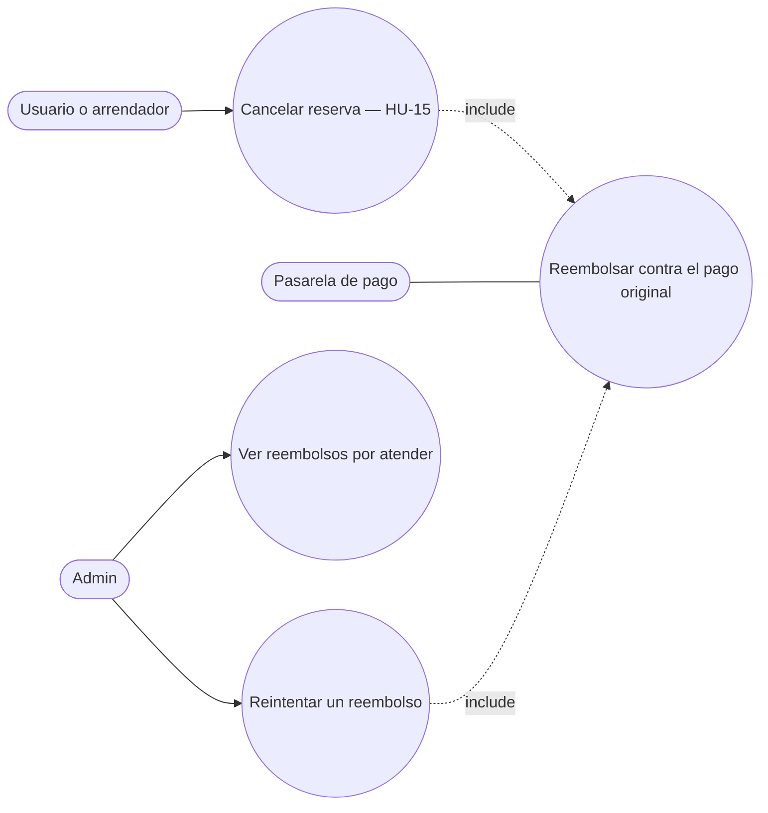
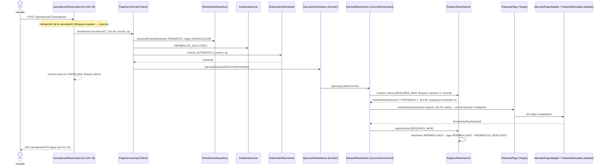
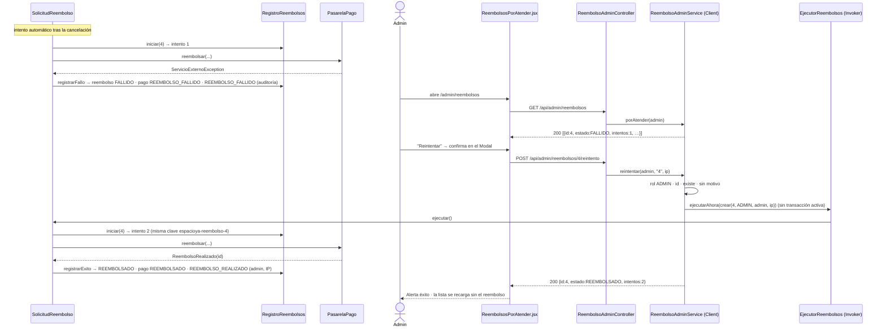
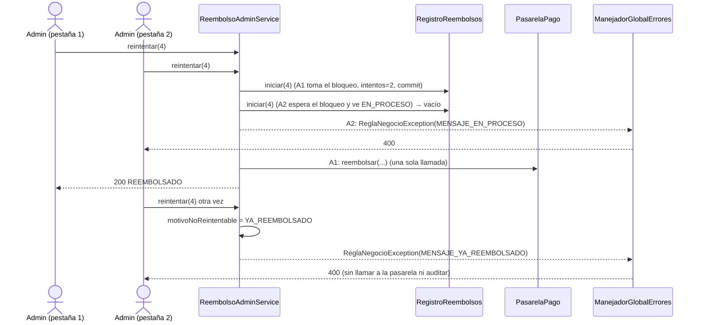

# HU-16 — Design: Reembolso automático

> Módulo `pagos` · Sprint 4 · tamaño S · depende de HU-13 (`done`) y HU-15 (`done`) · ★ **Command** y **Adapter**.
> Reutiliza `PasarelaPago` + `MercadoPagoAdapter` + `PasarelaSimulada` (Adapter de HU-13), `PagoService` /
> `ReembolsoPorCancelacion` / `PagoServiceImpl` (punto de extensión de HU-15), `Pago`, `EstadoPago` (ya tiene
> `REEMBOLSADO` y `REEMBOLSO_FALLIDO` en el enum y en `ck_pago_estado`), `PagoRepository`, `ReglasPago`,
> `DespuesDelCommit`, `AuditoriaService`, `TransactionTemplate`, `Clock`, `IpCliente`, `FiltroIpsAdmin`, las excepciones
> de `comun/error` y el kit (`Tarjeta`, `Boton`, `Modal`, `Alerta`, `EtiquetaEstado`). D1–D13: decisiones por defecto
> en `requirements.md`, a confirmar por Ariel Enriquez.

## 1. Decisiones

| # | Tema | Decisión | Por qué |
|---|------|----------|---------|
| DT-1 | Fuente de verdad (D1) | Tabla nueva `reembolso` (`V4_3`) con su estado `PENDIENTE` → `REEMBOLSADO` / `FALLIDO` (y `FALLIDO` → `PENDIENTE` al reintentar). `pago.estado` refleja el resultado para el resto del sistema (RN-07, HU-28) y se cambia **solo** en la misma transacción que el reembolso, con métodos de dominio nuevos `Pago.marcarReembolsado()` y `Pago.marcarReembolsoFallido()`. Mientras el reembolso está `PENDIENTE`, el pago conserva su estado (`PAGADO` o, en un reintento, `REEMBOLSO_FALLIDO`). | El modelo de datos ya pide `reembolso` con `intentos` y "un reembolso por pago y origen"; HU-26 la reutiliza con `RECLAMO`. Guardar los intentos en `pago` mezclaría el cobro con su devolución. Un solo punto que escribe los dos estados (`RegistroReembolsos`, DT-5) evita que se contradigan. |
| DT-2 | ★ Command | `SolicitudReembolso` es el **ConcreteCommand**: encapsula *qué* reembolso, *quién* lo pidió, *desde qué IP* y *cómo se disparó* (`Disparo.AUTOMATICO` o `ADMIN`), y su `ejecutar()` hace todo el intento contra el **Receiver** `PasarelaPago`. Lo crean dos **Clients** (`PagoServiceImpl` al cancelar y `ReembolsoAdminService` al reintentar) con la fábrica `SolicitudesReembolso`, y lo ejecuta el **Invoker** `EjecutorReembolsos`: después del commit (automático) o ya (reintento). Ver § 2. | Es lo que fija `architecture.md` ("`SolicitudReembolso` con `ejecutar()`, idempotente y reintentable"). La misma petición se ejecuta en dos momentos y por dos actores distintos: el Command la convierte en un objeto que se arma una vez y se ejecuta cuando toca, y el reintento es literalmente "volver a ejecutar el mismo comando" (R40). |
| DT-3 | ★ Adapter | `PasarelaPago` (**Target**) gana `ReembolsoRealizado reembolsar(SolicitudReembolsoPasarela)`, con records propios sin tipos del proveedor. `MercadoPagoAdapter` (**Adapter**) traduce a `POST /v1/payments/{id}/refunds` con `X-Idempotency-Key` (**Adaptee**: API REST de Mercado Pago) y `PasarelaSimulada` (Adapter de la simulación) aprueba los `sim-` o falla según `fallos-reembolso`. Toda falla → `ServicioExternoException`. Ver § 2. | HU-13 ya dejó el Adapter y `architecture.md` dice "HU-16 le agrega `reembolsar`" (RNF-ARQ-08). El comando no sabe qué pasarela hay detrás: con `mercadopago` o `simulada` el código de HU-16 es el mismo, y se elige con `@ConditionalOnProperty` como en HU-13 (sin fábrica). |
| DT-4 | Momento de la llamada (D3, R3–R5) | `PagoServiceImpl.reembolsarCancelacion` (misma firma, `MANDATORY`) valida, crea el reembolso `PENDIENTE` con `saveAndFlush`, audita `REEMBOLSO_SOLICITADO` y entrega el comando a `EjecutorReembolsos.ejecutarDespuesDelCommit`, que lo registra con `DespuesDelCommit.ejecutar`. El intento corre en `afterCommit`, en el mismo hilo, antes de que la cancelación responda. | Contrato de HU-15 § 11.1. Si la cancelación hace rollback no se llama a nadie (R4). `saveAndFlush` hace que la violación de `uq_reembolso_pago_origen` (R19, R20) salte dentro de la transacción del llamador y la revierta. Hacerlo síncrono evita hilos, colas o `@Async`, que el repo no usa (`architecture.md`: sin colas); el costo es que la respuesta de la cancelación espera a la pasarela (≤ 10 s con Mercado Pago). |
| DT-5 | Transacciones del intento (R16, R18) | `SolicitudReembolso.ejecutar()` tiene tres pasos: (1) `RegistroReembolsos.iniciar` en una transacción **`REQUIRES_NEW`** corta: `findParaActualizar` (bloqueo de la fila), `motivoNoReintentable`, `iniciarIntento(ahora)` y commit; (2) `pasarela.reembolsar(...)` **sin** transacción ni bloqueos; (3) `RegistroReembolsos.registrarExito` o `registrarFallo` en otra `REQUIRES_NEW`: vuelve a bloquear el reembolso, cambia reembolso y pago, y audita. `RegistroReembolsos` arma su `TransactionTemplate` con `PROPAGATION_REQUIRES_NEW` desde el `PlatformTransactionManager`. | En `afterCommit` la transacción ya terminó pero sus recursos siguen ligados al hilo: Spring pide `REQUIRES_NEW` para escribir ahí (`AuditoriaService.registrar` es `REQUIRED` y no persistiría). El paso 1 es la **reclamación**: dos intentos a la vez se serializan en el bloqueo y el segundo ve el reembolso en proceso (R22, R23). Ninguna fila queda bloqueada durante la llamada externa (regla de HU-13, `WebhookPagoService`). |
| DT-6 | Atascados (D5) | `Reembolso.MARGEN_SIN_RESPUESTA = Duration.ofMinutes(2)`. `estaEnProceso(ahora)` = `PENDIENTE` y `coalesce(ultimoIntentoEn, creadoEn) > ahora − 2 min`. `motivoNoReintentable(ahora)` → `YA_REEMBOLSADO` o `EN_PROCESO`; vacío si es `FALLIDO` o `PENDIENTE` sin respuesta. El listado del admin usa la misma regla en JPQL. | Si el proceso cae entre la cancelación y el resultado (o falla la base en el paso 3), el reembolso quedaría `PENDIENTE` para siempre. Con el margen, el admin lo ve y lo reintenta; la clave de idempotencia (D6) evita reembolsar dos veces si el primer intento sí llegó a la pasarela. 2 min supera con holgura los 10 s de espera del adaptador. Sin proceso programado (D4). |
| DT-7 | Clave de idempotencia (D6, R24) | `Reembolso.claveIdempotencia()` = `"espacioya-reembolso-" + id`. Viaja en `SolicitudReembolsoPasarela.claveIdempotencia`; Mercado Pago la recibe como `X-Idempotency-Key` y la simulada la usa para contar fallos. | Un reintento tras una respuesta perdida no crea un segundo reembolso en la pasarela (STRIDE T). Es estable porque depende solo del id de la fila, que es único por pago y origen. |
| DT-8 | Endpoints del admin (D4, D8, D9) | `pagos/controller/ReembolsoAdminController` en `/api/admin/reembolsos`: `GET` (por atender) y `POST /{id}/reintento`. Ambos delegan en `pagos/service/ReembolsoAdminService` (clase concreta, sin interfaz), que exige rol `ADMIN` antes de todo. `FiltroIpsAdmin` ya cubre `/api/admin/**` (R27). `{id}` llega como `String` y se valida con `ReglasPago.idBienEscrito` (404 si no). `Cache-Control: no-store` en las dos. El reintento **no** es `@Transactional` (DT-5). | Los reembolsos son de `pagos` (`architecture.md`: `pagos` contiene HU-16) y no hace falta exponer nada nuevo en `PagoService` para `administracion`. Mismo estilo que `CuentaAdminController` (rol en el servicio, `IpCliente.de`, `noStore`). 200 y no 201 en el reintento, como el `POST` de HU-15: la respuesta es el estado del reembolso, no un recurso nuevo. |
| DT-9 | Id de la ruta | `ReglasPago.idBienEscrito(String) → Long` (nulo si no es de 1 a 19 dígitos o no es > 0); `ReglasPago.idDeReserva` pasa a delegar en ella sin cambiar su resultado. | Una sola regla de "id bien escrito" en `pagos`; `pagos` no puede usar `ConversionReservas` (dirección `reservas → pagos`). `ReglasPagoTest` sigue verde. |
| DT-10 | Auditoría (D10, R36–R39) | `REEMBOLSO_SOLICITADO` se mantiene (HU-15). Por intento: `REEMBOLSO_REALIZADO` o `REEMBOLSO_FALLIDO`, entidad `reembolso`, id del reembolso, `usuario_id` e IP del comando, detalle `pagoId=12;reservaId=7;intento=1;disparo=AUTOMATICO;monto=161.00` (+ `;idReembolso=<id de la pasarela>` en el éxito). Nunca el cuerpo ni el código de la respuesta del proveedor (eso va solo al `log.warn` del adaptador, ya sin cuerpo, HU-13 R54). | "Registro de cada intento y resultado" (STRIDE R) con quién, qué, cuándo e IP. El registro va en la misma transacción que el cambio de estado: o quedan los dos o ninguno. |
| DT-11 | Pasarela simulada (D7) | `PasarelaSimulada` recibe `@Value("${espacioya.pagos.simulada.fallos-reembolso:0}") int fallosReembolso` y guarda un `ConcurrentHashMap<String, AtomicInteger>` de llamadas por clave. `reembolsar`: id sin `sim-` → `ServicioExternoException` (R43); llamada *n* ≤ `fallosReembolso` → `ServicioExternoException` (R15); si no, `log.info("Reembolso simulado: no se llamó a ninguna pasarela")` y `ReembolsoRealizado("sim-reembolso-" + clave)` (R14). Propiedad en `application.properties` como `${PAGOS_SIMULADA_FALLOS_REEMBOLSO:0}` y comentada en `.env.example`. | Sin dinero movido, aprobar los `sim-` es lo honesto (RS-5). Con `1`, la demo de CA2 sale sin reiniciar: el automático falla y el botón del admin funciona. El mapa se pierde al reiniciar, como los montos de HU-13: después de un reinicio el contador vuelve a 0 (riesgo aceptado, solo afecta a la simulación). |
| DT-12 | Pruebas | IT nuevas en `pagos.controller` que **extienden** `PagosSoporte` (reloj 2026-10-28T15:00Z, IP propia `10.18.x.x`): `ReembolsoAutomaticoIT` (CA1 de punta a punta por la API: reservar → pagar con la simulada → cancelar → reembolso `REEMBOLSADO` y pago `REEMBOLSADO`) y `ReembolsoAdminControllerIT` con `@SpringBootTest(properties = "espacioya.pagos.simulada.fallos-reembolso=1")` (CA2: el automático falla → el admin lo ve → reintenta → `REEMBOLSADO`). `ReembolsoConcurrenciaIT` (estilo `PagoConcurrenciaIT`). `MercadoPagoAdapterTest` (M) contra `StubMercadoPago` (M: ruta `POST /v1/payments/{id}/refunds` y el encabezado de idempotencia en `Solicitud`). Unitarias del dominio, del comando, del invoker, del registro, del servicio admin y de la simulada. | Mismo andamiaje que HU-13 y HU-15. Ningún test existente cambia salvo los tres casos de "Reemplazos y compatibilidad" de `requirements.md`. |

**Sin puerto nuevo** (la tabla "Puertos entre módulos" no cambia): `reservas → pagos` ya usa `PagoService`, y el admin
llama a `pagos` por su propio controlador. **Sin cambios en `comun`.**

## 2. Patrones ★ Command y Adapter

### Command

| Rol GoF | Clase en HU-16 | Qué hace |
|---|---|---|
| **Command** | `pagos.service.reembolso.ComandoReembolso` (interfaz) | `ResultadoReembolso ejecutar()`. Es lo único que conoce el Invoker |
| **ConcreteCommand** | `pagos.service.reembolso.SolicitudReembolso` (`final`, no es bean) | Guarda `reembolsoId`, `Disparo`, `solicitadoPor`, `ip` y sus colaboradores. `ejecutar()`: reclama el intento (`RegistroReembolsos.iniciar`), llama a `PasarelaPago.reembolsar` sin transacción y registra el resultado. **Idempotente:** si el reembolso ya está `REEMBOLSADO` o en proceso, devuelve `NO_EJECUTADO` sin llamar a la pasarela (R21, R22). **Reintentable:** un `FALLIDO` o un `PENDIENTE` sin respuesta se vuelve a ejecutar con la misma clave de idempotencia (R24) |
| **Receiver** | `pagos.service.pasarela.PasarelaPago` (Target del Adapter) | Hace el trabajo real: devolver el dinero contra la transacción original |
| **Invoker** | `pagos.service.reembolso.EjecutorReembolsos` (`@Component`) | `ejecutarDespuesDelCommit(comando)` (automático: `DespuesDelCommit.ejecutar(comando::ejecutar)`) y `ejecutarAhora(comando)` (reintento: exige que **no** haya transacción activa, `IllegalStateException` si la hay, para no retener filas durante la llamada) |
| **Client** | `PagoServiceImpl` (cancelación) y `ReembolsoAdminService` (reintento) | Crean el comando con `SolicitudesReembolso.crear(reembolsoId, disparo, solicitadoPor, ip)` y se lo pasan al Invoker. No llaman a la pasarela |
| (fábrica) | `pagos.service.reembolso.SolicitudesReembolso` (`@Component`) | Inyecta `PasarelaPago`, `RegistroReembolsos` y `Clock` en cada `SolicitudReembolso`, para que los Clients no los conozcan |
| (apoyo) | `pagos.service.reembolso.RegistroReembolsos` (`@Component`) | Las dos transacciones `REQUIRES_NEW` cortas del comando (DT-5): `iniciar`, `registrarExito`, `registrarFallo` |

**Por qué encaja aquí.** El mismo pedido ("devolver S/ X del pago P") nace en un momento (dentro de la transacción de
la cancelación) y se ejecuta en otro (después del commit), y puede volver a ejecutarse días después por otra persona
(el admin). El Command separa *armar* el pedido de *ejecutarlo*: el Client lo arma con los datos del servidor y el
Invoker decide cuándo correrlo. El reintento no es un camino aparte que copie la lógica, sino el mismo `ejecutar()` (R40),
y la idempotencia vive en un solo lugar (la reclamación del paso 1 + la clave de idempotencia). HU-26 creará el comando
con otro reembolso (`origen = RECLAMO`) sin tocar `SolicitudReembolso`.

**Cómo se prueba.** `SolicitudReembolsoTest` con dobles de `PasarelaPago` y `RegistroReembolsos`: `InOrder` iniciar →
reembolsar → registrarExito; fallo → registrarFallo; reclamación vacía → no llama a la pasarela; misma clave en dos
ejecuciones. `EjecutorReembolsosTest`: `ejecutarDespuesDelCommit` registra una sincronización y no ejecuta hasta
`afterCommit`; `ejecutarAhora` lanza con transacción activa. `PagoServiceImplTest` y `ReembolsoAdminServiceTest`
verifican que los dos Clients crean el comando con su `Disparo` y lo entregan al Invoker (R40). Las IT prueban el
efecto de punta a punta.

### Adapter

| Rol GoF | Clase | Qué hace |
|---|---|---|
| **Target** | `pagos.service.pasarela.PasarelaPago` (M) | Gana `ReembolsoRealizado reembolsar(SolicitudReembolsoPasarela solicitud)`. Records propios en el mismo paquete: `SolicitudReembolsoPasarela(String idTransaccion, BigDecimal monto, String claveIdempotencia)` y `ReembolsoRealizado(String idReembolso)` |
| **Adapter** | `MercadoPagoAdapter` (M) | `POST /v1/payments/{idTransaccion}/refunds`, cuerpo `{"amount": monto}`, encabezados `Authorization: Bearer` (ya en el `RestClient`) y `X-Idempotency-Key`; con `id` y `status = approved` → `ReembolsoRealizado(id)`; si no, `log.warn` sin cuerpo y `ServicioExternoException`. Reutiliza `llamar(operacion, …)` (traduce errores HTTP y de red), los tiempos de espera de 3 s y 7 s y `texto(...)` |
| **Adapter** | `PasarelaSimulada` (M) | Simula la API (DT-11) |
| **Adaptee** | API REST de reembolsos de Mercado Pago; la simulación en memoria | Formato del proveedor (`status`, `amount`, ids numéricos) que no sale del adaptador |
| **Client** | `SolicitudReembolso` | Solo conoce `PasarelaPago` y los dos records |

**Por qué encaja aquí.** El dominio de reembolsos no debe saber de Mercado Pago (RNF-ARQ-08, `architecture.md`: "No
usar el SDK de la pasarela fuera de su adaptador"). Reutilizar el Target de HU-13 hace que UAT (simulada) y producción
(Mercado Pago) ejecuten el mismo comando. **Cómo se prueba.** `MercadoPagoAdapterTest` (M) contra `StubMercadoPago`:
ruta, cuerpo, llave y clave enviados; `approved` → id; 4xx, 5xx, demora mayor que el tiempo de espera, sin `id` o con
`status` `in_process`/`rejected` → `ServicioExternoException` y el cuerpo del stub no aparece en la salida capturada.
`PasarelaSimuladaTest` (M) para R14, R15 y R43. `SeleccionPasarelaTest` sin cambios. `ArquitecturaReembolsoTest`
(N, reflexión sobre las clases de `pagos.service.reembolso`) comprueba que ninguna depende de `RestClient` ni de
`MercadoPagoAdapter` y que `SolicitudReembolso` solo conoce `PasarelaPago` (R41).

### Diagrama de clases

```mermaid
classDiagram
  direction LR
  class PagoService {
    <<interface>>
    +reembolsarCancelacion(ReembolsoPorCancelacion)
  }
  class PagoServiceImpl {
    +reembolsarCancelacion(solicitud)
  }
  class ReembolsoAdminService {
    +porAtender(admin) List~ReembolsoAdminDTO~
    +reintentar(admin, id, ip) ReembolsoAdminDTO
  }
  class ReembolsoAdminController
  class ComandoReembolso {
    <<interface>>
    +ejecutar() ResultadoReembolso
  }
  class SolicitudReembolso {
    -reembolsoId Long
    -disparo Disparo
    -solicitadoPor Long
    -ip String
    +ejecutar() ResultadoReembolso
  }
  class SolicitudesReembolso {
    +crear(reembolsoId, disparo, solicitadoPor, ip) SolicitudReembolso
  }
  class EjecutorReembolsos {
    +ejecutarDespuesDelCommit(ComandoReembolso)
    +ejecutarAhora(ComandoReembolso) ResultadoReembolso
  }
  class RegistroReembolsos {
    +iniciar(id, ahora) Optional~IntentoReembolso~
    +registrarExito(intento, realizado, contexto)
    +registrarFallo(intento, contexto)
  }
  class PasarelaPago {
    <<interface>>
    +crearCheckout(...)
    +cerrarCheckout(...)
    +idNotificado(...)
    +consultarPago(...)
    +reembolsar(SolicitudReembolsoPasarela) ReembolsoRealizado
  }
  class MercadoPagoAdapter
  class PasarelaSimulada
  class MercadoPagoAPI {
    <<Adaptee>>
    POST /v1/payments/id/refunds
  }
  class Reembolso {
    <<entity>>
    +MARGEN_SIN_RESPUESTA$ Duration
    +porCancelacion(pagoId, monto, ahora)$ Reembolso
    +motivoNoReintentable(ahora) Optional~MotivoNoReintentable~
    +iniciarIntento(ahora)
    +marcarReembolsado(idPasarela)
    +marcarFallido()
    +claveIdempotencia() String
  }
  class Pago {
    <<entity>>
    +marcarReembolsado()
    +marcarReembolsoFallido()
  }
  PagoService <|.. PagoServiceImpl
  PagoServiceImpl ..> SolicitudesReembolso : Client crea
  ReembolsoAdminService ..> SolicitudesReembolso : Client crea
  PagoServiceImpl --> EjecutorReembolsos : después del commit
  ReembolsoAdminService --> EjecutorReembolsos : ahora
  ReembolsoAdminController --> ReembolsoAdminService
  SolicitudesReembolso ..> SolicitudReembolso : crea
  ComandoReembolso <|.. SolicitudReembolso
  EjecutorReembolsos --> ComandoReembolso : Invoker
  SolicitudReembolso --> PasarelaPago : Receiver / Target
  SolicitudReembolso --> RegistroReembolsos
  RegistroReembolsos --> Reembolso
  RegistroReembolsos --> Pago
  PasarelaPago <|.. MercadoPagoAdapter : Adapter
  PasarelaPago <|.. PasarelaSimulada : Adapter
  MercadoPagoAdapter --> MercadoPagoAPI : traduce
  Reembolso --> Pago : pago_id
```



## 3. Caso de uso



**Reembolsar al cancelar (CA1)** — Precondición: reserva `CONFIRMADA` con pago `PAGADO` y política con monto > 0
(HU-15). (1) HU-15 cancela y llama a `reembolsarCancelacion` dentro de su transacción; (2) `pagos` crea el reembolso
`PENDIENTE`, audita `REEMBOLSO_SOLICITADO` y deja el comando programado; (3) se confirma la cancelación; (4) el comando
reclama el intento, pide el reembolso a la pasarela contra la transacción original y, con la confirmación, deja reembolso
y pago `REEMBOLSADO` y audita `REEMBOLSO_REALIZADO`; (5) la cancelación responde 200 como en HU-15.
Alterno — **la pasarela falla (CA2):** en (4) reembolso `FALLIDO`, pago `REEMBOLSO_FALLIDO`, auditoría `REEMBOLSO_FALLIDO`;
la cancelación responde igual 200.
**Reintentar (CA2)** — Precondición: admin con sesión desde una IP permitida. (1) En "Reembolsos por atender" ve los
`FALLIDO` y los `PENDIENTE` sin respuesta; (2) pulsa "Reintentar" y confirma en el modal; (3) la API ejecuta el mismo
comando; (4) la pantalla muestra el resultado y recarga la lista (el realizado desaparece; el que volvió a fallar sigue
con un intento más). Alternos: ya reembolsado → 400; en proceso (doble clic, otro admin) → 400; inexistente → 404.

## 4. Archivos por módulo y capa

Paquete base `pe.edu.ulima.espacioya`. (N) nuevo · (M) modificado.

| Módulo / capa | Archivos | Para |
|---|---|---|
| `pagos/domain/` (N) | `Reembolso` (entidad), `EstadoReembolso`, `OrigenReembolso`, `MotivoNoReintentable`, `ReembolsoPorAtender` (record de proyección) | R1, R10, R17–R22, R28, R29, R42 |
| `pagos/domain/` (M) | `Pago` (`marcarReembolsado`, `marcarReembolsoFallido`), `ReglasPago` (`idBienEscrito`; `idDeReserva` delega) | R11, R17, R32 |
| `pagos/repository/` (N) | `ReembolsoRepository` (`findParaActualizar`, `porAtender`, `existsByPagoIdAndOrigen`) | R1, R20, R22, R28 |
| `pagos/service/reembolso/` (N) | `ComandoReembolso`, `SolicitudReembolso`, `SolicitudesReembolso`, `EjecutorReembolsos`, `RegistroReembolsos`, `Disparo`, `ResultadoReembolso`, `IntentoReembolso` (record) | R3–R5, R8–R11, R16–R18, R21–R24, R36–R40 (★ Command) |
| `pagos/service/pasarela/` (N) | `SolicitudReembolsoPasarela`, `ReembolsoRealizado` (records) | R8, R12, R14 |
| `pagos/service/pasarela/` (M) | `PasarelaPago` (`reembolsar`), `MercadoPagoAdapter` (`reembolsar`), `PasarelaSimulada` (`reembolsar`, `fallos-reembolso`) | R12–R15, R41, R43 (★ Adapter) |
| `pagos/service/` (N) | `ReembolsoAdminService` | R26, R28–R35, R39 |
| `pagos/service/` (M) | `PagoService` (solo javadoc: el cuerpo ya lo ejecuta HU-16) | — |
| `pagos/service/impl/` (M) | `PagoServiceImpl` (cuerpo nuevo, misma firma y `MANDATORY`) | R1–R7, R20, R40 |
| `pagos/dto/` (N) | `ReembolsoAdminDTO` | R28, R30, R31 |
| `pagos/controller/` (N) | `ReembolsoAdminController` | R25–R35 |
| `resources/db/migration/` (N) | `V4_3__reembolso.sql` | R19, R42 |
| `resources/` (M) | `application.properties` (`espacioya.pagos.simulada.fallos-reembolso`); `2_Backend/.env.example` (M: `# PAGOS_SIMULADA_FALLOS_REEMBOLSO=0`) | R15 |
| Frontend | `api/pagos.js` (M), `pages/pagos/ReembolsosPorAtender.jsx` (N, + `.module.css`), `pages/pagos/textosPagos.js` (M), `components/ui/EtiquetaEstado.jsx` (M: dos estados), `App.jsx` (M: ruta), `pages/cuentas/Panel.jsx` (M: enlace) | § 12 |
| Tests (M) | `PagoServiceImplTest`, `CancelacionReservaControllerIT` (caso `solicitaElReembolso` + limpieza), `CancelacionConcurrenciaIT`, `PagosSoporte`, `MisReservasControllerIT`, `PagoConcurrenciaIT` (limpieza), `StubMercadoPago`, `MercadoPagoAdapterTest`, `PasarelaSimuladaTest`, `ReglasPagoTest` (casos agregados) | § 13 |
| Docs (implementer) | `docs/architecture.md`, `docs/modelo-datos.md`, `docs/frontend.md` | § 11 |

## 5. Endpoints

| Método y ruta | Entrada | Respuestas |
|---|---|---|
| `POST /api/reservas/{id}/cancelacion` y `POST /api/arrendadores/actual/reservas/{id}/cancelacion` (HU-15, **sin cambios**) | igual que HU-15 | igual que HU-15: **200** `CancelacionDTO` también si el reembolso falla (R7) |
| `GET /api/admin/reembolsos` | — | **200** `List<ReembolsoAdminDTO>`, `Cache-Control: no-store` (R28, R29) · **401** (R25) · **403** rol (R26) o IP (R27) |
| `POST /api/admin/reembolsos/{id}/reintento` | `{id}` como texto; el cuerpo se ignora (R35) | **200** `ReembolsoAdminDTO` con `REEMBOLSADO` (R30) o `FALLIDO` (R31), `no-store` · **400** *ya reembolsado* (R33) / *en proceso* (R23, R34) · **401** · **403** (R26, R27) · **404** (R32) |

```java
/** Un reembolso por atender o el resultado de un reintento (HU-16 CA2). Sin datos del usuario ni de la tarjeta (D8). */
public record ReembolsoAdminDTO(Long id, Long reservaId, BigDecimal monto, String origen, String estado, int intentos,
        Instant creadoEn, Instant ultimoIntentoEn) { }
```

Ejemplo `GET /api/admin/reembolsos` (reloj 2026-10-28T15:10Z):
`[{"id":4,"reservaId":7,"monto":161.00,"origen":"CANCELACION","estado":"FALLIDO","intentos":1,
"creadoEn":"2026-10-28T15:00:00Z","ultimoIntentoEn":"2026-10-28T15:00:00Z"}]`

Ejemplo `POST /api/admin/reembolsos/4/reintento` →
`{"id":4,"reservaId":7,"monto":161.00,"origen":"CANCELACION","estado":"REEMBOLSADO","intentos":2,
"creadoEn":"2026-10-28T15:00:00Z","ultimoIntentoEn":"2026-10-28T15:10:00Z"}`

### Mensajes (texto exacto)

| Constante | Texto | Dónde |
|---|---|---|
| `ReembolsoAdminService.MENSAJE_YA_REEMBOLSADO` | `Este reembolso ya se realizó.` | 400 (R33) |
| `ReembolsoAdminService.MENSAJE_EN_PROCESO` | `Este reembolso se está procesando. Espera un momento y vuelve a cargar la lista.` | 400 (R23, R34) |
| `ErrorDTO.MENSAJE_SESION_INVALIDA` (existente) | — | 401 (R25) |
| `ErrorDTO.MENSAJE_ACCESO_DENEGADO` (existente) | — | 403 (R26, R27) |
| `ErrorDTO.MENSAJE_RECURSO_NO_ENCONTRADO` (existente) | — | 404 (R32) |

Los dos primeros van como `ReglaNegocioException(mensaje)`, sin campo.

## 6. Clases y firmas públicas

```java
// pagos/domain (N)
public enum EstadoReembolso { PENDIENTE, REEMBOLSADO, FALLIDO }
public enum OrigenReembolso { CANCELACION, RECLAMO }          // RECLAMO: HU-26
public enum MotivoNoReintentable { YA_REEMBOLSADO, EN_PROCESO }

@Entity @Table(name = "reembolso")
public class Reembolso {
    public static final Duration MARGEN_SIN_RESPUESTA = Duration.ofMinutes(2);   // D5
    protected Reembolso();
    /** PENDIENTE, intentos 0, creadoEn = ahora (R1). */
    public static Reembolso porCancelacion(Long pagoId, BigDecimal monto, Instant ahora);
    /** YA_REEMBOLSADO si REEMBOLSADO; EN_PROCESO si PENDIENTE y coalesce(ultimoIntentoEn, creadoEn) > ahora − margen. */
    public Optional<MotivoNoReintentable> motivoNoReintentable(Instant ahora);
    /** @throws IllegalStateException si hay motivo. Estado PENDIENTE, intentos + 1, ultimoIntentoEn = ahora (R18). */
    public void iniciarIntento(Instant ahora);
    /** @throws IllegalStateException si no está PENDIENTE (R10). */
    public void marcarReembolsado(String idReembolsoPasarela);
    /** @throws IllegalStateException si no está PENDIENTE (R17). */
    public void marcarFallido();
    /** "espacioya-reembolso-" + id (D6, R24). */
    public String claveIdempotencia();
    // getters: id, pagoId, monto, origen, estado, intentos, creadoEn, ultimoIntentoEn, idReembolsoPasarela
}

/** Proyección del listado del admin (una consulta con la reserva del pago). */
public record ReembolsoPorAtender(Long id, Long reservaId, BigDecimal monto, OrigenReembolso origen,
        EstadoReembolso estado, int intentos, Instant creadoEn, Instant ultimoIntentoEn) { }

// pagos/domain (M) — Pago
/** PAGADO o REEMBOLSO_FALLIDO → REEMBOLSADO; otro estado → IllegalStateException (R11, RN-07). */
public void marcarReembolsado();
/** PAGADO o REEMBOLSO_FALLIDO → REEMBOLSO_FALLIDO; otro estado → IllegalStateException (R17). */
public void marcarReembolsoFallido();

// pagos/domain (M) — ReglasPago
/** 1 a 19 dígitos, sin desbordar un long y > 0; si no, null (DT-9). idDeReserva delega aquí. */
public static Long idBienEscrito(String texto);

// pagos/repository (N)
public interface ReembolsoRepository extends JpaRepository<Reembolso, Long> {
    @Lock(LockModeType.PESSIMISTIC_WRITE) @Query("select r from Reembolso r where r.id = :id")
    Optional<Reembolso> findParaActualizar(@Param("id") Long id);
    boolean existsByPagoIdAndOrigen(Long pagoId, OrigenReembolso origen);
    /** FALLIDO, o PENDIENTE con coalesce(ultimoIntentoEn, creadoEn) <= limite; join con Pago para reservaId;
     *  order by creadoEn, id (R28, R29). */
    @Query("""
        select new pe.edu.ulima.espacioya.pagos.domain.ReembolsoPorAtender(r.id, p.reservaId, r.monto, r.origen,
               r.estado, r.intentos, r.creadoEn, r.ultimoIntentoEn)
        from Reembolso r join Pago p on p.id = r.pagoId
        where r.estado = pe.edu.ulima.espacioya.pagos.domain.EstadoReembolso.FALLIDO
           or (r.estado = pe.edu.ulima.espacioya.pagos.domain.EstadoReembolso.PENDIENTE
               and coalesce(r.ultimoIntentoEn, r.creadoEn) <= :limite)
        order by r.creadoEn, r.id""")
    List<ReembolsoPorAtender> porAtender(@Param("limite") Instant limite);
}

// pagos/service/pasarela (N/M) — ★ Adapter
public record SolicitudReembolsoPasarela(String idTransaccion, BigDecimal monto, String claveIdempotencia) { }
public record ReembolsoRealizado(String idReembolso) { }
public interface PasarelaPago {   // + los 4 métodos de HU-13 sin cambios
    /** Reembolsa monto de la transacción idTransaccion. Solo devuelve si la pasarela lo aprobó.
     *  @throws ServicioExternoException ante cualquier falla, rechazo o respuesta incompleta (R12, R13). */
    ReembolsoRealizado reembolsar(SolicitudReembolsoPasarela solicitud);
}
// MercadoPagoAdapter.reembolsar y PasarelaSimulada.reembolsar: § 2 y DT-11.
// PasarelaSimulada (M): constructor gana @Value("${espacioya.pagos.simulada.fallos-reembolso:0}") int fallosReembolso.

// pagos/service/reembolso (N) — ★ Command
public enum Disparo { AUTOMATICO, ADMIN }
public enum ResultadoReembolso { REEMBOLSADO, FALLIDO, NO_EJECUTADO }
/** Lo que el paso 1 reclamó: datos leídos bajo bloqueo para el resto del intento. */
public record IntentoReembolso(Long reembolsoId, Long pagoId, Long reservaId, String idTransaccion, BigDecimal monto,
        int numero, String claveIdempotencia) { }

/** Command (★ HU-16). */
public interface ComandoReembolso { ResultadoReembolso ejecutar(); }

/** ConcreteCommand: un intento idempotente y reintentable del reembolso reembolsoId (DT-2, DT-5). */
public final class SolicitudReembolso implements ComandoReembolso {
    SolicitudReembolso(Long reembolsoId, Disparo disparo, Long solicitadoPor, String ip,
                       PasarelaPago pasarela, RegistroReembolsos registro, Clock reloj);   // de paquete: la crea la fábrica
    @Override public ResultadoReembolso ejecutar();
    public Long reembolsoId(); public Disparo disparo(); public Long solicitadoPor(); public String ip();
}

@Component public class SolicitudesReembolso {
    public SolicitudesReembolso(PasarelaPago pasarela, RegistroReembolsos registro, Clock reloj);
    public SolicitudReembolso crear(Long reembolsoId, Disparo disparo, Long solicitadoPor, String ip);
}

/** Invoker. */
@Component public class EjecutorReembolsos {
    /** Exige transacción activa (la de DespuesDelCommit); el comando corre en afterCommit (R3–R5). */
    public void ejecutarDespuesDelCommit(ComandoReembolso comando);
    /** @throws IllegalStateException si hay una transacción activa: la llamada externa no debe retener filas (R16). */
    public ResultadoReembolso ejecutarAhora(ComandoReembolso comando);
}

/** Transacciones REQUIRES_NEW cortas del comando (DT-5). */
@Component public class RegistroReembolsos {
    public static final String ACCION_REEMBOLSO_REALIZADO = "REEMBOLSO_REALIZADO";
    public static final String ACCION_REEMBOLSO_FALLIDO = "REEMBOLSO_FALLIDO";
    public RegistroReembolsos(ReembolsoRepository reembolsos, PagoRepository pagos, AuditoriaService auditoria,
                              PlatformTransactionManager transacciones);
    /** Bloquea, comprueba motivoNoReintentable, iniciarIntento y confirma. Vacío si hay motivo o no existe (R18, R21, R22). */
    public Optional<IntentoReembolso> iniciar(Long reembolsoId, Instant ahora);
    /** Reembolso REEMBOLSADO + pago REEMBOLSADO + REEMBOLSO_REALIZADO, en una transacción (R10, R11, R36, R38). */
    public void registrarExito(IntentoReembolso intento, ReembolsoRealizado realizado, SolicitudReembolso comando);
    /** Reembolso FALLIDO + pago REEMBOLSO_FALLIDO + REEMBOLSO_FALLIDO, en una transacción (R17, R37, R38). */
    public void registrarFallo(IntentoReembolso intento, SolicitudReembolso comando);
}

// pagos/service/impl (M) — Client 1
@Service public class PagoServiceImpl implements PagoService {
    public static final String ACCION_REEMBOLSO_SOLICITADO = "REEMBOLSO_SOLICITADO";        // sin cambios
    public PagoServiceImpl(PagoRepository pagos, ReembolsoRepository reembolsos, SolicitudesReembolso solicitudes,
                           EjecutorReembolsos ejecutor, AuditoriaService auditoria, Clock reloj);
    @Override @Transactional(propagation = Propagation.MANDATORY)
    public void reembolsarCancelacion(ReembolsoPorCancelacion solicitud);
}

// pagos/service (N) — Client 2
@Service public class ReembolsoAdminService {
    public static final String MENSAJE_YA_REEMBOLSADO, MENSAJE_EN_PROCESO;                  // § 5
    public ReembolsoAdminService(ReembolsoRepository reembolsos, PagoRepository pagos,
            SolicitudesReembolso solicitudes, EjecutorReembolsos ejecutor, Clock reloj);
    /** @throws AccesoDenegadoException si el rol no es ADMIN. */
    @Transactional(readOnly = true)
    public List<ReembolsoAdminDTO> porAtender(UsuarioAutenticado admin);
    /** Sin @Transactional (DT-5). @throws AccesoDenegadoException, RecursoNoEncontradoException, ReglaNegocioException. */
    public ReembolsoAdminDTO reintentar(UsuarioAutenticado admin, String id, String ip);
}

// pagos/controller (N)
@RestController @RequestMapping("/api/admin/reembolsos")
public class ReembolsoAdminController {
    @GetMapping public ResponseEntity<List<ReembolsoAdminDTO>> porAtender(@AuthenticationPrincipal UsuarioAutenticado admin);
    @PostMapping("/{id}/reintento")
    public ResponseEntity<ReembolsoAdminDTO> reintentar(@AuthenticationPrincipal UsuarioAutenticado admin,
                                                        @PathVariable String id, HttpServletRequest peticion);
}
```

## 7. Flujos

**`PagoServiceImpl.reembolsarCancelacion`** (`MANDATORY`): (1) `pagos.findByReservaIdAndEstado(reservaId, PAGADO)` vacío
→ `IllegalStateException` (R6, HU-15 R25); (2) `0 < monto ≤ pago.monto` o `IllegalArgumentException` (R6);
(3) `reembolsos.existsByPagoIdAndOrigen(pago.id, CANCELACION)` → `IllegalStateException` (R20; la restricción
`uq_reembolso_pago_origen` es la última defensa, R19); (4) `reembolso = reembolsos.saveAndFlush(Reembolso.porCancelacion(
pago.id, monto, ahora))` (R1); (5) auditoría `REEMBOLSO_SOLICITADO` igual que HU-15 (R2); (6) `ejecutor.ejecutarDespuesDelCommit(
solicitudes.crear(reembolso.id, AUTOMATICO, solicitadoPor, ip))` (R3–R5, R40). Nada lanza por la pasarela aquí (R7).

**`SolicitudReembolso.ejecutar()`**: (1) `intento = registro.iniciar(reembolsoId, Instant.now(reloj))`; vacío →
`NO_EJECUTADO` (R21, R22); (2) **sin transacción**: `realizado = pasarela.reembolsar(new SolicitudReembolsoPasarela(
intento.idTransaccion, intento.monto, intento.claveIdempotencia))` (R8, R9, R16, R24); (3) éxito →
`registro.registrarExito(intento, realizado, this)` → `REEMBOLSADO`; cualquier `RuntimeException` del paso 2 →
`registro.registrarFallo(intento, this)` → `FALLIDO` (R17). Una excepción en el paso 3 sube al Invoker: en el automático
`DespuesDelCommit` la registra con `log.warn` y el reembolso queda `PENDIENTE` hasta quedar sin respuesta (DT-6).

**`RegistroReembolsos.iniciar`** (`REQUIRES_NEW`): `findParaActualizar(id)`; vacío o `motivoNoReintentable(ahora)` presente
→ vacío; si no, `iniciarIntento(ahora)`; lee el pago original (`pagos.findById(pagoId)`) y devuelve `IntentoReembolso`.
Orden de bloqueos en `registrarExito`/`registrarFallo`: `reembolso` (`findParaActualizar`) → `pago` (`findById`, solo esta
clase lo modifica después de pagar). Nunca toma `espacio` ni `reserva`.

**`ReembolsoAdminService.porAtender`** (`readOnly`): rol `ADMIN` o 403 (R26) → `reembolsos.porAtender(ahora −
MARGEN_SIN_RESPUESTA)` → DTO (R28, R29).

**`ReembolsoAdminService.reintentar`** (sin transacción): (1) rol → 403 sin leer (R26); (2) `ReglasPago.idBienEscrito(id)`
nulo → 404 (R32); (3) `reembolsos.findById` vacío → 404 (R32); (4) `motivoNoReintentable(ahora)` → 400 con su mensaje (R33,
R34); (5) `resultado = ejecutor.ejecutarAhora(solicitudes.crear(id, ADMIN, admin.usuarioId(), ip))` (R30, R35, R40);
(6) `NO_EJECUTADO` → relee y 400 con el mensaje del motivo actual (otro reintento ganó la reclamación, R23); (7) relee el
reembolso y su `reservaId` y devuelve el DTO (R30, R31). Los 400/403/404 no escriben nada (R39): ocurren antes de
`iniciar`.

## 8. Diagramas de secuencia

### Flujo principal: cancelación con reembolso confirmado (CA1), con Command y Adapter



### Flujo de error: la pasarela falla y el admin reintenta (CA2)



### Flujo de error: idempotencia (doble reintento y ya reembolsado, STRIDE T)



## 9. Migración Flyway

`2_Backend/src/main/resources/db/migration/V4_3__reembolso.sql` (Sprint 4; `V4_1` es de HU-13 y `V4_2` de HU-15, como
acordó HU-15 § 9). Si al unir `develop` ya tiene `V4_3`, se renombra al siguiente `V4_n` libre (`docs/conventions.md`).

```sql
-- HU-16: reembolsos contra el pago original. Un reembolso por pago y origen: una cancelación no genera dos (STRIDE T).
-- Sin cascada desde pago: es historia financiera, como pago desde reserva.
CREATE TABLE reembolso (
    id                    BIGINT GENERATED ALWAYS AS IDENTITY PRIMARY KEY,
    pago_id               BIGINT        NOT NULL REFERENCES pago (id),
    monto                 NUMERIC(10,2) NOT NULL,
    origen                VARCHAR(20)   NOT NULL,
    estado                VARCHAR(20)   NOT NULL,
    intentos              INTEGER       NOT NULL DEFAULT 0,
    creado_en             TIMESTAMPTZ   NOT NULL,
    ultimo_intento_en     TIMESTAMPTZ,
    id_reembolso_pasarela VARCHAR(100),
    CONSTRAINT uq_reembolso_pago_origen UNIQUE (pago_id, origen),
    CONSTRAINT ck_reembolso_origen CHECK (origen IN ('CANCELACION', 'RECLAMO')),
    CONSTRAINT ck_reembolso_estado CHECK (estado IN ('PENDIENTE', 'REEMBOLSADO', 'FALLIDO')),
    CONSTRAINT ck_reembolso_monto CHECK (monto > 0),
    CONSTRAINT ck_reembolso_intentos CHECK (intentos >= 0),
    -- Solo un reembolso confirmado tiene el id que dio la pasarela.
    CONSTRAINT ck_reembolso_confirmado CHECK ((estado = 'REEMBOLSADO') = (id_reembolso_pasarela IS NOT NULL)),
    -- Un resultado siempre viene de un intento registrado.
    CONSTRAINT ck_reembolso_intentado
        CHECK (estado = 'PENDIENTE' OR (intentos > 0 AND ultimo_intento_en IS NOT NULL))
);
-- Listado del admin (FALLIDO y PENDIENTE sin respuesta) sin recorrer los ya reembolsados.
CREATE INDEX ix_reembolso_por_atender ON reembolso (creado_en, id) WHERE estado IN ('PENDIENTE', 'FALLIDO');
```

`pago` no cambia: `ck_pago_estado` ya admite `REEMBOLSADO` y `REEMBOLSO_FALLIDO`. `monto ≤ pago.monto` no se puede
expresar con un `CHECK` entre tablas: lo garantiza `PagoServiceImpl` (R6), como en HU-15.
`docs/modelo-datos.md` (implementer): fila `reembolso` con las columnas y estados nuevos, y en "Restricciones clave"
`uq_reembolso_pago_origen` y los cuatro `CHECK` en lugar de "Un reembolso por pago y origen" sin nombre.

## 10. Excepciones y componentes de `comun`

**Ninguna excepción nueva y sin cambios en `comun`.** Se reutilizan `ServicioExternoException` (falla de la pasarela,
atrapada por el comando: nunca llega al cliente en HU-16), `AccesoDenegadoException` (403), `RecursoNoEncontradoException`
(404), `ReglaNegocioException` sin campo (400), el 401 de `PuntoEntradaNoAutenticado`, el 403 de `FiltroIpsAdmin` y el
500 genérico para `IllegalStateException`/`IllegalArgumentException` de R6 (como HU-15 R25).
Componentes: `DespuesDelCommit` (R3–R5), `AuditoriaService` (R2, R36, R37; llamado dentro de las `REQUIRES_NEW`),
`IpCliente` (R35), `Clock` (R1, R18, D5). No se usa `LimitadorIntentos` (D12) ni `NotificadorCorreo` (D11).

## 11. Contratos con otros módulos y docs

### 11.1 `reservas` / HU-15 — avisar a **Kevin Chan**

`PagoService.reembolsarCancelacion` conserva firma, `MANDATORY` y excepciones. Cambia el efecto observable: tras el
commit de la cancelación se llama a la pasarela y el pago pasa a `REEMBOLSADO` o `REEMBOLSO_FALLIDO`. En
`CancelacionReservaControllerIT` solo cambia el caso `solicitaElReembolso` (espera `REEMBOLSADO` y una fila de
`reembolso`) y su `@AfterEach` borra `reembolso` antes que `pago`; lo mismo en `CancelacionConcurrenciaIT`. La pantalla
de HU-15 ("El reembolso de S/ X está en proceso.") no cambia.

### 11.2 HU-26 (Ariel Enriquez) y HU-28 (Eduardo Saldaña)

HU-26 crea su reembolso con `origen = RECLAMO` (agrega una fábrica `Reembolso.porReclamo`) y lo ejecuta con
`SolicitudesReembolso.crear(...)` + `EjecutorReembolsos`, sin tocar el comando. Como el pago puede estar ya
`REEMBOLSADO`, HU-26 decide qué estado le deja (D13). HU-28 cuenta `PAGADO` y `REEMBOLSADO`; el monto devuelto está en
`reembolso.monto`.

### 11.3 Docs del mismo PR (implementer)

- `docs/architecture.md`: en "Pagos: qué deja HU-13", la fila de `PasarelaPago` con `reembolsar`; reemplazar "HU-16
  reemplaza ese cuerpo…" por lo que hace ahora (§ 7) y agregar una tabla "Reembolsos: qué deja HU-16" con los roles del
  Command (§ 2), `RegistroReembolsos` (`REQUIRES_NEW`), el margen de 2 min, la clave de idempotencia, las rutas
  `/api/admin/reembolsos` y la propiedad `espacioya.pagos.simulada.fallos-reembolso`. En "Filas `sim-`": la simulada
  aprueba sus reembolsos y con `mercadopago` fallan (D7). Sin cambios en la tabla de puertos.
- `docs/modelo-datos.md`: § 9.
- `docs/frontend.md`: fila **Reembolso** en "Color de cada estado" (`FALLIDO` → Error, `PENDIENTE` → Atención; el
  `REEMBOLSADO` no se muestra en el panel), nota de `EtiquetaEstado` ("HU-16: los de `Reembolso`") y una viñeta de la
  ruta `/admin/reembolsos` en "Rutas y llamadas a la API".

## 12. Pantallas

**Estados nuevos en "Color de cada estado"** (entidad **Reembolso**): `FALLIDO` → **Error** ("Reembolso fallido") y
`PENDIENTE` → **Atención** ("Sin respuesta de la pasarela"). Son los valores de `ReembolsoAdminDTO.estado`.
`EtiquetaEstado.jsx` (M) agrega al mapa, bajo `// Reembolso (HU-16)`:
`FALLIDO: { texto: 'Reembolso fallido', tipo: 'error' }` y `PENDIENTE: { texto: 'Sin respuesta de la pasarela', tipo:
'atencion' }`. Ningún color ni componente nuevo en el kit.

**API — `src/api/pagos.js` (M):**
- `listarReembolsosPorAtender()` → `GET /api/admin/reembolsos`.
- `reintentarReembolso(id)` → `POST /api/admin/reembolsos/{id}/reintento` (sin cuerpo, id con `encodeURIComponent`).

**Reembolsos por atender — ruta `/admin/reembolsos`, `pages/pagos/ReembolsosPorAtender.jsx` (N, + `.module.css`), con
`RutaProtegida`.** Mismo esquema que `ColaIdentidades.jsx`: si el rol de la sesión no es `ADMIN`, `<Navigate to="/panel"
replace />` (la API igual responde 403). Textos en `pages/pagos/textosPagos.js` (M, bloque `// HU-16. Solo textos: el
estado y el monto los decide el servidor.`). Fechas con `fechaHora` de `pages/administracion/textosAdministracion.js` (`toLocaleString('es-PE')`), importado
igual que `formatoPrecio` se importa entre carpetas.
- Título `h2` "Reembolsos por atender" y un texto secundario: "Reembolsos que la pasarela no confirmó. Al reintentar se
  pide de nuevo el mismo reembolso, contra el pago original."
- Al montarse llama a `listarReembolsosPorAtender()`; "Cargando…" mientras tanto; error → `Alerta error` con el mensaje
  tal cual (p. ej. 403 por IP). Lista vacía → texto secundario "No hay reembolsos por atender."
- **CA2 "el admin la ve":** cada reembolso es una `Tarjeta` con `titulo` "Reserva #<reservaId>", `EtiquetaEstado
  estado={reembolso.estado}`, "Monto: **S/ X**" (`formatoPrecio` de `pages/espacios/textosEspacios.js`, como ya lo
  importa `PagoSimulado.jsx`; monto en `--color-texto` con `--peso-negrita`), "Origen: Cancelación de la reserva" (`ORIGENES_REEMBOLSO.CANCELACION`), "Intentos: n", "Solicitado
  el …" y "Último intento: …" (si hay).
- **CA2 "reintentar con un botón":** en `acciones`, `Boton variante="secundario"` "Reintentar" (secundario: hay uno por
  tarjeta y la regla es un solo primario por pantalla). Abre un `Modal` `variante="primario"`, `titulo` "¿Reintentar el
  reembolso?", contenido "Se volverá a pedir a la pasarela el reembolso de **S/ X** de la reserva #N, contra el pago
  original.", `textoConfirmar` "Reintentar" y `cargando` mientras espera (no se envía dos veces). Resultado:
  - 200 con `estado === 'REEMBOLSADO'` → cierra el modal, `Alerta exito` "Reembolso de S/ X realizado." y recarga la
    lista (ya no aparece).
  - 200 con `estado === 'FALLIDO'` → cierra el modal, `Alerta error` "La pasarela volvió a fallar. Puedes reintentarlo
    más tarde." y recarga la lista (sigue, con un intento más).
  - 400 (*ya reembolsado*, *en proceso*), 404 u otro error → cierra el modal, `Alerta error` con el mensaje de la API
    tal cual y recarga la lista.
- La pantalla no calcula nada: qué reembolsos aparecen, su estado y el monto vienen de la API.

**`App.jsx` (M):** ruta `/admin/reembolsos` con `RutaProtegida`, junto a las de HU-06 y HU-09. **`pages/cuentas/Panel.jsx`
(M):** enlace "Reembolsos por atender" en el bloque de `ADMIN`, y la descripción del admin pasa a "Revisa identidades,
gestiona cuentas y atiende reembolsos."

**Usuario y arrendador:** sin cambios. El mensaje de HU-15 "El reembolso de S/ X está en proceso." sigue siendo cierto
para el usuario (el resultado lo atiende el admin si falla).

## 13. Plan de pruebas (R → test)

`RAIT` = `ReembolsoAutomaticoIT` (N, extiende `PagosSoporte`, IP `10.18.x.x`, pasarela simulada con `fallos-reembolso=0`).
`RACIT` = `ReembolsoAdminControllerIT` (N, extiende `PagosSoporte`, `@SpringBootTest(properties =
"espacioya.pagos.simulada.fallos-reembolso=1")`, admin creado con `crearAdmin` y token desde `IP_ADMIN`). Ambas siembran o
recorren por la API: reservar a 5 días → `pago/simulacion` `APROBADO` → `POST /api/reservas/{id}/cancelacion` con el monto
de la vista previa. Ambas borran `reembolso` antes que `pago`. Cada test lleva `@DisplayName("HU-16 R<n>: …")`.

| R | Test |
|---|---|
| R1, R2 | `PagoServiceImplTest` (M: guarda `Reembolso` `PENDIENTE`, `CANCELACION`, intentos 0, `creadoEn` del reloj; sigue auditando `REEMBOLSO_SOLICITADO` igual), `RAIT` (fila de `reembolso` con esos valores tras cancelar; `REEMBOLSO_SOLICITADO` presente) |
| R3, R4 | `PagoServiceImplTest` (con `TransactionSynchronizationManager` inicializado: no llama a `ejecutarAhora` ni al comando; registra una sola sincronización vía `ejecutarDespuesDelCommit`), `EjecutorReembolsosTest` (N: el comando no corre hasta `afterCommit`; con rollback (`afterCompletion(STATUS_ROLLED_BACK)`) no corre), `RAIT` (cancelación que falla por el monto visto → 400, sin `reembolso` y sin llamada a la simulada, vía `@MockitoSpyBean PasarelaPago`) |
| R5 | `RAIT` (tras el 200 de la cancelación, el reembolso tiene `intentos = 1`) |
| R6 | `PagoServiceImplTest` (casos de HU-15 conservados: sin `PAGADO`, monto 0 o mayor → excepción y `reembolsos` sin interacciones) |
| R7 | `RACIT` (con el fallo configurado, la cancelación responde 200 con el `CancelacionDTO` esperado y la reserva queda `CANCELADA`) |
| R8, R9, R24 | `SolicitudReembolsoTest` (N: la solicitud a la pasarela lleva la transacción, el monto y la clave del `IntentoReembolso`; dos ejecuciones → misma clave), `RAIT` (con `@MockitoSpyBean PasarelaPago` y `ArgumentCaptor`: id del pago original, monto 161.00, `espacioya-reembolso-<id>`), `RACIT` (el reintento envía la misma clave que el automático) |
| R10, R11 | `RegistroReembolsosIT` (N, extiende `PagosSoporte`: `registrarExito` deja las dos filas en `REEMBOLSADO` con `id_reembolso_pasarela`), `ReembolsoTest` (N), `PagoTest` (N: transiciones permitidas y prohibidas), `RAIT` (punta a punta: reembolso y pago `REEMBOLSADO`) |
| R12, R13 | `MercadoPagoAdapterTest` (M, contra `StubMercadoPago` (M)): `POST /v1/payments/123/refunds`, cuerpo `{"amount":161.00}`, `Authorization` y `X-Idempotency-Key`; `approved` con `id` → id; 400, 404, 500, demora > 7 s, sin `id`, `status` `rejected` o `in_process` → `ServicioExternoException` y, con `OutputCaptureExtension`, el cuerpo del stub no aparece en el log |
| R14, R15, R43 | `PasarelaSimuladaTest` (M: `sim-…` → `sim-reembolso-…`; con `fallos-reembolso = 1` la primera llamada de una clave falla y la segunda aprueba, y otra clave vuelve a empezar; id `123` → falla con 0 y con 1) |
| R16 | `RACIT` (con `@MockitoSpyBean PasarelaPago` cuyo `reembolsar` comprueba, desde **otro hilo**, que `SELECT … FOR UPDATE NOWAIT` sobre la fila de `reembolso`, la de `pago` y la de `reserva` no falla, y luego delega), `SolicitudReembolsoTest` (`InOrder`: `iniciar` → `reembolsar` → `registrar*`), `EjecutorReembolsosTest` (`ejecutarAhora` con transacción activa → `IllegalStateException`) |
| R17, R18 | `SolicitudReembolsoTest` (excepción de la pasarela → `registrarFallo` y `FALLIDO`), `RegistroReembolsosIT` (`iniciar` confirma intentos + 1 y `ultimo_intento_en` antes de devolver; `registrarFallo` deja `FALLIDO` y pago `REEMBOLSO_FALLIDO`), `RACIT` (tras cancelar con el fallo configurado: `FALLIDO`, `intentos = 1`, pago `REEMBOLSO_FALLIDO`) |
| R19, R42 | `RegistroReembolsosIT` o `ReembolsoRestriccionesIT` (N, `JdbcTemplate`: segundo `(pago_id, origen)`, origen `OTRO`, estado `OTRO`, monto 0, intentos −1, `pago_id` inexistente, `REEMBOLSADO` sin id, `FALLIDO` con id, `FALLIDO` con 0 intentos → `DataIntegrityViolationException`; las filas válidas se aceptan) |
| R20 | `PagoServiceImplTest` (`existsByPagoIdAndOrigen` verdadero → `IllegalStateException`, sin `save` ni comando) |
| R21, R22 | `ReembolsoTest` (N: `motivoNoReintentable` para `REEMBOLSADO`, `PENDIENTE` recién creado, `PENDIENTE` a 1 min 59 s y a 2 min exactos del último intento, `FALLIDO`; `iniciarIntento` lanza con motivo), `SolicitudReembolsoTest` (reclamación vacía → `NO_EJECUTADO` sin llamar a la pasarela) |
| R23 | `ReembolsoConcurrenciaIT` (N, estilo `PagoConcurrenciaIT`: dos `POST …/reintento` a la vez sobre un `FALLIDO` → un 200 y un 400 *en proceso*; la simulada (spy) recibió una sola llamada para ese intento) |
| R25–R27 | `RACIT` (sin token → 401 en las dos rutas; `USUARIO` y `ARRENDADOR` → 403 y el reembolso no cambia; admin desde una IP no permitida → 403), `ReembolsoAdminServiceTest` (N: 403 sin tocar repositorios) |
| R28, R29 | `RACIT` (claves exactas del DTO; `no-store`; incluye `FALLIDO` y `PENDIENTE` sembrado con `ultimo_intento_en` = reloj − 2 min; excluye `REEMBOLSADO` y `PENDIENTE` a reloj − 1 min; orden por `creado_en`, `id`; sin filas nuevas en `auditoria`) |
| R30, R31 | `RACIT` (CA2 de punta a punta: cancelar → `FALLIDO` → aparece en el listado → reintento → 200 `REEMBOLSADO`, `intentos = 2`, pago `REEMBOLSADO`, ya no aparece). Para R31, `@MockitoSpyBean` que hace fallar también el reintento → 200 `FALLIDO`, `intentos = 2` |
| R32–R34 | `RACIT` (`abc`, `0`, 20 dígitos, inexistente → 404; `REEMBOLSADO` → 400 *ya reembolsado*; `PENDIENTE` reciente → 400 *en proceso*; en todos, la simulada no recibe llamadas), `ReembolsoAdminServiceTest`, `ReglasPagoTest` (M: `idBienEscrito`) |
| R35 | `RACIT` (cuerpo `{"monto":1,"pagoId":<otro>,"idTransaccion":"x"}` → se reembolsa el monto y la transacción de la fila) |
| R36–R38 | `RegistroReembolsosIT` (detalle exacto `pagoId=…;reservaId=…;intento=1;disparo=AUTOMATICO;monto=161.00;idReembolso=…` y el de fallo sin `idReembolso`), `RAIT` (`REEMBOLSO_REALIZADO` con `usuario_id` de quien canceló e IP de la cancelación), `RACIT` (`REEMBOLSO_FALLIDO` automático; `REEMBOLSO_REALIZADO` del reintento con el id del admin e `IP_ADMIN`; ningún registro contiene texto del proveedor) |
| R39 | `RACIT` (en cada 400/401/403/404 del reintento, ninguna fila nueva en `auditoria` y `reembolso`/`pago` iguales) |
| R40 | `PagoServiceImplTest` (crea el comando con `AUTOMATICO` y lo entrega a `ejecutarDespuesDelCommit`), `ReembolsoAdminServiceTest` (con `ADMIN` y `ejecutarAhora`), `ArquitecturaReembolsoTest` (N, reflexión: de las clases nuevas de HU-16, solo `SolicitudReembolso` y `SolicitudesReembolso` tienen un campo o parámetro `PasarelaPago`; `PagoServiceImpl` y `ReembolsoAdminService` no) |
| R41 | `ArquitecturaReembolsoTest` (N, reflexión: ninguna clase de `pagos.service.reembolso` ni `ReembolsoAdminService` tiene campos o parámetros de `RestClient`, `MercadoPagoAdapter` o `PasarelaSimulada`) |
| HU-15 (regresión) | `CancelacionReservaControllerIT` (M: solo `solicitaElReembolso` y la limpieza), `CancelacionConcurrenciaIT` (M: limpieza; sigue un solo `REEMBOLSO_SOLICITADO`) y los demás tests de HU-13, HU-14 y HU-15 en verde |

Frontend: sin tests automáticos. `npm --prefix 3_frontend run lint` y `build`, y caja negra de UAT con
`PAGOS_SIMULADA_FALLOS_REEMBOLSO=1`: (a) usuario cancela una reserva pagada con ≥ 48 h → 200 y mensaje de HU-15;
(b) admin abre "Reembolsos por atender" → la ve "Reembolso fallido", 1 intento; (c) "Reintentar" → modal → "Reembolso
de S/ X realizado." y la lista queda vacía; (d) con `0`, el reembolso no aparece nunca (CA1) y el log muestra "Reembolso
simulado"; (e) usuario o arrendador entrando a `/admin/reembolsos` → vuelve a `/panel`.

## 14. Alternativas descartadas

1. **Llamar a la pasarela dentro de la transacción de la cancelación.** Retendría los bloqueos de espacio y reserva
   durante hasta 10 s y un fallo de red revertiría la cancelación; HU-15 § 11.1 y la regla de HU-13 lo prohíben.
2. **Webhook de reembolso de Mercado Pago para confirmar** (D2). Exige otra firma, otra ruta y un estado intermedio sin
   fin claro; la API de reembolsos responde `approved` de forma síncrona y la historia no pide más. Se puede agregar
   después sin cambiar el comando.
3. **Solo `pago.estado`, sin tabla `reembolso`.** No hay dónde guardar intentos ni la restricción "un reembolso por pago y
   origen" que pide el modelo de datos, y HU-26 necesita montos parciales con `origen = RECLAMO`.
4. **Ejecutar el reembolso en un hilo aparte (`@Async`) o con una cola.** La cancelación respondería antes, pero el repo
   no usa hilos ni colas (`architecture.md`: sin colas de mensajes), las pruebas se volverían no deterministas y un
   reinicio perdería la tarea igual. El margen de 2 min (D5) cubre el caso del proceso que cae.
5. **Reintentos automáticos con un proceso programado** (`@Scheduled`, como `ProgramacionExpiracion`). CA2 pide que el
   admin reintente con un botón; reintentar solo podría repetir un rechazo definitivo y esconder el problema.
6. **Reclamar el intento con un `UPDATE … WHERE estado = …` condicional** en lugar del bloqueo de fila + método de
   dominio. Funciona, pero saca la regla de reintento (`motivoNoReintentable`) de la entidad y la duplica en JPQL.
7. **Un `if` en `PagoServiceImpl` y otro en el servicio del admin que llamen a la pasarela** (sin Command). Dos copias de
   la idempotencia y del registro de intentos; el reintento dejaría de ser "el mismo pedido otra vez" y el patrón ★ no
   se vería.
8. **Clave de idempotencia por intento** (`…-<id>-<n>`). Si la respuesta del primer intento se pierde pero Mercado Pago sí
   devolvió el dinero, el reintento haría un segundo reembolso (STRIDE T). Riesgo aceptado de la clave estable: si
   Mercado Pago guardara un rechazo para esa clave, el reintento lo repetiría; se revisa al conectar Mercado Pago (D8 de
   HU-13).
9. **Poner las rutas del admin en `administracion`** con métodos nuevos en `PagoService`. Agrega una interfaz pública
   solo para reenviar llamadas; `pagos` ya es el dueño de los reembolsos y `FiltroIpsAdmin` protege por prefijo de ruta.
10. **`ON DELETE CASCADE` de `pago` a `reembolso`** para no tocar las limpiezas de los tests. En producción nunca se borra
    un pago, pero una cascada borraría historia financiera en silencio; es mejor una línea más en cada limpieza.
11. **Hacer fallar la simulada con un monto o un id "mágico"** para la demo de CA2. Es invisible para quien prueba y
    choca con los montos reales de las reservas; la propiedad `fallos-reembolso` es explícita y no exige reiniciar
    entre el fallo y el reintento.
