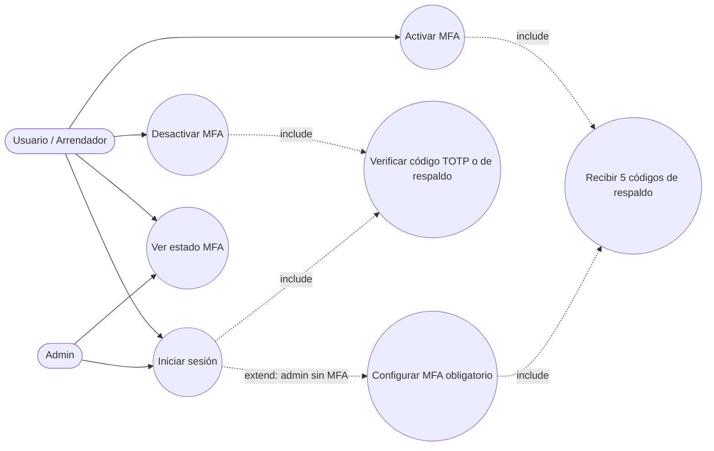

# HU-17 — Design: Autenticación multifactor (MFA)

> Módulo `cuentas` · Release 2 · Sprint 5 · tamaño M · depende de HU-03 (`done`) · sin ★ (`patterns: []`).
> Reutiliza `InicioSesionService` / `SesionService` / `Sesion` (token opaco SHA-256, HU-03), `TokenAleatorio`,
> `LimitadorIntentos`, `CifradorCampos` + `ConvertidorCifrado` (HU-02), `HuellaCampos` (HU-02), `AuditoriaService`,
> `PasswordEncoder`, `IpsPermitidasAdmin` + `FiltroIpsAdmin` (HU-06), `UsuarioRepository.findParaActualizar`,
> `AvisoCuenta`, `IpCliente`, `Clock` / `RelojControlable`, `ManejadorGlobalErrores`, el kit (`Campo`, `Boton`,
> `Alerta`, `Modal`) y `api/cliente.js`. P1–P12: decisiones por defecto en `requirements.md`, a confirmar por
> **Jorge Quispe**. **Sin dependencias nuevas** (ni backend ni frontend).

## 1. Decisiones

| # | Tema | Decisión | Por qué |
|---|------|----------|---------|
| DT-1 | Paso intermedio (P1) | Tabla nueva **`desafio_mfa`** con el SHA-256 del token de desafío (`TokenAleatorio`, como `sesion` y `token`), su `paso` (`CODIGO` / `CONFIGURACION`), vigencia de **5 min**, `intentos_fallidos` y `cerrado_en`. `POST /api/sesiones` responde **202** con `DesafioMfaDTO(desafio, paso)` cuando hace falta MFA y **201** con `SesionIniciadaDTO` (sin cambios) cuando no. El desafío viaja en el **cuerpo** de `POST /api/sesiones/mfa` y `POST /api/sesiones/mfa/configuracion` (rutas `permitAll`), nunca en `Authorization`. | `ValidadorSesion`, `FiltroAutenticacionSesion` y todas las rutas protegidas quedan intactos: un desafío **no es** una sesión y ningún endpoint protegido lo acepta por accidente. En BD (y no en memoria) para que el contador "por sesión" (STRIDE D) sobreviva a un reinicio y se pruebe en la IT. 202 = "aceptado, falta un paso"; el 201 de HU-03 no cambia para quien no tiene MFA. |
| DT-2 | Admin sin MFA (CA1) | Si las credenciales son de un `ADMIN` sin MFA activo, el desafío es de paso `CONFIGURACION`: con él, `POST /api/sesiones/mfa/configuracion` genera la configuración pendiente y `POST /api/sesiones/mfa` la confirma con el primer código, activa MFA, entrega los 5 códigos y **recién entonces** crea la sesión. | "Sin él no accedo al panel": el admin nunca tiene sesión sin MFA. Los admins creados por `CreadorAdmin` nacen sin MFA y caen aquí en su primer inicio de sesión, sin tocar el comando. |
| DT-3 | Sesiones admin heredadas (P10) | `SesionService.validar` rechaza (vacío → 401 de HU-03) la sesión de un `ADMIN` si `MfaRepository.existsByUsuarioIdAndActivoTrue(id)` es falso. Solo consulta para admins. | Las sesiones de admin abiertas antes del despliegue (renovables sin fin, HU-03 P6) dejarían entrar sin MFA. Cubre también el procedimiento operativo de "borrar la fila de `mfa`" (pregunta abierta 1). Una consulta por PK solo en solicitudes de admin. |
| DT-4 | TOTP propio (P9, P7) | `cuentas/domain/Totp` (RFC 6238 sobre `javax.crypto.Mac` `HmacSHA1`, truncamiento dinámico de RFC 4226, 6 dígitos, paso de 30 s, `T0 = 0`, tolerancia ±1, comparación con `MessageDigest.isEqual`) y `cuentas/domain/Base32` (RFC 4648 sin relleno). Ambas `public final`, puras, sin Spring. **Sin QR**: la API da `secreto` y `uri` `otpauth://`. | ~60 líneas con el JDK (como `HuellaCampos`), verificables con los vectores del Apéndice B de RFC 6238 y de RFC 4648 § 10. Agregar `dev.samstevens.totp` o zxing exige discutir dependencias (`docs/frontend.md` principio 3, CLAUDE.md). SHA-1 por compatibilidad con Google/Microsoft Authenticator (la mayoría ignora otros algoritmos). Públicas porque el soporte de pruebas (§ 11) calcula códigos con ellas. |
| DT-5 | Reutilización de un código | `mfa.ultimo_paso`: un código TOTP solo se acepta si su paso es **mayor** que el último aceptado, y al aceptarlo se guarda. | RFC 6238 § 5.2: un código visto (hombro, phishing en tiempo real) no sirve dos veces. |
| DT-6 | Secreto cifrado (RNF-SEG-14) | `Mfa.secreto` (Base32 en claro en memoria) con `@Convert(converter = ConvertidorCifrado.class)` → columna `TEXT` `v1:…` AES-256-GCM, como `PerfilArrendador`. 20 bytes de `SecureRandom` (160 bits, RFC 4226 § 4). | Reutiliza `comun/cifrado` (§8 de requerimientos: "se construye una vez"). |
| DT-7 | Códigos de respaldo (P8) | `GeneradorMfa.reemplazarCodigos`: 5 códigos de 10 caracteres Base32 (50 bits, `SecureRandom`), formato `XXXXX-XXXXX`; se guarda `HuellaCampos.calcular(normalizado)` (HMAC-SHA256 hex, 64) en `codigo_respaldo.hash_codigo`, único por usuario. Se buscan por `(usuario_id, hash_codigo, usado_en is null)`; usar = fijar `usado_en`. | "Códigos con hash": HMAC con llave secreta no se revierte probando valores sin la llave (a diferencia de un SHA-256 plano de un código corto). Permite buscar por igualdad en una consulta. bcrypt descartado (§ 14). `usado_en` (TIMESTAMPTZ) en vez de `usado` (boolean) del modelo de referencia, como `token.usado_en`: además de "ya se usó" dice cuándo; el implementer actualiza `docs/modelo-datos.md`. |
| DT-8 | Límite de intentos (P2, §9.7) | **Por desafío:** `DesafioMfa.MAXIMO_FALLOS = 5` persistido; al 5.º fallo se cierra y se responde 401 (vuelve a la contraseña). **Por usuario:** `LimitadorIntentos` con clave `"mfa|" + usuarioId`, `MAXIMO_FALLOS_USUARIO = 10`, `VENTANA_FALLOS = 15 min`, compartido por login, activación y desactivación; se consulta con `superaLimite` antes de comprobar y se `limpia` al aceptar un código. | El por desafío es el "límite por sesión" literal de la historia. Sin el por usuario, quien tiene la contraseña repetiría el login sin fin (cada login exitoso limpia `login|correo`, HU-03 R20): con 10 / 15 min son ≤ 960 intentos al día contra 3 códigos válidos de 10⁶ (≈ 0,3 % al día), y cada uno queda auditado. Mismo componente y misma ventana que HU-03 (en memoria, una instancia: riesgo ya aceptado en HU-03 DT-6). |
| DT-9 | Errores | Código no aceptado → `ReglaNegocioException("codigo", MENSAJE_CODIGO_INVALIDO)` (**400** con error de campo). Desafío no vigente o agotado → `VerificacionExpiradaException` nueva (**401**, `ErrorDTO.MENSAJE_VERIFICACION_EXPIRADA`). Límite → `DemasiadosIntentosException` (429). Admin que desactiva → `AccesoDenegadoException` (403). | 400 y no 401 para el código porque `api/cliente.js` borra el token ante un 401 con token: un código mal escrito en `/panel/seguridad` no debe cerrar la sesión. El 401 se reserva para "vuelve a iniciar sesión". |
| DT-10 | Emisión de sesión compartida | `cuentas/service/EmisorSesiones.emitir(cuenta, ip, detalle)` (`@Transactional(propagation = MANDATORY)`): genera el token, guarda `Sesion.iniciar(...)`, audita `LOGIN_EXITOSO` y devuelve `SesionIniciadaDTO` con `AvisoCuenta`. Lo usan `InicioSesionService` (sin MFA, detalle nulo) y `VerificacionMfaService` (detalle `factor=…`). | Una sola forma de crear sesiones (HU-03 R2, R3, R6, R30) sin copiar código. |
| DT-11 | Transacciones y bloqueos | Orden fijo **`desafio_mfa → usuario → mfa`** (`findParaActualizar` en los tres). `VerificacionMfaService.verificar`, `MfaService.activar` y `desactivar` corren en un `TransactionTemplate` que **devuelve** un resultado (`aceptado` / `codigo_invalido` / `expirado` / `bloqueado` …) y lanzan la excepción **fuera**, tras el commit. | El fallo debe **persistir** (`intentos_fallidos`, auditoría) aunque la respuesta sea un error: si se lanzara dentro, el rollback borraría el conteo. El bloqueo del desafío serializa dos envíos del mismo código (uno solo crea sesión); el de `usuario` serializa dos configuraciones a la vez (sin él, dos `INSERT` en `mfa` chocarían en la PK). |
| DT-12 | Revocar sesiones al activar (P6) | `SesionRepository.revocarOtras(usuarioId, sesionId)` (nuevo) en `MfaService.activar`; `revocarTodas(usuarioId)` (existente) en el paso `CONFIGURACION`, **antes** de emitir la sesión nueva. Ambos `@Modifying(flushAutomatically = true, clearAutomatically = true)`: se llaman **después** de cerrar el desafío, activar `mfa` y guardar los códigos, y antes de `emitir`. | Una sesión robada antes de activar MFA no sobrevive. El orden importa: `clear` desprende las entidades cargadas y un cambio posterior sobre ellas no se guardaría. |
| DT-13 | Control de IPs del admin (P3, §9.4) | **Se mantiene sin cambios de conducta** (§ 10). Solo se actualizan comentarios y docs que dicen "hasta HU-17". | Ver § 10. |
| DT-14 | Recuperación del admin (P4) | `Usuario.motivoRechazoRecuperacion` no cambia; su comentario pasa a "HU-04 S2, HU-06 D1; HU-17 lo mantiene (P4)". | Fuera de los CA; habilitarla cambiaría HU-04 (otra conducta y otras pruebas). |
| DT-15 | Sin puerto nuevo, sin cambios en otros módulos | Todo vive en `cuentas`; `comun` solo gana una excepción y un mensaje. `administracion`/`pagos` no cambian: sus rutas `/api/admin/**` heredan el MFA por la sesión. | HU-27 ("solo admins con MFA") lo obtiene gratis. La tabla de puertos de `docs/architecture.md` no cambia. |

## 2. Caso de uso



**Iniciar sesión con MFA (CA1, CA2).** Precondición: cuenta habilitada (HU-03) y, si es admin, IP permitida (HU-06).
Flujo: (1) correo y contraseña → 202 con desafío `CODIGO`; (2) código de la app o de respaldo → 201 con la sesión.
Alternos: sin MFA (usuario final) → 201 directo; admin sin MFA → configuración obligatoria (abajo); código incorrecto
→ 400 (hasta 4 veces); 5.º incorrecto o desafío vencido → 401 y vuelta a (1); 10 fallos en 15 min → 429.

**Configurar MFA obligatorio (CA1, CA3).** (1) desafío `CONFIGURACION` → clave y enlace; (2) el admin agrega la
cuenta en su app y envía el primer código → MFA activo, 5 códigos de respaldo y sesión.

**Activar MFA (CA2, CA3).** Con sesión: (1) "Activar" → clave y enlace (configuración pendiente); (2) primer código
→ MFA activo, demás sesiones revocadas, 5 códigos. Los siguientes inicios de sesión piden el código.

**Desactivar MFA.** Solo usuario final: contraseña + código → MFA borrado. El admin recibe 403.

### Diagrama de clases (núcleo)

```mermaid
classDiagram
  class SesionController
  class MfaController
  class InicioSesionService { +iniciar(InicioSesionDTO, ip) RespuestaInicioSesion }
  class VerificacionMfaService { +configurar(DesafioDTO, ip) ConfiguracionMfaDTO; +verificar(VerificacionMfaDTO, ip) SesionVerificadaDTO }
  class MfaService { +estado(u) EstadoMfaDTO; +iniciarConfiguracion(u) ConfiguracionMfaDTO; +activar(u, CodigoMfaDTO, ip) CodigosRespaldoDTO; +desactivar(u, DesactivacionMfaDTO, ip) }
  class SesionService { +validar(token) Optional~UsuarioAutenticado~ }
  class EmisorSesiones { +emitir(Usuario, ip, detalle) SesionIniciadaDTO }
  class VerificadorMfa { +bloqueado(usuarioId, ip) boolean; +comprobar(Mfa, codigo, admiteRespaldo, contexto, ip, ahora) Optional~FactorMfa~; +registrarFallo(usuarioId, contexto, ip); +limpiarFallos(usuarioId) }
  class GeneradorMfa { +nuevoSecreto() String; +configuracion(correo, secreto) ConfiguracionMfaDTO; +reemplazarCodigos(usuarioId, ahora) List~String~ }
  class Totp { <<utilidad>> +pasoDe(Instant) long; +codigo(byte[], long) String; +pasoAceptado(byte[], codigo, ahora, ultimoPaso) OptionalLong }
  class Base32 { <<utilidad>> +codificar(byte[]) String; +decodificar(String) byte[] }
  class Mfa { usuarioId; secreto(cifrado); activo; ultimoPaso }
  class CodigoRespaldo { usuarioId; hashCodigo; usadoEn }
  class DesafioMfa { hashToken; paso; expiraEn; intentosFallidos; cerradoEn }
  SesionController --> InicioSesionService
  SesionController --> VerificacionMfaService
  MfaController --> MfaService
  InicioSesionService --> EmisorSesiones
  VerificacionMfaService --> EmisorSesiones
  VerificacionMfaService --> VerificadorMfa
  VerificacionMfaService --> GeneradorMfa
  MfaService --> VerificadorMfa
  MfaService --> GeneradorMfa
  VerificadorMfa --> Totp
  Mfa --> Base32
  SesionService ..> Mfa : admin exige activo
  DesafioMfa --> Mfa : usuario
  Mfa "1" --> "0..5" CodigoRespaldo
```



## 3. Archivos por módulo y capa

| Capa | Archivo (N nuevo, M modificado) | Cubre |
|------|----------------------------------|-------|
| `comun/error/` | `VerificacionExpiradaException` (N), `ErrorDTO` (M, `MENSAJE_VERIFICACION_EXPIRADA`), `ManejadorGlobalErrores` (M, 401) | R18, R21 |
| `comun/seguridad/` | `ConfiguracionSeguridad` (M: `permitAll` de `POST /api/sesiones/mfa` y `POST /api/sesiones/mfa/configuracion`); `IpsPermitidasAdmin`, `FiltroIpsAdmin` (M: solo comentarios/javadoc sin "hasta HU-17") | R9, R10, R23, R44 |
| `cuentas/domain/` | `Totp`, `Base32`, `Mfa`, `CodigoRespaldo`, `DesafioMfa`, `PasoMfa`, `FactorMfa`, `ContextoMfa` (N); `Usuario` (M: solo comentario de `motivoRechazoRecuperacion`) | R5, R13–R17, R20, R21, R25, R31, R50–R54 |
| `cuentas/repository/` | `MfaRepository`, `CodigoRespaldoRepository`, `DesafioMfaRepository` (N); `SesionRepository` (M: `revocarOtras`) | R5, R16, R35, R39, R40 |
| `cuentas/service/` | `EmisorSesiones`, `GeneradorMfa`, `VerificadorMfa`, `VerificacionMfaService`, `MfaService` (N); `InicioSesionService` (M), `SesionService` (M) | R1–R66 |
| `cuentas/dto/` | `RespuestaInicioSesion` (N, sellada), `DesafioMfaDTO`, `DesafioDTO`, `VerificacionMfaDTO`, `SesionVerificadaDTO`, `ConfiguracionMfaDTO`, `CodigoMfaDTO`, `CodigosRespaldoDTO`, `DesactivacionMfaDTO`, `EstadoMfaDTO` (N); `SesionIniciadaDTO` (M: `implements RespuestaInicioSesion`) | R1–R3, R10, R22, R23, R26, R29, R32, R39, R57 |
| `cuentas/controller/` | `MfaController` (N); `SesionController` (M) | R1–R3, R10–R44, R58 |
| `resources/db/migration/` | `V5_1__mfa.sql` (N) | R5, R6, R37, R50 |
| `resources/application.properties` | (M) solo el comentario de `espacioya.admin.ips-permitidas` (l.48) | R9 |
| `2_Backend/.env.example` | (M) comentario de `ADMIN_IPS_PERMITIDAS` (complementa a MFA; `0.0.0.0/0,::/0` lo abre) | R9 |
| Frontend `src/api/cuentas.js` | (M) 6 funciones nuevas | Pantallas |
| Frontend `src/pages/cuentas/` | `IniciarSesion.jsx` (M), `PasoCodigoMfa.jsx`, `ConfiguracionMfa.jsx`, `CodigosRespaldo.jsx`, `SeguridadCuenta.jsx` (N, cada uno con su `.module.css`), `Panel.jsx` (M), `textosCuentas.js` (M) | Pantallas |
| Frontend `src/App.jsx` | (M) ruta `/panel/seguridad` | Pantallas |

## 4. Endpoints

| Método y ruta | Acceso | Entrada | Salida | Códigos |
|---------------|--------|---------|--------|---------|
| `POST /api/sesiones` (M) | público | `InicioSesionDTO` (sin cambios) | `201 SesionIniciadaDTO(token, rol, aviso)` **o** `202 DesafioMfaDTO(desafio, paso)` | 201 (R3), 202 (R1, R2), 400, 401 (R8, R9), 429 (HU-03) |
| `POST /api/sesiones/mfa/configuracion` (N) | público (desafío `CONFIGURACION`) | `DesafioDTO(desafio)` | `200 ConfiguracionMfaDTO(secreto, uri)` | 200 (R23), 400 (forma), 401 (R18) |
| `POST /api/sesiones/mfa` (N) | público (desafío) | `VerificacionMfaDTO(desafio, codigo)` | `201 SesionVerificadaDTO(token, rol, aviso, codigosRespaldo)` | 201 (R10, R11, R26), 400 (R19, R22, R27), 401 (R18, R21), 429 (R46) |
| `GET /api/mfa` (N) | sesión | — | `200 EstadoMfaDTO(activo, codigosRespaldoRestantes, desactivable)` | 200 (R39), 401 (R44) |
| `POST /api/mfa/configuracion` (N) | sesión | — (sin cuerpo) | `200 ConfiguracionMfaDTO(secreto, uri)` | 200 (R29), 400 (R30), 401 |
| `POST /api/mfa/activacion` (N) | sesión | `CodigoMfaDTO(codigo)` | `200 CodigosRespaldoDTO(codigos)` | 200 (R31, R32), 400 (R33, R34, forma), 401, 429 (R46) |
| `POST /api/mfa/desactivacion` (N) | sesión | `DesactivacionMfaDTO(contrasena, codigo)` | `204` | 204 (R40), 400 (R41, R43, forma), 401, 403 (R42), 429 (R46) |

Todas las respuestas `200`/`201` nuevas llevan `CacheControl.noStore()` explícito (R58), como HU-06 DT-9.
`POST /api/sesiones` devuelve `ResponseEntity<?>` (no `ResponseEntity<RespuestaInicioSesion>`) para que Jackson
serialice el record real y no la interfaz sin propiedades.

Validación (Bean Validation, `MethodArgumentNotValidException` → 400 por campo, sin llegar al servicio ni contar
fallos): `desafio` `@NotBlank @Size(max = 64)`; `codigo` `@NotBlank @Size(max = 20)`; `contrasena` `@NotBlank
@Size(max = 72)` (como `InicioSesionDTO`).

### Mensajes (texto exacto)

| Constante | Dónde | Texto |
|-----------|-------|-------|
| `ErrorDTO.MENSAJE_VERIFICACION_EXPIRADA` | 401 de R18, R21 | `Tu verificación expiró o no es válida. Inicia sesión de nuevo.` |
| `VerificadorMfa.MENSAJE_CODIGO_INVALIDO` | campo `codigo` en R19, R27, R34 | `El código no es válido o ya se usó.` |
| `MfaService.MENSAJE_YA_ACTIVO` | R30 | `La verificación en dos pasos ya está activa en tu cuenta.` |
| `MfaService.MENSAJE_SIN_CONFIGURACION` | R33 | `Primero genera tu clave de configuración.` |
| `MfaService.MENSAJE_NO_ACTIVO` | R43 | `La verificación en dos pasos no está activa en tu cuenta.` |
| `MfaService.MENSAJE_DESACTIVACION_RECHAZADA` | R41 | `La contraseña o el código no son correctos.` |
| `VerificacionMfaDTO.MENSAJE_DESAFIO` | campo `desafio` | `Inicia sesión de nuevo.` |
| `VerificacionMfaDTO.MENSAJE_CODIGO` (y en `CodigoMfaDTO`, `DesactivacionMfaDTO`) | campo `codigo` | `Ingresa el código de verificación.` |
| `DesactivacionMfaDTO.MENSAJE_CONTRASENA` | campo `contrasena` | `Ingresa tu contraseña.` |

R30, R33, R41 y R43 van como `ReglaNegocioException(null, mensaje)` (400 sin `errores`).

## 5. Clases y firmas públicas

```java
// cuentas/domain — utilidades puras (sin Spring)
public final class Base32 {
    public static String codificar(byte[] datos);              // RFC 4648, sin relleno, mayúsculas
    public static byte[] decodificar(String texto);            // IllegalArgumentException si no es Base32 válido
    public static boolean esBase32(String texto);              // solo A–Z y 2–7, no vacío
}

public final class Totp {
    public static final int DIGITOS = 6;
    public static final long SEGUNDOS_PASO = 30;
    public static final int TOLERANCIA_PASOS = 1;
    public static long pasoDe(Instant instante);                // floor(epochSecond / 30)
    public static String codigo(byte[] secreto, long paso);    // HmacSHA1 + truncamiento dinámico, 6 dígitos con ceros
    // Paso con el que coincide (actual, −1, +1, en ese orden) y que es > ultimoPaso; vacío si ninguno.
    // El código se compara con MessageDigest.isEqual; un texto que no son 6 dígitos devuelve vacío.
    public static OptionalLong pasoAceptado(byte[] secreto, String codigo, Instant ahora, Long ultimoPaso);
}

public enum PasoMfa { CODIGO, CONFIGURACION }
public enum FactorMfa { TOTP, RESPALDO }
public enum ContextoMfa { INICIO_SESION, ACTIVACION, DESACTIVACION }

@Entity @Table(name = "mfa")
public class Mfa {                       // @Id usuarioId (asignado, sin @GeneratedValue)
    // @Convert(converter = ConvertidorCifrado.class) @Column(nullable = false) String secreto;  (Base32)
    protected Mfa() { }
    public static Mfa pendiente(Long usuarioId, String secretoBase32, Instant ahora);
    public void reemplazarSecreto(String secretoBase32, Instant ahora); // IllegalStateException si activo; ultimoPaso = null
    public void activar(Instant ahora);                                  // IllegalStateException si ya activo
    public void registrarPaso(long paso);                                // IllegalArgumentException si paso <= ultimoPaso
    public boolean estaActivo();
    public byte[] secretoEnBytes();                                      // Base32.decodificar(secreto)
    public Long getUsuarioId(); public String getSecreto(); public Long getUltimoPaso();
    public Instant getCreadoEn(); public Instant getActivadoEn();
}

@Entity @Table(name = "codigo_respaldo")
public class CodigoRespaldo {            // hashCodigo con @JdbcTypeCode(SqlTypes.CHAR), length 64
    protected CodigoRespaldo() { }
    public static CodigoRespaldo nuevo(Long usuarioId, String hashCodigo, Instant ahora);
    public void usar(Instant ahora);     // IllegalStateException si ya usado
    public boolean estaUsado();
    // getters
}

@Entity @Table(name = "desafio_mfa")
public class DesafioMfa {
    public static final Duration VIGENCIA = Duration.ofMinutes(5);
    public static final int MAXIMO_FALLOS = 5;
    protected DesafioMfa() { }
    public static DesafioMfa crear(Long usuarioId, String hashToken, PasoMfa paso, Instant ahora);
    public boolean estaAbierto(Instant ahora);      // cerradoEn == null && ahora.isBefore(expiraEn)
    public boolean registrarFallo(Instant ahora);   // +1; al llegar a MAXIMO_FALLOS fija cerradoEn y devuelve true
    public void cerrar(Instant ahora);              // IllegalStateException si ya cerrado
    // getters
}
```

```java
// cuentas/repository
public interface MfaRepository extends JpaRepository<Mfa, Long> {
    @Lock(LockModeType.PESSIMISTIC_WRITE)
    @Query("select m from Mfa m where m.usuarioId = :usuarioId")
    Optional<Mfa> findParaActualizar(@Param("usuarioId") Long usuarioId);
    boolean existsByUsuarioIdAndActivoTrue(Long usuarioId);
}

public interface CodigoRespaldoRepository extends JpaRepository<CodigoRespaldo, Long> {
    Optional<CodigoRespaldo> findByUsuarioIdAndHashCodigoAndUsadoEnIsNull(Long usuarioId, String hashCodigo);
    long countByUsuarioIdAndUsadoEnIsNull(Long usuarioId);
    @Modifying(flushAutomatically = true)
    @Query("delete from CodigoRespaldo c where c.usuarioId = :usuarioId")
    int borrarDeUsuario(@Param("usuarioId") Long usuarioId);
}

public interface DesafioMfaRepository extends JpaRepository<DesafioMfa, Long> {
    @Lock(LockModeType.PESSIMISTIC_WRITE)
    @Query("select d from DesafioMfa d where d.hashToken = :hashToken")
    Optional<DesafioMfa> findParaActualizar(@Param("hashToken") String hashToken);
}

// SesionRepository (M)
@Modifying(flushAutomatically = true, clearAutomatically = true)
@Query("update Sesion s set s.revocada = true where s.usuarioId = :usuarioId and s.id <> :sesionId and s.revocada = false")
int revocarOtras(@Param("usuarioId") Long usuarioId, @Param("sesionId") Long sesionId);
```

```java
// cuentas/service
@Component
public class EmisorSesiones {
    public EmisorSesiones(SesionRepository sesiones, PerfilArrendadorRepository perfiles, AuditoriaService auditoria,
                          Clock reloj);
    @Transactional(propagation = Propagation.MANDATORY)
    public SesionIniciadaDTO emitir(Usuario cuenta, String ip, String detalleAuditoria); // LOGIN_EXITOSO
}

@Component
public class GeneradorMfa {
    public static final int CANTIDAD_CODIGOS = 5;
    public static final int BYTES_SECRETO = 20;
    public static final String EMISOR = "EspacioYa";
    public GeneradorMfa(HuellaCampos huella, CodigoRespaldoRepository codigos);
    public String nuevoSecreto();                                         // SecureRandom → Base32 (32 caracteres)
    public ConfiguracionMfaDTO configuracion(String correo, String secreto); // uri de R55 (URLEncoder UTF-8, %20)
    @Transactional(propagation = Propagation.MANDATORY)
    public List<String> reemplazarCodigos(Long usuarioId, Instant ahora);  // borra, guarda 5 huellas, devuelve XXXXX-XXXXX
    public static String normalizar(String codigo);                       // sin espacios ni '-', mayúsculas
    public String huella(String codigoNormalizado);                       // HuellaCampos.calcular
}

@Component
public class VerificadorMfa {
    public static final String ACCION_CODIGO_FALLIDO = "MFA_CODIGO_FALLIDO";
    public static final String ACCION_BLOQUEADO = "MFA_BLOQUEADO";
    public static final String ACCION_CODIGO_RESPALDO_USADO = "MFA_CODIGO_RESPALDO_USADO";
    public static final int MAXIMO_FALLOS_USUARIO = 10;
    public static final Duration VENTANA_FALLOS = Duration.ofMinutes(15);
    public static final String MENSAJE_CODIGO_INVALIDO = "El código no es válido o ya se usó.";
    static final String PREFIJO_CLAVE = "mfa|";
    public VerificadorMfa(LimitadorIntentos limitador, CodigoRespaldoRepository codigos, GeneradorMfa generador,
                          AuditoriaService auditoria);
    public boolean bloqueado(Long usuarioId, String ip);                  // superaLimite; si true audita MFA_BLOQUEADO
    // TOTP: Totp.pasoAceptado → mfa.registrarPaso. Respaldo (solo si admiteRespaldo y la cuenta tiene MFA activo):
    // normalizar → esBase32 y 10 caracteres → buscar por huella → usar → auditar MFA_CODIGO_RESPALDO_USADO.
    @Transactional(propagation = Propagation.MANDATORY)
    public Optional<FactorMfa> comprobar(Mfa mfa, String codigo, boolean admiteRespaldo, ContextoMfa contexto,
                                         String ip, Instant ahora);
    public void registrarFallo(Long usuarioId, ContextoMfa contexto, String ip); // limitador.registrar + auditoría
    public void limpiarFallos(Long usuarioId);
}

@Service
public class VerificacionMfaService {
    public static final String ACCION_MFA_ACTIVADO = "MFA_ACTIVADO";
    public VerificacionMfaService(DesafioMfaRepository desafios, UsuarioRepository usuarios, MfaRepository mfas,
                                  SesionRepository sesiones, VerificadorMfa verificador, GeneradorMfa generador,
                                  EmisorSesiones emisor, AuditoriaService auditoria, TransactionTemplate transacciones,
                                  Clock reloj);
    @Transactional
    public ConfiguracionMfaDTO configurar(DesafioDTO solicitud, String ip);            // R18, R23, R24
    public SesionVerificadaDTO verificar(VerificacionMfaDTO solicitud, String ip);     // R10–R22, R25–R27, R35, R46
}

@Service
public class MfaService {
    public static final String ACCION_MFA_DESACTIVADO = "MFA_DESACTIVADO";
    public MfaService(UsuarioRepository usuarios, MfaRepository mfas, CodigoRespaldoRepository codigos,
                      SesionRepository sesiones, VerificadorMfa verificador, GeneradorMfa generador,
                      PasswordEncoder encoder, AuditoriaService auditoria, TransactionTemplate transacciones,
                      Clock reloj);
    @Transactional(readOnly = true) public EstadoMfaDTO estado(UsuarioAutenticado usuario);          // R39
    @Transactional public ConfiguracionMfaDTO iniciarConfiguracion(UsuarioAutenticado usuario);     // R24, R29, R30
    public CodigosRespaldoDTO activar(UsuarioAutenticado usuario, CodigoMfaDTO solicitud, String ip); // R31–R36
    public void desactivar(UsuarioAutenticado usuario, DesactivacionMfaDTO solicitud, String ip);     // R40–R43
}

// InicioSesionService (M): + MfaRepository, DesafioMfaRepository, EmisorSesiones; - SesionRepository
public static final String ACCION_LOGIN_MFA_PENDIENTE = "LOGIN_MFA_PENDIENTE";
public RespuestaInicioSesion iniciar(InicioSesionDTO solicitud, String ip);

// SesionService (M): + MfaRepository; validar añade el filtro de DT-3.
```

```java
// cuentas/dto
public sealed interface RespuestaInicioSesion permits SesionIniciadaDTO, DesafioMfaDTO { }
public record SesionIniciadaDTO(String token, String rol, String aviso) implements RespuestaInicioSesion { } // toString igual
public record DesafioMfaDTO(String desafio, PasoMfa paso) implements RespuestaInicioSesion { }  // toString: desafio=***
public record DesafioDTO(@NotBlank @Size(max = 64) String desafio) { }                          // toString: ***
public record VerificacionMfaDTO(@NotBlank @Size(max = 64) String desafio,
                                 @NotBlank @Size(max = 20) String codigo) { }                    // toString: ***, ***
public record SesionVerificadaDTO(String token, String rol, String aviso, List<String> codigosRespaldo) { } // token=***, codigosRespaldo=***
public record ConfiguracionMfaDTO(String secreto, String uri) { }                                  // ***, ***
public record CodigoMfaDTO(@NotBlank @Size(max = 20) String codigo) { }                           // ***
public record CodigosRespaldoDTO(List<String> codigos) { }                                         // ***
public record DesactivacionMfaDTO(@NotBlank @Size(max = 72) String contrasena,
                                  @NotBlank @Size(max = 20) String codigo) { }                    // ***, ***
public record EstadoMfaDTO(boolean activo, long codigosRespaldoRestantes, boolean desactivable) { }
```

`SesionVerificadaDTO` se serializa con `codigosRespaldo: null` cuando no hay (R10): Jackson incluye nulos por
defecto en este proyecto (como `aviso`).

## 6. Flujos

**`InicioSesionService.iniciar` (M).** Igual que hoy hasta `motivoRechazo` (bloqueo por correo, señuelo, IP del admin,
motivos: R8, R9 salen aquí sin crear nada). Luego `limitador.limpiar("login|"+correo)` (HU-03 R20) y, en un
`TransactionTemplate`:
1. `mfaActivo = mfas.existsByUsuarioIdAndActivoTrue(id)`.
2. Si `mfaActivo` → paso `CODIGO`; si no y `esAdmin()` → paso `CONFIGURACION`; si no → `emisor.emitir(cuenta, ip, null)`
   y se devuelve el `SesionIniciadaDTO` (R3).
3. Con paso: `token = TokenAleatorio.generar()`, `desafios.save(DesafioMfa.crear(id, hash(token), paso, ahora))`,
   auditoría `LOGIN_MFA_PENDIENTE` (`paso=…`) y se devuelve `DesafioMfaDTO(token, paso)` (R1, R2, R4–R7, R59).

**`VerificacionMfaService.verificar`.** `TransactionTemplate` que devuelve un `Resultado` (record privado con
`tipo` y la respuesta):
1. `desafios.findParaActualizar(hash(desafio))`; luego `usuarios.findParaActualizar(usuarioId)`; luego
   `mfas.findParaActualizar(usuarioId)`. Si no es vigente para el endpoint (definición de requirements) → `EXPIRADO`.
2. `verificador.bloqueado(usuarioId, ip)` → `BLOQUEADO` (R46, R65; el desafío no suma).
3. Paso `CODIGO`: `verificador.comprobar(mfa, codigo, true, INICIO_SESION, ip, ahora)`. Paso `CONFIGURACION`: si no hay
   configuración pendiente → fallo; si la hay, `comprobar(mfa, codigo, false, INICIO_SESION, ip, ahora)`.
4. Fallo: `agotado = desafio.registrarFallo(ahora)`; `verificador.registrarFallo(...)` (R45, R64);
   `agotado ? EXPIRADO : CODIGO_INVALIDO` (R19–R21, R27).
5. Éxito: `desafio.cerrar(ahora)` (R13). Si `CONFIGURACION`: `mfa.activar(ahora)` (R25), `codigos =
   generador.reemplazarCodigos(...)` (R36, R37), auditoría `MFA_ACTIVADO contexto=INICIO_SESION` (R61),
   `sesiones.revocarTodas(usuarioId)` (R35). Luego `emisor.emitir(cuenta, ip, "factor=" + factor)` (R12, R60) y
   `verificador.limpiarFallos(usuarioId)` (R48). Devuelve `SesionVerificadaDTO` (R10, R11, R26).
6. Fuera de la transacción: `EXPIRADO` → `VerificacionExpiradaException`; `BLOQUEADO` → `DemasiadosIntentosException`;
   `CODIGO_INVALIDO` → `ReglaNegocioException("codigo", MENSAJE_CODIGO_INVALIDO)`.

**`VerificacionMfaService.configurar`** (`@Transactional`): mismos bloqueos y vigencia (solo `CONFIGURACION`, si no
401). `secreto = generador.nuevoSecreto()`; si hay fila pendiente `reemplazarSecreto`, si no `save(Mfa.pendiente(...))`
(R24); devuelve `generador.configuracion(correo, secreto)` (R23). No cuenta intentos ni audita (no comprueba códigos).

**`MfaService`.**
- `estado`: `mfas.findById` + `codigos.countByUsuarioIdAndUsadoEnIsNull`; `desactivable = activo && rol != ADMIN`.
- `iniciarConfiguracion`: `usuarios.findParaActualizar` → `mfas.findParaActualizar`; activo → 400 (R30); pendiente →
  reemplazar; ninguno → crear (R24, R29).
- `activar` (`TransactionTemplate` + resultado): bloqueos `usuario → mfa`; `bloqueado` → 429 (R46); sin pendiente →
  400 sin contar (R33); `comprobar(mfa, codigo, false, ACTIVACION, …)`; fallo → `registrarFallo` + 400 de campo
  (R34, R45, R64); éxito → `activar`, `reemplazarCodigos`, auditoría `MFA_ACTIVADO contexto=CUENTA`,
  `revocarOtras(usuarioId, sesionId)`, `limpiarFallos` → `CodigosRespaldoDTO` (R31, R32, R35, R36, R48, R61).
- `desactivar` (`TransactionTemplate` + resultado): rol `ADMIN` → 403 sin más (R42); bloqueos; `bloqueado` → 429; sin
  MFA activo → 400 (R43); `contrasenaOk = encoder.matches(...)` y `factor = comprobar(mfa, codigo, true,
  DESACTIVACION, …)` **siempre los dos** (el tiempo no dice cuál falló); alguno falla → `registrarFallo` + 400 (R41);
  si un código de respaldo se aceptó pero la contraseña no, el respaldo queda **usado** igual (ya se mostró ese código
  a quien lo envió). Éxito → `codigos.borrarDeUsuario`, `mfas.delete`, auditoría `MFA_DESACTIVADO`, `limpiarFallos`
  (R40, R48, R62).

**`SesionService.validar` (M).** Al filtro de cuenta `ACTIVA` se suma: `!usuario.esAdmin() ||
mfas.existsByUsuarioIdAndActivoTrue(usuario.getId())`; si falla, vacío y sin renovar (R28).

## 7. Detalle TOTP y Base32

- `codigo(secreto, paso)`: `Mac.getInstance("HmacSHA1")` con `SecretKeySpec(secreto, "HmacSHA1")` sobre el paso en
  8 bytes big-endian; `offset = hash[19] & 0x0f`; `binario = ((hash[o] & 0x7f) << 24) | ((hash[o+1] & 0xff) << 16) |
  ((hash[o+2] & 0xff) << 8) | (hash[o+3] & 0xff)`; `binario % 1_000_000` con ceros a la izquierda.
- `pasoAceptado`: quita espacios; si no son 6 dígitos ASCII → vacío; prueba `paso`, `paso − 1`, `paso + 1`; acepta el
  primero que coincide y es `> ultimoPaso`. Un código que solo coincide con un paso ya usado → vacío (R15).
- Vectores (secreto ASCII `12345678901234567890`, 6 últimos dígitos de RFC 6238 Apéndice B, SHA-1): 59 → `287082`;
  1111111109 → `081804`; 1111111111 → `050471`; 1234567890 → `005924`; 2000000000 → `279037`;
  20000000000 → `353130`. En Base32 ese secreto es `GEZDGNBVGY3TQOJQGEZDGNBVGY3TQOJQ`.
- Base32 (RFC 4648 § 10, sin relleno): `""→""`, `f→MY`, `fo→MZXQ`, `foo→MZXW6`, `foob→MZXW6YQ`, `fooba→MZXW6YTB`,
  `foobar→MZXW6YTBOI`.

## 8. Diagramas de secuencia

### Flujo principal A: admin configura MFA en su primer inicio de sesión (CA1, CA3)

```mermaid
sequenceDiagram
  actor A as Admin (IP permitida)
  participant SC as SesionController
  participant IS as InicioSesionService
  participant VS as VerificacionMfaService
  participant VM as VerificadorMfa
  participant GM as GeneradorMfa
  participant ES as EmisorSesiones
  participant DB as PostgreSQL
  A->>SC: POST /api/sesiones {correo, contrasena}
  SC->>IS: iniciar(dto, ip)
  IS->>IS: limitador, bcrypt, IP admin, motivos (HU-03/HU-06)
  IS->>DB: mfa activo? → no
  IS->>DB: INSERT desafio_mfa(paso=CONFIGURACION, hash) + auditoría LOGIN_MFA_PENDIENTE
  IS-->>SC: DesafioMfaDTO(desafio, CONFIGURACION)
  SC-->>A: 202 {desafio, paso}
  A->>SC: POST /api/sesiones/mfa/configuracion {desafio}
  SC->>VS: configurar(dto, ip)
  VS->>DB: lock desafio → usuario → mfa
  VS->>GM: nuevoSecreto()
  VS->>DB: INSERT mfa(activo=false, secreto cifrado)
  VS-->>A: 200 {secreto, uri otpauth}
  Note over A: agrega la cuenta en su app
  A->>SC: POST /api/sesiones/mfa {desafio, codigo}
  SC->>VS: verificar(dto, ip)
  VS->>DB: lock desafio → usuario → mfa (vigente)
  VS->>VM: bloqueado? → no; comprobar(mfa, codigo, false)
  VM->>VM: Totp.pasoAceptado → mfa.registrarPaso
  VM-->>VS: TOTP
  VS->>DB: desafio.cerrar, mfa.activar
  VS->>GM: reemplazarCodigos → 5 huellas HMAC
  VS->>DB: auditoría MFA_ACTIVADO, revocarTodas(usuario)
  VS->>ES: emitir(cuenta, ip, "factor=TOTP")
  ES->>DB: INSERT sesion + auditoría LOGIN_EXITOSO
  VS-->>SC: SesionVerificadaDTO(token, ADMIN, null, [5 códigos])
  SC-->>A: 201 (Cache-Control: no-store)
```

### Flujo principal B: usuario con MFA activo inicia sesión con un código de respaldo (CA2)

```mermaid
sequenceDiagram
  actor U as Usuario
  participant SC as SesionController
  participant IS as InicioSesionService
  participant VS as VerificacionMfaService
  participant VM as VerificadorMfa
  participant DB as PostgreSQL
  U->>SC: POST /api/sesiones
  SC->>IS: iniciar → mfa activo → desafío CODIGO
  SC-->>U: 202 {desafio, paso: CODIGO}
  U->>SC: POST /api/sesiones/mfa {desafio, "abcde-fghij"}
  SC->>VS: verificar
  VS->>VM: comprobar(mfa, codigo, true)
  VM->>VM: no son 6 dígitos → normalizar → ABCDEFGHIJ
  VM->>DB: codigo_respaldo por (usuario, HMAC, usado_en null) → usar(ahora)
  VM->>DB: auditoría MFA_CODIGO_RESPALDO_USADO restantes=4
  VM-->>VS: RESPALDO
  VS->>DB: desafio.cerrar; emitir(factor=RESPALDO)
  SC-->>U: 201 {token, rol, aviso, codigosRespaldo: null}
```

### Flujo de error: códigos incorrectos hasta agotar el desafío y el límite del usuario (STRIDE D)

```mermaid
sequenceDiagram
  actor X as Atacante con la contraseña
  participant SC as SesionController
  participant VS as VerificacionMfaService
  participant VM as VerificadorMfa
  participant DB as PostgreSQL
  X->>SC: POST /api/sesiones → 202 desafío D1
  loop intentos 1..4
    X->>SC: POST /api/sesiones/mfa {D1, código falso}
    VS->>VM: comprobar → vacío
    VS->>DB: D1.intentos_fallidos += 1; auditoría MFA_CODIGO_FALLIDO
    VS->>VM: registrarFallo (mfa|usuario)
    SC-->>X: 400 {errores: [codigo]}
  end
  X->>SC: 5.º código falso
  VS->>DB: intentos_fallidos = 5 → cerrado_en
  SC-->>X: 401 verificación expirada
  X->>SC: POST /api/sesiones → 202 desafío D2; 5 fallos más (total 10 en 15 min)
  X->>SC: POST /api/sesiones/mfa {D3, código}
  VS->>VM: bloqueado(usuario) → true; auditoría MFA_BLOQUEADO
  SC-->>X: 429 demasiados intentos (sin comprobar, D3 no suma)
```

## 9. Migración Flyway — `V5_1__mfa.sql`

Sprint 5 → `V5_1` (no hay ninguna `V5_*` en `develop` al redactar; HU-18, también del sprint 5, puede llegar antes:
si al unir `develop` ya tiene `V5_1`, se renombra a la siguiente libre, `docs/conventions.md`). Solo depende de
`V1_1` (`usuario`).

```sql
-- HU-17: MFA (TOTP, RFC 6238). Tablas de Release 2: no se editan las de Release 1.
-- secreto va cifrado con AES-256-GCM ("v1:" + base64, CifradorCampos): sin CHECK de formato.
-- Una fila por cuenta: activo = false es una configuración pendiente (secreto generado, sin confirmar).
-- ultimo_paso: último paso TOTP aceptado; un código de un paso igual o anterior no se acepta (RFC 6238 § 5.2).
-- ON DELETE CASCADE porque las pruebas borran usuarios; HU-22 anonimiza.
CREATE TABLE mfa (
    usuario_id  BIGINT      PRIMARY KEY REFERENCES usuario (id) ON DELETE CASCADE,
    secreto     TEXT        NOT NULL,
    activo      BOOLEAN     NOT NULL DEFAULT FALSE,
    creado_en   TIMESTAMPTZ NOT NULL,
    activado_en TIMESTAMPTZ,
    ultimo_paso BIGINT,
    CONSTRAINT ck_mfa_activado CHECK ((activo AND activado_en IS NOT NULL) OR (NOT activo AND activado_en IS NULL)),
    CONSTRAINT ck_mfa_ultimo_paso CHECK (ultimo_paso IS NULL OR ultimo_paso >= 0)
);

-- hash_codigo: HMAC-SHA256 hex (HuellaCampos) del código normalizado; el código nunca se guarda en claro.
-- Cuelga de mfa: borrar la configuración borra sus códigos.
CREATE TABLE codigo_respaldo (
    id          BIGINT GENERATED ALWAYS AS IDENTITY PRIMARY KEY,
    usuario_id  BIGINT      NOT NULL REFERENCES mfa (usuario_id) ON DELETE CASCADE,
    hash_codigo CHAR(64)    NOT NULL,
    creado_en   TIMESTAMPTZ NOT NULL,
    usado_en    TIMESTAMPTZ,
    CONSTRAINT uq_codigo_respaldo_usuario_hash UNIQUE (usuario_id, hash_codigo),
    CONSTRAINT ck_codigo_respaldo_hash CHECK (hash_codigo ~ '^[0-9a-f]{64}$')
);

-- Paso intermedio del inicio de sesión: solo el SHA-256 hex del token. Vigencia de 5 min, un solo uso,
-- 5 códigos incorrectos como máximo. Las filas no se borran: se rechazan al consultarlas.
CREATE TABLE desafio_mfa (
    id                BIGINT GENERATED ALWAYS AS IDENTITY PRIMARY KEY,
    usuario_id        BIGINT      NOT NULL REFERENCES usuario (id) ON DELETE CASCADE,
    hash_token        CHAR(64)    NOT NULL,
    paso              VARCHAR(20) NOT NULL,
    creado_en         TIMESTAMPTZ NOT NULL,
    expira_en         TIMESTAMPTZ NOT NULL,
    intentos_fallidos INTEGER     NOT NULL DEFAULT 0,
    cerrado_en        TIMESTAMPTZ,
    CONSTRAINT uq_desafio_mfa_hash_token UNIQUE (hash_token),
    CONSTRAINT ck_desafio_mfa_hash_token CHECK (hash_token ~ '^[0-9a-f]{64}$'),
    CONSTRAINT ck_desafio_mfa_paso CHECK (paso IN ('CODIGO', 'CONFIGURACION')),
    CONSTRAINT ck_desafio_mfa_expira CHECK (expira_en > creado_en),
    CONSTRAINT ck_desafio_mfa_intentos CHECK (intentos_fallidos BETWEEN 0 AND 5)
);

CREATE INDEX ix_desafio_mfa_usuario ON desafio_mfa (usuario_id);
```

Entidades con `@JdbcTypeCode(SqlTypes.CHAR)` en `hash_codigo` y `hash_token` (como `Sesion`), por
`ddl-auto=validate`. `desafio_mfa` no está en `docs/modelo-datos.md`: el implementer la agrega (regla de cabecera de ese
archivo) junto con las columnas reales de `mfa` y `codigo_respaldo`.

## 10. Control de IPs del admin: se mantiene (§9.4, P3)

Los comentarios "hasta HU-17" (`InicioSesionService` l.106, `IpsPermitidasAdmin` l.12, javadoc de `FiltroIpsAdmin`,
`application.properties` l.48, `.env.example` l.36) y `docs/architecture.md` l.432 piden que esta historia decida.
**Decisión: el control se mantiene y complementa a MFA**; no se retira código ni configuración.

- **Lo permiten las fuentes.** La historia dice "Reemplaza (o complementa)"; §9.4 dice "HU-17 decide si se retira o
  se mantiene junto con MFA"; RNF-SEG-04 exige IPs *hasta* HU-17 pero no las prohíbe después.
- **Defensa en profundidad para la cuenta más privilegiada.** MFA protege de una contraseña robada; el filtro de IPs
  protege además de un **token de sesión** robado (MFA no lo cubre: la sesión ya está emitida) y de un código TOTP
  capturado en tiempo real por phishing. Quitarlo bajaría la seguridad del panel sin que ningún CA lo pida.
- **Radio de impacto.** Retirarlo cambia `FiltroIpsAdmin`, `IpsPermitidasAdmin`, `ConfiguracionSeguridad`,
  `InicioSesionService`, propiedades, README y los requirements y pruebas de HU-06 (R2–R12), HU-09 y HU-16, de
  otros dueños. Mantenerlo no toca ninguno.
- **"Reemplazar" queda a un cambio de configuración.** Si el dueño u operación prefieren que en UAT entre cualquier
  IP, `ADMIN_IPS_PERMITIDAS=0.0.0.0/0,::/0` lo abre sin código (ambos rangos los acepta `IpsPermitidasAdmin`: máscara 0
  y forma IPv6). El implementer lo documenta en `.env.example` y README.

Cambios: solo textos. Los comentarios pasan a "complementa a MFA (HU-17, P3)"; R9 prueba que con MFA activo el admin
sigue sin entrar desde una IP no permitida y sin crear desafío. `docs/requerimientos.md` §9.4 se cierra con esta
decisión y `docs/architecture.md` l.432 cambia el título a "Panel admin: IPs permitidas + MFA".

## 11. Compatibilidad, pruebas existentes y docs del mismo PR

**Soporte de pruebas nuevo** `src/test/java/pe/edu/ulima/espacioya/MfaDePrueba.java` (junto a `RelojControlable`,
`public final`):

```java
public static final String SECRETO = "GEZDGNBVGY3TQOJQGEZDGNBVGY3TQOJQ"; // "12345678901234567890"
public static void activar(JdbcTemplate jdbc, CifradorCampos cifrador, long usuarioId, Instant ahora); // INSERT mfa activo
public static String codigo(Instant ahora);                     // Totp.codigo(Base32.decodificar(SECRETO), pasoDe(ahora))
public static void olvidarUltimoPaso(JdbcTemplate jdbc, long usuarioId); // UPDATE mfa SET ultimo_paso = NULL
// Login completo de dos pasos; antes llama a olvidarUltimoPaso para permitir varios logins en el mismo paso.
public static String iniciarSesion(MockMvc mvc, JdbcTemplate jdbc, String correo, String contrasena, String ip,
                                   Instant ahora) throws Exception;
```

**IT existentes que inician sesión como admin** (`grep -l "registrarAdmin\|rol = 'ADMIN'" src/test/java/**/*IT.java`):
`SesionControllerIT` (casos HU-06 R1–R4), `CuentaAdminControllerIT`, `RevisionIdentidadControllerIT`,
`FiltroIpsAdminIT`, `ReembolsosSoporte` (`ReembolsoAdminControllerIT`, `RegistroReembolsosIT`) y
`CreacionAdminServiceIT` si inicia sesión. Cambio mecánico: tras crear al admin, `MfaDePrueba.activar(...)`, y su
`token(...)` pasa a `MfaDePrueba.iniciarSesion(...)`. Sus asserts no cambian, salvo:
- `SesionControllerIT` HU-06 R1: espera `202` + segundo paso (ver `requirements.md` "Reemplazos").
- Los que siembran una fila de `sesion` de admin a mano: además `MfaDePrueba.activar` (R28).
- Las IT que cuentan filas de `auditoria` del admin: suman `LOGIN_MFA_PENDIENTE` (revisar si alguna cuenta todas).

**Unitarias existentes que cambian:** `InicioSesionServiceTest` (constructor: `MfaRepository`, `DesafioMfaRepository`,
`EmisorSesiones` real o mock; sus 19 casos siguen, el de admin desde IP permitida pasa a esperar `DesafioMfaDTO`),
`SesionServiceTest` (constructor + caso R28). Las IT que borran `usuario` no cambian: las tres tablas caen en cascada.

**Docs del mismo PR (implementer):** `docs/modelo-datos.md` (`mfa`, `codigo_respaldo` con `usado_en`, `desafio_mfa` y
sus restricciones); `docs/requerimientos.md` §9.4 (resuelto: se mantiene, § 10) y §9.7 (límite de intentos MFA: DT-8)
y la matriz §7 si corresponde; `docs/architecture.md` (Seguridad transversal l.432: IPs + MFA; `SesionService.validar`
exige MFA al admin); `docs/frontend.md` (ruta `/panel/seguridad` y pasos de MFA en "Rutas y llamadas a la API");
`README.md` (primer inicio de sesión del admin configura MFA; procedimiento ante pérdida, pregunta abierta 1;
`ADMIN_IPS_PERMITIDAS` complementa a MFA); `2_Backend/.env.example` (comentario).

## 12. Pantallas

No se agregan componentes al kit, estados de `EtiquetaEstado` ni colores. Componentes de página (no del kit) en
`pages/cuentas/`, cada uno con su CSS Module. Textos en `textosCuentas.js`. El **desafío vive solo en el estado de
React** de `IniciarSesion` (nunca en `sessionStorage`): recargar a mitad vuelve al paso de la contraseña;
`ProveedorSesion` y `RutaProtegida` no cambian.

### Funciones nuevas de `src/api/cuentas.js`

| Función | Endpoint | `autenticada` |
|---------|----------|---------------|
| `verificarMfa({ desafio, codigo })` | `POST /api/sesiones/mfa` | `false` |
| `configurarMfaEnInicio({ desafio })` | `POST /api/sesiones/mfa/configuracion` | `false` |
| `obtenerMfa()` | `GET /api/mfa` | sí |
| `iniciarConfiguracionMfa()` | `POST /api/mfa/configuracion` | sí |
| `activarMfa({ codigo })` | `POST /api/mfa/activacion` | sí |
| `desactivarMfa({ contrasena, codigo })` | `POST /api/mfa/desactivacion` | sí |

`iniciarSesion` no cambia: `peticion` ya devuelve el cuerpo de un 202. Las dos primeras van con `autenticada: false`
para que un 401 (verificación expirada) no se tome como sesión perdida.

### `/iniciar-sesion` — `pages/cuentas/IniciarSesion.jsx` (M)

Estado `paso`: `credenciales` → (`codigo` | `configuracion` → `codigos`).
- **Credenciales** (como hoy). Respuesta con `token` → igual que hoy (R3). Respuesta con `desafio` → guarda
  `{ desafio, paso }` y pasa al paso indicado (R1, R2).
- **Código** — `PasoCodigoMfa.jsx`: título "Verificación en dos pasos", `Campo` texto "Código de verificación"
  (`ayuda`: "Escribe el código de 6 dígitos de tu app o uno de tus códigos de respaldo."), `Boton` primario "Verificar"
  con `cargando`, `Boton` secundario "Volver" (descarta el desafío). 201 → `guardarToken`, `entrar`, `navegar(destino)`
  (CA1, CA2). 400 → `Alerta error` con el mensaje y el error bajo el `Campo` (R19). 401 → vuelve a credenciales con
  `Alerta error` "Tu verificación expiró…" (R18, R21). 429 → `Alerta error` en el mismo paso (R46). Red → mensaje
  estándar.
- **Configuración** (admin, CA1) — al entrar llama `configurarMfaEnInicio`; muestra `Alerta atencion` "Como
  administrador, debes activar la verificación en dos pasos para entrar al panel." y `ConfiguracionMfa.jsx`: pasos
  numerados ("Abre tu app de autenticación", "Agrega una cuenta con esta clave", "Escribe el código que te muestra"),
  la clave en grupos de 4 caracteres (solo presentación), un enlace "Abrir en mi app" con `href={uri}` (abre la app en
  el celular, P7), `Campo` código y `Boton` primario "Activar y entrar". 201 → `guardarToken` y pasa a **códigos**
  (todavía **sin** `entrar`, para que el `<Navigate>` no salte la lista). Errores como en el paso código.
- **Códigos** (CA3) — `CodigosRespaldo.jsx`: `Alerta atencion` "Guarda estos códigos en un lugar seguro. Cada uno
  sirve una sola vez y no volverás a verlos.", lista `<ol>` de los 5 códigos y `Boton` primario "Ya los guardé,
  continuar" → `entrar` y `navegar(destino)`.

### `/panel/seguridad` — `pages/cuentas/SeguridadCuenta.jsx` (N, con `RutaProtegida`)

Enlace "Seguridad de la cuenta" en `Panel.jsx` para los tres roles. Al montarse, `obtenerMfa()`.
- **Inactivo** (usuario final): texto "La verificación en dos pasos no está activa. Actívala para que una contraseña
  robada no baste para entrar." y `Boton` primario "Activar verificación en dos pasos" → `iniciarConfiguracionMfa()` →
  `ConfiguracionMfa.jsx` con `Boton` primario "Activar" → `activarMfa` → `CodigosRespaldo.jsx` + `Alerta exito`
  "Activaste la verificación en dos pasos. Desde ahora te pediremos un código al iniciar sesión." (CA2, CA3); "Listo"
  vuelve a leer el estado.
- **Activo**: `Alerta exito` "La verificación en dos pasos está activa." y texto secundario "Te quedan N códigos de
  respaldo." (R39). Si `desactivable`: `Boton peligro` "Desactivar" → `Modal` `peligro-confirmar` "¿Desactivar la
  verificación en dos pasos?" con `Campo` contraseña y `Campo` código dentro; confirmar → `desactivarMfa` con
  `cargando`; 204 → cierra el modal, `Alerta exito` "Desactivaste la verificación en dos pasos." y recarga; error →
  `Alerta error` dentro del modal con el mensaje tal cual (R41, R43, R46). Si no `desactivable` (admin): texto
  "Como administrador, la verificación en dos pasos es obligatoria." sin botón (R42).
- Errores de la API: `Alerta error` con el mensaje del `ErrorDTO`; 400 de campo `codigo` bajo el `Campo`.

Un solo botón primario visible por estado de la pantalla.

## 13. Plan de pruebas (R → test)

IP propia por test `10.17.x.x`; `RelojControlable` `@Primary`; `@BeforeEach` borra `desafio_mfa`, `codigo_respaldo`,
`mfa`, `sesion`, `auditoria`, `perfil_arrendador`, `usuario` y avanza el reloj 1 h (vacía el limitador en memoria).

| R | Test |
|---|------|
| R1, R2, R3, R4, R5, R6, R7, R8, R9, R59 | `InicioSesionServiceTest` (M) y `MfaInicioSesionIT` (202 `CODIGO` / `CONFIGURACION`, 201 usuario sin MFA o pendiente, sin filas en `sesion`, fila de `desafio_mfa` con `expira_en = +5 min`, hash de 64 y sin el token, dos desafíos distintos, contraseña errónea con MFA → 401 idéntico sin desafío, admin con MFA desde `10.17.x.x` → 401 sin desafío, auditoría `LOGIN_MFA_PENDIENTE`) |
| R10, R11, R12, R13, R60 | `VerificacionMfaServiceTest`; `MfaInicioSesionIT` (TOTP y respaldo → 201 con `codigosRespaldo` nulo, fila de `sesion`, token sirve en `GET /api/sesiones/actual`, desafío reenviado → 401, `LOGIN_EXITOSO factor=…`) |
| R14, R15, R52, R53 | `TotpTest` (±1 aceptado, ±2 no, paso ≤ último no); `MfaTest` (`registrarPaso`); `MfaInicioSesionIT` (mismo código en dos desafíos → el segundo 400) |
| R16, R17, R63 | `VerificadorMfaTest` (normalización, usado → no aceptado, auditoría con `restantes`); `MfaInicioSesionIT` (`abcde-fghij` en minúsculas; mismo respaldo dos veces) |
| R18 | `MfaInicioSesionIT` (inexistente, vencido a los 5 min, cerrado, cuenta suspendida, `CODIGO` sin MFA activo, `CODIGO` en `/configuracion`) |
| R19, R20, R21, R64 | `DesafioMfaTest` (5.º fallo cierra); `VerificacionMfaServiceTest`; `MfaInicioSesionIT` (4 × 400 con `errores[0].campo = codigo`, 5.º → 401, `intentos_fallidos`, `MFA_CODIGO_FALLIDO contexto=INICIO_SESION`) |
| R22 | `VerificacionMfaDTOTest` + `MfaInicioSesionIT` (vacíos y largos → 400 por campo, `intentos_fallidos` sin cambio) |
| R23, R24, R25, R26, R27, R35, R36, R61 | `VerificacionMfaServiceTest`; `MfaInicioSesionIT` (flujo admin completo: 202 → 200 secreto/uri → 201 con 5 códigos; segunda configuración reemplaza el secreto; respaldo o código erróneo en `CONFIGURACION` → 400 sin activar; sesión previa del admin revocada; `MFA_ACTIVADO contexto=INICIO_SESION`) |
| R28 | `SesionServiceTest` (admin sin MFA → vacío sin renovar; usuario final sin MFA → presente); `MfaInicioSesionIT` (sesión de admin sembrada sin MFA → 401 en `GET /api/sesiones/actual`) |
| R29, R30, R31, R32, R33, R34, R35, R39, R44, R61 | `MfaServiceTest`; `MfaControllerIT` (estado inactivo → configuración → activación con 5 códigos; otra sesión del usuario → 401, la actual → 200; ya activo → 400; sin pendiente → 400 sin contar; código erróneo → 400 de campo; `GET /api/mfa` con restantes; sin sesión → 401) |
| R36, R37, R38 | `GeneradorMfaTest` (5 distintos, formato `^[A-Z2-7]{5}-[A-Z2-7]{5}$`, huellas de 64); `MfaControllerIT` (`hash_codigo` ≠ código y = HMAC del normalizado; `GET /api/mfa` sin códigos) |
| R40, R41, R42, R43, R62 | `MfaServiceTest`; `MfaControllerIT` (204 y filas borradas, siguiente login → 201 sin desafío; contraseña o código erróneo → 400 mismo cuerpo; admin → 403 sin cambios; sin MFA → 400; `MFA_DESACTIVADO`) |
| R45, R46, R47, R48, R49, R65 | `VerificadorMfaTest` (`LimitadorIntentos` real con reloj fijo); `MfaInicioSesionIT` (10 fallos en dos desafíos → 429 aunque el código sea bueno, `MFA_BLOQUEADO`, desafío sin sumar; +15 min → vuelve a procesar; un acierto reinicia); `MfaControllerIT` (los fallos de activación cuentan para el login) |
| R50, R54, R55, R56 | `MfaControllerIT` (`mfa.secreto` empieza con `v1:` y no contiene el Base32; dos configuraciones → secretos distintos; `uri` exacta con el correo codificado; `GET /api/mfa` sin secreto); `GeneradorMfaTest` (`uri`, longitud 32) |
| R51 | `TotpTest` (vectores de § 7); `Base32Test` (vectores RFC 4648) |
| R57 | `DtoMfaTest` (`toString` de los 9 DTO nuevos sin los valores) |
| R58 | `MfaInicioSesionIT` y `MfaControllerIT` (`Cache-Control` contiene `no-store`) |
| R66 | `MfaInicioSesionIT` y `MfaControllerIT` (ningún `detalle` de `auditoria` contiene el desafío, código, secreto, token ni respaldo) |

## 14. Alternativas descartadas

1. **Sesión parcial en `sesion`** (columna `mfa_pendiente`) — obligaría a `SesionService.validar`, al filtro y a cada
   endpoint a distinguir dos clases de sesión; un endpoint que lo olvide abre el panel sin MFA. El desafío aparte no
   puede usarse como sesión por construcción (DT-1).
2. **Desafío en memoria** (`ConcurrentHashMap`) — se pierde al reiniciar, no deja fila que auditar ni probar, y el
   contador "por sesión" no persistiría. La sesión y el token de HU-03/HU-04 ya van en BD.
3. **Reutilizar la tabla `token`** con un tipo `DESAFIO_MFA` — le faltan `paso` e `intentos_fallidos`, habría que
   cambiar el `CHECK` de una tabla de Release 1 y mezclar enlaces de correo con pasos de login.
4. **Librería TOTP / QR (`dev.samstevens.totp`, zxing, `qrcode` en el front)** — dependencias nuevas que hay que
   discutir (`docs/frontend.md` principio 3); el algoritmo cabe en ~60 líneas del JDK y se valida con los vectores
   del RFC. El enlace `otpauth://` y la clave escrita cubren la configuración sin QR (P7).
5. **bcrypt para los códigos de respaldo** — 5 comparaciones bcrypt(12) por intento (≈ 1 s) y sin búsqueda por
   igualdad; con 50 bits por código y HMAC con llave secreta no hace falta un hash lento.
6. **Retirar el control de IPs** — ver § 10: menos defensa para el admin y cambios en requirements y pruebas de HU-06,
   HU-09 y HU-16 de otros dueños, sin que ningún CA lo pida.
7. **Revocar las sesiones de admin con un `UPDATE` en la migración** (en vez de DT-3) — no se prueba (Flyway corre antes
   de los datos de la IT) y no cubre un reseteo manual de `mfa` posterior.
8. **401 para un código incorrecto** — en `/panel/seguridad` `cliente.js` borraría el token y cerraría la sesión por
   un error de tipeo (DT-9).
