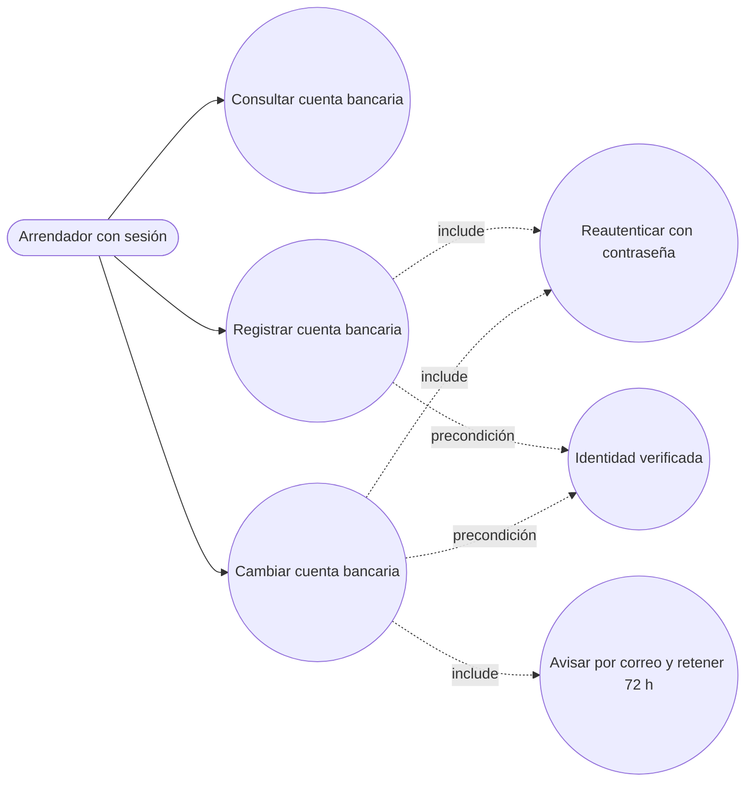
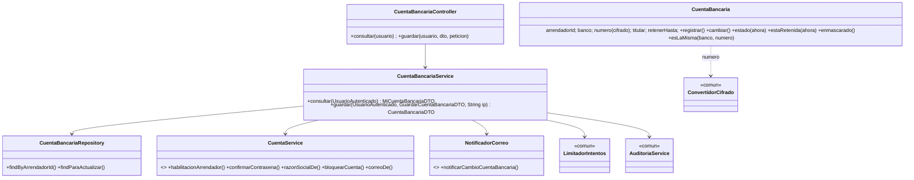
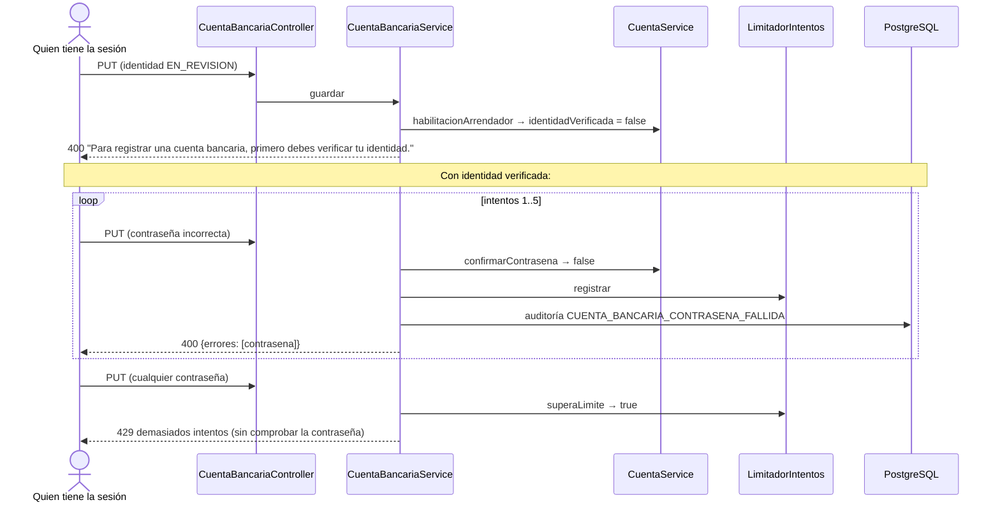

# HU-18 — Design: Registro de cuenta bancaria del arrendador

> Módulo `pagos` · Release 2 · Sprint 5 · tamaño S · depende de HU-06 (`done`) · sin ★ (`patterns: []`).
> Reutiliza `CuentaService.habilitacionArrendador` (HU-07/HU-06), `CuentaService.correoDe` (HU-13),
> `ConvertidorCifrado` + `CifradorCampos` (HU-02), `AuditoriaService`, `LimitadorIntentos` (HU-03),
> `DemasiadosIntentosException`, `ReglaNegocioException`, `AccesoDenegadoException`, `DespuesDelCommit`,
> `NotificadorCorreo` (la usa ya `pagos` desde HU-13), `IpCliente`, `Clock`, `ManejadorGlobalErrores`, el kit
> (`Campo`, `Boton`, `Alerta`, `EtiquetaEstado`) y `api/cliente.js`. P1–P9: ver `requirements.md`, a confirmar por
> **Ariel Enriquez**. **Sin dependencias nuevas** (ni backend ni frontend).

## 1. Decisiones

| # | Tema | Decisión | Por qué |
|---|------|----------|---------|
| DT-1 | Ubicación | Todo en `pagos` (`docs/architecture.md`: HU-18 es de `pagos`). Clase concreta `CuentaBancariaService` sin interfaz: HU-19 es del mismo módulo y la llama directo. | YAGNI (`docs/conventions.md`). |
| DT-2 | Una cuenta por arrendador | Tabla `cuenta_bancaria` con `UNIQUE (arrendador_id)`; el cambio hace `UPDATE` de la fila. El historial vive en la auditoría (datos enmascarados). | La historia habla de "la cuenta"; un historial en tablas no lo pide ningún CA. Ver alternativa descartada A. |
| DT-3 | Titular (P1) | El servidor guarda como `titular` la `razon_social` del perfil (la lee `CuentaService`, ver DT-6) y el cliente envía `declaraTitularidad = true`. No hay campo `titular` en la entrada. | Evita un titular distinto al verificado en HU-06 y no inventa una comparación de textos con tildes. La plataforma no puede validar con el banco. |
| DT-4 | Cifrado (R20) | `CuentaBancaria.numero` con `@Convert(converter = ConvertidorCifrado.class)` → columna `TEXT` `v1:…`, igual que `PerfilArrendador.numeroDocumento`. Los 4 últimos dígitos se calculan al descifrar (`enmascarar`); no hay columna con ellos. | Reutiliza `comun/cifrado` (§8: "se construye una vez"). La comparación "misma cuenta" (R16) se hace sobre el valor descifrado en memoria; no se necesita huella porque no se exige unicidad entre arrendadores (descartada B). |
| DT-5 | Reautenticación (P2, P3) | `CuentaService.confirmarContrasena(usuario, contrasena)` (método nuevo, §5) compara con `PasswordEncoder` el hash de la cuenta de la **sesión**. El conteo de fallos usa `LimitadorIntentos` con clave `"cuenta-bancaria\|" + usuarioId`, 5 en 15 min, como `InicioSesionService`. El fallo se audita **fuera** de la transacción de escritura (R7). | RNF-SEG-03 pide reautenticar para cuentas bancarias y HU-20/HU-22 lo reutilizan. Sin un límite, una sesión robada podría adivinar la contraseña en este endpoint. El límite se cuenta por cuenta y no por IP porque el atacante cambia de IP, no de víctima. |
| DT-6 | Extensión de `CuentaService` | Se agregan dos métodos: `confirmarContrasena(UsuarioAutenticado, String) → boolean` y `razonSocialDe(Long arrendadorId) → String`. Ambos sin rol (los llama `pagos` con la sesión ya validada); `razonSocialDe` lanza 404 si no hay perfil. **No es un puerto**: la dirección `pagos → cuentas` está permitida; se anota en `docs/architecture.md` junto a los demás métodos de `CuentaService`. | `pagos` nunca lee `UsuarioRepository` ni `PerfilArrendadorRepository` (principio 5). `razonSocialDe` devuelve solo ese dato, nunca el documento (RNF-SEG-16). |
| DT-7 | Orden de comprobaciones | `PUT`: (1) rol `ARRENDADOR` (403) → (2) identidad verificada (400, R3) → (3) límite (429) → (4) contraseña (400, R7) → (5) transacción de escritura: `bloquearCuenta` → releer identidad → cuenta vigente → misma cuenta (400, R16) → guardar → auditar → correo. (1)–(4) fuera de transacción. | La identidad va antes de la contraseña para que un arrendador sin identidad no gaste intentos ni pruebe contraseñas (R3). La contraseña va antes de revelar si la cuenta es "la misma" (R16). La identidad se relee bajo el bloqueo por si HU-20 la devolvió a revisión entre medias. |
| DT-8 | Concurrencia (R25) | `CuentaService.bloquearCuenta(usuarioId)` (HU-12 D4, `MANDATORY`) toma la fila de `usuario` al inicio de la transacción de escritura; luego `CuentaBancariaRepository.findParaActualizar`. | Serializa dos `PUT` del mismo arrendador; sin el bloqueo, dos primeros registros chocarían en `uq_cuenta_bancaria_arrendador`. El orden de bloqueos (`usuario` primero) es el mismo que usa el resto del proyecto. |
| DT-9 | Retención (R12, R18) | `CuentaBancaria.RETENCION = Duration.ofHours(72)`. `cambiar(...)` fija `retenerHasta = ahora + RETENCION`; `estado(ahora)` devuelve `RETENIDA` si `retenerHasta != null && ahora < retenerHasta`. El `Clock` se inyecta (se prueba con `RelojControlable` sin esperar 72 h). | RN-11. El estado no se guarda: se calcula al leer, como `Reserva.estadoEn`. HU-19 usa `estaRetenida(ahora)` para decidir; no lee la columna a mano. |
| DT-10 | Correo | `NotificadorCorreo.notificarCambioCuentaBancaria(String correo, AvisoCambioCuentaBancaria aviso)` (método nuevo; `AvisoCambioCuentaBancaria(banco, numeroEnmascarado, retenidaHasta)` en `cuentas.service`, junto a `AvisoCancelacionUsuario`). Se envía con `DespuesDelCommit.ejecutar`. El simulado no escribe el correo ni el banco en el log. | Mismo camino que los avisos de HU-13/HU-15. HU-25 mueve todo a `comun/correo`. |
| DT-11 | Errores | `ReglaNegocioException(null, MENSAJE_IDENTIDAD_NO_VERIFICADA)` (400 sin `errores`), `ReglaNegocioException("contrasena", …)` (400 de campo), `ReglaNegocioException(null, MENSAJE_YA_REGISTRADA)`, `DemasiadosIntentosException` (429), `AccesoDenegadoException` (403). Una contraseña incorrecta es **400** y no 401 porque `api/cliente.js` borra el token ante un 401 con token (HU-17 DT-9). | Mismo criterio que HU-17. |
| DT-12 | Rutas | `/api/arrendadores/actual/cuenta-bancaria` con `GET` y `PUT` (patrón de `/api/arrendadores/actual/reservas`, HU-14). `PUT` y no `POST`: el recurso es único y se reemplaza; 200 en registro y en cambio (la respuesta es el estado, no un recurso nuevo). | `docs/conventions.md`: `PUT` modifica; la identidad sale de la sesión. |

## 2. Caso de uso



**Registrar (CA1).** Precondición: rol `ARRENDADOR` e identidad verificada. Flujo: el arrendador envía banco, número,
declaración y contraseña → el sistema valida, reautentica, guarda con el número cifrado y la razón social como
titular, audita → 200 con la cuenta enmascarada `DISPONIBLE`. Alternos: identidad no verificada → 400 (CA3);
contraseña incorrecta → 400 y 5.º fallo → 429 después.

**Cambiar (CA2).** Igual, con cuenta vigente distinta: reemplaza los datos, `retener_hasta = ahora + 72 h`, audita el
antes y el después, y envía el aviso por correo tras el commit → 200 `RETENIDA`. Misma cuenta → 400.

### Diagrama de clases



## 3. Archivos por módulo y capa

| Capa | Archivo (N nuevo, M modificado) | Cubre |
|------|----------------------------------|-------|
| `pagos/domain/` | `CuentaBancaria` (N), `EstadoCuentaBancaria` (N: `DISPONIBLE`, `RETENIDA`) | R11, R12, R16–R18, R20 |
| `pagos/repository/` | `CuentaBancariaRepository` (N) | R5, R11, R12, R25 |
| `pagos/dto/` | `GuardarCuentaBancariaDTO`, `CuentaBancariaDTO`, `MiCuentaBancariaDTO` (N) | R5, R6, R10, R19, R22 |
| `pagos/service/` | `CuentaBancariaService` (N) | R1–R25 |
| `pagos/controller/` | `CuentaBancariaController` (N) | R1, R2, R4, R5, R21 |
| `cuentas/service/` | `CuentaService` (M: `confirmarContrasena`, `razonSocialDe`), `impl/CuentaServiceImpl` (M), `NotificadorCorreo` (M: `notificarCambioCuentaBancaria`), `NotificadorCorreoSimulado` (M), `AvisoCambioCuentaBancaria` (N) | R7, R11, R13, R15 |
| `resources/db/migration/` | `V5_2__cuenta_bancaria.sql` (N) | R17, R20, R25 |
| `2_Backend/src/test/` | Los dobles que implementan `NotificadorCorreo` (`PagosSoporte`, `CancelacionReservaControllerIT`, `ArrendadorControllerIT`, …) ganan el método nuevo | — |
| Frontend `src/api/pagos.js` | (M) `obtenerCuentaBancaria`, `guardarCuentaBancaria` | Pantalla |
| Frontend `src/pages/pagos/` | `CuentaBancaria.jsx` + `.module.css` (N), `textosPagos.js` (M) | Pantalla |
| Frontend `src/components/ui/EtiquetaEstado.jsx` | (M) estados `DISPONIBLE` y `RETENIDA` | CA1, CA2 visibles |
| Frontend `src/pages/cuentas/Panel.jsx`, `src/App.jsx` | (M) enlace y ruta `/panel/cuenta-bancaria` | Pantalla |
| `docs/` | El implementer actualiza `docs/modelo-datos.md` (fila `cuenta_bancaria`), `docs/architecture.md` (métodos nuevos de `CuentaService`) y `docs/frontend.md` (estados y ruta) | — |

`ConfiguracionSeguridad` no cambia: `anyRequest().authenticated()` cubre la ruta (R1). No hace falta `ReglaLimite`:
el límite es de la contraseña y vive en el servicio (DT-5).

## 4. Endpoints

| Método y ruta | Acceso | Entrada | Salida | Códigos |
|---------------|--------|---------|--------|---------|
| `GET /api/arrendadores/actual/cuenta-bancaria` | sesión `ARRENDADOR` | — | `200 MiCuentaBancariaDTO(identidadVerificada, cuenta)`; `cuenta` es `null` si no hay | 200 (R5, R18), 401 (R1), 403 (R2) |
| `PUT /api/arrendadores/actual/cuenta-bancaria` | sesión `ARRENDADOR` | `GuardarCuentaBancariaDTO(banco, numero, declaraTitularidad, contrasena)` | `200 CuentaBancariaDTO(banco, numeroEnmascarado, titular, estado, retenidaHasta)` | 200 (R11, R12), 400 (R3, R6, R7, R10, R16), 401 (R1), 403 (R2), 429 (R8) |

Ambas respuestas llevan `CacheControl.noStore()` (R21), como `ReembolsoAdminController`.

Validación (Bean Validation → 400 por campo con `ManejadorGlobalErrores`, sin llegar al servicio): `banco`
`@NotBlank @Size(min = 2, max = 60)`; `numero` `@NotBlank @Pattern(regexp = "\\d{10,20}")`; `declaraTitularidad`
`@AssertTrue`; `contrasena` `@NotBlank @Size(max = 72)` (como `InicioSesionDTO`). Un `GET` o `PUT` de otro rol llega al
servicio con un cuerpo válido y recibe 403 (R2); con un cuerpo inválido recibiría 400 antes: no revela nada.

### Mensajes (texto exacto)

| Constante | Dónde | Texto |
|-----------|-------|-------|
| `GuardarCuentaBancariaDTO.MENSAJE_BANCO` | campo `banco` | `Ingresa el nombre del banco (de 2 a 60 caracteres).` |
| `GuardarCuentaBancariaDTO.MENSAJE_NUMERO` | campo `numero` | `Ingresa el número de cuenta: solo dígitos, de 10 a 20.` |
| `GuardarCuentaBancariaDTO.MENSAJE_DECLARACION` | campo `declaraTitularidad` | `Confirma que la cuenta está a tu nombre o al de tu RUC.` |
| `GuardarCuentaBancariaDTO.MENSAJE_CONTRASENA` | campo `contrasena` (R6) | `Ingresa tu contraseña para confirmar.` |
| `CuentaBancariaService.MENSAJE_IDENTIDAD_NO_VERIFICADA` | R3 | `Para registrar una cuenta bancaria, primero debes verificar tu identidad.` |
| `CuentaBancariaService.MENSAJE_CONTRASENA_INCORRECTA` | campo `contrasena` (R7) | `La contraseña no es correcta.` |
| `CuentaBancariaService.MENSAJE_YA_REGISTRADA` | R16 | `Esa cuenta ya es la que tienes registrada.` |
| `ErrorDTO.MENSAJE_DEMASIADOS_INTENTOS` | R8 | (existente, genérico) |

## 5. Clases y firmas públicas

```java
// pagos/domain
public enum EstadoCuentaBancaria { DISPONIBLE, RETENIDA }

@Entity @Table(name = "cuenta_bancaria")
public class CuentaBancaria {
    public static final Duration RETENCION = Duration.ofHours(72);
    // @Id @GeneratedValue(IDENTITY) Long id; Long arrendadorId; String banco;
    // @Convert(converter = ConvertidorCifrado.class) String numero;  String titular;
    // Instant retenerHasta (nulo); Instant creadaEn; Instant actualizadaEn;
    protected CuentaBancaria() { }
    public static CuentaBancaria registrar(Long arrendadorId, String banco, String numero, String titular, Instant ahora);
    public void cambiar(String banco, String numero, String titular, Instant ahora); // retenerHasta = ahora + RETENCION
    public boolean esLaMisma(String banco, String numero);      // banco sin distinguir mayúsculas y sin espacios extremos
    public boolean estaRetenida(Instant ahora);                 // retenerHasta != null && ahora.isBefore(retenerHasta)
    public EstadoCuentaBancaria estado(Instant ahora);
    public String enmascarado();                                // "****" + 4 últimos dígitos
    public static String enmascarar(String numero);
    // getters; sin setters públicos
}

// pagos/repository
public interface CuentaBancariaRepository extends JpaRepository<CuentaBancaria, Long> {
    Optional<CuentaBancaria> findByArrendadorId(Long arrendadorId);
    @Lock(LockModeType.PESSIMISTIC_WRITE)
    @Query("select c from CuentaBancaria c where c.arrendadorId = :arrendadorId")
    Optional<CuentaBancaria> findParaActualizar(@Param("arrendadorId") Long arrendadorId);
}

// pagos/dto
public record GuardarCuentaBancariaDTO(@NotBlank @Size(min = 2, max = 60) String banco,
                                       @NotBlank @Pattern(regexp = "\\d{10,20}") String numero,
                                       @AssertTrue boolean declaraTitularidad,
                                       @NotBlank @Size(max = 72) String contrasena) { } // toString: numero=***, contrasena=***
public record CuentaBancariaDTO(String banco, String numeroEnmascarado, String titular,
                                EstadoCuentaBancaria estado, Instant retenidaHasta) { } // retenidaHasta solo si RETENIDA
public record MiCuentaBancariaDTO(boolean identidadVerificada, CuentaBancariaDTO cuenta) { }

// pagos/service
@Service
public class CuentaBancariaService {
    public static final String ACCION_REGISTRADA = "CUENTA_BANCARIA_REGISTRADA";
    public static final String ACCION_CAMBIADA = "CUENTA_BANCARIA_CAMBIADA";
    public static final String ACCION_CONTRASENA_FALLIDA = "CUENTA_BANCARIA_CONTRASENA_FALLIDA";
    public static final int MAXIMO_FALLOS = 5;
    public static final Duration VENTANA_FALLOS = Duration.ofMinutes(15);
    static final String PREFIJO_CLAVE = "cuenta-bancaria|";
    public CuentaBancariaService(CuentaBancariaRepository cuentas, CuentaService cuentasUsuario,
                                 NotificadorCorreo notificador, LimitadorIntentos limitador,
                                 AuditoriaService auditoria, TransactionTemplate transacciones, Clock reloj);
    @Transactional(readOnly = true)
    public MiCuentaBancariaDTO consultar(UsuarioAutenticado usuario);                 // R2, R5, R18
    public CuentaBancariaDTO guardar(UsuarioAutenticado usuario, GuardarCuentaBancariaDTO solicitud, String ip); // R2–R17, R19–R25
}

// pagos/controller
@RestController @RequestMapping("/api/arrendadores/actual/cuenta-bancaria")
public class CuentaBancariaController {
    @GetMapping ResponseEntity<MiCuentaBancariaDTO> consultar(@AuthenticationPrincipal UsuarioAutenticado u);
    @PutMapping ResponseEntity<CuentaBancariaDTO> guardar(@AuthenticationPrincipal UsuarioAutenticado u,
            @Valid @RequestBody GuardarCuentaBancariaDTO dto, HttpServletRequest peticion); // IpCliente.de(peticion)
}

// cuentas/service (M)
public interface CuentaService {
    /** true si la contraseña coincide con la de la cuenta de la sesión. No cuenta intentos: lo hace el llamador. */
    boolean confirmarContrasena(UsuarioAutenticado usuario, String contrasena);
    /** Razón social (nombre si el documento es DNI) del perfil del arrendador. 404 si no hay perfil. Nunca el documento. */
    String razonSocialDe(Long arrendadorId);
}
public interface NotificadorCorreo {
    void notificarCambioCuentaBancaria(String correoArrendador, AvisoCambioCuentaBancaria aviso);
}
public record AvisoCambioCuentaBancaria(String banco, String numeroEnmascarado, Instant retenidaHasta) { }
```

## 6. Flujos

**`CuentaBancariaService.guardar`** (sin `@Transactional`; la escritura va en `TransactionTemplate`):
1. Rol distinto de `ARRENDADOR` → `AccesoDenegadoException` (R2).
2. `habilitacionArrendador(usuario).identidadVerificada()` falso → `ReglaNegocioException(null,
   MENSAJE_IDENTIDAD_NO_VERIFICADA)` (R3).
3. `limitador.superaLimite(clave, MAXIMO_FALLOS, VENTANA_FALLOS)` → `DemasiadosIntentosException` (R8).
4. `confirmarContrasena` falso → `limitador.registrar(clave)`, `auditoria.registrar(CUENTA_BANCARIA_CONTRASENA_FALLIDA,
   entidad "usuario")` (es su propia transacción, no hay una abierta) y `ReglaNegocioException("contrasena",
   MENSAJE_CONTRASENA_INCORRECTA)` (R7). Verdadero → `limitador.limpiar(clave)` (R9).
5. `transacciones.execute`: `cuentasUsuario.bloquearCuenta(id)` → releer `identidadVerificada` (falso →
   `ReglaNegocioException`, R3) → `cuentas.findParaActualizar(id)`:
   - **Sin fila:** `titular = cuentasUsuario.razonSocialDe(id)`, `CuentaBancaria.registrar(...)`, `saveAndFlush`,
     auditoría `CUENTA_BANCARIA_REGISTRADA` con `banco=…;cuenta=****1234` (R11, R17, R23).
   - **Con fila y `esLaMisma`:** `ReglaNegocioException(null, MENSAJE_YA_REGISTRADA)` (R16; rollback, no se escribió nada).
   - **Con fila distinta:** guarda el enmascarado anterior, `cambiar(...)` (`retenerHasta = ahora + 72 h`),
     auditoría `CUENTA_BANCARIA_CAMBIADA` con `anterior=BANCO/****1111;nueva=BANCO/****2222;retenerHasta=…` (R12, R24) y
     `DespuesDelCommit.ejecutar(() -> notificador.notificarCambioCuentaBancaria(correoDe(id), aviso))` (R13–R15). El
     correo se lee dentro de la transacción (`correoDe`) y se envía después.
6. Devuelve `CuentaBancariaDTO` (R19). El número completo nunca sale de la entidad.

El bloqueo de `usuario` ocurre **después** del `bcrypt` (paso 4) para no retener la fila durante el hash.

**`consultar`:** rol (R2) → `habilitacionArrendador` → `findByArrendadorId` → `CuentaBancariaDTO` con `estado(ahora)`
(R5, R18). Sin escritura.

**Auditoría.** `EventoAuditoria(usuarioId, accion, "cuenta_bancaria", cuenta.getId(), ip, detalle)` (la fallida usa
entidad `usuario` e id del usuario). El detalle nunca lleva el número completo ni la contraseña (R22).

## 7. Diagramas de secuencia

### Flujo principal: cambio de cuenta con aviso y retención (CA2)

```mermaid
sequenceDiagram
  actor A as Arrendador (identidad verificada)
  participant C as CuentaBancariaController
  participant S as CuentaBancariaService
  participant CS as CuentaService (cuentas)
  participant L as LimitadorIntentos
  participant DB as PostgreSQL
  participant N as NotificadorCorreo
  A->>C: PUT /api/arrendadores/actual/cuenta-bancaria {banco, numero, declaraTitularidad, contrasena}
  C->>S: guardar(usuario, dto, ip)
  S->>CS: habilitacionArrendador(usuario) → identidad verificada
  S->>L: superaLimite("cuenta-bancaria|id") → no
  S->>CS: confirmarContrasena(usuario, contrasena) → true
  S->>L: limpiar
  S->>DB: BEGIN; bloquearCuenta (usuario FOR UPDATE)
  S->>DB: SELECT cuenta_bancaria FOR UPDATE → existe y es distinta
  S->>DB: UPDATE (banco, numero cifrado, retener_hasta = ahora+72h)
  S->>DB: INSERT auditoria CUENTA_BANCARIA_CAMBIADA (enmascarado)
  S->>DB: COMMIT
  S-->>N: (después del commit) notificarCambioCuentaBancaria(correo, aviso)
  S-->>C: CuentaBancariaDTO(estado=RETENIDA, retenidaHasta)
  C-->>A: 200 (Cache-Control: no-store)
```

### Flujo de error: sin identidad, contraseña incorrecta y bloqueo (CA3, STRIDE S/T)



## 8. Migración Flyway — `V5_2__cuenta_bancaria.sql`

Sprint 5 → siguiente `n` libre en `develop`: `V5_1` es `mfa` (HU-17), así que esta es `V5_2`. Si al unir `develop` ya
tiene `V5_2`, se renombra a la siguiente libre (`docs/conventions.md`). Solo depende de `V1_1` (`usuario`).

```sql
-- HU-18: cuenta bancaria del arrendador. Una sola cuenta vigente por arrendador (el cambio la reemplaza; el
-- historial vive en la auditoría). El número va cifrado con AES-256-GCM ("v1:" + base64, CifradorCampos): sin CHECK
-- de formato. retener_hasta: la siguiente liquidación no se paga antes de esa fecha (RN-11); nulo si nunca cambió.
-- Sin cascada desde usuario: es dato financiero, como pago. HU-22 anonimiza.
CREATE TABLE cuenta_bancaria (
    id            BIGINT GENERATED ALWAYS AS IDENTITY PRIMARY KEY,
    arrendador_id BIGINT       NOT NULL REFERENCES perfil_arrendador (usuario_id),
    banco         VARCHAR(60)  NOT NULL,
    numero        TEXT         NOT NULL,
    titular       VARCHAR(150) NOT NULL,
    retener_hasta TIMESTAMPTZ,
    creada_en     TIMESTAMPTZ  NOT NULL,
    actualizada_en TIMESTAMPTZ NOT NULL,
    CONSTRAINT uq_cuenta_bancaria_arrendador UNIQUE (arrendador_id),
    CONSTRAINT ck_cuenta_bancaria_banco CHECK (length(btrim(banco)) >= 2),
    CONSTRAINT ck_cuenta_bancaria_titular CHECK (length(btrim(titular)) >= 1),
    CONSTRAINT ck_cuenta_bancaria_fechas CHECK (actualizada_en >= creada_en)
);
```

`docs/modelo-datos.md` ya nombra `cuenta_bancaria` (`id, arrendador_id, banco, numero (cifrado), titular,
retener_hasta`); el implementer lo completa con `creada_en`, `actualizada_en` y las restricciones. El FK apunta a
`perfil_arrendador(usuario_id)` como dice el diagrama ER (`PERFIL_ARRENDADOR ||--o{ CUENTA_BANCARIA`); `V1_3` es de
un sprint menor, así que no hay dependencia hacia un número mayor.

## 9. Componentes de `comun` reutilizados y excepciones

- **Reutilizados:** `ConvertidorCifrado`/`CifradorCampos`, `AuditoriaService`/`EventoAuditoria`, `LimitadorIntentos`,
  `DespuesDelCommit`, `IpCliente`, `ManejadorGlobalErrores`, `ReglaNegocioException`, `AccesoDenegadoException`,
  `DemasiadosIntentosException`.
- **Excepciones nuevas:** ninguna.
- **Puertos nuevos:** ninguno (DT-6): `pagos → cuentas` está permitido; solo crecen `CuentaService` y
  `NotificadorCorreo`.

## 10. Lo que deben saber las historias que siguen

- **HU-19** lee la cuenta con `CuentaBancariaRepository` (mismo módulo) y decide con `CuentaBancaria.estaRetenida(ahora)`;
  sin fila, la liquidación queda `PENDIENTE_CUENTA`. Cómo ve el admin el número completo para transferir a mano lo
  decide HU-19 (P8): HU-18 no lo expone.
- **HU-20** (cambio de RUC/DNI) puede reutilizar `CuentaService.confirmarContrasena`.
- **HU-22** anonimiza `cuenta_bancaria` (sin cascada desde `usuario`).

## 11. Pantallas

### `/panel/cuenta-bancaria` — Cuenta bancaria

- **Ruta y archivo:** `/panel/cuenta-bancaria`, `pages/pagos/CuentaBancaria.jsx`, envuelta en `<RutaProtegida>` en
  `App.jsx`; otro rol vuelve a `/panel` con `Navigate` (la API igual responde 403). Enlace "Cuenta bancaria" en
  `Panel.jsx`, solo para `ARRENDADOR`, junto a "Verificar mi identidad".
- **Componentes del kit:** `Campo` (`banco` y `numero` de texto; `declaraTitularidad` con `tipo="checkbox"`;
  `contrasena` con `tipo="password"`), `Boton` (único primario "Guardar cuenta"), `Alerta`, `EtiquetaEstado`, `Tarjeta`.
  **No agrega componentes al kit.**
- **API (`src/api/pagos.js`):** `obtenerCuentaBancaria()` → `GET /api/arrendadores/actual/cuenta-bancaria`;
  `guardarCuentaBancaria({ banco, numero, declaraTitularidad, contrasena })` → `PUT` de la misma ruta.
- **Estados nuevos de `EtiquetaEstado` (tabla "Color de cada estado", fila "Cuenta bancaria"):**
  `DISPONIBLE` → Éxito, texto "Disponible para liquidaciones"; `RETENIDA` → Atención, texto "Retenida 72 h". El
  valor viene en `estado` de la API; la pantalla no calcula nada. El implementer los agrega a `docs/frontend.md`.
- **Cómo muestra cada CA:**
  - *Al abrir:* "Cargando…". Con cuenta: una `Tarjeta` con banco, `numeroEnmascarado` (la API ya lo enmascara),
    titular, `EtiquetaEstado` y, si `RETENIDA`, la fecha `retenidaHasta` (`fechaHora`). Sin cuenta: texto secundario
    "Aún no tienes una cuenta bancaria registrada."
  - *CA1:* formulario con banco, número, la casilla "La cuenta está a mi nombre o al de mi RUC" y contraseña;
    éxito → `Alerta exito` "Cuenta bancaria guardada." y el bloque se actualiza con la respuesta.
  - *CA2:* si ya hay cuenta, `Alerta atencion` fija sobre el formulario: "Si cambias tu cuenta, te avisaremos por
    correo y tu próxima liquidación se retendrá 72 horas." (solo informativa: la regla la aplica el servidor).
    Tras el cambio → `Alerta exito` y la etiqueta pasa a "Retenida 72 h".
  - *CA3:* si `identidadVerificada` es falso, `Alerta atencion` "Para registrar una cuenta bancaria, primero debes
    verificar tu identidad." con enlace a `/panel/identidad`, y el botón deshabilitado. Si de todos modos la API
    responde 400, `Alerta error` con el mensaje tal cual.
  - *Errores:* campo `contrasena`/`banco`/`numero`/`declaraTitularidad` del `ErrorDTO` bajo su `Campo`; 400 sin
    campo, 429 y 5xx → `Alerta error` con el mensaje de la API; error de red → "No pudimos conectar. Intenta de
    nuevo." La contraseña se vacía tras cada respuesta. El botón usa `cargando` para no enviar dos veces.
  - La pantalla nunca muestra el número completo ni lo guarda más allá del estado del formulario (se limpia tras
    guardar); nada va a `localStorage` ni `sessionStorage`.

## 12. Alternativas descartadas

- **A. Historial en tabla (varias filas con `activa` e índice único parcial `WHERE activa`).** Conserva todas las
  cuentas, pero ningún CA pide consultarlas, complica HU-19 (¿cuál usar?) y duplica lo que ya guarda la auditoría
  (RNF-SEG-12 pide el registro de cada cambio, y R24 lo cubre con datos enmascarados). Se descartó por YAGNI; si en
  el futuro se necesita el historial, se agrega una tabla sin cambiar la API.
- **B. Huella (HMAC) del número para impedir que dos arrendadores usen la misma cuenta.** Ningún CA ni RN lo pide y
  hay casos legítimos (un RUC compartido entre cuentas). Añadirlo obligaría a revelar si un número ya existe, lo que
  contradice la minimización de datos (RNF-SEG-16).
- **C. Titular escrito por el usuario y comparado con la razón social.** Genera rechazos por tildes y espacios y no
  prueba nada frente al banco; se prefirió derivarlo del servidor y exigir la declaración (P1).
- **D. Confirmar el cambio con un código por correo en vez de la contraseña.** La historia pide la contraseña
  (RNF-SEG-03) y el aviso por correo es posterior al cambio, no un paso previo.
