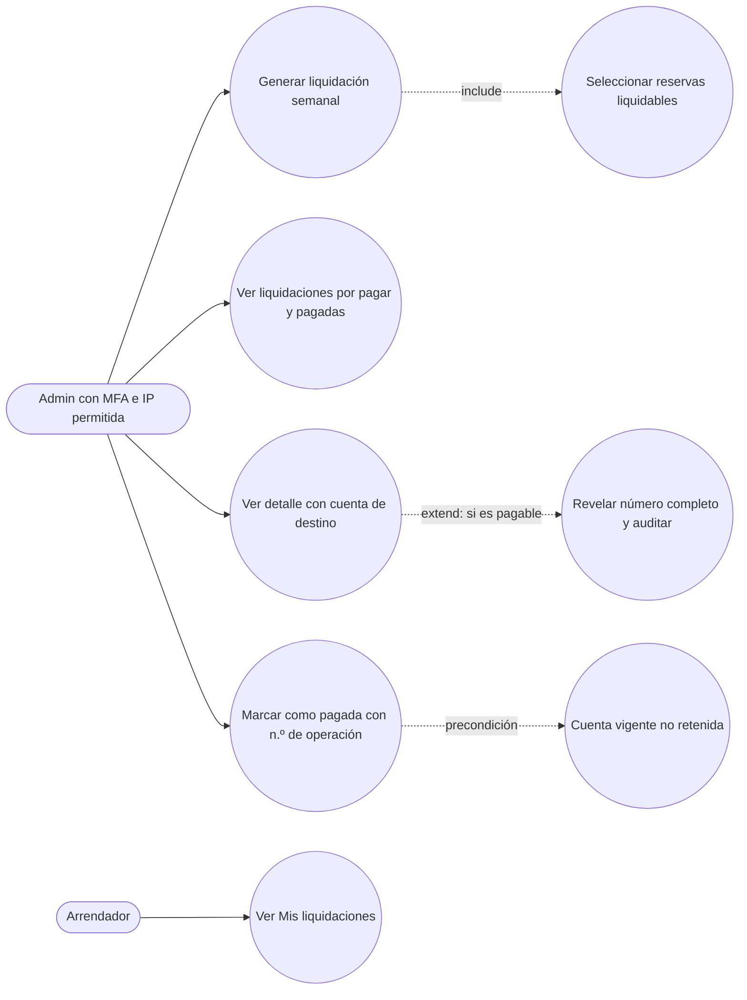
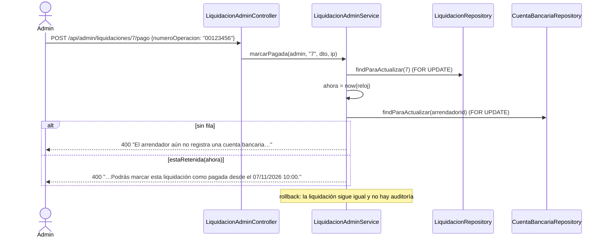
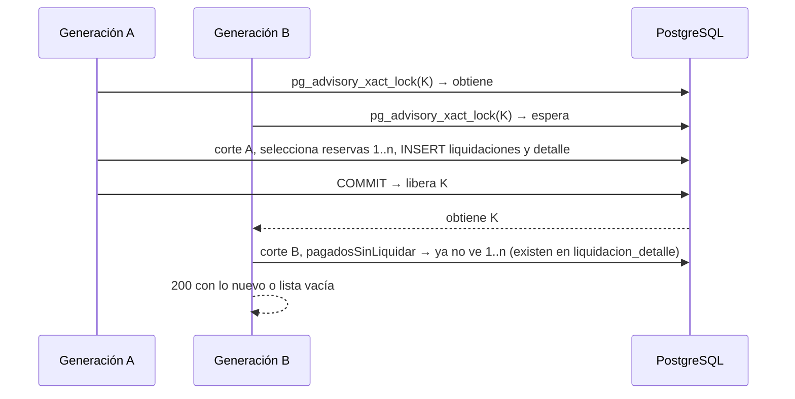
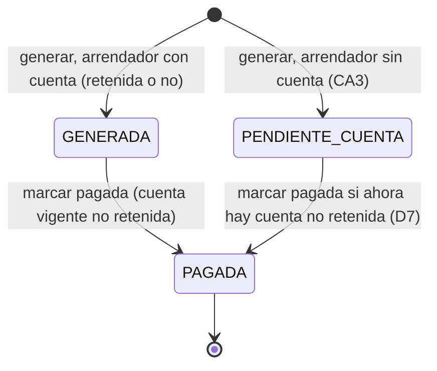

# HU-19 — Design: Liquidación semanal al arrendador

> Módulo `pagos` · Release 2 · Sprint 5 · tamaño M · depende de HU-13 y HU-18 (`done`) · sin ★ (`patterns: []`;
> DAO/Repository como en todas). Dueño: **Eduardo Saldaña**; prueba: **Ariel Enriquez**.
> Reutiliza `Pago`/`PagoRepository`/`EstadoPago` y la regla "solo `PAGADO`" (HU-13), `Reembolso` (HU-16),
> `CuentaBancaria`/`CuentaBancariaRepository` y `estaRetenida(ahora)` (HU-18), `ReglasPago.idBienEscrito`,
> `ReservaBloqueRepository.horarios` y `ReservaConHorario` (HU-14), `CatalogoEspaciosService.nombres` (HU-12),
> `CuentaService.nombres` (HU-14) y `arrendadoresNoActivos` (HU-09), `AuditoriaService`, `IpCliente`, `FiltroIpsAdmin`,
> la sesión con MFA del admin (HU-17), `ZonaHoraria`, `Clock`, `ManejadorGlobalErrores`, `ValidacionException` y el kit
> (`Tarjeta`, `Boton`, `Modal`, `Campo`, `Alerta`, `EtiquetaEstado`). Decisiones del dueño D1–D8 y supuestos S1–S15: ver
> `requirements.md`. **Sin dependencias nuevas** (ni backend ni frontend). **Sin cambios en `comun`.**

## 1. Decisiones

| # | Tema | Decisión | Por qué |
|---|------|----------|---------|
| DT-1 | Disparo manual (simplificación) | La generación es un `POST` del admin; no hay `@Scheduled`, cola ni llamada a ningún banco. La transferencia la hace el admin fuera del sistema y luego registra el número de operación. | `docs/architecture.md` "Qué NO hacer": la liquidación automática (job y transferencia por API) está fuera del alcance. |
| DT-2 | Todo lo pendiente (D1) | Cada generación toma **un corte** (`Instant.now(reloj)` tras el bloqueo, DT-7) y liquida todas las reservas liquidables a ese corte. `liquidacion.periodo` = fecha del corte en Lima (informativa). | D1. Con periodos fijos, una reserva que vuelve a ser liquidable (HU-26 CA3) o que madura tarde se perdería; "todo lo pendiente" la recoge en la siguiente. |
| DT-3 | Dónde vive cada regla (S6) | `pagos` decide **qué pago cuenta** (solo `PAGADO`, sin reembolso, no liquidado, `sim-` según D2) con una consulta propia, y la **regla de las 48 h** (`ReglasLiquidacion.esLiquidable`). `reservas` decide si el **estado** de una reserva admite liquidación (`Reserva.admiteLiquidacion()`: `CONFIRMADA`, o `CANCELADA` por el usuario con `monto_reembolso = 0`, D3) y calcula su **fin**. Se comunican por el puerto `pagos.ReservasLiquidables` (DT-4). | `pagos` no puede importar `reservas` (dirección `reservas → pagos`). Así `reservas` no conoce `liquidacion` y `pagos` no conoce `reserva_bloque` ni `EstadoReserva`. |
| DT-4 | Puerto nuevo `pagos.ReservasLiquidables` | Ya reservado en la tabla de puertos de `docs/architecture.md` ("HU-19"). Firma: `List<ReservaLiquidable> describir(Collection<Long> reservaIds)`. Lo implementa `reservas.service.impl.ReservasLiquidablesImpl` (`@Transactional(readOnly = true)`): `ReservaRepository.findAllById`, `ReservaBloqueRepository.horarios` (todas las filas, activas o no), `CatalogoEspaciosService.nombres` y el método nuevo `CatalogoEspaciosService.arrendadoresDe`. Colección vacía → `List.of()` sin consultar; una reserva sin filas de bloque no aparece. Sin sesión ni rol: lo llama `pagos` ya validado. Se inyecta directo (no `ObjectProvider`): `reservas` siempre está, como `ReservasPorCobrar`. Lo usan la generación **y** las lecturas (nombre del espacio y horario de cada línea). | DIP como `ReservasPorCobrar` (HU-13). No usa `ReservaDAO`: el DAO exige el dueño en cada consulta (HU-14 STRIDE E/I) y esto es una consulta del sistema para el admin, con ids que salen de `pagos`. Un método por lote: sin N+1. |
| DT-5 | Montos (S2, S4) | Línea = `pago.monto` (`PAGADO`). Bruto = Σ líneas. Comisión = `bruto × 0.10` con `setScale(2, HALF_UP)` sobre el **total**. Neto = bruto − comisión. `ReglasLiquidacion` (puro, en `pagos.domain`) replica la escala y el modo de `PoliticaReembolso` sin importarla. `ck_liquidacion_montos` garantiza lo mismo en la base (`round` de PostgreSQL redondea la mitad hacia arriba en positivos = `HALF_UP`). | CA1 da bruto, comisión y neto por liquidación. Redondear una sola vez evita que 10 % de cada línea sume un céntimo distinto del 10 % del total. `pagos` no puede importar `reservas.domain.PoliticaReembolso`. |
| DT-6 | Qué pago cuenta (S3, D2) | `PagoRepository.pagadosSinLiquidar(boolean incluirSimulados)` (JPQL): `estado = PAGADO`, sin fila en `Reembolso` para ese `pagoId`, sin fila en `LiquidacionDetalle` para esa `reservaId`, y si `!incluirSimulados`, `idTransaccionPasarela not like 'sim-%'`; orden por `reservaId`. `incluirSimulados` = la propiedad `espacioya.pagos.pasarela` vale `simulada` (sin distinguir mayúsculas, como `@ConditionalOnProperty`), leída con `@Value` en `GeneradorLiquidaciones`. La constante `ReglasPago.PREFIJO_SIMULADO = "sim-"` (nueva, pública) la usa también `PasarelaSimulada` en lugar de su copia privada. | `architecture.md`: "HU-19 y HU-28 cuentan solo `PAGADO`" y RS-5 de HU-13. Excluir todo pago con reembolso cubre el reembolso `PENDIENTE` (el pago sigue `PAGADO` mientras se procesa, HU-16 DT-1) y los parciales futuros de HU-26. |
| DT-7 | Concurrencia de dos generaciones (S5, R22) | `LiquidacionAdminService.generar` es `@Transactional`; su **primera** sentencia es `LiquidacionRepository.bloquearGeneracion(CLAVE_GENERACION)` → `select count(*) from (select pg_advisory_xact_lock(:clave)) bloqueo` (nativa, `MANDATORY`). La segunda generación espera al commit de la primera; recién entonces toma el corte y consulta (en `READ COMMITTED` cada sentencia ve lo ya confirmado), así que no ve como pendientes las reservas que la primera liquidó. `uq_liquidacion_detalle_reserva` es la última defensa: si aun así salta (`DataIntegrityViolationException` con ese nombre de restricción), se traduce a `ReglaNegocioException(MENSAJE_GENERACION_CRUZADA)` (400) y se revierte todo; cualquier otra violación se relanza. | No hay una fila natural que bloquear (las liquidaciones aún no existen y los arrendadores pueden ser nuevos). El bloqueo consultivo de transacción se libera solo al terminar, no deja filas ni tablas nuevas y el proyecto es solo PostgreSQL (sin H2). Ver alternativas A y B. |
| DT-8 | Marcar como pagada (D5, D7, S7) | Una transacción: `LiquidacionRepository.findParaActualizar(id)` (`PESSIMISTIC_WRITE`) → *ahora* → `CuentaBancariaRepository.findParaActualizar(arrendadorId)` → `Liquidacion.motivoNoPagable(cuenta, ahora)` → `marcarPagada(...)` → auditoría. Orden de bloqueos **`liquidacion → cuenta_bancaria`**: HU-18 toma `usuario → cuenta_bancaria` y nunca `liquidacion`, así que no hay ciclo. Bloquear la cuenta hace que un cambio de cuenta simultáneo se serialice: si el cambio confirma antes, el marcado ve la retención (400); si no, el cambio espera y el pago quedó registrado con la cuenta que existía. | Dos admins marcando a la vez: el segundo espera y ve `PAGADA` (R32). El *ahora* se toma después de los bloqueos (como HU-13 y HU-15). |
| DT-9 | Estados y transiciones | `PENDIENTE_CUENTA → PAGADA` y `GENERADA → PAGADA` (§ 8). No hay `PENDIENTE_CUENTA → GENERADA`: si el arrendador registra su cuenta, la liquidación sigue `PENDIENTE_CUENTA` y el detalle la muestra **pagable** (D7). `PAGADA` es final e inmutable (S8). | D7. Pasarla sola a `GENERADA` obligaría a tocar HU-18 (al registrar) o a escribir al leer. |
| DT-10 | Número completo para el admin (D4, S7) | `CuentaBancaria` gana `public String numeroParaTransferir()` (Javadoc: "solo para el detalle admin de HU-19, D4"). `LiquidacionAdminService.detalle` lo pone en `CuentaDestinoDTO.numeroCompleto` **solo** si la liquidación es pagable (por pagar, con cuenta, no retenida) y en la misma transacción audita `CUENTA_BANCARIA_CONSULTADA_ADMIN`. En cualquier otro caso `numeroCompleto` es `null`. `CuentaDestinoDTO.toString()` no lo incluye. La ruta responde `no-store`. | D4. Con la cuenta retenida no se puede pagar (D5): no hace falta revelar un número recién cambiado (posible cuenta secuestrada, que es justo lo que RN-11 protege). |
| DT-11 | Snapshot del destino (S7) | Al pagar se guardan `banco_destino` y `cuenta_destino` (**enmascarado**) en la liquidación. El número completo nunca se copia. | El arrendador y el admin ven a qué cuenta se pagó aunque luego la cambie (HU-18 reemplaza la fila). |
| DT-12 | Avisos (D6, S12) | Se calculan al leer, por lote: `CuentaService.arrendadoresNoActivos()` (HU-09) ∩ ids → `CUENTA_NO_ACTIVA`; método **nuevo** `CuentaService.arrendadoresSinIdentidadVerificada(Collection<Long> arrendadorIds) → Set<Long>` → `IDENTIDAD_NO_VERIFICADA`. No bloquean nada. La auditoría de la generación guarda los de ese momento. | D6. `pagos → cuentas` ya está permitido: no es un puerto. |
| DT-13 | Servicios | `LiquidacionAdminService` (rutas admin), `GeneradorLiquidaciones` (`@Component`, selección y armado, `MANDATORY`), `VistaLiquidaciones` (`@Component`, arma los DTO: líneas con el puerto, nombres, avisos) y `MisLiquidacionesService` (ruta del arrendador y `tieneLiquidacionesPendientes`, D8). Clases concretas sin interfaz. | YAGNI (`docs/conventions.md`); ningún otro módulo los llama aún. HU-22 conectará `tieneLiquidacionesPendientes` a su puerto `cuentas.ParticipanteDatosPersonales`. |
| DT-14 | Rol y rutas | Admin bajo `/api/admin/liquidaciones` (IP permitida por `FiltroIpsAdmin`; sesión de admin con MFA por `SesionService.validar`, HU-17; rol `ADMIN` exigido por el servicio **antes de leer nada**). Arrendador en `/api/arrendadores/actual/liquidaciones` (rol `ARRENDADOR`, identidad de la sesión). `ConfiguracionSeguridad` no cambia. | Mismo esquema que `ReembolsoAdminController` y `CuentaBancariaController`. |
| DT-15 | Paginación (S9) | Spring Data `Slice` con `PageRequest.of(pagina − 1, 20, orden)`; `hayMas = slice.hasNext()`. Validación de `pagina` y `grupo` como `ConsultaReservasService` (HU-14): sin `pagina` → 1; si no son solo dígitos o no cabe en `int` o es 0 → error de campo; `ValidacionException` con todos los errores. | Mismo contrato que HU-10 y HU-14 (sin total). La paginación va en SQL porque las liquidaciones crecen cada semana. |
| DT-16 | Sin correo (D8) | Ni `NotificadorCorreo` ni `DespuesDelCommit`. | D8. |

**Puerto nuevo:** `pagos.ReservasLiquidables` (ya reservado en la tabla; el implementer completa su fila con la firma).
**Métodos nuevos en interfaces de otros módulos** (no son puertos; direcciones permitidas): `CatalogoEspaciosService.arrendadoresDe`
(`reservas → espacios`) y `CuentaService.arrendadoresSinIdentidadVerificada` (`pagos → cuentas`).

## 2. Caso de uso y clases



**Generar (CA1, CA3).** Precondición: admin. Flujo: el admin pulsa "Generar liquidación" → el sistema toma el bloqueo de
generación y el corte → busca los pagos `PAGADO` sin reembolso ni liquidar → pide al puerto los datos de esas reservas →
filtra por estado admitido y fin + 48 h ≤ corte → agrupa por arrendador → crea una liquidación por arrendador
(`GENERADA` con cuenta, `PENDIENTE_CUENTA` sin ella) con sus líneas y montos → audita cada una → 200 con lo creado.
Alterno: nada que liquidar → 200 con lista vacía.

**Marcar pagada (CA2).** Precondición: admin y liquidación por pagar. Flujo: abre el detalle (ve la cuenta completa si es
pagable, auditado) → transfiere fuera del sistema → envía el número de operación → el sistema bloquea la liquidación y la
cuenta, revalida, la deja `PAGADA` con el destino enmascarado y audita → el arrendador la ve "Pagada". Alternos: sin
cuenta, cuenta retenida, ya pagada, número inválido → 400.

### Diagrama de clases

```mermaid
classDiagram
  class LiquidacionAdminController { +generar() +listar(grupo, pagina) +detalle(id) +marcarPagada(id, dto) }
  class MisLiquidacionesController { +listar(pagina) }
  class LiquidacionAdminService { +generar(admin, ip) +listar(admin, grupo, pagina) +detalle(admin, id, ip) +marcarPagada(admin, id, dto, ip) }
  class MisLiquidacionesService { +listar(arrendador, pagina) +tieneLiquidacionesPendientes(arrendadorId) }
  class GeneradorLiquidaciones { +generar(adminId, ip) Generacion }
  class VistaLiquidaciones { +resumenes() +detalle() +misLiquidaciones() }
  class Liquidacion { arrendadorId; periodo; montoBruto; comision; montoNeto; estado; simulada; +generar() +motivoNoPagable() +marcarPagada() }
  class LiquidacionDetalle { liquidacionId; reservaId; pagoId; monto; simulado }
  class EstadoLiquidacion { <<enum>> PENDIENTE_CUENTA GENERADA PAGADA }
  class ReglasLiquidacion { <<utilidad>> +esLiquidable(finEn, corte) +comision(bruto) +esSimulado(idTx) }
  class ReservasLiquidables { <<puerto pagos>> +describir(reservaIds) }
  class ReservasLiquidablesImpl { <<reservas>> }
  class CatalogoEspaciosService { <<interfaz espacios>> +nombres() +arrendadoresDe() }
  class CuentaService { <<interfaz cuentas>> +nombres() +arrendadoresNoActivos() +arrendadoresSinIdentidadVerificada() }
  class LiquidacionRepository
  class LiquidacionDetalleRepository
  class PagoRepository { +pagadosSinLiquidar(incluirSimulados) }
  class CuentaBancariaRepository
  LiquidacionAdminController --> LiquidacionAdminService
  MisLiquidacionesController --> MisLiquidacionesService
  LiquidacionAdminService --> GeneradorLiquidaciones
  LiquidacionAdminService --> VistaLiquidaciones
  MisLiquidacionesService --> VistaLiquidaciones
  GeneradorLiquidaciones --> PagoRepository
  GeneradorLiquidaciones --> ReservasLiquidables
  GeneradorLiquidaciones --> CuentaBancariaRepository
  GeneradorLiquidaciones --> LiquidacionRepository
  GeneradorLiquidaciones --> LiquidacionDetalleRepository
  VistaLiquidaciones --> ReservasLiquidables
  VistaLiquidaciones --> CuentaService
  ReservasLiquidablesImpl ..|> ReservasLiquidables
  ReservasLiquidablesImpl --> CatalogoEspaciosService
  Liquidacion --> EstadoLiquidacion
  Liquidacion ..> ReglasLiquidacion
  LiquidacionDetalle --> Liquidacion : liquidacionId
```



## 3. Archivos por módulo y capa

N = nuevo, M = modificado. La columna **Dueño a avisar** marca lo que toca código de otra historia o de otro dueño.

| Capa | Archivo | Cubre | Dueño a avisar |
|------|---------|-------|----------------|
| `pagos/domain/` | `Liquidacion` (N), `LiquidacionDetalle` (N), `EstadoLiquidacion` (N), `MotivoNoPagable` (N: `YA_PAGADA`, `SIN_CUENTA`, `CUENTA_RETENIDA`), `AvisoArrendador` (N: `CUENTA_NO_ACTIVA`, `IDENTIDAD_NO_VERIFICADA`), `ReglasLiquidacion` (N) | R8, R13, R15, R16, R25–R29 | — |
| `pagos/domain/` | `ReglasPago` (M: `PREFIJO_SIMULADO` pública) | R20, R21 | — (HU-13, Eduardo) |
| `pagos/domain/` | `CuentaBancaria` (M: `numeroParaTransferir()`) | R38 | **Ariel Enriquez** (HU-18) |
| `pagos/service/pasarela/` | `PasarelaSimulada` (M: usa `ReglasPago.PREFIJO_SIMULADO`; sin cambio de conducta) | — | — (HU-13/HU-16) |
| `pagos/repository/` | `LiquidacionRepository` (N), `LiquidacionDetalleRepository` (N), `PagoRepository` (M: `pagadosSinLiquidar`) | R9, R12, R21–R23, R33, R34, R42, R47 | — |
| `pagos/service/puertos/` | `ReservasLiquidables` (N), `ReservaLiquidable` (N, record) | R7–R11, R36, R42 | — |
| `pagos/service/` | `LiquidacionAdminService` (N), `GeneradorLiquidaciones` (N), `VistaLiquidaciones` (N), `MisLiquidacionesService` (N) | R2, R5–R48 | — |
| `pagos/dto/` | `MarcarLiquidacionPagadaDTO`, `GeneracionLiquidacionesDTO`, `LiquidacionAdminDTO`, `LiquidacionAdminDetalleDTO`, `CuentaDestinoDTO`, `PagoLiquidacionDTO`, `LineaLiquidacionDTO`, `MiLiquidacionDTO`, `PaginaLiquidacionesDTO` (N) | R19, R30, R33–R44 | — |
| `pagos/controller/` | `LiquidacionAdminController` (N), `MisLiquidacionesController` (N) | R1–R5, R14, R31, R41 | — |
| `reservas/domain/` | `Reserva` (M: `admiteLiquidacion()`), `ReservaConHorario` (M: `instanteDeFin()`) | R10, R11, R8 | **Kevin Chan** (campos de cancelación, HU-15) y **Adriana Callupe** (`ReservaConHorario`, HU-14) |
| `reservas/service/impl/` | `ReservasLiquidablesImpl` (N) | R7–R11 | — (módulo de HU-12, Eduardo) |
| `espacios/service/` | `CatalogoEspaciosService` (M: `arrendadoresDe`), `impl/CatalogoEspaciosServiceImpl` (M) | R7 | **Sebastian Garate** (`espacios`) |
| `cuentas/service/` | `CuentaService` (M: `arrendadoresSinIdentidadVerificada`), `impl/CuentaServiceImpl` (M) + consulta en el repositorio de `perfil_arrendador` (M) | R37 | **Jorge Quispe** (`cuentas`) |
| `resources/db/migration/` | `V5_3__liquidacion.sql` (N) | R12, R23 | — |
| `2_Backend/src/test/` | Dobles manuales de `CatalogoEspaciosService` o `CuentaService`, si alguno los implementa, ganan el método nuevo | — | — |
| Frontend `src/api/pagos.js` | (M) `generarLiquidaciones`, `listarLiquidaciones`, `obtenerLiquidacion`, `marcarLiquidacionPagada`, `listarMisLiquidaciones` | Pantallas | — |
| Frontend `src/pages/pagos/` | `Liquidaciones.jsx`, `SeccionLiquidaciones.jsx`, `DetalleLiquidacion.jsx`, `MisLiquidaciones.jsx`, `LineasLiquidacion.jsx` (+ sus `.module.css`) (N); `textosPagos.js` (M) | Pantallas | — |
| Frontend `src/components/ui/EtiquetaEstado.jsx` | (M) `GENERADA`, `PENDIENTE_CUENTA`, `PAGADA` | CA1–CA3 visibles | — |
| Frontend `src/App.jsx`, `src/pages/cuentas/Panel.jsx` | (M) tres rutas y dos enlaces | Pantallas | — |
| `docs/` | El implementer actualiza `architecture.md`, `modelo-datos.md` y `frontend.md` (§ 14.4) | — | — |

## 4. Endpoints

| Método y ruta | Acceso | Entrada | Salida | Códigos |
|---------------|--------|---------|--------|---------|
| `POST /api/admin/liquidaciones` | admin | **ninguna** (no se declara `@RequestBody`; un cuerpo se ignora, R14) | `200 GeneracionLiquidacionesDTO(corte, liquidaciones: List<LiquidacionAdminDTO>)` | 200 (R7, R18, R19), 400 (DT-7 cruce), 401 (R1), 403 (R2, R3) |
| `GET /api/admin/liquidaciones?grupo=por-pagar\|pagadas&pagina=n` | admin | `grupo` (por defecto `por-pagar`), `pagina` (por defecto 1) | `200 PaginaLiquidacionesDTO<LiquidacionAdminDTO>(pagina, liquidaciones, hayMas)` | 200 (R33, R34, R37), 400 (R35), 401, 403 |
| `GET /api/admin/liquidaciones/{id}` | admin | `{id}` como `String` | `200 LiquidacionAdminDetalleDTO` | 200 (R36–R39), 401, 403, 404 (R31) |
| `POST /api/admin/liquidaciones/{id}/pago` | admin | `MarcarLiquidacionPagadaDTO(numeroOperacion)` | `200 LiquidacionAdminDetalleDTO` (ya `PAGADA`, sin número completo) | 200 (R25, R26), 400 (R27–R30, R32), 401, 403, 404 (R31) |
| `GET /api/arrendadores/actual/liquidaciones?pagina=n` | arrendador | `pagina` (por defecto 1) | `200 PaginaLiquidacionesDTO<MiLiquidacionDTO>` | 200 (R42), 400 (R43), 401 (R4), 403 (R5) |

Todas con `ResponseEntity.ok().cacheControl(CacheControl.noStore())` (R41). El `POST …/pago` responde 200 y no 201: es
un cambio de estado, no un recurso nuevo (como HU-16 DT-8). La validación del cuerpo (Bean Validation) corre antes del
servicio: un cuerpo inválido da 400 aunque el rol no sea `ADMIN`, sin revelar nada (mismo criterio que HU-18).

### Mensajes (texto exacto)

| Constante | Dónde | Texto |
|-----------|-------|-------|
| `MarcarLiquidacionPagadaDTO.MENSAJE_NUMERO_OPERACION` | campo `numeroOperacion` (R30) | `Ingresa el número de operación: de 4 a 30 letras, dígitos o guiones.` |
| `LiquidacionAdminService.MENSAJE_SIN_CUENTA` | R27 | `El arrendador aún no registra una cuenta bancaria. Podrás marcar esta liquidación como pagada cuando la registre.` |
| `LiquidacionAdminService.MENSAJE_CUENTA_RETENIDA` | R28 (`String.format`, fecha `dd/MM/yyyy HH:mm` en Lima) | `La cuenta bancaria del arrendador cambió hace poco. Podrás marcar esta liquidación como pagada desde el %s.` |
| `LiquidacionAdminService.MENSAJE_YA_PAGADA` | R29, R32 | `Esta liquidación ya está pagada.` |
| `LiquidacionAdminService.MENSAJE_GENERACION_CRUZADA` | DT-7 | `Otra generación de liquidaciones se cruzó con esta. Vuelve a cargar la lista.` |
| `LiquidacionAdminService.MENSAJE_GRUPO` | campo `grupo` (R35) | `Elige por pagar o pagadas.` |
| `LiquidacionAdminService.MENSAJE_PAGINA` / `MisLiquidacionesService.MENSAJE_PAGINA` | campo `pagina` (R35, R43) | `La página no es válida.` (mismo texto que HU-10/HU-14) |
| `VistaLiquidaciones.NOMBRE_POR_DEFECTO` | S15 | `Arrendador #%d` |
| `ErrorDTO.MENSAJE_ACCESO_DENEGADO` / `MENSAJE_RECURSO_NO_ENCONTRADO` | R2, R5 / R31 | (existentes) |

## 5. Clases y firmas públicas

```java
// pagos/domain
public enum EstadoLiquidacion {
    PENDIENTE_CUENTA, GENERADA, PAGADA;
    public static final Set<EstadoLiquidacion> POR_PAGAR = Set.of(PENDIENTE_CUENTA, GENERADA);
}
public enum MotivoNoPagable { YA_PAGADA, SIN_CUENTA, CUENTA_RETENIDA }   // en este orden de evaluación
public enum AvisoArrendador { CUENTA_NO_ACTIVA, IDENTIDAD_NO_VERIFICADA }

public final class ReglasLiquidacion {
    public static final BigDecimal TASA_COMISION = new BigDecimal("0.10");      // RN-10, fija
    public static final Duration ESPERA = Duration.ofHours(48);                  // CA1, S1
    public static boolean esLiquidable(Instant finEn, Instant corte);            // !corte.isBefore(finEn.plus(ESPERA))
    public static BigDecimal comision(BigDecimal bruto);                         // bruto × 0.10, escala 2, HALF_UP
    public static boolean esSimulado(String idTransaccion);                      // startsWith(ReglasPago.PREFIJO_SIMULADO)
}

@Entity @Table(name = "liquidacion")
public class Liquidacion {
    // Long id; Long arrendadorId; LocalDate periodo; BigDecimal montoBruto, comision, montoNeto;
    // @Enumerated(STRING) EstadoLiquidacion estado; boolean simulada; Instant generadaEn; Long generadaPor;
    // String numeroOperacion; Instant pagadaEn; Long pagadaPor; String bancoDestino; String cuentaDestino;
    protected Liquidacion() { }
    /** Montos con ReglasLiquidacion; GENERADA si conCuenta, si no PENDIENTE_CUENTA; periodo = fecha del corte en Lima. */
    public static Liquidacion generar(Long arrendadorId, List<BigDecimal> montosDeLineas, boolean conCuenta,
                                      boolean simulada, Instant corte, Long adminId);  // IllegalArgumentException si vacía
    public boolean esPorPagar();
    public Optional<MotivoNoPagable> motivoNoPagable(Optional<CuentaBancaria> cuenta, Instant ahora);
    /** IllegalStateException si motivoNoPagable no está vacío. Guarda banco y cuenta.enmascarado(). */
    public void marcarPagada(String numeroOperacion, CuentaBancaria cuenta, Long adminId, Instant ahora);
    // getters; sin setters públicos
}

@Entity @Table(name = "liquidacion_detalle")
public class LiquidacionDetalle {
    // Long id; Long liquidacionId; Long reservaId; Long pagoId; BigDecimal monto; boolean simulado;
    protected LiquidacionDetalle() { }
    public static LiquidacionDetalle de(Long liquidacionId, Long reservaId, Long pagoId, BigDecimal monto,
                                        boolean simulado);
}

// pagos/domain/CuentaBancaria (M)
/** Número completo descifrado. Solo para el detalle admin de una liquidación pagable (HU-19 D4). Nunca a un log. */
public String numeroParaTransferir();

// pagos/domain/ReglasPago (M)
public static final String PREFIJO_SIMULADO = "sim-";

// pagos/repository
public interface LiquidacionRepository extends JpaRepository<Liquidacion, Long> {
    long CLAVE_GENERACION = 190_019L;
    /** Bloqueo consultivo hasta el fin de la transacción del llamador (DT-7). */
    @Transactional(propagation = Propagation.MANDATORY)
    @Query(value = "select count(*) from (select pg_advisory_xact_lock(:clave)) bloqueo", nativeQuery = true)
    long bloquearGeneracion(@Param("clave") long clave);
    @Lock(LockModeType.PESSIMISTIC_WRITE)
    @Query("select l from Liquidacion l where l.id = :id")
    Optional<Liquidacion> findParaActualizar(@Param("id") Long id);
    Slice<Liquidacion> findByEstadoIn(Collection<EstadoLiquidacion> estados, Pageable pagina);
    Slice<Liquidacion> findByArrendadorId(Long arrendadorId, Pageable pagina);
    boolean existsByArrendadorIdAndEstadoIn(Long arrendadorId, Collection<EstadoLiquidacion> estados);
}
public interface LiquidacionDetalleRepository extends JpaRepository<LiquidacionDetalle, Long> {
    List<LiquidacionDetalle> findByLiquidacionIdInOrderByLiquidacionIdAscReservaIdAsc(Collection<Long> ids);
}
// PagoRepository (M)
@Query("select p from Pago p where p.estado = pe.edu.ulima.espacioya.pagos.domain.EstadoPago.PAGADO "
        + "and not exists (select r.id from Reembolso r where r.pagoId = p.id) "
        + "and not exists (select d.id from LiquidacionDetalle d where d.reservaId = p.reservaId) "
        + "and (:incluirSimulados = true or p.idTransaccionPasarela not like 'sim-%') order by p.reservaId")
List<Pago> pagadosSinLiquidar(@Param("incluirSimulados") boolean incluirSimulados);

// pagos/service/puertos
/** Lo que pagos necesita de las reservas para liquidar (HU-19). Lo define pagos y lo implementa reservas (DIP). */
public interface ReservasLiquidables {
    /** Una por cada id que existe y tiene horario; las demás no aparecen. Vacía → List.of() sin consultar. Sin rol. */
    List<ReservaLiquidable> describir(Collection<Long> reservaIds);
}
/** admitida: CONFIRMADA, o CANCELADA por el usuario con monto_reembolso = 0 (D3). finEn: fin en Lima como instante. */
public record ReservaLiquidable(Long reservaId, Long arrendadorId, Long espacioId, String nombreEspacio,
                                LocalDate fecha, int horaInicio, int horaFin, Instant finEn,
                                boolean admitida, boolean cancelada) { }

// pagos/service
@Component
public class GeneradorLiquidaciones {
    public GeneradorLiquidaciones(LiquidacionRepository liquidaciones, LiquidacionDetalleRepository detalles,
                                  PagoRepository pagos, CuentaBancariaRepository cuentas,
                                  ReservasLiquidables reservas, CuentaService cuentasUsuario,
                                  AuditoriaService auditoria, Clock reloj,
                                  @Value("${espacioya.pagos.pasarela}") String pasarela);
    @Transactional(propagation = Propagation.MANDATORY)
    public Generacion generar(Long adminId, String ip);          // R7–R24, R45
    public record Generacion(Instant corte, List<Liquidacion> creadas) { }
}

@Component
public class VistaLiquidaciones {
    public VistaLiquidaciones(LiquidacionDetalleRepository detalles, ReservasLiquidables reservas,
                              CuentaService cuentasUsuario);
    public List<LiquidacionAdminDTO> resumenes(List<Liquidacion> liquidaciones);               // R19, R33, R34, R37
    public LiquidacionAdminDetalleDTO detalle(Liquidacion l, Optional<CuentaBancaria> cuenta,
                                              boolean conNumeroCompleto, Instant ahora);       // R36–R38, R40
    public List<MiLiquidacionDTO> misLiquidaciones(List<Liquidacion> liquidaciones);           // R42, R44
}

@Service
public class LiquidacionAdminService {
    public static final String ACCION_GENERADA = "LIQUIDACION_GENERADA";
    public static final String ACCION_PAGADA = "LIQUIDACION_PAGADA";
    public static final String ACCION_CUENTA_CONSULTADA = "CUENTA_BANCARIA_CONSULTADA_ADMIN";
    public static final int TAMANO_PAGINA = 20;
    public LiquidacionAdminService(LiquidacionRepository liquidaciones, CuentaBancariaRepository cuentas,
                                   GeneradorLiquidaciones generador, VistaLiquidaciones vista,
                                   AuditoriaService auditoria, Clock reloj);
    @Transactional
    public GeneracionLiquidacionesDTO generar(UsuarioAutenticado admin, String ip);                          // R2, R7–R24
    @Transactional(readOnly = true)
    public PaginaLiquidacionesDTO<LiquidacionAdminDTO> listar(UsuarioAutenticado admin, String grupo,
                                                              String pagina);                                 // R2, R33–R35, R37
    @Transactional
    public LiquidacionAdminDetalleDTO detalle(UsuarioAutenticado admin, String id, String ip);              // R2, R31, R36–R40
    @Transactional
    public LiquidacionAdminDetalleDTO marcarPagada(UsuarioAutenticado admin, String id,
                                                   MarcarLiquidacionPagadaDTO solicitud, String ip);        // R2, R25–R32, R46
}

@Service
public class MisLiquidacionesService {
    public static final int TAMANO_PAGINA = 20;
    public MisLiquidacionesService(LiquidacionRepository liquidaciones, VistaLiquidaciones vista);
    @Transactional(readOnly = true)
    public PaginaLiquidacionesDTO<MiLiquidacionDTO> listar(UsuarioAutenticado arrendador, String pagina);    // R5, R6, R42–R44
    /** D8: true si tiene alguna GENERADA o PENDIENTE_CUENTA. Sin sesión ni rol: lo conectará HU-22 a su puerto. */
    @Transactional(readOnly = true)
    public boolean tieneLiquidacionesPendientes(Long arrendadorId);                                          // R47
}

// pagos/dto
public record MarcarLiquidacionPagadaDTO(
        @NotNull(message = MENSAJE_NUMERO_OPERACION)
        @Pattern(regexp = "[A-Za-z0-9-]{4,30}", message = MENSAJE_NUMERO_OPERACION) String numeroOperacion) { }
public record GeneracionLiquidacionesDTO(Instant corte, List<LiquidacionAdminDTO> liquidaciones) { }
public record LiquidacionAdminDTO(Long id, Long arrendadorId, String arrendadorNombre, LocalDate periodo,
        Instant generadaEn, String estado, BigDecimal montoBruto, BigDecimal comision, BigDecimal montoNeto,
        int reservas, boolean simulada, List<String> avisos, String numeroOperacion, Instant pagadaEn) { }
public record LiquidacionAdminDetalleDTO(Long id, Long arrendadorId, String arrendadorNombre, LocalDate periodo,
        Instant generadaEn, String estado, BigDecimal montoBruto, BigDecimal comision, BigDecimal montoNeto,
        boolean simulada, List<String> avisos, boolean pagable, CuentaDestinoDTO cuenta, PagoLiquidacionDTO pago,
        List<LineaLiquidacionDTO> reservas) { }
/** numeroCompleto solo si la liquidación es pagable (DT-10); toString() lo omite. */
public record CuentaDestinoDTO(String banco, String titular, String numeroEnmascarado, String numeroCompleto,
                               String estado, Instant retenidaHasta) { }
public record PagoLiquidacionDTO(String numeroOperacion, Instant pagadaEn, String banco, String cuentaEnmascarada) { }
public record LineaLiquidacionDTO(Long reservaId, String espacioNombre, LocalDate fecha, Integer horaInicio,
                                  Integer horaFin, BigDecimal monto, boolean simulada, boolean cancelada) { }
public record MiLiquidacionDTO(Long id, LocalDate periodo, Instant generadaEn, String estado, BigDecimal montoBruto,
        BigDecimal comision, BigDecimal montoNeto, boolean simulada, PagoLiquidacionDTO pago,
        List<LineaLiquidacionDTO> reservas) { }
public record PaginaLiquidacionesDTO<T>(int pagina, List<T> liquidaciones, boolean hayMas) { }

// pagos/controller
@RestController @RequestMapping("/api/admin/liquidaciones")
public class LiquidacionAdminController {
    @PostMapping ResponseEntity<GeneracionLiquidacionesDTO> generar(@AuthenticationPrincipal UsuarioAutenticado a,
                                                                  HttpServletRequest peticion);
    @GetMapping ResponseEntity<PaginaLiquidacionesDTO<LiquidacionAdminDTO>> listar(@AuthenticationPrincipal …,
            @RequestParam(required = false) String grupo, @RequestParam(required = false) String pagina);
    @GetMapping("/{id}") ResponseEntity<LiquidacionAdminDetalleDTO> detalle(…, @PathVariable String id, HttpServletRequest p);
    @PostMapping("/{id}/pago") ResponseEntity<LiquidacionAdminDetalleDTO> marcarPagada(…, @PathVariable String id,
            @Valid @RequestBody MarcarLiquidacionPagadaDTO dto, HttpServletRequest p);
}
@RestController @RequestMapping("/api/arrendadores/actual/liquidaciones")
public class MisLiquidacionesController {
    @GetMapping ResponseEntity<PaginaLiquidacionesDTO<MiLiquidacionDTO>> listar(@AuthenticationPrincipal …,
            @RequestParam(required = false) String pagina);
}

// reservas (M) — avisar a Kevin Chan y Adriana Callupe
// Reserva
/** HU-19 D3: CONFIRMADA, o CANCELADA por el USUARIO con monto_reembolso = 0. Lee la fila (una CONFIRMADA no cambia sola). */
public boolean admiteLiquidacion();
// ReservaConHorario
/** fin() en America/Lima como instante; con horaFin = 24, las 00:00 del día siguiente. */
public Instant instanteDeFin();
// reservas/service/impl
@Service
public class ReservasLiquidablesImpl implements ReservasLiquidables {
    public ReservasLiquidablesImpl(ReservaRepository reservas, ReservaBloqueRepository bloques,
                                   CatalogoEspaciosService catalogo);
    @Override @Transactional(readOnly = true)
    public List<ReservaLiquidable> describir(Collection<Long> reservaIds);
}

// espacios (M) — avisar a Sebastian Garate
public interface CatalogoEspaciosService {
    /** Id del espacio → id de su arrendador, sin filtro de estado ni visibilidad (como nombres). Vacía → Map.of(). Sin sesión ni rol. */
    Map<Long, Long> arrendadoresDe(Collection<Long> espacioIds);
}

// cuentas (M) — avisar a Jorge Quispe
public interface CuentaService {
    /** Ids de esos arrendadores cuyo perfil no está VERIFICADA (o sin perfil). Vacía → Set.of() sin consultar. Sin sesión ni rol. */
    Set<Long> arrendadoresSinIdentidadVerificada(Collection<Long> arrendadorIds);
}
```

## 6. Flujos

**`LiquidacionAdminService.generar`** (`@Transactional`):
1. `exigirAdmin(admin)` → `AccesoDenegadoException` (R2), antes de cualquier consulta.
2. `generador.generar(admin.usuarioId(), ip)`:
   1. `liquidaciones.bloquearGeneracion(CLAVE_GENERACION)` (DT-7); `corte = Instant.now(reloj)` **después**.
   2. `pagos.pagadosSinLiquidar(incluirSimulados)` (DT-6; R9, R12, R21). Vacío → `Generacion(corte, [])` (R18).
   3. `reservas.describir(reservaIds)` → mapa por `reservaId`.
   4. Por cada pago: se queda si su reserva está descrita, `admitida` (R10, R11) y `ReglasLiquidacion.esLiquidable(finEn,
      corte)` (R8). Agrupa por `arrendadorId` en un `TreeMap` (orden estable por id).
   5. Si no queda nada → `Generacion(corte, [])` (R18).
   6. Avisos del lote (DT-12): `arrendadoresNoActivos()` y `arrendadoresSinIdentidadVerificada(ids)` (solo para la
      auditoría; no filtran nada, R24).
   7. Por arrendador: `conCuenta = cuentas.findByArrendadorId(id).isPresent()` (R15, R16); `simulada` = alguna línea
      simulada (R20); `Liquidacion.generar(...)` (R13) → `saveAndFlush`; líneas `LiquidacionDetalle.de(...)` →
      `saveAllAndFlush` (la violación de `uq_liquidacion_detalle_reserva` salta aquí, DT-7); auditoría
      `LIQUIDACION_GENERADA` (R45).
3. `vista.resumenes(creadas)` → `GeneracionLiquidacionesDTO(corte, …)` (R19).

Si `saveAllAndFlush` lanza `DataIntegrityViolationException` cuya causa nombra `uq_liquidacion_detalle_reserva`, el
servicio lanza `ReglaNegocioException(MENSAJE_GENERACION_CRUZADA)` (rollback completo); otra violación se relanza.

**`marcarPagada`** (`@Transactional`): `exigirAdmin` (R2) → `ReglasPago.idBienEscrito(id)` nulo → 404 (R31) →
`findParaActualizar(id)` vacío → 404 → `ahora = Instant.now(reloj)` → `cuentas.findParaActualizar(arrendadorId)` (DT-8)
→ `motivoNoPagable(cuenta, ahora)`: `YA_PAGADA` → 400 *ya pagada* (R29, R32); `SIN_CUENTA` → 400 *sin cuenta* (R27);
`CUENTA_RETENIDA` → 400 *cuenta retenida* con `retenerHasta` en Lima (R28) → `marcarPagada(numeroOperacion, cuenta,
adminId, ahora)` (R25, R26) → auditoría `LIQUIDACION_PAGADA` (R46) → `vista.detalle(l, cuenta, false, ahora)` (R40).
En los 400 no se escribe nada.

**`detalle`** (`@Transactional`): `exigirAdmin` → id → `findById` o 404 → `ahora` → `cuentas.findByArrendadorId` →
`pagable = motivoNoPagable(...).isEmpty()` → si `pagable`, auditoría `CUENTA_BANCARIA_CONSULTADA_ADMIN` (R39) y
`conNumeroCompleto = true` (R38) → `vista.detalle(...)` (R36, R37).

**`listar` (admin)** (`readOnly`): `exigirAdmin` → validar `grupo` y `pagina` (R35, `ValidacionException` con todos los
errores) → `por-pagar`: `findByEstadoIn(POR_PAGAR, PageRequest.of(p − 1, 20, Sort.by("generadaEn", "id")))` (R33);
`pagadas`: `findByEstadoIn({PAGADA}, … Sort.by(DESC, "pagadaEn", "id"))` (R34) → `vista.resumenes` → `hayMas`.

**`MisLiquidacionesService.listar`** (`readOnly`): rol `ARRENDADOR` o 403 **antes** de validar (R5) → `pagina` (R43) →
`findByArrendadorId(usuario.usuarioId(), … Sort.by(DESC, "generadaEn", "id"))` (R6, R42) → `vista.misLiquidaciones`
(sin usuario que reservó, sin datos del pago ni del admin, R44).

**`VistaLiquidaciones`**: líneas de todas las liquidaciones de la página en **una** consulta
(`findByLiquidacionIdIn…`), sus reservas en **una** llamada a `describir`, nombres de arrendador en una llamada a
`CuentaService.nombres` (solo admin) y avisos en dos llamadas (solo admin). Una línea cuya reserva no describe el
puerto (no debería ocurrir) sale con `espacioNombre`, `fecha` y horas nulos. `cancelada` sale del puerto.

## 7. Diagramas de secuencia

### Flujo principal: generar la liquidación (CA1, CA3)

```mermaid
sequenceDiagram
  actor AD as Admin (IP permitida, MFA)
  participant C as LiquidacionAdminController
  participant S as LiquidacionAdminService
  participant G as GeneradorLiquidaciones
  participant PR as PagoRepository
  participant RL as ReservasLiquidables (reservas)
  participant CE as CatalogoEspaciosService (espacios)
  participant CB as CuentaBancariaRepository
  participant DB as PostgreSQL
  participant AU as AuditoriaService
  AD->>C: POST /api/admin/liquidaciones (sin cuerpo)
  C->>S: generar(admin, ip)
  S->>S: exigirAdmin (403 si no)
  S->>DB: BEGIN
  S->>G: generar(adminId, ip)
  G->>DB: pg_advisory_xact_lock(CLAVE_GENERACION)
  G->>G: corte = now(reloj)
  G->>PR: pagadosSinLiquidar(incluirSimulados = pasarela simulada)
  PR-->>G: pagos PAGADO sin reembolso ni liquidar
  G->>RL: describir(reservaIds)
  RL->>CE: nombres(espacioIds), arrendadoresDe(espacioIds)
  RL-->>G: ReservaLiquidable(arrendadorId, finEn, admitida, cancelada, …)
  G->>G: filtra admitida y esLiquidable(finEn, corte); agrupa por arrendador
  loop por arrendador
    G->>CB: findByArrendadorId → ¿cuenta?
    G->>DB: INSERT liquidacion (GENERADA | PENDIENTE_CUENTA, montos)
    G->>DB: INSERT liquidacion_detalle (reserva, pago, monto, simulado)
    G->>AU: LIQUIDACION_GENERADA (bruto, comision, neto, estado, simulada, avisos)
  end
  G-->>S: Generacion(corte, creadas)
  S->>DB: COMMIT (libera el bloqueo)
  S-->>C: GeneracionLiquidacionesDTO
  C-->>AD: 200 (no-store)
```

### Flujo de error: marcar pagada con la cuenta retenida (D5) y sin cuenta (CA3)



### Flujo de concurrencia: dos generaciones a la vez (R22)



## 8. Estados y transiciones



`Liquidacion.motivoNoPagable(cuenta, ahora)` evalúa en orden: `YA_PAGADA` (estado `PAGADA`), `SIN_CUENTA` (sin fila),
`CUENTA_RETENIDA` (`cuenta.estaRetenida(ahora)`). Vacío = pagable. "Por pagar" = `GENERADA` o `PENDIENTE_CUENTA`. Una
liquidación nunca vuelve atrás ni cambia sus líneas o montos (R17, R29). La retención no es un estado de la
liquidación (no hay `RETENIDA` en el modelo): se lee de la cuenta al consultar y al marcar.

## 9. Migración Flyway — `V5_3__liquidacion.sql`

Sprint 5: `V5_1` es `mfa` (HU-17) y `V5_2` `cuenta_bancaria` (HU-18), así que esta es `V5_3` (revisar `develop` antes de
crearla; si ya existe, la siguiente libre). Depende solo de `V1_1` (`usuario`), `V1_3` (`perfil_arrendador`), `V3_3`
(`reserva`) y `V4_1` (`pago`), todas de número menor.

```sql
-- HU-19: liquidación al arrendador. La genera el admin con un botón (sin job) y la transferencia es manual (RN-10).
-- periodo = fecha del corte en America/Lima, informativa (D1). Montos calculados solo en el servidor; los CHECK fijan
-- la comisión de 10 % (round = HALF_UP en positivos) y neto = bruto - comisión (STRIDE T). Al pagar se guarda el banco
-- y la cuenta ENMASCARADA de destino; nunca el número completo. Sin cascadas: es dato contable (HU-22 anonimiza).
CREATE TABLE liquidacion (
    id               BIGINT GENERATED ALWAYS AS IDENTITY PRIMARY KEY,
    arrendador_id    BIGINT        NOT NULL REFERENCES perfil_arrendador (usuario_id),
    periodo          DATE          NOT NULL,
    monto_bruto      NUMERIC(12,2) NOT NULL,
    comision         NUMERIC(12,2) NOT NULL,
    monto_neto       NUMERIC(12,2) NOT NULL,
    estado           VARCHAR(20)   NOT NULL,
    simulada         BOOLEAN       NOT NULL,
    generada_en      TIMESTAMPTZ   NOT NULL,
    generada_por     BIGINT        NOT NULL REFERENCES usuario (id),
    numero_operacion VARCHAR(30),
    pagada_en        TIMESTAMPTZ,
    pagada_por       BIGINT REFERENCES usuario (id),
    banco_destino    VARCHAR(60),
    cuenta_destino   VARCHAR(8),
    CONSTRAINT ck_liquidacion_estado CHECK (estado IN ('PENDIENTE_CUENTA', 'GENERADA', 'PAGADA')),
    CONSTRAINT ck_liquidacion_montos CHECK (monto_bruto > 0
        AND comision = round(monto_bruto * 0.10, 2)
        AND monto_neto = monto_bruto - comision),
    CONSTRAINT ck_liquidacion_pagada CHECK ((estado = 'PAGADA') = (numero_operacion IS NOT NULL
        AND pagada_en IS NOT NULL AND pagada_por IS NOT NULL
        AND banco_destino IS NOT NULL AND cuenta_destino IS NOT NULL)),
    CONSTRAINT ck_liquidacion_numero_operacion CHECK (numero_operacion IS NULL
        OR numero_operacion ~ '^[A-Za-z0-9-]{4,30}$'),
    CONSTRAINT ck_liquidacion_fechas CHECK (pagada_en IS NULL OR pagada_en >= generada_en)
);

CREATE INDEX ix_liquidacion_estado ON liquidacion (estado, generada_en, id);
CREATE INDEX ix_liquidacion_arrendador ON liquidacion (arrendador_id, generada_en, id);

-- Una reserva (y su pago) se liquida una sola vez, cualquiera que sea el estado de la liquidación (principio 7).
CREATE TABLE liquidacion_detalle (
    id             BIGINT GENERATED ALWAYS AS IDENTITY PRIMARY KEY,
    liquidacion_id BIGINT        NOT NULL REFERENCES liquidacion (id),
    reserva_id     BIGINT        NOT NULL REFERENCES reserva (id),
    pago_id        BIGINT        NOT NULL REFERENCES pago (id),
    monto          NUMERIC(10,2) NOT NULL,
    simulado       BOOLEAN       NOT NULL,
    CONSTRAINT uq_liquidacion_detalle_reserva UNIQUE (reserva_id),
    CONSTRAINT uq_liquidacion_detalle_pago UNIQUE (pago_id),
    CONSTRAINT ck_liquidacion_detalle_monto CHECK (monto > 0)
);

CREATE INDEX ix_liquidacion_detalle_liquidacion ON liquidacion_detalle (liquidacion_id);
```

Notas: `monto_bruto` es `NUMERIC(12,2)` porque suma varios `NUMERIC(10,2)`. `periodo` se mantiene del modelo con tipo
`DATE` (P1 → D1). Las columnas `simulada`, `generada_*`, `pagada_*`, `banco_destino`, `cuenta_destino` y las de
`liquidacion_detalle` más allá de `reserva_id` se agregan a `docs/modelo-datos.md` en el mismo PR. Las IT que crean
liquidaciones borran `liquidacion_detalle` y `liquidacion` **antes** que `pago`, `reembolso` y `reserva` (sin cascada).

## 10. Seguridad (STRIDE)

| Amenaza | Control | R |
|---------|---------|---|
| (S) sesión robada de admin | `/api/admin/**`: `FiltroIpsAdmin` (403 fuera de `ADMIN_IPS_PERMITIDAS`) + sesión de admin solo con MFA (`SesionService.validar`, HU-17). Nada nuevo que configurar. | R1, R3 |
| (E) otro rol genera, marca o consulta | `exigirAdmin` / rol `ARRENDADOR` en el servicio antes de leer; arrendador desde la sesión. | R2, R5, R6 |
| (T) montos o estados del cliente | El `POST` de generación no tiene cuerpo; el de pago solo lee `numeroOperacion`. Montos con `ReglasLiquidacion` y `CHECK` en la base; doble liquidación imposible por `uq_*` y bloqueo. | R13, R14, R22, R23, R32 |
| (R) repudio | `LIQUIDACION_GENERADA`, `LIQUIDACION_PAGADA`, `CUENTA_BANCARIA_CONSULTADA_ADMIN` en la misma transacción. | R39, R45, R46 |
| (I) datos bancarios | Número completo solo en el detalle pagable, auditado y `no-store`; destino enmascarado; DTO del arrendador sin datos del usuario ni del pago. | R38, R40, R41, R44 |
| (D) | Sin rate limiting: rutas solo para admin y arrendador autenticados (RNF-SEG-17 no lo pide). | — |

## 11. Concurrencia

- **Dos generaciones** (R22): bloqueo consultivo de transacción + `uq_liquidacion_detalle_reserva` (DT-7).
- **Dos marcados de la misma liquidación** (R32): `findParaActualizar` sobre `liquidacion`; el segundo ve `PAGADA`.
- **Marcado y cambio de cuenta** (HU-18): orden `liquidacion → cuenta_bancaria` aquí y `usuario → cuenta_bancaria` en
  HU-18; sin ciclo (DT-8).
- **Generación y marcado a la vez:** tocan filas distintas (la generación solo inserta; nunca modifica liquidaciones
  existentes, R17).
- **Generación y HU-13/HU-15/HU-16:** solo entran reservas cuyo fin pasó hace 48 h: ya no se pueden cancelar (HU-15 solo
  antes del inicio) ni confirmar; un pago con reembolso en curso está excluido (DT-6). La inserción en
  `liquidacion_detalle` toma `KEY SHARE` sobre `reserva` y `pago` por las FK; nadie las bloquea en ese momento salvo un
  webhook tardío, que solo haría esperar.

## 12. Auditoría

`EventoAuditoria(usuarioId = admin, accion, entidad, entidadId, ip, detalle)`; detalle `clave=valor;…` sin número completo.

| Acción | Entidad / id | Detalle |
|--------|--------------|---------|
| `LIQUIDACION_GENERADA` | `liquidacion` / id | `arrendadorId=12;reservas=3;bruto=450.00;comision=45.00;neto=405.00;estado=GENERADA;periodo=2026-11-04;simulada=true[;avisos=CUENTA_NO_ACTIVA,IDENTIDAD_NO_VERIFICADA]` |
| `LIQUIDACION_PAGADA` | `liquidacion` / id | `estadoAnterior=PENDIENTE_CUENTA;numeroOperacion=00123456;cuenta=BCP/****1234;neto=405.00;simulada=true` |
| `CUENTA_BANCARIA_CONSULTADA_ADMIN` | `cuenta_bancaria` / id | `liquidacionId=7;arrendadorId=12;cuenta=****1234` |

## 13. Excepciones y componentes de `comun`

- **Reutilizados:** `AccesoDenegadoException` (403), `RecursoNoEncontradoException` (404), `ReglaNegocioException` (400,
  sin campo), `ValidacionException` (400 por campo de `grupo`/`pagina`), Bean Validation → 400 por campo
  (`numeroOperacion`), `ManejadorGlobalErrores`, `AuditoriaService`, `IpCliente`, `FiltroIpsAdmin`, `ZonaHoraria`,
  `Clock` (`RelojControlable` en pruebas).
- **Excepciones nuevas:** ninguna. **Cambios en `comun`:** ninguno. Sin `LimitadorIntentos`, `NotificadorCorreo` ni
  `DespuesDelCommit` (D8).

## 14. Contratos con otros módulos y avisos a dueños

### 14.1 `espacios` — avisar a **Sebastian Garate**

`CatalogoEspaciosService.arrendadoresDe(Collection<Long> espacioIds) → Map<Long, Long>`: una consulta
(`EspacioRepository.findAllById` o una proyección `id, arrendadorId`), sin filtro de estado ni de visibilidad (como
`nombres`), vacía → `Map.of()`. Patrón ya usado por HU-12 y HU-14 al ampliar la interfaz. Test en
`CatalogoEspaciosServiceImplTest`.

### 14.2 `cuentas` — avisar a **Jorge Quispe**

`CuentaService.arrendadoresSinIdentidadVerificada(Collection<Long>) → Set<Long>`: ids de los dados cuyo
`perfil_arrendador.estado_identidad` no es `VERIFICADA` o que no tienen perfil; vacía → `Set.of()` sin consultar; sin
sesión ni rol; nunca datos del perfil. Una consulta por lote en el repositorio de perfiles. Test en
`CuentaServiceImplTest`.

### 14.3 `reservas` — avisar a **Kevin Chan** (HU-15) y **Adriana Callupe** (HU-14)

`Reserva.admiteLiquidacion()` lee `estado`, `canceladaPor` y `montoReembolso` (columnas de HU-15); no cambia la
cancelación. `ReservaConHorario.instanteDeFin()` es el gemelo de `instanteDeInicio()`. `ReservasLiquidablesImpl` es una
clase nueva que solo lee. Si HU-15 cambia algún día la política de RN-06 o cómo se guarda `monto_reembolso`, debe
revisar `admiteLiquidacion`.

### 14.4 `pagos` — avisar a **Ariel Enriquez** (HU-18) y docs del PR

- `CuentaBancaria.numeroParaTransferir()` es el **único** acceso al número completo; nadie más debe usarlo.
- Docs (implementer): `docs/architecture.md` — fila de `pagos.ReservasLiquidables` con la firma; métodos nuevos de
  `CatalogoEspaciosService` y `CuentaService`; sección "Liquidación: qué deja HU-19" (bloqueo de generación, regla
  "qué pago cuenta", 48 h y su borde, `tieneLiquidacionesPendientes`, número completo solo en el detalle);
  `docs/modelo-datos.md` — filas de `liquidacion` / `liquidacion_detalle` y sus restricciones; `docs/frontend.md` —
  textos de `GENERADA`, `PENDIENTE_CUENTA`, `PAGADA` y las tres rutas.

### 14.5 Lo que deben saber las historias que siguen

- **HU-22 (Kevin Chan):** `MisLiquidacionesService.tieneLiquidacionesPendientes(arrendadorId)` → `GENERADA` o
  `PENDIENTE_CUENTA` (S13); conéctalo a `cuentas.ParticipanteDatosPersonales` cuando lo crees. Pagos `PAGADO` aún no
  liquidados no cuentan: si deben bloquear la eliminación, decídelo en tu spec. `liquidacion` no tiene cascada.
- **HU-26 (Ariel Enriquez):** (1) reclamo solo si `ahora < fin + 48 h` con el mismo `fin` (`ReservaConHorario.instanteDeFin`)
  y la misma constante de 48 h, para no dejar hueco ni solape con `ReglasLiquidacion.esLiquidable`; (2) agrega el puerto
  `pagos.ReclamosAbiertos` y un filtro más en el paso 2.4 de `GeneradorLiquidaciones` (S10); con "todo lo pendiente"
  (D1), una reserva que vuelve a ser liquidable entra sola en la siguiente generación; (3) un reembolso por reclamo deja
  la reserva fuera de toda liquidación (S3) si aún no se liquidó; si quieres liquidar el remanente, cambia
  `pagadosSinLiquidar`.
- **HU-28 (Eduardo Saldaña):** puede reutilizar `ReglasPago.PREFIJO_SIMULADO`. No lee liquidaciones.

## 15. Pantallas

**Estados de `EtiquetaEstado`** (fila "Liquidación" de "Color de cada estado", ya fijada en `docs/frontend.md`):
`GENERADA` → Atención, texto **"Por pagar"**; `PENDIENTE_CUENTA` → Atención, **"Pendiente de cuenta"**; `PAGADA` → Éxito,
**"Pagada"**. Se agregan al mapa bajo `// Liquidación (HU-19)`. No se usan `PENDIENTE` ni `RETENIDA` (ya tienen otro
texto). **Ningún componente nuevo en el kit ni color nuevo.** Textos en `pages/pagos/textosPagos.js` (bloque `// HU-19.
Solo textos: montos, estados y avisos los decide el servidor.`); montos con `formatoPrecio`
(`pages/espacios/textosEspacios.js`), fechas con `formatoFecha` (`pages/reservas/textosReservas.js`), horas con
`formatoHora` y fecha-hora con `fechaHora` (`pages/administracion/textosAdministracion.js`). Montos siempre en
`--color-texto` con `--peso-negrita`.

**API (`src/api/pagos.js`, M):**
- `generarLiquidaciones()` → `POST /api/admin/liquidaciones` (sin cuerpo).
- `listarLiquidaciones(grupo, pagina)` → `GET /api/admin/liquidaciones?grupo=…&pagina=…`.
- `obtenerLiquidacion(id)` → `GET /api/admin/liquidaciones/{id}`.
- `marcarLiquidacionPagada(id, numeroOperacion)` → `POST /api/admin/liquidaciones/{id}/pago` con `{ numeroOperacion }`.
- `listarMisLiquidaciones(pagina)` → `GET /api/arrendadores/actual/liquidaciones?pagina=…`.

**Textos comunes:** avisos `CUENTA_NO_ACTIVA` → "La cuenta del arrendador no está activa (suspendida o eliminada)." e
`IDENTIDAD_NO_VERIFICADA` → "La identidad del arrendador no está verificada."; simulada → "Incluye pagos simulados: no
se cobró dinero real por estas reservas."; línea cancelada → "Cancelada sin reembolso".

### 15.1 `/admin/liquidaciones` — Liquidaciones (`pages/pagos/Liquidaciones.jsx`, N)

- `RutaProtegida`; rol distinto de `ADMIN` → `<Navigate to="/panel" replace />` (la API igual responde 403). Enlace
  "Liquidaciones" en `Panel.jsx` (bloque `ADMIN`); descripción del admin: "Revisa identidades, gestiona cuentas, atiende
  reembolsos y liquida a los arrendadores."
- Título "Liquidaciones" y texto secundario "Cada generación liquida las reservas usadas hace más de 48 horas que aún no
  se liquidaron. Los montos los calcula el sistema."
- **CA1:** único `Boton primario` "Generar liquidación" → `Modal` `primario` "¿Generar la liquidación?" con el texto
  anterior, `textoConfirmar` "Generar", `cargando`. Resultado: con liquidaciones → `Alerta exito` "Se generaron N
  liquidaciones." (1 → "Se generó 1 liquidación."); lista vacía → `Alerta info` "No hay reservas por liquidar."; error →
  `Alerta error` con el mensaje tal cual. Luego recarga las secciones (contador `recarga` como `key`).
- Dos secciones con `pages/pagos/SeccionLiquidaciones.jsx` (no es del kit; como `SeccionReservas` de HU-14): "Por pagar"
  (`grupo=por-pagar`) y "Pagadas" (`grupo=pagadas`), con `Boton secundario` "Ver más" mientras `hayMas`. Cada liquidación
  es una `Tarjeta` con `titulo` = nombre del arrendador, `EtiquetaEstado`, "Liquidación del <periodo>", bruto, "Comisión
  (10 %)", neto en negrita, "N reservas", el aviso de simulada y los avisos del arrendador (texto `--color-texto-secundario`
  con el texto, no solo color) y, en pagadas, "Pagada el … · Operación …". En `acciones`, `Link` "Ver detalle" →
  `/admin/liquidaciones/:id`. **CA3:** la de un arrendador sin cuenta se ve con la etiqueta "Pendiente de cuenta".
- Lista vacía: "No hay liquidaciones por pagar." / "Aún no hay liquidaciones pagadas."

### 15.2 `/admin/liquidaciones/:id` — Detalle de la liquidación (`pages/pagos/DetalleLiquidacion.jsx`, N)

- Misma guarda de rol. Carga con `obtenerLiquidacion(id)`; 404 → `Alerta error` con el mensaje y enlace "Volver a
  liquidaciones".
- Cabecera: arrendador, `EtiquetaEstado`, periodo, generada el …, bruto, comisión, **neto**; `Alerta atencion` por cada
  aviso (D6) y por simulada (D2).
- **Cuenta de destino:** `Tarjeta` "Cuenta de destino" con banco, titular y:
  - si `cuenta.numeroCompleto` viene (pagable, D4): el número completo y la nota "Cópialo para transferir. Esta consulta
    queda registrada.";
  - si no: el número enmascarado y `EtiquetaEstado` de la cuenta (`DISPONIBLE`/`RETENIDA`); si `RETENIDA`, `Alerta atencion`
    "La cuenta cambió hace poco. Podrás marcar esta liquidación como pagada desde el <retenidaHasta>." (D5);
  - si `cuenta` es nula: `Alerta atencion` "El arrendador aún no registra una cuenta bancaria." (CA3).
- Líneas con `pages/pagos/LineasLiquidacion.jsx` (no es del kit; la reutiliza "Mis liquidaciones"): por reserva, espacio,
  fecha, horario `HH:00–HH:00`, monto en negrita y, si aplica, "Cancelada sin reembolso" y "Simulado".
- **CA2:** si `pagable`, único `Boton primario` "Marcar como pagada" → `Modal` `primario` "Marcar como pagada" con texto
  "Registra el número de operación de la transferencia de S/ <neto> a <banco> <enmascarado>." y un `Campo` "Número de
  operación" (`ayuda` "De 4 a 30 letras, dígitos o guiones."; la pantalla quita espacios extremos antes de enviar),
  `textoConfirmar` "Marcar como pagada", `cargando`. 200 → cierra, `Alerta exito` "Liquidación marcada como pagada." y la
  pantalla se actualiza con la respuesta (etiqueta "Pagada", sin número completo). Error de campo `numeroOperacion` bajo
  el `Campo` (modal abierto); otro 400/404 → cierra el modal, `Alerta error` con el mensaje tal cual y recarga. Si no es
  pagable, no hay botón.
- Si está `PAGADA`: "Pagada el … · Operación … · <banco> <cuentaEnmascarada>".

### 15.3 `/panel/liquidaciones` — Mis liquidaciones (`pages/pagos/MisLiquidaciones.jsx`, N)

- `RutaProtegida`; rol distinto de `ARRENDADOR` → `/panel`. Enlace "Mis liquidaciones" en `Panel.jsx` (bloque
  `ARRENDADOR`, junto a "Cuenta bancaria").
- Título "Mis liquidaciones", texto secundario "Lo cobrado por tus reservas menos la comisión de la plataforma (10 %).
  La plataforma te transfiere el neto a tu cuenta bancaria." Pide la página 1 y muestra "Ver más" mientras `hayMas`.
- Cada liquidación es una `Tarjeta` "Liquidación del <periodo>" con `EtiquetaEstado`, bruto, comisión, **neto**,
  `LineasLiquidacion` y:
  - **CA2** `PAGADA`: "Pagada el … · Operación N.º … · <banco> <cuentaEnmascarada>";
  - **CA3** `PENDIENTE_CUENTA`: `Alerta atencion` "Registra tu cuenta bancaria para recibir este pago." con `Link` a
    `/panel/cuenta-bancaria`;
  - `GENERADA`: texto secundario "En proceso de pago.";
  - simulada: el aviso de simulada.
- Sin totales acumulados ni gráficos (fuera del alcance: "Panel de ingresos y ocupación"). Lista vacía: "Aún no tienes
  liquidaciones." Error → `Alerta error` con el mensaje tal cual.

**`App.jsx` (M):** `/admin/liquidaciones` y `/admin/liquidaciones/:id` junto a `/admin/reembolsos` (comentario "HU-19:
la API valida IP y rol"), y `/panel/liquidaciones`, todas con `RutaProtegida`.

## 16. Plan de pruebas (R → test)

Cada test lleva `@DisplayName("HU-19 R<n>: …")`. Unitarias con Mockito y `Clock` fijo; IT con Testcontainers y
`RelojControlable`, extendiendo `PagosSoporte` (pasarela `simulada`).

| Test | Tipo | R |
|------|------|---|
| `ReglasLiquidacionTest` | unitaria | R8 (fin + 48 h − 1 s fuera, exacto dentro), R13 (redondeo `HALF_UP`: 10.05 → 1.01; neto = bruto − comisión), R20/R21 (`esSimulado`) |
| `LiquidacionTest` | unitaria | R13, R15, R16, R25–R29 (`motivoNoPagable` en orden, `marcarPagada` guarda destino enmascarado, `IllegalStateException` si no pagable) |
| `ReservaTest` (M), `ReservaConHorarioTest` (M) | unitaria | R10, R11 (`admiteLiquidacion`), R8 (`instanteDeFin` con `horaFin` 24 y en Lima) |
| `ReservasLiquidablesImplTest` | unitaria | R7, R10, R11 (vacía sin consultar, sin bloques omitida, `admitida`/`cancelada`, arrendador desde `arrendadoresDe`) |
| `CatalogoEspaciosServiceImplTest` (M), `CuentaServiceImplTest` (M) | unitaria | R7, R37 |
| `GeneradorLiquidacionesTest` | unitaria | R7–R13, R15–R18, R20, R21, R24, R45 (bloqueo antes del corte; agrupación; avisos en auditoría; no filtra por avisos) |
| `LiquidacionAdminServiceTest` | unitaria | R2 (sin tocar repositorios), R14, R19, R25–R32 (incluida la traducción de `uq_liquidacion_detalle_reserva`), R33–R40, R46, R48 (`verifyNoInteractions` de `NotificadorCorreo`) |
| `MisLiquidacionesServiceTest` | unitaria | R5 (403 antes de validar), R6, R42–R44, R47 |
| `MarcarLiquidacionPagadaDTOTest` | unitaria | R30 |
| `LiquidacionRepositoryIT` | IT | R9, R12, R21, R23 (cada `CHECK` y `uq_*` violado da error; `pagadosSinLiquidar` con y sin simulados, con reembolso, ya liquidado) |
| `LiquidacionAdminControllerIT` | IT | R1, R2, R3, R7, R13, R14, R15, R16, R18, R19, R20, R25–R31, R33–R41, R45, R46 (CA1 y CA3 de punta a punta: reservar → pagar con la simulada → avanzar el reloj 48 h → generar; CA2: marcar; retenida tras un `PUT` de cuenta; número completo + auditoría; `no-store`) |
| `MisLiquidacionesControllerIT` | IT | R4, R5, R6, R42, R43, R44 (CA2: el arrendador la ve `PAGADA`; otro arrendador no la ve) |
| `LiquidacionConcurrenciaIT` | IT | R22 (dos `generar` a la vez con `CountDownLatch`: ambos 200, cada reserva una vez), R32 (dos marcados: uno 200, otro 400) |
| `LiquidacionCancelacionIT` | IT | R10, R11 (cancelada por el usuario < 48 h → liquidada con `cancelada = true`; cancelada con 100 % → fuera), R17 (segunda generación con reservas nuevas → liquidación nueva) |

## 17. Riesgos y confirmaciones

| # | Riesgo | Tratamiento |
|---|--------|-------------|
| RK-1 | **D3 sin confirmar por el PO (Ariel Enriquez).** CA1 literal excluye la cancelada sin reembolso. | R11 lleva ⚠. Si el PO la rechaza: quitar el caso `CANCELADA` de `Reserva.admiteLiquidacion`, retirar R11 y su test y ajustar R10. El cambio es local (un método y un test). Confirmarlo antes de la demo de UAT. |
| RK-2 | En UAT todos los pagos son `sim-` (D2). | Las liquidaciones salen marcadas como simuladas en la API, la UI y la auditoría. Al conectar Mercado Pago, los `sim-` dejan de liquidarse solos (R21). |
| RK-3 | Admin transfiere a la cuenta vieja y la cuenta cambia antes de marcar. | El marcado ve la retención (DT-8) y el destino guardado es el de la cuenta al marcar. El admin revisa el destino en el modal. Riesgo aceptado. |
| RK-4 | `pagadosSinLiquidar` crece con los pagos de reservas futuras (hasta 8 semanas). | Decenas o cientos de filas por generación: aceptado. Si crece, se filtra por fecha en el puerto sin cambiar la API. |
| RK-5 | Lista `IN` grande en `describir`. | Igual que RK-4; si hiciera falta, se parte en lotes dentro del impl. |

## 18. Alternativas descartadas

- **A. Serializar con `SELECT … FOR UPDATE` sobre `perfil_arrendador` de cada arrendador.** Hay que conocer los
  arrendadores antes de bloquear (la selección cambia entre lectura y bloqueo), el orden de bloqueo depende del lote y
  no cubre a un arrendador que aparece en la segunda generación. El bloqueo consultivo es uno solo y global.
- **B. Confiar solo en `uq_liquidacion_detalle_reserva`.** La segunda generación chocaría a mitad de camino y se
  revertiría entera con un error; con el bloqueo responde 200 con lo que quede. La restricción se mantiene como última
  defensa.
- **C. Periodo semanal fijo (lunes–domingo).** Descartada por D1: más reglas, y las reservas que maduran tarde o que
  vuelven a ser liquidables (HU-26) se perderían.
- **D. Comisión por línea y suma de comisiones.** El total podría diferir en céntimos del 10 % del bruto que muestra la
  liquidación (CA1); además el `CHECK` sobre el total sería imposible.
- **E. Que el puerto devuelva todas las reservas "usadas" y `pagos` reste las liquidadas.** La lista crece sin límite con
  el historial; partir de los pagos no liquidados de `pagos` la acota (S6).
- **F. Pasar `PENDIENTE_CUENTA` a `GENERADA` al registrar la cuenta.** Obliga a HU-18 a conocer `liquidacion` o a
  escribir al leer; D7 resuelve con revalidar al marcar.
- **G. Guardar el número completo en la liquidación al pagar.** Duplicaría un dato cifrado y sensible (RNF-SEG-14); se
  guarda solo el enmascarado.
- **H. Enviar correo al arrendador al pagar o al quedar `PENDIENTE_CUENTA`.** Ningún CA lo pide y D8 lo descarta.
