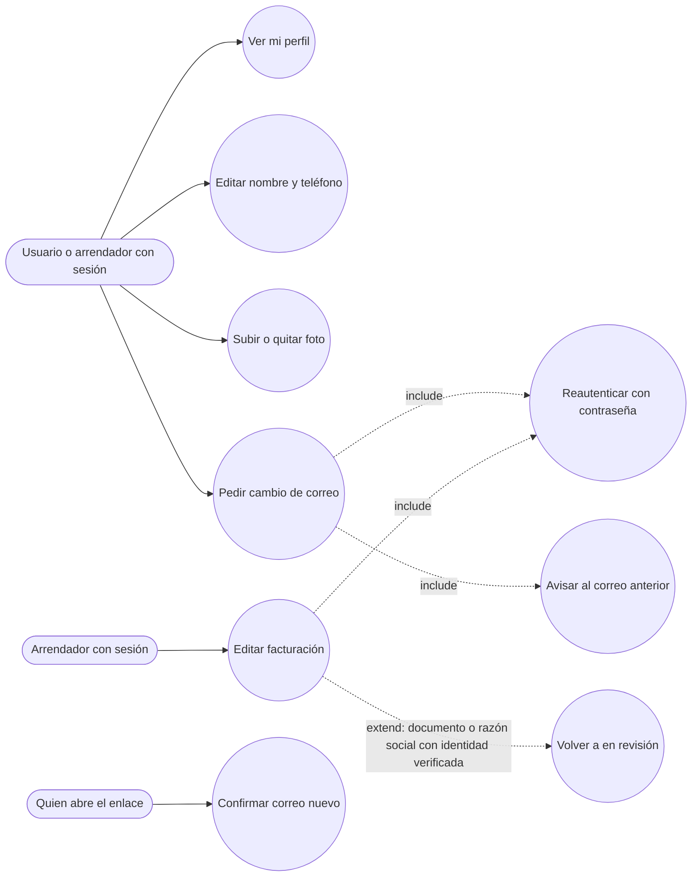

# HU-20 — Design: Edición de perfil

> Módulo `cuentas` · Release 2 · Sprint 6 · tamaño S · depende de HU-03 (`done`) · sin ★ (`patterns: []`).
> Reutiliza `CuentaService.confirmarContrasena` (HU-18), `LimitadorIntentos` (HU-03), `TokenAleatorio`, `Token` y
> `TokenRepository` (HU-04), `ValidadorDocumento` y `HuellaCampos` (HU-02), `ConvertidorCifrado` (HU-02),
> `ValidadorArchivo`, `ArchivosPrivados` y `ArchivoMultipart` (HU-05/HU-07), `NotificadorCorreo` (HU-01),
> `DespuesDelCommit`, `AuditoriaService`, `IpCliente`, `ManejadorGlobalErrores`, `Clock`, el kit (`Campo`, `Boton`,
> `Alerta`, `Modal`, `EtiquetaEstado`, `Tarjeta`) y `api/cliente.js` (`peticion`, `peticionArchivo`).
> **Sin dependencias nuevas** (ni backend ni frontend) y **sin variables de entorno nuevas**.
> Fuente de los huecos: `progress/explore_HU-20.md` § "Huecos / decisiones para el spec" (13 puntos → D1–D22).

## 1. Decisiones para revisar por la dueña (Adriana Callupe)

> Cada fila resuelve un hueco del explorador con la opción más conservadora y coherente con el código existente.
> **⚠ = impacta el producto**; revísalas primero. Si cambias una, dime cuál y se ajustan los `R<n>` citados antes de
> pasar a `in_progress`. Ninguna depende de un pendiente de `docs/requerimientos.md` §9.

| # | Hueco | Decisión tomada | Alternativa descartada y motivo | R |
|---|-------|-----------------|---------------------------------|---|
| D1 | 1 | `V6_1` agrega a `usuario` `correo_pendiente`, `foto_ruta` y `foto_tipo_mime`, y admite el tipo de token **nuevo** `CAMBIO_CORREO` (se rehace `ck_token_tipo`). El destino vive en `usuario.correo_pendiente` (uno a la vez); el token no guarda el correo. | Reutilizar el tipo `VERIFICACION`: HU-25 lo usará para el correo de registro y `anularPendientes` por tipo anularía uno con el otro. Guardar el destino en el token: el `GET` del perfil tendría que buscar tokens para mostrar "pendiente", y con dos solicitudes habría dos destinos vivos. `foto_url` (como dice `modelo-datos.md`): la foto es privada y no tiene URL; se guarda la clave como `documento_identidad.ruta_archivo`. | R25, R31 |
| D2 ⚠ | 2 | Sin correo real (S5 de HU-01): `NotificadorCorreo` gana `notificarCambioCorreo(correoNuevo, enlace)` y `notificarAvisoCambioCorreo(correoActual, correoNuevoEnmascarado)`. El simulado solo escribe el enlace en el log con `espacioya.correo.simulado.registrar-enlace=true` (como HU-04). El **aviso al correo anterior se envía al solicitar** el cambio ("cuando guardo", CA2), con el nuevo enmascarado, para que el dueño se entere antes de que el cambio ocurra. | Avisar solo al confirmar: el dueño legítimo se enteraría cuando ya perdió el correo. Avisar en los dos momentos: duplica correos sin que lo pida un CA (se puede agregar después sin cambiar la API). | R26, R27, R28 |
| D3 | 3 | Correo nuevo ya registrado por otra cuenta: **misma respuesta** 202, mismo `correo_pendiente` y mismo aviso al anterior, pero sin token ni enlace; se audita `CORREO_CAMBIO_NO_EMITIDO`. Al confirmar se revisa otra vez la unicidad (carrera con `uq_usuario_correo`) y responde el 400 genérico. | Responder 400 "correo en uso": revela qué correos tienen cuenta (RNF-SEG-13). Índice único sobre `correo_pendiente`: también delataría la existencia y bloquearía a dos personas que piden el mismo correo libre. | R29, R33 |
| D4 | 3 | Al confirmar el correo **no se revocan sesiones** ni se toca el límite de inicio de sesión. Las sesiones van por id de usuario, no por correo; RNF-SEG-02 revoca solo al cambiar la contraseña o suspender. Pedir el cambio ya exige la contraseña. | Revocar todas las sesiones: la confirmación es pública (no hay "sesión actual" que conservar) y sacaría al usuario de la pestaña donde lo pidió, sin que un CA lo pida. | R31 |
| D5 ⚠ | 4 | **Exigen contraseña:** cambiar el correo y cualquier dato de facturación (tipo y número de documento, razón social, dirección fiscal). **No la exigen:** nombre, teléfono y foto. | Pedirla en todo: la historia y RNF-SEG-03 solo la piden para correo y facturación; pedirla para el teléfono empeora la UX sin un riesgo equivalente (el teléfono no sirve para recuperar la cuenta). | R12, R18–R21 |
| D6 | 4 | Reautenticación con `CuentaService.confirmarContrasena` + `LimitadorIntentos`: **5 fallos en 15 min por cuenta**, clave `perfil|<id>` compartida por correo y facturación (un atacante no duplica sus intentos alternando rutas), separada de `cuenta-bancaria|` (HU-18) y de `login|`. El fallo se audita fuera de la transacción. Mismo valor que HU-03/HU-18; no se inventa una cifra. | Cupo por ruta: duplica los intentos posibles. Sin límite: una sesión robada podría adivinar la contraseña aquí. | R19–R21 |
| D7 ⚠ | 5 | **Facturación solo para `ARRENDADOR`** (es el único con `perfil_arrendador`). `USUARIO` edita nombre, teléfono, foto y correo. **`ADMIN` recibe 403** en todo el perfil (la historia es "como usuario o arrendador"; el admin no recupera contraseña por correo y cambiar su correo le cambiaría el acceso). | Crear columnas de facturación para `USUARIO`: ningún CA ni RF las usa hoy (HU-28 emite comprobantes con datos del pago) y serían datos personales nuevos que cifrar, exportar (HU-22) y anonimizar. Dejar que el admin edite su perfil: superficie nueva sin pedido. | R2, R3, R5 |
| D8 | 5 | Datos básicos: para `ARRENDADOR` **nombre y teléfono siguen obligatorios** (como en su registro, HU-02); para `USUARIO` son opcionales y un valor en blanco se guarda nulo (nace sin ellos, HU-01). Mismos formatos y mensajes que `RegistroArrendadorDTO`. | Obligatorios para todos: un `USUARIO` que solo quiere subir su foto tendría que inventar un teléfono. Opcionales para todos: dejaría arrendadores sin contacto. | R9–R11 |
| D9 ⚠ | 6 | Vuelve a `EN_REVISION` una identidad `VERIFICADA` si cambia **el documento (tipo o número) o la razón social**; cambiar solo la dirección fiscal no. RN-02 nombra solo RUC/DNI; se agrega la razón social porque es el nombre que el admin verificó y el que HU-18 copia como titular de la cuenta bancaria: sin esto, un arrendador verificado podría ponerse otro nombre sin revisión. | Literal de RN-02 (solo documento): más simple, pero deja ese hueco. Si lo prefieres, se borra R38 y la razón social pasa a comportarse como la dirección. | R37–R39 |
| D10 | 6 | `NO_INICIADA` y `RECHAZADA` cambian facturación sin cambiar de estado (aún deben subir o resubir documentos, HU-05). En `EN_REVISION` se **rechaza** cambiar documento o razón social (la dirección sí se puede): el admin podría aprobar datos que no vio. | Permitirlo en revisión: el admin abre el expediente, el arrendador cambia el número y el admin aprueba un dato distinto al que revisó. | R40, R41 |
| D11 ⚠ | 6 | Al volver a revisión se **reutilizan los documentos vigentes** (no se exige resubirlos: `enviarDocumentos` solo admite `NO_INICIADA`/`RECHAZADA` y CA3 dice "vuelve a en revisión"). El arrendador vuelve a la cola del admin con la fecha de su envío original (`min(subido_en)`), así que queda adelante. Si los documentos no corresponden al número nuevo, el admin **rechaza** con motivo y el arrendador los resube (flujo existente de HU-05/HU-06). | Pasar a `NO_INICIADA` y exigir resubir: contradice el texto de CA3. Habilitar un reenvío desde `EN_REVISION`: cambia RN-01 y la máquina de estados de HU-05. | R37, R44 |
| D12 ⚠ | 6 | Al volver a revisión, **los espacios ya publicados siguen visibles** y sus reservas siguen; lo que se pierde es lo que ya depende de `VERIFICADA`: publicar espacios nuevos (`EspacioService`), registrar o cambiar la cuenta bancaria (HU-18) y, en liquidaciones, el aviso al admin de HU-19 (D6). HU-20 no toca `espacios` ni `pagos`. | Ocultar o pausar sus espacios: cambia otro módulo, afecta a usuarios con reservas pagadas y no lo pide ningún CA. | R44 |
| D13 | 6 | Documento nuevo que ya tiene otro arrendador: 400 **genérico** ("No pudimos actualizar tu documento…") después de la contraseña; cuenta como fallo en `perfil|<id>` y se audita sin el número. Así enumerar documentos exige la contraseña y gasta el mismo cupo de 5/15 min. Se detecta con `findByHashDocumento` y, por carrera, con la violación de `uq_perfil_arrendador_hash_documento`. | "Ese documento ya está registrado": revela que el documento tiene cuenta. Aceptarlo en silencio (como el registro de HU-02): CA1 exige que el cambio se vea, y el usuario vería su documento viejo sin explicación. | R42 |
| D14 | 7 | `cuenta_bancaria.titular` **no se actualiza** al cambiar la razón social. Con D9 la identidad vuelve a revisión y HU-18 no deja cambiar la cuenta hasta que esté verificada; al volver a guardarla se toma la razón social nueva. HU-20 no escribe en `pagos`. | Actualizar el titular desde `cuentas`: crea la dependencia `cuentas → pagos`, que la arquitectura prohíbe (dirección `pagos → cuentas`). | — |
| D15 ⚠ | 8 | La foto de perfil la **ve solo su dueño**: se guarda **cifrada** en `ArchivosPrivados` (carpeta `perfiles`) y se sirve por `GET /api/usuarios/actual/foto` con la sesión (el frontend la pide con `peticionArchivo`, como la foto de un borrador en HU-07). JPG/PNG hasta 5 MiB, re-codificada y sin EXIF (`ValidadorArchivo`, rechazando PDF como `FotoEspacioService`). Se puede **quitar** (`DELETE`). | `ArchivosPublicos` + URL estable `/api/fotos/...`: una cara es un dato personal y ninguna pantalla de otra persona la muestra hoy (RNF-SEG-16). URL firmada de 5 min: obliga a renovarla y no aporta frente a un `GET` con sesión. Si quieres que la vean otros (p. ej. el arrendador en sus reservas), eso es otra historia. | R13–R17 |
| D16 | 9 | Rutas: `GET`/`PUT /api/usuarios/actual/perfil` (datos básicos), `GET`/`PUT`/`DELETE /api/usuarios/actual/foto`, `POST /api/usuarios/actual/cambios-correo`, `POST /api/cambios-correo/confirmaciones` (pública) y `PUT /api/arrendadores/actual/facturacion`. El `GET` da el número de documento **enmascarado** también a su dueño; en el `PUT` un `numeroDocumento` vacío conserva el actual. | Mostrar el número completo al dueño: una sesión robada lo leería sin contraseña. Un solo `PUT` con todo: obligaría a pedir la contraseña para cambiar el teléfono. | R5, R6, R35, R36 |
| D17 | 10 | Auditoría: `PERFIL_ACTUALIZADO`, `FOTO_PERFIL_ACTUALIZADA`, `FOTO_PERFIL_ELIMINADA`, `PERFIL_CONTRASENA_FALLIDA`, `CORREO_CAMBIO_SOLICITADO`, `CORREO_CAMBIO_NO_EMITIDO`, `CORREO_CAMBIADO`, `CORREO_CAMBIO_RECHAZADO`, `FACTURACION_ACTUALIZADA` (con `identidad=VERIFICADA->EN_REVISION` cuando aplica) y `FACTURACION_DOCUMENTO_RECHAZADO`. El detalle lleva nombres de campo y correos enmascarados, nunca valores. | Una tabla de historial de perfil: la auditoría ya registra quién, qué, cuándo e IP (como HU-18). | R19, R47–R51 |
| D18 | 11 | Solicitudes de cambio de correo: **3 por cuenta por hora** (mismo cupo que la recuperación de HU-04), contadas después de la contraseña correcta; al superarlo, 429. El implementer agrega este límite y el de D6 a RNF-SEG-17. | Sin límite: se podría usar la plataforma para enviar enlaces a correos ajenos. Contar por IP: el abuso es por cuenta. | R24 |
| D19 | 12 | Pantallas `/panel/perfil` (`pages/cuentas/Perfil.jsx`, con sesión) y `/confirmar-correo` (`pages/cuentas/ConfirmarCorreo.jsx`, pública, token en el `#`). La confirmación exige **pulsar un botón** (no se confirma al cargar). Tras guardar facturación, `ProveedorSesion` gana `refrescar()` para leer de nuevo el aviso. | Confirmar al abrir el enlace: un previsualizador o una pestaña abierta por error lo consumiría sin intención. | Pantallas |
| D20 | 13 | Sin ampliar `CuentaService` ni crear puertos: todo vive en `cuentas` con servicios concretos (`PerfilService`, `CambioCorreoService`, `FacturacionService`) y un componente `ReautenticacionPerfil`. | Agregar métodos a `CuentaService`: ningún otro módulo los necesita (YAGNI). | — |
| D21 ⚠ | 2 | La confirmación es **pública**: el token de 256 bits enviado al correo nuevo es la prueba (igual que `/api/recuperaciones/confirmaciones`). | Exigir sesión para confirmar: si el enlace se abre en otro dispositivo hay que iniciar sesión antes y `RutaProtegida` todavía no conserva el retorno con el `#token`. No agrega seguridad: pedir el cambio ya exigió sesión y contraseña. | R31–R34 |
| D22 | 1 | El enlace de cambio de correo vence a los **30 minutos** (`Token.VIGENCIA_CAMBIO_CORREO`, igual que la recuperación); una nueva solicitud anula el anterior. | 24 h: más cómodo, pero un enlace vivo más tiempo es más riesgo; se puede pedir otro desde el perfil. | R25, R32 |

## 2. Caso de uso



**Editar datos básicos y foto (CA1).** Precondición: sesión `USUARIO` o `ARRENDADOR`. El titular envía nombre y
teléfono (o una foto) → el sistema valida, guarda, audita → 200 con el perfil nuevo. Alternos: datos inválidos → 400 por
campo; foto inválida → 400 en `foto` sin tocar la vigente.

**Cambiar correo (CA2).** Envía correo nuevo y contraseña → el sistema reautentica, guarda el pendiente, emite un token y,
tras el commit, envía el enlace al nuevo y el aviso al anterior → 202 genérico. El correo de la cuenta no cambia hasta que
alguien abre el enlace y pulsa "Confirmar" → 200. Alternos: contraseña incorrecta (400, al 5.º fallo 429), mismo correo
(400), correo en uso (202 idéntico sin enlace), enlace inválido o vencido (400 genérico).

**Editar facturación (CA3).** Arrendador envía documento (opcional), razón social, dirección y contraseña → reautentica →
bajo bloqueo `usuario → perfil` aplica los cambios; con identidad `VERIFICADA` y documento o razón social distintos, pasa a
`EN_REVISION` → 200. Alternos: en revisión (400), documento de otro (400 genérico).

### Diagrama de clases

```mermaid
classDiagram
  class PerfilController { +consultar() +actualizarDatos() +subirFoto() +verFoto() +quitarFoto() +solicitarCambioCorreo() }
  class ConfirmacionCorreoController { +confirmar(dto, peticion) }
  class FacturacionController { +actualizar(usuario, dto, peticion) }
  class PerfilService { +consultar(u) +actualizarDatos(u, dto, ip) +guardarFoto(u, archivo, ip) +foto(u) +quitarFoto(u, ip) }
  class CambioCorreoService { +solicitar(u, dto, ip) +confirmar(token, ip) }
  class FacturacionService { +actualizar(u, dto, ip) }
  class ReautenticacionPerfil { +exigir(u, contrasena, operacion, ip) +registrarFallo(u) }
  class Usuario { correo; correoPendiente; nombre; telefono; fotoRuta; fotoTipoMime; +actualizarDatos() +solicitarCambioCorreo() +confirmarCambioCorreo() +cambiarFoto() +quitarFoto() +enmascararCorreo() }
  class PerfilArrendador { +actualizarFacturacion(...) CambioFacturacion +admiteCambioDeIdentidad() }
  class CambioFacturacion { <<record>> campos; identidadAnterior; identidadNueva; +hayCambios() }
  class Token { +cambioCorreo(usuarioId, hash, ahora) }
  class CuentaService { <<interfaz cuentas>> +confirmarContrasena() }
  class NotificadorCorreo { <<interfaz>> +notificarCambioCorreo() +notificarAvisoCambioCorreo() }
  class ArchivosPrivados { <<comun>> }
  class ValidadorArchivo { <<comun>> }
  class LimitadorIntentos { <<comun>> }
  class AuditoriaService { <<comun>> }
  class HuellaCampos { <<comun>> }
  PerfilController --> PerfilService
  PerfilController --> CambioCorreoService
  ConfirmacionCorreoController --> CambioCorreoService
  FacturacionController --> FacturacionService
  FacturacionController ..> PerfilService : respuesta
  CambioCorreoService --> ReautenticacionPerfil
  FacturacionService --> ReautenticacionPerfil
  ReautenticacionPerfil --> CuentaService
  ReautenticacionPerfil --> LimitadorIntentos
  PerfilService --> ArchivosPrivados
  PerfilService --> ValidadorArchivo
  CambioCorreoService --> NotificadorCorreo
  CambioCorreoService --> Token
  FacturacionService --> PerfilArrendador
  FacturacionService --> HuellaCampos
  PerfilArrendador ..> CambioFacturacion
  PerfilService --> AuditoriaService
  CambioCorreoService --> AuditoriaService
  FacturacionService --> AuditoriaService
```



## 3. Archivos por módulo y capa

| Capa | Archivo (N nuevo, M modificado) | Cubre |
|------|----------------------------------|-------|
| `cuentas/domain/` | `Usuario` (M: `correoPendiente`, `fotoRuta`, `fotoTipoMime` y sus métodos, `enmascararCorreo`), `PerfilArrendador` (M: `actualizarFacturacion`, `admiteCambioDeIdentidad`, `enmascararNumero`), `CambioFacturacion` (N), `CampoFacturacion` (N, enum), `Token` (M: `cambioCorreo`, `VIGENCIA_CAMBIO_CORREO`), `TipoToken` (M: `CAMBIO_CORREO`), `MotivoRechazoCambioCorreo` (N) | R8–R11, R25, R31, R32, R37–R43 |
| `cuentas/repository/` | Sin cambios: `UsuarioRepository.findParaActualizar`/`findByCorreo`, `PerfilArrendadorRepository.findParaActualizar`/`findByHashDocumento`, `TokenRepository.findByHashTokenAndTipo`/`marcarUsado`/`anularPendientes` | R25, R31–R33, R42, R52 |
| `cuentas/dto/` | `PerfilDTO`, `FacturacionDTO`, `DatosPerfilDTO`, `SolicitudCambioCorreoDTO`, `ConfirmacionCorreoDTO`, `ActualizacionFacturacionDTO` (N); `MensajeDTO` (existente) | R5, R6, R9, R18, R22, R35, R46 |
| `cuentas/service/` | `PerfilService`, `CambioCorreoService`, `FacturacionService`, `ReautenticacionPerfil` (N); `NotificadorCorreo` y `NotificadorCorreoSimulado` (M: dos métodos) | R2–R52 |
| `cuentas/controller/` | `PerfilController`, `ConfirmacionCorreoController`, `FacturacionController` (N) | R1–R4, R7, R16, R34 |
| `comun/seguridad/ConfiguracionSeguridad` | (M) `permitAll` solo para `POST /api/cambios-correo/confirmaciones` | R34 |
| `resources/db/migration/` | `V6_1__perfil_usuario.sql` (N) | R1, R25, R45, R52 |
| `2_Backend/src/test/` | Los dobles que implementan `NotificadorCorreo` ganan los dos métodos nuevos | — |
| Frontend `src/api/cuentas.js` | (M) `obtenerPerfil`, `actualizarDatosPerfil`, `subirFotoPerfil`, `obtenerFotoPerfil`, `quitarFotoPerfil`, `solicitarCambioCorreo`, `confirmarCambioCorreo`, `actualizarFacturacion` | Pantallas |
| Frontend `src/pages/cuentas/` | `Perfil.jsx` + `.module.css`, `ConfirmarCorreo.jsx` + `.module.css` (N), `textosCuentas.js` (M), `Panel.jsx` (M: enlace "Mi perfil") | Pantallas |
| Frontend `src/sesion/ProveedorSesion.jsx` | (M) `refrescar()` | CA3 visible |
| Frontend `src/App.jsx` | (M) rutas `/panel/perfil` (con `RutaProtegida`) y `/confirmar-correo` (pública) | Pantallas |
| `docs/` | El implementer actualiza `docs/modelo-datos.md`, `docs/requerimientos.md` (RNF-SEG-17 y RN-02 si se mantiene D9), `docs/architecture.md` y `docs/frontend.md` (ver T22) | — |

## 4. Endpoints

| Método y ruta | Acceso | Entrada | Salida | Códigos |
|---------------|--------|---------|--------|---------|
| `GET /api/usuarios/actual/perfil` | sesión `USUARIO`/`ARRENDADOR` | — | `PerfilDTO` | 200 (R5), 401 (R1), 403 (R2) |
| `PUT /api/usuarios/actual/perfil` | sesión `USUARIO`/`ARRENDADOR` | `DatosPerfilDTO(nombre, telefono)` | `PerfilDTO` | 200 (R8, R11), 400 (R9, R10), 401, 403 |
| `PUT /api/usuarios/actual/foto` | sesión `USUARIO`/`ARRENDADOR` | multipart `foto` | `PerfilDTO` | 200 (R13), 400 (R14), 401, 403 |
| `GET /api/usuarios/actual/foto` | sesión `USUARIO`/`ARRENDADOR` | — | bytes `image/jpeg`/`image/png` | 200 (R16), 404 (R16), 401, 403 |
| `DELETE /api/usuarios/actual/foto` | sesión `USUARIO`/`ARRENDADOR` | — | `PerfilDTO` | 200 (R17), 401, 403 |
| `POST /api/usuarios/actual/cambios-correo` | sesión `USUARIO`/`ARRENDADOR` | `SolicitudCambioCorreoDTO(correo, contrasena)` | `MensajeDTO` | 202 (R25, R29), 400 (R18, R19, R22, R23), 401, 403, 429 (R20, R24) |
| `POST /api/cambios-correo/confirmaciones` | **pública** | `ConfirmacionCorreoDTO(token)` | `MensajeDTO` | 200 (R31), 400 (R32, R33) |
| `PUT /api/arrendadores/actual/facturacion` | sesión `ARRENDADOR` | `ActualizacionFacturacionDTO(tipoDocumento, numeroDocumento, razonSocial, direccionFiscal, contrasena)` | `PerfilDTO` | 200 (R36–R40, R43), 400 (R18, R19, R35, R41, R42), 401, 403 (R3), 429 (R20) |

Todas con `CacheControl.noStore()` (R7); `GET /foto` además `X-Content-Type-Options: nosniff` (como
`FotoPublicaController`). Un 400 de contraseña es 400 y no 401 porque `api/cliente.js` borra el token ante un 401 con
token (HU-17 DT-9, HU-18 DT-11). El rol se comprueba en el servicio antes de leer; un cuerpo inválido de otro rol recibe
400 antes que 403 (no revela nada, como HU-18).

Validación (Bean Validation → 400 por campo con `ManejadorGlobalErrores`):
- `DatosPerfilDTO`: `nombre` `@Size(max = 100)`; `telefono` `@Pattern(regexp = "^$|9[0-9]{8}")`. Obligatoriedad por rol
  (R10) en el servicio, con `ReglaNegocioException(campo, mensaje)`.
- `SolicitudCambioCorreoDTO`: `correo` `@NotBlank @Email @Size(max = 254)`; `contrasena` `@NotBlank @Size(max = 72)`.
- `ConfirmacionCorreoDTO`: `token` `@NotBlank @Size(max = 100)` (la forma la revisa `TokenAleatorio.tieneFormato`).
- `ActualizacionFacturacionDTO`: `tipoDocumento` `@NotNull @Pattern("DNI|RUC")`; `numeroDocumento` opcional;
  `razonSocial` `@NotBlank @Size(max = 150)`; `direccionFiscal` `@NotBlank @Size(max = 200)`; `contrasena`
  `@NotBlank @Size(max = 72)`. `ValidadorDocumento.error(tipo, numero)` y "tipo distinto sin número" en el servicio,
  antes de la contraseña (R35).

### DTO de salida

```java
public record PerfilDTO(String rol, String nombre, String telefono, String correo, String correoPendiente,
                        boolean tieneFoto, FacturacionDTO facturacion) { }        // facturacion null para USUARIO
public record FacturacionDTO(String tipoDocumento, String numeroDocumentoEnmascarado, String razonSocial,
                             String direccionFiscal, String estadoIdentidad) { }
```

### Mensajes (texto exacto)

| Constante | Dónde | Texto |
|-----------|-------|-------|
| `RegistroArrendadorDTO.MENSAJE_NOMBRE` | `nombre` (R9, R10) | (existente) `Ingresa tu nombre completo (máximo 100 caracteres).` |
| `RegistroArrendadorDTO.MENSAJE_TELEFONO` | `telefono` (R9, R10) | (existente) `Ingresa un celular de 9 dígitos que empiece con 9.` |
| `FotoEspacioService.MENSAJE_FALTA_FOTO` / `MENSAJE_TIPO_FOTO` → copiados en `PerfilService` | `foto` (R14) | `Elige una foto.` / `La foto debe ser JPG o PNG.`; tamaño e ilegible: `MotivoRechazoArchivo.mensaje()` |
| `SolicitudCambioCorreoDTO.MENSAJE_CORREO` | `correo` (R22) | `Ingresa un correo válido.` |
| `ReautenticacionPerfil.MENSAJE_CONTRASENA` | `contrasena` (R18) | `Ingresa tu contraseña para confirmar.` |
| `ReautenticacionPerfil.MENSAJE_CONTRASENA_INCORRECTA` | `contrasena` (R19) | `La contraseña no es correcta.` |
| `CambioCorreoService.MENSAJE_MISMO_CORREO` | `correo` (R23) | `Ese ya es tu correo.` |
| `CambioCorreoService.MENSAJE_SOLICITUD_RECIBIDA` | 202 (R25, R29) | `Si el correo está disponible, te enviamos un enlace para confirmarlo. Tu correo actual seguirá activo hasta que lo confirmes.` |
| `CambioCorreoService.MENSAJE_ENLACE_INVALIDO` | 400 (R32, R33) | `El enlace para confirmar tu correo no es válido o ya expiró. Solicita el cambio de nuevo.` |
| `CambioCorreoService.MENSAJE_CORREO_CONFIRMADO` | 200 (R31) | `Tu correo se cambió. Desde ahora inicia sesión con tu nuevo correo.` |
| `ValidadorDocumento.MENSAJE_*` | `numeroDocumento` (R35) | (existentes; `MENSAJE_NUMERO_FALTA` también para "tipo distinto sin número") |
| `RegistroArrendadorDTO.MENSAJE_TIPO_DOCUMENTO` / `MENSAJE_RAZON_SOCIAL` / `MENSAJE_DIRECCION` | R35 | (existentes) |
| `FacturacionService.MENSAJE_IDENTIDAD_EN_REVISION` | 400 sin campo (R41) | `Tu identidad está en revisión. Podrás cambiar tu documento o razón social cuando termine.` |
| `FacturacionService.MENSAJE_DOCUMENTO_NO_DISPONIBLE` | 400 sin campo (R42) | `No pudimos actualizar tu documento. Revisa el número o escríbenos a soporte.` |
| `ErrorDTO.MENSAJE_DEMASIADOS_INTENTOS` | 429 (R20, R24) | (existente, genérico) |

## 5. Clases y firmas públicas

```java
// cuentas/domain
public enum TipoToken { RECUPERACION, CAMBIO_CORREO }

public class Token {
    public static final Duration VIGENCIA_CAMBIO_CORREO = Duration.ofMinutes(30);
    public static Token cambioCorreo(Long usuarioId, String hashToken, Instant ahora);
}

public class Usuario {
    // + @Column(name = "correo_pendiente", length = 254) String correoPendiente;
    // + @Column(name = "foto_ruta", length = 60) String fotoRuta;  @Column(name = "foto_tipo_mime", length = 20) String fotoTipoMime;
    /** @return los nombres de los campos que cambiaron ("nombre", "telefono"); blanco → null. */
    public List<String> actualizarDatos(String nombre, String telefono);
    public void solicitarCambioCorreo(String correoNormalizado);        // IllegalArgumentException si es el actual
    public void confirmarCambioCorreo();                                // IllegalStateException sin pendiente
    /** @return la ruta anterior (o null) para borrarla tras el commit. */
    public String cambiarFoto(String ruta, String tipoMime);
    public String quitarFoto();
    public boolean tieneFoto();
    public static String enmascararCorreo(String correo);               // "j***@correo.pe"
    // getters de los campos nuevos
}

public enum CampoFacturacion { TIPO_DOCUMENTO, NUMERO_DOCUMENTO, RAZON_SOCIAL, DIRECCION_FISCAL }

public record CambioFacturacion(Set<CampoFacturacion> campos, EstadoIdentidad identidadAnterior,
                                EstadoIdentidad identidadNueva) {
    public boolean hayCambios();
    public boolean cambiaDocumento();
    public boolean cambiaIdentidad();            // documento o razón social (D9)
}

public class PerfilArrendador {
    /** false en EN_REVISION (D10). */
    public boolean admiteCambioDeIdentidad();
    /** Calcula y aplica; VERIFICADA + cambiaIdentidad → EN_REVISION (R37, R38). numero/hash null = conserva. */
    public CambioFacturacion actualizarFacturacion(TipoDocumento tipo, String numeroNormalizado, String hashDocumento,
                                                   String razonSocial, String direccionFiscal);
    public CambioFacturacion cambiosPropuestos(TipoDocumento tipo, String numeroNormalizado, String razonSocial,
                                               String direccionFiscal);   // sin aplicar; para R41 y R43
    public String numeroEnmascarado();           // "****" + 4 últimos
}

public enum MotivoRechazoCambioCorreo { TOKEN_DESCONOCIDO, TOKEN_USADO, TOKEN_EXPIRADO, CUENTA_NO_HABILITADA,
                                        CORREO_EN_USO }

// cuentas/dto (entrada; toString enmascara contrasena, correo, numeroDocumento, razonSocial, direccionFiscal, token,
// nombre y telefono, R46)
public record DatosPerfilDTO(@Size(max = 100) String nombre, @Pattern(regexp = "^$|9[0-9]{8}") String telefono) { }
public record SolicitudCambioCorreoDTO(@NotBlank @Email @Size(max = 254) String correo,
                                       @NotBlank @Size(max = 72) String contrasena) { }
public record ConfirmacionCorreoDTO(@NotBlank @Size(max = 100) String token) { }
public record ActualizacionFacturacionDTO(@NotNull @Pattern(regexp = "DNI|RUC") String tipoDocumento,
                                          String numeroDocumento,
                                          @NotBlank @Size(max = 150) String razonSocial,
                                          @NotBlank @Size(max = 200) String direccionFiscal,
                                          @NotBlank @Size(max = 72) String contrasena) { }

// cuentas/service
@Component
public class ReautenticacionPerfil {
    public static final int MAXIMO_FALLOS = 5;
    public static final Duration VENTANA_FALLOS = Duration.ofMinutes(15);
    public static final String ACCION_CONTRASENA_FALLIDA = "PERFIL_CONTRASENA_FALLIDA";
    static final String PREFIJO_CLAVE = "perfil|";
    public enum Operacion { CORREO, FACTURACION }
    public ReautenticacionPerfil(CuentaService cuentas, LimitadorIntentos limitador, AuditoriaService auditoria);
    /** 429 si supera; contraseña mala → registra, audita (sin transacción abierta) y 400 de campo; buena → limpia. */
    public void exigir(UsuarioAutenticado usuario, String contrasena, Operacion operacion, String ip);
    /** Cuenta un fallo sin contraseña mala (documento en uso, R42). */
    public void registrarFallo(UsuarioAutenticado usuario);
}

@Service
public class PerfilService {
    public static final String ACCION_ACTUALIZADO = "PERFIL_ACTUALIZADO";
    public static final String ACCION_FOTO_ACTUALIZADA = "FOTO_PERFIL_ACTUALIZADA";
    public static final String ACCION_FOTO_ELIMINADA = "FOTO_PERFIL_ELIMINADA";
    public static final String CARPETA = "perfiles";
    public static final String CAMPO_FOTO = "foto";
    public PerfilService(UsuarioRepository usuarios, PerfilArrendadorRepository perfiles, ValidadorArchivo validador,
                         ArchivosPrivados archivos, AuditoriaService auditoria, TransactionTemplate transacciones);
    @Transactional(readOnly = true) public PerfilDTO consultar(UsuarioAutenticado usuario);             // R2, R5, R6
    public PerfilDTO actualizarDatos(UsuarioAutenticado usuario, DatosPerfilDTO datos, String ip);      // R8–R12, R47
    public PerfilDTO guardarFoto(UsuarioAutenticado usuario, ArchivoRecibido foto, String ip);          // R13–R15, R48
    @Transactional(readOnly = true) public FotoPerfil foto(UsuarioAutenticado usuario);                 // R16
    public PerfilDTO quitarFoto(UsuarioAutenticado usuario, String ip);                                 // R15, R17, R48
    public record FotoPerfil(byte[] contenido, String tipoMime) { }
}

@Service
public class CambioCorreoService {
    public static final String ACCION_SOLICITADO = "CORREO_CAMBIO_SOLICITADO";
    public static final String ACCION_NO_EMITIDO = "CORREO_CAMBIO_NO_EMITIDO";
    public static final String ACCION_CAMBIADO = "CORREO_CAMBIADO";
    public static final String ACCION_RECHAZADO = "CORREO_CAMBIO_RECHAZADO";
    public static final int MAXIMO_SOLICITUDES = 3;
    public static final Duration VENTANA_SOLICITUDES = Duration.ofHours(1);
    static final String PREFIJO_CLAVE = "cambio-correo|";
    static final String RUTA_ENLACE = "/confirmar-correo#token=";
    public CambioCorreoService(UsuarioRepository usuarios, TokenRepository tokens, ReautenticacionPerfil reautenticacion,
                               NotificadorCorreo notificador, LimitadorIntentos limitador, AuditoriaService auditoria,
                               TransactionTemplate transacciones, Clock reloj,
                               @Value("${espacioya.frontend.url}") String urlFrontend);
    public void solicitar(UsuarioAutenticado usuario, SolicitudCambioCorreoDTO solicitud, String ip);   // R2, R18–R30
    public void confirmar(String token, String ip);                                                     // R31–R33, R50
}

@Service
public class FacturacionService {
    public static final String ACCION_ACTUALIZADA = "FACTURACION_ACTUALIZADA";
    public static final String ACCION_DOCUMENTO_RECHAZADO = "FACTURACION_DOCUMENTO_RECHAZADO";
    public FacturacionService(UsuarioRepository usuarios, PerfilArrendadorRepository perfiles,
                              ReautenticacionPerfil reautenticacion, HuellaCampos huella, AuditoriaService auditoria,
                              TransactionTemplate transacciones);
    public void actualizar(UsuarioAutenticado usuario, ActualizacionFacturacionDTO solicitud, String ip); // R3, R35–R44, R51, R52
}

// cuentas/service (M)
public interface NotificadorCorreo {
    void notificarCambioCorreo(String correoNuevo, String enlace);                        // R26
    void notificarAvisoCambioCorreo(String correoActual, String correoNuevoEnmascarado);  // R27
}

// cuentas/controller
@RestController @RequestMapping("/api/usuarios/actual")
public class PerfilController {
    @GetMapping("/perfil") ResponseEntity<PerfilDTO> consultar(@AuthenticationPrincipal UsuarioAutenticado u);
    @PutMapping("/perfil") ResponseEntity<PerfilDTO> actualizarDatos(u, @Valid @RequestBody DatosPerfilDTO dto, HttpServletRequest p);
    @PutMapping(path = "/foto", consumes = MULTIPART_FORM_DATA_VALUE)
    ResponseEntity<PerfilDTO> subirFoto(u, @RequestPart(name = "foto", required = false) MultipartFile foto, HttpServletRequest p);
    @GetMapping("/foto") ResponseEntity<byte[]> verFoto(u);
    @DeleteMapping("/foto") ResponseEntity<PerfilDTO> quitarFoto(u, HttpServletRequest p);
    @PostMapping("/cambios-correo") ResponseEntity<MensajeDTO> solicitarCambioCorreo(u, @Valid @RequestBody SolicitudCambioCorreoDTO dto, HttpServletRequest p); // 202
}
@RestController @RequestMapping("/api/cambios-correo/confirmaciones")
public class ConfirmacionCorreoController {
    @PostMapping ResponseEntity<MensajeDTO> confirmar(@Valid @RequestBody ConfirmacionCorreoDTO dto, HttpServletRequest p);
}
@RestController @RequestMapping("/api/arrendadores/actual/facturacion")
public class FacturacionController {
    @PutMapping ResponseEntity<PerfilDTO> actualizar(u, @Valid @RequestBody ActualizacionFacturacionDTO dto, HttpServletRequest p);
    // tras FacturacionService.actualizar responde PerfilService.consultar(u)
}
```

## 6. Flujos

**`PerfilService.actualizarDatos`:** rol `ADMIN` → 403 (R2) → si `ARRENDADOR` y `nombre` en blanco o `telefono` vacío →
400 por campo (R10) → `TransactionTemplate`: `usuarios.findParaActualizar(id)` → `usuario.actualizarDatos(...)` → si la
lista de campos no está vacía, auditoría `PERFIL_ACTUALIZADO` `campos=nombre,telefono` (R47) → `consultar` (R8).

**`PerfilService.guardarFoto`:** rol (R2) → `validador.validar(foto)`; rechazado o PDF → 400 `foto` (R14; se reutiliza
el patrón de `FotoEspacioService.validar`) → `archivos.guardar("perfiles", contenido)` **fuera** de la transacción →
`TransactionTemplate`: bloqueo `usuario`, `anterior = usuario.cambiarFoto(clave, mime)`, auditoría
`FOTO_PERFIL_ACTUALIZADA` `mime=…;tamano=…` (R48), `DespuesDelCommit.ejecutar(() -> eliminarSinFallar(anterior))`
(R15). Si la transacción lanza, `eliminarSinFallar(clave)` y se relanza (R15). `quitarFoto` es igual sin archivo nuevo;
sin foto previa no escribe ni audita (R17).

**`CambioCorreoService.solicitar`** (sin `@Transactional`):
1. Rol `ADMIN` → 403 (R2). (Bean Validation ya cubrió R18 y R22.)
2. `reautenticacion.exigir(usuario, contrasena, CORREO, ip)` → 429 (R20) / 400 (R19) / limpia (R21).
3. `nuevo = Usuario.normalizarCorreo(correo)`; igual a `usuario.correo` → 400 `correo` (R23).
4. `limitador.intentar("cambio-correo|" + id, 3, 1 h)` falso → `DemasiadosIntentosException` (R24).
5. `enUso = usuarios.findByCorreo(nuevo).isPresent()`; `token = enUso ? null : TokenAleatorio.generar()`.
6. `TransactionTemplate`: bloqueo `usuario` → `solicitarCambioCorreo(nuevo)` → `tokens.anularPendientes(id,
   CAMBIO_CORREO, ahora)` → si `token != null`, `tokens.save(Token.cambioCorreo(id, hash(token), ahora))` → auditoría
   `CORREO_CAMBIO_SOLICITADO` o `CORREO_CAMBIO_NO_EMITIDO motivo=CORREO_EN_USO` con `nuevo=<enmascarado>` (R49) →
   `DespuesDelCommit`: si hay token, `notificarCambioCorreo(nuevo, url + RUTA_ENLACE + token)` (R26); siempre
   `notificarAvisoCambioCorreo(correoActual, enmascarado)` (R27). `DespuesDelCommit` atrapa el fallo del envío (R28).
7. El controlador responde 202 `MensajeDTO(MENSAJE_SOLICITUD_RECIBIDA)` en los dos casos (R25, R29).

**`CambioCorreoService.confirmar`** (calcado de `RecuperacionContrasenaService.comprobar` + `restablecer`):
`tieneFormato` → `findByHashTokenAndTipo(hash, CAMBIO_CORREO)` → usado → expirado → cuenta `ACTIVA` con
`correoPendiente != null`; cualquier fallo → auditoría `CORREO_CAMBIO_RECHAZADO motivo=…` y 400 (R32, R50). Luego
`TransactionTemplate`: `tokens.marcarUsado(id, ahora) == 0` → rechazo `TOKEN_USADO` (R33) → `findParaActualizar(usuario)`
→ `findByCorreo(pendiente)` presente → rechazo `CORREO_EN_USO` (rollback, R33) → `confirmarCambioCorreo()` →
`saveAndFlush` (una `DataIntegrityViolationException` de `uq_usuario_correo` se traduce al mismo 400 fuera de la
transacción) → auditoría `CORREO_CAMBIADO anterior=…;nuevo=…` (R31, R50). Las sesiones no cambian (D4).

**`FacturacionService.actualizar`** (sin `@Transactional`; orden pensado para no gastar intentos en errores de forma):
1. Rol distinto de `ARRENDADOR` → 403 (R3).
2. `tipo`, `numero = ValidadorDocumento.normalizar(numeroDocumento)` (vacío → `null`); `ValidadorDocumento.error` →
   400 `numeroDocumento`; `numero == null` y `tipo` distinto del actual → 400 `numeroDocumento` (R35).
3. `reautenticacion.exigir(usuario, contrasena, FACTURACION, ip)` (R19–R21).
4. `huellaNueva = numero == null ? null : huella.calcular(numero)` (fuera de la transacción).
5. `TransactionTemplate`: `usuarios.findParaActualizar(id)` → `perfiles.findParaActualizar(id)` (orden de R52) →
   `propuesto = perfil.cambiosPropuestos(...)`:
   - sin cambios → fin sin escribir ni auditar (R43);
   - `propuesto.cambiaIdentidad() && !perfil.admiteCambioDeIdentidad()` → 400 `MENSAJE_IDENTIDAD_EN_REVISION` (R41);
   - `cambiaDocumento` y `findByHashDocumento(huellaNueva)` de **otro** arrendador → señal "documento en uso" (R42);
   - si no: `cambio = perfil.actualizarFacturacion(...)` → `saveAndFlush` → auditoría `FACTURACION_ACTUALIZADA
     campos=…;identidad=VERIFICADA->EN_REVISION` (R36–R40, R51).
6. "Documento en uso" (o `DataIntegrityViolationException` de `uq_perfil_arrendador_hash_documento`): después del
   rollback, `reautenticacion.registrarFallo(usuario)`, auditoría `FACTURACION_DOCUMENTO_RECHAZADO
   motivo=DOCUMENTO_EN_USO` y 400 `MENSAJE_DOCUMENTO_NO_DISPONIBLE` (R42, R51).

`SesionService.actual` y `habilitacionArrendador` leen `perfil_arrendador` en cada solicitud, así que R44 se cumple sin
código nuevo; la IT lo comprueba.

## 7. Diagramas de secuencia

### Flujo principal: cambio de correo y confirmación (CA2)

```mermaid
sequenceDiagram
  actor T as Titular (sesión)
  participant PC as PerfilController
  participant CC as CambioCorreoService
  participant RA as ReautenticacionPerfil
  participant CS as CuentaService
  participant DB as PostgreSQL
  participant N as NotificadorCorreo
  actor V as Quien abre el enlace
  participant CF as ConfirmacionCorreoController
  T->>PC: POST /api/usuarios/actual/cambios-correo {correo, contrasena}
  PC->>CC: solicitar(usuario, dto, ip)
  CC->>RA: exigir(usuario, contrasena, CORREO)
  RA->>CS: confirmarContrasena → true (limpia perfil|id)
  CC->>CC: límite cambio-correo|id (3/h) → ok; correo libre
  CC->>DB: BEGIN; usuario FOR UPDATE; correo_pendiente = nuevo
  CC->>DB: anularPendientes(CAMBIO_CORREO); INSERT token (SHA-256, +30 min)
  CC->>DB: INSERT auditoria CORREO_CAMBIO_SOLICITADO (nuevo enmascarado); COMMIT
  CC-->>N: (tras commit) notificarCambioCorreo(nuevo, enlace)
  CC-->>N: (tras commit) notificarAvisoCambioCorreo(actual, j***@correo.pe)
  PC-->>T: 202 "Si el correo está disponible…"
  V->>CF: POST /api/cambios-correo/confirmaciones {token}
  CF->>CC: confirmar(token, ip)
  CC->>DB: token CAMBIO_CORREO vigente, cuenta ACTIVA con pendiente
  CC->>DB: BEGIN; marcarUsado (UPDATE condicional) = 1; usuario FOR UPDATE
  CC->>DB: correo = correo_pendiente; correo_pendiente = null; auditoría CORREO_CAMBIADO; COMMIT
  CF-->>V: 200 "Tu correo se cambió…"
```

### Flujo CA3: arrendador verificado cambia su RUC

```mermaid
sequenceDiagram
  actor A as Arrendador (VERIFICADA)
  participant FC as FacturacionController
  participant FS as FacturacionService
  participant RA as ReautenticacionPerfil
  participant DB as PostgreSQL
  participant PS as PerfilService
  A->>FC: PUT /api/arrendadores/actual/facturacion {RUC, 20…, razonSocial, direccion, contrasena}
  FC->>FS: actualizar(usuario, dto, ip)
  FS->>FS: rol ARRENDADOR; ValidadorDocumento OK
  FS->>RA: exigir(…, FACTURACION) → ok
  FS->>DB: BEGIN; usuario FOR UPDATE; perfil_arrendador FOR UPDATE
  FS->>DB: findByHashDocumento(huella) → nadie más
  FS->>FS: perfil.actualizarFacturacion → CambioFacturacion(NUMERO, TIPO; VERIFICADA→EN_REVISION)
  FS->>DB: UPDATE perfil (cifrado, hash, estado EN_REVISION); auditoría FACTURACION_ACTUALIZADA; COMMIT
  FC->>PS: consultar(usuario)
  FC-->>A: 200 PerfilDTO(facturacion.estadoIdentidad = EN_REVISION)
  Note over A: GET /api/sesiones/actual → aviso "Estamos revisando tus documentos…"
```

### Flujo de error: contraseña incorrecta, bloqueo y documento de otro (STRIDE S, RNF-SEG-13)

```mermaid
sequenceDiagram
  actor X as Quien tiene la sesión
  participant FS as FacturacionService / CambioCorreoService
  participant RA as ReautenticacionPerfil
  participant L as LimitadorIntentos
  participant DB as PostgreSQL
  loop intentos 1..5
    X->>FS: PUT facturación o POST cambios-correo (contraseña incorrecta)
    FS->>RA: exigir → confirmarContrasena = false
    RA->>L: registrar("perfil|id")
    RA->>DB: auditoría PERFIL_CONTRASENA_FALLIDA operacion=…
    FS-->>X: 400 {errores: [contrasena]}
  end
  X->>FS: cualquier intento
  FS->>RA: exigir → superaLimite = true
  FS-->>X: 429 demasiados intentos (sin comprobar la contraseña)
  Note over X,DB: Pasada la ventana, contraseña correcta y documento de otro arrendador:
  X->>FS: PUT facturación (documento ajeno)
  FS->>DB: BEGIN; bloqueos; findByHashDocumento → otro arrendador; ROLLBACK
  FS->>RA: registrarFallo (cuenta en perfil|id)
  FS->>DB: auditoría FACTURACION_DOCUMENTO_RECHAZADO
  FS-->>X: 400 "No pudimos actualizar tu documento…"
```

## 8. Migración Flyway — `V6_1__perfil_usuario.sql`

Sprint 6 → primer `n` libre en `develop` (hoy la carpeta llega a `V5_3`). HU-21 y HU-22 son del mismo sprint: si al
unir `develop` ya existe `V6_1`, se renombra a la siguiente libre (`docs/conventions.md`). Solo altera tablas de `V1_1`,
`V1_3` (no toca) y `V1_5`: no depende de un número mayor.

```sql
-- HU-20: edición de perfil. correo_pendiente = correo pedido y aún no confirmado (uno a la vez; el correo de la cuenta
-- no cambia hasta confirmar). Sin UNIQUE a propósito: un índice único delataría que el correo existe (RNF-SEG-13); la
-- unicidad real la sigue dando uq_usuario_correo al confirmar. La foto de perfil es privada y va cifrada fuera de la
-- BD (ArchivosPrivados, carpeta "perfiles"): aquí solo su clave y su tipo real.
ALTER TABLE usuario
    ADD COLUMN correo_pendiente VARCHAR(254),
    ADD COLUMN foto_ruta        VARCHAR(60),
    ADD COLUMN foto_tipo_mime   VARCHAR(20);

ALTER TABLE usuario
    ADD CONSTRAINT ck_usuario_correo_pendiente CHECK (
        correo_pendiente IS NULL
        OR (correo_pendiente = lower(btrim(correo_pendiente)) AND correo_pendiente <> correo)),
    ADD CONSTRAINT ck_usuario_foto CHECK (
        (foto_ruta IS NULL AND foto_tipo_mime IS NULL)
        OR (foto_ruta ~ '^perfiles/[0-9a-f]{8}-[0-9a-f]{4}-[0-9a-f]{4}-[0-9a-f]{4}-[0-9a-f]{12}$'
            AND foto_tipo_mime IN ('image/jpeg', 'image/png')));

-- Token de cambio de correo (HU-20). VERIFICACION queda para el correo de registro (HU-25).
ALTER TABLE token DROP CONSTRAINT ck_token_tipo;
ALTER TABLE token
    ADD CONSTRAINT ck_token_tipo CHECK (tipo IN ('VERIFICACION', 'RECUPERACION', 'CAMBIO_CORREO'));
```

`perfil_arrendador` no cambia: sus columnas ya son cifradas y `uq_perfil_arrendador_hash_documento` ya existe.

## 9. Componentes de `comun` reutilizados y excepciones

- **Reutilizados:** `AuditoriaService`/`EventoAuditoria`, `LimitadorIntentos`, `TokenAleatorio`, `HuellaCampos`,
  `ConvertidorCifrado`, `ValidadorArchivo`, `ArchivosPrivados`, `ArchivoMultipart`, `DespuesDelCommit`, `IpCliente`,
  `ManejadorGlobalErrores` (incluye `MaxUploadSizeExceededException`), `ReglaNegocioException`,
  `AccesoDenegadoException`, `RecursoNoEncontradoException` (foto inexistente), `DemasiadosIntentosException`.
- **Excepciones nuevas:** ninguna.
- **Puertos nuevos:** ninguno. `CuentaService` no cambia (D20). `NotificadorCorreo` gana dos métodos.
- **Rate limiting:** no hace falta `ReglaLimite` (los dos límites son por cuenta y viven en el servicio). La
  confirmación pública no lleva límite por IP, igual que `/api/recuperaciones/confirmaciones`: el token tiene 256 bits.

## 10. Lo que deben saber las historias que siguen

- **HU-22** (exportar y anonimizar): exportar `correo_pendiente` y si hay foto; al anonimizar, borrar `correo_pendiente`,
  `foto_ruta`/`foto_tipo_mime` **y el archivo** de `ArchivosPrivados`, y anular los tokens `CAMBIO_CORREO`. Puede reutilizar
  `ReautenticacionPerfil` (o su patrón) para su contraseña.
- **HU-25** (correo real): implementar `notificarCambioCorreo` y `notificarAvisoCambioCorreo` en el adaptador; el tipo
  `VERIFICACION` sigue libre para el registro.
- **HU-06**: un perfil devuelto a revisión aparece en la cola con sus documentos vigentes y la fecha del envío original
  (D11).
- **HU-18/HU-19**: `cuenta_bancaria.titular` puede quedar con la razón social anterior hasta que el arrendador, ya
  verificado otra vez, vuelva a guardar su cuenta (D14).

## 11. Alternativas descartadas (resumen)

- **A. Un solo `PUT /perfil` con todos los datos y la contraseña siempre.** Pediría la contraseña para cambiar el
  teléfono o la foto (D5) y mezclaría validaciones de tres reglas distintas en un DTO.
- **B. Tipo de token `VERIFICACION` para el cambio de correo.** Choca con HU-25 (D1).
- **C. Foto pública con URL estable.** Expone un dato personal sin que ningún CA lo pida (D15).
- **D. Confirmación con sesión.** Peor UX entre dispositivos sin ganar seguridad (D21).
- **E. Revocar sesiones al cambiar el correo.** No lo pide RNF-SEG-02 ni un CA (D4).
- **F. Pausar los espacios al volver a revisión.** Toca `espacios`, afecta reservas pagadas y no lo pide CA3 (D12).

## 12. Pantallas

### `/panel/perfil` — Mi perfil

- **Ruta y archivo:** `/panel/perfil`, `pages/cuentas/Perfil.jsx` (+ `Perfil.module.css`), con `<RutaProtegida>` en
  `App.jsx`; un `ADMIN` vuelve a `/panel` con `Navigate` (la API igual responde 403). Enlace "Mi perfil" en `Panel.jsx`
  para `USUARIO` y `ARRENDADOR`, junto a "Seguridad".
- **Componentes del kit:** `Tarjeta` (una por sección), `Campo` (`texto`, `email`, `password`, `select` para el tipo de
  documento, `archivo` con `accept="image/jpeg,image/png"`), `Boton`, `Alerta`, `Modal` (confirmar con contraseña) y
  `EtiquetaEstado` (estado de identidad, ya existente). **No agrega componentes al kit, estados ni colores.**
- **API (`src/api/cuentas.js`):** `obtenerPerfil()` → `GET /api/usuarios/actual/perfil`; `actualizarDatosPerfil({ nombre,
  telefono })` → `PUT` de la misma ruta; `subirFotoPerfil(archivo)` → `PUT /api/usuarios/actual/foto` (`FormData`, campo
  `foto`); `obtenerFotoPerfil()` → `peticionArchivo('/api/usuarios/actual/foto')`; `quitarFotoPerfil()` → `DELETE`;
  `solicitarCambioCorreo({ correo, contrasena })` → `POST /api/usuarios/actual/cambios-correo`;
  `actualizarFacturacion({ tipoDocumento, numeroDocumento, razonSocial, direccionFiscal, contrasena })` → `PUT
  /api/arrendadores/actual/facturacion`.
- **Cómo muestra cada CA:**
  - *Al abrir:* "Cargando…" y luego las secciones con lo que devuelve `obtenerPerfil`.
  - *CA1 — "Datos personales":* `Campo` nombre y teléfono (ayuda "Celular de 9 dígitos que empiece con 9") y `Boton
    primario` "Guardar cambios" con `cargando`. Éxito → `Alerta exito` "Tus datos se guardaron." y el formulario toma los
    valores de la respuesta (no los del estado local): así se ve lo que guardó el servidor.
  - *CA1 — "Foto":* si `tieneFoto`, la imagen (blob de `obtenerFotoPerfil` con `URL.createObjectURL`, revocado al
    desmontar o reemplazar); si no, la caja "Sin foto" del componente `Imagen` (sin `src`). `Campo tipo="archivo"` +
    `Boton secundario` "Subir foto" y, con foto, `Boton secundario` "Quitar foto". Error de `foto` bajo el `Campo`.
  - *CA2 — "Correo":* texto "Tu correo: <correo>". Con `correoPendiente`, `Alerta info` "Pendiente de confirmar:
    <correoPendiente>. Revisa ese correo y abre el enlace. Tu correo actual sigue activo." Formulario con `Campo email`
    "Correo nuevo" y `Boton secundario` "Cambiar correo", que abre un `Modal primario` "Confirma con tu contraseña" con
    `Campo password`. 202 → cierra el modal, `Alerta exito` con el mensaje de la API tal cual y recarga el perfil (se ve
    el pendiente). Error de `contrasena` bajo el `Campo` del modal; error de `correo` bajo su `Campo`; 429 → `Alerta
    error` dentro del modal.
  - *CA3 — "Datos de facturación"* (solo `ARRENDADOR`): `EtiquetaEstado` con `facturacion.estadoIdentidad`; `Campo
    select` tipo (DNI/RUC), `Campo` "Número de documento" vacío con ayuda "Actual: ****1234. Déjalo vacío para
    mantenerlo.", razón social, dirección fiscal y `Boton secundario` "Guardar facturación", que abre el mismo `Modal` de
    contraseña. Con `VERIFICADA`, `Alerta atencion` fija: "Si cambias tu documento o tu razón social, tu identidad
    volverá a revisión y no podrás publicar espacios nuevos ni cambiar tu cuenta bancaria hasta que la aprobemos."
    (informativa; la regla la aplica el servidor). Con `EN_REVISION`, `Alerta info` "Tu identidad está en revisión…" y
    solo la dirección queda editable (ayuda visual; el servidor revalida, R41). Tras un 200, `Alerta exito` "Tus datos
    de facturación se guardaron.", el `EtiquetaEstado` toma el estado de la respuesta (`EN_REVISION` si volvió a
    revisión) y se llama a `refrescar()` de `useSesion` para que el aviso del panel cambie (R44).
  - *Errores:* errores por campo bajo su `Campo`; 400 sin campo (R41, R42), 403, 429 y 5xx → `Alerta error` con el
    mensaje tal cual; red → "No pudimos conectar. Intenta de nuevo." La contraseña vive solo en el estado del modal y se
    vacía tras cada respuesta; nada va a `localStorage` ni `sessionStorage`.

### `/confirmar-correo` — Confirmar correo nuevo

- **Ruta y archivo:** `/confirmar-correo`, `pages/cuentas/ConfirmarCorreo.jsx` (+ `.module.css`), **pública** (sin
  `RutaProtegida`), como `/restablecer-contrasena`. Lee el token de `window.location.hash` (`#token=…`), lo guarda en el
  estado y limpia el `#` con `history.replaceState` para que no quede en el historial.
- **Componentes del kit:** `Boton` (único primario "Confirmar mi nuevo correo", con `cargando`), `Alerta`.
- **API:** `confirmarCambioCorreo(token)` → `POST /api/cambios-correo/confirmaciones` con `autenticada: false` (un 400 no
  borra la sesión del navegador).
- **CA2 visible:** sin token → `Alerta error` con el mismo texto de enlace no válido y enlace "Ir a mi perfil". Con
  token → texto "Pulsa el botón para confirmar tu nuevo correo." y el botón (D19). 200 → `Alerta exito` con el mensaje
  de la API y enlace a "Iniciar sesión" (o "Ir a mi perfil" si hay sesión). 400 → `Alerta error` con el mensaje tal
  cual y enlace "Ir a mi perfil" para pedirlo de nuevo.

### `ProveedorSesion` (M)

Agrega `refrescar()`: vuelve a llamar a `obtenerSesionActual()` y actualiza `{ rol, aviso }` (si falla, deja la sesión
como estaba). Se expone en el contexto junto a `entrar` y `salir`. No cambia nada más.
