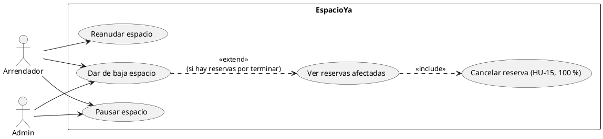
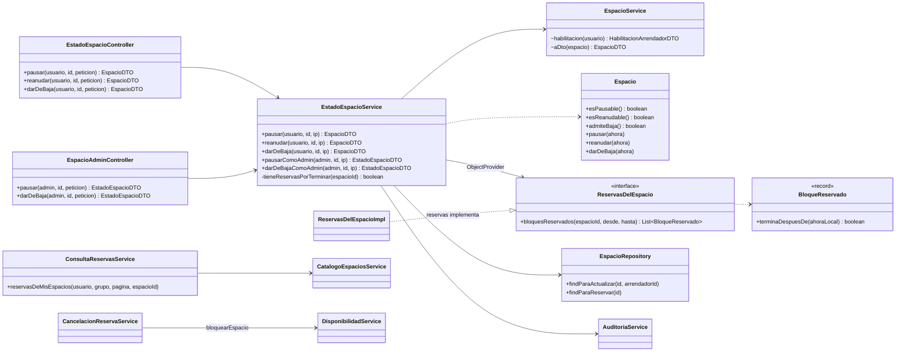
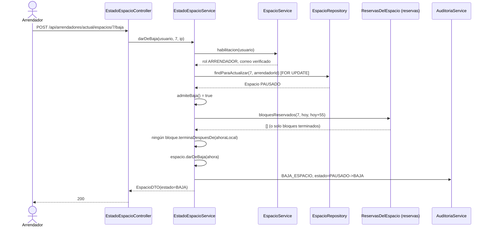
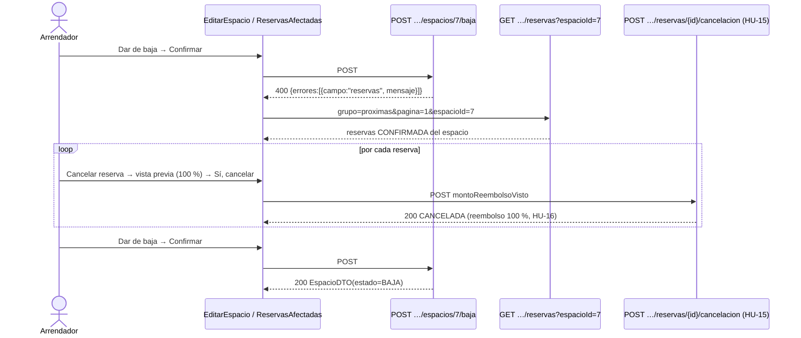
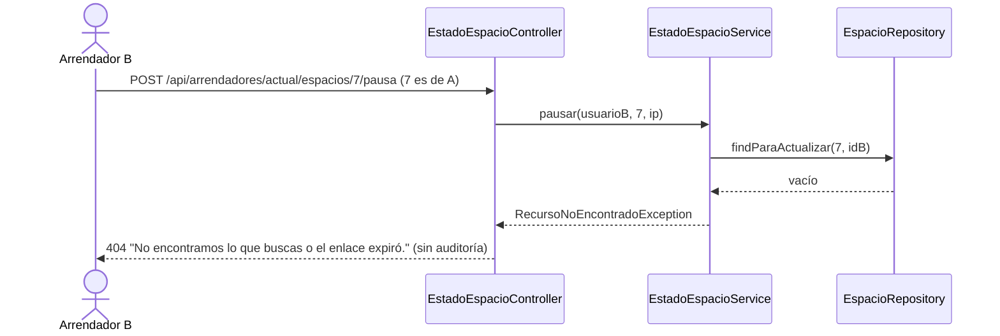

# HU-21 — Design: Pausar o dar de baja una publicación

> Módulo `espacios` (y un filtro opcional en `reservas`) · Sprint 6 · tamaño S · depende de HU-07 y HU-15 (`done`).
> Sin patrón ★. Reutiliza `Espacio`, `EstadoEspacio` (ya trae `PAUSADO` y `BAJA`), `EspacioRepository.findParaActualizar` /
> `findParaReservar`, `EspacioService` (habilitación, `aDto`, mensajes), `FotoEspacioRepository.countByEspacioId`, el puerto
> `ReservasDelEspacio` (vía `ObjectProvider`, como `DisponibilidadServiceImpl`), `VentanaReserva`, `ZonaHoraria`,
> `ConsultaReservasService` + `ReservaDAO` (HU-14), `CancelacionReservaService` y sus rutas (HU-15, **sin cambios**),
> `AuditoriaService`, `IpCliente`, `FiltroIpsAdmin`, las excepciones de `comun/error` y el kit (`Boton`, `Modal`, `Alerta`,
> `EtiquetaEstado`, `Tarjeta`) más `SeccionReservas` y `CancelarReserva` de `pages/reservas`.
>
> **Sin migración, sin puerto nuevo, sin cambios en `comun`, `pagos`, `cuentas` ni `busqueda`.**

## 1. Decisiones técnicas

| # | Tema | Decisión | Por qué |
|---|------|----------|---------|
| DT-1 | Rutas | Arrendador: `POST /api/arrendadores/actual/espacios/{id}/pausa`, `…/{id}/reanudacion`, `…/{id}/baja` en un controlador nuevo `EstadoEspacioController` (mismo prefijo que `EspacioController`, como `CalendarioEspacioController`). Admin: `POST /api/admin/espacios/{id}/pausa` y `…/{id}/baja` en `EspacioAdminController`, **dentro de `espacios`**. Sin cuerpo. | Sustantivo de la acción como subrecurso, igual que `/publicacion` (HU-07), `/cancelacion` (HU-15), `/suspension` y `/reactivacion` (HU-09). Las rutas admin dentro del módulo dueño siguen el precedente de `pagos.controller.ReembolsoAdminController` y `LiquidacionAdminController`: no hace falta una interfaz pública nueva de `espacios` para `administracion`. |
| DT-2 | Servicio | Clase concreta nueva `espacios.service.EstadoEspacioService` (sin interfaz: solo la usan controladores de `espacios`). `EspacioService` solo cambia la visibilidad de `habilitacion(...)` y `aDto(...)` de `private` a paquete. | `EspacioService` ya tiene ~200 líneas; `FotoEspacioService` y `CalendarioEspacioService` fijan el precedente de un servicio por tema que reutiliza la habilitación de `EspacioService`. |
| DT-3 | Reglas de estado en la entidad | `Espacio` gana `esPausable()` (`PUBLICADO`), `esReanudable()` (`PAUSADO`), `admiteBaja()` (`PUBLICADO` o `PAUSADO`) y `pausar(Instant)`, `reanudar(Instant)`, `darDeBaja(Instant)`, que lanzan `IllegalStateException` si el predicado no se cumple (como `publicar`) y fijan `actualizadoEn`. `esEditable()` no cambia. | Convención "métodos de dominio que cambian el estado". El servicio traduce el predicado falso a `ReglaNegocioException` con su mensaje (R6, R8, R16). |
| DT-4 | Orden de comprobación | **Arrendador** (R53 de HU-07): rol y correo verificado (`EspacioService.habilitacion`, 403) → propiedad con bloqueo (`findParaActualizar(id, arrendadorId)`, 404) → estado (400) → *reanudar:* identidad verificada (400) → fotos (400) / *baja:* reservas por terminar (400 en `reservas`) → cambio → auditoría. **Admin**: rol `ADMIN` (403, antes de leer) → `findParaReservar(id)` (bloqueo sin filtro de dueño, 404) → estado → *baja:* reservas → cambio → auditoría. | Mismo orden que `publicar`. Comprobar el estado antes que las reservas evita consultar reservas de un `BAJA` o `OCULTO` (R16). |
| DT-5 | Reservas por terminar | Se calculan **en `espacios`** con el puerto existente `ReservasDelEspacio.bloquesReservados(espacioId, ventana.desde(), ventana.hasta())` (`VentanaReserva.desde(ZonaHoraria.hoy(reloj))`, lo que ya prevé `architecture.md` para HU-21) y se filtran con un método nuevo del record `BloqueReservado.terminaDespuesDe(LocalDateTime ahoraLocal)` = `fecha.atTime(horaInicio, 0).plusHours(1).isAfter(ahoraLocal)`. Hay reservas por terminar si **algún** bloque cumple. El puerto llega por `ObjectProvider<ReservasDelEspacio>` (sin bean = sin reservas, como HU-08 R21). | El puerto ya devuelve exactamente las reservas activas (`CONFIRMADA` o `PENDIENTE_PAGO` vigente) y `espacios` no puede llamar a `reservas` (ciclo). La ventana alcanza: ninguna reserva se crea más allá de hoy + 55 y "hoy" solo avanza; los bloques de días anteriores ya terminaron. El filtro por hora corrige que el puerto filtra por fecha (incluye bloques de hoy ya terminados). Agregar un método a un record no rompe los dobles `@Primary` de las IT. |
| DT-6 | Bloqueo y carrera (R17) | La baja lee las reservas **después** de tomar el bloqueo de fila del espacio (`findParaActualizar` / `findParaReservar`, `PESSIMISTIC_WRITE`) y en la misma transacción. `retenerSiLibres` (crear reserva), `bloquearEspacio` (webhook y cancelación) toman el mismo bloqueo, así que se serializan: si la reserva entra primero, la baja la ve (PostgreSQL READ COMMITTED: cada sentencia ve lo confirmado al empezar); si la baja entra primero, la reserva relee el espacio en `BAJA` y responde 404. Pausa y reanudación toman el mismo bloqueo. Orden de bloqueos: solo `espacio` (subconjunto de `usuario → espacio → reserva`, sin ciclos). | Contrato de HU-08 DT-10 / HU-12. `ReservasDelEspacioImpl.bloquesReservados` es `readOnly` y se une a la transacción de escritura igual que en `retenerSiLibres`. |
| DT-7 | Lista de reservas afectadas (R19–R22) | Parámetro **opcional** `espacioId` en `GET /api/arrendadores/actual/reservas`. `ConsultaReservasService.reservasDeMisEspacios(usuario, grupo, pagina, espacioId)`: rol (403) → validación de `grupo`, `pagina` y `espacioId` juntos (400 con todos los errores) → si hay `espacioId` y no está en `nombresDelArrendador(sesión)` → 404 → `dao.confirmadasDeEspacios(Set.of(espacioId))`. La firma de 3 parámetros se mantiene y delega con `null`. `ReservaDAO` no cambia. **Prevalencia sobre HU-14 R7 (decisión de Sebastian Garate, 2026-11-04, opción 1):** R21 de HU-21 deja sin efecto HU-14 R7 **únicamente** para el parámetro `espacioId` en `GET /api/arrendadores/actual/reservas`: ahí ya no se ignora (400 si es inválido, 404 si no existe o es ajeno, filtro si es propio). En esa misma ruta se siguen ignorando los demás parámetros que nombra HU-14 R7 (`usuarioId`, `arrendadorId`, …). La ruta del usuario `GET /api/reservas` **no cambia** y sigue ignorando `espacioId`. `specs/HU-14/` no se edita; la precedencia queda documentada aquí. | Reutiliza DTO, orden, `HistorialReservas`, `Pagina` y la propiedad de HU-14 sin un método nuevo en el DAO ni en el puerto. Las tarjetas que devuelve sirven tal cual a `CancelarReserva` (HU-15). |
| DT-8 | Respuesta de baja con reservas | `ReglaNegocioException("reservas", MENSAJE_RESERVAS_POR_TERMINAR)` → 400 `{ mensaje: "Revisa los datos del formulario.", errores: [{ campo: "reservas", mensaje: … }] }`. El admin recibe `MENSAJE_RESERVAS_POR_TERMINAR_ADMIN` en el mismo campo. | El frontend distingue este 400 de los demás por el campo, como `CancelarReserva` distingue `montoReembolsoVisto` (HU-15 R32); no hace falta un código HTTP nuevo ni tocar `ManejadorGlobalErrores`. |
| DT-9 | DTO | Arrendador: `EspacioDTO` (el de HU-07, sin cambios) para refrescar la pantalla. Admin: `EstadoEspacioDTO(Long id, String estado)` nuevo. | El admin no necesita la ficha ni las fotos (minimización). |
| DT-10 | Auditoría (R34–R39) | Constantes en `EstadoEspacioService`: `ACCION_PAUSA = "PAUSA_ESPACIO"`, `ACCION_REANUDACION = "REANUDACION_ESPACIO"`, `ACCION_BAJA = "BAJA_ESPACIO"`; entidad `EspacioService.ENTIDAD_ESPACIO`; detalle `estado=<anterior>-><nuevo>` y, si actúa el admin, `;actor=ADMIN;arrendadorId=<id>`. En la misma transacción que el cambio (`AuditoriaService` es `REQUIRED`). Los rechazos no se auditan (como `publicar`). | Convención de `PUBLICACION_ESPACIO` (HU-07). Cada `RESERVA_CANCELADA` ya la audita HU-15. |
| DT-11 | Sin migración | `ck_espacio_estado` (`V2_2`) ya admite `PAUSADO` y `BAJA` (HU-07 DT-10). La fecha del cambio queda en `actualizado_en` y en la auditoría. | Mínima superficie. |
| DT-12 | Pruebas | IP de las IT en `10.21.x.x`. `EstadoEspacioControllerIT` y `EspacioAdminControllerIT` extienden `EspaciosControllerSoporte` y cargan bloques en su doble `ReservasDelEspacioFalso`. `BajaEspacioConReservasIT` y `BajaEspacioConcurrenciaIT` en `reservas.controller` extienden `ReservasControllerSoporte` con el puerto **real**. Se agregan casos a `EspacioTest` y `ConsultaReservasServiceTest`. **Una prueba existente de HU-14 se ajusta** (corrige la versión aprobada, que decía que ninguna cambiaba): `MisReservasControllerIT.deSusEspaciosEnCualquierEstado` quita `&espacioId=<ajeno>` de su consulta a `GET /api/arrendadores/actual/reservas` y sigue verificando que se ignora `arrendadorId` (200 con las reservas propias), porque por DT-7 un `espacioId` ajeno ahora da 404 (lo cubren `ConsultaReservasServiceTest` y `BajaEspacioConReservasIT`). La comprobación de la ruta del usuario `GET /api/reservas` con `espacioId` ignorado no cambia. Ningún otro test existente cambia. | El doble prueba la regla en `espacios`; el puerto real prueba la cadena completa (reserva confirmada → baja rechazada → cancelación 100 % → baja aceptada). |

## 2. Decisiones para revisar por el dueño

Tomadas con la opción más conservadora y coherente con el código existente. ⚠ = impacto alto en el producto; conviene que
Sebastian Garate las confirme o cambie antes de aprobar.

| # | Decisión tomada | Alternativa descartada | Motivo |
|---|-----------------|------------------------|--------|
| 1 ⚠ | **Transiciones:** pausar solo desde `PUBLICADO`; reanudar solo desde `PAUSADO`; dar de baja desde `PUBLICADO` **o** `PAUSADO`; `BAJA` es **final** (no se reactiva, no se edita). `BORRADOR` y `OCULTO` no admiten ninguna de las tres. Repetir una pausa o una baja da 400. | (a) `BAJA → PUBLICADO` (reactivar). (b) `BORRADOR → BAJA` para "borrar" borradores. (c) Pausa/baja idempotentes (200 sin cambio). | `architecture.md` fija `PUBLICADO ⇄ PAUSADO` y `PUBLICADO → BAJA`; `PAUSADO → BAJA` es el caso natural ("primero pauso, luego doy de baja") y tiene las mismas reglas. Reactivar una baja la convertiría en una pausa. Un borrador no se ve ni se reserva: no necesita baja. `OCULTO` es de la moderación (HU-27). |
| 2 ⚠ | **Reanudar exige lo mismo que publicar:** identidad `VERIFICADA` y al menos una foto (mensajes de HU-07). | Reanudar sin condiciones. | "Publicar espacios visibles requiere identidad verificada" (`architecture.md`). Sin esto, un arrendador que volvió a `EN_REVISION` (HU-20) podría volver a mostrar un espacio, y uno que quitó todas sus fotos estando pausado reaparecería sin fotos. Efecto: si pausas estando en revisión, no puedes reanudar hasta que el admin verifique. |
| 3 ⚠ | **Qué cuenta como "reserva futura" que impide la baja:** toda reserva activa (`CONFIRMADA` o `PENDIENTE_PAGO` vigente) con algún bloque que aún no termina. Incluye las **en curso** (no se pueden cancelar: hay que esperar a que terminen) y las **pendientes de pago vigentes** (no se pueden cancelar: vencen en ≤ 15 min o se confirman). | (a) Contar solo las `CONFIRMADA` que no empezaron. (b) Dar de baja dejando vivas las pendientes. | Nunca deja un espacio en `BAJA` con una reserva que alguien pagó y aún va a usar, ni con una pendiente que el webhook podría confirmar después (HU-13 D6: confirma aunque el espacio no se vea). El costo es esperar unos minutos u horas en casos raros; el mensaje lo explica. |
| 4 ⚠ | **Quién cancela con reembolso 100 %:** el **arrendador, una por una**, con el flujo de HU-15 existente (`CancelarReserva`, política `ARRENDADOR` = 100 %), desde la lista de reservas afectadas que aparece al intentar la baja. Luego vuelve a confirmar la baja. No hay "cancelar todas y dar de baja" ni cancelación automática. | Botón "Cancelar todas y dar de baja" en un solo paso (orquestador en `reservas`, N reembolsos y N pares de correos en una transacción). | Cero backend nuevo de cancelación; el arrendador ve cada reserva y su reembolso antes de confirmarla (lo que pide CA2: "veo las reservas afectadas y debo cancelarlas"). Un lote atómico agrega riesgo (un fallo revierte todo) y superficie. |
| 5 ⚠ | **Admin:** puede **pausar** y **dar de baja** cualquier espacio por `/api/admin/espacios/{id}/pausa|baja` (IP permitida + MFA + rol `ADMIN` en el servicio). **No** puede reanudar, **no** puede cancelar reservas (su baja se rechaza si hay reservas por terminar), **no** se avisa al arrendador por correo y **no hay pantalla** de admin en esta historia (HU-27 traerá la cola de moderación y podrá llamar a estas rutas). Un espacio pausado por el admin lo puede reanudar su dueño. | (a) Sin acciones de admin (solo el dueño). (b) Admin con pantalla en `DetalleCuenta` (requiere listar espacios del arrendador para el admin). (c) Admin que cancela reservas (nuevo `QuienCancela.ADMIN`). (d) Correo al arrendador. | STRIDE (E) nombra al admin; con las rutas queda cubierto en backend con la mínima superficie. La moderación con bloqueo y aviso (`OCULTO` + correo con motivo) es exactamente HU-27; duplicarla aquí invadiría esa historia. |
| 6 ⚠ | **Pausar no avisa** a los usuarios con reservas; sus reservas `CONFIRMADA` siguen en pie (CA1). Una `PENDIENTE_PAGO` de un espacio pausado **no** puede abrir un checkout nuevo (regla existente de HU-13: el espacio ya no es visible) y vence; si ya tenía un checkout abierto, el pago aún la confirma. | Avisar por correo o permitir pagar pendientes de espacios pausados. | Ningún CA lo pide y cambiar HU-13 queda fuera del alcance. |
| 7 | La lista de reservas afectadas sale de `GET /api/arrendadores/actual/reservas?grupo=proximas&espacioId=` (solo `CONFIRMADA`, como HU-14). Las pendientes no se listan; las cubre el mensaje del 400. | Nuevo método del puerto que devuelva ids de reservas y una vista previa `GET …/espacios/{id}/baja`. | Reutiliza DTO, paginación y propiedad de HU-14, y las tarjetas sirven tal cual a `CancelarReserva`. Ampliar el puerto obliga a `reservas` a duplicar la consulta del arrendador. |
| 8 | Baja con reservas: 400 con error en el campo `reservas` (DT-8). | 409 Conflict o un código propio. | `ManejadorGlobalErrores` ya da 400 con campo; mismo mecanismo que HU-15. |
| 9 | Auditoría `PAUSA_ESPACIO`, `REANUDACION_ESPACIO`, `BAJA_ESPACIO`; **sin motivo** obligatorio; los rechazos (p. ej. baja con reservas) **no** se auditan. | Motivo obligatorio; auditar `BAJA_ESPACIO_RECHAZADA`. | La historia no pide motivo (sí HU-27). Un rechazo no cambia nada y la transacción se revierte; auditarlo exigiría una transacción aparte. |
| 10 | Sin migración: no hay columnas `pausado_en`, `baja_en` ni `motivo`. | Columnas nuevas. | `actualizado_en` + auditoría bastan para "registro de pausas y bajas". |
| 11 | Un espacio en `BAJA` sigue en "Mis espacios" con la etiqueta "De baja"; su editor queda de solo lectura; sus reservas pasadas siguen en "Reservas de mis espacios" y se liquidan normalmente (HU-19 no filtra estado). | Ocultarlo de "Mis espacios". | No se pierde el historial y no cambia nada en `pagos`. |
| 12 | Pausar y dar de baja **no** exigen identidad verificada (solo rol y correo verificado, como editar). | Exigirla. | Retirar un espacio del catálogo nunca debe bloquearse; en `EN_REVISION` (HU-20) el arrendador debe poder pausar. |
| 13 | Sin rate limiting. | Un límite por cuenta. | La historia no pide (D) y RNF-SEG-17 no fija cifra para estas rutas; no se inventa (§9 de requerimientos). |

## 3. Archivos por módulo y capa

### Backend — `2_Backend/src/main/java/pe/edu/ulima/espacioya/`

| Módulo / capa | Archivo | Acción |
|---|---|---|
| `espacios/domain` | `Espacio.java` | Modificar: `esPausable`, `esReanudable`, `admiteBaja`, `pausar`, `reanudar`, `darDeBaja` (DT-3); actualizar el Javadoc de la clase |
| `espacios/service/puertos` | `BloqueReservado.java` | Modificar: método `terminaDespuesDe(LocalDateTime)` (DT-5). El contrato del puerto no cambia |
| `espacios/service` | `EstadoEspacioService.java` | **Crear** (§ 8) |
| `espacios/service` | `EspacioService.java` | Modificar: `habilitacion` y `aDto` pasan a visibilidad de paquete; sin cambio de comportamiento |
| `espacios/dto` | `EstadoEspacioDTO.java` | **Crear**: `record EstadoEspacioDTO(Long id, String estado)` |
| `espacios/controller` | `EstadoEspacioController.java` | **Crear**: tres `POST` del arrendador |
| `espacios/controller` | `EspacioAdminController.java` | **Crear**: dos `POST` del admin |
| `reservas/service` | `ConsultaReservasService.java` | Modificar: sobrecarga con `espacioId`, validación y propiedad (DT-7) |
| `reservas/controller` | `ReservasDeMisEspaciosController.java` | Modificar: `@RequestParam(required = false) String espacioId` en `listar` |

Sin cambios: `ConfiguracionSeguridad` (`anyRequest().authenticated()` y `FiltroIpsAdmin` ya cubren `/api/admin/**`),
`ManejadorGlobalErrores`, `CancelacionReservaService`, `ReservasDelEspacio` (interfaz), `ReservasDelEspacioImpl`,
`CatalogoEspaciosServiceImpl`, `DisponibilidadServiceImpl`, `busqueda`, `pagos`, migraciones.

### Pruebas — `2_Backend/src/test/java/pe/edu/ulima/espacioya/`

| Archivo | Acción |
|---|---|
| `espacios/domain/EspacioTest.java` | Agregar casos de las transiciones |
| `espacios/service/puertos/BloqueReservadoTest.java` | Crear |
| `espacios/service/EstadoEspacioServiceTest.java` | Crear (Mockito) |
| `espacios/controller/EstadoEspacioControllerIT.java` | Crear (extiende `EspaciosControllerSoporte`) |
| `espacios/controller/EspacioAdminControllerIT.java` | Crear (extiende `EspaciosControllerSoporte`) |
| `reservas/service/ConsultaReservasServiceTest.java` | Agregar casos de `espacioId` |
| `reservas/controller/BajaEspacioConReservasIT.java` | Crear (extiende `ReservasControllerSoporte`, puerto real) |
| `reservas/controller/BajaEspacioConcurrenciaIT.java` | Crear |
| `reservas/controller/MisReservasControllerIT.java` (HU-14) | Modificar solo `deSusEspaciosEnCualquierEstado`: quitar `&espacioId=` de la consulta del arrendador; sigue verificando que se ignora `arrendadorId` (DT-7, DT-12) |

### Frontend — `3_frontend/src/`

| Archivo | Acción |
|---|---|
| `api/espacios.js` | Agregar `pausarEspacio(id)`, `reanudarEspacio(id)`, `darDeBajaEspacio(id)` |
| `api/reservas.js` | `listarReservasDeMisEspacios({ grupo, pagina, espacioId })`: agrega `espacioId` a la consulta solo si viene |
| `pages/espacios/EstadoPublicacion.jsx` (+ `.module.css`) | **Crear** (no es del kit): bloque "Estado de la publicación" |
| `pages/espacios/ReservasAfectadas.jsx` (+ `.module.css`) | **Crear** (no es del kit): lista de reservas afectadas con `CancelarReserva` |
| `pages/espacios/EditarEspacio.jsx` | Modificar: usa `EstadoPublicacion`; avisos de `PAUSADO` y `BAJA`; solo lectura en `BAJA`/`OCULTO` |
| `pages/espacios/textosEspacios.js` | Agregar los textos de § 13 |
| `pages/reservas/TarjetaReservaDeMiEspacio.jsx` | **Crear** extrayendo `tarjetaDeReserva` de `ReservasDeMisEspacios.jsx` (mismo marcado) para reutilizarla |
| `pages/reservas/ReservasDeMisEspacios.jsx` | Modificar: usa `TarjetaReservaDeMiEspacio`; sin cambio visible |

### Documentación (la actualiza el implementer, ver `tasks.md`)

`docs/architecture.md` (estados del espacio, sección "Estado del espacio: qué deja HU-21", nota en "Mis reservas" y en
"Disponibilidad") y `docs/frontend.md` (entrada de rutas de `/panel/espacios/:id`). `docs/modelo-datos.md` no cambia.

## 4. Caso de uso



**Flujo principal (baja, CA2).** 1) El arrendador abre su espacio y pulsa "Dar de baja". 2) Confirma en el modal.
3) El sistema bloquea el espacio, comprueba que es suyo y su estado, y busca reservas por terminar. 4a) Si no hay, lo deja
en `BAJA`, audita y responde 200. 4b) Si hay, responde 400 en `reservas`; la pantalla muestra las reservas afectadas.
5) El arrendador cancela cada una (HU-15, reembolso 100 %). 6) Vuelve a confirmar la baja → 4a.

**Flujos alternos.** Espacio ajeno o inexistente → 404. Estado que no admite la acción → 400. Reserva en curso o
pendiente de pago → 400 en `reservas` hasta que termine o venza. Otro rol → 403.

## 5. Máquina de estados del espacio (tras HU-21)

```mermaid
stateDiagram-v2
  [*] --> BORRADOR : crear (HU-07)
  BORRADOR --> PUBLICADO : publicar (identidad verificada + foto)
  PUBLICADO --> PAUSADO : pausar (arrendador o admin)
  PAUSADO --> PUBLICADO : reanudar (arrendador; identidad verificada + foto)
  PUBLICADO --> BAJA : dar de baja (sin reservas por terminar)
  PAUSADO --> BAJA : dar de baja (sin reservas por terminar)
  PUBLICADO --> OCULTO : moderación (HU-27)
  BAJA --> [*]
```



## 6. Diagrama de clases



## 7. Diagramas de secuencia

### 7.1 Baja aceptada (flujo principal)



### 7.2 Baja con reservas → cancelación → baja (CA2)



### 7.3 Flujo de error: espacio ajeno



## 8. Endpoints

| Método y ruta | Rol | Entrada | Salida | Códigos |
|---|---|---|---|---|
| `POST /api/arrendadores/actual/espacios/{id}/pausa` | `ARRENDADOR` | — | `EspacioDTO` | 200 (R1); 400 estado (R6); 403 (R25, R26); 404 (R27) |
| `POST /api/arrendadores/actual/espacios/{id}/reanudacion` | `ARRENDADOR` | — | `EspacioDTO` | 200 (R7); 400 estado / identidad / fotos (R8–R11); 403; 404 |
| `POST /api/arrendadores/actual/espacios/{id}/baja` | `ARRENDADOR` | — | `EspacioDTO` | 200 (R12, R15, R24); 400 estado (R16); 400 campo `reservas` (R13, R14); 403; 404 |
| `POST /api/admin/espacios/{id}/pausa` | `ADMIN` (IP permitida + MFA) | — | `EstadoEspacioDTO` | 200 (R28); 400 (R6); 403 (R32, R33); 404 (R31) |
| `POST /api/admin/espacios/{id}/baja` | `ADMIN` (IP permitida + MFA) | — | `EstadoEspacioDTO` | 200 (R29); 400 (R16); 400 campo `reservas` (R30); 403; 404 |
| `GET /api/arrendadores/actual/reservas?grupo=&pagina=&espacioId=` (**cambio**) | `ARRENDADOR` | `espacioId` opcional | `PaginaReservasDTO<ReservaDeMiEspacioDTO>` | 200 (R19, R22); 400 (R20); 403; 404 (R21) |
| `POST /api/arrendadores/actual/reservas/{id}/cancelacion` (HU-15, **sin cambios**) | `ARRENDADOR` | `{ montoReembolsoVisto }` | `CancelacionDTO` | 200 (R23) |

Las rutas `/{id}` usan `@PathVariable Long id`, igual que `EspacioController` (mismo comportamiento ante un id mal
escrito que las rutas de HU-07). Sin sesión: 401 de `ConfiguracionSeguridad`.

## 9. Clases y firmas públicas

```java
// espacios/domain/Espacio.java (agregados)
public boolean esPausable();     // estado == PUBLICADO
public boolean esReanudable();   // estado == PAUSADO
public boolean admiteBaja();     // estado == PUBLICADO || estado == PAUSADO
public void pausar(Instant ahora);    // IllegalStateException si !esPausable(); PAUSADO; actualizadoEn = ahora
public void reanudar(Instant ahora);  // IllegalStateException si !esReanudable(); PUBLICADO; actualizadoEn = ahora
public void darDeBaja(Instant ahora); // IllegalStateException si !admiteBaja(); BAJA; actualizadoEn = ahora

// espacios/service/puertos/BloqueReservado.java (agregado)
public boolean terminaDespuesDe(LocalDateTime ahoraLocal); // fecha.atTime(horaInicio, 0).plusHours(1).isAfter(ahoraLocal)

// espacios/dto/EstadoEspacioDTO.java
public record EstadoEspacioDTO(Long id, String estado) { }

// espacios/service/EstadoEspacioService.java
@Service
public class EstadoEspacioService {
    public static final String ACCION_PAUSA = "PAUSA_ESPACIO";
    public static final String ACCION_REANUDACION = "REANUDACION_ESPACIO";
    public static final String ACCION_BAJA = "BAJA_ESPACIO";
    public static final String CAMPO_RESERVAS = "reservas";
    public static final String MENSAJE_SOLO_PUBLICADO = "Solo puedes pausar un espacio publicado.";
    public static final String MENSAJE_SOLO_PAUSADO = "Solo puedes reanudar un espacio pausado.";
    public static final String MENSAJE_BAJA_NO_PERMITIDA = "Solo puedes dar de baja un espacio publicado o pausado.";
    public static final String MENSAJE_RESERVAS_POR_TERMINAR = "Este espacio tiene reservas por terminar. Cancela sus "
            + "reservas futuras (con reembolso del 100 %) y vuelve a intentarlo. Si hay una en curso o pendiente de pago, "
            + "espera a que termine o venza.";
    public static final String MENSAJE_RESERVAS_POR_TERMINAR_ADMIN = "Este espacio tiene reservas por terminar: el "
            + "arrendador debe cancelarlas antes de darlo de baja.";

    public EstadoEspacioService(EspacioService espacioService, EspacioRepository espacios,
                                FotoEspacioRepository fotos, ObjectProvider<ReservasDelEspacio> reservas,
                                AuditoriaService auditoria, Clock reloj);

    @Transactional public EspacioDTO pausar(UsuarioAutenticado usuario, Long id, String ip);
    @Transactional public EspacioDTO reanudar(UsuarioAutenticado usuario, Long id, String ip);
    @Transactional public EspacioDTO darDeBaja(UsuarioAutenticado usuario, Long id, String ip);
    @Transactional public EstadoEspacioDTO pausarComoAdmin(UsuarioAutenticado admin, Long id, String ip);
    @Transactional public EstadoEspacioDTO darDeBajaComoAdmin(UsuarioAutenticado admin, Long id, String ip);
}
```

Reutiliza de `EspacioService`: `MENSAJE_IDENTIDAD_NO_VERIFICADA`, `MENSAJE_SIN_FOTOS`, `MENSAJE_ESTADO_NO_EDITABLE` (R18,
ya existente), `ENTIDAD_ESPACIO`. Rol del admin: `"ADMIN".equals(admin.rol())`, si no `AccesoDenegadoException` antes de
leer (copia de `ReembolsoAdminService.exigirAdmin`). Un *ahora* (`Instant.now(reloj)`) y su hora de Lima
(`ZonaHoraria.ahora(reloj)`) se toman **después** del bloqueo del espacio.

```java
// reservas/service/ConsultaReservasService.java
public static final String CAMPO_ESPACIO = "espacioId";
public static final String MENSAJE_ESPACIO = "El espacio no es válido.";
public PaginaReservasDTO<ReservaDeMiEspacioDTO> reservasDeMisEspacios(UsuarioAutenticado usuario, String grupo,
        String pagina);                       // existente: delega con espacioId = null
public PaginaReservasDTO<ReservaDeMiEspacioDTO> reservasDeMisEspacios(UsuarioAutenticado usuario, String grupo,
        String pagina, String espacioId);     // nuevo
```

`espacioId` válido = solo dígitos y entre 1 y `Long.MAX_VALUE`. Si hay `espacioId` y el arrendador no tiene espacios o no
lo incluye → `RecursoNoEncontradoException` (antes de devolver la página vacía de HU-14).

## 10. Migraciones

Ninguna (DT-11). `ck_espacio_estado` ya admite los cinco estados.

## 11. Excepciones (`comun/error/`)

Reutilizadas, ninguna nueva: `AccesoDenegadoException` (403: rol o correo), `RecursoNoEncontradoException` (404: ajeno o
inexistente), `ReglaNegocioException` (400: estado, identidad, fotos; con campo `reservas` para DT-8),
`ValidacionException` (400: `grupo`, `pagina`, `espacioId` juntos). `IllegalStateException` de la entidad solo si el
servicio olvidó comprobar (error de programación → 500).

## 12. Componentes de `comun` reutilizados

`AuditoriaService` + `EventoAuditoria`, `IpCliente.de`, `UsuarioAutenticado` (`@AuthenticationPrincipal`),
`ZonaHoraria.hoy/ahora`, el bean `Clock`, `FiltroIpsAdmin` (rutas `/api/admin/**`), `SesionService` (MFA del admin) y
`ManejadorGlobalErrores`. Sin rate limiting (decisión 13). Sin correo (decisiones 5 y 6).

## 13. Pantallas

No agrega componentes al kit, estados ni colores (`EtiquetaEstado` ya mapea `PAUSADO` "Pausado" atención y `BAJA` "De
baja" neutro).

### `/panel/espacios/:id` — `pages/espacios/EditarEspacio.jsx` (modificada)

- Encabezado sin cambios (`EtiquetaEstado`).
- `PAUSADO`: `Alerta info` "Este espacio está pausado: no aparece en las búsquedas ni recibe reservas nuevas. Tus
  reservas confirmadas se mantienen." (CA1). `BAJA`: `Alerta info` "Este espacio está dado de baja: ya no aparece en el
  catálogo y no se puede editar." y los botones "Guardar cambios", "Subir foto" y "Quitar foto" van `deshabilitado` (igual
  para `OCULTO`, como ya hace `DisponibilidadEspacio.jsx`).
- Con `PUBLICADO` o `PAUSADO`, debajo de las fotos, el bloque `EstadoPublicacion` (nuevo, `pages/espacios/`), con
  `espacio` y `onCambio(espacioNuevo, mensaje)` que hace `setEspacio` y muestra `Alerta exito` arriba.

### `pages/espacios/EstadoPublicacion.jsx` (nuevo, no es del kit)

- Título "Estado de la publicación". Un solo primario en la pantalla ya es "Guardar cambios": aquí todos los botones son
  `secundario` o `peligro`.
- `PUBLICADO`: `Boton secundario` "Pausar" → `Modal` `primario` "¿Pausar este espacio?" con "Dejará de aparecer en las
  búsquedas y no recibirá reservas nuevas. Las reservas que ya tienes se mantienen." y `textoConfirmar` "Sí, pausar" →
  `pausarEspacio(id)`; éxito "Tu espacio está pausado." (CA1).
- `PAUSADO`: `Boton secundario` "Reanudar" (sin modal, no es destructivo) → `reanudarEspacio(id)`; éxito "Tu espacio
  vuelve a estar publicado."; error en `Alerta error` con el mensaje tal cual y, si `sesion.aviso`, el enlace "Verificar mi
  identidad" (como "Publicar").
- `PUBLICADO` o `PAUSADO`: `Boton peligro` "Dar de baja" → `Modal` `peligro-confirmar` "¿Dar de baja este espacio?" con
  "Es definitivo: dejará de aparecer en el catálogo y ya no podrás editarlo ni volver a publicarlo. Si tiene reservas
  futuras, primero tendrás que cancelarlas con reembolso del 100 %." y `textoConfirmar` "Sí, dar de baja" →
  `darDeBajaEspacio(id)` con `cargando`.
  - 200: cierra el modal, `onCambio` con "Tu espacio está dado de baja." (CA2).
  - 400 con error en el campo `reservas`: cierra el modal, `Alerta atencion` con ese mensaje y monta
    `ReservasAfectadas` (CA2 "veo las reservas afectadas").
  - Otro error: `Alerta error` con `falla.mensaje`.

### `pages/espacios/ReservasAfectadas.jsx` (nuevo, no es del kit)

- Recibe `espacioId`. `cargar` = `useCallback(({ grupo, pagina }) => listarReservasDeMisEspacios({ grupo, pagina,
  espacioId }), [espacioId])` (estable, porque `SeccionReservas` lo tiene en sus dependencias).
- `SeccionReservas` con título "Reservas afectadas", `grupo="proximas"`, texto vacío "Ya no quedan reservas confirmadas por
  cancelar. Vuelve a dar de baja el espacio." y cada reserva con `TarjetaReservaDeMiEspacio` + `CancelarReserva`
  (`obtenerCancelacionDeMiEspacio`, `cancelarReservaDeMiEspacio`) en las `CONFIRMADA` (CA2 "debo cancelarlas, reembolso
  100 %": la línea del reembolso la pone `CancelarReserva` según la `politica` `ARRENDADOR` de la API).
- Tras cada cancelación: `Alerta exito` (texto existente `RESERVA_CANCELADA_ARRENDADOR`) y contador `recarga` como `key`
  de la sección, como en `ReservasDeMisEspacios`.

### `pages/reservas/TarjetaReservaDeMiEspacio.jsx` (nuevo, extracción)

Mismo marcado que `tarjetaDeReserva` de `ReservasDeMisEspacios.jsx` (`Tarjeta`, `EtiquetaEstado`, "Reservado por", fecha,
horario, monto, enlace "Ver espacio" y el nodo `cancelar`). `ReservasDeMisEspacios` pasa a usarlo sin cambio visible.

### `/panel/espacios` — `MisEspacios.jsx`

Sin cambios: ya lista todos los estados con `EtiquetaEstado` (R40).

### Funciones de `api/`

| Función | Endpoint |
|---|---|
| `pausarEspacio(id)` | `POST /api/arrendadores/actual/espacios/{id}/pausa` |
| `reanudarEspacio(id)` | `POST /api/arrendadores/actual/espacios/{id}/reanudacion` |
| `darDeBajaEspacio(id)` | `POST /api/arrendadores/actual/espacios/{id}/baja` |
| `listarReservasDeMisEspacios({ grupo, pagina, espacioId })` | `GET /api/arrendadores/actual/reservas?…&espacioId=` (solo si viene) |
| `obtenerCancelacionDeMiEspacio`, `cancelarReservaDeMiEspacio` | HU-15, sin cambios |

Las rutas del admin no tienen pantalla (decisión 5).

## 14. Plan de pruebas

| Test | Cubre |
|---|---|
| `EspacioTest` (casos nuevos) | R6, R8, R16 (predicados y `IllegalStateException`), R39 |
| `BloqueReservadoTest` | R13, R14, R15 (bordes de `terminaDespuesDe`: bloque que termina justo ahora no cuenta; en curso sí; 23:00–24:00) |
| `EstadoEspacioServiceTest` | R1, R6–R16, R25–R32, R34–R39 (orden de reglas, sin bean del puerto = sin reservas, sin auditoría en rechazos) |
| `EstadoEspacioControllerIT` | R1, R2, R3, R4, R6–R13, R16, R18, R25–R27, R34–R36, R38–R40 (doble del puerto con bloques cargados) |
| `EspacioAdminControllerIT` | R28–R33, R37 |
| `ConsultaReservasServiceTest` (casos nuevos) | R19, R20, R21, R22 |
| `BajaEspacioConReservasIT` (puerto real) | R5, R13, R14, R15, R19, R21, R23, R24 |
| `BajaEspacioConcurrenciaIT` | R17 |

Cada test con `@DisplayName("HU-21 R<n>: …")`.

## 15. Alternativas descartadas

1. **Baja en un paso que cancela todo** (orquestador en `reservas` que llama a `CancelacionReservaService` por cada
   reserva y luego a `espacios`): ver decisión 4.
2. **Ampliar el puerto `ReservasDelEspacio`** con `reservasPorTerminar(espacioId)` que devuelva ids y horarios, y una vista
   previa `GET …/espacios/{id}/baja`: duplica en `reservas` la consulta del arrendador de HU-14 y agrega una ruta más; el
   filtro `espacioId` reutiliza lo hecho (decisión 7).
3. **Rutas admin en `administracion`** llamando a `espacios`: obligaría a crear una interfaz pública nueva en `espacios`
   solo para dos métodos; el precedente de `pagos` pone las rutas admin en el módulo dueño (DT-1).
4. **Filtro en `busqueda`** para excluir `PAUSADO`/`BAJA`: innecesario, toda la visibilidad pública ya exige
   `estado == PUBLICADO` (HU-09 D1); se prueban R2–R4 como regresión.
5. **`DELETE …/pausa` para reanudar**: el repo usa sustantivos de acción con `POST` (`/suspension` y `/reactivacion` de
   HU-09); `…/reanudacion` es coherente.
