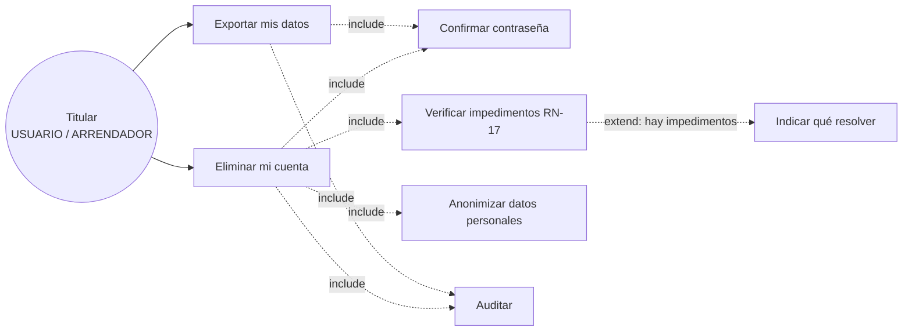
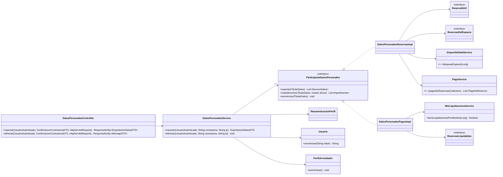
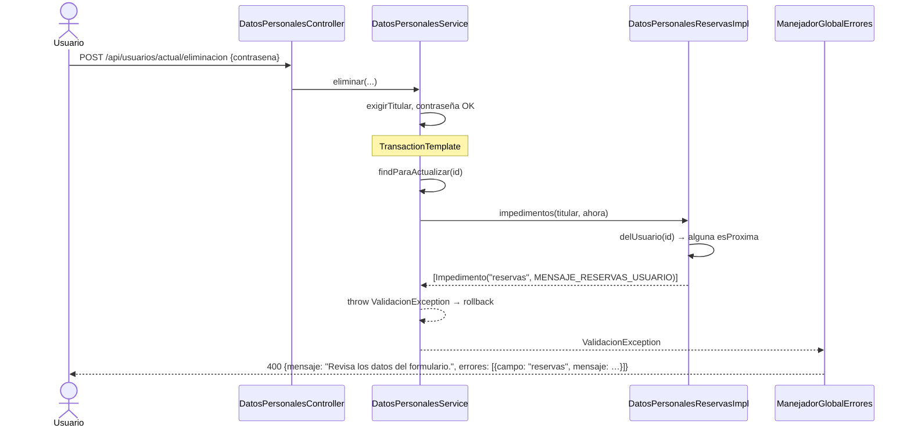
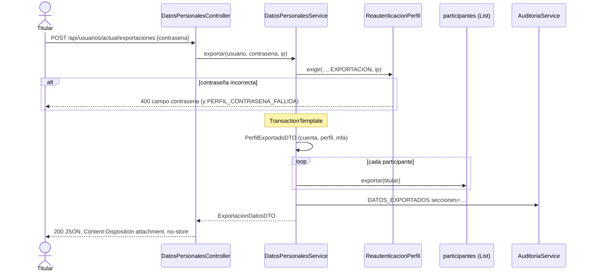

# HU-22 — Design: Derechos sobre datos personales

> Requirements: `requirements.md` (R1–R45). Módulo principal `cuentas`; participantes en `reservas` y `pagos`.
> No es ★: aplica DAO/Repository (como todas) y el puerto `cuentas.ParticipanteDatosPersonales` que
> `docs/architecture.md` ya preveía. Sin migraciones.

## 1. Decisiones técnicas

| Id | Decisión | Por qué |
|----|----------|---------|
| DT-1 | Puerto `cuentas.service.puertos.ParticipanteDatosPersonales` con tres operaciones (`exportar`, `impedimentos`, `anonimizar`), inyectado en `DatosPersonalesService` como `List<>` ordenada con `@Order`. Lo implementan `reservas` (`DatosPersonalesReservasImpl`, `@Order(1)`) y `pagos` (`DatosPersonalesPagosImpl`, `@Order(2)`) | Dirección `cuentas ← reservas`, `cuentas ← pagos`: `cuentas` no puede llamar a esos módulos (ya está en la tabla de puertos). Agregar HU-24/26/27 es sumar un bean (OCP, R45) |
| DT-2 | `busqueda` **no** implementa el puerto | Hoy no guarda datos personales (no existen reseñas). HU-24 lo implementará cuando cree `resena`. El implementer corrige la fila de la tabla de puertos |
| DT-3 | La sección `pagos` del **usuario** la arma el participante de `reservas`: lee sus reservas con `ReservaDAO.delUsuario` y pide los pagos con un método nuevo `PagoService.pagosDeReservas(ids)` | `pagos` no sabe qué reservas son de un usuario (solo conoce `reserva_id`) y no puede llamar a `reservas` salvo por sus puertos. `reservas → pagos` ya está permitido (HU-15) |
| DT-4 | Contraseña con `ReautenticacionPerfil` de HU-20, agregando `EXPORTACION` y `ELIMINACION` a `Operacion`. Mismo cupo `perfil|<id>` (5 fallos/15 min) | Reutiliza 429, 400 en `contrasena`, la auditoría del fallo y el contador. Un cupo aparte daría 5 intentos más a quien robó una sesión (HU-20 D6) |
| DT-5 | Orden: rol (403) → contraseña **fuera de transacción** (429/400) → transacción: bloqueo de `usuario` → *ahora* → impedimentos → anonimización → auditoría → revocar sesiones | Como HU-20: bcrypt y la auditoría del fallo no retienen la conexión. Con contraseña incorrecta no se revelan los impedimentos (R20). Los impedimentos se leen bajo el bloqueo y en la misma transacción que anonimiza (R42) |
| DT-6 | El hash nuevo (`PasswordEncoder.encode(TokenAleatorio.generar())`) se calcula **antes** de abrir la transacción | bcrypt cuesta ~100 ms: no se hace con la fila de `usuario` bloqueada |
| DT-7 | Se **conserva** la fila de `usuario` y de `perfil_arrendador` (anonimizadas) | `reserva`, `liquidacion`, `cuenta_bancaria`, `auditoria`, `espacio` y `revision_identidad` las referencian sin cascada o con cascada que borraría registros contables. Borrarlas violaría R31 |
| DT-8 | Marcadores que cumplen los `CHECK` y `UNIQUE` existentes: correo `eliminada-<id>@espacioya.invalid` (`.invalid` es un TLD reservado, RFC 2606; minúsculas: pasa `ck_usuario_correo_normalizado`), `hash_documento = 'eliminada-<id>'` (no es hex de 64: nunca choca con un HMAC real), `numero_documento`, `razon_social` y `direccion_fiscal` = `Usuario.TEXTO_ANONIMIZADO` (`"Cuenta eliminada"`), cifrados por `ConvertidorCifrado` como cualquier valor | Sin migración y sin relajar `NOT NULL`. Libera el correo y el documento para un registro nuevo (R33) |
| DT-9 | `cuenta_bancaria` se **borra** (no se anonimiza) | Nada la referencia; la liquidación `PAGADA` ya copió banco y cuenta enmascarada (HU-19). Sin liquidaciones ni cobros pendientes (R38, R39) no hay a quién pagar. Borrar es la anonimización más fuerte y evita inventar un número cifrado de relleno |
| DT-10 | Archivos (foto de perfil, documentos de identidad) se borran **después del commit** con `DespuesDelCommit` y `eliminarSinFallar` | Patrón de HU-20 (`PerfilService`): con rollback los archivos siguen ahí (R35) |
| DT-11 | `SesionRepository.revocarTodas` es el **último** paso de la transacción | Hace `flush` + `clear`: después ninguna entidad del contexto se vuelve a usar (patrón de `CuentaServiceImpl.suspenderCuenta`) |
| DT-12 | La exportación es `POST` con la contraseña en el cuerpo y responde el JSON con `Content-Disposition: attachment`. El frontend la llama con `peticion` (JSON) y arma el `Blob` | La contraseña no va en una URL ni en un `GET`. `peticionArchivo` es solo `GET`: no hace falta tocar `cliente.js` |
| DT-13 | Exportación en **una** transacción `TransactionTemplate` (no `readOnly`, porque audita) | El JSON y la fila `DATOS_EXPORTADOS` salen del mismo instante; si la auditoría falla, no se entrega el archivo (STRIDE R) |
| DT-14 | Impedimentos como `ValidacionException(List<ErrorCampoDTO>)` (400) con un error por campo: `reservas`, `liquidaciones`, `pagos` | Forma existente (`ErrorDTO.errores`); el frontend ya sabe leerla (`erroresPorCampo`). Todos a la vez (R40) |

## 2. Decisiones para revisar por el dueño

| Id | Decisión por defecto | Alternativa |
|----|----------------------|-------------|
| D1 | Registros contables conservados **sin fecha de fin**; no hay purga (supuesto 1 de `requirements.md`, §9 punto 6 abierto) | Fijar un plazo y agregar un proceso de purga (otra historia) |
| D2 | Los **cobros por liquidar** del arrendador bloquean la eliminación (R39) | Que no bloqueen: la siguiente generación crearía una liquidación `PENDIENTE_CUENTA` para una cuenta eliminada, que nadie podría cobrar |
| D3 | Reembolsos `PENDIENTE`/`FALLIDO` y pagos `PAGADO_TARDIO`/`MONTO_DISTINTO` **no** bloquean | Agregarlos como impedimento del usuario |
| D4 | En la exportación el documento y la cuenta bancaria van **enmascarados** (principio 3 de `architecture.md`) | Completos: es el propio titular, pero el archivo puede quedar en un equipo compartido |
| D5 | El correo y el documento quedan libres para registrarse de nuevo (R33) | Reservarlos (no anonimizar `correo`/`hash_documento`), lo que contradice la supresión |
| D6 | Razón social y documento del arrendador se anonimizan aunque haya liquidaciones `PAGADA` | Conservarlos cifrados por motivos tributarios (cambia R25) |
| D7 | La exportación del arrendador incluye solo las reservas `CONFIRMADA` de sus espacios, sin datos de quien reservó (como HU-14 sin `usuarioNombre`) | Incluir también canceladas (amplía `ReservaDAO`) |
| D8 | Sin correo de aviso de la eliminación | Avisar al correo anterior antes de anonimizar (método nuevo en `NotificadorCorreo`, HU-25) |
| D9 | Espacios del arrendador eliminado: conservan su estado, ocultos por HU-09 D1 | Pasarlos a `BAJA` con un participante en `espacios` |

## 3. Archivos por módulo y capa

### Backend — `2_Backend/src/main/java/pe/edu/ulima/espacioya/`

| Archivo | Nuevo / modificado | Qué |
|---------|--------------------|-----|
| `cuentas/service/puertos/ParticipanteDatosPersonales.java` | nuevo | El puerto (§ 6.1) |
| `cuentas/service/puertos/TitularDatos.java` | nuevo | `record TitularDatos(Long usuarioId, String rol)` con `esUsuario()`, `esArrendador()` |
| `cuentas/service/puertos/SeccionDatos.java` | nuevo | `record SeccionDatos(String nombre, Object contenido)` |
| `cuentas/service/puertos/Impedimento.java` | nuevo | `record Impedimento(String campo, String mensaje)` |
| `cuentas/service/DatosPersonalesService.java` | nuevo | Caso de uso: `exportar`, `eliminar` (§ 6.2) |
| `cuentas/service/ReautenticacionPerfil.java` | modificado | `Operacion { CORREO, FACTURACION, EXPORTACION, ELIMINACION }` |
| `cuentas/controller/DatosPersonalesController.java` | nuevo | `POST /api/usuarios/actual/exportaciones`, `POST /api/usuarios/actual/eliminacion` |
| `cuentas/dto/ConfirmacionContrasenaDTO.java` | nuevo | `record (String contrasena)`; `toString` enmascarado (como `SolicitudCambioCorreoDTO`) |
| `cuentas/dto/ExportacionDatosDTO.java` | nuevo | `record (Instant generadaEn, PerfilExportadoDTO perfil, Map<String, Object> secciones)` |
| `cuentas/dto/PerfilExportadoDTO.java` | nuevo | § 7 |
| `cuentas/dto/ConsentimientoDTO.java` | nuevo | `record (String versionPolitica, Instant fechaConsentimiento)` |
| `cuentas/dto/FacturacionExportadaDTO.java` | nuevo | `record (String tipoDocumento, String numeroDocumento, String razonSocial, String direccionFiscal, String estadoIdentidad)`; número enmascarado |
| `cuentas/domain/Usuario.java` | modificado | `TEXTO_ANONIMIZADO`, `marcadorCorreo(id)`, `anonimizar(hashNuevo)`, `puedeEliminarse()` |
| `cuentas/domain/PerfilArrendador.java` | modificado | `marcadorHuella(id)`, `anonimizar()` |
| `cuentas/repository/DocumentoIdentidadRepository.java` | sin cambios | Se usan `findByArrendadorIdOrderByTipoAsc` y `deleteAllInBatch(lista)` |
| `cuentas/repository/DesafioMfaRepository.java` | modificado | `@Modifying int borrarDeUsuario(Long usuarioId)` |
| `cuentas/repository/CodigoRespaldoRepository.java` | modificado | `@Modifying int borrarDeUsuario(Long usuarioId)` (antes de borrar `mfa`) |
| `reservas/service/impl/DatosPersonalesReservasImpl.java` | nuevo | Participante de `reservas` (§ 6.3). Nombre distinto del de `pagos`: dos beans con el mismo nombre simple chocan en Spring |
| `reservas/dto/ReservaExportadaDTO.java` | nuevo | § 7 |
| `reservas/dto/PagoExportadoDTO.java` | nuevo | `record (Long reservaId, BigDecimal monto, String estado, Instant creadoEn, List<ReembolsoExportadoDTO> reembolsos)` |
| `reservas/dto/ReembolsoExportadoDTO.java` | nuevo | `record (BigDecimal monto, String estado, Instant creadoEn)` |
| `pagos/service/PagoService.java` | modificado | `List<PagoDeReserva> pagosDeReservas(Collection<Long> reservaIds)` |
| `pagos/service/PagoDeReserva.java` | nuevo | `record (Long reservaId, BigDecimal monto, String estado, Instant creadoEn, List<ReembolsoDePago> reembolsos)` |
| `pagos/service/ReembolsoDePago.java` | nuevo | `record (BigDecimal monto, String estado, Instant creadoEn)` |
| `pagos/service/impl/PagoServiceImpl.java` | modificado | Implementa `pagosDeReservas` (`readOnly`, vacío → `List.of()` sin consultar) |
| `pagos/repository/PagoRepository.java` | modificado | `List<Pago> findByReservaIdInOrderByCreadoEnAscIdAsc(Collection<Long> reservaIds)` |
| `pagos/repository/ReembolsoRepository.java` | modificado | `List<Reembolso> findByPagoIdInOrderByCreadoEnAscIdAsc(Collection<Long> pagoIds)` |
| `pagos/repository/LiquidacionRepository.java` | modificado | `List<Liquidacion> findByArrendadorIdOrderByGeneradaEnDescIdDesc(Long arrendadorId)` |
| `pagos/service/impl/DatosPersonalesPagosImpl.java` | nuevo | Participante de `pagos` (§ 6.4) |
| `pagos/dto/CuentaBancariaExportadaDTO.java` | nuevo | `record (String banco, String numero, String titular, String estado)`; número enmascarado |

### Pruebas — `2_Backend/src/test/java/pe/edu/ulima/espacioya/`

| Archivo | Tipo | Qué cubre |
|---------|------|-----------|
| `cuentas/domain/UsuarioAnonimizacionTest.java` | unitaria | R22, R23 (dominio) |
| `cuentas/domain/PerfilArrendadorAnonimizacionTest.java` | unitaria | R25 (dominio) |
| `cuentas/service/ReautenticacionPerfilTest.java` | unitaria (ampliada) | R17 (`operacion=EXPORTACION`/`ELIMINACION`) |
| `cuentas/service/DatosPersonalesServiceTest.java` | unitaria (Mockito) | R1–R4, R14–R16, R18–R24, R28–R30, R34, R40, R42, R45 |
| `reservas/service/impl/DatosPersonalesReservasImplTest.java` | unitaria | R5–R7, R12, R13, R36, R37, R41, R43 |
| `pagos/service/impl/DatosPersonalesPagosImplTest.java` | unitaria | R8, R9, R13, R27, R38, R39, R44 |
| `pagos/service/impl/PagoServiceImplTest.java` | unitaria (ampliada) | R6 (`pagosDeReservas`) |
| `cuentas/controller/DatosPersonalesControllerIT.java` (+ `DatosPersonalesSoporte`) | integración | R1–R2, R10–R13, R15–R19, R21–R41 extremo a extremo |

### Frontend — `3_frontend/src/`

| Archivo | Nuevo / modificado | Qué |
|---------|--------------------|-----|
| `api/cuentas.js` | modificado | `exportarMisDatos({ contrasena })`, `eliminarMiCuenta({ contrasena })` |
| `pages/cuentas/DatosPersonales.jsx` + `.module.css` | nuevo (no es del kit) | Tarjeta "Mis datos personales" con sus dos modales |
| `pages/cuentas/Perfil.jsx` | modificado | Renderiza `<DatosPersonales />` como quinta `Tarjeta` |
| `pages/cuentas/textosCuentas.js` | modificado | Textos de § 13 |

### Documentación (la actualiza el implementer, ver `tasks.md`)

- `docs/architecture.md`: fila del puerto `ParticipanteDatosPersonales` (contrato, implementadores `reservas` y `pagos`;
  `busqueda` lo implementará HU-24), `PagoService.pagosDeReservas` y una subsección "Datos personales: qué deja HU-22".
- `docs/frontend.md`: viñeta de `/panel/perfil` con la tarjeta "Mis datos personales".
- `docs/modelo-datos.md`: nota en `usuario` y `perfil_arrendador` sobre los marcadores de una cuenta `ELIMINADA` y en
  `cuenta_bancaria` que HU-22 la borra.

## 4. Caso de uso



## 5. Diagrama de clases



`cuentas` solo conoce la interfaz (en `cuentas/service/puertos/`); `reservas` y `pagos` dependen de `cuentas`, nunca al
revés (DIP).

## 6. Clases y firmas públicas

### 6.1 Puerto

```java
package pe.edu.ulima.espacioya.cuentas.service.puertos;

/**
 * Lo implementa cada módulo que guarda datos de una cuenta (HU-22). Se inyecta como List<> ordenada con @Order.
 * Ninguno exige sesión ni rol: el titular ya lo validó cuentas.
 */
public interface ParticipanteDatosPersonales {

    /** Secciones de la exportación (nombre único en todo el JSON). Se une a la transacción del llamador; solo lee. */
    List<SeccionDatos> exportar(TitularDatos titular);

    /**
     * @Transactional(propagation = MANDATORY). Toma los bloqueos que necesite (R43, R44) y devuelve un Impedimento por
     * campo, o lista vacía. No escribe.
     */
    List<Impedimento> impedimentos(TitularDatos titular, Instant ahora);

    /** @Transactional(propagation = MANDATORY). Anonimiza o borra lo suyo; los archivos, con DespuesDelCommit. */
    void anonimizar(TitularDatos titular);
}
```

### 6.2 `cuentas.service.DatosPersonalesService` (concreta)

```java
public static final String ACCION_EXPORTADOS = "DATOS_EXPORTADOS";
public static final String ACCION_ELIMINADA = "CUENTA_ELIMINADA";
public static final String MENSAJE_ELIMINADA = "Tu cuenta fue eliminada.";

public DatosPersonalesService(UsuarioRepository usuarios, PerfilArrendadorRepository perfiles,
        DocumentoIdentidadRepository documentos, TokenRepository tokens, SesionRepository sesiones,
        MfaRepository mfas, CodigoRespaldoRepository codigos, DesafioMfaRepository desafios,
        List<ParticipanteDatosPersonales> participantes, ReautenticacionPerfil reautenticacion,
        PasswordEncoder encoder, ArchivosPrivados archivos, AuditoriaService auditoria,
        TransactionTemplate transacciones, Clock reloj)

public ExportacionDatosDTO exportar(UsuarioAutenticado usuario, String contrasena, String ip)
public void eliminar(UsuarioAutenticado usuario, String contrasena, String ip)
```

- `exportar`: `PerfilService.exigirTitular` (403) → `reautenticacion.exigir(…, EXPORTACION, ip)` → transacción: cuenta,
  perfil de arrendador, `mfaActivo` → `PerfilExportadoDTO` → secciones de cada participante en orden (nombre repetido →
  `IllegalStateException`) → auditoría `DATOS_EXPORTADOS` con `secciones=reservas,pagos…` → DTO con
  `generadaEn = Instant.now(reloj)`.
- `eliminar`: `exigirTitular` → `exigir(…, ELIMINACION, ip)` → `hash = encoder.encode(TokenAleatorio.generar())` →
  transacción:
  1. `usuarios.findParaActualizar(id)`; si no `puedeEliminarse()` → `IllegalStateException` (500; con sesión válida
     la cuenta está `ACTIVA`).
  2. `ahora = Instant.now(reloj)`; `impedimentos` de cada participante, concatenados en orden. No vacíos →
     `ValidacionException` (rollback, nada cambió).
  3. `var foto = cuenta.anonimizar(hash)`.
  4. Si es arrendador: `perfiles.findById(id)` → `perfil.anonimizar()`; `documentos.findByArrendadorIdOrderByTipoAsc`
     → claves → `deleteAllInBatch`.
  5. `tokens.anularPendientes(id, tipo, ahora)` para los tres `TipoToken`.
  6. `codigos.borrarDeUsuario(id)`, `mfas.deleteById` si existe, `desafios.borrarDeUsuario(id)`.
  7. `participante.anonimizar(titular)` de cada uno.
  8. Auditoría `CUENTA_ELIMINADA`, `detalle = "rol=" + rol`.
  9. `DespuesDelCommit.ejecutar(...)` para borrar la foto y cada documento (`eliminarSinFallar`, log sin la clave).
  10. `sesiones.revocarTodas(id)` (último, DT-11).

### 6.3 `reservas.service.impl.DatosPersonalesReservasImpl` (`@Component`, `@Order(1)`)

Dependencias: `ReservaDAO`, `CatalogoEspaciosService`, `DisponibilidadService`, `ReservasDelEspacio`, `PagoService`,
`Clock`.

| Operación | `USUARIO` | `ARRENDADOR` |
|-----------|-----------|--------------|
| `exportar` (`readOnly`) | `reservas`: `ReservaDAO.delUsuario` → `ReservaExportadaDTO` (nombres con `CatalogoEspaciosService.nombres`, estado con `estadoEn(ahora)`), por inicio e id. `pagos`: `PagoService.pagosDeReservas(ids)` → `PagoExportadoDTO` | `reservas`: `nombresDelArrendador(id)` → `ReservaDAO.confirmadasDeEspacios(ids)` → `ReservaExportadaDTO` sin datos del usuario (R7, R13) |
| `impedimentos` (`MANDATORY`) | `delUsuario(id)` con `esProxima(ahora, ZonaHoraria.ahora(reloj))` → `Impedimento("reservas", MENSAJE_RESERVAS_USUARIO)` | ids de `nombresDelArrendador` ordenados ascendente; por cada uno `bloquearEspacio(id)` y **después** `bloquesReservados(id, ventana.desde, ventana.hasta)` (`VentanaReserva.desde(ZonaHoraria.hoy(reloj))`); alguno `terminaDespuesDe(ahoraLocal)` → `Impedimento("reservas", MENSAJE_RESERVAS_ARRENDADOR)` |
| `anonimizar` | Nada: `reserva` solo guarda `usuario_id` y es registro contable (R31) | Nada |

Orden de bloqueos: `usuario (titular) → espacio`, el mismo que crear una reserva (`usuario (quien reserva) → espacio`)
y HU-21 (`espacio`): sin ciclos. `retenerSiLibres` relee `cuentaActiva(arrendadorId)` bajo el bloqueo del espacio: si la
eliminación confirma primero, la reserva nueva da 404; si la reserva confirma primero, la eliminación la ve (R43).

### 6.4 `pagos.service.impl.DatosPersonalesPagosImpl` (`@Component`, `@Order(2)`)

Dependencias: `LiquidacionRepository`, `VistaLiquidaciones`, `MisLiquidacionesService`, `CuentaBancariaRepository`,
`PagoRepository`, `ReservasLiquidables`, `Clock`, `@Value("${espacioya.pagos.pasarela}")` (mismo criterio
`incluirSimulados` que `GeneradorLiquidaciones`).

| Operación | `USUARIO` | `ARRENDADOR` |
|-----------|-----------|--------------|
| `exportar` | Lista vacía (DT-3) | `liquidaciones`: `findByArrendadorIdOrderByGeneradaEnDescIdDesc` → `vista.misLiquidaciones`. `cuentaBancaria`: `findByArrendadorId` → `CuentaBancariaExportadaDTO(banco, enmascarado(), titular, estado(ahora).name())` o `null` |
| `impedimentos` | Lista vacía | `bloquearGeneracion(CLAVE_GENERACION)` **primero** (R44); `tieneLiquidacionesPendientes(id)` → `Impedimento("liquidaciones", …)`; `pagadosSinLiquidar(incluirSimulados)` → `ReservasLiquidables.describir(reservaIds)` → alguna con `arrendadorId == id` y `admitida` → `Impedimento("pagos", …)` |
| `anonimizar` | Nada | `CuentaBancariaRepository.findParaActualizar(id)` → `delete` si existe (R27) |

Orden: `usuario → advisory 190019 → cuenta_bancaria`. La generación toma solo el advisory; marcar pagada toma
`liquidacion → cuenta_bancaria`, pero sin liquidaciones por pagar no hay ninguna que marcar. `pagadosSinLiquidar` es
global: riesgo aceptado (decenas de pagos por liquidar; si crece, se agrega un filtro por reservas del arrendador).

### 6.5 Dominio

```java
// Usuario
public static final String TEXTO_ANONIMIZADO = "Cuenta eliminada";
public static String marcadorCorreo(Long id)            // "eliminada-" + id + "@espacioya.invalid"
public boolean puedeEliminarse()                       // USUARIO o ARRENDADOR, estado ACTIVA
/** @return la ruta de la foto quitada (o null). @throws IllegalStateException si !puedeEliminarse() */
public String anonimizar(String hashNuevo)             // correo = marcadorCorreo(id); nombre, telefono,
                                                       // correoPendiente, foto = null; hash; estado = ELIMINADA
// PerfilArrendador
public static String marcadorHuella(Long usuarioId)     // "eliminada-" + usuarioId
public void anonimizar()                               // numero, razón social, dirección = TEXTO_ANONIMIZADO;
                                                       // hashDocumento = marcadorHuella; motivoRechazo = null
```

`estado_identidad` y `tipo_documento` no cambian (no identifican a la persona). `version_politica` y
`fecha_consentimiento` se conservan: son la prueba del consentimiento y no identifican solas.

## 7. Contenido del JSON (R1–R9, R13)

```json
{
  "generadaEn": "2026-11-04T15:00:00Z",
  "perfil": {
    "rol": "ARRENDADOR", "correo": "ana@correo.pe", "correoPendiente": null, "nombre": "Ana Ríos",
    "telefono": "987654321", "tieneFoto": true, "mfaActivo": false,
    "consentimiento": { "versionPolitica": "2026-10", "fechaConsentimiento": "2026-10-20T13:00:00Z" },
    "facturacion": { "tipoDocumento": "RUC", "numeroDocumento": "****5678", "razonSocial": "Ana Ríos EIRL",
                     "direccionFiscal": "Av. Arequipa 123", "estadoIdentidad": "VERIFICADA" }
  },
  "secciones": {
    "reservas": [ { "id": 41, "espacio": "Cancha Norte", "fecha": "2026-10-28", "horaInicio": 18, "horaFin": 20,
                    "estado": "CONFIRMADA", "precioHora": 50.00, "montoTotal": 100.00, "creadaEn": "…",
                    "canceladaPor": null, "canceladaEn": null, "montoReembolso": null } ],
    "liquidaciones": [ { "…campos de MiLiquidacionDTO…": "" } ],
    "cuentaBancaria": { "banco": "BCP", "numero": "****1234", "titular": "Ana Ríos EIRL", "estado": "DISPONIBLE" }
  }
}
```

- `USUARIO`: `facturacion` es `null`; `secciones` = `reservas` y `pagos`
  (`[{ "reservaId", "monto", "estado", "creadoEn", "reembolsos": [{ "monto", "estado", "creadoEn" }] }]`).
- `ARRENDADOR`: en `reservas` no hay `precioHora`, `creadaEn` ni datos de cancelación (son `CONFIRMADA`); nunca
  `usuarioId` ni `usuarioNombre`.
- `secciones` es un `LinkedHashMap` en el orden de los participantes. Las listas vacías se exportan como `[]`.

## 8. Anonimización tabla por tabla (R22–R31)

| Tabla | Qué hace HU-22 | Requisito |
|-------|----------------|-----------|
| `usuario` | Marcador de correo, hash nuevo, nombre/teléfono/correo pendiente/foto nulos, `ELIMINADA` | R21–R23 |
| archivo `perfiles/<UUID>` | Borrado tras el commit | R24 |
| `perfil_arrendador` | Texto fijo cifrado, `hash_documento = eliminada-<id>`, `motivo_rechazo` nulo | R25 |
| `documento_identidad` + archivos `identidad/<UUID>` | Filas borradas; archivos tras el commit | R26 |
| `cuenta_bancaria` | Fila borrada | R27 |
| `sesion` | Todas revocadas | R28 |
| `token` | Pendientes anulados (`usado_en = ahora`) | R29 |
| `mfa`, `codigo_respaldo`, `desafio_mfa` | Borrados | R30 |
| `reserva`, `reserva_bloque`, `pago`, `reembolso`, `checkout_pago`, `liquidacion`, `liquidacion_detalle`, `auditoria` | Sin cambios | R31 |
| `revision_identidad`, `suspension_cuenta` | Sin cambios (historial del admin, su `motivo` lo escribió el admin) | — |
| `espacio`, `foto_espacio`, `horario_semanal`, `bloqueo_fecha` | Sin cambios; ocultos por HU-09 D1 (D9) | — |

## 9. Diagramas de secuencia

### 9.1 Eliminación aceptada (flujo principal, arrendador)

```mermaid
sequenceDiagram
  actor A as Arrendador
  participant C as DatosPersonalesController
  participant S as DatosPersonalesService
  participant RA as ReautenticacionPerfil
  participant U as UsuarioRepository
  participant PR as DatosPersonalesReservasImpl
  participant PP as DatosPersonalesPagosImpl
  participant AU as AuditoriaService
  A->>C: POST /api/usuarios/actual/eliminacion {contrasena}
  C->>S: eliminar(usuario, contrasena, ip)
  S->>S: exigirTitular (403 si ADMIN)
  S->>RA: exigir(usuario, contrasena, ELIMINACION, ip)
  S->>S: hash = encode(TokenAleatorio.generar())
  Note over S: TransactionTemplate
  S->>U: findParaActualizar(id) [FOR UPDATE]
  S->>PR: impedimentos(titular, ahora)
  PR->>PR: por espacio: bloquearEspacio → bloquesReservados
  PR-->>S: []
  S->>PP: impedimentos(titular, ahora)
  PP->>PP: bloquearGeneracion → pendientes → cobros por liquidar
  PP-->>S: []
  S->>S: usuario.anonimizar(hash), perfil.anonimizar(), borrar documentos
  S->>S: anular tokens, borrar MFA
  S->>PR: anonimizar(titular)
  S->>PP: anonimizar(titular) (borra cuenta_bancaria)
  S->>AU: CUENTA_ELIMINADA
  S->>S: DespuesDelCommit(borrar archivos); revocarTodas(id)
  Note over S: commit
  S-->>C: ok
  C-->>A: 200 {mensaje: "Tu cuenta fue eliminada."} no-store
```

### 9.2 Eliminación con impedimentos (CA3, flujo de error)



### 9.3 Exportación (CA1)



## 10. Endpoints y mensajes

| Método y ruta | Cuerpo | Respuesta | Errores |
|---------------|--------|-----------|---------|
| `POST /api/usuarios/actual/exportaciones` | `ConfirmacionContrasenaDTO { contrasena }` | 200 `ExportacionDatosDTO`, `Content-Type: application/json`, `Content-Disposition: attachment; filename="espacioya-mis-datos-<AAAA-MM-DD>.json"`, `no-store` | 401 sin sesión; 403 `ADMIN`; 400 `contrasena`; 429; 400 genérico si el cuerpo no es JSON |
| `POST /api/usuarios/actual/eliminacion` | `ConfirmacionContrasenaDTO { contrasena }` | 200 `MensajeDTO { mensaje: "Tu cuenta fue eliminada." }`, `no-store` | 401; 403; 400 `contrasena`; 429; 400 `ValidacionException` con `reservas` / `liquidaciones` / `pagos` |

Ninguna ruta lleva id; la cuenta sale de `@AuthenticationPrincipal UsuarioAutenticado`; IP con `IpCliente.de`. No se
agregan `ReglaLimite` (RNF-SEG-17 no fija cupo; supuesto 9).

Mensajes (constantes `public static final` en el participante que los produce):

| Constante | Texto |
|-----------|-------|
| `DatosPersonalesReservasImpl.MENSAJE_RESERVAS_USUARIO` | "Tienes reservas próximas o en curso. Cancélalas o espera a que terminen antes de eliminar tu cuenta." |
| `DatosPersonalesReservasImpl.MENSAJE_RESERVAS_ARRENDADOR` | "Tus espacios tienen reservas por terminar. Cancélalas o espera a que terminen antes de eliminar tu cuenta." |
| `DatosPersonalesPagosImpl.MENSAJE_LIQUIDACIONES` | "Tienes liquidaciones por cobrar. Espera a que se paguen antes de eliminar tu cuenta." |
| `DatosPersonalesPagosImpl.MENSAJE_COBROS_POR_LIQUIDAR` | "Tienes cobros de reservas que aún no se liquidan. Espera a que se liquiden y se paguen antes de eliminar tu cuenta." |
| `DatosPersonalesService.MENSAJE_ELIMINADA` | "Tu cuenta fue eliminada." |

Campos de los impedimentos: `DatosPersonalesReservasImpl.CAMPO_RESERVAS = "reservas"`,
`DatosPersonalesPagosImpl.CAMPO_LIQUIDACIONES = "liquidaciones"`, `CAMPO_PAGOS = "pagos"`.

## 11. Migraciones

**Ninguna.** Los marcadores (DT-8) cumplen `uq_usuario_correo`, `ck_usuario_correo_normalizado`, `ck_usuario_foto`,
`ck_usuario_correo_pendiente`, `NOT NULL` de `hash_contrasena` y de `perfil_arrendador`, y
`uq_perfil_arrendador_hash_documento`; `ck_usuario_estado` ya admite `ELIMINADA`. La fecha de eliminación queda en la
auditoría (como la baja de HU-21). Si una historia futura necesita `eliminada_en`, la agrega en su sprint.

## 12. Excepciones (`comun/error/`)

Solo se reutilizan: `AccesoDenegadoException` (403, `ADMIN`), `ReglaNegocioException` (400 `contrasena`, vía
`ReautenticacionPerfil`), `DemasiadosIntentosException` (429), `ValidacionException` (400 con varios campos, impedimentos).
`IllegalStateException` (500 genérico) para invariantes rotas (cuenta de la sesión inexistente o no `ACTIVA`, sección
repetida). No se agrega ninguna.

## 13. Componentes de `comun` y de otras historias reutilizados

| Componente | Uso |
|------------|-----|
| `comun.auditoria.AuditoriaService` + `EventoAuditoria` | `DATOS_EXPORTADOS`, `CUENTA_ELIMINADA` (R14, R34) |
| `cuentas.service.ReautenticacionPerfil` (HU-20) + `comun.limite.LimitadorIntentos` | Contraseña y cupo (R15–R18) |
| `CuentaService.confirmarContrasena` (HU-18) | Dentro de `ReautenticacionPerfil` |
| `PerfilService.exigirTitular` (HU-20) | 403 al `ADMIN` (R19) |
| `comun.transaccion.DespuesDelCommit` | Borrar archivos tras el commit (R24, R26) |
| `comun.almacenamiento.ArchivosPrivados` | `eliminar(clave)` |
| `comun.seguridad.TokenAleatorio` | Secreto descartable para el hash nuevo (R23) |
| `comun.configuracion.ZonaHoraria` | Hora de Lima para `esProxima`, `terminaDespuesDe` y el nombre del archivo |
| `comun.web.IpCliente` | IP de la auditoría |
| `ReservaDAO`, `ReservaConHorario.esProxima` (HU-14) | Exportación e impedimentos del usuario |
| `ReservasDelEspacio`, `BloqueReservado.terminaDespuesDe`, `VentanaReserva` (HU-08, HU-21) | Impedimentos del arrendador |
| `DisponibilidadService.bloquearEspacio` (HU-13) | Bloqueo previo (R43) |
| `MisLiquidacionesService.tieneLiquidacionesPendientes`, `VistaLiquidaciones.misLiquidaciones` (HU-19) | Impedimento y exportación |
| `LiquidacionRepository.bloquearGeneracion`, `PagoRepository.pagadosSinLiquidar`, `ReservasLiquidables` (HU-19) | Cobros por liquidar (R39, R44) |
| `CuentaBancaria.enmascarado()`, `estado(ahora)` (HU-18) | Exportación (R9) |
| `SesionRepository.revocarTodas`, `TokenRepository.anularPendientes` | R28, R29 |

## 14. Pantallas

### `/panel/perfil` — `pages/cuentas/Perfil.jsx` (modificada)

Agrega, al final, `<DatosPersonales />`. No cambia las otras cuatro tarjetas.

### `pages/cuentas/DatosPersonales.jsx` (nuevo, no es del kit)

- **Kit:** `Tarjeta` (título "Mis datos personales"), `Boton`, `Modal`, `Campo` (`tipo="password"`), `Alerta`. No agrega
  componentes al kit, estados ni colores (no usa `EtiquetaEstado`).
- **Contenido:** texto secundario "Puedes descargar una copia de tus datos o eliminar tu cuenta." y, en `acciones`,
  `Boton secundario` "Descargar mis datos" y `Boton peligro` "Eliminar mi cuenta" (el único primario de la pantalla
  sigue siendo el de "Datos personales").
- **Descargar (CA1):** abre `Modal primario` "Confirma con tu contraseña" (`textoConfirmar` "Descargar"). Llama a
  `exportarMisDatos({ contrasena })`; con 200 arma `new Blob([JSON.stringify(datos, null, 2)], { type:
  'application/json' })`, lo descarga con un `<a download="espacioya-mis-datos-<fecha>.json">` temporal y
  `URL.createObjectURL` (revocado al terminar), cierra el modal y muestra `Alerta exito` "Descargamos tus datos en un
  archivo JSON.". La fecha del nombre sale de `datos.generadaEn` (no se calcula nada de negocio).
- **Eliminar (CA2):** abre `Modal` `variante="peligro-confirmar"` "¿Eliminar tu cuenta?" con `Alerta atencion`: "Se
  desactivará tu cuenta y se borrarán tus datos personales. Conservaremos tus reservas y pagos sin tus datos, como exige
  la ley. No podrás deshacerlo." y el `Campo` de contraseña; `textoConfirmar` "Eliminar mi cuenta". Con 200:
  `borrarToken()`, `salir()` de `useSesion` y `navegar('/iniciar-sesion', { replace: true, state: { mensaje, tipo:
  'exito' } })` con el mensaje de la API (`IniciarSesion` ya muestra `state.mensaje`). Se borra el token antes de
  navegar para que el 401 siguiente no dispare el aviso de "sesión perdida".
- **Impedimentos (CA3):** 400 con errores en `reservas`, `liquidaciones` o `pagos` → cierra el modal y muestra en la
  tarjeta `Alerta atencion` "Antes de eliminar tu cuenta, resuelve esto:" con una lista de los mensajes tal cual, en
  el orden recibido, y enlaces: `reservas` → `/mis-reservas` (USUARIO) o `/panel/reservas` (ARRENDADOR, según `rol` de
  `useSesion`); `liquidaciones` y `pagos` → `/panel/liquidaciones`.
- **Errores en el modal:** 400 en `contrasena` → bajo el `Campo`; 429 o sin campo → `Alerta error` dentro del modal; el
  modal sigue abierto. Error de red → "No pudimos conectar. Intenta de nuevo.". La contraseña vive solo en el estado
  del modal y se vacía tras cada respuesta y al cerrar. `Boton cargando` mientras espera (`Modal cargando`).

### Funciones de `api/cuentas.js`

| Función | Endpoint |
|---------|----------|
| `exportarMisDatos({ contrasena })` | `peticion('/api/usuarios/actual/exportaciones', { metodo: 'POST', cuerpo: { contrasena } })` |
| `eliminarMiCuenta({ contrasena })` | `peticion('/api/usuarios/actual/eliminacion', { metodo: 'POST', cuerpo: { contrasena } })` |

Textos en `textosCuentas.js`. Nada se guarda en `localStorage` (el JSON solo vive en memoria hasta la descarga).

## 15. Plan de pruebas

- **Unitarias** (Mockito, `Clock.fixed`): `DatosPersonalesServiceTest` verifica orden (`InOrder`: `findParaActualizar`
  antes de `impedimentos`, `revocarTodas` último), que con impedimentos no se llama a `anonimizar` ni a la auditoría,
  que el hash se calcula fuera de la transacción, que con dos participantes falsos se usan ambos (R45) y que un
  participante que lanza deja la excepción propagarse (R35). Los participantes se prueban con sus dependencias
  simuladas (`InOrder` para R43 y R44).
- **Integración** `DatosPersonalesControllerIT` (IP `10.22.x.x`, `RelojControlable`, doble `@Primary` de
  `NotificadorCorreo`, `JdbcTemplate` para sembrar y leer; `limpiar` en el orden de `PagosSoporte.limpiar` más `token`,
  `mfa`, `codigo_respaldo`, `desafio_mfa`, `documento_identidad`, `cuenta_bancaria`): exportación de usuario y
  arrendador con datos de otra cuenta sembrados (R12) y búsqueda de cadenas prohibidas en el cuerpo (R13); eliminación
  completa con verificación fila por fila (R21–R31), login posterior (R32), nuevo registro con el mismo correo y
  documento (R33), cada impedimento (R36–R39) y varios a la vez (R40), reserva pasada/cancelada/expirada no bloquea
  (R41), rollback con un participante de prueba registrado solo en `DatosPersonalesSoporte.Dobles` que lanza cuando el test lo
  activa (por defecto no hace nada) (R35).
- **Concurrencia** `DatosPersonalesConcurrenciaIT` (hilos reales con `CountDownLatch` contra PostgreSQL): dos
  eliminaciones a la vez y los dos órdenes de R43 (reserva sobre un espacio del arrendador) y R44 (generación de
  liquidaciones).

### 15.1 Riesgo aceptado: escritura concurrente tras la eliminación

- **Qué pasa.** Una petición cuya sesión se validó en `FiltroAutenticacionSesion` *antes* de que se confirme la
  eliminación, y que bloquea la fila de `usuario` *después*, sigue adelante con la cuenta ya `ELIMINADA`.
  `CuentaService.bloquearCuenta` y `usuarios.findParaActualizar` solo bloquean la fila; no vuelven a leer el estado.
- **Comprobado** (sonda temporal contra PostgreSQL, ya borrada): con el `UsuarioAutenticado` obtenido antes, se eliminó
  la cuenta por la API (200) y luego `ReservaService.crear` con ese principal creó una reserva `PENDIENTE_PAGO`. Queda
  una cuenta `ELIMINADA` con una reserva vigente.
- **No comprobado, mismo patrón:** `CuentaBancariaService` (HU-18, vía `bloquearCuenta`: podría volver a crear la
  `cuenta_bancaria` que borra R27) y `PerfilService`, `FacturacionService`, `MfaService` y `CambioCorreoService`
  (bloquean la fila y escriben sin mirar el estado: podrían volver a llenar datos anonimizados por R22 y R25).
- **Ventana.** Milisegundos: de la validación de la sesión en el filtro al bloqueo de la fila. Es la misma ventana que
  ya tiene la suspensión de HU-09.
- **R43 y R44 no tienen este problema.** En R43 quien reserva es otra cuenta y `retenerSiLibres` relee
  `cuentaActiva(arrendadorId)` bajo el bloqueo del espacio (§ 6.3). En R44 la generación de liquidaciones la hace el
  admin bajo el advisory lock que la eliminación también toma (§ 6.4).
- **Cobertura de R42.** La carrera "el usuario elimina mientras crea su reserva" no está en la IT: sería una prueba
  inestable que delata este riesgo. R42 queda cubierta por "dos eliminaciones a la vez" en
  `DatosPersonalesConcurrenciaIT` y por los dos órdenes deterministas (`DatosPersonalesServiceTest` con `InOrder` y
  los impedimentos de `DatosPersonalesControllerIT`).
- **Decisión.** Riesgo aceptado por Kevin Chan el 2026-11-05. La corrección propuesta (que
  `CuentaServiceImpl.bloquearCuenta` compruebe bajo el bloqueo que la cuenta sigue `ACTIVA` y, si no, lance
  `RecursoNoEncontradoException` → 404; lo análogo en los servicios de `cuentas` tras `findParaActualizar`) queda para
  una historia futura o una tarea `sdd: false`.

## 16. Alternativas descartadas

| Alternativa | Por qué no |
|-------------|------------|
| Borrar la fila de `usuario` (y en cascada `perfil_arrendador`) | `reserva`, `liquidacion`, `auditoria` y `revision_identidad.admin_id` la referencian sin cascada; la cascada de `perfil_arrendador` arrastraría `espacio` y rompería `reserva.espacio_id` y las liquidaciones (registros contables, R31) |
| Migración `V6_2` que permita nulos en `correo`, `hash_contrasena` y `perfil_arrendador` cuando `estado = 'ELIMINADA'` | Cambia contratos de tres historias, obliga a revisar cada lectura que asume no nulo y no aporta privacidad frente a los marcadores fijos |
| Consultar `reservas` y `pagos` directamente desde `cuentas` | Rompe la dirección `comun ← cuentas ← espacios ← reservas → pagos → cuentas` (ciclo) |
| Exportar con `GET` y la contraseña en un encabezado o en la URL | La contraseña quedaría en logs de proxies o en el historial; `POST` con cuerpo es el patrón de HU-18/HU-20 |
| Un `GET` de "vista previa" de impedimentos sin contraseña | Una ruta más que no pide la historia; el `POST` ya devuelve todos los impedimentos de una vez (R40) |
| Proceso programado que purgue tras el plazo legal | El plazo no está definido (§9 punto 6) y la simplificación del proyecto evita jobs no pedidos |
