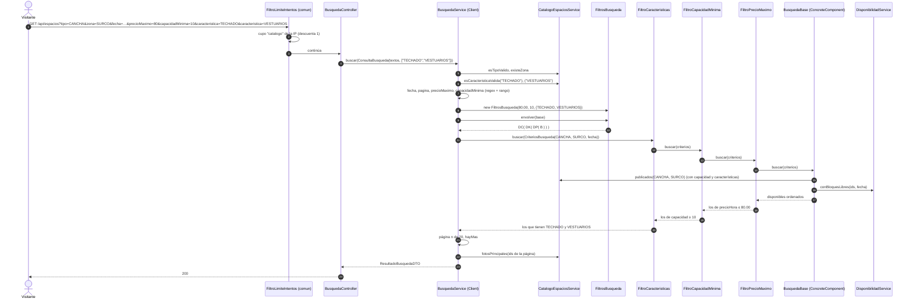
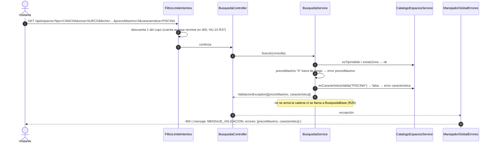
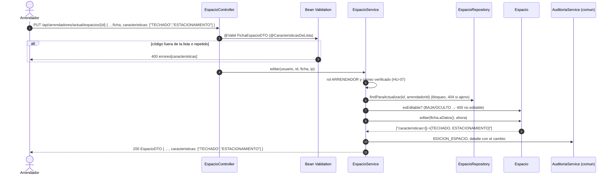
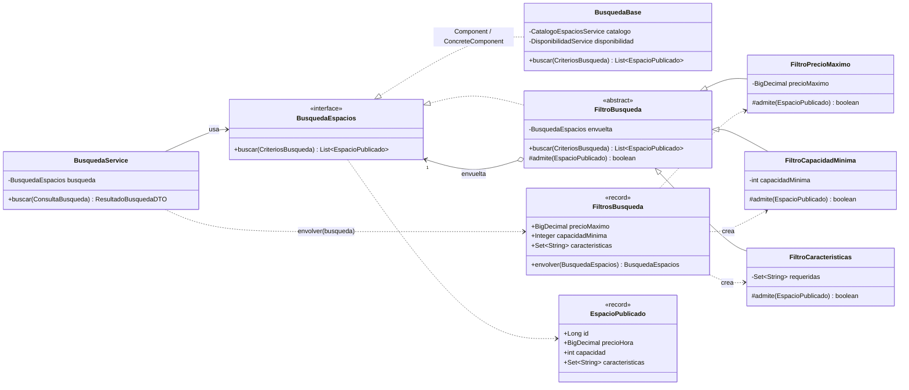

# HU-23 — Design: Filtros de búsqueda por precio, capacidad y características ★ Decorator

> Requirements: `specs/HU-23/requirements.md` (R1–R30). Reutiliza HU-07 (ficha `espacio`, `FichaEspacioDTO`,
> `EspacioService`, auditoría `EDICION_ESPACIO`, estados editables), HU-10 (`GET /api/espacios`,
> `BusquedaService`, la interfaz envolvible `BusquedaEspacios` y su `BusquedaBase`, el cupo `catalogo` de
> `LimiteCatalogo`) y HU-21 (`BAJA` no editable). Informe del código existente: `progress/explore_HU-23.md`.
> HU-23 es ★: aplica **Decorator** (fila HU-23 de "Patrones por historia" en `docs/architecture.md`), § 6.
> Las decisiones que el dueño debe confirmar están en § 15 (P1–P8 de `requirements.md`).

## 1. Decisiones técnicas

| Id | Decisión | Por qué |
|----|----------|---------|
| DT-1 | **Decorator por petición.** Cada filtro es un objeto que envuelve a otro `BusquedaEspacios` y guarda su propio valor (`new FiltroPrecioMaximo(envuelta, 80.00)`). `FiltrosBusqueda.envolver(base)` arma la cadena **solo con los filtros presentes**, en un orden fijo; sin filtros devuelve la base tal cual. Los decoradores no son beans. | "Cada filtro envuelve a la búsqueda base de HU-10 y se combinan libremente" (`docs/architecture.md`). Con el valor dentro del decorador, `CriteriosBusqueda` no cambia y la base no sabe que hay filtros (OCP). Igual que `SolicitudReembolso` de HU-16: objeto por petición, no singleton. |
| DT-2 | Un **decorador base abstracto** `FiltroBusqueda` implementa `BusquedaEspacios`, guarda la referencia a la envuelta y fija el reenvío: `buscar` llama a `envuelta.buscar(criterios)` y conserva, en el mismo orden, los que cumplen `admite(espacio)`. Cada decorador concreto solo implementa `admite`. | Rol GoF *Decorator*: el reenvío vive en un solo lugar y los concretos no pueden olvidarlo. Conservar el orden mantiene el orden de HU-10 (R17). |
| DT-3 | Filtrado **en memoria**, después de la disponibilidad de la base. El orden de envolvimiento (`precio` adentro, luego `capacidad`, luego `características` afuera) no cambia el resultado (intersección, R15), solo es fijo para que la cadena sea predecible en pruebas. | La base ya trae todos los disponibles ordenados (HU-10 DT-7) y `conBloquesLibres` consulta en lote (costo casi fijo por lote). El universo es tipo × zona (decenas). Ver alternativa A1. |
| DT-4 | `EspacioPublicado` (record que cruza de `espacios` a `busqueda`) gana `int capacidad` y `Set<String> caracteristicas`. `EspacioRepository.buscarPublicados*` cargan las características con `@EntityGraph(attributePaths = "caracteristicas")`: **una** consulta para todos los candidatos. | Los decoradores necesitan esos dos datos y `busqueda` no lee repositorios de `espacios` (principio 5). Sin `EntityGraph`, leer la colección perezosa de cada espacio sería N+1. Ver alternativa A3. |
| DT-5 | `busqueda` trata las características como **texto** y las valida con `CatalogoEspaciosService.esCaracteristicaValida(codigo)` (nuevo), igual que `esTipoValido` de HU-10. El enum `Caracteristica` vive en `espacios/domain` y no cruza el módulo. | Entre módulos solo se usa la interfaz del service (principio 5). Mismo estilo que `tipo` en HU-10. |
| DT-6 | Los filtros son **query params** de la misma `GET /api/espacios`: `precioMaximo`, `capacidadMinima` y `caracteristica` repetido (⚠ P2). El controlador lee `caracteristica` con `HttpServletRequest.getParameterValues("caracteristica")` (sin partir por comas) y los otros dos como `String` opcionales. | Con la misma ruta, el cupo `catalogo` de HU-10 ya los cuenta sin un `@Bean` nuevo (R27, R28). `@RequestParam List<String>` partiría `TECHADO,VESTUARIOS` en dos valores y la lista blanca dejaría de ser estricta (R22, alternativa A6). |
| DT-7 | Validación en `BusquedaService`, como texto, acumulando un `ErrorCampoDTO` por campo **después** de los de HU-10: `tipo`, `zona`, `fecha`, `pagina`, `precioMaximo`, `capacidadMinima`, `caracteristica` → `ValidacionException` (400). Si hay errores, no se llama a la búsqueda (R25, igual que HU-10 R29). | No cambia el orden ni los textos de HU-10 (su IT R28 sigue verde). Un solo error por campo aunque `caracteristica` tenga varios valores malos (R24). |
| DT-8 | Lista blanca estricta (STRIDE T): precio con regex `^[0-9]{1,6}(\.[0-9]{1,2})?$` y rango `[1.00, 100000.00]`; capacidad con `^[0-9]{1,6}$` y rango `[1, 100000]`; cada `caracteristica` exactamente un código de la lista fija y sin repetir. Presente y vacío = inválido (⚠ P4, P5, P6). Los nombres de parámetro desconocidos se siguen ignorando (HU-10 R22, R26). | Mismos rangos que la ficha (HU-07 `FichaEspacioDTO`): un filtro fuera de ellos no puede coincidir con nada. Regex antes de `new BigDecimal` / `Integer.parseInt`: `1e3`, `+5` y espacios no pasan. |
| DT-9 | Características en la ficha: `@ElementCollection` de `enum Caracteristica` en `Espacio` sobre la tabla `espacio_caracteristica`. Son parte del agregado `Espacio`: se guardan con `Espacio.crear` / `Espacio.editar`, sin repositorio propio. | "Un repositorio por agregado". La auditoría de la edición sale de `Espacio.editar` como el resto de los campos (R7, R8), y `BAJA`/`OCULTO` ya se rechazan antes (R9). |
| DT-10 | `FichaEspacioDTO` gana `List<String> caracteristicas` validada con una restricción propia `@CaracteristicasDeLista` (error en el campo `caracteristicas`). Ausente o `null` = lista vacía (⚠ P1): el `PUT` reemplaza la ficha completa. | Con `List<@Pattern String>` el campo del error sería `caracteristicas[0]` y la pantalla no lo encontraría. La restricción de clase propia deja `caracteristicas` como campo y detecta repetidos (R4, R5). |
| DT-11 | Catálogo `caracteristica(codigo PK, nombre)` sembrado por la migración, como `zona` (⚠ P8). `espacio_caracteristica(espacio_id, caracteristica)` con PK compuesta, FK a `caracteristica(codigo)` y FK a `espacio(id)` **en cascada**. | Integridad en la base (principio 7, R10). La cascada (R11) evita romper las 11 clases de prueba que hacen `DELETE FROM espacio`. Se aparta de `docs/modelo-datos.md` (`id`) por el mismo motivo que `zona`: el código es estable y legible en la auditoría; el implementer actualiza ese doc. |
| DT-12 | `EspacioDTO` gana `caracteristicas` (códigos en el orden de la lista fija). `ResultadoEspacioDTO` y `FichaPublicaDTO` **no** cambian (⚠ P7). | La pantalla "Editar espacio" necesita marcar las casillas guardadas (CA1). Ningún CA pide mostrar capacidad o características en la búsqueda; HU-10 R14 fija seis campos. |
| DT-13 | Las etiquetas visibles ("Techado", "Iluminación", …) viven en `pages/espacios/textosEspacios.js` como `CARACTERISTICAS`, igual que `TIPOS_ESPACIO`. **Sin** `GET /api/caracteristicas`. | Lista fija de 4, como los 3 tipos. Un endpoint más sería otra ruta a limitar (alternativa A5). |
| DT-14 | Sin auditoría de la búsqueda (como HU-10 DT-17). La edición audita con la acción existente `EDICION_ESPACIO`. | La búsqueda es lectura pública; la característica es un dato de la ficha más. |
| DT-15 | `DatosEspacio` y `FichaEspacioDTO` conservan un **constructor secundario** con sus parámetros de HU-07 (sin características → vacío / `null`). `EspacioPublicado` y `EspacioDTO` no: se actualizan sus 4 y 1 usos en pruebas. | Unos 15 usos en pruebas de HU-07/08/21 no tratan de características: el secundario dice "sin características", que es verdad. En `EspacioPublicado` una capacidad por defecto sería falsa. |

## 2. Archivos

`M` = modificar, `N` = nuevo. Raíz backend: `2_Backend/src/main/java/pe/edu/ulima/espacioya/` (`J/`), tests
`2_Backend/src/test/java/pe/edu/ulima/espacioya/` (`T/`), recursos `2_Backend/src/main/resources/` (`R/`).

### `espacios` (CA1 y datos para los filtros)
| Archivo | | Qué |
|---------|---|-----|
| `J/espacios/domain/Caracteristica.java` | N | `enum` con la lista fija en su orden (§ 5.1). |
| `J/espacios/domain/Espacio.java` | M | `@ElementCollection Set<Caracteristica> caracteristicas`; `asignar` y `editar` la incluyen; `getCaracteristicas()` (§ 5.1). |
| `J/espacios/domain/DatosEspacio.java` | M | Componente `Set<Caracteristica> caracteristicas` + constructor secundario de HU-07 (DT-15). |
| `J/espacios/dto/FichaEspacioDTO.java` | M | `List<String> caracteristicas` con `@CaracteristicasDeLista`, `M_CARACTERISTICAS`, `aDatos()` y constructor secundario. |
| `J/espacios/dto/CaracteristicasDeLista.java` | N | Anotación de Bean Validation (DT-10). |
| `J/espacios/dto/ValidadorCaracteristicasDeLista.java` | N | `ConstraintValidator<CaracteristicasDeLista, List<String>>`. |
| `J/espacios/dto/EspacioDTO.java` | M | Componente final `List<String> caracteristicas`. |
| `J/espacios/service/EspacioService.java` | M | `aDto` llena `caracteristicas`. `crear` y `editar` no cambian (las lleva `DatosEspacio`). |
| `J/espacios/service/EspacioPublicado.java` | M | `+ int capacidad, Set<String> caracteristicas` (DT-4). |
| `J/espacios/service/CatalogoEspaciosService.java` | M | `esCaracteristicaValida(String)`; javadoc de `publicados` (capacidad y características). |
| `J/espacios/service/impl/CatalogoEspaciosServiceImpl.java` | M | Mapea capacidad y características; implementa `esCaracteristicaValida`. |
| `J/espacios/repository/EspacioRepository.java` | M | `@EntityGraph(attributePaths = "caracteristicas")` en `buscarPublicados` y `buscarPublicadosExcluyendo`. |
| `R/db/migration/V7_1__caracteristicas.sql` | N | Catálogo y relación (§ 7). |

### `busqueda` (CA2, CA3, STRIDE T y D)
| Archivo | | Qué |
|---------|---|-----|
| `J/busqueda/service/FiltroBusqueda.java` | N | ★ Decorator (base abstracta), § 6. |
| `J/busqueda/service/FiltroPrecioMaximo.java` | N | ★ ConcreteDecorator. |
| `J/busqueda/service/FiltroCapacidadMinima.java` | N | ★ ConcreteDecorator. |
| `J/busqueda/service/FiltroCaracteristicas.java` | N | ★ ConcreteDecorator. |
| `J/busqueda/service/FiltrosBusqueda.java` | N | `record` con los filtros ya validados y `envolver(base)`: arma la cadena (★ ensamblador). |
| `J/busqueda/service/ConsultaBusqueda.java` | N | `record` con los parámetros **en texto** tal como llegan. |
| `J/busqueda/service/BusquedaService.java` | M | `buscar(ConsultaBusqueda)`: valida los filtros, arma `FiltrosBusqueda` y busca con la cadena. |
| `J/busqueda/controller/BusquedaController.java` | M | Lee `precioMaximo`, `capacidadMinima` y `caracteristica` (DT-6). |
| `J/busqueda/service/BusquedaEspacios.java` | — | Sin cambios (ya es el *Component*; se ajusta solo su javadoc si hace falta). |
| `J/busqueda/service/BusquedaBase.java` | — | Sin cambios (*ConcreteComponent*). |
| `J/busqueda/service/CriteriosBusqueda.java` | — | Sin cambios. |
| `J/busqueda/controller/ReglasLimiteBusqueda.java` | — | Sin cambios: la ruta es la misma (R27). |

### Frontend (`3_frontend/src/`)
| Archivo | | Qué |
|---------|---|-----|
| `components/ui/GrupoCasillas.jsx` + `GrupoCasillas.module.css` | N | Kit: grupo de casillas con leyenda y error del grupo (§ 11). |
| `components/ui/Campo.jsx` | M | Prop `step` en la rama genérica (precio con decimales). |
| `api/busqueda.js` | M | `buscarEspacios` con los tres filtros opcionales. |
| `pages/busqueda/BuscarEspacios.jsx` (+ `.module.css` si hace falta) | M | Campos de filtro, URL, sugerencia de CA3. |
| `pages/busqueda/textosBusqueda.js` | M | Textos de CA3 con filtros. |
| `pages/espacios/EditarEspacio.jsx` | M | `GrupoCasillas` "Características" (CA1). |
| `pages/espacios/textosEspacios.js` | M | `CARACTERISTICAS` (códigos y etiquetas). |

### Docs (los actualiza el implementer en el mismo PR)
- `docs/architecture.md`: fila HU-23 de "Patrones por historia" con los participantes de § 6; párrafo de
  `CatalogoEspaciosService` (`esCaracteristicaValida`, `publicados` con capacidad y características); una
  sección corta "Filtros: qué deja HU-23" (parámetros, orden de errores, cómo agregar un filtro nuevo).
- `docs/modelo-datos.md`: fila `caracteristica` / `espacio_caracteristica` con `codigo` como PK, columna
  `caracteristica`, cascada y las restricciones `pk_espacio_caracteristica`, `fk_*` en "Restricciones clave".
- `docs/frontend.md`: fila `GrupoCasillas` en el kit, `step` en la fila `Campo` y el párrafo de la pantalla de
  búsqueda con filtros.

## 3. Caso de uso y secuencias

**CU-23a "Marcar características del espacio" (CA1).** Actor: arrendador con correo verificado. Precondición:
espacio propio en `BORRADOR`, `PUBLICADO` o `PAUSADO`. Flujo: (1) abre `/panel/espacios/:id`; (2) ve marcadas
las características guardadas; (3) marca o desmarca y pulsa "Guardar cambios"; (4) el sistema valida la lista
blanca, guarda y audita el cambio; (5) ve "Guardamos los cambios." Alternos: (4a) código fuera de la lista o
repetido → 400 en `caracteristicas`; (4b) `BAJA`/`OCULTO` → 400 *no editable*.

**CU-23b "Filtrar la búsqueda" (CA2, CA3).** Actor: visitante o usuario. Flujo: (1) en `/buscar` elige tipo,
zona y fecha y, opcionalmente, precio máximo, capacidad mínima y características; (2) pulsa "Buscar"; (3) el
sistema aplica el cupo por IP, valida y arma la cadena de decoradores; (4) devuelve la página 1 de los que
cumplen todo. Alternos: (3a) filtro inválido → 400 por campo, sin calcular disponibilidad; (4a) ninguno cumple →
lista vacía y la pantalla sugiere quitar algún filtro con el botón "Quitar filtros"; (3b) cupo agotado → 429.

### 3.1 Flujo principal de la búsqueda con los tres filtros (★ Decorator)



### 3.2 Flujo de error: filtro fuera de la lista blanca (400, R22, R24, R25)



### 3.3 Marcar características al editar (CA1)



## 4. Endpoints, DTO y mensajes

### `GET /api/espacios` (HU-10, ampliada)

| Parámetro | Obligatorio | Regla (lista blanca) | Campo del error |
|-----------|-------------|----------------------|-----------------|
| `tipo`, `zona`, `fecha`, `pagina` | como HU-10 | como HU-10 | como HU-10 |
| `precioMaximo` | no | `^[0-9]{1,6}(\.[0-9]{1,2})?$` y 1.00 ≤ valor ≤ 100000.00 | `precioMaximo` |
| `capacidadMinima` | no | `^[0-9]{1,6}$` y 1 ≤ valor ≤ 100000 | `capacidadMinima` |
| `caracteristica` (repetible) | no | cada valor ∈ {`TECHADO`, `ILUMINACION`, `VESTUARIOS`, `ESTACIONAMIENTO`}, sin repetir; leído con `getParameterValues` | `caracteristica` |

- Respuesta 200: `ResultadoBusquedaDTO` de HU-10 **sin cambios** (`pagina`, `resultados` con los seis campos,
  `hayMas`). Lista vacía con filtros = R19.
- 400: `ErrorDTO(MENSAJE_VALIDACION, errores)` en el orden de R24. 429: cupo `catalogo` (sin cambios).
- Si `precioMaximo` o `capacidadMinima` se repiten, Spring los une con coma (`"50,60"`): no pasa la regex → 400.

### `POST /api/arrendadores/actual/espacios` y `PUT /api/arrendadores/actual/espacios/{id}` (HU-07, ampliadas)

- Entrada `FichaEspacioDTO`: los siete campos de HU-07 + `caracteristicas` (arreglo de textos, opcional).
- Salida `EspacioDTO`: los campos de HU-07 + `caracteristicas` (arreglo, orden de la lista fija, nunca `null`).
- Códigos: los de HU-07 (201/200, 400, 403, 404). El 400 de R4/R5 sale de `MethodArgumentNotValidException`
  con el campo `caracteristicas`.
- Todas las demás rutas que devuelven `EspacioDTO` (`GET …/{id}`, `POST …/publicacion`, `/pausa`,
  `/reanudacion`, `/baja`, fotos) ganan el campo sin otro cambio (R6).

### Mensajes nuevos

| Constante | Texto |
|-----------|-------|
| `FichaEspacioDTO.M_CARACTERISTICAS` (*característica de ficha inválida*) | `Elige características de la lista, sin repetir.` |
| `BusquedaService.MENSAJE_PRECIO_MAXIMO_INVALIDO` (*precio máximo inválido*) | `El precio máximo debe estar entre S/ 1.00 y S/ 100 000.00, con hasta 2 decimales.` |
| `BusquedaService.MENSAJE_CAPACIDAD_MINIMA_INVALIDA` (*capacidad mínima inválida*) | `La capacidad mínima debe ser un número entero entre 1 y 100 000.` |
| `BusquedaService.MENSAJE_CARACTERISTICA_INVALIDA` (*característica inválida*) | `Elige características de la lista, sin repetir.` |

Campos: `BusquedaService.CAMPO_PRECIO_MAXIMO = "precioMaximo"`, `CAMPO_CAPACIDAD_MINIMA = "capacidadMinima"`,
`CAMPO_CARACTERISTICA = "caracteristica"`. Los de HU-10 no cambian.

## 5. Clases y firmas públicas

### 5.1 `espacios`

```java
/** Lista fija de características de un espacio (HU-23 CA1, RF-B-08), en el orden en que se muestran. */
public enum Caracteristica {
    TECHADO, ILUMINACION, VESTUARIOS, ESTACIONAMIENTO;

    /** true solo si el texto es exactamente uno de los códigos (sensible a mayúsculas); false con null. */
    public static boolean esCodigo(String texto);

    /** Códigos ya validados → EnumSet inmodificable; colección vacía → conjunto vacío. */
    public static Set<Caracteristica> deCodigos(Collection<String> codigos);

    /** "[TECHADO, VESTUARIOS]" en el orden del enum; "[]" si está vacío (auditoría, R7). */
    public static String describir(Set<Caracteristica> caracteristicas);
}
```

`Espacio` (M):

```java
@ElementCollection
@CollectionTable(name = "espacio_caracteristica", joinColumns = @JoinColumn(name = "espacio_id"))
@Enumerated(EnumType.STRING)
@Column(name = "caracteristica", nullable = false, length = 20)
private Set<Caracteristica> caracteristicas = new HashSet<>();

/** Copia inmodificable en el orden del enum. */
public Set<Caracteristica> getCaracteristicas();
```

- `asignar(datos)` reemplaza el contenido (`clear` + `addAll`), sin cambiar la referencia de la colección.
- `editar(datos, ahora)`: después de `descripcion`, si `!Set.copyOf(caracteristicas).equals(datos.caracteristicas())`
  agrega `"caracteristicas=" + describir(antes) + "->" + describir(nuevas)`. Igual que hoy: lista vacía → no toca
  `actualizadoEn` (R8).

`DatosEspacio` (M):

```java
public record DatosEspacio(String nombre, TipoEspacio tipo, String direccion, String zona, int capacidad,
                           BigDecimal precioHora, String descripcion, Set<Caracteristica> caracteristicas) {
    public DatosEspacio { caracteristicas = caracteristicas == null ? Set.of() : Set.copyOf(caracteristicas); }
    /** Ficha de HU-07 sin características (DT-15). */
    public DatosEspacio(String nombre, TipoEspacio tipo, String direccion, String zona, int capacidad,
                        BigDecimal precioHora, String descripcion);
}
```

`FichaEspacioDTO` (M): último componente
`@CaracteristicasDeLista(message = FichaEspacioDTO.M_CARACTERISTICAS) List<String> caracteristicas`;
`aDatos()` pasa `Caracteristica.deCodigos(caracteristicas == null ? List.of() : caracteristicas)`; constructor
secundario con los siete componentes de HU-07 (`caracteristicas = null`).

```java
@Target(ElementType.FIELD) // también RECORD_COMPONENT/PARAMETER según haga falta para records
@Retention(RetentionPolicy.RUNTIME)
@Constraint(validatedBy = ValidadorCaracteristicasDeLista.class)
public @interface CaracteristicasDeLista {
    String message();
    Class<?>[] groups() default {};
    Class<? extends Payload>[] payload() default {};
}

/** null → válido (R3). Inválido si algún elemento es null o no es Caracteristica.esCodigo, o si se repite. */
public final class ValidadorCaracteristicasDeLista
        implements ConstraintValidator<CaracteristicasDeLista, List<String>> { … }
```

`EspacioDTO` (M): `…, List<FotoEspacioDTO> fotos, List<String> caracteristicas)`. `EspacioService.aDto` usa
`espacio.getCaracteristicas().stream().map(Enum::name).toList()`.

`EspacioPublicado` (M):

```java
public record EspacioPublicado(Long id, String nombre, String tipo, String zona, String zonaNombre,
                               BigDecimal precioHora, int capacidad, Set<String> caracteristicas) {
    public EspacioPublicado { caracteristicas = Set.copyOf(caracteristicas); }
}
```

`CatalogoEspaciosService` (M):

```java
/** true solo si el texto es exactamente TECHADO, ILUMINACION, VESTUARIOS o ESTACIONAMIENTO (HU-23). */
boolean esCaracteristicaValida(String codigo);
```

`EspacioRepository` (M): `@EntityGraph(attributePaths = "caracteristicas")` sobre las dos consultas
`buscarPublicados*` (el JPQL y el orden no cambian).

### 5.2 `busqueda`

```java
/** Parámetros de GET /api/espacios tal como llegan (texto). caracteristicas: vacío si el parámetro no vino. */
public record ConsultaBusqueda(String tipo, String zona, String fecha, String pagina,
                               String precioMaximo, String capacidadMinima, List<String> caracteristicas) {
    public ConsultaBusqueda { caracteristicas = caracteristicas == null ? List.of() : List.copyOf(caracteristicas); }
}
```

> `List.copyOf` rechaza elementos `null`; `getParameterValues` nunca los devuelve. Si el implementer prefiere,
> usa `Collections.unmodifiableList(new ArrayList<>(…))`.

```java
/** ★ Ensamblador del Decorator: filtros ya validados; null / vacío = filtro ausente. */
public record FiltrosBusqueda(BigDecimal precioMaximo, Integer capacidadMinima, Set<String> caracteristicas) {
    public static final FiltrosBusqueda NINGUNO = new FiltrosBusqueda(null, null, Set.of());
    public FiltrosBusqueda { caracteristicas = caracteristicas == null ? Set.of() : Set.copyOf(caracteristicas); }
    public boolean vacios();
    /** base si no hay filtros; si no, Caracteristicas( Capacidad( Precio( base ) ) ) solo con los presentes. */
    public BusquedaEspacios envolver(BusquedaEspacios base);
}

/** ★ Decorator (base): reenvía a la envuelta y conserva, en orden, los que admite. */
public abstract class FiltroBusqueda implements BusquedaEspacios {
    private final BusquedaEspacios envuelta;
    protected FiltroBusqueda(BusquedaEspacios envuelta);          // Objects.requireNonNull
    @Override public final List<EspacioPublicado> buscar(CriteriosBusqueda criterios);
    protected abstract boolean admite(EspacioPublicado espacio);
    BusquedaEspacios envuelta();                                   // de paquete: pruebas de composición
}

public final class FiltroPrecioMaximo extends FiltroBusqueda {
    public FiltroPrecioMaximo(BusquedaEspacios envuelta, BigDecimal precioMaximo);   // no null
    // admite: espacio.precioHora().compareTo(precioMaximo) <= 0
}

public final class FiltroCapacidadMinima extends FiltroBusqueda {
    public FiltroCapacidadMinima(BusquedaEspacios envuelta, int capacidadMinima);
    // admite: espacio.capacidad() >= capacidadMinima
}

public final class FiltroCaracteristicas extends FiltroBusqueda {
    public FiltroCaracteristicas(BusquedaEspacios envuelta, Set<String> requeridas); // vacío → IllegalArgumentException
    // admite: espacio.caracteristicas().containsAll(requeridas)
}
```

`BusquedaService` (M):

```java
@Transactional(readOnly = true)
public ResultadoBusquedaDTO buscar(ConsultaBusqueda consulta);
```

El constructor no cambia (`BusquedaEspacios busqueda` sigue siendo el único bean, `BusquedaBase`).
`BusquedaController.buscar` gana `@RequestParam(required = false) String precioMaximo`,
`@RequestParam(required = false) String capacidadMinima` y `HttpServletRequest solicitud`, y arma
`new ConsultaBusqueda(tipo, zona, fecha, pagina, precioMaximo, capacidadMinima,
valores == null ? List.of() : Arrays.asList(valores))` con `valores = solicitud.getParameterValues("caracteristica")`.

## 6. ★ Patrón Decorator

### 6.1 Problema

La búsqueda de HU-10 debe aceptar hasta tres filtros opcionales, en cualquier combinación (2³ = 8), sin tocar
`BusquedaBase` ni duplicar su regla de visibilidad y disponibilidad, y dejando abierta la puerta a filtros
futuros. Un `if` por filtro en la base o una subclase por combinación no escalan; Decorator agrega
responsabilidades a un objeto **en tiempo de ejecución** envolviéndolo con otros de la misma interfaz.

### 6.2 Participantes

| Rol GoF | Clase | Responsabilidad |
|---------|-------|-----------------|
| **Component** | `busqueda.service.BusquedaEspacios` (HU-10, sin cambios) | `List<EspacioPublicado> buscar(CriteriosBusqueda)`: todos los disponibles, ordenados, sin paginar. |
| **ConcreteComponent** | `busqueda.service.BusquedaBase` (HU-10, sin cambios) | Publicados visibles del tipo y la zona con bloques libres en la fecha. |
| **Decorator** | `busqueda.service.FiltroBusqueda` (abstracta) | Guarda la `envuelta` (también un `BusquedaEspacios`), le reenvía `buscar` y conserva en orden los que `admite`. |
| **ConcreteDecorator** | `FiltroPrecioMaximo` | `precioHora ≤ precioMaximo` (R12). |
| **ConcreteDecorator** | `FiltroCapacidadMinima` | `capacidad ≥ capacidadMinima` (R13). |
| **ConcreteDecorator** | `FiltroCaracteristicas` | Tiene todas las características pedidas (R14). |
| (ensamblador) | `FiltrosBusqueda.envolver(base)` | Elige qué decoradores apilar según los filtros presentes, en orden fijo. |
| **Client** | `BusquedaService` | Valida, pide la cadena a `FiltrosBusqueda` y solo conoce `BusquedaEspacios`: no tiene ningún `if` sobre qué filtro aplicar al buscar. |

### 6.3 Diagrama de clases



### 6.4 Composición

```java
// FiltrosBusqueda.envolver: de adentro hacia afuera, solo los presentes.
BusquedaEspacios cadena = base;
if (precioMaximo != null)       cadena = new FiltroPrecioMaximo(cadena, precioMaximo);
if (capacidadMinima != null)    cadena = new FiltroCapacidadMinima(cadena, capacidadMinima);
if (!caracteristicas.isEmpty()) cadena = new FiltroCaracteristicas(cadena, caracteristicas);
return cadena;
```

| Filtros presentes | Cadena (afuera → adentro) |
|-------------------|---------------------------|
| ninguno | `BusquedaBase` (la misma instancia, R16) |
| precio | `FiltroPrecioMaximo → BusquedaBase` |
| capacidad + características | `FiltroCaracteristicas → FiltroCapacidadMinima → BusquedaBase` |
| los tres | `FiltroCaracteristicas → FiltroCapacidadMinima → FiltroPrecioMaximo → BusquedaBase` |

Cada decorador solo **quita** elementos y conserva el orden, así que cualquier orden de apilado da la misma
lista (intersección): `FiltrosBusquedaTest` lo comprueba con las 6 permutaciones de los tres (R15). Un filtro
nuevo (p. ej. "precio mínimo") es una clase `extends FiltroBusqueda` más un componente de `FiltrosBusqueda`; ni
`BusquedaBase` ni los otros filtros cambian.

### 6.5 Por qué no se rompe HU-10

- `BusquedaService` sigue recibiendo un solo bean `BusquedaEspacios` (`BusquedaBase`): no hay ambigüedad de
  inyección ni `@Primary`.
- Sin filtros, `envolver` devuelve la base misma: la llamada es idéntica a la de HU-10 (R16), y los tests de
  HU-10 con `busqueda.buscar(CRITERIOS)` simulado siguen valiendo.

## 7. Migración `R/db/migration/V7_1__caracteristicas.sql`

Sprint 7 → `V7_1` (no hay ninguna `V7_*` aún; depende solo de `V2_2`, de número menor).

```sql
-- HU-23: catálogo cerrado de características (como zona) y su relación N:M con espacio.
CREATE TABLE caracteristica (
    codigo VARCHAR(20) PRIMARY KEY,
    nombre VARCHAR(40) NOT NULL,
    CONSTRAINT uq_caracteristica_nombre UNIQUE (nombre)
);

INSERT INTO caracteristica (codigo, nombre) VALUES
    ('TECHADO', 'Techado'),
    ('ILUMINACION', 'Iluminación'),
    ('VESTUARIOS', 'Vestuarios'),
    ('ESTACIONAMIENTO', 'Estacionamiento');

CREATE TABLE espacio_caracteristica (
    espacio_id     BIGINT      NOT NULL,
    caracteristica VARCHAR(20) NOT NULL,
    CONSTRAINT pk_espacio_caracteristica PRIMARY KEY (espacio_id, caracteristica),
    CONSTRAINT fk_espacio_caracteristica_espacio
        FOREIGN KEY (espacio_id) REFERENCES espacio (id) ON DELETE CASCADE,
    CONSTRAINT fk_espacio_caracteristica_caracteristica
        FOREIGN KEY (caracteristica) REFERENCES caracteristica (codigo)
);
```

- La PK `(espacio_id, caracteristica)` sirve también para cargar las de un lote de espacios (`EntityGraph`); no
  hace falta otro índice.
- Ninguna fila existente cambia: los espacios ya creados quedan sin características.

## 8. Excepciones (`comun/error`)

Se reutilizan, sin agregar ninguna:

| Excepción | Dónde | Respuesta |
|-----------|-------|-----------|
| `ValidacionException` | `BusquedaService` (filtros inválidos, R20–R24) | 400 `MENSAJE_VALIDACION` con errores por campo |
| `MethodArgumentNotValidException` (Spring) | `@CaracteristicasDeLista` (R4, R5) | 400 con error en `caracteristicas` (`ManejadorGlobalErrores.validacion`) |
| `ReglaNegocioException` | `EspacioService.editar`, `BAJA`/`OCULTO` (R9) | 400 *no editable* (HU-07/HU-21) |
| `DemasiadosIntentosException` | `FiltroLimiteIntentos` (R28) | 429 |
| `IllegalArgumentException` | `FiltroCaracteristicas` con conjunto vacío, `FiltroPrecioMaximo` con `null` | Error de programación (500); nunca lo dispara un cliente porque `FiltrosBusqueda` no los crea así |

## 9. Componentes de `comun` reutilizados

- **Rate limiting** (`comun/limite`, `busqueda/controller/LimiteCatalogo`, grupo `catalogo`, 120/IP/min): sin
  cambios; la ruta es la misma `GET /api/espacios` (R27, R28).
- **Manejo de errores** (`ManejadorGlobalErrores`, `ErrorDTO`, `ErrorCampoDTO`, `ValidacionException`).
- **Auditoría** (`AuditoriaService`, `EventoAuditoria`) vía `EspacioService`, acción existente `EDICION_ESPACIO`.
- **Seguridad**: `ConfiguracionSeguridad` ya deja `GET /api/espacios` pública y las rutas del arrendador con
  sesión; sin cambios.

## 10. Seguridad (STRIDE de la historia)

| Amenaza | Control | Requirements |
|---------|---------|--------------|
| (T) Manipulación de parámetros de filtro | Lista blanca en el servidor: regex + rango para precio y capacidad, códigos exactos de la lista fija para características, sin repetidos; un valor con comas no se parte; nombres desconocidos se ignoran (no se leen). Los valores nunca llegan a SQL: se comparan en memoria. En la ficha, `@CaracteristicasDeLista` y FK + PK en la base. | R4, R5, R10, R20–R26, R30 |
| (D) Abuso de la búsqueda con filtros | Mismo cupo `catalogo` por IP que HU-10 (misma ruta); los 400 también cuentan (HU-10 R37); un filtro inválido no calcula disponibilidad. | R25, R27, R28 |
| (I) Minimización (RNF-SEG-16) | La respuesta no expone capacidad ni características ni nada nuevo del arrendador. | R18 |
| (E) Edición ajena | Sin cambios: rol, correo verificado y propiedad de HU-07 antes de editar. | (HU-07) |

## 11. Pantallas

### 11.1 Kit

- **`GrupoCasillas` (N)**, `components/ui/GrupoCasillas.jsx` + `.module.css`. Varias casillas de una lista
  cerrada con una leyenda común. Props: `leyenda`, `nombre`, `opciones` (`[{ valor, etiqueta }]`), `valores`
  (arreglo de los marcados), `onChange(nuevosValores)` (arreglo en el orden de `opciones`), `error`, `ayuda`.
  Renderiza `<fieldset>` con `<legend>` y un `Campo tipo="checkbox"` por opción (cada uno con su `<label>`); el
  error va debajo del grupo con el estilo del error de `Campo` (`--color-error-texto`) y el `fieldset` con
  `aria-describedby` hacia él. Solo tokens. Lo usan las dos pantallas.
- **`Campo` (M)**: prop opcional `step`, pasada al `<input>` de la rama genérica (como `min`/`max`). La búsqueda
  la usa con `step="0.01"` en el precio.

### 11.2 Buscar espacios — `/buscar` → `pages/busqueda/BuscarEspacios.jsx`

- **Formulario** (además de tipo, zona y fecha de HU-10): `Campo tipo="number"` "Precio máximo por hora (S/)"
  (`nombre="precioMaximo"`, `min="1"`, `step="0.01"`), `Campo tipo="number"` "Capacidad mínima (personas)"
  (`nombre="capacidadMinima"`, `min="1"`), `GrupoCasillas` "Características" (`nombre="caracteristica"`,
  `opciones={CARACTERISTICAS}`). Los tres son opcionales; el único primario sigue siendo "Buscar".
- **URL**: los filtros viven en la URL junto a los de HU-10: `?…&precioMaximo=80&capacidadMinima=10&caracteristica=TECHADO&caracteristica=VESTUARIOS`.
  Se leen con `parametros.get(...)` y `parametros.getAll('caracteristica')`. `alBuscar` arma los parámetros con
  `pagina=1` y **omite** los filtros vacíos (⚠ P5). `irAPagina` copia los parámetros actuales y solo cambia
  `pagina`, así los filtros se conservan al paginar. El borrador del formulario incluye los tres filtros.
- **API**: `buscarEspacios({ tipo, zona, fecha, pagina, precioMaximo, capacidadMinima, caracteristicas })` en
  `api/busqueda.js` agrega `precioMaximo` y `capacidadMinima` solo si no están vacíos, y un
  `parametros.append('caracteristica', c)` por cada característica. Sin token, como en HU-10.
- **Errores**: `CAMPOS_FORMULARIO` agrega `precioMaximo`, `capacidadMinima` y `caracteristica`; cada error va
  bajo su `Campo` o bajo el `GrupoCasillas`, y la `Alerta error` muestra el `mensaje` tal cual (HU-10).
- **CA2**: la pantalla muestra lo que devuelve la API; no filtra nada en el cliente.
- **CA3**: con `resultados` vacío en la página 1 y **algún filtro en la URL** (`precioMaximo`, `capacidadMinima`
  o `caracteristica`): texto secundario `SIN_RESULTADOS_CON_FILTROS` y `SUGERENCIA_QUITAR_FILTRO`, y un
  `Boton secundario` "Quitar filtros" que deja solo `tipo`, `zona`, `fecha` y `pagina=1` en la URL. Sin filtros,
  se mantienen los textos de HU-10.
- **Textos** (`textosBusqueda.js`): `SIN_RESULTADOS_CON_FILTROS = 'No encontramos espacios que cumplan todos los
  filtros.'`, `SUGERENCIA_QUITAR_FILTRO = 'Prueba a quitar algún filtro: precio máximo, capacidad mínima o alguna
  característica.'`, `BOTON_QUITAR_FILTROS = 'Quitar filtros'`.

### 11.3 Editar espacio — `/panel/espacios/:id` y `/panel/espacios/nuevo` → `pages/espacios/EditarEspacio.jsx`

- **CA1**: `GrupoCasillas` "Características" (`nombre="caracteristicas"`, `opciones={CARACTERISTICAS}`,
  `ayuda="Marca lo que ofrece tu espacio."`) después de "Descripción" y antes de "Guardar".
- `FICHA_VACIA.caracteristicas = []`; `fichaDe(espacio)` toma `espacio.caracteristicas`; `cuerpoDe(ficha)` envía
  el arreglo tal cual. Funciones de `api/espacios.js` sin cambios (`crearEspacio`, `editarEspacio`).
- El error del campo `caracteristicas` va bajo el grupo; éxito: `Alerta exito` "Guardamos los cambios." (HU-07).
- En `BAJA`/`OCULTO` el botón "Guardar cambios" ya está deshabilitado (HU-21); el servidor también lo rechaza (R9).
- `textosEspacios.js`: `CARACTERISTICAS = [{ valor: 'TECHADO', etiqueta: 'Techado' }, { valor: 'ILUMINACION',
  etiqueta: 'Iluminación' }, { valor: 'VESTUARIOS', etiqueta: 'Vestuarios' }, { valor: 'ESTACIONAMIENTO',
  etiqueta: 'Estacionamiento' }]`.

No agrega estados ni colores (no hay `EtiquetaEstado` nuevo).

## 12. Plan de pruebas

| Clase | Tipo | Qué cubre |
|-------|------|-----------|
| `T/espacios/domain/CaracteristicaTest` | N, unitaria | `esCodigo` exacto (mayúsculas, vacío, null), `deCodigos`, `describir` en orden fijo (R4, R7, R30). |
| `T/espacios/domain/EspacioTest` | M, unitaria | `editar` agrega `caracteristicas=[…]->[…]` (R7); mismas en otro orden → sin cambios ni `actualizadoEn` (R8); `crear` las guarda (R1). |
| `T/espacios/dto/FichaEspacioDTOTest` | M, unitaria | `@CaracteristicasDeLista`: válida, `null`, ausente, código desconocido, minúsculas, `""`, elemento `null`, repetido → error en `caracteristicas` (R3, R4, R5). |
| `T/espacios/service/EspacioServiceTest` | M, unitaria | `aDto` con `caracteristicas` en orden fijo (R6); `editar` en `BAJA` no toca características (R9). |
| `T/espacios/service/impl/CatalogoEspaciosServiceImplTest` | M, unitaria | `publicados` mapea capacidad y características (R29); `esCaracteristicaValida` (R30). |
| `T/espacios/repository/EspacioCaracteristicaIT` | N, integración | Semilla = valores del enum; FK rechaza `PISCINA`; PK rechaza repetido (R10); `DELETE FROM espacio` borra sus filas (R11). |
| `T/espacios/controller/EspacioControllerIT` | M, integración | `POST` y `PUT` con características (R1, R2), sin el campo (R3), inválidas sin cambios en la BD (R4, R5), `EspacioDTO.caracteristicas` (R6), fila de auditoría (R7), `BAJA` (R9). |
| `T/busqueda/service/FiltroPrecioMaximoTest` | N, unitaria | Límite inclusivo, orden conservado, una sola llamada a la envuelta (R12). |
| `T/busqueda/service/FiltroCapacidadMinimaTest` | N, unitaria | Límite inclusivo, orden conservado (R13). |
| `T/busqueda/service/FiltroCaracteristicasTest` | N, unitaria | Todas las pedidas (AND), espacio sin características, conjunto vacío → `IllegalArgumentException` (R14). |
| `T/busqueda/service/FiltrosBusquedaTest` | N, unitaria | ★ **Composición**: sin filtros devuelve la misma base (R16); con los tres, la cadena es `FiltroCaracteristicas → FiltroCapacidadMinima → FiltroPrecioMaximo → base` (vía `envuelta()`); solo los presentes se apilan; las 6 permutaciones manuales dan la misma lista que `envolver` (R15). |
| `T/busqueda/service/BusquedaServiceTest` | M, unitaria | Firma `buscar(ConsultaBusqueda)` en los tests de HU-10; validación R20–R23 con cada ejemplo; orden de errores R24; sin llamada a la búsqueda R25; paginación sobre la lista filtrada R17; vacío R19. |
| `T/busqueda/controller/BusquedaControllerIT` | M, integración | Semillas con capacidad y características (JDBC a `espacio_caracteristica`): R12–R16, R18, R19, R22 (`TECHADO,VESTUARIOS`), R24, R26 extremo a extremo. |
| `T/busqueda/controller/LimiteCatalogoIT` | M, integración | Peticiones con filtros consumen el mismo cupo y reciben 429 al agotarlo (R27, R28). |

Todas con `@DisplayName("HU-23 R<n>: …")`. Las semillas de `BusquedaServiceTest`, `BusquedaBaseTest` y
`CatalogoEspaciosServiceImplTest` que construyen `EspacioPublicado` se actualizan con capacidad y características.

## 13. Alternativas descartadas

| Id | Alternativa | Por qué no |
|----|-------------|------------|
| A1 | Filtros en SQL (JPQL dinámico o `Specification` con `precio_hora <= :max`, `capacidad >= :min` y un `EXISTS` por característica). | Más eficiente en catálogos grandes, pero no aplica el Decorator que pide la historia: la combinación quedaría en un solo método con un `if` por filtro, mezclada con la regla de visibilidad de HU-09 D1 en `espacios`. El universo tipo × zona es pequeño y `conBloquesLibres` ya es por lote (DT-3). Si crece, un decorador puede pasar su condición a la consulta sin cambiar la API. |
| A2 | Decoradores como beans singleton compuestos en una `@Configuration` (`@Primary`), cada uno saltándose si su filtro es `null`, con los valores dentro de `CriteriosBusqueda`. | Siempre se envuelven los tres (no "se combinan libremente"), cada decorador lleva un `if` de "estoy activo", `CriteriosBusqueda` se infla y aparecen dos beans `BusquedaEspacios` (ambigüedad, `@Primary`). El Decorator por petición (DT-1) evita todo eso. |
| A3 | Que cada decorador pida capacidad o características a `CatalogoEspaciosService` con un método en lote nuevo. | Una consulta más por decorador y por búsqueda; con `EntityGraph` en `publicados` se trae todo en una (DT-4). |
| A4 | Características como `enum` + `CHECK` en `espacio_caracteristica`, sin tabla `caracteristica`. | Se aparta más de `docs/modelo-datos.md` y pierde la FK (principio 7); con tabla, el catálogo y sus nombres viven en la base como `zona`. |
| A5 | `GET /api/caracteristicas` para llenar las casillas. | Lista fija de cuatro, como los tres tipos (`TIPOS_ESPACIO`); un endpoint más sería otra ruta pública que limitar y probar (DT-13). |
| A6 | `@RequestParam List<String> caracteristica`. | Spring parte un valor por comas: `TECHADO,VESTUARIOS` pasaría como dos y la lista blanca dejaría de ser estricta (R22). `getParameterValues` lee los valores crudos. |
| A7 | Ampliar `CriteriosBusqueda` con los filtros y que `BusquedaBase` los aplique. | Rompe OCP y el contrato de HU-10 (`BusquedaBase` sabría de filtros); es justo lo que el Decorator evita. |

## 14. Riesgos

- **Rendimiento**: filtrar después de la disponibilidad calcula bloques libres de espacios que luego se
  descartan. Aceptado por DT-3 (lote de pocas consultas, universo de un distrito).
- **`EntityGraph` + `order by`**: Hibernate une `espacio` con `espacio_caracteristica`; las filas repetidas por
  el join se colapsan en una entidad por id y el orden por `precio_hora, id` se conserva. `CatalogoEspaciosServiceImplTest`
  no lo prueba (mock); lo prueba `BusquedaControllerIT` con un espacio de dos características (no se repite en
  `resultados`, R15).
- **Compatibilidad del `PUT`**: un cliente que no envíe `caracteristicas` borra las guardadas (⚠ P1). El único
  cliente es `EditarEspacio.jsx`, que se actualiza en el mismo PR.

## 15. Decisiones abiertas para el dueño

Los valores por defecto están en la tabla P1–P8 de `requirements.md`. Alternativas por punto:

- **P1** `null` = "sin cambio" en el `PUT` (en vez de lista vacía): exigiría distinguir ausente de vacío en el
  DTO y haría el `PUT` parcial solo para este campo.
- **P2** Lista separada por comas (`?caracteristicas=TECHADO,VESTUARIOS`): más corta, pero obliga a partir y
  revalidar a mano.
- **P3** Límites estrictos (`<`, `>`): poco natural para "precio máximo" y "capacidad mínima".
- **P5** Vacío = ausente: más tolerante, pero no sigue a HU-10 R27.
- **P6** Colapsar repetidos en silencio.
- **P7** Mostrar capacidad o características en cada resultado o en la ficha pública (HU-11 DT-16): cambia HU-10
  R14 y los DTO públicos; queda para una historia futura si el PO lo pide.
- **P8** Otras características o etiquetas: es una fila más en la migración nueva y un valor más del enum.
