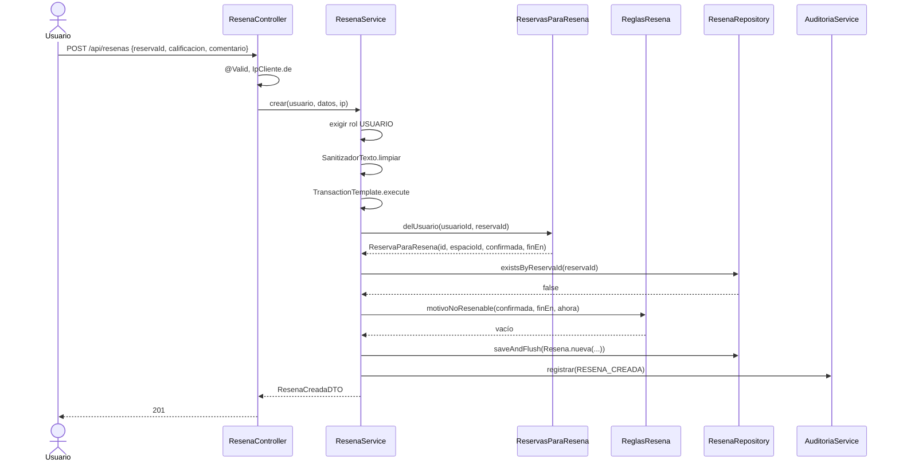
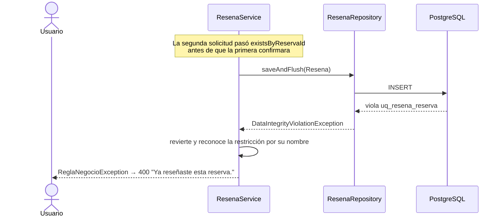

# HU-24 — Design: Reseñas y calificaciones

> Requirements: `specs/HU-24/requirements.md` (R1–R43, decisiones P1–P18). Reutiliza HU-11 (ficha pública, cupo
> `catalogo`), HU-14 (`ReservaDAO`, `ReservaConHorario`) y HU-22 (`ParticipanteDatosPersonales`). Informe del código:
> `progress/explore_HU-24.md`. HU-24 no es ★: no aplica patrón del curso; usa DAO/Repository como todo el repo.

## 1. Decisiones técnicas

| Id | Decisión | Por qué |
|----|----------|---------|
| DT-1 | La tabla, la entidad y el servicio viven en `busqueda`, que estrena sus capas `domain` y `repository`. | `architecture.md`, principio 4, y `feature_list.json`. |
| DT-2 | `busqueda` consulta las reservas con una **interfaz pública nueva y angosta** de `reservas`, `reservas.service.ReservasParaResena`. **No es un puerto**: la dirección `busqueda → reservas` ya está permitida, así que no hace falta inversión de dependencias. | `busqueda` no puede leer `ReservaRepository` (principio 5). `ReservaService.consultar` no da el fin ni lista por usuario, y agregarle métodos obliga a inyectar `ReservaDAO` en `ReservaServiceImpl` y tocar sus pruebas (alternativa A2). |
| DT-3 | `ReservasParaResenaImpl` lee siempre con `ReservaDAO.delUsuario(usuarioId)` y filtra en memoria, también para buscar una reserva por id. | El DAO exige el dueño en la firma: una reserva ajena simplemente no aparece (R9, STRIDE E/I). HU-14 ya aceptó clasificar en memoria decenas de reservas por persona. |
| DT-4 | La regla es **pura**: `busqueda.domain.ReglasResena.motivoNoResenable(confirmada, fin, ahora)`, con `PLAZO = 14 días`. | Bordes de R5, R7 y R8 probados con unitarias, sin reloj real. Mismo estilo que `ReglasLiquidacion`. |
| DT-5 | La referencia temporal es `ReservaConHorario.instanteDeFin` (P1). Intervalo semiabierto: `fin ≤ ahora < fin + 14 días`. Lima no tiene horario de verano, así que 14 × 24 h y 14 días de calendario coinciden. | Mismo fin que HU-19 y HU-26, y mismo criterio de borde: no hay dos definiciones de "ya pasó". |
| DT-6 | `ResenaService.crear` **no** lleva `@Transactional`: usa `TransactionTemplate` y traduce la violación de `uq_resena_reserva`, reconocida por su nombre, a *ya reseñada*. | Patrón de `ReservaServiceImpl.crear` (HU-12 DT-7). Con `@Transactional` la violación llegaría al confirmar y no se podría traducir. Otra violación se relanza. `existsByReservaId` da el camino normal; el índice, la defensa ante la carrera (R14). |
| DT-7 | Sin bloqueos. | Una `CONFIRMADA` terminada ya no cambia de estado: `motivoNoCancelable` responde `YA_INICIADA` y el webhook solo confirma reservas vigentes. La doble reseña la frena el índice único. |
| DT-8 | Sanitización **al guardar**, en una utilidad nueva y pura, `comun.texto.SanitizadorTexto.limpiar(String)`. Pasos: `\r\n` y `\r` → `\n`; quitar `\p{Cc}` salvo `\n` y `\t`; quitar `<[^<>]*>`; quitar todo `<` y `>` restante; `strip()`. | P4. El último paso garantiza que no quede ninguna etiqueta, ni con `<scr<script>ipt>`. Quitar `\p{Cc}` además evita el 500 de PostgreSQL con `U+0000`. Las expresiones no retroceden: costo lineal. Va en `comun` porque el principio 9 pide construir lo transversal una vez y HU-26 puede reutilizarla. Ver alternativas A3 y A4. |
| DT-9 | `GET /api/resenas/pendientes` dice qué reservas se pueden reseñar; `ReservaDTO` no cambia (P5). La pantalla solo pregunta si el id está en la lista. | Comparar un id no es una regla de negocio: la decide el servidor. Sin puerto ni cambios en `reservas` más allá de DT-2 y sin tocar el contrato de HU-12 y HU-14. Ver alternativa A1. |
| DT-10 | El resumen va en `FichaPublicaDTO` (`calificacionPromedio`, `totalResenas`) y las reseñas en su ruta paginada, `GET /api/espacios/{id}/resenas` (P6). | HU-11 DT-16 prevé campos nuevos en la ficha. Paginar por separado evita que la ficha crezca con las reseñas. `Slice` hace `LIMIT n + 1`: da `hayMas` sin contar (como HU-10, sin total por página). |
| DT-11 | El promedio se calcula con `count` y `sum` enteros y `BigDecimal.divide(…, 1, HALF_UP)` en `ResumenCalificaciones` (R28). | `avg` devuelve `double`: 4.25 o 4.35 pueden redondear mal. Dos enteros son exactos. |
| DT-12 | `calificacion` es `SMALLINT` y **`short`** en la entidad, con `getCalificacion()` que devuelve `int`. | `spring.jpa.hibernate.ddl-auto=validate`: un `int` contra `SMALLINT` impide arrancar. Mismo arreglo que `ReservaBloque.horaInicio`. |
| DT-13 | `comentario` es `NOT NULL`; al anonimizar se reemplaza por `Resena.COMENTARIO_ELIMINADO` (P11), con un `UPDATE` masivo por `usuario_id`. | Mismo criterio que "Cuenta eliminada" en HU-22. La columna conserva su `CHECK` y la pantalla no necesita un caso nulo. |
| DT-14 | `DatosPersonalesResenasImpl` implementa el puerto con `@Order(3)`. El doble `ParticipanteQueFalla` pasa a `@Order(4)`. | HU-22 DT-2 lo dejó pendiente. Un doble con el mismo orden que un bean real dejaría indefinido quién anonimiza primero. |
| DT-15 | Los DTO de entrada usan lectores estrictos propios (`CrearResenaDTO.SoloEnteroLargo`, `SoloEnteroCorto`, `SoloTexto`). | Como `CrearReservaDTO`: un `"4"` o un `4.5` se reportan en su campo y no como cuerpo ilegible (R15–R17). `busqueda` no importa DTO de `reservas`. |
| DT-16 | Orden de `crear`: `@Valid` (400) → rol (403) → sanitizar (400) → transacción: reserva propia (404) → *ya reseñada* (400) → regla (400) → `saveAndFlush` → auditoría. | La validación del cuerpo no depende de la reserva: no filtra nada. Mismo orden que `POST /api/reservas`. *Ya reseñada* va antes que el plazo porque es la causa real (R12). |
| DT-17 | `busqueda` usa `cuentas` **solo** por el puerto de HU-22, no por `CuentaService` (P8, P15). | No se muestra el autor, así que no hace falta `nombres(ids)`. |
| DT-18 | `ResenaService` es una clase concreta. HU-27 creará la interfaz pública cuando `administracion` la necesite. | "Solo los servicios que usan otros módulos llevan interfaz" (YAGNI). |
| DT-19 | Las reseñas públicas exponen `fecha` (`LocalDate` de Lima), no `creado_en`. | Minimización: un día basta, y la pantalla reutiliza `formatoFecha`. El orden sigue usando `creado_en`. |

## 2. Archivos

`M` = modificar, `N` = nuevo. Raíz backend: `2_Backend/src/main/java/pe/edu/ulima/espacioya/` (`J/`), pruebas
`2_Backend/src/test/java/pe/edu/ulima/espacioya/` (`T/`), recursos `2_Backend/src/main/resources/` (`R/`), frontend
`3_frontend/src/` (`F/`).

### `busqueda`

| Archivo | | Qué |
|---------|---|-----|
| `R/db/migration/V7_2__resena.sql` | N | Tabla, restricciones e índices (§ 7). |
| `J/busqueda/domain/Resena.java` | N | Entidad (§ 6). |
| `J/busqueda/domain/EstadoResena.java` | N | `VISIBLE`, `OCULTA`. |
| `J/busqueda/domain/MotivoNoResenable.java` | N | `NO_USADA`, `PLAZO_VENCIDO`. |
| `J/busqueda/domain/ReglasResena.java` | N | Regla pura (DT-4). |
| `J/busqueda/domain/ResumenCalificaciones.java` | N | Promedio y total (DT-11). |
| `J/busqueda/repository/ResenaRepository.java` | N | Consultas (§ 6). |
| `J/busqueda/repository/TotalesResena.java` | N | Proyección `cantidad`, `suma`. |
| `J/busqueda/dto/CrearResenaDTO.java` | N | Entrada con lectores estrictos. |
| `J/busqueda/dto/ResenaCreadaDTO.java` | N | Respuesta del `POST`. |
| `J/busqueda/dto/ResenasPendientesDTO.java` | N | `List<Long> reservaIds`. |
| `J/busqueda/dto/ResenaPublicaDTO.java` | N | Cuatro campos públicos (R31). |
| `J/busqueda/dto/PaginaResenasDTO.java` | N | `pagina`, `resenas`, `hayMas`. |
| `J/busqueda/dto/ResenaExportadaDTO.java` | N | Sección `resenas` de HU-22. |
| `J/busqueda/dto/FichaPublicaDTO.java` | M | `+ calificacionPromedio, totalResenas`; `de(ficha, resumen)`. |
| `J/busqueda/service/ResenaService.java` | N | Caso de uso, clase concreta (§ 6). |
| `J/busqueda/service/FichaService.java` | M | Recibe `ResenaService` y arma el resumen solo si el espacio es visible. |
| `J/busqueda/service/BusquedaService.java` | M | `pagina(String)` pasa de `private` a paquete, para reutilizar la regla. |
| `J/busqueda/service/impl/DatosPersonalesResenasImpl.java` | N | Puerto de HU-22 (§ 10). |
| `J/busqueda/controller/ResenaController.java` | N | Las tres rutas (§ 4). |
| `J/busqueda/controller/ReglasLimiteFicha.java` | M | `RUTA_RESENAS` y su regla del grupo `catalogo`. |

### `reservas` y `comun`

| Archivo | | Qué |
|---------|---|-----|
| `J/reservas/service/ReservasParaResena.java` | N | Interfaz pública (DT-2). |
| `J/reservas/service/ReservaParaResena.java` | N | `record` que cruza a `busqueda`. |
| `J/reservas/service/impl/ReservasParaResenaImpl.java` | N | Implementación con `ReservaDAO` (DT-3). |
| `J/comun/texto/SanitizadorTexto.java` | N | Utilidad pura (DT-8). |
| `J/comun/seguridad/ConfiguracionSeguridad.java` | M | `GET /api/espacios/*/resenas` en `permitAll`. |

### Frontend

| Archivo | | Qué |
|---------|---|-----|
| `F/api/busqueda.js` | M | `crearResena`, `listarResenasPendientes`, `listarResenasDeEspacio`. |
| `F/pages/reservas/ResenarReserva.jsx` + `.module.css` | N | Botón y `Modal` (no es del kit). |
| `F/pages/reservas/MisReservas.jsx` | M | Lee pendientes y agrega la acción en "Pasadas". |
| `F/pages/reservas/textosReservas.js` | M | Textos del modal. |
| `F/pages/busqueda/ResenasEspacio.jsx` + `.module.css` | N | Sección "Reseñas" (no es del kit). |
| `F/pages/busqueda/FichaEspacio.jsx` | M | Resumen y sección. |
| `F/pages/busqueda/textosFicha.js` | M | Textos de la sección. |

## 3. Caso de uso y secuencias


**Flujo principal: reseña creada (R1, R23).**



**Flujo de error: dos envíos a la vez (R14).**



## 4. Endpoints

| Método y ruta | Sesión | Entrada | Salida | Códigos |
|---------------|--------|---------|--------|---------|
| `POST /api/resenas` | `USUARIO` | `CrearResenaDTO` | `ResenaCreadaDTO` | 201; 400 (`reservaId`, `calificacion`, `comentario` o sin campo); 401; 403; 404 |
| `GET /api/resenas/pendientes` | `USUARIO` | — | `ResenasPendientesDTO` | 200; 401; 403 |
| `GET /api/espacios/{id}/resenas?pagina=n` | Pública, cupo `catalogo` | `id` y `pagina` como texto | `PaginaResenasDTO` | 200; 400 (`pagina`); 404; 429 |
| `GET /api/espacios/{id}` (HU-11) | Pública, cupo `catalogo` | — | `FichaPublicaDTO` con 2 campos más | Sin cambios |

Las dos rutas `/api/resenas` no se registran en `ConfiguracionSeguridad`: `anyRequest().authenticated()` ya las cubre.
Ninguna ruta lleva `usuarioId`: el usuario sale de `@AuthenticationPrincipal UsuarioAutenticado`.

## 5. DTO y mensajes

```java
public record CrearResenaDTO(
        @NotNull(message = M_RESERVA) @Positive(message = M_RESERVA)
        @JsonDeserialize(using = SoloEnteroLargo.class) Long reservaId,
        @NotNull(message = M_CALIFICACION) @Min(value = 1, message = M_CALIFICACION)
        @Max(value = 5, message = M_CALIFICACION)
        @JsonDeserialize(using = SoloEnteroCorto.class) Integer calificacion,
        @NotBlank(message = M_COMENTARIO) @Size(max = 500, message = M_COMENTARIO)
        @JsonDeserialize(using = SoloTexto.class) String comentario) { }

public record ResenaCreadaDTO(Long id, Long reservaId, int calificacion, String comentario, LocalDate fecha) { }
public record ResenasPendientesDTO(List<Long> reservaIds) { }
public record ResenaPublicaDTO(Long id, int calificacion, String comentario, LocalDate fecha) { }
public record PaginaResenasDTO(int pagina, List<ResenaPublicaDTO> resenas, boolean hayMas) { }
public record ResenaExportadaDTO(Long reservaId, String espacioNombre, int calificacion, String comentario,
                                 String estado, LocalDate fecha) { }
```

`FichaPublicaDTO` agrega al final `BigDecimal calificacionPromedio` y `long totalResenas`.

`SoloEnteroCorto` devuelve el valor solo si es un entero JSON que cabe en un `int`; un valor mayor se lee `null`.

| Mensaje | Constante | Texto |
|---------|-----------|-------|
| *reserva inválida* | `CrearResenaDTO.M_RESERVA` | Elige una reserva válida. |
| *calificación inválida* | `CrearResenaDTO.M_CALIFICACION` | Elige una calificación de 1 a 5. |
| *comentario inválido* | `CrearResenaDTO.M_COMENTARIO` | Escribe un comentario de hasta 500 caracteres. |
| *no reseñable* | `ResenaService.MENSAJE_NO_RESENABLE` | Solo puedes reseñar reservas confirmadas que ya pasaron. |
| *plazo vencido* | `ResenaService.MENSAJE_PLAZO_VENCIDO` | El plazo de 14 días para reseñar esta reserva ya terminó. |
| *ya reseñada* | `ResenaService.MENSAJE_YA_RESENADA` | Ya reseñaste esta reserva. |
| *comentario eliminado* | `Resena.COMENTARIO_ELIMINADO` | Comentario eliminado. |

## 6. Clases y firmas públicas

```java
// reservas.service — sin sesión ni rol: el llamador pasa el id de la sesión.
public record ReservaParaResena(Long id, Long espacioId, boolean confirmada, Instant finEn) { }

public interface ReservasParaResena {
    /** @throws RecursoNoEncontradoException si no es una reserva de ese usuario. */
    ReservaParaResena delUsuario(Long usuarioId, Long reservaId);

    /** Las de estado leído CONFIRMADA de ese usuario, cualquiera sea su fin. */
    List<ReservaParaResena> confirmadasDe(Long usuarioId);
}

// busqueda.domain
public final class ReglasResena {
    public static final Duration PLAZO = Duration.ofDays(14);

    /** Vacío si está dentro del plazo. No confirmada o sin terminar: NO_USADA; ahora ≥ fin + PLAZO: PLAZO_VENCIDO. */
    public static Optional<MotivoNoResenable> motivoNoResenable(boolean confirmada, Instant fin, Instant ahora);
}

public record ResumenCalificaciones(BigDecimal promedio, long total) {
    public static ResumenCalificaciones de(long cantidad, long suma);
}

@Entity
@Table(name = "resena")
public class Resena {
    public static final String COMENTARIO_ELIMINADO = "Comentario eliminado.";

    protected Resena() { }

    public static Resena nueva(Long reservaId, Long usuarioId, Long espacioId, int calificacion, String comentario,
                               Instant ahora);

    // Getters, sin setters. getCalificacion() devuelve int (DT-12).
}

// busqueda.repository
public interface ResenaRepository extends JpaRepository<Resena, Long> {
    boolean existsByReservaId(Long reservaId);

    @Query("select r.reservaId from Resena r where r.usuarioId = :usuarioId")
    Set<Long> reservasResenadas(@Param("usuarioId") Long usuarioId);

    Slice<Resena> findByEspacioIdAndEstado(Long espacioId, EstadoResena estado, Pageable pagina);

    @Query("select count(r) as cantidad, coalesce(sum(r.calificacion), 0) as suma from Resena r "
            + "where r.espacioId = :espacioId and r.estado = :estado")
    TotalesResena totales(@Param("espacioId") Long espacioId, @Param("estado") EstadoResena estado);

    List<Resena> findByUsuarioIdOrderByCreadoEnAscIdAsc(Long usuarioId);

    @Modifying
    @Query("update Resena r set r.comentario = :comentario where r.usuarioId = :usuarioId")
    int reemplazarComentarios(@Param("usuarioId") Long usuarioId, @Param("comentario") String comentario);
}

// busqueda.service
@Service
public class ResenaService {
    public static final String ACCION_RESENA_CREADA = "RESENA_CREADA";
    public static final int TAMANO_PAGINA = 10;

    public ResenaCreadaDTO crear(UsuarioAutenticado usuario, CrearResenaDTO datos, String ip);

    @Transactional(readOnly = true)
    public ResenasPendientesDTO pendientes(UsuarioAutenticado usuario);

    @Transactional(readOnly = true)
    public PaginaResenasDTO deEspacio(String espacioId, String pagina);

    @Transactional(readOnly = true)
    public ResumenCalificaciones resumen(Long espacioId);
}

// comun.texto
public final class SanitizadorTexto {
    public static String limpiar(String texto);
}
```

- `pendientes`: `confirmadasDe(usuarioId)`, quitar `reservasResenadas(usuarioId)`, conservar las que
  `motivoNoResenable` deja vacío con un solo `ahora`, ordenar por id.
- `deEspacio`: id con el criterio de `FichaService.idValido`, que pasa a paquete; `esVisible` (404, R33); después
  `pagina` (`BusquedaService.pagina`; 0 → 400, R34); `PageRequest.of(n - 1, TAMANO_PAGINA, Sort.by(DESC, "creadoEn",
  "id"))`. El offset de `PageRequest` es `long`: una página enorme no desborda y devuelve una lista vacía.
- `ReservasParaResenaImpl` es `@Transactional(readOnly = true)`, con `estadoEn(ahora) == CONFIRMADA` y
  `instanteDeFin()`.

## 7. Migración

`V7_2__resena.sql`. HU-25 también es del sprint 7: antes de crearla, confirmar en `develop` que `V7_2` sigue libre.

```sql
-- HU-24: una reseña por reserva. estado lo usa HU-27; HU-24 solo crea VISIBLE.
CREATE TABLE resena (
    id           BIGINT GENERATED ALWAYS AS IDENTITY PRIMARY KEY,
    reserva_id   BIGINT       NOT NULL,
    usuario_id   BIGINT       NOT NULL,
    espacio_id   BIGINT       NOT NULL,
    calificacion SMALLINT     NOT NULL,
    comentario   VARCHAR(500) NOT NULL,
    estado       VARCHAR(10)  NOT NULL,
    creado_en    TIMESTAMPTZ  NOT NULL,
    CONSTRAINT uq_resena_reserva UNIQUE (reserva_id),
    CONSTRAINT fk_resena_reserva FOREIGN KEY (reserva_id) REFERENCES reserva (id),
    CONSTRAINT fk_resena_usuario FOREIGN KEY (usuario_id) REFERENCES usuario (id),
    CONSTRAINT fk_resena_espacio FOREIGN KEY (espacio_id) REFERENCES espacio (id),
    CONSTRAINT ck_resena_calificacion CHECK (calificacion BETWEEN 1 AND 5),
    CONSTRAINT ck_resena_estado CHECK (estado IN ('VISIBLE', 'OCULTA')),
    CONSTRAINT ck_resena_comentario CHECK (char_length(btrim(comentario)) >= 1)
);
-- La ficha pagina y promedia solo las visibles.
CREATE INDEX ix_resena_espacio_visible ON resena (espacio_id, creado_en DESC, id DESC) WHERE estado = 'VISIBLE';
-- Pendientes, exportación y anonimización de HU-22.
CREATE INDEX ix_resena_usuario ON resena (usuario_id);
```

## 8. Excepciones

Sin excepciones nuevas. Todas son de `comun/error/`:

| Excepción | Caso |
|-----------|------|
| `MethodArgumentNotValidException` | R15, R16, R17 |
| `ReglaNegocioException(campo, mensaje)` | R22, R34 |
| `ReglaNegocioException(mensaje)` | R6, R7, R8, R12, R14 |
| `AccesoDenegadoException` | R10, R26 |
| `RecursoNoEncontradoException` | R9, R33 |
| `DemasiadosIntentosException` (la lanza el filtro) | R38 |

## 9. Componentes de `comun` reutilizados

- **Auditoría:** `AuditoriaService.registrar(EventoAuditoria)`, dentro de la transacción. IP con `IpCliente.de(peticion)`.
- **Rate limiting:** `LimiteCatalogo.regla("GET", RUTA_RESENAS)`, en `ReglasLimiteFicha`. El límite no se escribe a mano.
- **Hora:** `Clock` y `ZonaHoraria.LIMA`.
- **Errores:** `ManejadorGlobalErrores`. HU-24 no agrega manejadores.
- **Correo:** ninguno. La historia no pide avisos.
- **Nuevo:** `comun.texto.SanitizadorTexto` (DT-8), con su fila en `docs/requerimientos.md` § 8.

## 10. Datos personales (HU-22)

`DatosPersonalesResenasImpl`, `@Component`, `@Order(3)`, en `busqueda/service/impl/`:

| Método | Comportamiento |
|--------|----------------|
| `exportar` | `@Transactional(readOnly = true)`. Solo con `titular.esUsuario()`: `SeccionDatos("resenas", lista)`, también vacía; `espacioNombre` con `CatalogoEspaciosService.nombres(ids)`, sin filtro de visibilidad. Otro rol: `List.of()`. |
| `impedimentos` | `MANDATORY`. Siempre `List.of()`. |
| `anonimizar` | `MANDATORY`. `reemplazarComentarios(titular.usuarioId(), Resena.COMENTARIO_ELIMINADO)`. No lleva auditoría propia: `CUENTA_ELIMINADA` la cubre. |

`usuario_id` se conserva: la fila de `usuario` queda anonimizada y la FK sigue válida. No hay archivos que borrar.

## 11. Pantallas

No agrega componentes al kit, estados a `EtiquetaEstado` ni colores. La calificación se elige con un `Campo tipo="select"`
y se muestra como texto ("4.3 de 5"): no hay estrellas. `VISIBLE` no se muestra, porque la ficha solo recibe reseñas
visibles. Solo tokens en los CSS Modules. Ninguna pantalla usa `dangerouslySetInnerHTML`: React escapa el comentario.

### `/mis-reservas` — `pages/reservas/MisReservas.jsx` (CA1, CA2, CA3)

- **Kit:** `Boton`, `Modal`, `Campo`, `Alerta`, `Tarjeta`. Nuevo fuera del kit: `pages/reservas/ResenarReserva.jsx`.
- **API:** `listarResenasPendientes()` → `GET /api/resenas/pendientes`; `crearResena({ reservaId, calificacion,
  comentario })` → `POST /api/resenas`, en `api/busqueda.js`.
- **Comportamiento:** al montarse y con cada `recarga`, la pantalla pide los pendientes y guarda un `Set` de ids. En
  "Pasadas", `tarjetaPasada(reserva)` pasa `ResenarReserva` como acción de `tarjetaDeReserva` solo si el id está en el
  `Set`. Si la consulta falla, la lista funciona igual, sin el botón; el servidor sigue validando al crear.
- **CA1:** `Boton secundario` "Calificar" abre `Modal` `primario` "Califica tu reserva" con `Campo select`
  "Calificación" (5 a 1, "5 - Excelente", "4 - Muy bueno", "3 - Regular", "2 - Malo", "1 - Muy malo") y `Campo textarea`
  "Comentario", con la ayuda "Hasta 500 caracteres.". "Publicar reseña" llama a `crearResena` con `cargando`. Con 201:
  se cierra el modal, `Alerta exito` "Tu reseña ya está publicada." y `recarga` sube, así que el botón desaparece.
- **CA2:** el botón no aparece en reservas no reseñables. Si la API igual rechaza (400 o 404), se cierra el modal y
  se muestra `Alerta error` con el mensaje tal cual bajo el botón.
- **CA3:** después de reseñar, la reserva sale de los pendientes. Si otro envío se adelantó, llega *ya reseñada* como
  `Alerta error`.
- **Errores por campo:** `calificacion` y `comentario` quedan dentro del modal, bajo su `Campo`. Un `select` vacío se
  envía como `null` y responde el servidor: la pantalla no valida reglas.

### `/espacios/:id` — `pages/busqueda/FichaEspacio.jsx` (CA1)

- **Kit:** `Tarjeta`, `Boton`, `Alerta`. Nuevo fuera del kit: `pages/busqueda/ResenasEspacio.jsx`, con
  `key={espacio.id}`.
- **API:** `obtenerEspacio` (con los dos campos nuevos) y `listarResenasDeEspacio(id, pagina)` → `GET
  /api/espacios/{id}/resenas`, con `autenticada: false`.
- **Resumen:** debajo de la descripción, en la columna de datos: "`4.3` de 5 · `12` reseñas" ("1 reseña" en singular),
  o "Aún sin reseñas." si `totalResenas` es 0. El promedio lo trae la API.
- **Sección "Reseñas":** al final de la pantalla, después de "Reservar", para no separar los bloques de su botón. Cada
  reseña es una `Tarjeta` con título "`n` de 5", el comentario (`white-space: pre-line`) y la fecha en
  `--color-texto-secundario` (`formatoFecha`). "Ver más" es un `Boton secundario` mientras `hayMas` y no repite ids,
  como `SeccionReservas`. Lista vacía: "Este espacio aún no tiene reseñas.". Error: `Alerta error` con el mensaje. El
  único primario sigue siendo "Reservar".

## 12. Patrones

HU-24 no tiene `patterns` en `feature_list.json`. Usa Repository (`ResenaRepository`) y reutiliza el DAO de HU-14 sin
cambiarlo. Puerto que implementa: `cuentas.ParticipanteDatosPersonales`. **No crea puertos nuevos** (DT-2).

## 13. Alternativas descartadas

| Id | Alternativa | Por qué no |
|----|-------------|------------|
| A1 | Agregar `resenable` a `ReservaDTO`, con un puerto `reservas.ResenasDeReservas` implementado por `busqueda`. | Rompe 7 aserciones de los 11 campos, el campo no aplica a `crear` ni a `consultar`, crea la primera carpeta de puertos de `reservas` y suma una consulta a tres rutas. La ruta propia evita todo eso con una llamada más (P5). |
| A2 | Agregar métodos a `ReservaService`. | Obliga a inyectar `ReservaDAO` en un constructor de 9 parámetros y a tocar `ReservaServiceImplTest`, y mezcla dos usos en una interfaz. Una interfaz angosta sigue el precedente de `ReservasLiquidables`. |
| A3 | Escapar con `HtmlUtils.htmlEscape` al guardar. | Doble escape: `&lt;` visible en la ficha y en la exportación de HU-22, y un `'` o `&` normal también se deformaría. |
| A4 | Usar jsoup, o rechazar con 400 todo comentario con `<` o `>`. | jsoup agrega una dependencia sin discutir para un texto que nunca se muestra como HTML. Rechazar castiga un "5 > 3" inocente y la historia pide sanitizar, no rechazar. |
| A5 | Poner las reseñas dentro de `FichaPublicaDTO`, sin ruta aparte. | La ficha crece sin límite o esconde las antiguas mientras `totalResenas` dice otra cosa. |
| A6 | Guardar el promedio en `espacio`. | `espacios` tendría que escribir por cuenta de `busqueda`, y HU-27 tendría que recalcularlo al ocultar. El modelo tampoco lo prevé. |
| A7 | Borrar la reseña al eliminar la cuenta. | Cambiaría el promedio de un espacio por un hecho ajeno a él. El comentario, que es lo personal, igual desaparece (P11). |
| A8 | `POST /api/reservas/{id}/resena`. | Una ruta `/api/reservas` en `busqueda` confunde el módulo dueño. `POST /api/resenas` sigue a `POST /api/reservas`, que lleva `espacioId` en el cuerpo. |

## 14. Efectos en pruebas existentes

| Prueba | Cambio |
|--------|--------|
| `T/busqueda/controller/FichaControllerIT.java:267` | `containsOnlyKeys` suma `calificacionPromedio` y `totalResenas`. |
| `T/busqueda/service/FichaServiceTest.java:57, :72` | Constructor con `ResenaService` y `FichaPublicaDTO` con los dos campos. |
| `T/cuentas/controller/DatosPersonalesControllerIT.java:116, :138` | El usuario exporta `reservas`, `pagos`, `resenas`; detalle `secciones=reservas,pagos,resenas`. Las líneas `:158` y `:162` (arrendador) no cambian. |
| `T/cuentas/controller/DatosPersonalesSoporte.java:132` | `ParticipanteQueFalla` pasa a `@Order(4)` (DT-14). |
| `T/cuentas/controller/DatosPersonalesSoporte.java:237` | `limpiar` borra `resena` antes que `reserva`. |

`ResultadoEspacioDTO`, `ReservaDTO` y `ReservaServiceImpl` no cambian. La FK no tiene cascada: toda IT que cree reseñas
las borra al limpiar. Las demás suites no crean reseñas y siguen igual.

## 15. Riesgos aceptados y lo que deja HU-24

- **Carrera con la eliminación de la cuenta (riesgo aceptado).** Una reseña que se confirma justo después del `UPDATE` de
  `anonimizar` conserva su comentario. Exige que la misma persona reseñe durante su eliminación, que revoca sus sesiones
  en la misma transacción.
- **Lectura en memoria (riesgo aceptado).** `pendientes` y `delUsuario` cargan todas las reservas del usuario, como
  HU-14.
- **HU-27** agrega `Resena.ocultar`, la interfaz pública de `busqueda` para `administracion` y lee `id` de la ficha para
  `reporte.objetivo_id`. No necesita cambiar las consultas: ya filtran `VISIBLE`.
- **HU-26** puede reutilizar `SanitizadorTexto`.

## 16. Documentos que actualiza el implementer

| Documento | Cambio |
|-----------|--------|
| `docs/modelo-datos.md` | `resena` con `creado_en`, tipos y FK; fila de restricciones con los nombres de § 7; anonimización en la fila "Cuenta `ELIMINADA`". |
| `docs/architecture.md` | Flecha `busqueda → cuentas` (solo puerto); fila de `ParticipanteDatosPersonales` con `busqueda` y `@Order(3)`; párrafo de `ReservasParaResena` junto a las interfaces públicas; `FichaPublicaDTO` y `ConfiguracionSeguridad`; sección "Reseñas: qué deja HU-24 (HU-26, HU-27)". |
| `docs/requerimientos.md` | § 8: fila de sanitización de texto. § 9 punto 9: el cupo `catalogo` incluye las reseñas de la ficha. |
| `docs/frontend.md` | Rutas: reseñar en `/mis-reservas` y sección "Reseñas" en `/espacios/:id`. |
