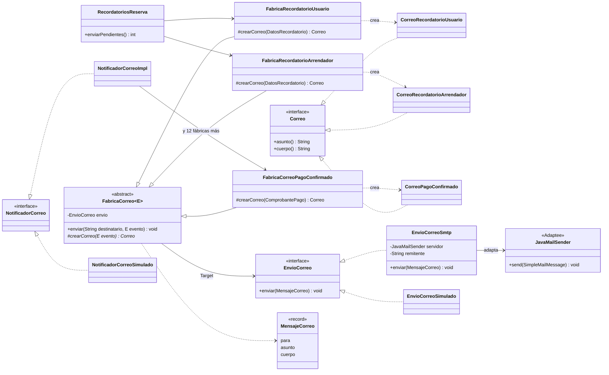
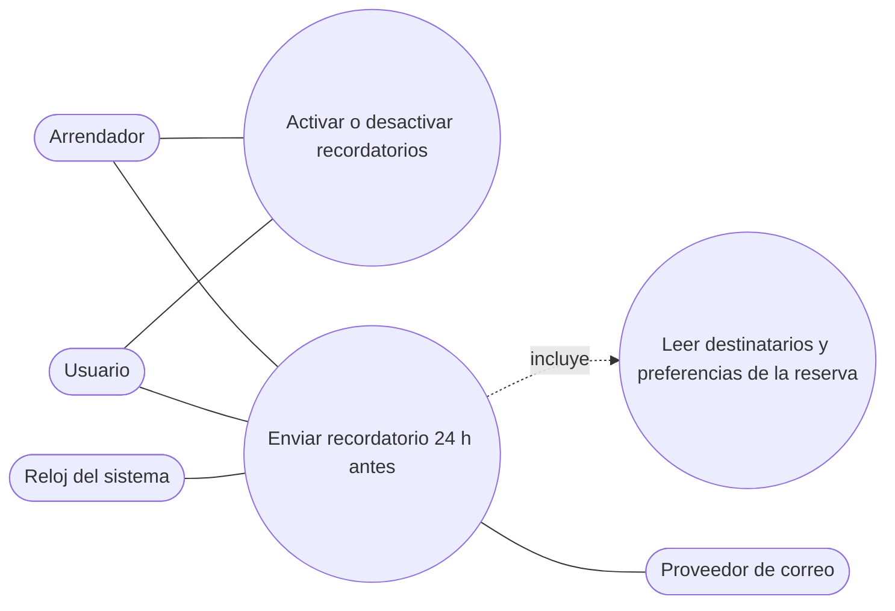
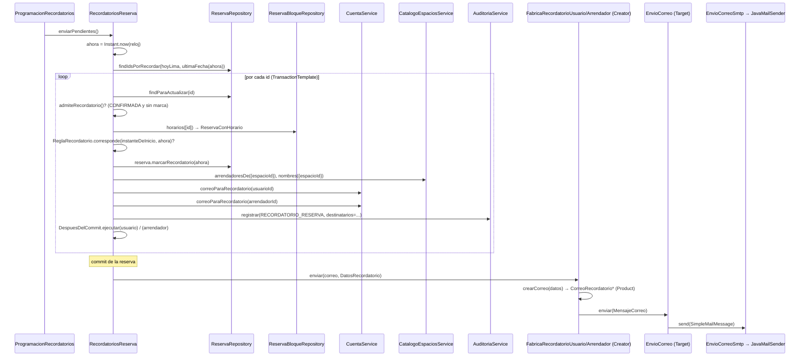
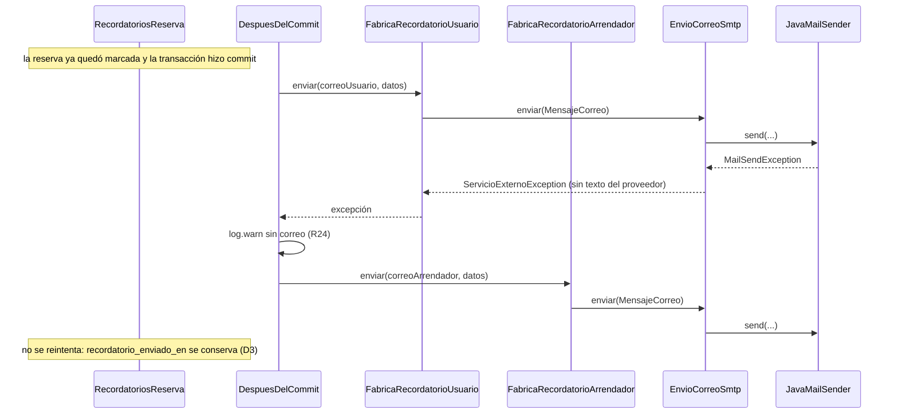

# HU-25 · Recordatorio de reserva por correo — Design

> Historia ★ (Factory Method + Adapter). Módulo principal `reservas`; toca `comun` (nuevo paquete `correo`) y `cuentas`
> (preferencia y adaptador real de `NotificadorCorreo`). Sprint 7 → migración `V7_3`.
> Requirements: `specs/HU-25/requirements.md`. Hechos del código: `progress/explore_HU-25.md`.

## 1. Decisiones

| Id | Decisión | Por qué |
|----|----------|---------|
| D1 | **Proceso programado** (`@Scheduled`, retraso fijo, `PT5M` por defecto) que busca reservas `CONFIRMADA` cuyo inicio cae en las próximas 24 h y aún no tienen recordatorio. **Cierra §9 punto 8.** | RF-D-10 necesita un disparo por tiempo; ya hay un proceso del mismo tipo (`ProgramacionExpiracion`, HU-12) y la simplificación de §5 no lo descarta. Sin colas (fuera de lo permitido). |
| D2 | Ventana `inicio − 24 h ≤ ahora < inicio`. Una reserva confirmada con menos de 24 h de anticipación recibe el recordatorio en la siguiente pasada, **aunque llegue minutos después del comprobante** (aceptado por el dueño, P2); **no** se agrega `confirmada_en`. Una que ya empezó no lo recibe. Con el intervalo de 5 min el correo sale entre 24 h y ~23 h 55 min antes. | CA1 "faltan 24 h"; no mandar recordatorios de reservas pasadas si el proceso estuvo caído. Filtrar por anticipación al confirmar exigiría otra columna y otra regla que ningún CA pide. |
| D3 | Columna `reserva.recordatorio_enviado_en` (`TIMESTAMPTZ`, nula) como marca de idempotencia, guardada en la misma transacción que lee los destinatarios; los correos salen con `DespuesDelCommit`. Semántica **como mucho una vez**: si el envío falla, no se reintenta. | Es la misma semántica que el resto de correos (HU-13, HU-15). La alternativa "al menos una vez" exige una tabla de envíos con reintentos (ver § 13). |
| D4 | Columna `usuario.recordatorios_activos` (`BOOLEAN NOT NULL DEFAULT TRUE`), ya prevista en `docs/modelo-datos.md`. Opt-out: todas las cuentas empiezan con recordatorios. | CA2 habla de desactivarlos, es decir, vienen activos. |
| D5 | Ruta propia `GET`/`PUT /api/usuarios/actual/preferencias-correo` con `PreferenciasCorreoDTO(Boolean recordatoriosActivos)`; **no** se amplía `PerfilDTO` ni `PUT /perfil`. | SRP y no romper las pruebas de HU-20 que fijan los campos del perfil; el `PUT /perfil` exige nombre y teléfono. `ADMIN` → 403 como el perfil (HU-20 D7). |
| D6 | Solo se envía a cuentas `ACTIVA` con la preferencia activa (`CuentaService.correoParaRecordatorio`). | Una cuenta eliminada tiene un correo `@espacioya.invalid`; una suspendida no debe recibir avisos de uso. |
| D7 | La preferencia **solo** la lee el proceso de recordatorios. `AvisosPago`, `AvisosCancelacion` y `NotificadorCorreo` no la consultan (CA3 ya se cumple; se fija con pruebas). | RN-14. |
| D8 | **Adapter** en `comun/correo`: Target `EnvioCorreo`, adaptador `EnvioCorreoSmtp` sobre `JavaMailSender` (`spring-boot-starter-mail`, Adaptee) y `EnvioCorreoSimulado`. Se eligen con `espacioya.correo.proveedor` (`smtp` \| `simulado`, por defecto `simulado`) y `@ConditionalOnProperty`, como `PasarelaPago` (sin fábrica de adaptadores). | RNF-ARQ-08 y `architecture.md` "Patrones por historia". SMTP es un protocolo estándar: cambiar de proveedor (Gmail, SES, Brevo…) es cambiar variables, no código. |
| D9 | **Factory Method** en `comun/correo`: Creator abstracto `FabricaCorreo<E>` con el método fábrica `crearCorreo(E)` y la operación `enviar(destinatario, evento)`; Product `Correo`. Cada evento tiene su ConcreteCreator y su ConcreteProduct **en su módulo** (`reservas` para los recordatorios, `cuentas` para los 13 correos existentes). | `comun` no depende de ningún módulo: los tipos de los eventos (`ComprobantePago`, `Aviso*`) viven en `cuentas`. Agregar un correo nuevo es agregar un par Creator/Product sin tocar el envío (OCP). |
| D10 | `NotificadorCorreo` **se queda en `cuentas.service`** y no gana métodos. Gana una segunda implementación, `cuentas.service.impl.NotificadorCorreoImpl` (con `proveedor=smtp`), que delega en los 13 ConcreteCreators. `NotificadorCorreoSimulado` queda igual, solo con `@ConditionalOnProperty(proveedor=simulado)` (conserva `registrar-enlace` de HU-04 D1 y su prueba). Así "HU-25 implementa los métodos de `NotificadorCorreo` en el adaptador real" (`architecture.md`, Perfil). | Mover el puerto a `comun` cambia 28 archivos (20 con imports) sin cambiar comportamiento; agregar un método al puerto obliga a tocar 9 dobles. Los recordatorios usan `EnvioCorreo` directo. El Javadoc del puerto se actualiza ("HU-25 decidió dejarlo en `cuentas`"). |
| D11 | `notificarVerificacion` con SMTP envía un correo de **bienvenida** sin enlace. El flujo real de verificación (token `VERIFICACION`) **no** entra: ningún CA de HU-25 lo pide y la cuenta sigue naciendo verificada (HU-01 S5). | No inventar alcance. |
| D12 | **UAT usa `CORREO_PROVEEDOR=simulado`** (no hay servidor SMTP ni remitente, respuesta P1 del dueño). En UAT, CA1 se demuestra con el log "Envío de correo simulado: no se envió ningún correo." y la fila de auditoría `RECORDATORIO_RESERVA` (`destinatarios=…`). El adaptador SMTP queda listo y probado contra un `JavaMailSender` de Mockito; activarlo solo requiere configuración (§ 9.1), sin código. | Igual que Mercado Pago (HU-13 D8). |
| D13 | **`recordatoriosActivos` entra en la exportación de HU-22** (respuesta P3 del dueño, R37): campo `boolean recordatoriosActivos` en `PerfilExportadoDTO`, justo después de `mfaActivo`, leído en `PerfilExportadoDTO.de(...)` con `cuenta.tieneRecordatoriosActivos()`. La firma de `de(Usuario, PerfilArrendador, boolean)` no cambia, así que `DatosPersonalesService` no se toca. | Es una preferencia que la persona eligió y se guarda en su cuenta (como `mfaActivo`, que ya se exporta). Leerla de la entidad que ya carga la exportación no agrega consultas ni puertos. |

## 2. Archivos

### `comun/correo` (nuevo paquete)

| Archivo | Rol |
|---|---|
| `MensajeCorreo.java` | `record` que recibe el Target: `para`, `asunto`, `cuerpo` (no vacíos) |
| `EnvioCorreo.java` | **Adapter · Target** |
| `EnvioCorreoSmtp.java` | **Adapter · Adapter** (Adaptee: `JavaMailSender`) |
| `EnvioCorreoSimulado.java` | **Adapter · Adapter** sin proveedor (solo log sin datos) |
| `Correo.java` | **Factory Method · Product** |
| `FabricaCorreo.java` | **Factory Method · Creator** (abstracto) |
| `SinDatos.java` | `enum` con un solo valor, evento de los correos sin datos |
| `FormatoCorreo.java` | Formatos de fecha, horario, monto e instante (Lima) |

### `reservas`

| Capa | Archivo | Cambio |
|---|---|---|
| domain | `Reserva.java` | Campo `recordatorioEnviadoEn`, `admiteRecordatorio()`, `marcarRecordatorio(Instant)` |
| domain | `ReglaRecordatorio.java` (nuevo) | `ANTICIPACION = 24 h`, `corresponde(inicio, ahora)`, `ultimaFecha(ahora)` |
| repository | `ReservaRepository.java` | `findIdsPorRecordar(desde, hasta)` |
| service/recordatorio | `RecordatoriosReserva.java` (nuevo) | Proceso: candidatas → una transacción por reserva → correos tras el commit |
| service/recordatorio | `ProgramacionRecordatorios.java` (nuevo) | `@Scheduled` con su propio `@EnableScheduling` |
| service/recordatorio | `DatosRecordatorio.java` (nuevo) | Evento: espacio, fecha, horaInicio, horaFin |
| service/recordatorio | `FabricaRecordatorioUsuario.java`, `FabricaRecordatorioArrendador.java` (nuevos) | ConcreteCreators |
| service/recordatorio | `CorreoRecordatorioUsuario.java`, `CorreoRecordatorioArrendador.java` (nuevos) | ConcreteProducts |

### `cuentas`

| Capa | Archivo | Cambio |
|---|---|---|
| domain | `Usuario.java` | Campo `recordatoriosActivos`, `tieneRecordatoriosActivos()`, `cambiarRecordatorios(boolean) → boolean` |
| dto | `PreferenciasCorreoDTO.java` (nuevo) | `@NotNull(message = MENSAJE_RECORDATORIOS_OBLIGATORIO) Boolean recordatoriosActivos` |
| dto | `PerfilExportadoDTO.java` (HU-22) | Componente `boolean recordatoriosActivos` después de `mfaActivo`; `de(...)` lo lee de `cuenta.tieneRecordatoriosActivos()`; Javadoc cita HU-25 R37 (D13) |
| controller | `PreferenciasCorreoController.java` (nuevo) | `GET`/`PUT /api/usuarios/actual/preferencias-correo` |
| service | `PreferenciasCorreoService.java` (nuevo, concreto) | Consulta y cambio con auditoría |
| service | `CuentaService.java` | `Optional<String> correoParaRecordatorio(Long usuarioId)` |
| service/impl | `CuentaServiceImpl.java` | Implementa el método nuevo |
| service | `NotificadorCorreo.java` | Solo Javadoc (D10) |
| service | `NotificadorCorreoSimulado.java` | `@ConditionalOnProperty(name="espacioya.correo.proveedor", havingValue="simulado")` |
| service/impl | `NotificadorCorreoImpl.java` (nuevo) | `@ConditionalOnProperty(... havingValue="smtp")`, delega en las fábricas |
| service/correo | 13 ConcreteCreators `FabricaCorreo<Evento>` y 13 ConcreteProducts `Correo<Evento>` (nuevos) | Ver § 3.1 |

### Recursos y configuración

- `db/migration/V7_3__recordatorios.sql` (confirmar en `develop` que `V7_3` sigue libre).
- `pom.xml`: `spring-boot-starter-mail` (versión del BOM de Spring Boot 4.1.2).
- `application.properties`, `src/test/resources/config/application.properties`, `.env.example` (§ 9).

### Frontend

- `3_frontend/src/api/cuentas.js`: `obtenerPreferenciasCorreo()`, `actualizarPreferenciasCorreo({ recordatoriosActivos })`.
- `3_frontend/src/pages/cuentas/Recordatorios.jsx` (nuevo, como `DatosPersonales.jsx`) y su uso en `Perfil.jsx`.
- `3_frontend/src/pages/cuentas/textosCuentas.js`: textos nuevos.

## 3. Patrones ★

### 3.1 Factory Method — "crear el correo según el evento"

| Rol GoF | Clase | Qué hace |
|---|---|---|
| Product | `comun.correo.Correo` | `String asunto()`, `String cuerpo()` |
| ConcreteProduct | `CorreoRecordatorioUsuario`, `CorreoRecordatorioArrendador` (reservas); `CorreoBienvenida`, `CorreoRecuperacion`, `CorreoIdentidadAprobada`, `CorreoIdentidadRechazada`, `CorreoCuentaSuspendida`, `CorreoCuentaReactivada`, `CorreoPagoConfirmado`, `CorreoReservaPagada`, `CorreoCancelacionUsuario`, `CorreoCancelacionArrendador`, `CorreoCambioCuentaBancaria`, `CorreoCambioCorreo`, `CorreoAvisoCambioCorreo` (cuentas) | `record` que recibe su evento y arma asunto fijo y cuerpo según la tabla C1 |
| Creator | `comun.correo.FabricaCorreo<E>` | Declara el método fábrica `protected abstract Correo crearCorreo(E evento)` y la operación `public final void enviar(String destinatario, E evento)`, que no conoce ningún producto concreto: crea el correo, arma el `MensajeCorreo` y lo entrega al Target del Adapter |
| ConcreteCreator | `FabricaRecordatorioUsuario`, `FabricaRecordatorioArrendador`, y una `FabricaCorreo<Evento>` por cada producto de `cuentas` | Sobrescribe `crearCorreo` y decide qué producto instanciar |
| Client | `RecordatoriosReserva`; `NotificadorCorreoImpl` | Elige la fábrica del evento y llama a `enviar` |

**Por qué Factory Method y no un `switch` por tipo de evento:** cada correo tiene datos de entrada distintos y su propio
texto; el envío (validar, armar `MensajeCorreo`, entregar al proveedor) es siempre igual y vive una vez en el Creator.
Un correo nuevo (HU-26, HU-27) es una subclase y un `record`, sin tocar `FabricaCorreo`, `EnvioCorreo` ni los demás
correos. Las fábricas **no son beans**: el Client las crea en su constructor con el `EnvioCorreo` inyectado (como los
decoradores de HU-23).

### 3.2 Adapter — proveedor de correo

| Rol GoF | Clase | Qué hace |
|---|---|---|
| Target | `comun.correo.EnvioCorreo` | `void enviar(MensajeCorreo mensaje)`; sin tipos del proveedor; falla → `ServicioExternoException` |
| Adapter | `comun.correo.EnvioCorreoSmtp` | Traduce `MensajeCorreo` a `SimpleMailMessage` (`from` = remitente, `to` = un solo destinatario, `subject`, `text`) y `MailException` a `ServicioExternoException` |
| Adaptee | `org.springframework.mail.javamail.JavaMailSender` (Jakarta Mail) | API del servidor SMTP |
| Adapter sin proveedor | `comun.correo.EnvioCorreoSimulado` | Solo escribe "Envío de correo simulado: no se envió ningún correo." |
| Client | `FabricaCorreo` (y por ella todas las fábricas) | Solo conoce `EnvioCorreo` |

Selección por configuración (`@ConditionalOnProperty`), igual que `PasarelaPago`: con un valor desconocido no hay bean
de `EnvioCorreo` y el backend no arranca (R34). Ninguna clase fuera de `EnvioCorreoSmtp` importa `org.springframework.mail`
ni `jakarta.mail` (`architecture.md`, "Qué NO hacer").

### 3.3 Diagrama de clases



(En el diagrama solo se dibuja una de las 13 fábricas de `cuentas`; las demás siguen la misma forma.)

## 4. Caso de uso



Flujo principal "Enviar recordatorio": (1) el proceso se dispara cada 5 min; (2) lee las reservas `CONFIRMADA` sin
recordatorio con algún bloque entre hoy y la fecha de *ahora + 24 h* (Lima); (3) por cada una, bloquea su fila,
relee el estado y calcula el inicio; (4) si está en el plazo, marca `recordatorio_enviado_en`, lee el correo de cada
participante con su preferencia y estado, y audita; (5) tras el commit, envía un correo a cada destinatario.
Alternativos: fuera de plazo, ya recordada o no confirmada → nada; preferencia desactivada o cuenta no activa → ese
destinatario no recibe; falla un envío → se registra y sigue el otro.

## 5. Secuencias

### 5.1 Flujo principal



### 5.2 Flujo de error: falla el envío al usuario



### 5.3 Preferencia

`PUT /preferencias-correo` → `PreferenciasCorreoController` (`@Valid`, 400 R4) → `PreferenciasCorreoService.actualizar`:
rol (403 R5) → transacción: `UsuarioRepository.findParaActualizar(id de la sesión)` → `cambiarRecordatorios(valor)`
→ si cambió, auditoría `PREFERENCIA_RECORDATORIOS` → `PreferenciasCorreoDTO`.

## 6. Endpoints

| Método y ruta | Rol | Entrada | Salida | Códigos |
|---|---|---|---|---|
| `GET /api/usuarios/actual/preferencias-correo` | `USUARIO`, `ARRENDADOR` | — | `PreferenciasCorreoDTO` | 200; 401 sin sesión; 403 `ADMIN` |
| `PUT /api/usuarios/actual/preferencias-correo` | `USUARIO`, `ARRENDADOR` | `PreferenciasCorreoDTO` (`{ "recordatoriosActivos": false }`) | `PreferenciasCorreoDTO` | 200; 400 campo `recordatoriosActivos`; 401; 403 `ADMIN` |

Ambas con `Cache-Control: no-store`, sin id en la URL ni en el cuerpo (la cuenta sale de `@AuthenticationPrincipal`).
La ruta cae bajo `/api/usuarios/actual/**`, ya autenticada en `ConfiguracionSeguridad`; no se agrega regla de rate
limiting (la historia no la pide y `PUT /perfil` tampoco tiene cupo). `MENSAJE_RECORDATORIOS_OBLIGATORIO` =
"Indica si quieres recibir recordatorios.".

El proceso de recordatorios **no** tiene ruta HTTP: los destinatarios salen solo de la reserva (STRIDE E).

## 7. Clases y firmas públicas

```java
// comun/correo
public record MensajeCorreo(String para, String asunto, String cuerpo) { /* IllegalArgumentException si alguno es nulo o en blanco */ }

public interface EnvioCorreo {
    void enviar(MensajeCorreo mensaje); // ServicioExternoException si el proveedor falla
}

@Component
@ConditionalOnProperty(name = "espacioya.correo.proveedor", havingValue = "smtp")
public class EnvioCorreoSmtp implements EnvioCorreo {
    public EnvioCorreoSmtp(JavaMailSender servidor,
                           @Value("${espacioya.correo.remitente:}") String remitente,
                           @Value("${spring.mail.host:}") String host); // IllegalStateException si remitente o host en blanco (R34)
    public void enviar(MensajeCorreo mensaje);
}

@Component
@ConditionalOnProperty(name = "espacioya.correo.proveedor", havingValue = "simulado")
public class EnvioCorreoSimulado implements EnvioCorreo {
    public void enviar(MensajeCorreo mensaje); // solo un log fijo, sin para, asunto ni cuerpo (R35)
}

public interface Correo { String asunto(); String cuerpo(); }

public abstract class FabricaCorreo<E> {
    protected FabricaCorreo(EnvioCorreo envio);
    public final void enviar(String destinatario, E evento) {
        var correo = crearCorreo(evento);
        envio.enviar(new MensajeCorreo(destinatario, correo.asunto(), correo.cuerpo()));
    }
    protected abstract Correo crearCorreo(E evento);
}

public enum SinDatos { VALOR }

public final class FormatoCorreo {
    public static String fecha(LocalDate fecha);           // dd/MM/yyyy
    public static String horario(int horaInicio, int horaFin); // "10:00 a 12:00", fin 24 → "24:00"
    public static String monto(BigDecimal monto);          // "S/ 120.00"
    public static String instante(Instant instante);       // America/Lima, dd/MM/yyyy HH:mm
}

// reservas/domain
public final class ReglaRecordatorio {
    public static final Duration ANTICIPACION = Duration.ofHours(24);
    public static boolean corresponde(Instant inicio, Instant ahora); // !ahora.isBefore(inicio - 24h) && ahora.isBefore(inicio)
    public static LocalDate ultimaFecha(Instant ahora);               // fecha de Lima de ahora + 24 h
}
// Reserva
public boolean admiteRecordatorio();             // estado == CONFIRMADA && recordatorioEnviadoEn == null
public void marcarRecordatorio(Instant ahora);   // IllegalStateException si !admiteRecordatorio()
public Instant getRecordatorioEnviadoEn();

// reservas/repository/ReservaRepository
@Query("select r.id from Reserva r where r.estado = ...EstadoReserva.CONFIRMADA and r.recordatorioEnviadoEn is null "
     + "and exists (select 1 from ReservaBloque b where b.reservaId = r.id and b.activo = true "
     + "and b.fecha between :desde and :hasta) order by r.id")
List<Long> findIdsPorRecordar(@Param("desde") LocalDate desde, @Param("hasta") LocalDate hasta);

// reservas/service/recordatorio
public record DatosRecordatorio(String espacio, LocalDate fecha, int horaInicio, int horaFin) { }
public record CorreoRecordatorioUsuario(DatosRecordatorio datos) implements Correo { }
public record CorreoRecordatorioArrendador(DatosRecordatorio datos) implements Correo { }
public final class FabricaRecordatorioUsuario extends FabricaCorreo<DatosRecordatorio> { public FabricaRecordatorioUsuario(EnvioCorreo envio); }
public final class FabricaRecordatorioArrendador extends FabricaCorreo<DatosRecordatorio> { public FabricaRecordatorioArrendador(EnvioCorreo envio); }

@Service
public class RecordatoriosReserva {
    public static final String ACCION_RECORDATORIO = "RECORDATORIO_RESERVA";
    public RecordatoriosReserva(ReservaRepository reservas, ReservaBloqueRepository bloques, CuentaService cuentas,
                                CatalogoEspaciosService catalogo, EnvioCorreo envio, AuditoriaService auditoria,
                                TransactionTemplate transacciones, Clock reloj);
    /** Una transacción por reserva; devuelve cuántas reservas quedaron marcadas. */
    public int enviarPendientes();
}

@Configuration(proxyBeanMethods = false)
@EnableScheduling
@ConditionalOnProperty(name = "espacioya.reservas.recordatorios.activa", havingValue = "true")
public class ProgramacionRecordatorios {
    @Scheduled(fixedDelayString = "${espacioya.reservas.recordatorios.intervalo}")
    public void enviarRecordatorios();
}

// cuentas
// Usuario
public boolean tieneRecordatoriosActivos();
public boolean cambiarRecordatorios(boolean activos); // true si cambió
// CuentaService (sin sesión ni rol: lo usa el proceso)
/** Correo de la cuenta solo si existe, está ACTIVA y tiene recordatorios activos; si no, vacío. Nunca va a un cliente. */
Optional<String> correoParaRecordatorio(Long usuarioId);

public record PreferenciasCorreoDTO(@NotNull(message = MENSAJE_RECORDATORIOS_OBLIGATORIO) Boolean recordatoriosActivos) { }

// HU-22, cambiado por HU-25 (D13, R37)
public record PerfilExportadoDTO(String rol, String correo, String correoPendiente, String nombre, String telefono,
                                 boolean tieneFoto, boolean mfaActivo, boolean recordatoriosActivos,
                                 ConsentimientoDTO consentimiento, FacturacionExportadaDTO facturacion) {
    public static PerfilExportadoDTO de(Usuario cuenta, PerfilArrendador perfil, boolean mfaActivo); // firma igual
}

@Service
public class PreferenciasCorreoService {
    public static final String ACCION_PREFERENCIA = "PREFERENCIA_RECORDATORIOS";
    public PreferenciasCorreoDTO consultar(UsuarioAutenticado usuario);
    public PreferenciasCorreoDTO actualizar(UsuarioAutenticado usuario, PreferenciasCorreoDTO datos, String ip);
}

@Component
@ConditionalOnProperty(name = "espacioya.correo.proveedor", havingValue = "smtp")
public class NotificadorCorreoImpl implements NotificadorCorreo {
    public NotificadorCorreoImpl(EnvioCorreo envio); // crea las 13 fábricas
    // cada método: fabrica<Evento>.enviar(correo, evento)  (eventos sin datos: SinDatos.VALOR)
}
```

Fábricas de `cuentas/service/correo` (ConcreteCreator → evento → ConcreteProduct):
`FabricaCorreoBienvenida` (`SinDatos`), `FabricaCorreoRecuperacion` (`String enlace`), `FabricaCorreoIdentidadAprobada`
(`SinDatos`), `FabricaCorreoIdentidadRechazada` (`String motivo`), `FabricaCorreoCuentaSuspendida` (`String motivo`),
`FabricaCorreoCuentaReactivada` (`SinDatos`), `FabricaCorreoPagoConfirmado` (`ComprobantePago`),
`FabricaCorreoReservaPagada` (`AvisoReservaPagada`), `FabricaCorreoCancelacionUsuario` (`AvisoCancelacionUsuario`),
`FabricaCorreoCancelacionArrendador` (`AvisoCancelacionArrendador`), `FabricaCorreoCambioCuentaBancaria`
(`AvisoCambioCuentaBancaria`), `FabricaCorreoCambioCorreo` (`String enlace`), `FabricaCorreoAvisoCambioCorreo`
(`String correoNuevoEnmascarado`); cada una crea su `Correo<Evento>`, con el contenido de la tabla C1.

**Detalles de `RecordatoriosReserva.enviarPendientes`.**
- Un solo `ahora` por pasada; `desde = ZonaHoraria.hoy(reloj)`, `hasta = ReglaRecordatorio.ultimaFecha(ahora)`.
- Por id, `transacciones.execute(...)` dentro de `try/catch (RuntimeException)` con `log.warn("No se pudo procesar el
  recordatorio de la reserva {}", id)` (R25), como `ExpiracionReservas`.
- Solo toma el bloqueo de `reserva` (nunca `espacio` ni `usuario`): respeta el orden `usuario → espacio → reserva`. La
  cancelación (HU-15) toma `espacio → reserva`: o cancela antes y el proceso ve `CANCELADA` (R18), o el proceso marca
  antes y la cancelación espera; en ese caso el recordatorio sale y luego el aviso de cancelación (riesgo aceptado).
- El horario se arma como en `ReservaDAOJpa` (`HorarioReserva` → `ReservaConHorario`, `horaFin = max + 1`).
- Fuera del plazo no marca nada: la reserva vuelve a ser candidata en la próxima pasada.
- Correos: uno por `DespuesDelCommit.ejecutar` y solo para los `Optional` presentes. Auditoría con
  `destinatarios=USUARIO,ARRENDADOR`, `USUARIO`, `ARRENDADOR` o `NINGUNO`.

## 8. Migración `V7_3__recordatorios.sql`

```sql
ALTER TABLE usuario ADD COLUMN recordatorios_activos BOOLEAN NOT NULL DEFAULT TRUE;

ALTER TABLE reserva ADD COLUMN recordatorio_enviado_en TIMESTAMPTZ;
ALTER TABLE reserva ADD CONSTRAINT ck_reserva_recordatorio
    CHECK (recordatorio_enviado_en IS NULL OR estado IN ('CONFIRMADA', 'CANCELADA'));

-- Candidatas del proceso: solo las confirmadas aún sin recordatorio.
CREATE INDEX ix_reserva_por_recordar ON reserva (id)
    WHERE estado = 'CONFIRMADA' AND recordatorio_enviado_en IS NULL;
```

`ck_reserva_recordatorio`: una reserva marcada puede cancelarse después (por eso `CANCELADA`), pero nunca se marca una
pendiente o expirada. El `JOIN` con `reserva_bloque` usa `ix_reserva_bloque_reserva`. No depende de migraciones de
número mayor. `docs/modelo-datos.md` se actualiza en el mismo PR (columna nueva de `reserva`, restricción e índice).

## 9. Configuración

`application.properties`:

```properties
# Proveedor de correo (HU-25, D8). smtp o simulado; con otro valor el backend no arranca. UAT: simulado (D12; SMTP real: § 9.1).
espacioya.correo.proveedor=${CORREO_PROVEEDOR:simulado}
espacioya.correo.remitente=${CORREO_REMITENTE:}
spring.mail.host=${CORREO_SMTP_HOST:}
spring.mail.port=${CORREO_SMTP_PUERTO:587}
spring.mail.username=${CORREO_SMTP_USUARIO:}
spring.mail.password=${CORREO_SMTP_CONTRASENA:}
spring.mail.properties.mail.smtp.auth=true
spring.mail.properties.mail.smtp.starttls.enable=true
spring.mail.properties.mail.smtp.starttls.required=true
spring.mail.properties.mail.smtp.connectiontimeout=5000
spring.mail.properties.mail.smtp.timeout=5000
spring.mail.properties.mail.smtp.writetimeout=5000

# Recordatorio 24 h antes de cada reserva confirmada (HU-25, D1). Intervalo ISO-8601.
espacioya.reservas.recordatorios.activa=${RESERVAS_RECORDATORIOS_ACTIVA:true}
espacioya.reservas.recordatorios.intervalo=${RESERVAS_RECORDATORIOS_INTERVALO:PT5M}
```

Pruebas (`src/test/resources/config/application.properties`): `espacioya.reservas.recordatorios.activa=false` y
`espacioya.correo.proveedor=simulado` explícito. `.env.example`: las variables nuevas sin valores. `STARTTLS` obligatorio
cumple RNF-SEG-13 (TLS). La contraseña SMTP nunca se escribe en el repositorio.

### 9.1 Activar SMTP real en el futuro (D12)

UAT y desarrollo quedan con `CORREO_PROVEEDOR=simulado`. Para enviar correos reales basta con definir estas variables
de entorno en el servidor (o en `.env`, que no se versiona) y reiniciar el backend; no se cambia código ni pruebas:

| Variable | Ejemplo | Obligatoria con `smtp` |
|---|---|---|
| `CORREO_PROVEEDOR` | `smtp` | Sí |
| `CORREO_REMITENTE` | `EspacioYa <no-responder@dominio-verificado>` (dirección autorizada por el proveedor) | Sí (R34) |
| `CORREO_SMTP_HOST` | host SMTP del proveedor (Gmail, Brevo, SES, Mailtrap…) | Sí (R34) |
| `CORREO_SMTP_PUERTO` | `587` (STARTTLS) | No, por defecto `587` |
| `CORREO_SMTP_USUARIO` | usuario o clave de API SMTP | Según el proveedor |
| `CORREO_SMTP_CONTRASENA` | contraseña de aplicación o clave SMTP | Según el proveedor |

Requisitos del proveedor: que acepte STARTTLS en el puerto configurado (las propiedades exigen TLS) y que el remitente
esté verificado (dominio o dirección), o el servidor rechazará los mensajes. Si falta el remitente o el host, el backend
no arranca (R34). Para un ensayo sin enviar a buzones reales sirve un servidor de pruebas SMTP (p. ej. Mailtrap o
MailHog) con las mismas variables.

## 10. Excepciones de `comun/error`

- Se reutiliza `ServicioExternoException` (R33): `architecture.md` ya dice que "también servirá a correo". Nunca llega
  a un cliente desde el proceso ni desde `DespuesDelCommit` (se atrapa y se registra).
- `AccesoDenegadoException` (403 `ADMIN`), `ValidacionException`/`ErrorCampoDTO` vía `@Valid` (400).
- No se agregan excepciones.

## 11. Componentes de `comun` reutilizados

`Clock` y `ZonaHoraria` (plazo en Lima), `DespuesDelCommit` (correos tras el commit, uno por sincronización),
`AuditoriaService`/`EventoAuditoria`, `ServicioExternoException`, `UsuarioAutenticado`, `IpCliente`. Se agrega el
componente transversal **correo** (`comun/correo`), que la fila de §8 de `requerimientos.md` asignaba a HU-25.

## 12. Pantallas

### Perfil — tarjeta "Recordatorios" (`/panel/perfil`, `pages/cuentas/Perfil.jsx` + `pages/cuentas/Recordatorios.jsx`)

- **Kit:** `Tarjeta` (título "Recordatorios"), `Campo tipo="checkbox"` ("Recibir un recordatorio por correo 24 h antes
  de cada reserva"), `Boton variante="secundario"` "Guardar" (con `cargando`; secundario porque
  el único primario de `/panel/perfil` es "Guardar datos" y `docs/frontend.md` § Botones exige "un solo botón primario
  por pantalla"; corregido por B1 del review), `Alerta`. **No se agregan componentes** al kit,
  estados ni colores.
- **API:** `obtenerPreferenciasCorreo()` → `GET /api/usuarios/actual/preferencias-correo` al montar;
  `actualizarPreferenciasCorreo({ recordatoriosActivos })` → `PUT` de la misma ruta.
- **CA2:** al guardar con 200, `Alerta exito` "Guardamos tu preferencia de recordatorios." y la casilla toma el valor
  que devolvió la API.
- **CA3 (visible):** texto secundario fijo bajo la casilla (`ayuda` del `Campo`): "Los correos de pago y de
  cancelación se envían siempre."
- **Errores:** 400 con error de campo bajo el `Campo`; otro 4xx/5xx en `Alerta error` con el mensaje tal cual; sin red,
  "No pudimos conectar. Intenta de nuevo." Mientras carga, el texto de carga habitual.
- La tarjeta va después de "Correo" y antes de "Datos de facturación". `ADMIN` ya es redirigido a `/panel` por
  `Perfil.jsx`, así que nunca la ve.

CA1 no tiene pantalla: es un correo.

## 13. Alternativas descartadas

1. **Mover `NotificadorCorreo` y sus records a `comun/correo`** (lo que anunciaba su Javadoc). Descartada (D10): 28
   archivos cambian solo por imports y los 9 dobles de prueba igual; no aporta comportamiento. El Adapter y el Factory
   Method sí viven en `comun/correo`.
2. **Agregar `notificarRecordatorio` a `NotificadorCorreo`.** Descartada: obliga a tocar 9 dobles y `NotificadorCorreoSimulado`
   y mete en `cuentas` un correo que es de `reservas`. El recordatorio usa directamente sus fábricas y `EnvioCorreo`.
3. **Tabla `envio_correo` con estado y reintentos ("al menos una vez").** Descartada para HU-25 (D3): más tablas y
   un segundo proceso; ningún otro correo del sistema reintenta. Si se necesita, la marca de `reserva` sigue sirviendo.
4. **Calcular el plazo en SQL con `AT TIME ZONE 'America/Lima'`.** Descartada: duplica la regla de
   `ReservaConHorario.instanteDeInicio()`. La consulta solo acota por fecha y la regla exacta se aplica en Java.
5. **Un `switch` por tipo de evento en una sola clase "plantillas de correo".** Descartada: es la "fábrica simple"
   que `architecture.md` ya tiene en `SolicitudesReembolso`; crece con cada correo y no es Factory Method (ver § 3.1).
6. **SDK HTTP de un proveedor (SendGrid, SES).** Descartada: ata el adaptador a un proveedor que nadie eligió; SMTP
   sirve con cualquiera.
7. **Campo `recordatoriosActivos` en `PerfilDTO`/`PUT /perfil`.** Descartada (D5).
8. **Guardar `confirmada_en` y no enviar el recordatorio si faltaban menos de *N* horas al confirmar.** Descartada por el
   dueño (P2, D2): agrega una columna y una regla que ningún CA pide.
9. **Pasar la preferencia a `PerfilExportadoDTO.de(...)` como parámetro nuevo (como `mfaActivo`).** Descartada (D13):
   `mfaActivo` viene de otra tabla; la preferencia ya está en `Usuario`, que `de` recibe, y así `DatosPersonalesService`
   y sus pruebas no cambian de firma.

## 14. Decisiones del dueño y riesgos

Respuestas de Jorge Quispe (dueño) del 2026-11-07. Ya no quedan preguntas abiertas.

- **P1 → cerrada (D12):** no hay servidor SMTP ni remitente para UAT. UAT usa el proveedor `simulado`; CA1 se demuestra
  con el log "Envío de correo simulado: no se envió ningún correo." y la auditoría `RECORDATORIO_RESERVA`. Para activar
  SMTP real en el futuro basta con la configuración de § 9.1.
- **P2 → cerrada (D2):** aceptado. Una reserva hecha con menos de 24 h de anticipación recibe el recordatorio aunque
  llegue minutos después del comprobante. No se agrega `confirmada_en`.
- **P3 → cerrada (D13, R37):** la exportación de HU-22 **sí** incluye `recordatoriosActivos` en el bloque `perfil`
  (`PerfilExportadoDTO`).
- **Riesgo (se mantiene):** con SMTP real, el envío corre en el hilo que confirma (webhook, cancelación) después del commit; con
  timeouts de 5 s, una caída del proveedor alarga esas respuestas hasta 5 s por correo (HU-04 S10 lo había anticipado).
  No se agrega `@Async` (no hay ejecutor asíncrono en el proyecto).

## 15. Documentos que actualiza el implementer

- `docs/architecture.md`: fila HU-25 de "Patrones por historia" (roles de § 3) y una sección "Correo: qué deja HU-25"
  (Target, adaptadores, cómo agregar un correo, propiedades); `CuentaService.correoParaRecordatorio`; tabla de
  reservas (`ProgramacionRecordatorios`).
- `docs/modelo-datos.md`: `reserva.recordatorio_enviado_en`, `ck_reserva_recordatorio`, `ix_reserva_por_recordar`;
  detalle de `usuario.recordatorios_activos`.
- `docs/requerimientos.md` §9 punto 8: resuelto (D1).
- `docs/frontend.md`: la tarjeta "Recordatorios" del perfil.
- `docs/architecture.md` (sección del proveedor de correo): las variables de § 9.1 para activar SMTP real.
- La exportación de HU-22 gana `perfil.recordatoriosActivos` (D13); si `docs/` describe los campos del bloque
  `perfil`, se agrega ahí. `specs/HU-22/` no se edita (es el spec cerrado de otra historia).
