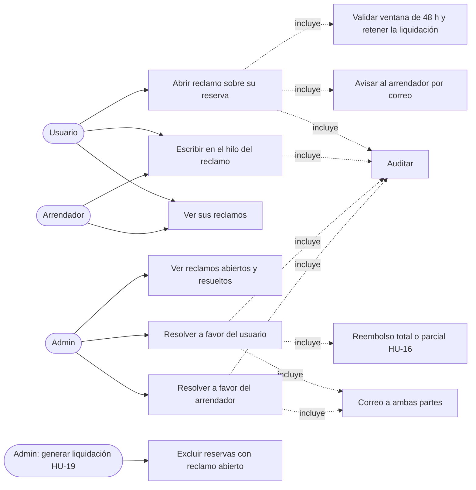
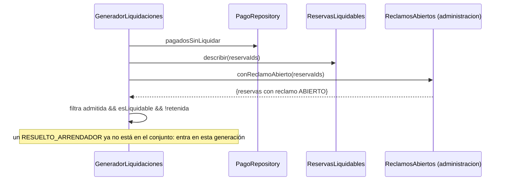

# HU-26 — Design: Reclamos sobre una reserva

> Requirements: `specs/HU-26/requirements.md` (R1–R70, decisiones P1–P15 y dos preguntas abiertas). Reutiliza HU-14
> (`ReservaDAO`, `ReservaConHorario`), HU-16 (Command de reembolso), HU-19 (bloqueo de generación, `ReglasLiquidacion`),
> HU-22 (`ParticipanteDatosPersonales`), HU-24 (`SanitizadorTexto`, interfaz angosta de `reservas`) y HU-25 (Factory
> Method de correo). Informe del código: `progress/explore_HU-26.md`. HU-26 no es ★: no introduce patrón del curso;
> aplica los existentes sin modificarlos.

## 1. Decisiones técnicas

| Id | Decisión | Por qué |
|----|----------|---------|
| DT-1 | Tablas `reclamo` y `mensaje_reclamo`, entidades, servicios y controladores en `administracion` (`feature_list.json`, principio 4). | La historia es de la épica F. `administracion → (todos)` está permitida, así que usa `reservas`, `pagos`, `espacios` y `cuentas` por sus interfaces públicas sin puertos nuevos, salvo el que pide `pagos` (DT-4). |
| DT-2 | `reservas` expone una **interfaz pública angosta nueva**, `reservas.service.ReservasParaReclamo` (no es un puerto). `delUsuario` y `confirmadasDe` leen con `ReservaDAO.delUsuario` y filtran en memoria (como `ReservasParaResenaImpl`); `describir(ids)` es una consulta del sistema por lote (como `ReservasLiquidablesImpl`), sin dueño. | `administracion` no puede leer `ReservaRepository` (principio 5). El DAO exige el dueño en la firma (HU-14): una reserva ajena no aparece (R9). Las partes ya se validaron con la fila de `reclamo` antes de llamar a `describir`. |
| DT-3 | `PagoService` gana tres métodos: `bloquearGeneracionLiquidaciones()` (`MANDATORY`, toma `pg_advisory_xact_lock(190019)`), `reservaLiquidada(reservaId)` (`MANDATORY`) y `reembolsarReclamo(ReembolsoPorReclamo)` (`MANDATORY`, gemelo de `reembolsarCancelacion`). | "Solo vía la interfaz del service" del otro módulo. El bloqueo no se expone como repositorio: `administracion` no conoce `LiquidacionRepository`. |
| DT-4 | **Puerto nuevo** `pagos.service.puertos.ReclamosAbiertos` (`Set<Long> conReclamoAbierto(Collection<Long> reservaIds)`), implementado por `administracion.service.impl.ReclamosAbiertosImpl`. `GeneradorLiquidaciones` lo usa como un filtro más en `liquidablesPorArrendador` (R20). | Ya está previsto en la tabla de puertos de `architecture.md` (RN-12): `pagos` está "abajo" de `administracion`, que ya lo usa (DT-3); sin el puerto habría un ciclo. Colección vacía → `Set.of()` sin consultar. |
| DT-5 | Ventana `inicio ≤ ahora < fin + 48 h` en una regla pura `administracion.domain.ReglasReclamo`, con `PLAZO = ReglasLiquidacion.ESPERA` (P2). | `architecture.md` (HU-19, "Lo que deben saber") pide la **misma** constante y el **mismo** fin para no dejar hueco ni solape con la liquidación. Bordes probados sin reloj real (`ReglasReclamoTest`). |
| DT-6 | **Carrera abrir ↔ generar (H3).** `abrir` toma `PagoService.bloquearGeneracionLiquidaciones()` y **después** lee `ahora`, evalúa la ventana y consulta `reservaLiquidada` (R21). | O el reclamo se confirma primero y la generación (que toma el mismo bloqueo y luego lee los reclamos) lo ve; o la generación se confirma primero, y entonces su corte es ≥ `fin + 48 h`, así que el `ahora` del reclamo, tomado después, cae fuera de la ventana (R7) o la reserva ya está en `liquidacion_detalle` (R8). |
| DT-7 | `ReclamoService.abrir` usa `TransactionTemplate` (sin `@Transactional`) y traduce la violación de `uq_reclamo_reserva`, reconocida por su nombre, a *ya reclamada* (R14). | Mismo patrón que `ResenaService.crear` (HU-24 DT-6) y `ReservaServiceImpl.crear`. Otra violación se relanza. |
| DT-8 | Mensajes y resolución bloquean la fila de `reclamo` (`ReclamoRepository.findParaActualizar`, `PESSIMISTIC_WRITE`) antes de leer su estado y contar mensajes (R29, R55). | Serializa dos mensajes de la misma parte (límite de 10) y un mensaje frente a la resolución; dos resoluciones a la vez: la segunda ve `RESUELTO_*`. |
| DT-9 | **Orden de bloqueos.** Abrir: `advisory 190019` → `INSERT reclamo` (sin filas bloqueadas). Mensaje: `reclamo`. Resolver: `reclamo` → `INSERT reembolso`; tras el commit, `RegistroReembolsos` toma `reembolso → pago` en `REQUIRES_NEW`. Generar (HU-19): `advisory 190019` → lee `reclamo` sin bloquear. | Nadie toma `reclamo` y después `advisory`, ni `pago` y después `reclamo`: sin ciclos. `PagoServiceImpl.reembolsarReclamo` no bloquea `pago` (igual que `reembolsarCancelacion`). |
| DT-10 | `Disparo.AUTOMATICO` para el primer intento del reembolso por reclamo. | Es el primer intento, automático tras el commit, igual que la cancelación; el admin queda como `solicitadoPor`. `ADMIN` en HU-16 significa *reintento desde el panel*. Un `FALLIDO` se reintenta en `/admin/reembolsos` sin cambios (HU-16 ya filtra todos los orígenes). |
| DT-11 | Estado del pago tras el reembolso por reclamo: `REEMBOLSADO` (total o parcial) o `REEMBOLSO_FALLIDO`, con `Pago.marcarReembolsado/marcarReembolsoFallido` de HU-16 sin cambios. Al resolver, el pago siempre está `PAGADO`: una reserva `CONFIRMADA` no tiene reembolso por cancelación y solo hay un reclamo por reserva. | Responde a "decide qué estado le deja" (`architecture.md`, Reembolsos). No hay estado "parcialmente reembolsado" y crearlo cambiaría HU-16, HU-19 y HU-28 (P7). |
| DT-12 | `TOTAL` lo calcula el servidor con el monto del pago `PAGADO` (`PagoService.pagosDeReservas`, HU-22); `PARCIAL` exige `0 < monto < pagado` con escala ≤ 2. `PagoServiceImpl.reembolsarReclamo` revalida `0 < monto ≤ pago.monto` (P6). | Principio 6: el cliente nunca decide el monto total; el parcial es una decisión explícita del admin que el servidor acota. |
| DT-13 | La reserva no cambia de estado al resolver (P8). | No hay columna para eso y HU-24 P10 asume `CONFIRMADA`. |
| DT-14 | El reclamo guarda `usuario_id` y `arrendador_id` (copiados al abrir; el arrendador sale de `CatalogoEspaciosService.arrendadoresDe`). | Las listas por parte y el control de propiedad (R25, R31) se resuelven en `reclamo` sin cruzar módulos en cada lectura. El arrendador de un espacio no cambia. Desviación del modelo de referencia anotada en P14. |
| DT-15 | Hilo de mensajes de ambas partes, 10 por parte, solo mientras `ABIERTO` (P1). La descripción no cuenta como mensaje. El admin no escribe en el hilo. | CA1 "el arrendador puede responder" y STRIDE R "registro de mensajes". Límite por parte para que ninguna agote el hilo de la otra (STRIDE D). Pregunta abierta 1. |
| DT-16 | Correos con Factory Method de HU-25 en `administracion/service/correo` (tres `record` `Correo` y tres `final … extends FabricaCorreo<…>`), enviados por un Client `AvisosReclamo` con un `DespuesDelCommit.ejecutar` **por correo**. Los correos de destino se leen con `CuentaService.correoDe` **dentro** de la transacción. | `architecture.md`, "Agregar un correo (HU-26, HU-27)". Un correo que falla no impide el otro ni revierte nada; con rollback no sale ninguno (R59). |
| DT-17 | `ReservaDTO` no se amplía (P11): `GET /api/reclamos/reclamables` devuelve los ids. | Igual que HU-24 P5: ampliarlo rompe aserciones de HU-12 y HU-14 y `reservas` no puede llamar a `administracion`. |
| DT-18 | Sanitizado al guardar con `comun.texto.SanitizadorTexto.limpiar`; un texto que queda vacío es 400 en su campo (R18, R19, R28, R52). | §8 de requerimientos: componente transversal ya construido por HU-24. |
| DT-19 | `exigirAdmin` se copia como método privado en `ReclamoAdminService`, como en los otros tres servicios del admin (H13). | Extraerlo es de HU-27 (comentario de HU-09); hacerlo aquí tocaría servicios de otras historias. |
| DT-20 | DTO de entrada con lectores estrictos propios (`SoloEnteroLargo`, `SoloTexto`, `SoloNumero`) en `administracion.dto.LectoresJson`. | Como `CrearResenaDTO`: un `"5"` o un número en un campo de texto se reportan en su campo y no como cuerpo ilegible. `administracion` no importa DTO de `busqueda`. |
| DT-21 | `@Valid` va antes del rol en `POST /api/reclamos` y en la resolución (orden de HU-24 DT-16). | La validación del cuerpo no lee nada. Las pruebas de 403 envían un cuerpo válido. |

## 2. Archivos

`M` = modificar, `N` = nuevo. Raíz backend: `2_Backend/src/main/java/pe/edu/ulima/espacioya/` (`J/`), pruebas
`2_Backend/src/test/java/pe/edu/ulima/espacioya/` (`T/`), recursos `2_Backend/src/main/resources/` (`R/`), frontend
`3_frontend/src/` (`F/`).

### `administracion`

| Archivo | | Qué |
|---------|---|-----|
| `R/db/migration/V8_1__reclamos.sql` | N | Tablas, restricciones e índices (§ 8). Número a coordinar con HU-27 y HU-28 (§ 16). |
| `J/administracion/domain/Reclamo.java` | N | Entidad (§ 7). |
| `J/administracion/domain/MensajeReclamo.java` | N | Entidad (§ 7). |
| `J/administracion/domain/EstadoReclamo.java` | N | `ABIERTO`, `RESUELTO_USUARIO`, `RESUELTO_ARRENDADOR`. |
| `J/administracion/domain/MotivoReclamo.java` | N | `ESPACIO_CERRADO`, `DISTINTO_A_LO_PUBLICADO`, `OTRO`. |
| `J/administracion/domain/PapelReclamo.java` | N | `USUARIO`, `ARRENDADOR` (también es el valor de `aFavorDe`). |
| `J/administracion/domain/TipoReembolsoReclamo.java` | N | `TOTAL`, `PARCIAL`. |
| `J/administracion/domain/MotivoNoReclamable.java` | N | `NO_RECLAMABLE`, `PLAZO_VENCIDO`. |
| `J/administracion/domain/ReglasReclamo.java` | N | Regla pura (DT-5). |
| `J/administracion/repository/ReclamoRepository.java` | N | Consultas (§ 7). |
| `J/administracion/repository/MensajeReclamoRepository.java` | N | Consultas (§ 7). |
| `J/administracion/dto/LectoresJson.java` | N | Lectores estrictos (DT-20). |
| `J/administracion/dto/CrearReclamoDTO.java` | N | Entrada de `POST /api/reclamos`. |
| `J/administracion/dto/NuevoMensajeDTO.java` | N | Entrada de `POST /api/reclamos/{id}/mensajes`. |
| `J/administracion/dto/ResolucionReclamoDTO.java` | N | Entrada de la resolución. |
| `J/administracion/dto/DetalleReclamoDTO.java` | N | Detalle para las partes (R2, R32). |
| `J/administracion/dto/DetalleReclamoAdminDTO.java` | N | Detalle para el admin (R37). |
| `J/administracion/dto/MensajeReclamoDTO.java` | N | `id`, `papel`, `texto`, `fecha`. |
| `J/administracion/dto/ReclamoResumenDTO.java` | N | Fila de las listas. |
| `J/administracion/dto/PaginaReclamosDTO.java` | N | `pagina`, `reclamos`, `hayMas`. |
| `J/administracion/dto/ReclamablesDTO.java` | N | `List<Long> reservaIds`. |
| `J/administracion/dto/ReclamoExportadoDTO.java` | N | Sección `reclamos` de HU-22. |
| `J/administracion/service/ReclamoService.java` | N | Casos de uso de las partes (§ 7). |
| `J/administracion/service/ReclamoAdminService.java` | N | Casos de uso del admin (§ 7). |
| `J/administracion/service/VistaReclamos.java` | N | Arma los DTO con la reserva descrita y los mensajes (compartida por los dos servicios). |
| `J/administracion/service/AvisosReclamo.java` | N | Client de los correos (DT-16). |
| `J/administracion/service/correo/DatosReclamoAbierto.java` | N | Evento: espacio, fecha, horario, motivo. |
| `J/administracion/service/correo/DatosResolucion.java` | N | Evento: espacio, fecha, horario, a favor, resolución, monto. |
| `J/administracion/service/correo/CorreoReclamoAbierto.java` + `FabricaReclamoAbierto.java` | N | ConcreteProduct / ConcreteCreator (arrendador). |
| `J/administracion/service/correo/CorreoResolucionUsuario.java` + `FabricaResolucionUsuario.java` | N | ConcreteProduct / ConcreteCreator (usuario). |
| `J/administracion/service/correo/CorreoResolucionArrendador.java` + `FabricaResolucionArrendador.java` | N | ConcreteProduct / ConcreteCreator (arrendador). |
| `J/administracion/service/impl/ReclamosAbiertosImpl.java` | N | Puerto de `pagos` (DT-4). |
| `J/administracion/service/impl/DatosPersonalesReclamosImpl.java` | N | Puerto de HU-22, `@Order(4)` (§ 11). |
| `J/administracion/controller/ConversionReclamos.java` | N | `idReclamo(String)` → `Long` o 404 (R25, R40); `pagina(String)`. |
| `J/administracion/controller/ReclamoController.java` | N | `/api/reclamos` (§ 4). |
| `J/administracion/controller/ReclamoAdminController.java` | N | `/api/admin/reclamos` (§ 4). |

### `reservas`

| Archivo | | Qué |
|---------|---|-----|
| `J/reservas/service/ReservasParaReclamo.java` | N | Interfaz pública angosta (DT-2). |
| `J/reservas/service/ReservaParaReclamo.java` | N | `record` que cruza a `administracion`. |
| `J/reservas/service/impl/ReservasParaReclamoImpl.java` | N | Implementación (DT-2). |

### `pagos`

| Archivo | | Qué |
|---------|---|-----|
| `J/pagos/service/PagoService.java` | M | Tres métodos (DT-3). |
| `J/pagos/service/ReembolsoPorReclamo.java` | N | `record(reservaId, monto, solicitadoPor, ip)`. |
| `J/pagos/service/impl/PagoServiceImpl.java` | M | Implementa los tres; extrae la parte común con `reembolsarCancelacion` en un método privado `reembolsar(origen, …)` sin cambiar su comportamiento. |
| `J/pagos/domain/Reembolso.java` | M | `+ static porReclamo(pagoId, monto, ahora)`. |
| `J/pagos/repository/LiquidacionDetalleRepository.java` | M | `+ boolean existsByReservaId(Long reservaId)`. |
| `J/pagos/service/puertos/ReclamosAbiertos.java` | N | Puerto (DT-4). |
| `J/pagos/service/GeneradorLiquidaciones.java` | M | Recibe `ReclamosAbiertos` y excluye las reservas con reclamo abierto (R20). |

### Frontend

| Archivo | | Qué |
|---------|---|-----|
| `F/api/administracion.js` | M | Funciones del § 12. |
| `F/components/ui/EtiquetaEstado.jsx` | M | Estados del reclamo (§ 12.6). |
| `F/pages/reservas/ReportarProblema.jsx` + `.module.css` | N | Botón y `Modal` en "Mis reservas" (no es del kit). |
| `F/pages/reservas/MisReservas.jsx` | M | Lee reclamables y agrega la acción. |
| `F/pages/administracion/MisReclamos.jsx` + `.module.css` | N | `/reclamos`. |
| `F/pages/administracion/DetalleReclamo.jsx` + `.module.css` | N | `/reclamos/:id` con el hilo. |
| `F/pages/administracion/HiloReclamo.jsx` + `.module.css` | N | Lista de mensajes (no es del kit; la usan las dos pantallas de detalle). |
| `F/pages/administracion/ReclamosAdmin.jsx` + `.module.css` | N | `/admin/reclamos`. |
| `F/pages/administracion/ResolverReclamo.jsx` + `.module.css` | N | `/admin/reclamos/:id`. |
| `F/pages/administracion/textosAdministracion.js` | M | Textos y etiquetas de motivo y estado. |
| `F/pages/cuentas/Panel.jsx` | M | Enlaces "Mis reclamos" (`USUARIO`), "Reclamos de mis reservas" (`ARRENDADOR`), "Reclamos" (`ADMIN`). |
| `F/pages/cuentas/DatosPersonales.jsx` | M | Impedimento `reclamos` con enlace a `/reclamos`. |
| `F/App.jsx` | M | Cuatro rutas con `RutaProtegida`. |

## 3. Caso de uso



## 4. Endpoints

| Método y ruta | Sesión | Entrada | Salida | Códigos |
|---------------|--------|---------|--------|---------|
| `POST /api/reclamos` | `USUARIO` | `CrearReclamoDTO` | `DetalleReclamoDTO` | 201; 400 (`reservaId`, `motivo`, `descripcion` o sin campo); 401; 403; 404 |
| `GET /api/reclamos/reclamables` | `USUARIO` | — | `ReclamablesDTO` | 200; 401; 403 |
| `GET /api/reclamos?pagina=n` | `USUARIO` o `ARRENDADOR` | `pagina` como texto | `PaginaReclamosDTO` | 200; 400 (`pagina`); 401; 403 |
| `GET /api/reclamos/{id}` | Parte | `id` como texto | `DetalleReclamoDTO` | 200; 401; 403 (`ADMIN`); 404 |
| `POST /api/reclamos/{id}/mensajes` | Parte | `NuevoMensajeDTO` | `MensajeReclamoDTO` | 201; 400 (`texto` o sin campo); 401; 403; 404 |
| `GET /api/admin/reclamos?grupo=abiertos\|resueltos&pagina=n` | `ADMIN` (IP + MFA) | texto | `PaginaReclamosDTO` | 200; 400 (`grupo`, `pagina`); 401; 403 |
| `GET /api/admin/reclamos/{id}` | `ADMIN` | `id` como texto | `DetalleReclamoAdminDTO` | 200; 401; 403; 404 |
| `POST /api/admin/reclamos/{id}/resolucion` | `ADMIN` | `ResolucionReclamoDTO` | `DetalleReclamoAdminDTO` | 200; 400 (`aFavorDe`, `reembolso`, `montoReembolso`, `resolucion` o sin campo); 401; 403; 404 |

- Todas las `GET` con `Cache-Control: no-store` (R41). Ninguna ruta lleva `usuarioId`: la identidad sale de
  `@AuthenticationPrincipal UsuarioAutenticado` y la IP de `IpCliente.de(peticion)`.
- `/api/reclamos/**` no se registra en `ConfiguracionSeguridad` (`anyRequest().authenticated()` la cubre);
  `/api/admin/reclamos/**` queda detrás de `FiltroIpsAdmin` por su prefijo.
- No hay `PUT`, `PATCH` ni `DELETE` (R30): Spring responde 405.
- Orden de validación de `POST /api/reclamos` (DT-21): `@Valid` (400) → rol (403) → sanitizar (400) → transacción:
  reserva propia (404) → *ya reclamada* (400) → bloqueo de generación → `ahora` → regla (400) → liquidada (400) →
  `saveAndFlush` → auditoría → correo tras el commit.
- Orden de la resolución: `@Valid` (400 `aFavorDe`, `resolucion`) → rol (403) → sanitizar (400) → transacción:
  `findParaActualizar` (404) → *ya resuelto* (400) → si `USUARIO`: `reembolso` (400) → monto pagado → `montoReembolso`
  (400) → `resolver…` → `reembolsarReclamo` → auditoría → correos tras el commit.
- Orden del mensaje: `@Valid` (400) → rol (`ADMIN` 403) → sanitizar (400) → transacción: `findParaActualizar` (404) →
  ¿es parte? (404) → *reclamo cerrado* (400) → *límite de mensajes* (400) → `save` → auditoría.

## 5. Diagramas de secuencia

**Flujo principal: abrir un reclamo (R1, R20–R22, R60).**

```mermaid
sequenceDiagram
  actor U as Usuario
  participant C as ReclamoController
  participant S as ReclamoService
  participant R as ReservasParaReclamo
  participant D as ReclamoRepository
  participant P as PagoService
  participant G as ReglasReclamo
  participant A as AuditoriaService
  participant K as CuentaService
  participant V as AvisosReclamo
  U->>C: POST /api/reclamos {reservaId, motivo, descripcion}
  C->>C: @Valid, IpCliente.de
  C->>S: abrir(usuario, datos, ip)
  S->>S: exigir rol USUARIO; SanitizadorTexto.limpiar
  S->>S: TransactionTemplate.execute
  S->>R: delUsuario(usuarioId, reservaId)
  R-->>S: ReservaParaReclamo(confirmada, inicioEn, finEn, arrendadorId, ...)
  S->>D: existsByReservaId(reservaId)
  D-->>S: false
  S->>P: bloquearGeneracionLiquidaciones()
  Note over P: pg_advisory_xact_lock(190019)
  S->>S: ahora = Instant.now(reloj)
  S->>G: motivoNoReclamable(confirmada, inicioEn, finEn, ahora)
  G-->>S: vacío
  S->>P: reservaLiquidada(reservaId)
  P-->>S: false
  S->>D: saveAndFlush(Reclamo.abrir(...))
  S->>A: registrar(RECLAMO_ABIERTO)
  S->>K: correoDe(arrendadorId)
  S->>V: reclamoAbierto(correo, DatosReclamoAbierto)
  Note over V: DespuesDelCommit.ejecutar(FabricaReclamoAbierto.enviar)
  S-->>C: DetalleReclamoDTO
  C-->>U: 201
```

**Flujo de error: la generación de liquidaciones gana la carrera (R7, R8, R21).**

```mermaid
sequenceDiagram
  actor AD as Admin
  participant GL as GeneradorLiquidaciones
  participant RA as ReclamosAbiertos
  participant PG as PostgreSQL
  actor U as Usuario
  participant S as ReclamoService
  participant P as PagoService
  AD->>GL: generar()
  GL->>PG: pg_advisory_xact_lock(190019)
  GL->>GL: corte = now (≥ fin + 48 h)
  U->>S: POST /api/reclamos (pasó delUsuario y existsByReservaId)
  S->>P: bloquearGeneracionLiquidaciones()
  P->>PG: pg_advisory_xact_lock(190019)
  Note over P,PG: espera
  GL->>RA: conReclamoAbierto(ids)
  RA-->>GL: {} (no hay reclamo)
  GL->>PG: INSERT liquidacion, liquidacion_detalle; COMMIT
  PG-->>P: bloqueo concedido
  S->>S: ahora (≥ corte ≥ fin + 48 h)
  S-->>U: 400 "El plazo para reclamar terminó..."
```

**Flujo principal: resolver a favor del usuario (R42–R45, R57, R58, R62).**

```mermaid
sequenceDiagram
  actor AD as Admin
  participant C as ReclamoAdminController
  participant S as ReclamoAdminService
  participant D as ReclamoRepository
  participant P as PagoService
  participant E as EjecutorReembolsos
  participant A as AuditoriaService
  participant V as AvisosReclamo
  AD->>C: POST /api/admin/reclamos/{id}/resolucion {aFavorDe: USUARIO, reembolso, montoReembolso, resolucion}
  C->>S: resolver(admin, id, datos, ip)
  S->>S: exigirAdmin; SanitizadorTexto.limpiar
  S->>D: findParaActualizar(id) (FOR UPDATE)
  D-->>S: Reclamo ABIERTO
  S->>P: pagosDeReservas([reservaId])
  P-->>S: pago PAGADO (monto pagado)
  S->>S: monto = TOTAL ? pagado : montoReembolso (0 < m < pagado)
  S->>D: reclamo.resolverAFavorDelUsuario(adminId, resolucion, monto, ahora)
  S->>P: reembolsarReclamo(ReembolsoPorReclamo(reservaId, monto, adminId, ip))
  P->>P: saveAndFlush(Reembolso.porReclamo) ; auditar REEMBOLSO_SOLICITADO
  P->>E: ejecutarDespuesDelCommit(SolicitudReembolso AUTOMATICO)
  S->>A: registrar(RECLAMO_RESUELTO)
  S->>V: reclamoResuelto(correoUsuario, correoArrendador, DatosResolucion)
  S-->>C: DetalleReclamoAdminDTO
  Note over E,V: tras el COMMIT: pasarela (HU-16) y dos correos
  C-->>AD: 200
```

**Flujo de la generación con un reclamo abierto (R20, R50).**



## 6. DTO y mensajes

```java
public record CrearReclamoDTO(
        @NotNull(message = M_RESERVA) @Positive(message = M_RESERVA)
        @JsonDeserialize(using = LectoresJson.SoloEnteroLargo.class) Long reservaId,
        @NotNull(message = M_MOTIVO) @Pattern(regexp = "ESPACIO_CERRADO|DISTINTO_A_LO_PUBLICADO|OTRO",
                message = M_MOTIVO) @JsonDeserialize(using = LectoresJson.SoloTexto.class) String motivo,
        @NotBlank(message = M_DESCRIPCION) @Size(max = 1000, message = M_DESCRIPCION)
        @JsonDeserialize(using = LectoresJson.SoloTexto.class) String descripcion) { }

public record NuevoMensajeDTO(
        @NotBlank(message = M_TEXTO) @Size(max = 1000, message = M_TEXTO)
        @JsonDeserialize(using = LectoresJson.SoloTexto.class) String texto) { }

public record ResolucionReclamoDTO(
        @NotNull(message = M_A_FAVOR) @Pattern(regexp = "USUARIO|ARRENDADOR", message = M_A_FAVOR)
        @JsonDeserialize(using = LectoresJson.SoloTexto.class) String aFavorDe,
        @JsonDeserialize(using = LectoresJson.SoloTexto.class) String reembolso,          // validado en el servicio
        @JsonDeserialize(using = LectoresJson.SoloNumero.class) BigDecimal montoReembolso, // validado en el servicio
        @NotBlank(message = M_RESOLUCION) @Size(max = 500, message = M_RESOLUCION)
        @JsonDeserialize(using = LectoresJson.SoloTexto.class) String resolucion) { }

public record MensajeReclamoDTO(Long id, String papel, String texto, Instant fecha) { }

public record DetalleReclamoDTO(Long id, Long reservaId, String espacioNombre, LocalDate fecha, int horaInicio,
        int horaFin, String motivo, String descripcion, String estado, Instant abiertoEn,
        List<MensajeReclamoDTO> mensajes, String aFavorDe, String resolucion, Instant resueltoEn,
        BigDecimal montoReembolso /* null para el arrendador (R32) */, String papel, int mensajesRestantes,
        boolean puedeEscribir) { }

public record DetalleReclamoAdminDTO(Long id, Long reservaId, String espacioNombre, LocalDate fecha, int horaInicio,
        int horaFin, String motivo, String descripcion, String estado, Instant abiertoEn,
        List<MensajeReclamoDTO> mensajes, String aFavorDe, String resolucion, Instant resueltoEn,
        BigDecimal montoReembolso, String usuarioNombre, String arrendadorNombre, BigDecimal montoPagado) { }

public record ReclamoResumenDTO(Long id, Long reservaId, String espacioNombre, LocalDate fecha, String motivo,
        String estado, Instant abiertoEn, Instant resueltoEn) { }
public record PaginaReclamosDTO(int pagina, List<ReclamoResumenDTO> reclamos, boolean hayMas) { }
public record ReclamablesDTO(List<Long> reservaIds) { }
public record ReclamoExportadoDTO(Long reservaId, String espacioNombre, String motivo, String estado,
        Instant abiertoEn, Instant resueltoEn, String aFavorDe, List<String> misTextos) { }
```

- `SoloNumero` devuelve el `BigDecimal` solo si el valor es un número JSON; un texto o un booleano se lee `null` (y con
  `PARCIAL` termina en *monto inválido*). Con `ARRENDADOR`, `reembolso` y `montoReembolso` se ignoran (R51).
- `aFavorDe` en las salidas: `USUARIO`, `ARRENDADOR` o `null` (`ABIERTO`), derivado del estado.
- `usuarioNombre` y `arrendadorNombre` salen de `CuentaService.nombres` (pueden ser `null`).

| Mensaje | Constante | Texto |
|---------|-----------|-------|
| *reserva inválida* | `CrearReclamoDTO.M_RESERVA` | Elige una reserva válida. |
| *motivo inválido* | `CrearReclamoDTO.M_MOTIVO` | Elige un motivo de la lista. |
| *descripción inválida* | `CrearReclamoDTO.M_DESCRIPCION` | Describe el problema en hasta 1000 caracteres. |
| *texto inválido* | `NuevoMensajeDTO.M_TEXTO` | Escribe un mensaje de hasta 1000 caracteres. |
| *a favor inválido* | `ResolucionReclamoDTO.M_A_FAVOR` | Elige a favor de quién se resuelve. |
| *resolución inválida* | `ResolucionReclamoDTO.M_RESOLUCION` | Escribe el motivo de la resolución en hasta 500 caracteres. |
| *reembolso inválido* | `ReclamoAdminService.MENSAJE_REEMBOLSO` | Elige reembolso total o parcial. |
| *monto inválido* | `ReclamoAdminService.MENSAJE_MONTO` | Escribe un monto mayor que 0 y menor que lo pagado, con hasta 2 decimales. |
| *grupo inválido* | `ReclamoAdminService.MENSAJE_GRUPO` | Elige reclamos abiertos o resueltos. |
| *página inválida* | `BusquedaService.MENSAJE_PAGINA_INVALIDA` (se reutiliza) | La página no es válida. |
| *no reclamable* | `ReclamoService.MENSAJE_NO_RECLAMABLE` | Solo puedes reclamar una reserva confirmada que ya empezó. |
| *plazo vencido* | `ReclamoService.MENSAJE_PLAZO_VENCIDO` | El plazo para reclamar terminó: es de 48 horas desde el fin de la reserva. |
| *ya reclamada* | `ReclamoService.MENSAJE_YA_RECLAMADA` | Ya abriste un reclamo para esta reserva. |
| *reclamo cerrado* | `ReclamoService.MENSAJE_RECLAMO_CERRADO` | Este reclamo ya se resolvió y no admite mensajes. |
| *límite de mensajes* | `ReclamoService.MENSAJE_LIMITE_MENSAJES` | Llegaste al máximo de 10 mensajes en este reclamo. |
| *ya resuelto* | `ReclamoAdminService.MENSAJE_YA_RESUELTO` | Este reclamo ya se resolvió. |
| *texto eliminado* | `Reclamo.TEXTO_ELIMINADO` | Texto eliminado. |
| *reclamo abierto* | `DatosPersonalesReclamosImpl.MENSAJE_RECLAMO_ABIERTO` | Tienes un reclamo abierto. Espera a que se resuelva antes de eliminar tu cuenta. |

**Correos** (asunto fijo; cuerpo en texto plano con `FormatoCorreo.fecha/horario/monto`; sin descripción, mensajes,
correo, teléfono ni tarjeta):

| Correo | Para | Asunto | Cuerpo |
|--------|------|--------|--------|
| `CorreoReclamoAbierto` | Arrendador | Recibiste un reclamo sobre una reserva | Espacio, fecha, horario, motivo (etiqueta en español). "Entra a EspacioYa, en Reclamos, para responder. El cobro de esta reserva queda retenido hasta que el reclamo se resuelva." |
| `CorreoResolucionUsuario` | Usuario | Resolvimos tu reclamo | Espacio, fecha, horario, "Resultado: a tu favor" o "a favor del arrendador", "Motivo: <resolución>" y, a su favor, "Solicitamos un reembolso de S/ X a tu medio de pago." |
| `CorreoResolucionArrendador` | Arrendador | Resolvimos un reclamo sobre tu espacio | Espacio, fecha, horario, "Resultado: a favor del usuario. Esta reserva no se liquidará." o "a tu favor. La reserva entra en la siguiente liquidación.", "Motivo: <resolución>". Sin monto (P12). |

## 7. Clases y firmas públicas

```java
// reservas.service — sin sesión ni rol: el llamador pasa el id de la sesión (DT-2).
public record ReservaParaReclamo(Long id, Long usuarioId, Long espacioId, String espacioNombre, Long arrendadorId,
        boolean confirmada, LocalDate fecha, int horaInicio, int horaFin, Instant inicioEn, Instant finEn) { }

public interface ReservasParaReclamo {
    /** @throws RecursoNoEncontradoException si no es una reserva de ese usuario. readOnly. */
    ReservaParaReclamo delUsuario(Long usuarioId, Long reservaId);
    /** Las de estado leído CONFIRMADA de ese usuario, cualquiera sea su horario. readOnly. */
    List<ReservaParaReclamo> confirmadasDe(Long usuarioId);
    /** Consulta del sistema por lote, sin dueño; vacía → List.of() sin consultar; sin bloques no aparece. readOnly. */
    List<ReservaParaReclamo> describir(Collection<Long> reservaIds);
}

// pagos.service
public record ReembolsoPorReclamo(Long reservaId, BigDecimal monto, Long solicitadoPor, String ip) { }

public interface PagoService {
    void reembolsarCancelacion(ReembolsoPorCancelacion solicitud);             // sin cambios
    List<PagoDeReserva> pagosDeReservas(Collection<Long> reservaIds);         // sin cambios
    /** MANDATORY. pg_advisory_xact_lock(190019): el mismo bloqueo que GeneradorLiquidaciones (HU-26 DT-6). */
    void bloquearGeneracionLiquidaciones();
    /** MANDATORY. true si la reserva ya está en liquidacion_detalle. */
    boolean reservaLiquidada(Long reservaId);
    /**
     * MANDATORY. Como reembolsarCancelacion, con origen RECLAMO: pago PAGADO (IllegalStateException si no hay),
     * 0 < monto ≤ pago.monto (IllegalArgumentException), sin otro reembolso RECLAMO del pago (IllegalStateException),
     * saveAndFlush(Reembolso.porReclamo), auditoría REEMBOLSO_SOLICITADO "origen=RECLAMO;reservaId=…;monto=…" y
     * EjecutorReembolsos.ejecutarDespuesDelCommit(solicitudes.crear(id, AUTOMATICO, solicitadoPor, ip)).
     */
    void reembolsarReclamo(ReembolsoPorReclamo solicitud);
}

// pagos.service.puertos — lo implementa administracion (DT-4).
public interface ReclamosAbiertos {
    /** Ids, de entre esos, con un reclamo ABIERTO. Vacía → Set.of() sin consultar. Se une a la transacción. */
    Set<Long> conReclamoAbierto(Collection<Long> reservaIds);
}

// pagos.domain.Reembolso
public static Reembolso porReclamo(Long pagoId, BigDecimal monto, Instant ahora);

// administracion.domain
public final class ReglasReclamo {
    public static final Duration PLAZO = ReglasLiquidacion.ESPERA;              // 48 h, DT-5
    public static final int MAXIMO_MENSAJES_POR_PARTE = 10;
    public static Optional<MotivoNoReclamable> motivoNoReclamable(boolean confirmada, Instant inicio, Instant fin,
                                                                  Instant ahora);
    // !confirmada o ahora < inicio → NO_RECLAMABLE; ahora ≥ fin + PLAZO → PLAZO_VENCIDO.
}

@Entity @Table(name = "reclamo")
public class Reclamo {
    public static final String TEXTO_ELIMINADO = "Texto eliminado.";
    protected Reclamo() { }
    public static Reclamo abrir(Long reservaId, Long usuarioId, Long arrendadorId, MotivoReclamo motivo,
                                String descripcion, Instant ahora);
    public boolean estaAbierto();
    public Optional<PapelReclamo> papelDe(Long usuarioId);       // USUARIO, ARRENDADOR o vacío
    public Optional<PapelReclamo> aFavorDe();                    // vacío si ABIERTO
    /** IllegalStateException si no está ABIERTO o monto ≤ 0. */
    public void resolverAFavorDelUsuario(Long adminId, String resolucion, BigDecimal monto, Instant ahora);
    /** IllegalStateException si no está ABIERTO. */
    public void resolverAFavorDelArrendador(Long adminId, String resolucion, Instant ahora);
    // getters; sin setters públicos
}

@Entity @Table(name = "mensaje_reclamo")
public class MensajeReclamo {
    protected MensajeReclamo() { }
    public static MensajeReclamo nuevo(Long reclamoId, Long autorId, PapelReclamo papel, String texto, Instant ahora);
    // getters
}

// administracion.repository
public interface ReclamoRepository extends JpaRepository<Reclamo, Long> {
    boolean existsByReservaId(Long reservaId);
    @Lock(LockModeType.PESSIMISTIC_WRITE) @Query("select r from Reclamo r where r.id = :id")
    Optional<Reclamo> findParaActualizar(@Param("id") Long id);
    Slice<Reclamo> findByUsuarioId(Long usuarioId, Pageable pagina);           // abiertoEn, id desc
    Slice<Reclamo> findByArrendadorId(Long arrendadorId, Pageable pagina);     // abiertoEn, id desc
    Slice<Reclamo> findByEstado(EstadoReclamo estado, Pageable pagina);        // abiertos: abiertoEn, id asc
    Slice<Reclamo> findByEstadoIn(Collection<EstadoReclamo> estados, Pageable pagina); // resueltoEn, id desc
    @Query("select r.reservaId from Reclamo r where r.reservaId in :ids")
    Set<Long> reservasConReclamo(@Param("ids") Collection<Long> reservaIds);
    @Query("select r.reservaId from Reclamo r where r.reservaId in :ids and r.estado = 'ABIERTO'")
    Set<Long> reservasConReclamoAbierto(@Param("ids") Collection<Long> reservaIds);
    List<Reclamo> findByUsuarioIdOrArrendadorIdOrderByAbiertoEnAscIdAsc(Long usuarioId, Long arrendadorId);
    @Query("select count(r) > 0 from Reclamo r where r.estado = 'ABIERTO' and (r.usuarioId = :id or r.arrendadorId = :id)")
    boolean existeAbiertoDe(@Param("id") Long usuarioId);
    @Modifying(flushAutomatically = true) @Query("update Reclamo r set r.descripcion = :texto where r.usuarioId = :id")
    int reemplazarDescripciones(@Param("id") Long usuarioId, @Param("texto") String texto);
}

public interface MensajeReclamoRepository extends JpaRepository<MensajeReclamo, Long> {
    List<MensajeReclamo> findByReclamoIdOrderByFechaAscIdAsc(Long reclamoId);
    long countByReclamoIdAndAutorId(Long reclamoId, Long autorId);
    List<MensajeReclamo> findByAutorIdOrderByFechaAscIdAsc(Long autorId);
    @Modifying(flushAutomatically = true) @Query("update MensajeReclamo m set m.texto = :texto where m.autorId = :id")
    int reemplazarTextos(@Param("id") Long autorId, @Param("texto") String texto);
}

// administracion.service
@Service
public class ReclamoService {
    public static final String ACCION_ABIERTO = "RECLAMO_ABIERTO";
    public static final String ACCION_MENSAJE = "RECLAMO_MENSAJE";
    public static final int TAMANO_PAGINA = 10;
    public DetalleReclamoDTO abrir(UsuarioAutenticado usuario, CrearReclamoDTO datos, String ip);   // TransactionTemplate
    @Transactional(readOnly = true) public ReclamablesDTO reclamables(UsuarioAutenticado usuario);
    @Transactional(readOnly = true) public PaginaReclamosDTO listar(UsuarioAutenticado parte, String pagina);
    @Transactional(readOnly = true) public DetalleReclamoDTO detalle(UsuarioAutenticado parte, Long reclamoId);
    @Transactional public MensajeReclamoDTO enviarMensaje(UsuarioAutenticado parte, Long reclamoId,
                                                         NuevoMensajeDTO datos, String ip);
}

@Service
public class ReclamoAdminService {
    public static final String ACCION_RESUELTO = "RECLAMO_RESUELTO";
    @Transactional(readOnly = true) public PaginaReclamosDTO listar(UsuarioAutenticado admin, String grupo, String pagina);
    @Transactional(readOnly = true) public DetalleReclamoAdminDTO detalle(UsuarioAutenticado admin, Long reclamoId);
    @Transactional public DetalleReclamoAdminDTO resolver(UsuarioAutenticado admin, Long reclamoId,
                                                         ResolucionReclamoDTO datos, String ip);
}

@Component
public class AvisosReclamo {                       // Client del Factory Method (DT-16)
    public AvisosReclamo(EnvioCorreo envio);
    public void reclamoAbierto(String correoArrendador, DatosReclamoAbierto datos);
    public void reclamoResuelto(String correoUsuario, String correoArrendador, DatosResolucion datos);
}

// administracion.service.correo
public record DatosReclamoAbierto(String espacio, LocalDate fecha, int horaInicio, int horaFin, MotivoReclamo motivo) { }
public record DatosResolucion(String espacio, LocalDate fecha, int horaInicio, int horaFin, PapelReclamo aFavorDe,
                              String resolucion, BigDecimal montoReembolso) { }
public final class FabricaReclamoAbierto extends FabricaCorreo<DatosReclamoAbierto> { … }
public final class FabricaResolucionUsuario extends FabricaCorreo<DatosResolucion> { … }
public final class FabricaResolucionArrendador extends FabricaCorreo<DatosResolucion> { … }
```

- `VistaReclamos` (`@Component`, de paquete público para los dos servicios) arma `DetalleReclamoDTO`,
  `DetalleReclamoAdminDTO` y `ReclamoResumenDTO` con `ReservasParaReclamo.describir` (una consulta por lote en las
  listas) y `MensajeReclamoRepository.findByReclamoIdOrderByFechaAscIdAsc`.
- Paginación: `Slice` con `PageRequest.of(n − 1, 10, orden)`; si `(n − 1) × 10` supera `Integer.MAX_VALUE`, se responde
  la página vacía sin consultar (como `ResenaService.deEspacio`).

## 8. Migración `V8_1__reclamos.sql`

```sql
-- HU-26: un reclamo por reserva y el hilo de mensajes de sus dos partes.
CREATE TABLE reclamo (
    id              BIGINT GENERATED ALWAYS AS IDENTITY PRIMARY KEY,
    reserva_id      BIGINT        NOT NULL,
    usuario_id      BIGINT        NOT NULL,
    arrendador_id   BIGINT        NOT NULL,
    motivo          VARCHAR(30)   NOT NULL,
    descripcion     VARCHAR(1000) NOT NULL,
    estado          VARCHAR(20)   NOT NULL,
    abierto_en      TIMESTAMPTZ   NOT NULL,
    resolucion      VARCHAR(500),
    resuelto_por    BIGINT,
    resuelto_en     TIMESTAMPTZ,
    monto_reembolso NUMERIC(10, 2),
    CONSTRAINT uq_reclamo_reserva UNIQUE (reserva_id),
    CONSTRAINT fk_reclamo_reserva FOREIGN KEY (reserva_id) REFERENCES reserva (id),
    CONSTRAINT fk_reclamo_usuario FOREIGN KEY (usuario_id) REFERENCES usuario (id),
    CONSTRAINT fk_reclamo_arrendador FOREIGN KEY (arrendador_id) REFERENCES usuario (id),
    CONSTRAINT fk_reclamo_resuelto_por FOREIGN KEY (resuelto_por) REFERENCES usuario (id),
    CONSTRAINT ck_reclamo_motivo CHECK (motivo IN ('ESPACIO_CERRADO', 'DISTINTO_A_LO_PUBLICADO', 'OTRO')),
    CONSTRAINT ck_reclamo_estado CHECK (estado IN ('ABIERTO', 'RESUELTO_USUARIO', 'RESUELTO_ARRENDADOR')),
    CONSTRAINT ck_reclamo_descripcion CHECK (char_length(btrim(descripcion)) >= 1),
    CONSTRAINT ck_reclamo_resolucion CHECK (
        (estado = 'ABIERTO' AND resolucion IS NULL AND resuelto_por IS NULL AND resuelto_en IS NULL
            AND monto_reembolso IS NULL)
        OR (estado = 'RESUELTO_USUARIO' AND char_length(btrim(resolucion)) >= 1 AND resuelto_por IS NOT NULL
            AND resuelto_en >= abierto_en AND monto_reembolso > 0)
        OR (estado = 'RESUELTO_ARRENDADOR' AND char_length(btrim(resolucion)) >= 1 AND resuelto_por IS NOT NULL
            AND resuelto_en >= abierto_en AND monto_reembolso IS NULL))
);
-- Cola del admin (abiertos por antigüedad) y lista de resueltos.
CREATE INDEX ix_reclamo_estado ON reclamo (estado, abierto_en, id);
CREATE INDEX ix_reclamo_resueltos ON reclamo (resuelto_en DESC, id DESC) WHERE estado <> 'ABIERTO';
-- "Mis reclamos" de cada parte, exportación e impedimentos de HU-22.
CREATE INDEX ix_reclamo_usuario ON reclamo (usuario_id, abierto_en DESC, id DESC);
CREATE INDEX ix_reclamo_arrendador ON reclamo (arrendador_id, abierto_en DESC, id DESC);

CREATE TABLE mensaje_reclamo (
    id          BIGINT GENERATED ALWAYS AS IDENTITY PRIMARY KEY,
    reclamo_id  BIGINT        NOT NULL,
    autor_id    BIGINT        NOT NULL,
    papel       VARCHAR(12)   NOT NULL,
    texto       VARCHAR(1000) NOT NULL,
    fecha       TIMESTAMPTZ   NOT NULL,
    CONSTRAINT fk_mensaje_reclamo_reclamo FOREIGN KEY (reclamo_id) REFERENCES reclamo (id),
    CONSTRAINT fk_mensaje_reclamo_autor FOREIGN KEY (autor_id) REFERENCES usuario (id),
    CONSTRAINT ck_mensaje_reclamo_papel CHECK (papel IN ('USUARIO', 'ARRENDADOR')),
    CONSTRAINT ck_mensaje_reclamo_texto CHECK (char_length(btrim(texto)) >= 1)
);
CREATE INDEX ix_mensaje_reclamo_reclamo ON mensaje_reclamo (reclamo_id, fecha, id);
CREATE INDEX ix_mensaje_reclamo_autor ON mensaje_reclamo (autor_id);
```

- Sin cascadas (R66): las IT borran `mensaje_reclamo` y `reclamo` antes que `reserva` y `usuario`, y `reembolso` antes
  que `pago` (como ya hace `PagosSoporte.limpiar`, que se amplía).
- `texto eliminado` cumple los `CHECK` de no vacío.
- `V8_1` depende solo de tablas de `V1_1` y `V3_3` (número menor): cumple la regla de `out-of-order`.

## 9. Excepciones (`comun/error/`)

Se reutilizan, sin agregar ninguna: `ReglaNegocioException` (400, con campo o sin él: *no reclamable*, *plazo
vencido*, *ya reclamada*, *reclamo cerrado*, *límite de mensajes*, *ya resuelto*, *reembolso inválido*, *monto
inválido*, *grupo inválido*, *página inválida*), `ValidacionException` / errores de `@Valid` (400 por campo),
`RecursoNoEncontradoException` (404 genérico), `AccesoDenegadoException` (403). `IllegalStateException` o
`IllegalArgumentException` de `PagoService` (pago inexistente, monto fuera de rango) son errores de programación: 500
genérico y rollback de la resolución.

## 10. Componentes de `comun` y de otros módulos reutilizados

| Componente | Uso |
|------------|-----|
| `comun.auditoria.AuditoriaService` | `RECLAMO_ABIERTO`, `RECLAMO_MENSAJE`, `RECLAMO_RESUELTO` (R60–R62); `REEMBOLSO_SOLICITADO` lo audita `PagoServiceImpl`. |
| `comun.texto.SanitizadorTexto` | Descripción, mensaje y resolución (R18). |
| `comun.correo.FabricaCorreo`, `Correo`, `EnvioCorreo`, `FormatoCorreo` | Correos (DT-16). |
| `comun.transaccion.DespuesDelCommit` | Un envío por correo tras el commit (R22, R57–R59). |
| `comun.seguridad.FiltroIpsAdmin`, `UsuarioAutenticado`; `comun.web.IpCliente` | Panel admin, sesión e IP. |
| `comun.configuracion.ZonaHoraria` | Inicio y fin en Lima (vía `ReservaConHorario`). |
| `cuentas.CuentaService.correoDe`, `nombres` | Destinatarios y nombres del detalle admin. |
| `espacios.CatalogoEspaciosService.nombres`, `arrendadoresDe` | Dentro de `ReservasParaReclamoImpl`. |
| `pagos` Command de HU-16 (`SolicitudesReembolso`, `EjecutorReembolsos`, `RegistroReembolsos`) | Sin cambios, vía `PagoService.reembolsarReclamo`. |
| `pagos.ReglasLiquidacion.ESPERA` | Plazo de 48 h (DT-5). |
| Rate limiting (`comun/limite`) | **No** se usa: "1 reclamo por reserva" es la restricción única (P15) y el límite de mensajes es una regla de negocio por parte (como el cupo de 3 pendientes de HU-12). |
| `comun/almacenamiento` | **No** se usa: sin fotos (simplificación de la historia). |

## 11. Datos personales (HU-22)

`DatosPersonalesReclamosImpl` (`@Component`, `@Order(4)`, en `administracion.service.impl`):

- `exportar(titular)` (`readOnly`): para `USUARIO` y `ARRENDADOR`, sección `reclamos` con
  `ReclamoRepository.findByUsuarioIdOrArrendadorIdOrderByAbiertoEnAscIdAsc(id, id)` y, por reclamo,
  `ReclamoExportadoDTO`; `misTextos` = la descripción si el titular lo abrió más sus mensajes
  (`findByAutorIdOrderByFechaAscIdAsc`, agrupados por reclamo). Nunca textos de la otra parte ni la resolución (R68).
  Otro rol → `List.of()`.
- `impedimentos(titular, ahora)` (`MANDATORY`): `existeAbiertoDe(id)` → `Impedimento("reclamos",
  MENSAJE_RECLAMO_ABIERTO)` (R69). No toma bloqueos (riesgo § 15).
- `anonimizar(titular)` (`MANDATORY`): `reemplazarDescripciones` y `reemplazarTextos` con `Reclamo.TEXTO_ELIMINADO`
  (R70). Conserva todo lo demás; `CUENTA_ELIMINADA` ya lo audita.

El doble de pruebas `ParticipanteQueFalla` (hoy `@Order(4)`, HU-24 DT-14) pasa a `@Order(5)`. El campo `reclamos` va
después de `reservas`, `liquidaciones` y `pagos` en el 400 de la eliminación.

## 12. Pantallas

Ninguna agrega componentes al kit ni colores. Se agregan los estados del reclamo a `EtiquetaEstado` (§ 12.6). Errores:
por campo bajo su `Campo`; 4xx/5xx sin campo en `Alerta error` con el mensaje tal cual; sin red, "No pudimos
conectar. Intenta de nuevo." (`docs/frontend.md`).

**`F/api/administracion.js`** (nuevas): `abrirReclamo({ reservaId, motivo, descripcion })` → `POST /api/reclamos`;
`listarReclamables()` → `GET /api/reclamos/reclamables`; `listarMisReclamos({ pagina })` → `GET /api/reclamos`;
`obtenerReclamo(id)` → `GET /api/reclamos/{id}`; `enviarMensajeReclamo(id, { texto })` → `POST
/api/reclamos/{id}/mensajes`; `listarReclamosAdmin({ grupo, pagina })` → `GET /api/admin/reclamos`;
`obtenerReclamoAdmin(id)` → `GET /api/admin/reclamos/{id}`; `resolverReclamo(id, { aFavorDe, reembolso,
montoReembolso, resolucion })` → `POST /api/admin/reclamos/{id}/resolucion`.

### 12.1 `/mis-reservas` — `pages/reservas/MisReservas.jsx` (CA1)

- Al montarse y con cada `recarga`, `listarReclamables()` → `Set` de ids (si falla, la lista funciona igual, sin el
  botón), como HU-24 hace con las reseñables.
- En **Próximas y Pasadas**, las reservas del `Set` llevan `ReportarProblema.jsx` (no es del kit) junto a la acción
  existente: `Boton secundario` "Reportar un problema" y `Modal primario` "Reportar un problema con tu reserva" con
  `Campo select` "Motivo" (Espacio cerrado / Distinto a lo publicado / Otro) y `Campo textarea` "Descripción" (ayuda:
  "Cuéntanos qué pasó. Hasta 1000 caracteres. No puedes adjuntar fotos."). "Enviar reclamo" (`cargando`) →
  `abrirReclamo`. Con 201: cierra el modal, `Alerta exito` "Abrimos tu reclamo. El arrendador puede responder y el
  equipo de EspacioYa lo resolverá." con enlace "Ver reclamo" a `/reclamos/:id`, y `recarga` sube (la reserva deja de
  ser reclamable). Errores de `motivo` y `descripcion` bajo su `Campo`; otro rechazo (400 *plazo vencido*, *ya
  reclamada*, 404) cierra el modal y va en `Alerta error` tal cual.

### 12.2 `/reclamos` — `pages/administracion/MisReclamos.jsx` (CA1, con `RutaProtegida`)

- Título "Mis reclamos" (`USUARIO`) o "Reclamos de mis reservas" (`ARRENDADOR`); `ADMIN` vuelve a `/panel` con
  `Navigate` (la API igual responde 403). Enlace desde `Panel`.
- `listarMisReclamos({ pagina })` de 10 en 10 con `Boton secundario` "Ver más" mientras `hayMas`, sin repetir ids. Cada
  reclamo es una `Tarjeta` con el espacio, `EtiquetaEstado`, fecha de la reserva, motivo y "Abierto el …", y enlace
  "Ver reclamo" → `/reclamos/:id`. Vacía: "Aún no tienes reclamos." / "No hay reclamos sobre tus reservas.".

### 12.3 `/reclamos/:id` — `pages/administracion/DetalleReclamo.jsx` (CA1, CA2, CA3, con `RutaProtegida`)

- `obtenerReclamo(id)`: `Tarjeta` con espacio, fecha, horario, motivo, `EtiquetaEstado`, descripción
  (`white-space: pre-line`) y "Abierto el …". Si está resuelto: "Resuelto a favor del usuario/arrendador", la
  resolución y, solo si la API trae `montoReembolso` (usuario), "Reembolso solicitado: S/ X" en negrita.
- `HiloReclamo.jsx` (no es del kit): mensajes en orden, cada uno con "Tú" si `papel` coincide con el `papel` de la
  respuesta, si no "Usuario"/"Arrendador", texto y `fechaHora`. Vacío: "Aún no hay mensajes.". Nunca
  `dangerouslySetInnerHTML`.
- Si `puedeEscribir`: `Campo textarea` "Tu mensaje" (ayuda "Te quedan N mensajes.") y el único `Boton primario`
  "Enviar mensaje" → `enviarMensajeReclamo`; con 201 limpia el campo y relee el detalle. Error de `texto` bajo el
  `Campo`; otro (400 *reclamo cerrado*, *límite*) en `Alerta error` y relee. Si no: texto secundario "Este reclamo ya
  se resolvió." o "Llegaste al máximo de mensajes.". 404: `Alerta error` tal cual.

### 12.4 `/admin/reclamos` — `pages/administracion/ReclamosAdmin.jsx` (CA2, CA3, con `RutaProtegida`)

- "Reclamos" (enlace desde `Panel` para `ADMIN`; otro rol vuelve a `/panel`). Dos secciones, "Abiertos" (el más
  antiguo primero) y "Resueltos", con `listarReclamosAdmin({ grupo, pagina })` y "Ver más" mientras `hayMas` (mismo
  patrón que `SeccionLiquidaciones`). `Tarjeta` por reclamo: espacio, "Reserva #N", `EtiquetaEstado`, motivo, fechas
  y "Ver reclamo" → `/admin/reclamos/:id`. Sin botón primario en la lista.

### 12.5 `/admin/reclamos/:id` — `pages/administracion/ResolverReclamo.jsx` (CA2, CA3, con `RutaProtegida`)

- `obtenerReclamoAdmin(id)`: datos de la reserva, usuario y arrendador (nombres o "Sin nombre"), "Monto pagado" en
  negrita, descripción, `HiloReclamo` (sin papel propio: "Usuario"/"Arrendador") y, si está resuelto, la resolución
  y el monto reembolsado.
- Solo con `ABIERTO`: formulario "Resolver reclamo" con `Campo select` "A favor de" (Usuario / Arrendador); con
  Usuario, `Campo select` "Reembolso" (Total / Parcial) y, con Parcial, `Campo tipo="number"` "Monto a reembolsar (S/)"
  (`step="0.01"`); `Campo textarea` "Motivo de la resolución". El único `Boton primario` "Resolver" abre el `Modal
  primario` "¿Resolver este reclamo?" que repite la decisión ("Se reembolsará el total pagado al usuario", "Se
  reembolsará S/ X al usuario" o "La reserva volverá a ser liquidable"); los textos no calculan montos: muestran el
  monto pagado y el escrito. Confirmar → `resolverReclamo` con `cargando`. 200: `Alerta exito` "Reclamo resuelto.
  Avisamos por correo al usuario y al arrendador." (y, a favor del usuario, "El reembolso se procesa en la pasarela;
  si falla, aparecerá en Reembolsos por atender."), y la pantalla muestra la respuesta. Errores de campo bajo su
  `Campo` (el modal se cierra); otro error (400 *ya resuelto*, 404) en `Alerta error` y relee.

### 12.6 Estados (`EtiquetaEstado` y `docs/frontend.md`)

| Estado | Color | Texto |
|--------|-------|-------|
| `ABIERTO` | Atención | Abierto |
| `RESUELTO_USUARIO` | Neutro | Resuelto a favor del usuario |
| `RESUELTO_ARRENDADOR` | Neutro | Resuelto a favor del arrendador |

Neutro y no éxito ni error: una resolución es un final normal, como `CANCELADA`.

### 12.7 Otros cambios

- `Panel.jsx`: "Mis reclamos" (`USUARIO`), "Reclamos de mis reservas" (`ARRENDADOR`), "Reclamos" (`ADMIN`).
- `DatosPersonales.jsx` (HU-22): el impedimento `reclamos` se lista con enlace a `/reclamos`.
- `App.jsx`: `/reclamos`, `/reclamos/:id`, `/admin/reclamos`, `/admin/reclamos/:id`, todas con `RutaProtegida`.

## 13. Puertos e interfaces nuevas (para `architecture.md`)

| Interfaz | Tipo | Justificación |
|----------|------|---------------|
| `pagos.service.puertos.ReclamosAbiertos` | Puerto (lo implementa `administracion`) | `pagos` necesita saber qué reservas están retenidas y `administracion` ya depende de `pagos` (DT-3): sin el puerto habría ciclo. Ya figura en la tabla de puertos; el implementer completa la columna "Para". |
| `reservas.service.ReservasParaReclamo` | Interfaz pública, no puerto | `administracion → reservas` está permitida. |
| `PagoService.bloquearGeneracionLiquidaciones`, `reservaLiquidada`, `reembolsarReclamo` | Métodos nuevos de una interfaz pública | `administracion → pagos` está permitida. |

## 14. Alternativas descartadas

| # | Alternativa | Por qué se descarta |
|---|-------------|---------------------|
| A1 | Ampliar `ReservaDTO` con `reclamable` y `estadoReclamo`. | Rompe aserciones que fijan sus 11 campos (HU-12, HU-14) y obliga a `reservas` a consultar `administracion` (ciclo o puerto nuevo). La ruta `reclamables` resuelve lo mismo (DT-17, como HU-24). |
| A2 | Retener la reserva con una columna `retenida` en `reserva` o en `pago`. | Duplica el estado del reclamo en otro módulo y exige mantenerlo sincronizado al resolver; el puerto `ReclamosAbiertos` ya estaba previsto por la arquitectura y lee la fuente de verdad. |
| A3 | Abrir el reclamo sin el bloqueo de generación y confiar en la ventana de 48 h. | Una transacción de apertura lenta podría confirmarse después de que una generación leyó los reclamos y liquidó la reserva (H3). El bloqueo cuesta una espera corta solo mientras se genera. |
| A4 | Una sola respuesta del arrendador, sin hilo. | Más simple, pero el usuario no puede replicar y "registro de mensajes" (STRIDE R) queda pobre. Es la alternativa si el PO la prefiere (pregunta abierta 1): cambia dos requirements y una pantalla. |
| A5 | El cliente envía el monto del reembolso total. | Viola el principio 6 (montos solo en el servidor). |
| A6 | Liquidar el remanente de un reembolso parcial. | Cambia `pagadosSinLiquidar`, el estado del pago y HU-28; fuera del alcance de HU-26 (P7, pregunta abierta 2). |
| A7 | Correos por `NotificadorCorreo` de `cuentas`. | La guía de HU-25 pide fábricas en el módulo dueño del evento; `NotificadorCorreo` crecería con eventos de otro módulo. |
| A8 | `LimitadorIntentos` para "1 reclamo por reserva". | La restricción única es más fuerte (no depende de la memoria ni de la IP) y es lo que pide el principio 7. |

## 15. Riesgos aceptados y efectos en pruebas existentes

- **Eliminación de cuenta concurrente (HU-22).** `impedimentos` no toma bloqueos: si el usuario abre un reclamo
  mientras su eliminación está en curso, el reclamo puede confirmarse después con su descripción. Ventana de
  milisegundos; mismo tipo de riesgo que "`pagadosSinLiquidar` es global" en HU-22.
- **Remanente de un parcial no se liquida** (P7) y el pago queda `REEMBOLSADO` aunque el reembolso sea parcial (DT-11).
- **Correo tras el commit en el hilo de la solicitud** (HU-25): hasta 5 s por correo si el proveedor cae.
- **Pruebas a actualizar:** `GeneradorLiquidacionesTest` y las IT de liquidaciones (constructor con `ReclamosAbiertos`;
  un doble que devuelve `Set.of()`); `PagoServiceImplTest` (constructor con `LiquidacionRepository` y
  `LiquidacionDetalleRepository`); las IT de exportación de HU-22 que fijan las secciones (se agrega `reclamos` para
  `USUARIO` y `ARRENDADOR`); `ParticipanteQueFalla` a `@Order(5)`; `PagosSoporte.limpiar` y los soportes de IT que borran
  `reserva`/`usuario` (borrar antes `mensaje_reclamo` y `reclamo`); `EtiquetaEstado` (lint).

## 16. Documentos que actualiza el implementer (mismo PR)

- `docs/architecture.md`: tabla de puertos (`ReclamosAbiertos`: firma y "Para"), `PagoService` (tres métodos),
  `ReservasParaReclamo`, sección nueva "Reclamos: qué deja HU-26" (rutas, orden de bloqueos DT-9, estados) y la nota de
  HU-19 sobre el filtro ya aplicado.
- `docs/modelo-datos.md`: columnas y restricciones de `reclamo` y `mensaje_reclamo` (P14); marcador "Texto eliminado."
  en la fila de cuenta `ELIMINADA`.
- `docs/frontend.md`: fila "Reclamo" de la tabla de estados (§ 12.6), `EtiquetaEstado` y las rutas del § 12.
- `docs/requerimientos.md` §9 punto 3: marcarlo resuelto **solo** si el PO confirmó la pregunta abierta 1.
- Número de migración: `V8_1` si sigue libre en `develop` al unir; si HU-27 o HU-28 lo tomaron antes, renombrar al
  siguiente `V8_n` libre (`docs/conventions.md`).
