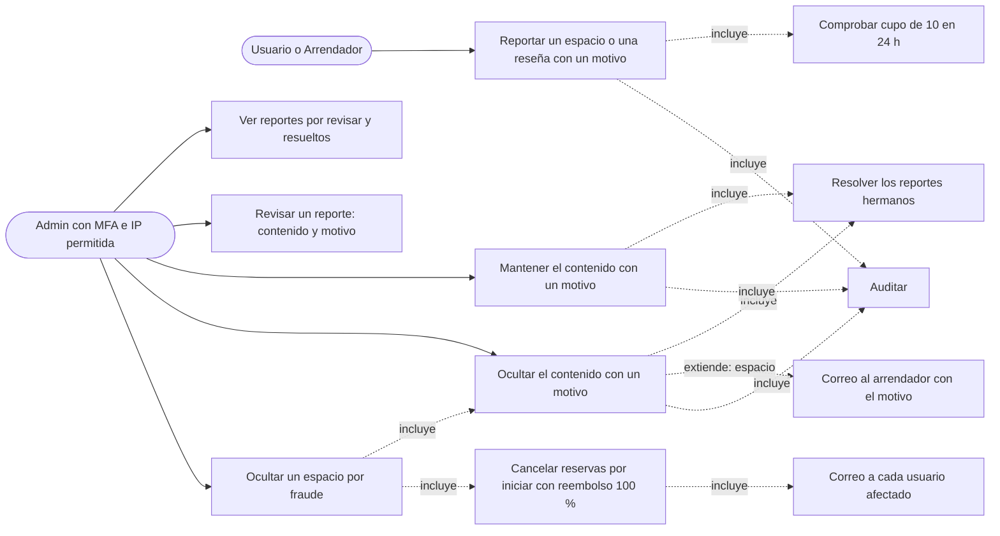

# HU-27 — Design: Reportes y moderación de publicaciones y reseñas

> Requirements: `specs/HU-27/requirements.md` (R1–R78, decisiones P1–P17; las dos preguntas abiertas ya las respondió el
> dueño el 2026-11-09: ocultar es definitivo y ocultar **por fraude** cancela y reembolsa las reservas por iniciar, ver
> DT-11 y DT-17 a DT-24). Para eso reutiliza además HU-15 (cancelación y Strategy de reembolso ★), HU-16 (reembolso con
> Command tras el commit) y HU-19 (`Reserva.admiteLiquidacion`). Reutiliza HU-09 y
> HU-17 (panel admin detrás de IPs permitidas + MFA), HU-21 (transiciones de estado del espacio con bloqueo de fila),
> HU-22 (`ParticipanteDatosPersonales`), HU-24 (`Resena`, `EstadoResena.OCULTA`, consultas que ya filtran `VISIBLE`),
> HU-25 (Factory Method de correo) y HU-26 (estructura del panel admin, `ConversionReclamos`, `VistaReclamos`,
> `LectoresJson`). Informe del código: `progress/explore_HU-27.md`. HU-27 no es ★.

## 1. Decisiones técnicas

| Id | Decisión | Por qué |
|----|----------|---------|
| DT-1 | Tabla `reporte`, entidad, servicios y controladores en `administracion` (`feature_list.json`). `espacios` y `busqueda` ganan **interfaces públicas nuevas** (`ModeracionEspacios`, `ModeracionResenas`), no puertos. | `administracion → (todos)` está permitida (`architecture.md`, Puertos). Principio 5: entre módulos solo la interfaz del service; `EstadoEspacioService` y `ResenaService` son clases concretas (YAGNI) y `architecture.md` ya prevé "HU-27 creará la interfaz pública [de `busqueda`] cuando `administracion` la necesite". |
| DT-2 | El cambio de estado del contenido vive en su módulo: `Espacio.ocultar` + `EstadoEspacioService.ocultarComoAdmin` (copia del patrón de `pausarComoAdmin`) y `Resena.ocultar` + `ModeracionResenasImpl.ocultar`. Cada uno audita su propia transición (`OCULTACION_ESPACIO`, `OCULTACION_RESENA`) y vuelve a exigir `ADMIN` (R62). | Las reglas de estado están en la entidad (`architecture.md`, HU-21). Como `CuentaService.aprobarIdentidad` (HU-06), un método que cambia estado a pedido del admin exige el rol aunque `administracion` ya lo haya comprobado. |
| DT-3 | Los dos `ocultar` son `@Transactional(propagation = MANDATORY)`: se unen a la transacción de `ReporteAdminService.decidir`. Si el contenido no es ocultable lanzan `ReglaNegocioException` y toda la decisión se revierte (R39, R40). | Ocultar el contenido y resolver los reportes es un solo hecho: o pasan los dos o ninguno (R33). |
| DT-4 | `reporte` usa `espacio_id` **o** `resena_id` (una sola, `CHECK`), con llaves foráneas, en vez de `objetivo_id` polimórfico (P15). | Principio 7: "llaves foráneas en todas las relaciones". Un `objetivo_id` sin FK permite reportes huérfanos. La API sigue con `tipoObjetivo` + `objetivoId`; la entidad expone `getObjetivoId()`. |
| DT-5 | Un reporte por reportante y contenido con dos **índices únicos parciales** (`uq_reporte_espacio`, `uq_reporte_resena`) y `ReporteService.reportar` con `TransactionTemplate`, que traduce la violación reconocida por el nombre del índice a *ya reportado* (R11, R12). | Mismo patrón que `ResenaService.crear` (HU-24 DT-6) y `ReclamoService.abrir` (HU-26 DT-7). Otra violación se relanza. |
| DT-6 | **Cupo 10/24 h en la base** (P5): dentro de la transacción, `CuentaService.bloquearCuenta(reportanteId)` (`MANDATORY`, `FOR UPDATE` sobre `usuario`) y luego `ReporteRepository.countByReportanteIdAndCreadoEnAfter(id, ahora − 24 h)`; con 10 o más, `DemasiadosIntentosException` (429). Se comprueba **antes** de mirar el contenido (R19). | Durable y exacto (no se pierde al reiniciar, no depende de la IP, no se comparte mal entre instancias). El bloqueo serializa dos reportes simultáneos del mismo usuario (R18), como el cupo de 3 pendientes de HU-12 (D4). `LimitadorIntentos` es por IP y en memoria (§8). |
| DT-7 | **Decidir** bloquea primero los reportes hermanos (`ReporteRepository.bloquearPorRevisar…`, `PESSIMISTIC_WRITE`, `order by id`) y **después** el contenido (`findParaReservar` del espacio o `findParaActualizar` de la reseña). El reporte decidido se lee antes sin bloqueo solo para saber su contenido (inmutable). | Dos admins que deciden dos reportes del mismo contenido toman las mismas filas en el mismo orden: el segundo espera y luego ve `MANTENIDO`/`OCULTADO` → *ya resuelto* (R42). Bloquear solo el reporte propio y luego actualizar los hermanos podía hacer un ciclo reporte A → espacio / reporte B → reporte A. |
| DT-8 | **Orden de bloqueos.** Reportar: `usuario` → `INSERT reporte`. Decidir: `reporte` (hermanos, por id) → `espacio` o `resena`. Nadie toma `espacio` o `resena` y después `reporte`. | Ninguna historia anterior bloquea `reporte`; `usuario → espacio` (HU-12, HU-22) y `reporte → espacio` no forman ciclo porque decidir no toma `usuario`. |
| DT-9 | Visibilidad **sin cambios** fuera de las entidades: la búsqueda, la ficha, las fotos públicas, la disponibilidad y la reserva ya exigen `PUBLICADO` (HU-09 D1, HU-21); las reseñas de la ficha y el promedio ya filtran `VISIBLE` (HU-24). | CA3 "deja de verse" se cumple con el cambio de estado (R35–R37). Las IT lo comprueban de punta a punta. |
| DT-10 | `Espacio.esOcultable()` = `PUBLICADO` o `PAUSADO`; `ocultar(Instant)` lanza `IllegalStateException` si no y fija `actualizado_en`. `OCULTO` queda fuera de `esEditable`, `esPausable`, `esReanudable` y `admiteBaja` (ya lo está): es final (P8, R38). | Mismo diseño que `darDeBaja` (HU-21). |
| DT-11 | `ModeracionEspacios.ocultar` **solo oculta**: no consulta `ReservasDelEspacio` ni cancela. Con `OCULTAR` nada más pasa (R46). Con `OCULTAR_POR_FRAUDE`, `ReporteAdminService.decidir` llama **después** a `reservas.service.CancelacionPorModeracion.cancelarPorFraude` en la misma transacción (DT-17). | Cambio de estado del espacio y cancelación de reservas viven cada uno en su módulo; quien orquesta es `administracion` (`administracion → (todos)`), como hoy con reportes + contenido. `espacios` no puede depender de `reservas` sino por su puerto. |
| DT-17 | **Ocultar por fraude** es una tercera decisión, `OCULTAR_POR_FRAUDE`, elegida por el admin y solo válida para reportes de espacio (R63, P17). Se guarda en `reporte.por_fraude` (columna `BOOLEAN`, `ck_reporte_fraude`) y la salida la deriva (R78). | El dueño pidió cancelar "si es fraude": lo decide quien revisa, no el reportante. Derivarlo del motivo `FRAUDE` del reporte fallaría con hermanos de motivos mixtos y con fraudes reportados como `INFORMACION_FALSA`. Un tercer valor de `decision` reutiliza `@Pattern` + `LectoresJson.SoloTexto` sin un lector booleano nuevo. |
| DT-18 | **Qué se cancela:** las reservas por iniciar del espacio (`CONFIRMADA` y `motivoNoCancelable(inicio, ahora)` vacío, la misma regla de HU-15). **No** se tocan: `CONFIRMADA` ya iniciada o terminada (vía de HU-26: reclamo desde el inicio), `PENDIENTE_PAGO` (con el espacio no visible no se puede iniciar el pago, HU-13 D6, y expira en 15 min; no hay transición de dominio para cancelarla), `EXPIRADA`, `CANCELADA` (R64, R65). | Reutiliza `Reserva.cancelar` sin relajar su regla; las ya iniciadas no se pueden "deshacer" y HU-26 ya da su reembolso con mediación del admin. |
| DT-19 | **Quién cancela:** `QuienCancela.ADMIN` (nuevo valor) + ConcreteStrategy `ReembolsoPorModeracion` (código `MODERACION`, 100 %, aplica solo a `ADMIN`) agregada a `CalculoReembolso.politicaFija()` (R67). `ck_reserva_cancelada_por` admite `ADMIN` (R74). | OCP del Strategy ★ de HU-15: agregar una regla es agregar una clase. Reutilizar `ARRENDADOR` (también 100 %) mentiría en la auditoría, en la exportación de HU-22 y en el correo al usuario ("Cancelada por: el arrendador"). |
| DT-20 | **Reembolso:** `PagoService.reembolsarCancelacion(new ReembolsoPorCancelacion(reservaId, montoTotal, adminId, ip))` por cada reserva, dentro de la transacción (`MANDATORY`): crea el reembolso `PENDIENTE`, audita `REEMBOLSO_SOLICITADO` y la pasarela se llama tras el commit con el Command de HU-16 (R66). Sin cambios en `pagos`. | Mismo mecanismo que HU-15; un fallo de la pasarela no revierte la cancelación y queda en la cola de reembolsos del admin (HU-16). |
| DT-21 | **Liquidación:** sin cambios en `pagos`. `Reserva.admiteLiquidacion` ya excluye toda `CANCELADA` que no sea del `USUARIO` con 0 % (HU-19 D3), así que una `CANCELADA` por `ADMIN` nunca se liquida (R68). Las reservas por iniciar no pueden estar en una liquidación (se liquidan 48 h después del fin). | El arrendador no cobra lo que se devolvió. Se agrega un test de dominio que lo fija para `ADMIN`. |
| DT-22 | **Correos:** a cada usuario, el aviso de cancelación existente (`NotificadorCorreo.notificarCancelacionAlUsuario` con `canceladaPor = "ADMIN"`, `QuienCancelo` → "EspacioYa") con `AvisosCancelacion.programarAlUsuario` (nuevo, un `DespuesDelCommit` por reserva). Al arrendador **no** se le envía un aviso por reserva: `CorreoEspacioOcultado` agrega el resumen (R47, R69, R70). | Reutiliza el ConcreteProduct de HU-15/HU-25; el arrendador fraudulento recibe un solo correo. El usuario no recibe el motivo de la decisión (no se acusa a nadie por correo). |
| DT-23 | **Atomicidad y bloqueos:** todo en la transacción de `decidir`. Orden: `reporte` (hermanos) → `espacio` (`ocultarComoAdmin`, `findParaReservar FOR UPDATE`) → `reserva` (`findConfirmadasParaActualizar(espacioId)`, `FOR UPDATE`, `order by id`) → `pago` (dentro de `reembolsarCancelacion`). Es el orden `espacio → reserva → pago` de HU-15/HU-13, precedido por `reporte`, que nadie más toma. Cualquier excepción revierte todo (R72, R73). | Una cancelación simultánea de HU-15 toma primero el mismo `espacio`: se serializan y la segunda ve `CANCELADA`. El webhook de HU-13 también toma `espacio → reserva`. |
| DT-24 | `CancelacionReservaService` rechaza `QuienCancela.ADMIN` con `AccesoDenegadoException` antes de leer (R77): sus `switch` agregan el caso `ADMIN`. | Las rutas de HU-15 fijan `USUARIO`/`ARRENDADOR`; sin esto, `exigirRol` aceptaría a un admin con `ADMIN`. Defensa en profundidad. |
| DT-12 | Correo con el Factory Method de HU-25 en `administracion.service.correo` (`DatosEspacioOcultado`, `CorreoEspacioOcultado`, `FabricaEspacioOcultado`) y un Client `AvisosModeracion` con `DespuesDelCommit.ejecutar`. El correo del arrendador se lee con `CuentaService.correoDe` **dentro** de la transacción. | Receta "Agregar un correo (HU-26, HU-27)" de `architecture.md`. Con rollback no sale (R48). |
| DT-13 | `comun.seguridad.RolesSesion.exigirAdmin(UsuarioAutenticado)` reemplaza las siete copias privadas de `exigirAdmin` (`RevisionIdentidadService`, `CuentaAdminService`, `ReclamoAdminService`, `EstadoEspacioService`, `CuentaServiceImpl`, `LiquidacionAdminService`, `ReembolsoAdminService`), con el mismo comportamiento: `null` o rol distinto de `ADMIN` → `AccesoDenegadoException` (P13). | HU-26 DT-19 lo dejó para HU-27. `comun` no depende de ningún módulo: compara con el texto `"ADMIN"`, como hoy. Las pruebas existentes de 403 lo cubren sin cambios. |
| DT-14 | Ids de ruta con `ConversionReportes.idReporte` (delega en `ConversionReclamos.idReclamo` de HU-26; mismo paquete `administracion.controller`) y página con `VistaReclamos.numeroDePagina`; DTO de entrada con `LectoresJson.SoloTexto` / `SoloEnteroLargo` de `administracion.dto`. | Reutilizar lo de HU-26 sin duplicar (un id mal escrito es el 404 genérico, R27; un `"5"` en `objetivoId` es error de campo, R14). |
| DT-15 | `@Valid` va antes del rol en `POST /api/reportes` y en la decisión (orden de HU-24 DT-16 y HU-26 DT-21). | La validación del cuerpo no lee nada. Las pruebas de 403 envían un cuerpo válido. |
| DT-16 | El admin no ve la identidad del reportante (P14) ni el correo del arrendador; ve el nombre del arrendador (`CuentaService.nombres`, "Sin nombre" en pantalla si falta). | RNF-SEG-16. El reportante queda en `reporte.reportante_id` y en la auditoría. |

## 2. Archivos

`M` = modificar, `N` = nuevo. Raíz backend: `2_Backend/src/main/java/pe/edu/ulima/espacioya/` (`J/`), pruebas
`2_Backend/src/test/java/pe/edu/ulima/espacioya/` (`T/`), recursos `2_Backend/src/main/resources/` (`R/`), frontend
`3_frontend/src/` (`F/`).

### `administracion`

| Archivo | | Qué |
|---------|---|-----|
| `R/db/migration/V8_2__reportes.sql` | N | Tabla, restricciones e índices (§ 8), incluido `por_fraude`, y el cambio de `ck_reserva_cancelada_por` (R74). Número a confirmar en `develop` al unir (§ 16). |
| `J/administracion/domain/Reporte.java` | N | Entidad (§ 7). |
| `J/administracion/domain/EstadoReporte.java` | N | `POR_REVISAR`, `MANTENIDO`, `OCULTADO`. |
| `J/administracion/domain/TipoObjetivoReporte.java` | N | `ESPACIO`, `RESENA`. |
| `J/administracion/domain/MotivoReporte.java` | N | `FRAUDE`, `INFORMACION_FALSA`, `CONTENIDO_INAPROPIADO`, `SPAM`. |
| `J/administracion/domain/DecisionReporte.java` | N | `MANTENER`, `OCULTAR`, `OCULTAR_POR_FRAUDE` (`oculta()`, `esFraude()`). |
| `J/administracion/domain/ReglasReporte.java` | N | `MAXIMO_POR_DIA = 10`, `VENTANA = Duration.ofHours(24)`, `inicioVentana(ahora)`. |
| `J/administracion/repository/ReporteRepository.java` | N | Consultas (§ 7). |
| `J/administracion/dto/CrearReporteDTO.java` | N | Entrada de `POST /api/reportes`. |
| `J/administracion/dto/ReporteCreadoDTO.java` | N | Salida 201 (R3). |
| `J/administracion/dto/DecisionReporteDTO.java` | N | Entrada de la decisión. |
| `J/administracion/dto/ReporteResumenDTO.java` | N | Fila de la cola (R20). |
| `J/administracion/dto/PaginaReportesDTO.java` | N | `pagina`, `reportes`, `hayMas`. |
| `J/administracion/dto/DetalleReporteAdminDTO.java` | N | Detalle (R24, R25). |
| `J/administracion/dto/EspacioReportadoDTO.java` | N | Contenido espacio del detalle. |
| `J/administracion/dto/ResenaReportadaDTO.java` | N | Contenido reseña del detalle. |
| `J/administracion/dto/ReporteExportadoDTO.java` | N | Sección `reportes` de HU-22. |
| `J/administracion/service/ReporteService.java` | N | Reportar (§ 7). |
| `J/administracion/service/ReporteAdminService.java` | N | Cola, detalle y decisión (§ 7). |
| `J/administracion/service/VistaReportes.java` | N | Arma resúmenes y detalle con `ModeracionEspacios.describir`, `ModeracionResenas.describir`, `CatalogoEspaciosService.nombres` y `CuentaService.nombres`, por lote. |
| `J/administracion/service/AvisosModeracion.java` | N | Client del correo (DT-12). |
| `J/administracion/service/correo/DatosEspacioOcultado.java` | N | Evento: `espacio`, `motivo`, `porFraude`, `reservasCanceladas`. |
| `J/administracion/service/correo/CorreoEspacioOcultado.java` + `FabricaEspacioOcultado.java` | N | ConcreteProduct / ConcreteCreator. |
| `J/administracion/service/impl/DatosPersonalesReportesImpl.java` | N | Puerto de HU-22, `@Order(5)` (§ 11). |
| `J/administracion/controller/ReporteController.java` | N | `POST /api/reportes`. |
| `J/administracion/controller/ReporteAdminController.java` | N | `/api/admin/reportes` (§ 4). |
| `J/administracion/controller/ConversionReportes.java` | N | `idReporte(String)` package-private; delega en `ConversionReclamos.idReclamo` de HU-26 (DT-14). |
| `J/administracion/service/RevisionIdentidadService.java`, `CuentaAdminService.java`, `ReclamoAdminService.java` | M | Usan `RolesSesion.exigirAdmin` (DT-13). |

### `espacios`

| Archivo | | Qué |
|---------|---|-----|
| `J/espacios/domain/Espacio.java` | M | `+ esOcultable()`, `+ ocultar(Instant)` (DT-10). |
| `J/espacios/service/ModeracionEspacios.java` | N | Interfaz pública (§ 7). |
| `J/espacios/service/EspacioReportable.java`, `EspacioModerado.java`, `EspacioOcultado.java` | N | `record` que cruzan a `administracion`. |
| `J/espacios/service/impl/ModeracionEspaciosImpl.java` | N | Implementación: `reportable` con `CatalogoEspaciosService.esVisible` + `EspacioRepository.findById`; `describir` con `findAllById`; `ocultar` delega en `EstadoEspacioService.ocultarComoAdmin`. |
| `J/espacios/service/EstadoEspacioService.java` | M | `+ ACCION_OCULTACION = "OCULTACION_ESPACIO"`, `+ MENSAJE_NO_OCULTABLE`, `+ ocultarComoAdmin(admin, id, ip)` (`MANDATORY`); usa `RolesSesion.exigirAdmin`. |

### `busqueda`

| Archivo | | Qué |
|---------|---|-----|
| `J/busqueda/domain/Resena.java` | M | `+ estaVisible()`, `+ ocultar()` (`IllegalStateException` si no está `VISIBLE`). |
| `J/busqueda/repository/ResenaRepository.java` | M | `+ findParaActualizar(id)` con `PESSIMISTIC_WRITE`. |
| `J/busqueda/service/ModeracionResenas.java` | N | Interfaz pública (§ 7). |
| `J/busqueda/service/ResenaReportable.java`, `ResenaModerada.java` | N | `record` que cruzan a `administracion`. |
| `J/busqueda/service/impl/ModeracionResenasImpl.java` | N | Implementación (§ 7). |
| `J/busqueda/service/ResenaService.java` | M | Solo el javadoc: la interfaz pública para `administracion` es `ModeracionResenas`. |

### `reservas` (ocultar por fraude, DT-17 a DT-24)

| Archivo | | Qué |
|---------|---|-----|
| `J/reservas/domain/QuienCancela.java` | M | `+ ADMIN` (`rolRequerido()` = `"ADMIN"`). |
| `J/reservas/domain/ReembolsoPorModeracion.java` | N | ConcreteStrategy: `CODIGO = "MODERACION"`, aplica solo a `ADMIN`, 100 % (R67). |
| `J/reservas/domain/CalculoReembolso.java` | M | `politicaFija()` agrega `new ReembolsoPorModeracion()`. |
| `J/reservas/repository/ReservaRepository.java` | M | `+ findConfirmadasParaActualizar(espacioId)` (`PESSIMISTIC_WRITE`, `order by id`). |
| `J/reservas/service/CancelacionPorModeracion.java` | N | Interfaz pública para `administracion` (§ 7). |
| `J/reservas/service/ReservasCanceladasPorModeracion.java` | N | `record` resultado: `cantidad`. |
| `J/reservas/service/impl/CancelacionPorModeracionImpl.java` | N | Implementación (§ 7). |
| `J/reservas/service/CancelacionReservaService.java` | M | Caso `ADMIN` en los `switch` y en `exigirRol` → `AccesoDenegadoException` (DT-24, R77). |
| `J/reservas/service/AvisosCancelacion.java` | M | `+ programarAlUsuario(usuarioId, espacioNombre, horario, quien, reembolso)` (solo el correo al usuario, DT-22). |

### `cuentas`, `pagos`, `comun`

| Archivo | | Qué |
|---------|---|-----|
| `J/comun/seguridad/RolesSesion.java` | N | `exigirAdmin` (DT-13). |
| `J/cuentas/service/impl/CuentaServiceImpl.java` | M | Usa `RolesSesion.exigirAdmin`. |
| `J/cuentas/service/correo/QuienCancelo.java` | M | `"ADMIN"` → `"EspacioYa"` (DT-22). |
| `J/pagos/service/LiquidacionAdminService.java`, `ReembolsoAdminService.java` | M | Usan `RolesSesion.exigirAdmin`. |
| `T/cuentas/controller/DatosPersonalesSoporte.java` | M | `ParticipanteQueFalla` pasa de `@Order(5)` a `@Order(6)`. |

### Frontend

| Archivo | | Qué |
|---------|---|-----|
| `F/api/administracion.js` | M | Cuatro funciones (§ 12). |
| `F/components/ui/EtiquetaEstado.jsx` | M | Estados de reseña y de reporte (§ 12.5). |
| `F/pages/busqueda/ReportarContenido.jsx` + `.module.css` | N | Botón y `Modal` de reporte (no es del kit). |
| `F/pages/busqueda/FichaEspacio.jsx` | M | "Reportar publicación" y pasa `puedeReportar` a `ResenasEspacio`. |
| `F/pages/busqueda/ResenasEspacio.jsx` | M | "Reportar reseña" en `acciones` de cada `Tarjeta`. |
| `F/pages/busqueda/textosFicha.js` | M | Textos del reporte y etiquetas de motivo. |
| `F/pages/administracion/ReportesAdmin.jsx` + `.module.css` | N | `/admin/reportes`. |
| `F/pages/administracion/RevisarReporte.jsx` + `.module.css` | N | `/admin/reportes/:id`. |
| `F/pages/administracion/textosAdministracion.js` | M | Textos del panel de moderación. |
| `F/pages/cuentas/Panel.jsx` | M | Enlace "Reportes" para `ADMIN`. |
| `F/App.jsx` | M | Dos rutas con `RutaProtegida`. |

## 3. Caso de uso



## 4. Endpoints

| Método y ruta | Sesión | Entrada | Salida | Códigos |
|---------------|--------|---------|--------|---------|
| `POST /api/reportes` | `USUARIO` o `ARRENDADOR` | `CrearReporteDTO` | `ReporteCreadoDTO` | 201; 400 (`tipoObjetivo`, `objetivoId`, `motivo` o sin campo: *contenido propio*, *ya reportado*); 401; 403 (`ADMIN`); 404; 429 |
| `GET /api/admin/reportes?grupo=pendientes\|resueltos&pagina=n` | `ADMIN` (IP + MFA) | texto | `PaginaReportesDTO` | 200; 400 (`grupo`, `pagina`); 401; 403 |
| `GET /api/admin/reportes/{id}` | `ADMIN` | `id` como texto | `DetalleReporteAdminDTO` | 200; 401; 403; 404 |
| `POST /api/admin/reportes/{id}/decision` | `ADMIN` | `DecisionReporteDTO` | `DetalleReporteAdminDTO` (con `reservasCanceladas`) | 200; 400 (`decision`: *decisión inválida*, *fraude solo en espacios*; `motivoDecision`; o sin campo: *ya resuelto*, *espacio no ocultable*, *reseña no ocultable*); 401; 403; 404 |

- Las `GET` con `Cache-Control: no-store` (R28); la decisión también (devuelve el detalle). La identidad sale de
  `@AuthenticationPrincipal UsuarioAutenticado` y la IP de `IpCliente.de(peticion)`.
- `POST /api/reportes` no se registra en `ConfiguracionSeguridad` (`anyRequest().authenticated()` la cubre, R6);
  `/api/admin/reportes/**` queda detrás de `FiltroIpsAdmin` por su prefijo (R29) y de `SesionService.validar`, que
  rechaza la sesión de un admin sin MFA (HU-17 DT-3, R30). No hace falta código nuevo para eso.
- No hay `PUT`, `PATCH` ni `DELETE` (R55): Spring responde 405.
- **Orden de `POST /api/reportes`** (DT-15, DT-6): `@Valid` (400) → rol (403) → `TransactionTemplate`:
  `bloquearCuenta` → cupo (429) → contenido reportable (404) → propio (400) → *ya reportado* (400) → `saveAndFlush` →
  auditoría `REPORTE_CREADO`. Violación de `uq_reporte_*` fuera de la transacción → 400 *ya reportado*.
- **Orden de la decisión** (DT-7): `@Valid` (400) → `RolesSesion.exigirAdmin` (403) → sanitizar el motivo (400) →
  transacción: `findById` (404) → `OCULTAR_POR_FRAUDE` sobre una reseña (400 *fraude solo en espacios*, R63) → bloquear
  hermanos por id → el reporte no está entre ellos (400 *ya resuelto*) → si `OCULTAR` u `OCULTAR_POR_FRAUDE`:
  `ModeracionEspacios.ocultar` o `ModeracionResenas.ocultar` (400 no ocultable) → si `OCULTAR_POR_FRAUDE`:
  `CancelacionPorModeracion.cancelarPorFraude(admin, espacioId, ip)` (bloquea reservas, cancela, reembolsa, audita y
  programa los correos a usuarios) → `Reporte.resolver` en cada hermano → auditoría `REPORTE_RESUELTO` (con
  `reservasCanceladas`) → si es un espacio oculto: `correoDe(arrendadorId)` y `AvisosModeracion.espacioOcultado` (tras
  el commit) → detalle con `reservasCanceladas`.

## 5. Diagramas de secuencia

**Flujo principal: reportar una reseña (R2, R3, R16–R19, R50).**

```mermaid
sequenceDiagram
  actor U as Usuario
  participant C as ReporteController
  participant S as ReporteService
  participant K as CuentaService
  participant D as ReporteRepository
  participant MR as ModeracionResenas
  participant A as AuditoriaService
  U->>C: POST /api/reportes {tipoObjetivo: RESENA, objetivoId, motivo}
  C->>C: @Valid, IpCliente.de
  C->>S: reportar(usuario, datos, ip)
  S->>S: rol USUARIO o ARRENDADOR (si no, 403)
  S->>S: TransactionTemplate.execute
  S->>K: bloquearCuenta(usuarioId)
  Note over K: SELECT ... FOR UPDATE usuario
  S->>D: countByReportanteIdAndCreadoEnAfter(usuarioId, ahora − 24 h)
  D-->>S: 3 (< 10)
  S->>MR: reportable(objetivoId)
  MR-->>S: ResenaReportable(id, autorId, espacioId)
  S->>S: autorId ≠ usuarioId
  S->>D: existsByReportanteIdAndResenaId(usuarioId, objetivoId)
  D-->>S: false
  S->>D: saveAndFlush(Reporte.deResena(...))
  S->>A: registrar(REPORTE_CREADO, "tipo=RESENA;objetivoId=..;motivo=SPAM")
  S-->>C: ReporteCreadoDTO
  C-->>U: 201
```

**Flujo de error: cupo agotado (R16, R19).**

```mermaid
sequenceDiagram
  actor U as Usuario
  participant S as ReporteService
  participant K as CuentaService
  participant D as ReporteRepository
  U->>S: POST /api/reportes (11.º en 24 h)
  S->>K: bloquearCuenta(usuarioId)
  S->>D: countByReportanteIdAndCreadoEnAfter(usuarioId, ahora − 24 h)
  D-->>S: 10
  S-->>U: 429 DemasiadosIntentosException (sin mirar el contenido; ROLLBACK, nada se audita)
```

**Flujo principal: ocultar un espacio (R32, R33, R42, R47, R51, R52).**

```mermaid
sequenceDiagram
  actor AD as Admin
  participant C as ReporteAdminController
  participant S as ReporteAdminService
  participant D as ReporteRepository
  participant ME as ModeracionEspacios
  participant EE as EstadoEspacioService
  participant A as AuditoriaService
  participant K as CuentaService
  participant V as AvisosModeracion
  AD->>C: POST /api/admin/reportes/{id}/decision {decision: OCULTAR, motivoDecision}
  C->>S: decidir(admin, id, datos, ip)
  S->>S: RolesSesion.exigirAdmin; SanitizadorTexto.limpiar
  S->>D: findById(id)
  D-->>S: Reporte(ESPACIO, espacioId)
  S->>D: bloquearPorRevisarDeEspacio(espacioId) (FOR UPDATE, order by id)
  D-->>S: [reporte id, hermanos]
  S->>ME: ocultar(admin, espacioId, ip)
  ME->>EE: ocultarComoAdmin(admin, espacioId, ip)
  EE->>EE: exigirAdmin; findParaReservar (FOR UPDATE); esOcultable; Espacio.ocultar
  EE->>A: registrar(OCULTACION_ESPACIO, "estado=PUBLICADO->OCULTO;actor=ADMIN;arrendadorId=..")
  ME-->>S: EspacioOcultado(id, arrendadorId, nombre)
  S->>S: cada hermano: Reporte.resolver(OCULTADO, adminId, motivo, ahora)
  S->>A: registrar(REPORTE_RESUELTO, "tipo=ESPACIO;objetivoId=..;decision=OCULTAR;reportes=3")
  S->>K: correoDe(arrendadorId)
  S->>V: espacioOcultado(correo, DatosEspacioOcultado(nombre, motivo))
  Note over V: DespuesDelCommit.ejecutar(FabricaEspacioOcultado.enviar)
  S-->>C: DetalleReporteAdminDTO
  C-->>AD: 200
```

**Flujo principal: ocultar un espacio por fraude (R32, R33, R47, R63–R73). ★ Strategy de HU-15 reutilizado.**

```mermaid
sequenceDiagram
  actor AD as Admin
  participant S as ReporteAdminService
  participant D as ReporteRepository
  participant ME as ModeracionEspacios
  participant CM as CancelacionPorModeracion
  participant RR as ReservaRepository
  participant CR as CalculoReembolso
  participant P as PagoService
  participant AC as AvisosCancelacion
  participant A as AuditoriaService
  participant V as AvisosModeracion
  AD->>S: decidir(admin, id, {decision: OCULTAR_POR_FRAUDE, motivoDecision}, ip)
  S->>D: findById(id) → Reporte(ESPACIO); bloquearPorRevisarDeEspacio (FOR UPDATE)
  S->>ME: ocultar(admin, espacioId, ip)
  Note over ME: espacio FOR UPDATE → OCULTO; audita OCULTACION_ESPACIO
  ME-->>S: EspacioOcultado(id, arrendadorId, nombre, estadoAnterior)
  S->>CM: cancelarPorFraude(admin, espacioId, ip)
  CM->>CM: RolesSesion.exigirAdmin; DisponibilidadService.bloquearEspacio (ya tomado)
  CM->>RR: findConfirmadasParaActualizar(espacioId) (FOR UPDATE, order by id)
  loop cada reserva por iniciar (motivoNoCancelable vacío)
    CM->>CR: calcular(SolicitudCancelacion(ADMIN, inicio, ahora, montoTotal))
    CR-->>CM: MODERACION, 100 %, montoTotal
    CM->>CM: Reserva.cancelar(ADMIN, …); bloques.desactivarDeReserva
    CM->>P: reembolsarCancelacion(reservaId, montoTotal, adminId, ip)
    Note over P: reembolso PENDIENTE + REEMBOLSO_SOLICITADO; pasarela tras el commit (HU-16)
    CM->>A: registrar(RESERVA_CANCELADA, "canceladaPor=ADMIN;…;politica=MODERACION;porcentaje=100;monto=…")
    CM->>AC: programarAlUsuario(usuarioId, nombre, horario, ADMIN, reembolso)
  end
  CM-->>S: ReservasCanceladasPorModeracion(n)
  S->>S: cada hermano: resolver(OCULTAR_POR_FRAUDE, …) → OCULTADO, por_fraude = true
  S->>A: registrar(REPORTE_RESUELTO, "…;decision=OCULTAR_POR_FRAUDE;reportes=k;reservasCanceladas=n")
  S->>V: espacioOcultado(correo, DatosEspacioOcultado(nombre, motivo, true, n))
  S-->>AD: 200 DetalleReporteAdminDTO (reservasCanceladas = n)
  Note over S,V: COMMIT → correos a usuarios y arrendador; Command de reembolso a la pasarela. Excepción antes → ROLLBACK total (R72)
```

**Flujo de error: dos admins deciden reportes del mismo espacio a la vez (R41, R42).**

```mermaid
sequenceDiagram
  actor A1 as Admin 1
  actor A2 as Admin 2
  participant S as ReporteAdminService
  participant PG as PostgreSQL
  A1->>S: decidir(reporte 7, OCULTAR)
  S->>PG: SELECT reportes POR_REVISAR del espacio FOR UPDATE order by id → [7, 9]
  A2->>S: decidir(reporte 9, MANTENER)
  S->>PG: SELECT reportes POR_REVISAR del espacio FOR UPDATE order by id
  Note over PG: espera a Admin 1
  S->>PG: espacio OCULTO; 7 y 9 OCULTADO; COMMIT
  PG-->>S: (Admin 2) [] — el 9 ya no está POR_REVISAR
  S-->>A2: 400 "Este reporte ya se resolvió."
```

## 6. DTO y mensajes

```java
public record CrearReporteDTO(
        @NotNull(message = M_TIPO) @Pattern(regexp = "ESPACIO|RESENA", message = M_TIPO)
        @JsonDeserialize(using = LectoresJson.SoloTexto.class) String tipoObjetivo,
        @NotNull(message = M_OBJETIVO) @Positive(message = M_OBJETIVO)
        @JsonDeserialize(using = LectoresJson.SoloEnteroLargo.class) Long objetivoId,
        @NotNull(message = M_MOTIVO)
        @Pattern(regexp = "FRAUDE|INFORMACION_FALSA|CONTENIDO_INAPROPIADO|SPAM", message = M_MOTIVO)
        @JsonDeserialize(using = LectoresJson.SoloTexto.class) String motivo) { }

public record ReporteCreadoDTO(Long id, String tipoObjetivo, Long objetivoId, String motivo, String estado,
        Instant creadoEn) { }

public record DecisionReporteDTO(
        @NotNull(message = M_DECISION)
        @Pattern(regexp = "MANTENER|OCULTAR|OCULTAR_POR_FRAUDE", message = M_DECISION)
        @JsonDeserialize(using = LectoresJson.SoloTexto.class) String decision,
        @NotBlank(message = M_MOTIVO_DECISION) @Size(max = 500, message = M_MOTIVO_DECISION)
        @JsonDeserialize(using = LectoresJson.SoloTexto.class) String motivoDecision) { }

public record ReporteResumenDTO(Long id, String tipoObjetivo, Long objetivoId, String espacioNombre, String motivo,
        String estado, Instant creadoEn, Instant resueltoEn) { }
public record PaginaReportesDTO(int pagina, List<ReporteResumenDTO> reportes, boolean hayMas) { }

public record EspacioReportadoDTO(String nombre, String tipo, String zona, String direccion, int capacidad,
        BigDecimal precioHora, String descripcion, String estado, String arrendadorNombre) { }
public record ResenaReportadaDTO(int calificacion, String comentario, LocalDate fecha, String estado, Long espacioId,
        String espacioNombre) { }

public record DetalleReporteAdminDTO(Long id, String tipoObjetivo, Long objetivoId, String motivo, String estado,
        Instant creadoEn, String decision /* MANTENER, OCULTAR, OCULTAR_POR_FRAUDE o null */, String motivoDecision,
        Instant resueltoEn, long reportesPendientes, EspacioReportadoDTO espacio /* null si es reseña */,
        ResenaReportadaDTO resena /* null si es espacio */,
        Integer reservasCanceladas /* solo en la respuesta de la decisión (R45); null en GET */) { }

public record ReporteExportadoDTO(String tipoObjetivo, Long objetivoId, String motivo, String estado,
        Instant creadoEn, Instant resueltoEn) { }
```

- `espacioNombre` del resumen: `CatalogoEspaciosService.nombres` sobre el `espacioId` del espacio o de la reseña (un
  lote por página); `arrendadorNombre` de `CuentaService.nombres` (puede ser `null`).
- `decision` en las salidas se deriva del estado: `MANTENIDO` → `MANTENER`, `OCULTADO` → `OCULTAR` u
  `OCULTAR_POR_FRAUDE` según `por_fraude` (R78), `POR_REVISAR` → `null`.
- `fecha` de la reseña: `creado_en` en `America/Lima`, como `ResenaPublicaDTO`.

| Mensaje | Constante | Texto |
|---------|-----------|-------|
| *tipo inválido* | `CrearReporteDTO.M_TIPO` | Elige si reportas un espacio o una reseña. |
| *contenido inválido* | `CrearReporteDTO.M_OBJETIVO` | Elige un contenido válido para reportar. |
| *motivo inválido* | `CrearReporteDTO.M_MOTIVO` | Elige un motivo de la lista. |
| *contenido propio* | `ReporteService.MENSAJE_CONTENIDO_PROPIO` | No puedes reportar tu propio contenido. |
| *ya reportado* | `ReporteService.MENSAJE_YA_REPORTADO` | Ya reportaste este contenido. Lo revisaremos pronto. |
| *decisión inválida* | `DecisionReporteDTO.M_DECISION` | Elige mantener u ocultar el contenido. |
| *motivo de decisión inválido* | `DecisionReporteDTO.M_MOTIVO_DECISION` | Escribe el motivo de la decisión en hasta 500 caracteres. |
| *ya resuelto* | `ReporteAdminService.MENSAJE_YA_RESUELTO` | Este reporte ya se resolvió. |
| *espacio no ocultable* | `EstadoEspacioService.MENSAJE_NO_OCULTABLE` | Solo puedes ocultar un espacio publicado o pausado. |
| *reseña no ocultable* | `ModeracionResenasImpl.MENSAJE_NO_OCULTABLE` | Esta reseña ya está oculta. |
| *fraude solo en espacios* | `ReporteAdminService.MENSAJE_FRAUDE_SOLO_ESPACIOS` | Solo puedes ocultar por fraude un espacio. Para una reseña, elige ocultar. |
| *grupo inválido* | `ReporteAdminService.MENSAJE_GRUPO` | Elige reportes por revisar o resueltos. |
| *página inválida* | `BusquedaService.MENSAJE_PAGINA_INVALIDA` (se reutiliza) | La página no es válida. |
| 429 | `ErrorDTO.MENSAJE_DEMASIADOS_INTENTOS` (se reutiliza) | (el genérico existente) |

**Correo** (asunto fijo; cuerpo en texto plano; sin motivo del reporte, reportante, correo ni teléfono):

| Correo | Para | Asunto | Cuerpo |
|--------|------|--------|--------|
| `CorreoEspacioOcultado` | Arrendador | Ocultamos tu espacio en EspacioYa | "Revisamos un reporte sobre tu espacio "<nombre>" y decidimos ocultarlo: ya no aparece en la búsqueda ni recibe reservas nuevas." / "Motivo: <motivo de la decisión>" / sin fraude: "Las reservas que ya estaban confirmadas se mantienen." / por fraude con n > 0: "Como lo ocultamos por fraude, cancelamos sus <n> reservas confirmadas que aún no empezaban y devolvimos el 100 % a quienes reservaron. Esas reservas no se incluirán en tus liquidaciones." / por fraude con n = 0: "Como lo ocultamos por fraude, no recibirá más reservas. No tenía reservas confirmadas por empezar." |
| `CorreoCancelacionUsuario` (HU-15, sin cambios salvo `QuienCancelo`) | Usuario de cada reserva cancelada | Tu reserva fue cancelada | El existente: espacio, fecha, horario, "Cancelada por: EspacioYa", "Reembolso: 100 % (<monto>)". Sin el motivo de la decisión ni la palabra "fraude". |

## 7. Clases y firmas públicas

```java
// comun.seguridad
public final class RolesSesion {
    /** null o rol distinto de ADMIN → AccesoDenegadoException (DT-13). */
    public static void exigirAdmin(UsuarioAutenticado sesion);
}

// espacios.domain.Espacio
public boolean esOcultable();                 // PUBLICADO o PAUSADO
public void ocultar(Instant ahora);           // IllegalStateException si !esOcultable(); estado OCULTO, actualizadoEn

// espacios.service — interfaz pública para administracion (no es un puerto). Sin sesión salvo ocultar.
public record EspacioReportable(Long id, Long arrendadorId) { }
public record EspacioModerado(Long id, Long arrendadorId, String nombre, String tipo, String zona, String direccion,
        int capacidad, BigDecimal precioHora, String descripcion, String estado) { }
public record EspacioOcultado(Long id, Long arrendadorId, String nombre, String estadoAnterior) { }

public interface ModeracionEspacios {
    /** readOnly. Vacío si null, inexistente o no visible (PUBLICADO y arrendador ACTIVA, como esVisible). */
    Optional<EspacioReportable> reportable(Long espacioId);
    /** readOnly. Cualquier estado; los que no existen no aparecen; vacía → Map.of() sin consultar. */
    Map<Long, EspacioModerado> describir(Collection<Long> espacioIds);
    /**
     * MANDATORY. Rol ADMIN (AccesoDenegadoException antes de leer) → findParaReservar (404) → esOcultable (400
     * MENSAJE_NO_OCULTABLE) → Espacio.ocultar → auditoría OCULTACION_ESPACIO. No mira reservas (DT-11).
     */
    EspacioOcultado ocultar(UsuarioAutenticado admin, Long espacioId, String ip);
}

// espacios.service.EstadoEspacioService (clase concreta, gana)
public static final String ACCION_OCULTACION = "OCULTACION_ESPACIO";
public static final String MENSAJE_NO_OCULTABLE = "Solo puedes ocultar un espacio publicado o pausado.";
@Transactional(propagation = Propagation.MANDATORY)
public EspacioOcultado ocultarComoAdmin(UsuarioAutenticado admin, Long id, String ip);

// busqueda.domain.Resena
public boolean estaVisible();
public void ocultar();                        // IllegalStateException si no está VISIBLE

// busqueda.repository.ResenaRepository
@Lock(LockModeType.PESSIMISTIC_WRITE) @Query("select r from Resena r where r.id = :id")
Optional<Resena> findParaActualizar(@Param("id") Long id);

// busqueda.service — interfaz pública para administracion (no es un puerto).
public record ResenaReportable(Long id, Long autorId, Long espacioId) { }
public record ResenaModerada(Long id, Long espacioId, int calificacion, String comentario, LocalDate fecha,
        String estado) { }

public interface ModeracionResenas {
    /** readOnly. Vacío si null, inexistente, OCULTA o de un espacio no visible (CatalogoEspaciosService.esVisible). */
    Optional<ResenaReportable> reportable(Long resenaId);
    /** readOnly. Cualquier estado; vacía → Map.of() sin consultar. */
    Map<Long, ResenaModerada> describir(Collection<Long> resenaIds);
    /**
     * MANDATORY. Rol ADMIN (antes de leer) → findParaActualizar (404) → estaVisible (400 MENSAJE_NO_OCULTABLE) →
     * Resena.ocultar → auditoría OCULTACION_RESENA "estado=VISIBLE->OCULTA;actor=ADMIN;espacioId=<id>".
     */
    void ocultar(UsuarioAutenticado admin, Long resenaId, String ip);
}

// administracion.domain
public final class ReglasReporte {
    public static final int MAXIMO_POR_DIA = 10;
    public static final Duration VENTANA = Duration.ofHours(24);
    public static Instant inicioVentana(Instant ahora);          // ahora − 24 h (exclusivo: creado_en > inicio)
}

@Entity @Table(name = "reporte")
public class Reporte {
    protected Reporte() { }
    public static Reporte deEspacio(Long reportanteId, Long espacioId, MotivoReporte motivo, Instant ahora);
    public static Reporte deResena(Long reportanteId, Long resenaId, MotivoReporte motivo, Instant ahora);
    public Long getObjetivoId();                                 // espacioId o resenaId según el tipo
    public boolean estaPorRevisar();
    public Optional<DecisionReporte> decision();                 // vacío si POR_REVISAR; OCULTAR_POR_FRAUDE si por_fraude
    public boolean isPorFraude();
    /**
     * IllegalStateException si no está POR_REVISAR o si OCULTAR_POR_FRAUDE en un reporte de reseña.
     * MANTENER → MANTENIDO; OCULTAR → OCULTADO; OCULTAR_POR_FRAUDE → OCULTADO con porFraude = true.
     */
    public void resolver(DecisionReporte decision, Long adminId, String motivoDecision, Instant ahora);
    // getters; sin setters públicos
}

// administracion.repository
public interface ReporteRepository extends JpaRepository<Reporte, Long> {
    long countByReportanteIdAndCreadoEnAfter(Long reportanteId, Instant desde);
    boolean existsByReportanteIdAndEspacioId(Long reportanteId, Long espacioId);
    boolean existsByReportanteIdAndResenaId(Long reportanteId, Long resenaId);
    @Lock(LockModeType.PESSIMISTIC_WRITE)
    @Query("select r from Reporte r where r.espacioId = :id and r.estado = 'POR_REVISAR' order by r.id")
    List<Reporte> bloquearPorRevisarDeEspacio(@Param("id") Long espacioId);
    @Lock(LockModeType.PESSIMISTIC_WRITE)
    @Query("select r from Reporte r where r.resenaId = :id and r.estado = 'POR_REVISAR' order by r.id")
    List<Reporte> bloquearPorRevisarDeResena(@Param("id") Long resenaId);
    long countByEspacioIdAndEstado(Long espacioId, EstadoReporte estado);
    long countByResenaIdAndEstado(Long resenaId, EstadoReporte estado);
    Slice<Reporte> findByEstado(EstadoReporte estado, Pageable pagina);                 // creadoEn, id asc
    Slice<Reporte> findByEstadoIn(Collection<EstadoReporte> estados, Pageable pagina);  // resueltoEn, id desc
    List<Reporte> findByReportanteIdOrderByCreadoEnAscIdAsc(Long reportanteId);
}

// administracion.service
@Service
public class ReporteService {
    public static final String ACCION_CREADO = "REPORTE_CREADO";
    public static final String ENTIDAD_REPORTE = "reporte";
    public static final String MENSAJE_CONTENIDO_PROPIO = "No puedes reportar tu propio contenido.";
    public static final String MENSAJE_YA_REPORTADO = "Ya reportaste este contenido. Lo revisaremos pronto.";
    public ReporteCreadoDTO reportar(UsuarioAutenticado reportante, CrearReporteDTO datos, String ip); // TransactionTemplate
}

@Service
public class ReporteAdminService {
    public static final String ACCION_RESUELTO = "REPORTE_RESUELTO";
    public static final String MENSAJE_FRAUDE_SOLO_ESPACIOS =
            "Solo puedes ocultar por fraude un espacio. Para una reseña, elige ocultar.";
    public static final int TAMANO_PAGINA = 10;
    public static final String GRUPO_PENDIENTES = "pendientes";
    public static final String GRUPO_RESUELTOS = "resueltos";
    @Transactional(readOnly = true) public PaginaReportesDTO listar(UsuarioAutenticado admin, String grupo, String pagina);
    @Transactional(readOnly = true) public DetalleReporteAdminDTO detalle(UsuarioAutenticado admin, Long reporteId);
    @Transactional public DetalleReporteAdminDTO decidir(UsuarioAutenticado admin, Long reporteId,
                                                         DecisionReporteDTO datos, String ip);
}

@Component
public class AvisosModeracion {                      // Client del Factory Method (DT-12)
    public AvisosModeracion(EnvioCorreo envio);
    public void espacioOcultado(String correoArrendador, DatosEspacioOcultado datos);  // DespuesDelCommit
}

// administracion.service.correo
public record DatosEspacioOcultado(String espacio, String motivo, boolean porFraude, int reservasCanceladas) { }
public record CorreoEspacioOcultado(DatosEspacioOcultado datos) implements Correo { … }
public final class FabricaEspacioOcultado extends FabricaCorreo<DatosEspacioOcultado> { … }

// reservas.domain (★ Strategy de HU-15: un ConcreteStrategy más, sin tocar el Client)
public enum QuienCancela { USUARIO, ARRENDADOR, ADMIN; public String rolRequerido(); }
public final class ReembolsoPorModeracion implements PoliticaReembolso {
    public static final String CODIGO = "MODERACION";
    public boolean aplicaA(SolicitudCancelacion s);   // s.quien() == ADMIN
    public int porcentaje();                          // 100
}
// CalculoReembolso.politicaFija(): USUARIO_CON_ANTICIPACION, USUARIO_SIN_ANTICIPACION, ARRENDADOR, MODERACION

// reservas.repository.ReservaRepository
@Lock(LockModeType.PESSIMISTIC_WRITE)
@Query("select r from Reserva r where r.espacioId = :espacioId "
        + "and r.estado = pe.edu.ulima.espacioya.reservas.domain.EstadoReserva.CONFIRMADA order by r.id")
List<Reserva> findConfirmadasParaActualizar(@Param("espacioId") Long espacioId);

// reservas.service — interfaz pública para administracion (no es un puerto: administracion → reservas está permitida)
public record ReservasCanceladasPorModeracion(int cantidad) { }

public interface CancelacionPorModeracion {
    /**
     * MANDATORY (se une a ReporteAdminService.decidir). RolesSesion.exigirAdmin antes de leer (R76) →
     * DisponibilidadService.bloquearEspacio(espacioId) (el llamador ya lo tiene: no espera) →
     * findConfirmadasParaActualizar (FOR UPDATE, id asc) → para cada una, con su horario y ahora tomados después del
     * bloqueo: si motivoNoCancelable(inicio, ahora) no está vacío, se omite (R65); si no, CalculoReembolso con
     * QuienCancela.ADMIN (100 %, R67) → Reserva.cancelar(ADMIN, inicio, monto, ahora) → bloques.desactivarDeReserva →
     * PagoService.reembolsarCancelacion(new ReembolsoPorCancelacion(id, monto, admin.usuarioId(), ip)) (R66) →
     * auditoría RESERVA_CANCELADA (R71) → AvisosCancelacion.programarAlUsuario (R69).
     * Cualquier excepción se propaga y revierte toda la decisión (R72).
     */
    ReservasCanceladasPorModeracion cancelarPorFraude(UsuarioAutenticado admin, Long espacioId, String ip);
}

// reservas.service.AvisosCancelacion (gana; programar de HU-15 no cambia)
/** Lee el correo del usuario en la transacción y envía solo notificarCancelacionAlUsuario tras el commit (DT-22). */
public void programarAlUsuario(Long usuarioId, String espacioNombre, ReservaConHorario horario, QuienCancela quien,
                               ReembolsoCalculado reembolso);
```

- `CancelacionPorModeracionImpl` (`@Service`, `reservas.service.impl`) reutiliza de `CancelacionReservaService` la
  forma de armar `ReservaConHorario` (`bloques.findByReservaIdOrderByHoraInicioAsc`) y el formato de auditoría;
  `ACCION_RESERVA_CANCELADA` y `ENTIDAD_RESERVA` se toman de `CancelacionReservaService` (la segunda pasa a `public`
  o se repite como constante privada con el mismo valor `"reserva"`). El nombre del espacio para el correo lo da
  `EspacioBloqueado.nombre()`.
- `CancelacionReservaService` (DT-24): `exigirRol` rechaza `QuienCancela.ADMIN` antes de comparar el rol; los `switch`
  de `vistaPrevia` y `esPropia` agregan `case ADMIN -> throw new AccesoDenegadoException()`.

- `ReporteService.reportar`: roles admitidos `USUARIO` y `ARRENDADOR`; cualquier otro (incluido `ADMIN`) → 403 antes de
  la transacción (R5). Dentro: `CuentaService.bloquearCuenta` → `countByReportanteIdAndCreadoEnAfter(id,
  ReglasReporte.inicioVentana(ahora)) >= MAXIMO_POR_DIA` → `DemasiadosIntentosException` → `reportable` del módulo que
  corresponda (`RecursoNoEncontradoException` si vacío) → propio → `exists…` → `saveAndFlush` → auditoría. El índice
  violado se reconoce por `uq_reporte_espacio` o `uq_reporte_resena` en el mensaje más específico (como HU-24).
- `ReporteAdminService.listar`: `RolesSesion.exigirAdmin` → `grupo` y `pagina` validados juntos con
  `ValidacionException` (orden `grupo`, `pagina`, como HU-26) → `PageRequest.of(n − 1, 10, orden)`; si el offset supera
  `Integer.MAX_VALUE`, página vacía sin consultar → `VistaReportes.resumenes`.
- `VistaReportes` (`@Component`): resúmenes con un `describir` por módulo y un `nombres` por página; detalle con
  `describir` del contenido, `countBy…AndEstado(…, POR_REVISAR)` y `CuentaService.nombres` del arrendador.

## 8. Migración `V8_2__reportes.sql`

```sql
-- HU-27: reportes de usuarios sobre un espacio o una reseña y la decisión del admin.
CREATE TABLE reporte (
    id              BIGINT GENERATED ALWAYS AS IDENTITY PRIMARY KEY,
    reportante_id   BIGINT       NOT NULL,
    tipo_objetivo   VARCHAR(10)  NOT NULL,
    espacio_id      BIGINT,
    resena_id       BIGINT,
    motivo          VARCHAR(30)  NOT NULL,
    estado          VARCHAR(12)  NOT NULL,
    creado_en       TIMESTAMPTZ  NOT NULL,
    admin_id        BIGINT,
    motivo_decision VARCHAR(500),
    resuelto_en     TIMESTAMPTZ,
    por_fraude      BOOLEAN      NOT NULL DEFAULT FALSE,
    CONSTRAINT fk_reporte_reportante FOREIGN KEY (reportante_id) REFERENCES usuario (id),
    CONSTRAINT fk_reporte_espacio FOREIGN KEY (espacio_id) REFERENCES espacio (id),
    CONSTRAINT fk_reporte_resena FOREIGN KEY (resena_id) REFERENCES resena (id),
    CONSTRAINT fk_reporte_admin FOREIGN KEY (admin_id) REFERENCES usuario (id),
    CONSTRAINT ck_reporte_tipo CHECK (tipo_objetivo IN ('ESPACIO', 'RESENA')),
    CONSTRAINT ck_reporte_objetivo CHECK (
        (tipo_objetivo = 'ESPACIO' AND espacio_id IS NOT NULL AND resena_id IS NULL)
        OR (tipo_objetivo = 'RESENA' AND resena_id IS NOT NULL AND espacio_id IS NULL)),
    CONSTRAINT ck_reporte_motivo CHECK (motivo IN ('FRAUDE', 'INFORMACION_FALSA', 'CONTENIDO_INAPROPIADO', 'SPAM')),
    CONSTRAINT ck_reporte_estado CHECK (estado IN ('POR_REVISAR', 'MANTENIDO', 'OCULTADO')),
    -- Los IS NOT NULL explícitos evitan que un NULL vuelva la expresión NULL y el CHECK la deje pasar (R57).
    CONSTRAINT ck_reporte_decision CHECK (
        (estado = 'POR_REVISAR' AND admin_id IS NULL AND motivo_decision IS NULL AND resuelto_en IS NULL)
        OR (estado IN ('MANTENIDO', 'OCULTADO') AND admin_id IS NOT NULL
            AND motivo_decision IS NOT NULL AND char_length(btrim(motivo_decision)) >= 1
            AND resuelto_en IS NOT NULL AND resuelto_en >= creado_en)),
    -- Ocultar por fraude solo existe para un espacio ocultado (P17, R75).
    CONSTRAINT ck_reporte_fraude CHECK (NOT por_fraude OR (estado = 'OCULTADO' AND tipo_objetivo = 'ESPACIO'))
);
-- Un reporte por persona y contenido, en cualquier estado (P4).
CREATE UNIQUE INDEX uq_reporte_espacio ON reporte (reportante_id, espacio_id) WHERE espacio_id IS NOT NULL;
CREATE UNIQUE INDEX uq_reporte_resena ON reporte (reportante_id, resena_id) WHERE resena_id IS NOT NULL;
-- Cupo de 10 en 24 h y exportación de HU-22.
CREATE INDEX ix_reporte_reportante ON reporte (reportante_id, creado_en);
-- Cola del admin: por revisar por antigüedad y resueltos recientes.
CREATE INDEX ix_reporte_por_revisar ON reporte (creado_en, id) WHERE estado = 'POR_REVISAR';
CREATE INDEX ix_reporte_resueltos ON reporte (resuelto_en DESC, id DESC) WHERE estado <> 'POR_REVISAR';
-- Reportes hermanos de un contenido.
CREATE INDEX ix_reporte_espacio_estado ON reporte (espacio_id, estado) WHERE espacio_id IS NOT NULL;
CREATE INDEX ix_reporte_resena_estado ON reporte (resena_id, estado) WHERE resena_id IS NOT NULL;

-- Ocultar por fraude cancela reservas como ADMIN (R74). ck_reserva_cancelacion (V4_2) no cambia.
ALTER TABLE reserva DROP CONSTRAINT ck_reserva_cancelada_por;
ALTER TABLE reserva ADD CONSTRAINT ck_reserva_cancelada_por
    CHECK (cancelada_por IS NULL OR cancelada_por IN ('USUARIO', 'ARRENDADOR', 'ADMIN'));
-- Reservas confirmadas de un espacio (findConfirmadasParaActualizar); hoy no hay índice por espacio_id en reserva.
CREATE INDEX ix_reserva_espacio_confirmada ON reserva (espacio_id, id) WHERE estado = 'CONFIRMADA';
```

- Ninguna fila existente tiene `ADMIN`: el `ADD CONSTRAINT` valida sin problema. `V4_2` no se edita (Flyway).

- Sin cambios en `espacio` ni `resena`: `ck_espacio_estado` ya admite `OCULTO` (`V2_2`) y `ck_resena_estado` ya admite
  `OCULTA` (`V7_2`). La fecha del ocultamiento queda en `actualizado_en` (espacio), en `reporte.resuelto_en` y en la
  auditoría.
- Sin cascadas (R58): toda IT que cree reportes borra `reporte` antes que `resena`, `espacio` y `usuario`.
- `V8_2` solo depende de `V1_1`, `V2_2`, `V3_3`, `V4_2` y `V7_2` (números menores): cumple la regla de `out-of-order`.

## 9. Excepciones (`comun/error/`)

Se reutilizan, sin agregar ninguna: `ReglaNegocioException` (400, con campo o sin él: *contenido propio*, *ya
reportado*, *ya resuelto*, *espacio no ocultable*, *reseña no ocultable*, *motivo de decisión inválido* tras sanitizar),
`ValidacionException` / errores de `@Valid` (400 por campo: `tipoObjetivo`, `objetivoId`, `motivo`, `decision`,
`motivoDecision`, `grupo`, `pagina`; `ReglaNegocioException("decision", MENSAJE_FRAUDE_SOLO_ESPACIOS)` para R63),
`RecursoNoEncontradoException` (404 genérico), `AccesoDenegadoException` (403) y `DemasiadosIntentosException` (429
genérico). Un `IllegalStateException` de `Espacio.ocultar`, `Resena.ocultar`, `Reporte.resolver`, `Reserva.cancelar`
o de `PagoService.reembolsarCancelacion` (reserva `CONFIRMADA` sin pago `PAGADO`, dato inconsistente) solo ocurre por
un error de programación o de datos: 500 genérico y rollback de toda la decisión (R72).

## 10. Componentes de `comun` y de otros módulos reutilizados

| Componente | Uso |
|------------|-----|
| `comun.auditoria.AuditoriaService` | `REPORTE_CREADO`, `REPORTE_RESUELTO` (administracion), `OCULTACION_ESPACIO` (espacios), `OCULTACION_RESENA` (busqueda) (R50–R53). |
| `comun.seguridad.FiltroIpsAdmin`, `SesionService.validar` (HU-17) | IPs permitidas y MFA del admin, sin código nuevo (R29, R30). |
| `comun.seguridad.RolesSesion` (nuevo) | Rol `ADMIN` en los servicios (DT-13). |
| `comun.texto.SanitizadorTexto` | Motivo de la decisión (R44). |
| `comun.correo.FabricaCorreo`, `Correo`, `EnvioCorreo`; `comun.transaccion.DespuesDelCommit` | Correo al arrendador (DT-12). |
| `comun.error.DemasiadosIntentosException` | 429 del cupo (R16). |
| `comun.web.IpCliente`, `comun.seguridad.UsuarioAutenticado` | IP y sesión. |
| `cuentas.CuentaService.bloquearCuenta`, `correoDe`, `nombres` | Cupo serializado, destinatario, nombre del arrendador. |
| `espacios.CatalogoEspaciosService.esVisible`, `nombres` | `reportable` del espacio y de la reseña; nombre del espacio en la cola. |
| `administracion`: `ConversionReportes.idReporte` (delega en `ConversionReclamos.idReclamo`), `VistaReclamos.numeroDePagina`, `LectoresJson` | Id de ruta, página y lectores estrictos (DT-14). |
| `busqueda.BusquedaService.CAMPO_PAGINA`, `MENSAJE_PAGINA_INVALIDA` | Página inválida. |
| `comun/limite` (`LimitadorIntentos`, `ReglaLimite`) | **No** se usa (P5, P16). |
| `reservas`: `Reserva.motivoNoCancelable`, `Reserva.cancelar`, `CalculoReembolso` (★ Strategy HU-15), `ReservaBloqueRepository.desactivarDeReserva`, `AvisosCancelacion` | Cancelación por fraude con la misma regla, política nueva `MODERACION` y correo al usuario (R64–R69). |
| `espacios.DisponibilidadService.bloquearEspacio` | Orden `espacio → reserva` (R73). |
| `pagos.PagoService.reembolsarCancelacion` + Command de HU-16 | Reembolso 100 % tras el commit (R66). |
| `Reserva.admiteLiquidacion` (HU-19 D3) | Excluye de la liquidación lo cancelado por `ADMIN` sin cambios en `pagos` (R68). |
| `cuentas.NotificadorCorreo.notificarCancelacionAlUsuario` + `CorreoCancelacionUsuario` (HU-15/HU-25) | Aviso al usuario (R69). |

## 11. Datos personales (HU-22)

`DatosPersonalesReportesImpl` (`@Component`, `@Order(5)`, en `administracion.service.impl`):

- `exportar(titular)` (`readOnly`): para `USUARIO` y `ARRENDADOR`, sección `reportes` con
  `findByReportanteIdOrderByCreadoEnAscIdAsc(id)` → `ReporteExportadoDTO` (sin `motivoDecision` ni admin, R59). Otro
  rol → `List.of()`.
- `impedimentos(titular, ahora)` (`MANDATORY`): `List.of()` (R60).
- `anonimizar(titular)` (`MANDATORY`): no cambia nada (R61): los reportes no guardan texto libre del reportante y
  `CUENTA_ELIMINADA` ya lo audita.

El doble de pruebas `ParticipanteQueFalla` pasa de `@Order(5)` a `@Order(6)`. Las IT de exportación de HU-22 que fijan
las secciones agregan `reportes` para `USUARIO` y `ARRENDADOR`.

## 12. Pantallas

No se agregan componentes al kit ni colores. Se agregan estados a `EtiquetaEstado` (§ 12.5). Errores: por campo bajo
su `Campo`; 4xx/5xx sin campo en `Alerta error` con el mensaje tal cual; sin red, "No pudimos conectar. Intenta de
nuevo." (`docs/frontend.md`).

**`F/api/administracion.js`** (nuevas): `reportarContenido({ tipoObjetivo, objetivoId, motivo })` → `POST
/api/reportes`; `listarReportesAdmin({ grupo, pagina })` → `GET /api/admin/reportes`; `obtenerReporteAdmin(id)` → `GET
/api/admin/reportes/{id}`; `decidirReporte(id, { decision, motivoDecision })` → `POST
/api/admin/reportes/{id}/decision`.

### 12.1 `/espacios/:id` — `pages/busqueda/FichaEspacio.jsx` (CA1)

- `puedeReportar = sesion && (sesion.rol === 'USUARIO' || sesion.rol === 'ARRENDADOR')`. Un visitante y un `ADMIN` no
  ven el botón (la API igual responde 401/403). El rol solo elige qué mostrar.
- Debajo de la política de cancelación, `ReportarContenido` (no es del kit) con `tipoObjetivo="ESPACIO"`, `objetivoId=
  {espacio.id}`: `Boton secundario` "Reportar publicación". El único primario sigue siendo "Reservar".
- `ReportarContenido` abre el `Modal primario` "Reportar esta publicación" (o "Reportar esta reseña") con `Campo
  select` "Motivo" (Posible fraude o estafa / Información falsa o engañosa / Contenido ofensivo o inapropiado / Spam o
  publicidad; primera opción vacía "Elige un motivo") y ayuda "El equipo de EspacioYa revisará tu reporte. No le
  diremos a nadie quién lo envió.". "Enviar reporte" (`cargando`) → `reportarContenido`. Con 201: cierra el modal y
  `Alerta exito` bajo el botón "Gracias. Enviamos tu reporte al equipo de EspacioYa." y el botón queda
  `deshabilitado` (texto "Reportado"). Error de `motivo` bajo su `Campo` (el modal sigue abierto); otro rechazo (400
  *contenido propio*, *ya reportado*, 404, 429) cierra el modal y va en `Alerta error` tal cual bajo el botón.

### 12.2 Reseñas de la ficha — `pages/busqueda/ResenasEspacio.jsx` (CA1)

- Recibe `puedeReportar` de `FichaEspacio`. Con `true`, cada `Tarjeta` de reseña lleva en `acciones` un
  `ReportarContenido` con `tipoObjetivo="RESENA"`, `objetivoId={resena.id}` y botón "Reportar reseña". Mismo modal y
  mensajes que § 12.1. Nunca `dangerouslySetInnerHTML`.

### 12.3 `/admin/reportes` — `pages/administracion/ReportesAdmin.jsx` (CA2, con `RutaProtegida`)

- "Reportes" (enlace desde `Panel` para `ADMIN`; otro rol vuelve a `/panel` con `Navigate`). Dos secciones, "Por
  revisar" (el más antiguo primero, `grupo=pendientes`) y "Resueltos", con `listarReportesAdmin({ grupo, pagina })`
  reutilizando `pages/pagos/SeccionLiquidaciones.jsx` como `ReclamosAdmin` ("Ver más" mientras `hayMas`, sin repetir
  ids). `Tarjeta` por reporte: título "Espacio: <espacioNombre>" o "Reseña en <espacioNombre>", `EtiquetaEstado` del
  reporte, motivo (etiqueta en español), "Reportado el …" y, si está resuelto, "Resuelto el …"; enlace "Revisar" →
  `/admin/reportes/:id`. Vacía: "No hay reportes por revisar." / "Aún no hay reportes resueltos.". Sin botón primario.

### 12.4 `/admin/reportes/:id` — `pages/administracion/RevisarReporte.jsx` (CA2, CA3, con `RutaProtegida`)

- `obtenerReporteAdmin(id)`. `Tarjeta` "Reporte" con `EtiquetaEstado`, motivo del reporte, "Reportado el …" y "N
  reportes por revisar sobre este contenido" (si `reportesPendientes > 1`).
- `Tarjeta` "Contenido reportado":
  - Espacio: nombre, `EtiquetaEstado` del espacio (`PUBLICADO`, `PAUSADO`, `OCULTO`, `BAJA`…), tipo, zona, dirección,
    capacidad, precio por hora en negrita (`formatoPrecio`), descripción (`white-space: pre-line`) y "Arrendador:
    <nombre>" ("Sin nombre" si es `null`). Si el estado es `PUBLICADO`, enlace "Ver ficha pública" → `/espacios/:id`
    (ahí están las fotos).
  - Reseña: "n de 5", comentario (`white-space: pre-line`), fecha, `EtiquetaEstado` (`VISIBLE`/`OCULTA`) y "Espacio:
    <espacioNombre>".
- Si está resuelto: "Decisión: se mantuvo el contenido", "Decisión: se ocultó el contenido" o "Decisión: se ocultó por
  fraude y se cancelaron sus reservas por empezar" (`OCULTAR_POR_FRAUDE`), "Motivo: …" y "Resuelto el …".
- Solo con `POR_REVISAR`: formulario "Decidir" con `Campo select` "Decisión" (Mantener el contenido / Ocultar el
  contenido / y, **solo si es un espacio**, "Ocultar por fraude y cancelar sus reservas") y `Campo textarea` "Motivo de
  la decisión" (ayuda: "Hasta 500 caracteres." y, si es un espacio, "Si lo ocultas, se lo enviaremos al arrendador por
  correo."). El único `Boton primario` "Registrar decisión" abre el `Modal`: con Ocultar, variante `peligro-confirmar`
  "¿Ocultar este contenido?" con "Dejará de verse en el catálogo. Se resolverán los N reportes por revisar." (espacio:
  "Avisaremos al arrendador por correo con el motivo. Sus reservas confirmadas se mantienen."); con Ocultar por fraude,
  variante `peligro-confirmar` "¿Ocultar este espacio por fraude?" con "Dejará de verse en el catálogo. Cancelaremos
  todas sus reservas confirmadas que aún no empiezan, devolveremos el 100 % a quienes reservaron y les avisaremos por
  correo. No se puede deshacer."; con Mantener, variante `primario` "¿Mantener este contenido?". Confirmar →
  `decidirReporte` con `cargando`. 200: `Alerta exito` "Decisión registrada." (espacio oculto: "Decisión registrada.
  Avisamos al arrendador por correo."; por fraude: "Decisión registrada. Cancelamos N reservas con reembolso total y
  avisamos por correo." con N = `reservasCanceladas`) y la pantalla muestra la respuesta. Errores de campo bajo su
  `Campo` (el modal se cierra); otro error (400 *ya resuelto*, no ocultable, 404, 500) en `Alerta error` tal cual y
  relee.
- Los reembolsos que esto genera aparecen en `/admin/reembolsos` (HU-16) sin cambios en esa pantalla. En "Mis reservas"
  del usuario la reserva pasa a `CANCELADA` con la etiqueta existente.

### 12.5 Estados (`EtiquetaEstado` y `docs/frontend.md`)

| Entidad | Estado | Color | Texto |
|---------|--------|-------|-------|
| Reseña | `VISIBLE` | Éxito | Visible |
| Reseña | `OCULTA` | Error | Oculta |
| Reporte | `POR_REVISAR` | Atención | Por revisar |
| Reporte | `MANTENIDO` | Neutro | Contenido mantenido |
| Reporte | `OCULTADO` | Neutro | Contenido ocultado |

Reseña según la fila ya prevista en `docs/frontend.md`. Reporte: nueva fila; una decisión es un final normal (neutro),
como un reclamo resuelto. Los valores no chocan con claves existentes (`PENDIENTE` es de reembolso, por eso P11).

### 12.6 Otros cambios

- `Panel.jsx`: enlace "Reportes" (`ADMIN`) junto a "Reclamos".
- `App.jsx`: `/admin/reportes` y `/admin/reportes/:id`, con `RutaProtegida`.
- "Mis espacios" y `EditarEspacio.jsx` ya muestran `OCULTO` con su etiqueta y el formulario deshabilitado (HU-21): sin
  cambios.

## 13. Puertos e interfaces nuevas (para `architecture.md`)

| Interfaz | Tipo | Justificación |
|----------|------|---------------|
| `espacios.service.ModeracionEspacios` | Interfaz pública, no puerto | `administracion → espacios` está permitida; `EstadoEspacioService` es concreta. |
| `busqueda.service.ModeracionResenas` | Interfaz pública, no puerto | `administracion → busqueda` está permitida; `architecture.md` ya la prevé. |
| `cuentas.ParticipanteDatosPersonales` | Puerto existente, nueva implementación `DatosPersonalesReportesImpl` (`@Order(5)`) | Agregar un módulo es agregar un bean (OCP). |
| `reservas.service.CancelacionPorModeracion` | Interfaz pública, no puerto | `administracion → reservas` está permitida; `CancelacionReservaService` es concreta y atada a las rutas de HU-15 (principio 5: entre módulos solo interfaces del service). |

No hay puertos nuevos.

## 14. Alternativas descartadas

| # | Alternativa | Por qué se descarta |
|---|-------------|---------------------|
| A1 | `objetivo_id` polimórfico sin FK, como dice `modelo-datos.md`. | Viola el principio 7 y permite reportes de contenido inexistente; dos columnas con `CHECK` cuestan poco (DT-4). |
| A2 | `LimitadorIntentos` con la clave `reporte|<usuarioId>` para el cupo diario. | Está en memoria (se pierde al reiniciar, no se comparte entre instancias) y cuenta intentos, no reportes creados. El cupo es una regla de negocio por usuario (P5, como HU-12). |
| A3 | Que `administracion` llame a `POST /api/admin/espacios/{id}/...` o a `EstadoEspacioService` directamente. | Lo primero cruza HTTP dentro del monolito; lo segundo viola el principio 5 (solo interfaces del service de otro módulo). |
| A4 | Cola agrupada por contenido (una fila por espacio o reseña con todos sus reportes). | Consultas y DTO más complejos para un volumen bajo; resolver los hermanos juntos (P6) da el mismo resultado al admin. |
| A5 | Bloquear solo el reporte decidido y actualizar los hermanos con un `UPDATE` masivo. | Dos admins con reportes distintos del mismo contenido podían bloquearse en ciclo (DT-7). |
| A6 | Columna `motivo_ocultamiento` en `espacio` y `resena`. | Duplica lo que ya guarda `reporte.motivo_decision`; HU-27 no tiene pantalla del arrendador que la lea. |
| A7 | Texto libre opcional en el reporte. | CA1 solo pide un motivo; el texto libre obliga a sanitizar, exportar y anonimizar, y abre otro canal de abuso. |
| A8 | Cancelar reservas en **todo** ocultamiento de espacio. | El dueño pidió cancelar "si es fraude". Un espacio oculto por fotos inapropiadas o spam existe: cancelar castigaría a usuarios y arrendador sin necesidad (P17). |
| A9 | Deducir "fraude" del motivo `FRAUDE` de los reportes. | Lo elige el reportante, no el admin; con hermanos de motivos mixtos es ambiguo y un fraude reportado como `INFORMACION_FALSA` quedaría sin cancelar (DT-17). |
| A10 | Cancelar como `ARRENDADOR` (ya da 100 %) sin migración. | Falsea la auditoría, la exportación de HU-22 y el correo al usuario ("Cancelada por: el arrendador") (DT-19). |
| A11 | Cancelar también las `CONFIRMADA` en curso y las `PENDIENTE_PAGO`. | `Reserva.cancelar` exige que no haya empezado (HU-15 D2) y no hay transición para una pendiente; las iniciadas tienen el reclamo de HU-26 y las pendientes no pueden pagar con el espacio oculto (HU-13 D6). Relajar esas reglas toca HU-13/HU-15 sin pedido explícito. |
| A12 | Que `espacios` (`ocultarComoAdmin`) cancele las reservas por el puerto `ReservasDelEspacio`. | El puerto es de lectura de bloques; ampliarlo haría que `espacios` orqueste reembolsos de `pagos`. `administracion` ya orquesta la decisión (DT-11). |
| A13 | Cancelar fuera de la transacción de la decisión (después del commit, o con un proceso programado). | Rompe la atomicidad pedida: un fallo dejaría el espacio oculto con reservas vigentes y el usuario sin aviso (R72). |

## 15. Riesgos aceptados y efectos en pruebas existentes

- **Reporte creado durante una decisión.** Un reporte que se inserta después de que `decidir` bloqueó los hermanos queda
  `POR_REVISAR` sobre un contenido ya oculto. Ventana de milisegundos; el admin lo cierra con "Mantener" (ocultar
  responde *no ocultable*).
- **Reservas de un espacio oculto sin fraude** se mantienen (P9, R46).
- **Pago ya aprobado de una pendiente tras ocultar por fraude.** Una `PENDIENTE_PAGO` cuyo checkout se creó antes de
  ocultar puede confirmarse después por el webhook (HU-13 D6: "con el pago ya aprobado y la reserva vigente, se
  confirma igual"), y queda `CONFIRMADA` en un espacio `OCULTO`. Ventana máxima de 15 min. No se cubre aquí (cambiaría
  HU-13); queda como pregunta para el dueño en `progress/spec_delta_HU-27.md`.
- **Reservas ya iniciadas o terminadas de un espacio fraudulento** siguen liquidables al arrendador si nadie abre un
  reclamo (HU-26 bloquea la liquidación de una reserva con reclamo abierto). Pregunta para el dueño en el delta.
- **Muchas reservas por iniciar** (hasta 55 días): una transacción más larga y un reembolso por reserva; volumen bajo
  en este proyecto. Cada Command de reembolso se ejecuta tras el commit como en HU-15.
- **Correo tras el commit en el hilo de la solicitud** (HU-25): hasta 5 s si el proveedor cae.
- **Pruebas a actualizar:** `DatosPersonalesSoporte` (`ParticipanteQueFalla` a `@Order(6)`); IT de exportación de HU-22
  que fijan las secciones (`reportes`); soportes de IT que borran `resena`, `espacio` o `usuario` (borrar antes
  `reporte`); las pruebas de los siete servicios con `exigirAdmin` siguen verdes sin cambios (mismo comportamiento);
  `EtiquetaEstado` (lint); pruebas del Strategy de HU-15 que fijan la lista de `politicaFija()` o "aplica exactamente
  una" (agregar el caso `ADMIN`); `CancelacionReservaServiceTest` (caso `ADMIN`, R77); `CorreosCancelacionTest` o
  equivalente (`QuienCancelo` con `ADMIN`); IT de restricciones de `reserva` de HU-15 si fijan los valores de
  `cancelada_por`.

## 16. Documentos que actualiza el implementer (mismo PR)

- `docs/architecture.md`: `ModeracionEspacios` y `ModeracionResenas` en la lista de interfaces públicas; `@Order(5)` de
  reportes en la fila del puerto `ParticipanteDatosPersonales`; sección nueva "Moderación: qué deja HU-27" (rutas,
  orden de bloqueos DT-8, estados, cupo); en "Estado del espacio", `ocultarComoAdmin` y `OCULTO` final; `RolesSesion` en
  "Seguridad transversal" (E).
- `docs/modelo-datos.md`: columnas y restricciones de `reporte` (P15), incluido `por_fraude`; `reserva.cancelada_por`
  admite `ADMIN`.
- `docs/architecture.md` (además): `CancelacionPorModeracion` en la lista de interfaces públicas; en la sección del
  Strategy de HU-15, la política `MODERACION` (`QuienCancela.ADMIN`, 100 %); orden de bloqueos al ocultar por fraude
  `reporte → espacio → reserva → pago` (DT-23).
- `docs/frontend.md`: fila "Reporte (HU-27)" en "Color de cada estado", `EtiquetaEstado` (HU-27) y las pantallas del
  § 12.
- Número de migración: `V8_2` si sigue libre en `develop` al unir; si HU-28 lo tomó antes, renombrar al siguiente
  `V8_n` libre (`docs/conventions.md`).
