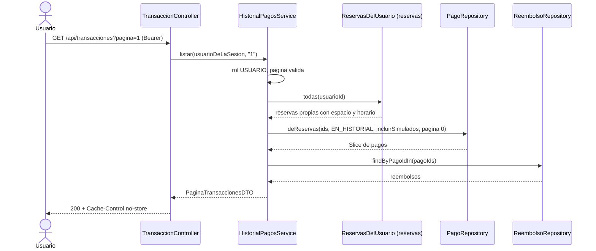
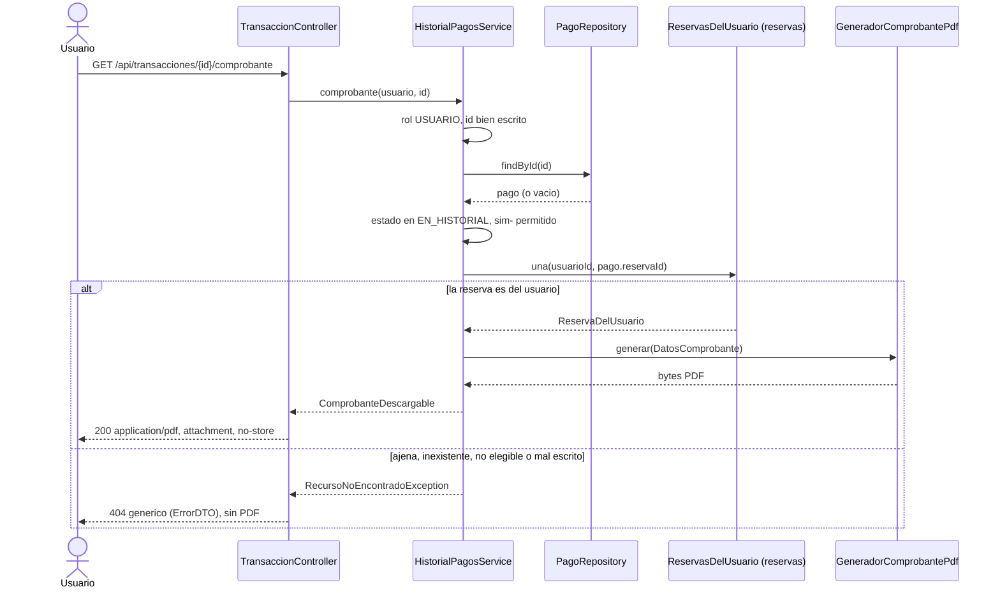

# HU-28 · Historial de pagos y comprobantes — Design

> Módulo `pagos` (más un puerto que implementa `reservas`). Sin patrón ★. Solo lectura: no hay migración ni auditoría.

## 1. Caso de uso

**Ver mis pagos y descargar el comprobante.** Un `USUARIO` abre "Mis pagos" y ve sus pagos `PAGADO` y `REEMBOLSADO` con
fecha, espacio, monto y estado (CA1). Elige una y descarga su comprobante en PDF (CA2). El usuario sale de la sesión;
nada en la URL ni en el cuerpo lo identifica.

## 2. Archivos por módulo y capa

### Backend, `pe.edu.ulima.espacioya.pagos`

| Capa | Archivo | Qué es |
|------|---------|--------|
| controller | `TransaccionController` (nuevo) | `GET /api/transacciones` y `GET /api/transacciones/{id}/comprobante`. Sin lógica: delega en `HistorialPagosService`, pone cabeceras y `no-store` |
| dto | `TransaccionDTO` (nuevo) | Una fila del historial |
| dto | `PaginaTransaccionesDTO` (nuevo) | `(int pagina, List<TransaccionDTO> transacciones, boolean hayMas)` |
| service | `HistorialPagosService` (nuevo, clase concreta) | Rol, página, ownership, filtros y armado de DTO y comprobante |
| service | `ComprobanteDescargable` (nuevo, record) | `(String nombreArchivo, byte[] contenido)` |
| service/comprobante | `DatosComprobante` (nuevo, record) | Lo único que el generador conoce del pago |
| service/comprobante | `GeneradorComprobantePdf` (nuevo, clase concreta) | `byte[] generar(DatosComprobante)`; PDF escrito a mano, sin librería (ver D1) |
| service/puertos | `ReservasDelUsuario` y `ReservaDelUsuario` (nuevos) | Puerto que implementa `reservas` (ver § 5) |
| repository | `PagoRepository` (modifica) | Agrega `deReservas(...)` |
| domain | `EstadoPago` (modifica) | Agrega la constante `EN_HISTORIAL = EnumSet.of(PAGADO, REEMBOLSADO)` |

### Backend, `pe.edu.ulima.espacioya.reservas`

| Capa | Archivo | Qué es |
|------|---------|--------|
| service/impl | `ReservasDelUsuarioImpl` (nuevo) | Implementa el puerto con `ReservaDAO.delUsuario` y `CatalogoEspaciosService.nombres` |

### Pruebas, `2_Backend/src/test/java/...`

`HistorialPagosServiceTest`, `GeneradorComprobantePdfTest`, `HistorialPagosControllerIT`, `ReservasDelUsuarioImplIT`.

### Frontend, `3_frontend/src/`

| Archivo | Qué es |
|---------|--------|
| `api/pagos.js` (modifica) | `listarMisTransacciones`, `descargarComprobante` |
| `pages/pagos/MisPagos.jsx` + `MisPagos.module.css` (nuevos) | Pantalla `/mis-pagos` |
| `pages/pagos/textosPagos.js` (modifica) | Textos de la pantalla |
| `components/ui/EtiquetaEstado.jsx` (modifica) | Agrega `PAGADO` y `REEMBOLSADO` al mapa |
| `pages/cuentas/Panel.jsx` (modifica) | Enlace "Mis pagos" para `USUARIO` |
| `App.jsx` (modifica) | Ruta `/mis-pagos` con `RutaProtegida` |

## 3. Endpoints

| Método y ruta | Rol | Entrada | Salida | Códigos |
|---------------|-----|---------|--------|---------|
| `GET /api/transacciones?pagina=n` | `USUARIO` | `pagina` opcional (por defecto 1) | `PaginaTransaccionesDTO` | 200; 400 (`pagina`); 401; 403 |
| `GET /api/transacciones/{id}/comprobante` | `USUARIO` | `id` como texto | PDF (`application/pdf`) | 200; 401; 403; 404 |

Las dos llevan `Cache-Control: no-store`. El 404 del comprobante es el mismo para id mal escrito, inexistente, ajeno,
no elegible o `sim-` con pasarela real (R17, R20).

```java
public record TransaccionDTO(Long id, Long reservaId, LocalDate fecha, String espacio, BigDecimal monto,
                             String estado, BigDecimal montoReembolsado, boolean simulada) { }

public record PaginaTransaccionesDTO(int pagina, List<TransaccionDTO> transacciones, boolean hayMas) { }
```

- `fecha`: `LocalDate.ofInstant(pago.creadoEn, ZonaHoraria.LIMA)`.
- `estado`: `pago.estado.name()` (solo `PAGADO` o `REEMBOLSADO`).
- `montoReembolsado`: suma de `reembolso.monto` con estado `REEMBOLSADO` del pago; `null` si el pago es `PAGADO`.
- Nunca viajan `ultimos4`, `idTransaccionPasarela` ni `usuarioId` (R18). El número de comprobante es `id`.

El controlador no declara `produces` en el comprobante: con `produces = application/pdf`, un error (`ErrorDTO` en JSON)
fallaría con `HttpMediaTypeNotAcceptableException` si el cliente no acepta JSON. El tipo se fija en el
`ResponseEntity<byte[]>` solo en el caso 200.

## 4. Clases y firmas

```java
@Service
public class HistorialPagosService {
    public static final int TAMANO_PAGINA = 10;
    public static final String CAMPO_PAGINA = "pagina";
    public static final String MENSAJE_PAGINA = "La página no es válida.";

    public HistorialPagosService(PagoRepository pagos, ReembolsoRepository reembolsos, ReservasDelUsuario reservas,
                                 GeneradorComprobantePdf generador,
                                 @Value("${espacioya.pagos.pasarela}") String pasarela);

    @Transactional(readOnly = true)
    public PaginaTransaccionesDTO listar(UsuarioAutenticado usuario, String pagina);

    @Transactional(readOnly = true)
    public ComprobanteDescargable comprobante(UsuarioAutenticado usuario, String id);
}

public interface ReservasDelUsuario {          // pagos.service.puertos
    List<ReservaDelUsuario> todas(Long usuarioId);
    Optional<ReservaDelUsuario> una(Long usuarioId, Long reservaId);
}
public record ReservaDelUsuario(Long reservaId, Long espacioId, String espacio, LocalDate fecha,
                                int horaInicio, int horaFin) { }

public record DatosComprobante(Long numero, LocalDate fechaPago, String espacio, LocalDate fechaReserva,
                               int horaInicio, int horaFin, BigDecimal monto, String estado,
                               BigDecimal montoReembolsado, String ultimos4, boolean simulado) { }

@Component
public class GeneradorComprobantePdf {
    public byte[] generar(DatosComprobante datos);
}

// PagoRepository (agrega)
@Query("select p from Pago p where p.reservaId in :reservaIds and p.estado in :estados "
     + "and (:incluirSimulados = true or p.idTransaccionPasarela not like 'sim-%') "
     + "order by p.creadoEn desc, p.id desc")
Slice<Pago> deReservas(@Param("reservaIds") Collection<Long> reservaIds,
                       @Param("estados") Collection<EstadoPago> estados,
                       @Param("incluirSimulados") boolean incluirSimulados, Pageable pagina);
```

### Reglas de `HistorialPagosService`

- `incluirSimulados`: igual que `DatosPersonalesPagosImpl` y `GeneradorLiquidaciones`:
  `"simulada".equalsIgnoreCase(pasarela.strip())`. Un pago es simulado con `ReglasLiquidacion.esSimulado(idTransaccion)`.
- `listar`: (1) rol `USUARIO`, si no `AccesoDenegadoException` (R9); (2) `pagina` (sin parámetro = 1; solo dígitos y
  dentro de `int`, si no `ValidacionException` con `ErrorCampoDTO("pagina", ...)`, R6); (3) `reservas.todas(usuarioId)`;
  sin reservas, página vacía sin consultar `pago` (R7); (4) `pagos.deReservas(ids, EstadoPago.EN_HISTORIAL,
  incluirSimulados, PageRequest.of(n - 1, 10))`; (5) un `reembolsos.findByPagoIdInOrderByCreadoEnAscIdAsc(pagoIds)` por
  página, sin N+1; (6) arma los DTO con el nombre del espacio del puerto.
- `comprobante`: (1) rol (R9); (2) `id` con `[0-9]{1,18}` y `> 0`, si no `RecursoNoEncontradoException` (R17); (3)
  `pagos.findById`, vacío o estado fuera de `EN_HISTORIAL` o `sim-` con pasarela real → 404 (R3, R17, R20); (4)
  `reservas.una(usuarioId, pago.reservaId)`, vacío → el mismo 404 (R8, R17); (5) arma `DatosComprobante` y llama al
  generador. El `id` de otro usuario nunca llega al generador.
- La propiedad la garantiza el puerto: `ReservasDelUsuarioImpl` usa `ReservaDAO.delUsuario(usuarioId)`, que exige el dueño
  en la firma (HU-14). `pagos` no sabe de quién es una reserva y no lee `reserva` (principio 5).
- Sin escrituras: los dos métodos son `readOnly` (R22). Sin auditoría: son lecturas, como HU-14 y HU-19 "mis
  liquidaciones"; no hay `EventoAuditoria` nuevo.

### Comprobante PDF (`GeneradorComprobantePdf`)

PDF 1.4 de una página A4 con la fuente estándar Helvetica (`/WinAnsiEncoding`, texto convertido a `windows-1252`; lo no
representable sale como `?`). Se escapan `\`, `(` y `)` y se descartan los caracteres de control. Estructura: catálogo,
árbol de páginas, página, fuente y un solo flujo de contenido, con tabla `xref` calculada. Sin `/Info` ni fechas de
creación, así que la salida es determinista y comprobable. Contenido, en este orden:

1. "EspacioYa · Comprobante de pago" y "N.º `<numero>`".
2. "Fecha de pago: dd/MM/yyyy" (Lima).
3. "Espacio: `<espacio>`", "Reserva: dd/MM/yyyy, HH:00 a HH:00".
4. "Monto pagado: S/ 150.00" y "Estado: Pagado" o "Reembolsado".
5. Con `montoReembolsado`: "Monto reembolsado: S/ 150.00" (R13).
6. "Tarjeta: terminada en 1234" solo si `ultimos4` coincide con `\d{4}`; si no, "Tarjeta: no informada" (R14, R15).
7. Con `simulado`: "Pago simulado: no se cobró dinero real." (R19).

No incluye el id de la pasarela, el correo, el teléfono, el nombre del usuario ni datos del arrendador (R16).

## 5. Puerto nuevo entre módulos

`pagos.service.puertos.ReservasDelUsuario`, que implementa `reservas.service.impl.ReservasDelUsuarioImpl`. Se justifica
porque `pagos` necesita saber qué reservas son del usuario y el nombre y horario de su espacio, y la dirección
`reservas → pagos` ya existe: el módulo de abajo (`pagos`) define la interfaz y el de arriba (`reservas`) la implementa,
como `ReservasPorCobrar` y `ReservasLiquidables`. `ReservasLiquidables` no sirve: no trae el dueño de la reserva. El
implementer agrega la fila a la tabla de puertos de `docs/architecture.md`.

- `todas(usuarioId)`: `ReservaDAO.delUsuario(usuarioId)` y `CatalogoEspaciosService.nombres(espacioIds)` (sin filtro de
  visibilidad: una reserva cuyo espacio ya no se ve se muestra igual). Sin nombre, "Espacio". `readOnly`.
- `una(usuarioId, reservaId)`: lo mismo filtrado por `reservaId`. Ajena o inexistente → `Optional.empty()`.
- Sin sesión ni rol: el llamador pasa el id de la sesión.

## 6. Diagramas de secuencia

### Flujo principal: listar el historial (CA1)



### Flujo de descarga y flujo de error (CA2, STRIDE E)



## 7. Migraciones y base de datos

Ninguna. Todo sale de `pago`, `reembolso` y `reserva` (migraciones de HU-12, HU-13 y HU-16). El volumen por persona son decenas de pagos, así
que no se crea un índice en `pago(reserva_id)`; si crece, va en una `V8_n` libre.

## 8. Excepciones y componentes de `comun`

Se reutilizan, sin crear ninguna: `AccesoDenegadoException` (403), `RecursoNoEncontradoException` (404),
`ValidacionException` + `ErrorCampoDTO` (400 en `pagina`) y `ManejadorGlobalErrores`. También `UsuarioAutenticado` (la
sesión), `ZonaHoraria.LIMA` y `ReglasLiquidacion.esSimulado`. No se usa auditoría, rate limiting ni correo.

## 9. Pantallas

### `/mis-pagos` — `pages/pagos/MisPagos.jsx` (con `RutaProtegida`)

- **Acceso.** Enlace "Mis pagos" en `Panel` solo para `USUARIO`. Otro rol vuelve a `/panel` con `Navigate` (la API igual
  responde 403), como `MisLiquidaciones`.
- **Componentes del kit.** `Tarjeta`, `EtiquetaEstado`, `Boton` (`secundario`: no hay botón primario en la pantalla, hay
  varias filas), `Alerta`. Reutiliza `SeccionLiquidaciones` (lista con "Ver más") con un `cargar` que adapta la respuesta:
  `listarMisTransacciones(pagina).then((d) => ({ ...d, liquidaciones: d.transacciones }))`, con un comentario que lo
  explique. No agrega componentes al kit.
- **Estados nuevos en `EtiquetaEstado`.** `PAGADO` → "Pagado" (éxito) y `REEMBOLSADO` → "Reembolsado" (neutro). Ya están
  en la tabla "Color de cada estado" de `docs/frontend.md` (fila Pago): no se agrega ningún color ni token.
- **Funciones de `src/api/pagos.js`.** `listarMisTransacciones(pagina)` → `peticion('/api/transacciones?pagina=n')` y
  `descargarComprobante(id)` → `peticionArchivo('/api/transacciones/<id>/comprobante')`, que devuelve un `Blob` con el
  token (un enlace `<a href>` no puede enviar `Authorization`).
- **CA1.** Cada transacción es una `Tarjeta` con título "Pago #id", `EtiquetaEstado`, fecha (`formatoFecha`), espacio,
  monto en negrita (`formatoPrecio`), "Reembolsado: S/ X" solo si la API trae `montoReembolsado`, y la leyenda "Pago
  simulado" si `simulada`. Orden y páginas los decide el servidor; "Ver más" mientras `hayMas`. Lista vacía: texto
  secundario "Aún no tienes pagos." (R7). Error de la API (p. ej. 403): `Alerta error` con el mensaje tal cual.
- **CA2.** `Boton secundario` "Descargar comprobante" por tarjeta, con `cargando`. Llama a `descargarComprobante(id)`, arma
  un `<a download="comprobante-<id>.pdf">` temporal con `URL.createObjectURL(blob)` y lo revoca al terminar, como
  `DatosPersonales.jsx` de HU-22. Un error (incluido el 404 y la red) se muestra en `Alerta error` bajo esa tarjeta; los
  últimos 4 dígitos solo existen dentro del PDF.
- **Sin reglas en el cliente.** La pantalla no calcula montos, no decide qué pagos aparecen ni el estado.
- **Textos** en `textosPagos.js`: título "Mis pagos", descripción, `SIN_PAGOS`, `BOTON_DESCARGAR_COMPROBANTE`,
  `ENLACE_MIS_PAGOS`, `tituloPago(id)`, `reembolsadoDe(monto)` y `AVISO_PAGO_SIMULADO`.

## 10. Alternativas descartadas

- **D1. Librería de PDF (OpenPDF, PDFBox).** Descartada: agrega una dependencia y su licencia al `pom.xml` para un
  documento de una página con diez líneas de texto, y AGENTS.md exige discutir cualquier dependencia nueva. Un escritor
  mínimo de PDF 1.4 con Helvetica es corto, determinista y probable con `%PDF-`, `%%EOF` y el texto en claro. Si el
  dueño prefiere la librería, solo cambia `GeneradorComprobantePdf`.
- **D2. Comprobante por `reservaId` (`/api/reservas/{id}/comprobante`).** Descartada: una reserva puede tener varios
  pagos (intentos rechazados, tardíos) y el comprobante es de un pago concreto; el historial y la descarga usan el mismo
  `id` de transacción.
- **D3. Que `reservas` exponga `GET /api/transacciones` y llame a `PagoService`.** Descartada: HU-22 lo hizo porque
  `pagos` no sabe de quién es una reserva, pero aquí la pantalla y las reglas (estados, simulados, reembolsos) son de
  `pagos` (HU-28 está en su módulo, `docs/architecture.md` principio 4). Se invierte con un puerto, la forma ya usada por
  `ReservasPorCobrar` y `ReservasLiquidables`.
- **D4. Filtrar por usuario con un `join` de `pago` a `reserva` en `PagoRepository`.** Descartada: `pagos` no puede leer la
  tabla de otro módulo (principio 5) y se perdería la garantía de que el dueño va en la firma del DAO.
- **D5. Mostrar también `REEMBOLSO_FALLIDO`.** Descartada por ahora: `docs/architecture.md` dice que HU-28 cuenta `PAGADO` y
  `REEMBOLSADO`. Cambiarlo es agregar el estado a `EstadoPago.EN_HISTORIAL` (ver la pregunta P1 del `progress`).
- **D6. Auditar cada descarga.** Descartada: la historia no pide auditoría (sin control R) y las lecturas de HU-14 y HU-19
  tampoco se auditan.

## 11. Para el implementer: documentación que debe actualizar

`docs/architecture.md` (fila del puerto `pagos.ReservasDelUsuario` y párrafo de HU-28 en "Pagos"), `docs/frontend.md`
(ruta `/mis-pagos`, `PAGADO` y `REEMBOLSADO` en `EtiquetaEstado`, que HU-13 dejó pendientes) y la fila HU-28 de la matriz
§7 de `docs/requerimientos.md`.
