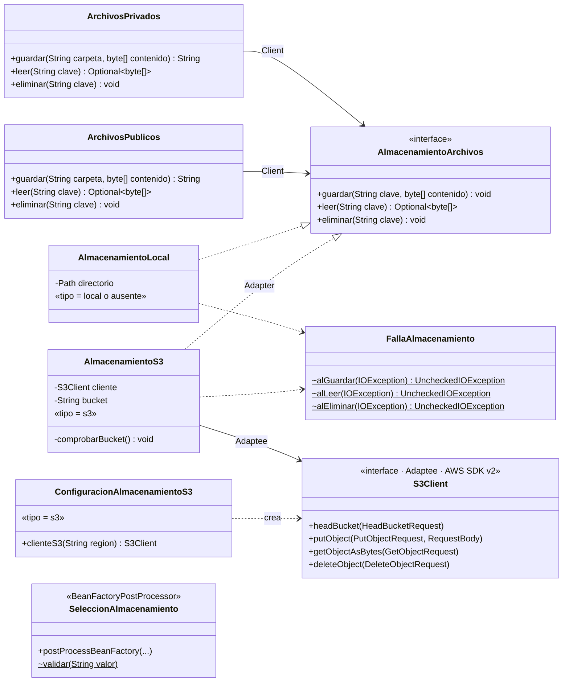
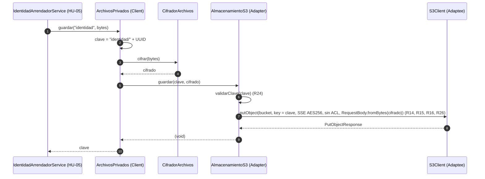
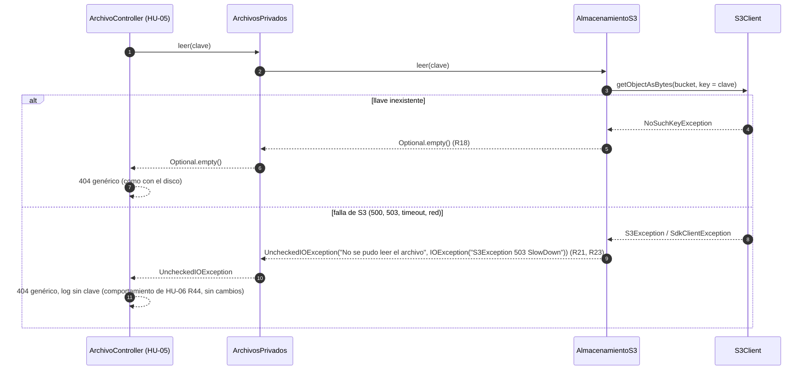

# HU-29 · Design — Almacenamiento de archivos en S3 seleccionable por configuración

> Requirements: [`requirements.md`](requirements.md). Módulo: `comun` (`comun.almacenamiento`). Sprint 9.
> Patrón ★ de la historia: **Adapter** (Target `AlmacenamientoArchivos`, ya creado en HU-05).

## 1. Resumen y decisiones

HU-05 dejó el puerto `AlmacenamientoArchivos` (`guardar`, `leer`, `eliminar`) con un solo adaptador,
`AlmacenamientoLocal`. HU-29 agrega un segundo adaptador, `AlmacenamientoS3`, sobre el `S3Client` síncrono del AWS SDK
for Java v2, y elige uno u otro por configuración. `ArchivosPrivados` (cifra) y `ArchivosPublicos` (fotos) **no
cambian**: siguen validando la clave y delegando en el puerto.

| # | Decisión | Origen |
|---|----------|--------|
| D1 | Selección explícita con `espacioya.almacenamiento.tipo` (`ALMACENAMIENTO_TIPO`): `local` (por defecto) o `s3`, con `@ConditionalOnProperty` en cada adaptador, igual que `EnvioCorreo` (HU-25) y `PasarelaPago` (HU-13): sin fábrica de adaptadores | Dueño |
| D2 | Sin fallback silencioso: con `s3`, falta de bucket o región, o un bucket inexistente o inaccesible, hacen fallar el arranque. Se comprueba con `HeadBucket` en el constructor del adaptador | Dueño |
| D3 | AWS SDK for Java v2 (`software.amazon.awssdk:s3`), credenciales por la cadena por defecto (`DefaultCredentialsProvider`: en Fargate, el rol de la tarea `LabRole`). No se crean claves IAM | Dueño |
| D4 | Mismas claves que el disco (`<carpeta>/<UUID>`, sin prefijo en el bucket), `leer` vacío si la llave no existe, misma excepción (`UncheckedIOException` con el mismo mensaje) ante fallas | Dueño, CA2, CA5, (D) |
| D5 | Un valor de tipo inválido falla **antes** de crear cualquier bean, con un mensaje que lista `local` y `s3` (CA4). Sin esto, Spring fallaría con un "no hay bean de `AlmacenamientoArchivos`" que no dice qué valores son válidos. Lo hace un `BeanFactoryPostProcessor` (`SeleccionAlmacenamiento`) | spec-author |
| D6 | La región es obligatoria con `s3` (sin valor por defecto ni la cadena de regiones del SDK): la configuración queda explícita en la task definition, como pidió el dueño | spec-author |
| D7 | Cada `PutObject` pide SSE-S3 (`AES256`) y nunca lleva ACL, aunque el bucket ya cifre por defecto y tenga Block Public Access: defensa en profundidad verificable en pruebas | spec-author, (I) |
| D8 | Timeouts del cliente: 10 s por intento y 30 s por operación (reintentos incluidos). Una subida de 5 MiB dentro de la región cabe con holgura; sin límite, un S3 colgado retendría hilos de Tomcat sin fin | spec-author, (D) |
| D9 | Las fallas de operación se traducen a `UncheckedIOException` cuya causa es un `IOException` con solo el tipo de excepción, el código HTTP y el código de error de AWS: sin clave, sin bucket, sin el texto del proveedor (R23) | spec-author, (D) |
| D10 | Pruebas sin AWS ni Docker: `S3Client` simulado con Mockito, un doble en memoria (`S3EnMemoria`) para la prueba de contrato compartida con el disco, y `ApplicationContextRunner` para la selección. **Sin `*IT` nueva** (ver § 13) | Dueño, spec-author |

## 2. Archivos

Todo en `2_Backend/`. No hay controladores, DTO, entidades ni migraciones nuevas.

| Acción | Archivo | Capa / rol |
|--------|---------|-----------|
| Crear | `src/main/java/pe/edu/ulima/espacioya/comun/almacenamiento/SeleccionAlmacenamiento.java` | Configuración: constantes del tipo y validación temprana (D5) |
| Crear | `src/main/java/pe/edu/ulima/espacioya/comun/almacenamiento/FallaAlmacenamiento.java` | Mensajes y excepción comunes a los dos adaptadores (D4) |
| Crear | `src/main/java/pe/edu/ulima/espacioya/comun/almacenamiento/AlmacenamientoS3.java` | ★ Adapter · Adapter |
| Crear | `src/main/java/pe/edu/ulima/espacioya/comun/almacenamiento/ConfiguracionAlmacenamientoS3.java` | Crea el Adaptee `S3Client` (solo con `s3`) |
| Modificar | `src/main/java/pe/edu/ulima/espacioya/comun/almacenamiento/AlmacenamientoLocal.java` | `@ConditionalOnProperty(... local, matchIfMissing = true)` y mensajes desde `FallaAlmacenamiento`; comportamiento igual |
| Modificar | `src/main/java/pe/edu/ulima/espacioya/comun/almacenamiento/AlmacenamientoArchivos.java` | Solo javadoc: el contrato (vacío si no existe, eliminar idempotente, `UncheckedIOException` ante fallas) y los dos adaptadores |
| Modificar | `src/main/resources/application.properties` | Tres propiedades nuevas (§ 8) |
| Modificar | `src/test/resources/config/application.properties` | `espacioya.almacenamiento.tipo=local` explícito para las IT |
| Modificar | `.env.example` | `ALMACENAMIENTO_TIPO`, `ALMACENAMIENTO_S3_BUCKET`, `ALMACENAMIENTO_S3_REGION` (§ 8) |
| Modificar | `pom.xml` | BOM del AWS SDK v2 y `software.amazon.awssdk:s3` sin `netty-nio-client` (§ 8) |
| Crear (test) | `src/test/java/.../comun/almacenamiento/SeleccionAlmacenamientoTest.java` | `ApplicationContextRunner` |
| Crear (test) | `src/test/java/.../comun/almacenamiento/AlmacenamientoS3Test.java` | Mockito sobre `S3Client` |
| Crear (test) | `src/test/java/.../comun/almacenamiento/ConfiguracionAlmacenamientoS3Test.java` | Cliente real construido sin red; lectura de archivos de configuración |
| Crear (test) | `src/test/java/.../comun/almacenamiento/ContratoAlmacenamientoArchivos.java` | Pruebas abstractas del contrato (no termina en `Test`: no corre sola) |
| Crear (test) | `src/test/java/.../comun/almacenamiento/AlmacenamientoLocalContratoTest.java` | Contrato sobre el disco (`@TempDir`) |
| Crear (test) | `src/test/java/.../comun/almacenamiento/AlmacenamientoS3ContratoTest.java` | Contrato sobre `AlmacenamientoS3` + `S3EnMemoria` |
| Crear (test) | `src/test/java/.../comun/almacenamiento/S3EnMemoria.java` | Doble de `S3Client` con un `Map<String, byte[]>` |
| Modificar (docs) | `docs/architecture.md` | Fila HU-29 en "Patrones por historia", fila "Archivos" del Stack y sección "Almacenamiento: qué deja HU-29" (§ 15) |

`AlmacenamientoLocalTest`, `ArchivosPrivadosTest`, `ArchivosPublicosTest` y `ArchivoControllerTest` no cambian y
deben seguir verdes.

## 3. Patrón Adapter

| Rol GoF | Clase | Nota |
|---------|-------|------|
| Target | `AlmacenamientoArchivos` | Sin cambios de firma |
| Client | `ArchivosPrivados`, `ArchivosPublicos` | Sin cambios; validan la clave antes de llamar al Target |
| Adapter | `AlmacenamientoS3` | Traduce `guardar`/`leer`/`eliminar` a `PutObject`/`GetObject`/`DeleteObject` y las excepciones del SDK a las del Target |
| Adaptee | `S3Client` (AWS SDK v2) | Lo crea `ConfiguracionAlmacenamientoS3`; nadie más importa `software.amazon.awssdk` |
| Adapter (ya existente) | `AlmacenamientoLocal` | Adaptee: `java.nio.file.Files` |



## 4. Caso de uso

**CU-29 Elegir dónde se guardan los archivos.** Actor: equipo de despliegue (configura la task definition o el
`.env`). Precondición con `s3`: el bucket existe, es privado, y el rol de la tarea tiene permiso sobre él (§ 11).

1. El equipo define `ALMACENAMIENTO_TIPO` (o no la define) y, con `s3`, `ALMACENAMIENTO_S3_BUCKET` y
   `ALMACENAMIENTO_S3_REGION`.
2. El backend arranca: `SeleccionAlmacenamiento` valida el tipo; Spring crea solo el adaptador de ese tipo.
3. Con `s3`, el adaptador comprueba el bucket con `HeadBucket`. Si todo está bien, el backend queda listo.
4. Los casos de uso de HU-02, HU-05, HU-06, HU-07, HU-20 y HU-22 guardan, leen y eliminan archivos como siempre.

Flujos alternativos: 2a tipo inválido → el arranque falla (R5). 3a falta el bucket o la región → falla (R6, R7).
3b bucket inexistente, sin acceso, en otra región o S3 inalcanzable → falla (R9–R12). En ningún caso se usa el disco
(R13). 4a S3 falla en una operación → `UncheckedIOException` (R20–R22), que el resto del sistema ya maneja (§ 10).

## 5. Diagramas de secuencia

### 5.1 Arranque con `s3` (flujo principal y errores)

```mermaid
sequenceDiagram
    autonumber
    participant Boot as Spring Boot
    participant Sel as SeleccionAlmacenamiento
    participant Conf as ConfiguracionAlmacenamientoS3
    participant Ad as AlmacenamientoS3
    participant S3 as S3Client (Adaptee)
    Boot->>Sel: postProcessBeanFactory (antes de crear beans)
    alt tipo distinto de local y s3
        Sel-->>Boot: IllegalStateException "…ALMACENAMIENTO_TIPO vale 'x': los valores válidos son local y s3" (R5)
    end
    Note over Boot: @ConditionalOnProperty: solo se registran ConfiguracionAlmacenamientoS3 y AlmacenamientoS3
    Boot->>Conf: clienteS3(region)
    alt región en blanco
        Conf-->>Boot: IllegalStateException "Falta ALMACENAMIENTO_S3_REGION…" (R7)
    end
    Conf-->>Boot: S3Client (DefaultCredentialsProvider, región, timeouts)
    Boot->>Ad: new AlmacenamientoS3(cliente, bucket)
    alt bucket en blanco
        Ad-->>Boot: IllegalStateException "Falta ALMACENAMIENTO_S3_BUCKET…" (R6), sin llamar a S3
    end
    Ad->>S3: headBucket(bucket) (R8)
    alt 404 NoSuchBucket
        S3-->>Ad: NoSuchBucketException
        Ad-->>Boot: IllegalStateException "El bucket S3 'b' no existe…" (R9)
    else 403
        Ad-->>Boot: IllegalStateException "…no es accesible con las credenciales del rol…" (R10)
    else 301
        Ad-->>Boot: IllegalStateException "…está en otra región: revisa ALMACENAMIENTO_S3_REGION" (R11)
    else otra falla (red, sin credenciales)
        Ad-->>Boot: IllegalStateException "No se pudo comprobar el bucket S3 'b' (…)" (R12)
    end
    S3-->>Ad: 200
    Ad-->>Boot: adaptador listo (log INFO con el bucket)
    Note over Boot: cualquier excepción aborta el arranque; nunca se crea AlmacenamientoLocal (R13)
```

### 5.2 Guardar un documento (flujo principal, CA2)



### 5.3 Leer una clave inexistente y falla de S3 (flujos de error, CA5 y (D))



## 6. Endpoints

**Ninguno nuevo ni modificado.** Las rutas que guardan o sirven archivos (HU-02, HU-05, HU-06, HU-07, HU-20, HU-22)
responden igual con cualquiera de los dos adaptadores: mismos códigos, mismos DTO, mismos encabezados.

## 7. Clases y firmas públicas

Todas en `pe.edu.ulima.espacioya.comun.almacenamiento`. Inyección por constructor, sin Lombok.

### 7.1 `SeleccionAlmacenamiento`

```java
/** Valida espacioya.almacenamiento.tipo antes de crear cualquier bean (HU-29 D5, R5). */
@Component
public class SeleccionAlmacenamiento implements BeanFactoryPostProcessor, EnvironmentAware {
    static final String PROPIEDAD = "espacioya.almacenamiento.tipo";
    static final String LOCAL = "local";
    static final String S3 = "s3";

    @Override public void setEnvironment(Environment entorno);
    @Override public void postProcessBeanFactory(ConfigurableListableBeanFactory fabrica); // validar(entorno.getProperty(PROPIEDAD))
    static void validar(String valor);
}
```

- `validar(null)` no falla (sin la propiedad, `matchIfMissing` elige el disco: R1).
- Válido = `LOCAL.equalsIgnoreCase(valor)` o `S3.equalsIgnoreCase(valor)`, **sin** `strip()`: es exactamente la regla
  de `@ConditionalOnProperty`, así que validación y selección nunca discrepan. `""`, `" s3"` o `disco` fallan.
- Mensaje (`IllegalStateException`):
  `espacioya.almacenamiento.tipo (ALMACENAMIENTO_TIPO) vale '<valor>': los valores válidos son local y s3`.
- Un `BeanFactoryPostProcessor` corre después de evaluar las condiciones y antes de instanciar cualquier singleton, así
  que su error siempre sale antes que el "no hay bean de `AlmacenamientoArchivos`".

### 7.2 `FallaAlmacenamiento`

```java
final class FallaAlmacenamiento {
    static final String MENSAJE_GUARDAR = "No se pudo guardar el archivo";
    static final String MENSAJE_LEER = "No se pudo leer el archivo";
    static final String MENSAJE_ELIMINAR = "No se pudo eliminar el archivo";

    static UncheckedIOException alGuardar(IOException causa);
    static UncheckedIOException alLeer(IOException causa);
    static UncheckedIOException alEliminar(IOException causa);
}
```

No importa nada del SDK. `AlmacenamientoLocal` la usa en sus tres `catch (IOException e)`: los textos son los mismos de
hoy, así que su comportamiento no cambia.

### 7.3 `AlmacenamientoLocal` (modificada)

```java
@Component
@ConditionalOnProperty(name = SeleccionAlmacenamiento.PROPIEDAD, havingValue = SeleccionAlmacenamiento.LOCAL,
        matchIfMissing = true)
public class AlmacenamientoLocal implements AlmacenamientoArchivos { /* igual que hoy */ }
```

### 7.4 `ConfiguracionAlmacenamientoS3`

```java
@Configuration(proxyBeanMethods = false)
@ConditionalOnProperty(name = SeleccionAlmacenamiento.PROPIEDAD, havingValue = SeleccionAlmacenamiento.S3)
public class ConfiguracionAlmacenamientoS3 {
    static final Duration TIEMPO_INTENTO = Duration.ofSeconds(10);
    static final Duration TIEMPO_OPERACION = Duration.ofSeconds(30);

    @Bean(destroyMethod = "close")
    public S3Client clienteS3(@Value("${espacioya.almacenamiento.s3.region:}") String region); // delega en crearCliente

    static S3Client crearCliente(String region);
}
```

`crearCliente`:
1. Región `null` o en blanco → `IllegalStateException("Falta ALMACENAMIENTO_S3_REGION (espacioya.almacenamiento.s3.region):
   el almacenamiento s3 la necesita")` (R7).
2. `S3Client.builder().region(Region.of(region.strip()))` (R29)
   `.credentialsProvider(DefaultCredentialsProvider.builder().build())` (R27; explícito para que la prueba lo vea)
   `.overrideConfiguration(c -> c.apiCallAttemptTimeout(TIEMPO_INTENTO).apiCallTimeout(TIEMPO_OPERACION))` (R30)
   `.build()`.
3. Construir el cliente **no** contacta a AWS ni resuelve credenciales: por eso la prueba corre sin red.

No se configura `endpointOverride` ni `forcePathStyle` (no hay LocalStack, § 13). No se fija el cliente HTTP: el SDK usa
su cliente síncrono por defecto (Apache).

### 7.5 `AlmacenamientoS3`

```java
/** ★ Adapter (HU-29): AlmacenamientoArchivos sobre un bucket S3 privado. Única clase, con su configuración, que
 *  importa software.amazon.awssdk. */
@Component
@ConditionalOnProperty(name = SeleccionAlmacenamiento.PROPIEDAD, havingValue = SeleccionAlmacenamiento.S3)
public class AlmacenamientoS3 implements AlmacenamientoArchivos {
    public AlmacenamientoS3(S3Client cliente, @Value("${espacioya.almacenamiento.s3.bucket:}") String bucket);
    @Override public void guardar(String clave, byte[] contenido);
    @Override public Optional<byte[]> leer(String clave);
    @Override public void eliminar(String clave);
}
```

**Constructor.**
1. Bucket `null` o en blanco → `IllegalStateException("Falta ALMACENAMIENTO_S3_BUCKET (espacioya.almacenamiento.s3.bucket):
   el almacenamiento s3 la necesita")`, sin tocar el cliente (R6). Se guarda `bucket.strip()`.
2. `comprobarBucket()`: `cliente.headBucket(HeadBucketRequest.builder().bucket(bucket).build())` (R8). Se usan siempre
   las sobrecargas con objeto `*Request` (no las de `Consumer`), para que los `verify` de Mockito coincidan.
   - `NoSuchBucketException`, o `S3Exception` con `statusCode() == 404` →
     `IllegalStateException("El bucket S3 '<b>' no existe (ALMACENAMIENTO_S3_BUCKET). La aplicación no crea el bucket")` (R9).
   - `S3Exception` 403 → `"El bucket S3 '<b>' no es accesible con las credenciales del rol: revisa sus permisos
     (s3:ListBucket, s3:GetObject, s3:PutObject, s3:DeleteObject)"` (R10).
   - `S3Exception` 301 → `"El bucket S3 '<b>' está en otra región: revisa ALMACENAMIENTO_S3_REGION"` (R11).
   - Cualquier otra `SdkException` → `"No se pudo comprobar el bucket S3 '<b>' (<descripción>)"`, con la excepción del
     SDK como causa (R12). Es un error de arranque para quien opera, no llega a ningún cliente HTTP.
3. `log.info("Almacenamiento de archivos en el bucket S3 {}", bucket)`.

**Operaciones.** Cada una empieza con `validarClave(clave)` (R24): `null`, en blanco, que empieza con `/` o con algún
segmento `..` (partir por `/`) → `IllegalArgumentException("Clave de almacenamiento fuera del directorio")`, el mismo
texto que el disco, sin tocar el cliente.

| Método | Llamada al SDK | Éxito | Falla |
|--------|----------------|-------|-------|
| `guardar` | `putObject(PutObjectRequest.builder().bucket(bucket).key(clave).serverSideEncryption(ServerSideEncryption.AES256).build(), RequestBody.fromBytes(contenido))` — sin `acl` (R14–R16) | `void`. Un `PutObject` es atómico: nunca se ve un objeto a medio escribir, como la escritura atómica del disco | `SdkException` → `FallaAlmacenamiento.alGuardar(new IOException(describir(e)))` (R20) |
| `leer` | `getObjectAsBytes(GetObjectRequest.builder().bucket(bucket).key(clave).build()).asByteArray()` (R17) | `Optional.of(bytes)` | `NoSuchKeyException` o `S3Exception` 404 → `Optional.empty()` (R18); otra `SdkException` → `alLeer(...)` (R21) |
| `eliminar` | `deleteObject(DeleteObjectRequest.builder().bucket(bucket).key(clave).build())` (R19) | `void`. S3 responde 204 aunque la llave no exista: idempotente como `deleteIfExists` | `SdkException` → `alEliminar(...)` (R22) |

`private static String describir(SdkException e)` (R23, D9): para `AwsServiceException` →
`e.getClass().getSimpleName() + " " + e.statusCode() + " " + código de awsErrorDetails()` (o sin código si no hay
detalles); para el resto → `e.getClass().getSimpleName()`. Nunca `e.getMessage()` (el SDK incluye ahí el texto de S3 y
el request id) ni la clave ni el bucket. La `SdkException` original **no** se encadena como causa.

**Por qué `NoSuchKeyException` es confiable.** S3 responde 403 en vez de 404 a una llave inexistente si el rol no tiene
`s3:ListBucket`. `HeadBucket` exige justamente `s3:ListBucket`, así que si el arranque pasó R8, una llave inexistente da
404 y `leer` devuelve vacío (CA5). Un 403 en `leer` es una falla real (R21), no "no existe".

### 7.6 `AlmacenamientoArchivos` (solo javadoc)

Documenta el contrato que la prueba de contrato (R25) verifica para ambos adaptadores: `leer` devuelve vacío si la clave
no existe; `eliminar` no falla si no existe; guardar de nuevo reemplaza; cualquier falla del proveedor es
`UncheckedIOException`; una clave fuera del espacio de claves es `IllegalArgumentException`. Cambia "S3 más adelante"
por los dos adaptadores y cómo se elige.

## 8. Configuración

### 8.1 `application.properties` (después del bloque de HU-05)

```properties
# Dónde se guardan los archivos (HU-29): local (directorio de arriba) o s3. Con otro valor el backend no arranca.
# Con s3, sin bucket o sin región, o si el bucket no existe o no es accesible, el backend no arranca: nunca pasa al disco.
# Las credenciales salen de la cadena por defecto del SDK de AWS (rol de la tarea en Fargate); no se configuran aquí.
espacioya.almacenamiento.tipo=${ALMACENAMIENTO_TIPO:local}
espacioya.almacenamiento.s3.bucket=${ALMACENAMIENTO_S3_BUCKET:}
espacioya.almacenamiento.s3.region=${ALMACENAMIENTO_S3_REGION:}
```

Con `s3`, `espacioya.almacenamiento.directorio` no se usa (no se crea `AlmacenamientoLocal`). La llave de firma
`ALMACENAMIENTO_LLAVE_FIRMA` sigue siendo obligatoria con cualquier tipo: la URL firmada no cambia.

### 8.2 `src/test/resources/config/application.properties`

Agregar `espacioya.almacenamiento.tipo=local` junto al directorio de pruebas: las IT siempre usan el disco aunque quien
las corre tenga `ALMACENAMIENTO_TIPO=s3` en su entorno.

### 8.3 `.env.example` (después de `ALMACENAMIENTO_LLAVE_FIRMA`)

```properties
# Dónde se guardan los archivos (HU-29): local (disco, el directorio de arriba) o s3 (bucket privado).
# Sin la variable: local, y no hace falta nada de abajo. Si la defines, no la dejes vacía: con un valor distinto
# de local o s3 el backend no arranca. UAT: s3 (las dos réplicas ven los mismos archivos).
# ALMACENAMIENTO_TIPO=s3
# Con s3, obligatorias: nombre del bucket (ya creado, privado y con cifrado SSE-S3; la aplicación no lo crea) y su
# región (en el Learner Lab, us-east-1). Si el bucket no existe o el rol no tiene acceso, el backend no arranca.
# Las credenciales NO van aquí: el SDK usa el rol de la tarea (LabRole en Fargate).
ALMACENAMIENTO_S3_BUCKET=
ALMACENAMIENTO_S3_REGION=
```

Ojo con R28: ningún comentario escribe literalmente los nombres de las variables de claves de AWS (la prueba busca esos
textos).

### 8.4 `pom.xml`

```xml
<properties>
    <java.version>25</java.version>
    <!-- AWS SDK for Java v2 (HU-29): última 2.x estable de Maven Central al implementar -->
    <aws-sdk.version>2.x.y</aws-sdk.version>
</properties>

<dependencyManagement>
    <dependencies>
        <dependency>
            <groupId>software.amazon.awssdk</groupId>
            <artifactId>bom</artifactId>
            <version>${aws-sdk.version}</version>
            <type>pom</type>
            <scope>import</scope>
        </dependency>
    </dependencies>
</dependencyManagement>

<!-- Almacenamiento en S3 (HU-29): solo lo usan comun.almacenamiento.AlmacenamientoS3 y su configuración.
     Cliente síncrono: no hace falta el cliente HTTP asíncrono (Netty). -->
<dependency>
    <groupId>software.amazon.awssdk</groupId>
    <artifactId>s3</artifactId>
    <exclusions>
        <exclusion>
            <groupId>software.amazon.awssdk</groupId>
            <artifactId>netty-nio-client</artifactId>
        </exclusion>
    </exclusions>
</dependency>
```

El implementer fija la versión concreta, confirma con `dependency:tree` que queda un cliente HTTP síncrono
(`apache-client`) y que no entra ninguna autoconfiguración de AWS en Spring (no se agrega Spring Cloud AWS). Con
`local`, el JAR del SDK está en el classpath pero ninguna clase suya se instancia (R3).

## 9. Migraciones

Ninguna. No cambia la base de datos: las columnas que guardan claves (`*_ruta`, `foto_*`) guardan la misma clave con
cualquiera de los dos adaptadores.

## 10. Excepciones (`comun/error/`) y componentes de `comun` reutilizados

- **No se agrega ninguna excepción.** Se mantiene `UncheckedIOException` (de Java) como la excepción del Target ante
  fallas, porque es la que ya lanzan el disco y la que ya atrapan los llamadores: `ArchivoController` la traduce a 404
  genérico (HU-06 R44) y el resto llega a `ManejadorGlobalErrores.inesperado` → 500 con `MENSAJE_INESPERADO`. Con S3
  el sistema responde exactamente lo mismo que hoy con el disco (CA2, (D)).
- **No se usa `ServicioExternoException`** (503) aunque `architecture.md` dice que "también servirá a almacenamiento":
  cambiaría las respuestas de HU-05/HU-06/HU-07 según el adaptador, y la historia exige que el resto del sistema no note
  la diferencia. Queda como mejora posible para ambos adaptadores a la vez, fuera de HU-29.
- Errores de arranque: `IllegalStateException`, como `EnvioCorreoSmtp` (HU-25) y `CifradorCampos` (HU-02).
- Reutilizados sin cambios: `ArchivosPrivados`, `ArchivosPublicos`, `CifradorArchivos` (`comun.cifrado`), `FirmadorUrl`,
  `ArchivoController`. No hay auditoría, correo ni rate limiting en esta historia.

## 11. Infraestructura que la historia supone (UAT, no es código)

La aplicación **no** crea ni configura el bucket (fuera del alcance). Para que R8 pase en UAT, quien despliega
(AWS Academy Learner Lab) deja listo:

1. Un bucket en `us-east-1` con **Block Public Access** (las cuatro opciones) y cifrado por defecto **SSE-S3** — (I).
   Sin política de bucket pública y sin ACL.
2. La task definition del backend con `taskRoleArn` = `LabRole` y las variables `ALMACENAMIENTO_TIPO=s3`,
   `ALMACENAMIENTO_S3_BUCKET=<nombre>`, `ALMACENAMIENTO_S3_REGION=us-east-1`. **Ninguna** variable de claves de AWS: el
   SDK toma las credenciales del endpoint de credenciales del contenedor (cadena por defecto) — (S/E).
3. Salida de red de las tareas a S3: endpoint de VPC tipo *gateway* para S3 (recomendado, sin costo) o NAT/IP pública.
   Sin ella, R8 falla por timeout (R12) y el backend no arranca, que es lo esperado.

**Verificación en UAT (caja negra, `docs/verification.md`):** (a) con el bucket bien configurado, subir un documento
(HU-05) y verlo con su URL firmada; subir una foto (HU-07) y verla en la ficha; (b) repetir la lectura varias veces para
que atienda la otra réplica: el archivo se ve igual; (c) en la consola de S3, el objeto existe con la clave
`identidad/<UUID>`, cifrado SSE-S3, y su contenido descargado no es un PDF legible (cifrado por la app); (d) con
`ALMACENAMIENTO_S3_BUCKET` mal escrito, la tarea no arranca y CloudWatch muestra el mensaje de R9.

## 12. Fuera del alcance (no se implementa)

- URL prefirmadas de S3: los archivos se siguen sirviendo a través del backend (`/api/archivos` firmada por
  `FirmadorUrl`, `/api/fotos/<UUID>`).
- Migrar archivos existentes del disco al bucket: UAT empieza con el bucket vacío.
- Crear o configurar el bucket desde la aplicación (ni `CreateBucket`, ni `PutPublicAccessBlock`, ni cifrado por
  defecto).
- Cualquier elemento de la lista "fuera del alcance" de `docs/architecture.md` (ninguno se roza).

## 13. Estrategia de pruebas

Todas `*Test` (unitarias, `./mvnw test`, sin Docker ni AWS):

| Prueba | Técnica | Cubre |
|--------|---------|-------|
| `SeleccionAlmacenamientoTest` | `ApplicationContextRunner` con `SeleccionAlmacenamiento`, `AlmacenamientoLocal`, `AlmacenamientoS3` y `ConfiguracionAlmacenamientoS3` como configuración de usuario; para `s3`, el `S3Client` real se reemplaza registrando un mock con `withBean` y **sin** `ConfiguracionAlmacenamientoS3` | R1, R2, R3, R4, R5, R13 |
| `AlmacenamientoS3Test` | `@Mock S3Client`, `ArgumentCaptor` de `PutObjectRequest` y `RequestBody` (bytes con `contentStreamProvider().newStream().readAllBytes()`); excepciones construidas con `S3Exception.builder().statusCode(…).awsErrorDetails(…)`, `NoSuchKeyException.builder()`, `NoSuchBucketException.builder()`, `SdkClientException.create(…)` | R6, R8–R12, R14–R24, R26 |
| `ConfiguracionAlmacenamientoS3Test` | `crearCliente("us-east-1")` real (no contacta a AWS) y lectura de `serviceClientConfiguration()`; lectura de `src/main/resources/application.properties` y `.env.example` desde el directorio del módulo (surefire corre en `2_Backend/`) | R7, R27, R28, R29, R30 |
| `AlmacenamientoLocalContratoTest`, `AlmacenamientoS3ContratoTest` (heredan de `ContratoAlmacenamientoArchivos`) | Mismas pruebas sobre los dos adaptadores; S3 con `S3EnMemoria` | R25 (y R18 de punta a punta) |

Notas para el implementer:
- `S3EnMemoria implements S3Client`: sobrescribe `headBucket`, `putObject(PutObjectRequest, RequestBody)`,
  `getObjectAsBytes(GetObjectRequest)` (devuelve `ResponseBytes.fromByteArray(GetObjectResponse.builder().build(), …)`
  o lanza `NoSuchKeyException` con `statusCode(404)`), `deleteObject(DeleteObjectRequest)`, `serviceName()` y `close()`.
  Los demás métodos del SDK ya lanzan `UnsupportedOperationException` por defecto.
- R27: si `serviceClientConfiguration().credentialsProvider()` no devuelve la misma instancia (el SDK podría envolverla),
  extraer `static AwsCredentialsProvider proveedorCredenciales()` package-private en `ConfiguracionAlmacenamientoS3` y
  probar ese método; documentarlo en `progress/impl_HU-29.md`.
- R5 se prueba con `disco`, `""` y `" s3"`; R2 y R4 también con `LOCAL` y `S3` en mayúsculas.
- `@DisplayName("HU-29 R<n>: …")` en todas; en `ContratoAlmacenamientoArchivos` el `DisplayName` dice "HU-29 R25".

**Prueba de integración opcional: se declara que NO se incluye.** Se evaluaron dos:
1. *LocalStack con Testcontainers* (`AlmacenamientoS3IT`): probaría el SDK contra un S3 emulado, pero agrega una imagen
   pesada y otra dependencia de Docker a `./mvnw verify`, y LocalStack no es S3 (no prueba permisos de `LabRole`, ni
   SSE real, ni la red de Fargate), que es justo lo que puede fallar en UAT.
2. *Contra AWS real con `@EnabledIfEnvironmentVariable`*: no afectaría a `./init.sh`, pero las credenciales del Learner
   Lab duran unas horas y la prueba quedaría casi siempre saltada, sin aportar evidencia en el reviewer.

El riesgo real (bucket, permisos y red) se cubre en el arranque mismo (R8: si algo está mal, la tarea no arranca) y en
la verificación de UAT de § 11. Si el dueño quiere la opción 2, se agrega como task en la aprobación del spec.

## 14. Alternativas descartadas

| Alternativa | Por qué se descartó |
|-------------|---------------------|
| Pasar a disco en silencio si S3 falla al arrancar | Con dos réplicas, cada una tendría su propio disco: un documento subido en una no se vería en la otra, y se perdería al reemplazar la tarea. El error quedaría escondido hasta la caja negra (D2, decisión del dueño) |
| Elegir el adaptador con un `@Bean` y un `switch` (fábrica) | Rompe la homogeneidad con `EnvioCorreo` y `PasarelaPago` (`@ConditionalOnProperty`, sin fábrica); el dueño pidió `@ConditionalOnProperty` |
| Solo `@ConditionalOnProperty`, sin `SeleccionAlmacenamiento` | Con un valor inválido Spring fallaría con "required a bean of type AlmacenamientoArchivos", que no nombra la propiedad ni los valores válidos: incumple CA4 |
| Spring Cloud AWS (`spring-cloud-aws-starter-s3`) | Su autoconfiguración crea un `S3Client` en cuanto está en el classpath, también en local (contra CA1, o habría que apagarla con más propiedades), y suele ir por detrás de las versiones de Spring Boot (el proyecto usa Boot 4). Para tres operaciones, el SDK directo es más simple |
| Montar el bucket como disco (Mountpoint for S3, s3fs) y dejar `AlmacenamientoLocal` | Fargate no permite FUSE (contexto técnico de la historia) |
| URL prefirmadas para servir directo desde S3 | Fuera del alcance de la historia; además cambiaría `FirmadorUrl` y la autorización de HU-05/HU-07 |
| Comprobar Block Public Access (`GetPublicAccessBlock`) al arrancar | Exige otro permiso al rol y es configuración del bucket, que la app no administra (fuera del alcance); se verifica en UAT (§ 11) |
| Región por la cadena de regiones del SDK (`AWS_REGION` de ECS) | Funcionaría en Fargate, pero en local tomaría la del perfil de quien ejecuta sin que se note; el dueño pidió región explícita por propiedad (D6) |

## 15. Documentación que actualiza el implementer

- `docs/architecture.md`, "Patrones por historia": fila `HU-29 ★ | Adapter | comun/almacenamiento: Target
  AlmacenamientoArchivos, Adapters AlmacenamientoLocal (disco) y AlmacenamientoS3 (Adaptee S3Client del AWS SDK v2); se
  elige con espacioya.almacenamiento.tipo; Clients ArchivosPrivados y ArchivosPublicos`.
- `docs/architecture.md`, Stack, fila "Archivos": "en disco local o en un bucket S3 privado según
  `ALMACENAMIENTO_TIPO` (HU-29)".
- `docs/architecture.md`: sección breve "Almacenamiento: qué deja HU-29 (★ Adapter)" con la selección, el contrato del
  Target, la regla "nadie fuera de `AlmacenamientoS3` y `ConfiguracionAlmacenamientoS3` importa `software.amazon.awssdk`"
  y las variables, como la de Correo (HU-25).
- No hay puerto nuevo entre módulos (todo queda en `comun`): la tabla de puertos no cambia.

## Pantallas

No aplica: la historia no tiene interfaz. Ninguna pantalla cambia.
