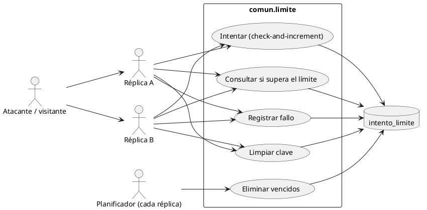
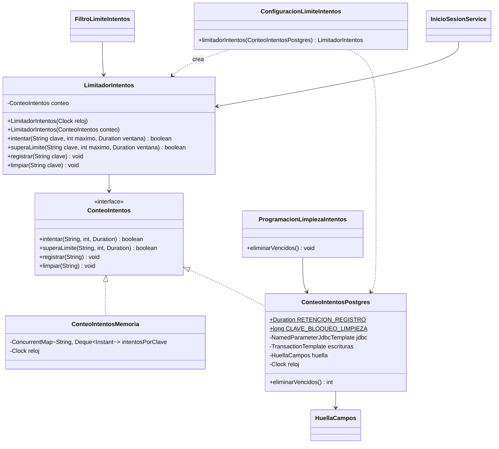

# HU-30 · Design — Límite de intentos compartido entre réplicas

> Requirements: [`requirements.md`](requirements.md). Módulo: `comun` (`comun.limite`). Sprint 9 · tamaño S.
> Sin patrones ★. Base: `progress/explore_HU-30.md`. Sin pantallas, sin endpoints nuevos.

## 1. Resumen y decisiones

Hoy `LimitadorIntentos` guarda, por clave, un registro de instantes (*sliding log*) en un `ConcurrentHashMap` del
proceso. Con dos réplicas detrás del ALB cada una lleva su propia cuenta. HU-30 deja **la misma clase y la misma API**
para los siete usuarios (`InicioSesionService`, `VerificadorMfa`, `ReautenticacionPerfil`, `CuentaBancariaService`,
`RecuperacionContrasenaService`, `CambioCorreoService`, `FiltroLimiteIntentos`) y cambia lo que hay detrás: el bean de
Spring delega en un conteo guardado en PostgreSQL, una fila por clave, actualizada con **una sola sentencia atómica**.

| # | Decisión | Origen |
|---|----------|--------|
| D1 | Contador compartido en PostgreSQL (tabla `intento_limite`, migración `V9_1`). Sin Redis/ElastiCache | Dueño |
| D2 | `LimitadorIntentos` sigue siendo **clase concreta** con las mismas cuatro firmas; pasa a delegar en una interfaz interna `ConteoIntentos` con dos implementaciones: `ConteoIntentosMemoria` (el código actual, movido sin cambios) y `ConteoIntentosPostgres`. El constructor `LimitadorIntentos(Clock)` se conserva y usa la memoria, así que las 11 pruebas unitarias que hacen `new LimitadorIntentos(reloj)` y los `mock(LimitadorIntentos.class)` **no cambian**. El bean de la aplicación se declara en `ConfiguracionLimiteIntentos` sobre `ConteoIntentosPostgres` (R1, R15) | Dueño (CA5), spec-author |
| D3 | Se conserva la semántica exacta: ventana **deslizante** con un instante por intento, borde `instante <= ahora − ventana` no cuenta, un rechazo no se registra, "ahora" sale del bean `Clock` (R6–R12). Por eso la fila guarda un arreglo `TIMESTAMPTZ[]` de instantes vigentes, no un contador por ventana fija | Dueño (CA3, CA5), explorador § 3 |
| D4 | La clave se guarda como **HMAC-SHA256 hex** con `HuellaCampos` (llave `CIFRADO_LLAVE_HUELLA`, ya obligatoria), nunca en claro ni como SHA-256 simple. Ver § 9 | spec-author, (I) |
| D5 | Atomicidad con `INSERT … ON CONFLICT (clave_hash) DO UPDATE … WHERE <vigentes < máximo> RETURNING`: una sentencia que inserta o bloquea la fila de la clave, cuenta, decide y añade. Ver § 8 | Dueño (S/D), spec-author |
| D6 | Cada escritura (`intentar`, `registrar`, `limpiar`) corre en **su propia transacción** (`TransactionTemplate` con `PROPAGATION_REQUIRES_NEW`, como `RegistroReembolsos`): confirma al instante y no depende del commit del llamador (MFA, DT-11 de HU-17) ni alarga sus bloqueos. `superaLimite` es una lectura simple, sin transacción propia (R19) | spec-author, explorador § 1 |
| D7 | Cada fila lleva `expira_en`: `intentar` la lleva a `ahora + ventana`; `registrar`, que no recibe ventana, a `ahora + RETENCION_REGISTRO` (1 h, la ventana más larga de RNF-SEG-17), y descarta instantes más viejos que esa retención. `superaLimite` con una ventana mayor que la retención lanza `IllegalArgumentException` para no contar de menos en silencio (R13, R14, R22, R23) | spec-author |
| D8 | Limpieza programada `ProgramacionLimpiezaIntentos` (mismo patrón que `ProgramacionExpiracion`: `@EnableScheduling` propio, `@ConditionalOnProperty`, `fixedDelay`). Cada pasada toma `pg_try_advisory_xact_lock(300030)`: si otra réplica la tiene, **se omite**; si no, un solo `DELETE … WHERE expira_en <= :ahora` (R24–R27) | Dueño (CA4), spec-author |
| D9 | **Fallo cerrado:** si la base falla, la excepción se propaga; un intento nunca se acepta por error de infraestructura (R20) | spec-author, (D) |
| D10 | La regla de límite por IP del WAF en el ALB es infraestructura: solo nota de despliegue (§ 12) | Dueño, historia |

## 2. Archivos

Todo en `2_Backend/`, paquete `pe.edu.ulima.espacioya.comun.limite` salvo donde se indica.

| Acción | Archivo | Rol |
|--------|---------|-----|
| Crear | `src/main/java/.../comun/limite/ConteoIntentos.java` | Interfaz interna del almacén de intentos (no es un puerto entre módulos) |
| Crear | `src/main/java/.../comun/limite/ConteoIntentosMemoria.java` | El cuerpo actual de `LimitadorIntentos` movido tal cual (mapa, `compute`, `purgar`) |
| Crear | `src/main/java/.../comun/limite/ConteoIntentosPostgres.java` | `@Component`: conteo compartido con `NamedParameterJdbcTemplate`, `HuellaCampos` y `Clock`; también `eliminarVencidos()` |
| Crear | `src/main/java/.../comun/limite/ConfiguracionLimiteIntentos.java` | `@Configuration`: bean `LimitadorIntentos` sobre `ConteoIntentosPostgres` |
| Crear | `src/main/java/.../comun/limite/ProgramacionLimpiezaIntentos.java` | Proceso programado de la limpieza |
| Modificar | `src/main/java/.../comun/limite/LimitadorIntentos.java` | Quita `@Component`; delega en `ConteoIntentos`; conserva `LimitadorIntentos(Clock)` (memoria) y agrega `LimitadorIntentos(ConteoIntentos)` |
| Crear | `src/main/resources/db/migration/V9_1__intento_limite.sql` | Tabla `intento_limite` (§ 10) |
| Modificar | `src/main/resources/application.properties` | `espacioya.limite.limpieza.activa` e `.intervalo` (§ 11) |
| Modificar | `src/test/resources/config/application.properties` | `espacioya.limite.limpieza.activa=false` |
| Modificar | `.env.example` | `LIMITE_LIMPIEZA_ACTIVA`, `LIMITE_LIMPIEZA_INTERVALO` |
| Crear (test) | `src/test/java/.../comun/limite/ContratoConteoIntentos.java` | Pruebas de semántica comunes (abstracta) |
| Crear (test) | `src/test/java/.../comun/limite/ConteoIntentosMemoriaTest.java` | Contrato sobre la memoria (línea base) |
| Crear (test) | `src/test/java/.../comun/limite/ConteoIntentosPostgresTest.java` | Unitaria con dobles: R10, R13, R20 |
| Crear (test) | `src/test/java/.../comun/limite/ConteoIntentosPostgresIT.java` | Contrato + dos instancias + concurrencia + limpieza sobre PostgreSQL (Testcontainers) |
| Crear (test) | `src/test/java/.../comun/limite/ProgramacionLimpiezaIntentosTest.java` | `ApplicationContextRunner`: R26, R27 |
| Sin cambios | Los siete usuarios del limitador, `ReglaLimite`, `ReglasLimite*`, `LimiteCatalogo` y **todas** las pruebas existentes | CA5 (R15, R16) |
| Modificar (docs) | `docs/modelo-datos.md`, `docs/architecture.md` | Lo hace el implementer (§ 15) |

## 3. Caso de uso



Flujo principal (CA1): el atacante reparte 5 contraseñas erradas para `ana@x.pe` entre A y B; cada fallo se suma a la
misma fila; el 6.º intento, llegue a A o a B, ve 5 vigentes y recibe 429. Flujo alterno (CA2): un login correcto en B
borra la fila; A deja de verla. Flujo de error (S/D): 10 peticiones simultáneas al catálogo con cupo restante 3, mitad
a cada réplica: la BD serializa las sentencias de esa clave y solo 3 devuelven fila.

## 4. Diagrama de clases



(Los otros cinco usuarios dependen de `LimitadorIntentos` igual que `InicioSesionService`.)

## 5. Diagramas de secuencia

### 5.1 Principal: fallos de login repartidos entre réplicas (CA1, CA2)

```mermaid
sequenceDiagram
  participant AT as Atacante
  participant ALB
  participant A as Réplica A · InicioSesionService
  participant B as Réplica B · InicioSesionService
  participant LA as LimitadorIntentos (A)
  participant LB as LimitadorIntentos (B)
  participant DB as PostgreSQL · intento_limite
  AT->>ALB: POST /api/sesiones (fallo 1..3)
  ALB->>A: reparte
  A->>LA: superaLimite("login|ana@x.pe", 5, 15 min)
  LA->>DB: SELECT count(*) … WHERE clave_hash = HMAC AND i > ahora-15min
  DB-->>LA: 0..2
  A->>LA: registrar("login|ana@x.pe")
  LA->>DB: [REQUIRES_NEW] INSERT … ON CONFLICT DO UPDATE (append ahora)
  A-->>AT: 401
  AT->>ALB: POST /api/sesiones (fallo 4..5)
  ALB->>B: reparte
  B->>LB: superaLimite(…) → SELECT → 3..4
  B->>LB: registrar(…) → upsert
  B-->>AT: 401
  AT->>ALB: POST /api/sesiones (6.º)
  ALB->>A: reparte
  A->>LA: superaLimite(…)
  LA->>DB: SELECT count(*)
  DB-->>LA: 5
  A-->>AT: 429 MENSAJE_DEMASIADOS_INTENTOS (+ auditoría LOGIN_BLOQUEADO)
  Note over B,DB: CA2: un login correcto en B → LB.limpiar → [REQUIRES_NEW] DELETE … WHERE clave_hash = HMAC; A ya no cuenta
```

### 5.2 Error: carrera en el cupo del catálogo (S/D)

```mermaid
sequenceDiagram
  participant A as Réplica A · FiltroLimiteIntentos
  participant B as Réplica B · FiltroLimiteIntentos
  participant DB as PostgreSQL
  Note over A,B: clave catalogo|203.0.113.9 con 119 vigentes, máximo 120
  par simultáneas
    A->>DB: INSERT … ON CONFLICT DO UPDATE … WHERE vigentes < 120 RETURNING
    B->>DB: INSERT … ON CONFLICT DO UPDATE … WHERE vigentes < 120 RETURNING
  end
  Note over DB: A toma el bloqueo de la fila; B espera
  DB-->>A: 1 fila (120 vigentes) → aceptado → cadena.doFilter
  Note over DB: commit de A; B reevalúa WHERE sobre la versión nueva: 120 < 120 es falso
  DB-->>B: 0 filas → rechazado (no se registra)
  B-->>B: 429 JSON ErrorDTO.MENSAJE_DEMASIADOS_INTENTOS
```

### 5.3 Limpieza programada con dos réplicas (CA4)

```mermaid
sequenceDiagram
  participant PA as Réplica A · ProgramacionLimpiezaIntentos
  participant PB as Réplica B · ProgramacionLimpiezaIntentos
  participant DB as PostgreSQL
  PA->>DB: BEGIN; SELECT pg_try_advisory_xact_lock(300030)
  DB-->>PA: true
  PB->>DB: BEGIN; SELECT pg_try_advisory_xact_lock(300030)
  DB-->>PB: false → COMMIT, 0 borradas (se omite)
  PA->>DB: DELETE FROM intento_limite WHERE expira_en <= :ahora
  PA->>DB: COMMIT (suelta el bloqueo)
```

## 6. Endpoints

Ninguno nuevo ni modificado. Las respuestas de los existentes no cambian (R16): 429 con
`ErrorDTO.MENSAJE_DEMASIADOS_INTENTOS` desde `FiltroLimiteIntentos` y desde `DemasiadosIntentosException` →
`ManejadorGlobalErrores`; la recuperación sigue respondiendo sin error y auditando `LIMITE_SUPERADO`.

## 7. Clases y firmas públicas

```java
// comun/limite/ConteoIntentos (nuevo) — mismas firmas y semántica que LimitadorIntentos
public interface ConteoIntentos {
    boolean intentar(String clave, int maximo, Duration ventana);
    boolean superaLimite(String clave, int maximo, Duration ventana);
    void registrar(String clave);
    void limpiar(String clave);
}

// comun/limite/ConteoIntentosMemoria (nuevo) — el código actual de LimitadorIntentos, sin cambios de lógica
public class ConteoIntentosMemoria implements ConteoIntentos {
    public ConteoIntentosMemoria(Clock reloj);
}

// comun/limite/LimitadorIntentos (M) — sin @Component; delega cada método en conteo
public class LimitadorIntentos {
    public LimitadorIntentos(Clock reloj);              // this(new ConteoIntentosMemoria(reloj)): pruebas unitarias
    public LimitadorIntentos(ConteoIntentos conteo);    // el bean de la aplicación
    public boolean intentar(String clave, int maximo, Duration ventana);
    public boolean superaLimite(String clave, int maximo, Duration ventana);
    public void registrar(String clave);
    public void limpiar(String clave);
}

// comun/limite/ConteoIntentosPostgres (nuevo)
@Component
public class ConteoIntentosPostgres implements ConteoIntentos {
    public static final Duration RETENCION_REGISTRO = Duration.ofHours(1);
    public static final long CLAVE_BLOQUEO_LIMPIEZA = 300_030L;   // distinta de 190_019 (liquidaciones)
    public ConteoIntentosPostgres(DataSource datos, PlatformTransactionManager transacciones,
                                  HuellaCampos huella, Clock reloj);
    public int eliminarVencidos();   // filas borradas; 0 si otra réplica tiene la limpieza (R25)
}

// comun/limite/ConfiguracionLimiteIntentos (nuevo)
@Configuration(proxyBeanMethods = false)
public class ConfiguracionLimiteIntentos {
    @Bean
    public LimitadorIntentos limitadorIntentos(ConteoIntentosPostgres conteo);
}

// comun/limite/ProgramacionLimpiezaIntentos (nuevo)
@Configuration(proxyBeanMethods = false)
@EnableScheduling
@ConditionalOnProperty(name = "espacioya.limite.limpieza.activa", havingValue = "true")
public class ProgramacionLimpiezaIntentos {
    public ProgramacionLimpiezaIntentos(ConteoIntentosPostgres conteo);
    @Scheduled(fixedDelayString = "${espacioya.limite.limpieza.intervalo}")
    public void eliminarVencidos();
}
```

Notas de implementación:

- `LimitadorIntentos` **debe** perder `@Component`: con dos constructores públicos y sin `@Autowired`, Spring no sabría
  cuál usar. El bean lo crea `ConfiguracionLimiteIntentos`; `FiltroLimiteIntentos` y los servicios lo siguen
  recibiendo por constructor igual que hoy.
- `ConteoIntentosPostgres` arma `new NamedParameterJdbcTemplate(datos)` (no depende de la autoconfiguración de JDBC) y un
  `TransactionTemplate escrituras` con `PROPAGATION_REQUIRES_NEW`. Con el `JpaTransactionManager` de la aplicación,
  `JdbcTemplate` usa la conexión de la transacción nueva (Spring liga el `ConnectionHolder` del `DataSource`).
- *ahora* = `Instant.now(reloj).truncatedTo(ChronoUnit.MICROS)`; los parámetros de fecha se pasan como
  `OffsetDateTime.ofInstant(…, ZoneOffset.UTC)`. Nada usa `now()` de PostgreSQL (R11).
- La clave enviada a la base es siempre `huella.calcular(clave)` (R21). La clave en claro no se registra en logs.
- Comentarios en el código solo para el *por qué* (atomicidad del upsert, `REQUIRES_NEW`, retención, `fillfactor`).

## 8. Operaciones en SQL y por qué son atómicas

Parámetros: `:clave` = huella; `:ahora`; `:desde` = `ahora − ventana`; `:expira` = `ahora + ventana` (o
`ahora + RETENCION_REGISTRO` en `registrar`); `:maximo`.

**`intentar`** (R3, R7, R8, R9, R17, R22) — en `escrituras` (REQUIRES_NEW); si `maximo < 1` devuelve `false` antes de
tocar la base (R10, igual que la memoria: `0 < 0` es falso):

```sql
INSERT INTO intento_limite AS l (clave_hash, instantes, expira_en)
VALUES (:clave, ARRAY[CAST(:ahora AS TIMESTAMPTZ)], :expira)
ON CONFLICT (clave_hash) DO UPDATE
   SET instantes = ARRAY(SELECT i FROM unnest(l.instantes) AS i WHERE i > :desde ORDER BY i)
                   || CAST(:ahora AS TIMESTAMPTZ),
       expira_en = GREATEST(l.expira_en, EXCLUDED.expira_en)
 WHERE (SELECT count(*) FROM unnest(l.instantes) AS i WHERE i > :desde) < :maximo
RETURNING clave_hash
```

Aceptado ⇔ devuelve una fila (`jdbc.query(sql, params, ResultSet::next)`). Si la clave no existe se inserta (con
`maximo ≥ 1` siempre cabe). Si existe y la condición `WHERE` es falsa no se actualiza nada: el rechazo no se registra
(R9).

**Por qué no hay carrera (S/D):** PostgreSQL garantiza que `INSERT … ON CONFLICT DO UPDATE` termina en inserción o en
actualización de forma atómica aun con alta concurrencia. Si la fila existe, la sentencia toma el **bloqueo de fila**
antes de evaluar `SET` y `WHERE`; una segunda sentencia sobre la misma clave (desde otra réplica) espera ese bloqueo y,
en `READ COMMITTED`, evalúa `WHERE` y `SET` sobre la **versión ya confirmada** por la primera. Si dos réplicas insertan
a la vez una clave nueva, el índice único serializa: una inserta y la otra pasa a la rama de actualización viendo la
fila nueva. El conteo, la decisión y el añadido ocurren así dentro de una sola sentencia y una sola fila bloqueada, sin
lecturas previas en Java. La transacción dura una sentencia, así que el bloqueo dura milisegundos y claves distintas
nunca se bloquean entre sí.

**`superaLimite`** (R2, R6, R13) — lectura sin transacción propia (en `READ COMMITTED` ve lo último confirmado por
cualquier réplica); antes, si `ventana > RETENCION_REGISTRO`, `IllegalArgumentException`:

```sql
SELECT count(*) FROM intento_limite AS l CROSS JOIN LATERAL unnest(l.instantes) AS i
 WHERE l.clave_hash = :clave AND i > :desde
```

Devuelve `count >= maximo`. No escribe (como hoy, no registra).

**`registrar`** (R14, R18, R23) — en `escrituras`; mismo upsert sin `WHERE`, con `:desde` = `ahora − RETENCION_REGISTRO`.
Dos registros simultáneos se serializan por el bloqueo de fila y ninguno se pierde.

**`limpiar`** (R4, R5) — en `escrituras`: `DELETE FROM intento_limite WHERE clave_hash = :clave`.

**`eliminarVencidos`** (R24, R25) — en `escrituras`:

```sql
SELECT pg_try_advisory_xact_lock(:claveLimpieza);           -- false → devuelve 0 sin borrar
DELETE FROM intento_limite WHERE expira_en <= :ahora;       -- devuelve las filas borradas
```

El bloqueo consultivo se suelta solo al confirmar. Usa la forma de un `bigint` como `LiquidacionRepository`
(`190_019`), con otra constante. Aunque el `DELETE` ya es idempotente, el bloqueo evita que dos réplicas hagan la misma
pasada a la vez (CA4, "sin duplicar trabajo"). Si una `intentar` actualiza una fila vencida mientras la limpieza la
borra, la que llega segunda espera el bloqueo de fila: si gana la limpieza, el upsert inserta la fila de nuevo (cuenta
desde cero, que es lo correcto porque estaba vencida); si gana el upsert, el `DELETE` reevalúa `expira_en <= :ahora`
sobre la versión nueva y no la borra.

Una fila vencida que todavía no se limpió no altera ningún conteo: sus instantes no son vigentes (R6, R7). La limpieza
existe por higiene y privacidad (STRIDE I), no por exactitud.

## 9. Clave en claro, SHA-256 o HMAC (STRIDE I) — decisión D4

Las claves son `login|<correo>`, `recuperacion|<correo>`, `<grupo>|<ip>` y `<prefijo>|<usuarioId>`. Correos e IPs son
datos personales (Ley 29733); además la tabla revela *quién estaba fallando su contraseña o pidiendo recuperación*.

| Opción | Problema |
|--------|----------|
| Clave en claro | Legible por cualquiera con lectura de la base o de un respaldo, durante toda su ventana |
| SHA-256 simple (`TokenAleatorio.hash`) | Reversible por diccionario: basta hashear los correos de `usuario` o las 2³² IPv4 para recuperar la clave. Sirve para tokens aleatorios de 256 bits, no para valores adivinables |
| **HMAC-SHA256 (`HuellaCampos`)** — elegida | Sin la llave (`CIFRADO_LLAVE_HUELLA`, que vive en el entorno, no en la base) no se revierte probando valores. Es el mismo criterio de `perfil_arrendador.hash_documento` y `codigo_respaldo.hash_codigo`. La llave ya es obligatoria en todos los entornos y en pruebas |

Consecuencias aceptadas: rotar `CIFRADO_LLAVE_HUELLA` reinicia todos los contadores (y ya obliga a recalcular
`hash_documento`); para saber si un correo concreto está bloqueado hay que calcular su huella. El costo es un HMAC por
llamada (microsegundos). Además, cada fila se borra al vencer (R22–R24): con `intentar`, a lo sumo un intervalo de
limpieza después de su ventana; con `registrar`, una hora después del último fallo.

## 10. Migración `V9_1__intento_limite.sql`

```sql
-- HU-30: intentos del limitador compartidos entre réplicas. Una fila por clave con los instantes vigentes
-- (ventana deslizante). La clave se guarda como HMAC-SHA256 hex (HuellaCampos), nunca en claro.
-- Sin índice en expira_en: así cada intento es una actualización HOT (fillfactor 70) y la limpieza recorre una
-- tabla pequeña (solo claves con intentos en la última hora).
CREATE TABLE intento_limite (
    clave_hash CHAR(64)      NOT NULL,
    instantes  TIMESTAMPTZ[] NOT NULL,
    expira_en  TIMESTAMPTZ   NOT NULL,
    CONSTRAINT pk_intento_limite PRIMARY KEY (clave_hash),
    CONSTRAINT ck_intento_limite_clave_hash CHECK (clave_hash ~ '^[0-9a-f]{64}$'),
    CONSTRAINT ck_intento_limite_instantes CHECK (cardinality(instantes) >= 1)
) WITH (fillfactor = 70);
```

- Sprint 9 → `V9_1`. HU-31 es del mismo sprint: si al unir ya existe `V9_1` en `develop`, se renombra al siguiente `n`
  libre (`docs/conventions.md`). No depende de ninguna otra tabla.
- Sin entidad JPA (`ddl-auto=validate` solo valida entidades). Sin llaves foráneas: la clave no es una entidad.
- Tamaño: el arreglo más largo es el del catálogo (≤ 120 instantes × 8 bytes), cabe en la fila sin TOAST.

## 11. Configuración

`application.properties` (junto a las de `reservas`):

```properties
# Limpieza de intento_limite vencidos (HU-30). Cada réplica la programa; un bloqueo consultivo evita pasadas dobles.
espacioya.limite.limpieza.activa=${LIMITE_LIMPIEZA_ACTIVA:true}
espacioya.limite.limpieza.intervalo=${LIMITE_LIMPIEZA_INTERVALO:PT10M}
```

`src/test/resources/config/application.properties`: `espacioya.limite.limpieza.activa=false` (las pruebas llaman a
`eliminarVencidos()`). `.env.example`: las dos variables, sin valores secretos. No se agregan propiedades para máximos
ni ventanas (fuera del alcance).

## 12. Nota de despliegue (STRIDE D) — sin código

En UAT, el límite por IP del catálogo (120 / min, `LIMITE_CATALOGO_*`) y el de registro (5 / h) se aplican en la
aplicación y ahora valen para el conjunto de réplicas. Se **complementan** con una regla *rate-based* del AWS WAF
asociada al ALB (bloqueo por IP de origen ante volúmenes muy superiores), que frena una inundación antes de que cada
petición cueste una escritura en PostgreSQL. Es configuración de infraestructura: va en la guía de despliegue, fuera de
esta historia. Con el WAF delante, la IP que ve el backend sigue saliendo de `X-Forwarded-For` solo si la conexión
viene de `PROXIES_CONFIANZA` (el ALB), como hoy.

## 13. Excepciones y componentes de `comun` reutilizados

| Componente | Uso |
|------------|-----|
| `DemasiadosIntentosException`, `ErrorDTO.MENSAJE_DEMASIADOS_INTENTOS`, `ManejadorGlobalErrores` | Sin cambios: los lanzan y traducen los servicios y el filtro (R16) |
| `HuellaCampos` | Huella de la clave (D4, R21) |
| Bean `Clock` (`ConfiguracionReloj`) | *ahora* (R11); las IT lo sustituyen por `RelojControlable` |
| `FiltroLimiteIntentos`, `ReglaLimite` | Sin cambios |
| Patrón de `ProgramacionExpiracion` | Proceso programado con `@ConditionalOnProperty` y `fixedDelay` |
| Patrón de `RegistroReembolsos` | `TransactionTemplate` `REQUIRES_NEW` |

No se crean excepciones nuevas. `IllegalArgumentException` (R13) es un error de programación, no de negocio. Un fallo
de la base sale como `DataAccessException` de Spring (R20): en un servicio, `ManejadorGlobalErrores` lo trata como
error genérico 500; en el filtro, lo resuelve la página de error de Spring Boot (sin traza). Ningún puerto nuevo entre
módulos: `ConteoIntentos` es interno de `comun.limite`.

## 14. Pruebas

| Prueba | Tipo | Qué demuestra |
|--------|------|---------------|
| `LimitadorIntentosTest`, `FiltroLimiteIntentosTest` y las 9 unitarias de servicios que hacen `new LimitadorIntentos(reloj)` o `mock(...)` | Existentes, **sin cambios** | R15 (siguen compilando y en verde) |
| `ContratoConteoIntentos` (abstracta) | — | Semántica sobre un `LimitadorIntentos` construido por la subclase con un `RelojControlable`: 5 aceptados y 6.º rechazado; rechazados no cuentan ni alargan (R9); ventana deslizante desde el más antiguo (R6, R8); borde exacto no cuenta (R6); vencidos → desde cero (R7); claves independientes (R12); `superaLimite` al 5.º sin registrar (R2 en una instancia); `limpiar` reinicia (R4). Claves únicas por prueba (`UUID`) |
| `ConteoIntentosMemoriaTest extends ContratoConteoIntentos` | Unitaria | Línea base: el contrato vale para la memoria |
| `ConteoIntentosPostgresTest` | Unitaria (Mockito: `DataSource`, `PlatformTransactionManager`) | R10 (`maximo = 0` → `false`, sin `getConnection`), R13 (ventana de 2 h → `IllegalArgumentException`, sin `getConnection`), R20 (`getConnection` lanza `SQLException` → sale `DataAccessException`, nunca `true`) |
| `ConteoIntentosPostgresIT extends ContratoConteoIntentos` | IT (`@SpringBootTest`, `@Import(TestcontainersConfiguration.class)`, `RelojControlable` `@Primary` en 2026-10) | El contrato contra PostgreSQL (CA3, CA5) y además: **R1** el bean `LimitadorIntentos` del contexto deja una fila en `intento_limite`; **R2/R3** *instancia A* = bean del contexto, *instancia B* = `new LimitadorIntentos(new ConteoIntentosPostgres(otroPool, new DataSourceTransactionManager(otroPool), huella, reloj))` con su propio `HikariDataSource` hacia el mismo contenedor: 3 fallos en A + 2 en B → `superaLimite` `true` en ambas; 5 aceptados repartidos → el 6.º rechazado en cualquiera; **R4/R5** `login|<correo>` registrado solo en B, `limpiar` en A → `false` en B; **R11** el instante guardado es el del reloj de prueba (2026-10), no el de la base; **R14** tras `registrar` con instantes de hace más de 1 h, el arreglo solo conserva los recientes; **R17** 20 hilos (10 por instancia) liberados a la vez con `CountDownLatch` sobre `intentar(clave, 5, 1 min)` → exactamente 5 `true`, y con 2 vigentes previos → exactamente 3 (`@RepeatedTest(5)`); **R18** 20 `registrar` concurrentes → `cardinality(instantes) = 20`; **R19** `registrar` dentro de una transacción del llamador que se revierte → el intento sigue en la tabla; **R21** `clave_hash = huella.calcular(clave)`, cumple `^[0-9a-f]{64}$` y `row_to_json` de la fila no contiene el correo ni la IP; **R22/R23** `expira_en` = `ahora + ventana` / `ahora + 1 h` y nunca retrocede; **R24** con filas vencidas y vigentes, `eliminarVencidos()` borra solo las vencidas y devuelve cuántas; **R25** con otra conexión que mantiene `pg_advisory_xact_lock(300030)` en una transacción abierta, `eliminarVencidos()` devuelve 0 y no borra |
| `ProgramacionLimpiezaIntentosTest` | Unitaria (`ApplicationContextRunner` con un `ConteoIntentosPostgres` simulado) | R26 (`activa=true` → bean presente; su método llama a `eliminarVencidos()`), R27 (`false` o sin propiedad → sin bean) |
| `SesionControllerIT`, `LimiteCatalogoIT`, `LimiteFichaIT`, `UsuarioControllerIT`, `ArrendadorControllerIT`, `RecuperacionContrasenaControllerIT`, `CambioCorreoControllerIT`, `MfaControllerIT`, `MfaInicioSesionIT`, `DatosPersonalesControllerIT`, `FacturacionControllerIT`, `CuentaBancariaControllerIT` | IT existentes, **sin cambios** | R16: los mismos 429, máximos y ventanas, ahora sobre el conteo compartido |

Aislamiento de las IT existentes: cada contexto de Spring tiene su contenedor, como hoy tenía su mapa; las pruebas ya
usan IPs y correos únicos, y la limpieza programada está apagada en pruebas. No se resetea la tabla entre pruebas.

## 15. Documentación que actualiza el implementer

- `docs/modelo-datos.md`: fila `intento_limite` en el grupo **Transversal** (clave_hash HMAC, instantes, expira_en,
  sin FK, `V9_1`) y fila en "Restricciones clave" (`pk_intento_limite`, `ck_intento_limite_clave_hash`,
  `ck_intento_limite_instantes`).
- `docs/architecture.md`: una línea en (D) de seguridad transversal: los límites de `LimitadorIntentos` se cuentan en
  PostgreSQL y valen para todas las réplicas (HU-30); la regla WAF por IP es de la guía de despliegue.
- No cambia la tabla de puertos ni la de patrones.

## 16. Riesgos y límites conocidos

1. **Check-then-act en los servicios.** `InicioSesionService`, `ReautenticacionPerfil`, `CuentaBancariaService` y
   `VerificadorMfa` hacen `superaLimite → validar → registrar`, que no es atómico ni hoy (explorador § 1). En el instante
   en que se cruza el límite, las peticiones que ya pasaron `superaLimite` en paralelo pueden validar su contraseña
   antes de que se registre el fallo que bloquea. Es un exceso acotado al número de peticiones simultáneas en ese
   momento, no "el doble" acumulado; después todas ven el bloqueo. Cerrarlo exige cambiar los servicios a
   `intentar`/reservar cupo, lo que prohíben CA5 y la decisión del dueño. `intentar` (filtro, recuperación, cambio de
   correo) sí es exacto (R17).
2. **Segunda conexión por `REQUIRES_NEW`.** Las escrituras hechas dentro de una transacción del llamador (MFA) piden
   una segunda conexión del pool mientras la primera sigue tomada. Con el pool por defecto (10) solo se agota con
   decenas de verificaciones MFA simultáneas en una réplica; entonces la espera de Hikari (30 s) termina en error (fallo
   cerrado, D9). Aceptable para UAT.
3. **Una escritura por petición al catálogo.** Cada `GET /api/espacios*` hace un upsert. A 120 / min por IP y con
   actualizaciones HOT es poco; el WAF (§ 12) corta volúmenes anómalos antes.
4. **Relojes de las réplicas.** El instante sale del `Clock` de cada réplica (Fargate sincroniza con Amazon Time Sync);
   un desfase de milisegundos solo mueve el borde de la ventana esos milisegundos.

## 17. Alternativas descartadas

| Alternativa | Por qué no |
|-------------|------------|
| Redis / ElastiCache | Fuera del alcance de la historia; en Learner Lab agrega un servicio que mantener |
| Contador por **ventana fija** (`conteo`, `inicio_ventana`) | Cambia la semántica deslizante que fijan `LimitadorIntentosTest` y `FiltroLimiteIntentosTest` (CA3, CA5) y permite ráfagas de 2 × máximo en el borde de la ventana |
| Una fila **por intento** + `pg_advisory_xact_lock(hash(clave))` | Hasta 120 inserciones/min por IP del catálogo, varias sentencias por intento (bloquear, contar, insertar) y el hash de la clave a `bigint` comparte espacio con el bloqueo `190_019`. El arreglo por clave hace lo mismo en una sentencia |
| `SELECT … FOR UPDATE` + decisión en Java + `UPDATE` | Tres viajes a la base y la carrera de "insertar si no existe" que habría que resolver capturando `DataIntegrityViolationException` y reintentando. El upsert lo resuelve en el motor |
| Entidad JPA + `@Query` nativa | El arreglo `TIMESTAMPTZ[]` requiere mapeo especial de Hibernate y un `@Modifying` no devuelve el `RETURNING`; aquí no hay agregado de dominio que cargar. `NamedParameterJdbcTemplate` es el DAO a mano justificado porque impone la regla atómica (`docs/conventions.md`) |
| Convertir `LimitadorIntentos` en interfaz | Rompe `new LimitadorIntentos(reloj)` en 11 pruebas unitarias. La delegación conserva la clase y la API (D2) |
| Tomar "ahora" de `now()` de PostgreSQL | Evita desfases entre réplicas, pero rompe todas las IT que avanzan `RelojControlable` (explorador § 1) |
| ShedLock o elección de líder para la limpieza | Dependencia nueva para algo que resuelve un `pg_try_advisory_xact_lock` |
| Clave en claro o SHA-256 simple | Ver § 9 |
