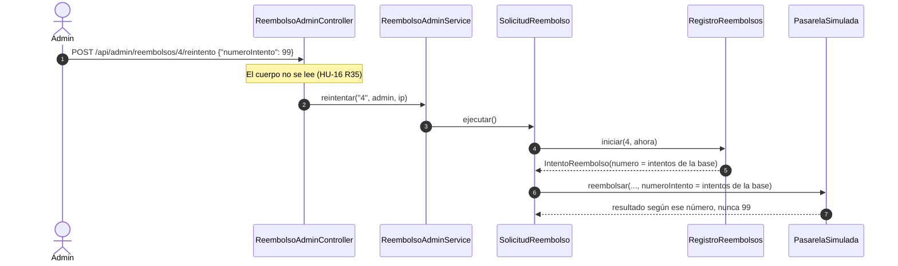

# HU-31 · Design — Fallo de reembolso simulado sin estado en memoria

> Requirements: [`requirements.md`](requirements.md). Módulo `pagos` (`pagos.service.pasarela`,
> `pagos.service.reembolso`). Sprint 9. Sin patrones ★ propios: se respeta el ★ Adapter y el ★ Command de HU-16.

## 1. Decisiones técnicas

| # | Tema | Decisión | Por qué |
|---|------|----------|---------|
| DT-1 | Dónde vive el número | `SolicitudReembolsoPasarela` gana un cuarto componente `int numeroIntento`: `record SolicitudReembolsoPasarela(String idTransaccion, BigDecimal monto, String claveIdempotencia, int numeroIntento)`. Constructor compacto: `numeroIntento < 1` → `IllegalArgumentException` (R3). | Es el Target del ★ Adapter: el único dato que cruza del comando a la pasarela. El número ya existe y está persistido (`reembolso.intentos`, HU-16 DT-5); basta con llevarlo. Un record propio, sin tipos del proveedor (HU-16 DT-3). |
| DT-2 | Quién lo llena | `SolicitudReembolso.ejecutar()` construye la solicitud con `intento.numero()` (R1). `IntentoReembolso.numero` lo arma `RegistroReembolsos.iniciar` con `reembolso.getIntentos()` después de `iniciarIntento` y bajo el bloqueo de la fila; la transacción `REQUIRES_NEW` confirma antes de llamar a la pasarela. | STRIDE T: el número sale solo de la base. El controlador del admin no lee cuerpo (HU-16 R35) y el comando no recibe el número de nadie más (R2). Dos intentos a la vez se serializan en el bloqueo de `iniciar` (HU-16 R22, R23), así que cada intento tiene un número único y creciente (R4). |
| DT-3 | Decisión de la simulada | `PasarelaSimulada.reembolsar`: (1) id sin `sim-` → `ServicioExternoException` (R12, igual que hoy y antes que todo); (2) `solicitud.numeroIntento() <= fallosReembolso` → `log.info("Reembolso simulado: falla configurada en el intento {}", n)` y `ServicioExternoException` (R5); (3) si no, `log.info("Reembolso simulado: no se llamó a ninguna pasarela")` y `ReembolsoRealizado("sim-reembolso-" + clave)` (R6, R7). Se **eliminan** el campo `llamadasDeReembolso` y el import de `AtomicInteger`. | El resultado pasa a ser una función pura de `(idTransaccion, claveIdempotencia, numeroIntento, N)`: dos réplicas o una instancia recién arrancada responden lo mismo (R8–R10). El mapa `montos` de HU-13 (checkout y consulta simulados) **no** se toca: es otra historia y no participa del reembolso. |
| DT-4 | Adaptador real | `MercadoPagoAdapter.reembolsar` no cambia: no lee `numeroIntento`; sigue mandando `X-Idempotency-Key = claveIdempotencia`, `amount = monto` y la ruta con `idTransaccion`. Solo se amplía el comentario de la línea 147 ("el número de intento solo lo usa la simulada"). | CA4 y HU-16 D6: si un intento llegó a Mercado Pago y su respuesta se perdió, el reintento con la misma clave devuelve el mismo reembolso. Meter el número en la clave o en el cuerpo rompería esa idempotencia. |
| DT-5 | Configuración | Sin propiedades nuevas. Se reescriben los comentarios de `application.properties` (líneas 118-119) y `2_Backend/.env.example` (líneas 108-110): "los intentos 1 a N de cada reembolso fallan (por el número de intento guardado en la base), también con varias réplicas y tras reiniciar". | Mismo nombre de variable que ya usa UAT (`PAGOS_SIMULADA_FALLOS_REEMBOLSO`); el significado de *N* para la demo de CA2 de HU-16 es el mismo con una réplica. |
| DT-6 | Pruebas de réplicas y reinicio | Unitarias en `PasarelaSimuladaTest` con **dos instancias** de `PasarelaSimulada` (simulan dos réplicas) y con una **instancia nueva** tras fallos en otra (simula un reinicio). IT en `ReembolsoAdminControllerIT` (*N* = 1): un reembolso `FALLIDO` sembrado con `intentos = 1` (su intento 1 "ocurrió en otro proceso", la simulada en ejecución nunca vio esa clave) se reintenta y queda `REEMBOLSADO`. | Con el código de hoy ese IT falla (el contador en memoria de esa clave empieza en 0, la llamada 1 ≤ 1 falla), así que es la prueba de regresión de CA2. Levantar dos contextos de Spring en un IT no agrega nada: la simulada no comparte nada con la base salvo lo que le llega en la solicitud. |

**Sin puerto nuevo** (la tabla "Puertos entre módulos" no cambia). **Sin cambios en `comun`.** Sin migraciones: no hay
`V9_<n>__…` en esta historia (la columna `reembolso.intentos` y su `CHECK (intentos >= 0)` ya existen desde `V4_3`).

## 2. Caso de uso

**Actor:** admin (reintento) y el sistema (intento automático tras cancelar o resolver un reclamo).
**Precondición:** pasarela `simulada`, `fallos-reembolso = N`, pago con id `sim-…`.

1. Se pide el intento *k* de un reembolso (automático o por `POST /api/admin/reembolsos/{id}/reintento`), en
   cualquier réplica.
2. `RegistroReembolsos.iniciar` bloquea la fila, sube `intentos` a *k*, confirma y devuelve `IntentoReembolso(numero = k)`.
3. `SolicitudReembolso` pide a la pasarela `SolicitudReembolsoPasarela(..., clave, k)`.
4. La simulada falla si *k* ≤ *N*; si no, aprueba.
5. `RegistroReembolsos.registrarFallo` / `registrarExito` deja el estado y la auditoría con `intento=k` (igual que hoy).

**Flujo alterno (reinicio o réplica distinta):** entre el paso 5 del intento *k* y el paso 1 del intento *k* + 1 el
proceso se reinicia o la petición cae en otra réplica: el paso 2 lee `intentos = k` de la base y el resultado no
cambia.

## 3. Diagramas de secuencia

### 3.1 Flujo principal: N = 1, el automático falla en la réplica A y el reintento se aprueba en la réplica B

```mermaid
sequenceDiagram
    autonumber
    actor U as Usuario
    actor Ad as Admin
    participant A as Réplica A
    participant B as Réplica B
    participant Reg as RegistroReembolsos
    participant DB as PostgreSQL
    participant SimA as PasarelaSimulada (A)
    participant SimB as PasarelaSimulada (B)

    U->>A: POST /api/reservas/{id}/cancelacion
    A->>Reg: iniciar(reembolsoId, ahora)
    Reg->>DB: SELECT ... FOR UPDATE; intentos = 1; COMMIT
    Reg-->>A: IntentoReembolso(numero = 1)
    A->>SimA: reembolsar(Solicitud(sim-7-…, 241.50, espacioya-reembolso-4, 1))
    SimA-->>A: ServicioExternoException (1 <= N)
    A->>Reg: registrarFallo → FALLIDO, REEMBOLSO_FALLIDO intento=1
    Note over A,B: La réplica que atiende cambia (o el backend se reinicia)
    Ad->>B: POST /api/admin/reembolsos/4/reintento
    B->>Reg: iniciar(4, ahora)
    Reg->>DB: SELECT ... FOR UPDATE; intentos = 2; COMMIT
    Reg-->>B: IntentoReembolso(numero = 2)
    B->>SimB: reembolsar(Solicitud(sim-7-…, 241.50, espacioya-reembolso-4, 2))
    SimB-->>B: ReembolsoRealizado(sim-reembolso-espacioya-reembolso-4)
    B->>Reg: registrarExito → REEMBOLSADO, REEMBOLSO_REALIZADO intento=2
    B-->>Ad: 200 {estado: REEMBOLSADO, intentos: 2}
```

### 3.2 Flujo de error: el admin manda un número en el cuerpo (STRIDE T)



## 4. Endpoints

Ninguno nuevo ni modificado. `POST /api/admin/reembolsos/{id}/reintento` y `GET /api/admin/reembolsos` (HU-16) quedan
igual: mismo DTO (`ReembolsoAdminDTO`) y mismos códigos (200, 400, 401, 403, 404).

## 5. Clases y firmas públicas

```java
// pagos/service/pasarela (M)
/**
 * Reembolso que se pide a la pasarela (HU-16, ★ Adapter). La claveIdempotencia es la misma en todos los intentos (D6).
 * numeroIntento es reembolso.intentos ya confirmado en la base para este intento (HU-31): solo lo usa la simulada.
 */
public record SolicitudReembolsoPasarela(String idTransaccion, BigDecimal monto, String claveIdempotencia,
                                         int numeroIntento) {
    public SolicitudReembolsoPasarela { /* numeroIntento < 1 → IllegalArgumentException (R3) */ }
}

// PasarelaSimulada (M): misma firma pública. Constructor (String secretoWebhook, int fallosReembolso) sin cambios.
// Se elimina: private final Map<String, AtomicInteger> llamadasDeReembolso.
public ReembolsoRealizado reembolsar(SolicitudReembolsoPasarela solicitud); // DT-3

// MercadoPagoAdapter (M, solo comentario): reembolsar sin cambios de comportamiento.

// pagos/service/reembolso/SolicitudReembolso (M): ejecutar() pasa intento.numero() como cuarto argumento.
```

`PasarelaPago`, `IntentoReembolso`, `RegistroReembolsos`, `Reembolso` y `ReembolsoRepository` **no cambian** (solo se
puede afinar el javadoc de `PasarelaPago.reembolsar` para nombrar el número de intento).

## 6. Archivos por módulo y capa

| Ubicación | Archivos | Requirements |
|-----------|----------|--------------|
| `pagos/service/pasarela/` (M) | `SolicitudReembolsoPasarela` (componente nuevo + constructor compacto) | R1, R3 |
| `pagos/service/pasarela/` (M) | `PasarelaSimulada` (decisión por número, sin mapa, javadoc de clase líneas 30-32) | R5–R10, R12 |
| `pagos/service/pasarela/` (M) | `MercadoPagoAdapter` (solo comentario) | R14 |
| `pagos/service/reembolso/` (M) | `SolicitudReembolso` (pasa `intento.numero()`) | R1, R2, R4 |
| `resources/` (M) | `application.properties` (comentario de `fallos-reembolso`); `2_Backend/.env.example` (comentario) | R5 |
| Tests | ver § 8 | todos |
| Docs (implementer) | `docs/architecture.md` (§ 9) | — |

Frontend: **ninguno**. No hay pantallas nuevas ni cambiadas, ni estados nuevos en "Color de cada estado".

## 7. Excepciones y componentes de `comun`

- `comun.error.ServicioExternoException`: se reutiliza para el fallo simulado (como hoy). Sin excepciones nuevas.
- `IllegalArgumentException` (JDK) en el constructor compacto del record: es un error de programación, nunca llega a
  la API (el número siempre sale de `iniciar`, ≥ 1).
- `comun.auditoria.AuditoriaService`: se sigue usando desde `RegistroReembolsos`, sin cambios (R13).
- Rate limiting, correo, cifrado, almacenamiento: no aplican.

## 8. Pruebas: qué cambia y qué se agrega

Revisión hecha de todas las pruebas que dependen del contador en memoria o construyen `SolicitudReembolsoPasarela`
(búsqueda de `fallos-reembolso`, `SolicitudReembolsoPasarela`, `new PasarelaSimulada(`):

| Test | Hoy | Cambio | Requirements |
|------|-----|--------|--------------|
| `SolicitudReembolsoPasarelaTest` (N, unitaria) | — | `numeroIntento` 0 y −1 → `IllegalArgumentException`; 1 se acepta. | R3 |
| `PasarelaSimuladaTest` (M) | helper `reembolso(id, clave)`; `fallaLasPrimerasLlamadasDeCadaClave` y `fallaExactamenteNLlamadas` cuentan llamadas (HU-16 R15) | Helper pasa a `reembolso(id, clave, numero)`. Se **reemplazan** los dos tests de R15 por: (a) con *N* = 2, intentos 1 y 2 fallan y 3 aprueba (R5, R6); (b) con *N* = 1, el intento 1 repetido falla las dos veces y el 2 repetido aprueba las dos veces con el mismo id; el intento 2 de otra clave aprueba sin que esa clave haya fallado antes (R8); (c) **dos instancias** A y B con *N* = 2: A(1) falla, B(2) falla, A(3) aprueba, B(3) aprueba con el mismo id, y para cada número 1..5 A y B dan el mismo resultado (parametrizado) (R8, R9); (d) **reinicio**: A con *N* = 1 falla el 1; una instancia **nueva** C con *N* = 1 aprueba el 2 y falla el 1 (R10). `apruebaElReembolsoSimulado` pasa a usar número 1 con *N* = 0 y su `@DisplayName` cita también HU-31 R7. `noReembolsaLoQueNoEmitio` se parametriza con *N* ∈ {0, 1} y número ∈ {1, 2} (R12). | R5–R10, R12 |
| `SolicitudReembolsoTest` (M) | `solicitudConLosDatosDelIntento` verifica el record de 3 componentes | Espera `new SolicitudReembolsoPasarela("sim-7-APROBADO-1", 161.00, "espacioya-reembolso-4", 1)`. `mismaClaveEnCadaEjecucion` agrega que los números enviados son 1 y 2 (con `INTENTO` y `segundo`). | R1, R4 |
| `MercadoPagoAdapterTest` (M) | constante `REEMBOLSO` de 3 componentes | Constante con número 1. Test nuevo: dos `reembolsar` con números 1 y 3 → las dos `doble.solicitudes("POST")` tienen la misma ruta, autorización, cuerpo y `claveIdempotencia` (records iguales). | R14 |
| `ReembolsoAdminControllerIT` (M, *N* = 1) | `mismaClaveEnElReintento` exige `pedidos.get(1).isEqualTo(pedidos.get(0))` → **fallaría** con el número | Compara transacción, monto y clave iguales, y `numeroIntento` 1 y 2. | R4 |
| `ReembolsoAdminControllerIT` (M) | `ignoraElCuerpo` (sembrado `FALLIDO` con `intentos = 1`): hoy el reintento fallaba porque el contador de esa clave empezaba en 0; ahora aprueba. Solo exige 200, así que sigue verde. | El cuerpo agrega `"numeroIntento":99,"intentos":99`; se exige `pedido.numeroIntento() == 2` y `intentos = 2` en la fila. | R2 |
| `ReembolsoAdminControllerIT` (M) | — | Test nuevo de **reinicio**: `fallidoSembrado()` (intentos = 1, la simulada en ejecución nunca vio su clave) → reintento → 200 `REEMBOLSADO`, `intentos = 2`, `id_reembolso_pasarela = sim-reembolso-espacioya-reembolso-<id>`, auditoría `REEMBOLSO_REALIZADO` con `intento=2;disparo=ADMIN`. | R11 |
| `ReembolsoAdminControllerIT` (M) | — | Test nuevo de **registro**: `reembolsoSembrado("PENDIENTE", 0, haceMinutos(10), null, "PAGADO")` (sin respuesta, reintentable) → reintento → 200 `FALLIDO`, `intentos = 1`, una auditoría `REEMBOLSO_FALLIDO` con `;intento=1;disparo=ADMIN;` y sin `idReembolso`. La pasarela va espiada con el método real (sin `doThrow`). | R13 |
| `ReembolsoAdminControllerIT` `fallaYElAdminLoReintenta` | Ya prueba con *N* = 1: automático falla (`intento=1`), reintento aprueba (`intento=2`) | Sin cambios de código; su `@DisplayName` agrega `HU-31 R5, R6, R13`. | R5, R6, R13 |
| `ReembolsoAutomaticoIT` (M, *N* = 0) | `reembolsaContraElPagoOriginal` captura el pedido | Agrega `pedido.getValue().numeroIntento() == 1`; `cancelarReembolsa` ya exige `REEMBOLSADO` con `intentos = 1` y su `@DisplayName` agrega `HU-31 R7`. | R1, R7 |
| `ReclamoReembolsoFallidoIT`, `ReembolsoConcurrenciaIT`, `RegistroReembolsosIT`, `CancelacionReservaControllerIT`, `HistorialPagosServiceTest` | No construyen el record ni dependen del conteo por llamadas | Sin cambios; deben seguir verdes. | — |

Cada test nuevo o modificado lleva `@DisplayName("HU-31 R<n>: …")` (o agrega `HU-31 R<n>` a uno de HU-16 que ya lo
prueba).

## 9. Documentación que actualiza el implementer

- `docs/architecture.md` línea 412: la firma pasa a `SolicitudReembolsoPasarela(idTransaccion, monto,
  claveIdempotencia, numeroIntento)`; "Mercado Pago ignora el número".
- `docs/architecture.md` líneas 490-492: "con *N* > 0, la simulada falla los intentos 1 a *N* de cada reembolso, por el
  número de intento guardado en `reembolso.intentos`: el resultado es el mismo con varias réplicas y tras reiniciar
  (HU-31)". Se borra "El contador vive en memoria y vuelve a 0 al reiniciar".
- `docs/modelo-datos.md` y `docs/frontend.md`: sin cambios.

## 10. Alternativas descartadas

1. **Contador compartido en una tabla nueva** (como `intento_limite` de HU-30). Duplica `reembolso.intentos`, que ya
   se incrementa bajo bloqueo; exige migración y una consulta por llamada para algo que solo usa la simulación.
2. **Que la simulada lea `ReembolsoRepository` por la clave.** El Adapter quedaría acoplado a la persistencia del
   dominio (rompe el ★ Adapter de HU-16 DT-3: el Target solo recibe records propios) y agrega una lectura fuera de la
   transacción del intento, con riesgo de leer un valor distinto al reclamado.
3. **Codificar el número en la clave de idempotencia** (`espacioya-reembolso-4-2`). Rompe HU-16 D6 y CA4: con Mercado
   Pago, un reintento tras una respuesta perdida crearía un segundo reembolso.
4. **Sesiones pegajosas en el Load Balancer.** No arregla el reinicio (CA2) y el intento automático (usuario) y el
   reintento (admin) llegan con sesiones distintas.
5. **Pasar el número por `ThreadLocal`/MDC.** Acoplamiento oculto entre comando y pasarela, difícil de probar.

## 11. Riesgos y notas

- El cambio es binario para la API Java: todo `new SolicitudReembolsoPasarela(...)` de 3 argumentos deja de compilar.
  En `main` solo hay uno (`SolicitudReembolso`); en tests, `PasarelaSimuladaTest`, `SolicitudReembolsoTest` y
  `MercadoPagoAdapterTest` (§ 8).
- Un `PENDIENTE` sin respuesta que se reintenta también suma un intento (HU-16 DT-6): con *N* = 1 y un intento 1 que
  se quedó sin respuesta, el reintento es el 2 y se aprueba. Es el comportamiento esperado: el número cuenta intentos
  iniciados, no respuestas.
- Si *N* fuera negativo, todo número (≥ 1) lo supera y se aprueba, igual que hoy.
